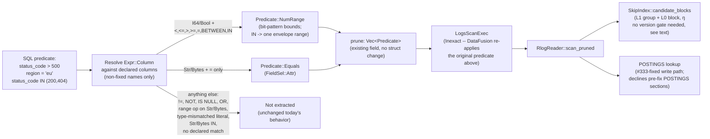

# ADR-0093: skip-index and postings pushdown for declared typed logs columns

Status: Accepted (2026-10-14).
Implemented: the declared-column resolver and extractors in
`crates/ravel-sql/src/logs_pushdown.rs`.

## Context

RLOG persists two pruning primitives that the SQL pushdown path never
reaches for typed predicates. The skip index carries per-block `NumStat`
min/max for I64/F64/Bool dynamic columns (`crates/ravel-logseg/src/
block.rs`), and `SkipIndex::candidate_blocks` already consumes a
`Predicate::NumRange` arm at both L1 group and L0 block level
(`crates/ravel-logseg/src/skip_index.rs:268-307`) — landed by #331
(PR #380). POSTINGS indexes operator-selected fields (any attribute
type, not only strings) for exact equality, and `attrs['k'] = 'v'`
pushdown against it already ships,
including the fix for a correctness bug in its write path (#333, commit
`87240232`: `merged_indexed_terms` now folds duplicate-key occurrences in
the same order the read side's merged view does).

Neither primitive is reachable from a query written against a **declared**
column the way ADR-0090/ADR-0100 actually shipped declared columns: as a
plain Arrow column, queried as `status_code = 500`, not as
`attrs['status_code'] = 500`. `crates/ravel-sql/src/logs_pushdown.rs`'s
`handle_binary` recognizes exactly three shapes today — `ts` comparisons
(`ts_comparison`, ~line 216), `has_word` (`has_word_predicate`, ~line 309),
and `attrs['k'] = 'v'` equality (`attr_equality_predicate`, ~line 181,
gated by `attr_subscript_key` at ~line 201 checking `Expr::Column(c) if
c.name == "attrs"`). **No extractor recognizes a plain `Expr::Column`
matching a declared column's name**, for either a range comparison or an
equality. `status_code = 500` and `status_code > 500` both scan and
decode every block today regardless of what the skip index or POSTINGS
could tell the planner.

Both gaps share an identical first step — resolve a bare `Expr::Column`
reference against the tenant's declared-column vocabulary
(`crates/ravel-sql/src/declared.rs`) — but they are not one mechanism past
that point: they dispatch to two different reader-side primitives, each
with its own soundness basis and its own version story (see the soundness
section below). This ADR is one shared resolver feeding two existing,
independently-proven prune primitives, not a single unified mechanism.
`DeclaredType` is exactly four variants today (`Str`, `I64`, `Bool`,
`Bytes` — `declared.rs:41-54`; F64 is ADR-0101-Accepted but has no landed
code yet, `git log` shows only doc commits for it; date/timestamp is
fully deferred with no ADR). This ADR scopes to what the declared-column
vocabulary can actually carry today: `I64` and `Bool` route to
`Predicate::NumRange`, `Str` (and `Bytes`, where POSTINGS already indexes
it) route to `Predicate::Equals`. F64 and date/timestamp pushdown follow
automatically, with zero new pushdown-side work, once their own
declared-column plumbing lands — this ADR does not block on either.

**Extraction is an allowlist, not a best-effort translation.** The
resolver only ever recognizes a fixed set of shapes (enumerated in the
Decision section below); every other shape — negation (`!=`, `NOT`, a
negated `BETWEEN`), `IS [NOT] NULL`, `OR` disjunctions, a range operator on
a resolved `Str`/`Bytes` column, or a cast-wrapped operand — is not
extracted and contributes nothing to the prune channel, exactly as if the
column were undeclared. This mirrors the existing `attrs[...]` extractor's
own behavior (it already declines everything outside its three recognized
shapes) and is the safe default for a prune-only, widen-never mechanism:
declining to prune is always sound, inventing an unsound negation is not.

`Bool` needs no separate machinery: `bool_stat` (`block.rs`) stores its
min/max as `0u64`/`1u64`, the identical shape `i64_stat` uses, and
`stat_disjoint` is generic over `NumStat`'s type tag. `col = true`
degenerates to `Predicate::NumRange { field, ty: FieldType::Bool, min:
Some(1), max: Some(1) }` and `col = false` to `min: Some(0), max: Some(0)`
— the same extraction code path as an I64 equality with a boolean-to-bit
literal mapping. This does NOT extend to `col != true`: `NumRange` is a
single contiguous inclusive range and cannot express "not equal to X" as
a widen-only predicate for I64 (the complement of a point is disjoint).
Bool's complement happens to coincide with the other single point, but
special-casing that coincidence would invite the same trick for I64,
where it is unsound. Per the allowlist rule above, `!=` and `NOT`-wrapped
predicates on any declared column are simply not extracted, for both Bool
and I64 alike.

### The soundness basis differs by half; this ADR reuses both, unmodified

**NumRange half.** `skip_index.rs` (~lines 204-208): "An arm whose column
has no stat in `stats` proves nothing and is skipped: absence is 'no
information', never 'no match' (ADR-0013)... Pruning on an absent stat
would silently drop correct results, so this degrade-safe fallthrough is
unconditional." Mutation-tested in both directions by PR #380, applied at
both L1 group and L0 block level unconditionally — there is no version
gate on the NumRange consumption path (`numeric_range_arms` →
`SkipIndex::candidate_blocks`, called unconditionally from
`scan_pruned`). It needs none: since ADR-0095's RLOG v3, `NumStat` folds
each row's fully-resolved merged-view value (block.rs, ADR-0095), and
ADR-0095 deleted v2 read support outright ("every existing RLOG object
becomes unreadable the moment this ships"), so every object this reader
can open has merged-view-correct stats already. Absence of a stat (a
column never declared for that tenant at write time, or an old object
predating the column's declaration) falls through under the rule above.

**POSTINGS-equality half.** Reuses `Predicate::Equals` against POSTINGS
verbatim (same as the already-shipped `attrs['k']='v'` path), and
inherits POSTINGS' own, separate version gate: a section whose POSTINGS
version predates the #333 fix declines **all** equality pruning
unconditionally, both content and prune channels (`scan_blocks`'s version
check, ~reader.rs:281-296, regression-tested at ~reader.rs:2288 by
`version_1_object_with_cross_type_duplicate_declines_to_prune`), because
that section cannot prove its per-record duplicate-key index is complete.
Any equality predicate this ADR adds inherits that decline automatically
— it is enforced at the POSTINGS-section-version level, not per-predicate-
type, so no new code carries it. This decline is orthogonal to the
NumRange half's story above: they gate on different axes (POSTINGS
section version vs. nothing, because RLOG's own single-version regime
already guarantees it), and a query mixing both predicate types can prune
on one half while declining the other for the same object.

**A note on where the resolver may NOT look.** The resolver must not
shadow the fixed logs schema: `declared.rs` has no reserved-name check,
and ADR-0090 specifies a declared column's SQL name is used verbatim,
never mangled, so a tenant could in principle declare a column literally
named `ts`. Resolving a bare `Expr::Column` against declared names must
run only for names outside the nine fixed logs columns (`ts`, `attrs`,
and the rest) — the existing `ts_comparison`/fixed-column handling always
wins for a fixed name, declared resolution only applies to a name that
isn't one of them. This is not a new invariant this ADR invents; it is
the order the existing `handle_binary` chain must preserve so this ADR's
addition cannot regress the already-shipped, most-common `TsRange`
pushdown. (A declared key literally colliding with a fixed schema name
would already be a schema-construction problem in `logs_schema_with_
declared` today, independent of this ADR; that gap is out of this ADR's
scope and is reported, not fixed, here.)

### Precedent: pushdown stays Inexact, DataFusion's residual is the correctness backstop

`logs_scan.rs` (~lines 147-155): "Pushdown is always `Inexact`, so
DataFusion re-applies the *original* predicate against the emitted batch.
`build_batch` populates the `attrs` column from the fully merged view
(ADR-0033 amendment), so the residual evaluates `attrs['k'] = 'v'` against
exactly the data a row's SQL semantics demand... The merged column and the
residual are the whole correctness story." Both new extraction shapes stay
`Inexact` for the same reason: pruning underneath the residual, never a
substitute for it. This precedent covers the prune arms this ADR builds; a
declared Str column's `<>` against a literal is now evaluated exactly in
the scan and reported `Exact` (see the exact not-equal amendment below).

## Decision

Add one shared resolver to `logs_pushdown.rs`, feeding two existing,
separately-sound prune primitives.

1. **Resolve a plain `Expr::Column` against the tenant's declared
   columns**, but only for a name that is not one of the nine fixed logs
   columns (`ts`, `attrs`, and the rest) — a fixed-column name always
   takes the existing `ts_comparison`/fixed-column path first, regardless
   of whether a tenant also happens to have declared a column of the same
   name. For a non-fixed name: a match against a declared column
   (`crates/ravel-sql/src/declared.rs`'s resolution, already used
   elsewhere in this crate for declared-column projection) resolves to
   its `DeclaredType`; no match falls through unchanged to today's
   behavior (scanned, not pruned, exactly as now — this ADR only adds
   pruning opportunities, removes none).
2. **Extraction is an explicit allowlist of (type, operator, operand)
   shapes; every shape not listed here declines extraction:**
   - `I64`/`Bool` + one of `<`, `<=`, `>`, `>=`, `=`, or `BETWEEN`, against
     a literal whose `ScalarValue` type exactly matches the resolved
     `DeclaredType` (an I64 column against an integer literal, a Bool
     column against a boolean literal) → build a `Predicate::NumRange
     { field, ty, min, max }` (the actual variant shape,
     `crates/ravel-logseg/src/record.rs`; not a `min_bits`/`max_bits`
     pair — those names belong to the separate `NumStat`/`NumRangeArm`
     types) using the same bit-pattern encoding `NumStat` already uses
     (two's-complement u64 for I64, 0/1 for Bool; F64's `to_bits` encoding
     is not reachable yet per the F64 scoping above). Honor the
     `NumRange` variant's own doc-comment contract exactly (record.rs,
     ~lines 267-291): a range that should include zero must be widened to
     cover both `0.0`/`-0.0` bit patterns explicitly, and a bound must
     never be constructed from a NaN literal.
   - `I64` + `IN (v1, v2, ...)` → build ONE envelope `NumRange { field,
     ty: I64, min: Some(bits(min(v1,v2,...))), max:
     Some(bits(max(v1,v2,...))) }` — a single contiguous range spanning
     the literal set, not one range per value. This is deliberately
     coarser than an exact per-value prune (it also "matches" every value
     strictly between the given ones), but it is prune-safe: a wider
     range can only fail to prune a block the exact set would also have
     kept, never prune one it shouldn't. `Predicate` has no disjunction
     arm (`Predicate::And` exists, no `Or`), and `numeric_prunes` treats
     multiple arms as an intersection, so one range-per-value would be
     unsound here — an arm covering only one of several IN values would
     independently prove some blocks disjoint that the full disjunction
     does not exclude, silently dropping matching rows. See rejected
     alternative 5 for the disjunctive-prune shape this envelope
     approach deliberately avoids building.
   - `Str`/`Bytes` + `=`, against a matching-type literal →
     `Predicate::Equals { field: FieldSel::Attr(name), value }` —
     byte-identical to what `attr_equality_predicate` already builds for
     the `attrs['k'] = 'v'` shape; a second SQL-expression shape
     producing the same predicate value, not new POSTINGS-side machinery.
   - `Str`/`Bytes` + `IN (...)` → **not extracted**, matching the existing
     `attrs['k'] IN (...)` behavior exactly (logs_pushdown.rs's own module
     doc: "an IN list is a disjunction, and the prune channel intersects
     its arms, so a sound disjunctive prune needs a different shape... it
     contributes nothing to either channel"). POSTINGS has no sound
     disjunctive-equality prune shape today; do not invent one under this
     ADR's scope.
   - Any other combination — `!=`, `NOT`, a negated `BETWEEN`, `IS [NOT]
     NULL`, an `OR` disjunction, a range operator (`<`, `>`, etc.) on a
     resolved `Str`/`Bytes` column, or a literal whose type does not
     exactly match the resolved `DeclaredType` (including any
     `Cast`-wrapped operand DataFusion's own type coercion may have
     already inserted, e.g. rewriting `i64_col > 3.14` to compare against
     a cast column) — is **not extracted**. Never coerce a mismatched
     literal to fit; decline instead. `<>` on a declared `Str` column
     against a string literal still produces no prune arm, but is
     evaluated exactly in the scan (see the exact not-equal amendment
     below).
3. **Wire the produced predicate into the existing `prune: Vec<Predicate>`
   field** on whatever pushdown-result struct `logs_pushdown.rs` already
   builds (no struct change: it is already typed to hold arbitrary
   `Predicate` values). `SkipIndex::candidate_blocks` already consumes
   `NumRange` arms from wave #331 via `RlogReader::scan_pruned`'s existing
   resolution path; no reader-side change is needed for the range half.
4. **Regression tests**: a selective numeric/bool predicate on a declared
   column must reduce `blocks_scanned` (`SqlStats` already surfaces the
   counter, per #331's own test pattern); a selective declared-Str
   equality must reduce `blocks_pruned` via POSTINGS the same way the
   existing `attrs['k']='v'` test does; a differential test with pruning
   disabled proving identical results; a predicate whose declared column
   is absent from some objects (a tenant that added the column later)
   must still return correct results, exercising the existing absence
   rule against the NEW extraction path specifically (the rule itself is
   proven, the new call site into it is not); a declared-column `IN`
   predicate over I64 must return correct results across the envelope
   range's necessarily-coarser pruning (values strictly between the IN
   set's min and max, absent from the set, must still be excluded by the
   Inexact residual, not by pruning); `!=`/`NOT`-wrapped predicates on a
   declared column must produce no prune arm at all; a mismatched-type
   comparison (e.g. a float literal against a declared I64 column) must
   produce no prune arm; **the extraction assertions must run against a
   fully planned/optimized `LogicalPlan`** (not a hand-built `Expr`), so
   that a type-coercion rewrite silently turning a target shape into an
   unrecognized `Cast`-wrapped one is caught rather than masked by a test
   that only ever exercises the pre-optimization shape.

### Data flow

### Explicitly out of scope

- **F64 declared-column pushdown.** ADR-0101 is Accepted but unimplemented
  (`declared.rs`'s `DeclaredType` has no F64 variant yet). This ADR's
  `NumRange` extraction dispatches on `DeclaredType`, so F64 support is a
  one-variant addition to the same `match` once ADR-0101 lands code — not
  a reason to block this ADR on that landing.
- **Date/timestamp declared columns.** No declared-column type exists for
  them yet; fully deferred, no ADR filed. Same non-blocking relationship:
  whichever future ADR adds the type, this mechanism's dispatch extends to
  it without new pushdown-side design.
- **Wave #331's own scope** (the `NumRange` predicate type, its bit-pattern
  encoding, `SkipIndex::candidate_blocks`'s L1/L0 consumption, the
  absence-is-no-information rule) — already landed, reused verbatim, not
  re-litigated here.
- **#362's remaining scope** (LIMIT pushdown as a fetch-stop hint) —
  independent, unrelated mechanism, tracked separately.

## Rejected alternatives

1. **A second, parallel extractor for declared-column predicates,
   separate from the existing `attrs[...]`/`ts` extractors.** Rejected:
   the resolve-then-dispatch shape this ADR proposes is one small addition
   to the existing `handle_binary`/`handle_leaf` chain, sharing its
   `IN`-unioning and residual-Inexact discipline. A parallel extractor
   would duplicate both, and two `IN`-handling implementations invites
   exactly the kind of drift the object-store-contract's checksum
   discipline in this repo exists to prevent elsewhere.
2. **Making the new pushdown Exact instead of Inexact**, since a declared
   column's projected value is deterministic and doesn't need DataFusion's
   residual re-check the way the merged `attrs` column's ADR-0033
   semantics do. Rejected outright, not on cost grounds: both `NumRange`
   and the reused `Equals` are prune-only, block-level arms by
   construction (`NumRange`'s own doc comment: "never an exact per-row
   filter"). Classifying either as Exact would tell DataFusion to skip
   re-evaluating the predicate against surviving rows, so any
   non-matching row inside a block that merely wasn't pruned (the
   ordinary, expected case for a coarse block-level bound) would stream
   to the client unfiltered — wrong query results, not a hygiene
   trade-off. The reason holds for the prune arms; it does not cover an
   evaluator that runs per row on the built column, which the exact
   not-equal amendment below adds for a declared Str `<>`.
3. **Blocking this ADR on ADR-0101's F64 code landing**, to ship numeric
   pushdown for all three numeric-capable declared types at once.
   Rejected: I64 and Bool cover real, already-declarable tenant columns
   today (status codes, flags, small integer enums — exactly ClickBench's
   own `hits` mapping shape), and gating a shipped correctness/performance
   win on an unrelated epic's implementation timeline serves no one.
4. **Extending `Predicate::NumRange` itself to carry a new range-of-strings
   or prefix-match shape for declared Str columns**, to prune more than
   equality (e.g., `status_message > 'a'` lexicographic ranges). Rejected
   as unscoped: POSTINGS is an equality index, not an ordered index; a
   lexicographic range predicate would need its own format-level index
   (a sorted term dictionary or similar), which is new frozen-format
   surface this ADR does not open. Equality-only for Str is the honest
   scope of what POSTINGS already supports.
5. **Adding a disjunctive prune shape (a `Predicate::Or`, or a
   multi-range `NumRange` variant) to prune `IN` exactly**, for both the
   numeric and string halves. Rejected for this ADR: `numeric_prunes`'
   intersection-of-arms design and POSTINGS' single-term lookup both
   assume conjunctive composition throughout the reader; a disjunction
   arm is a real, independently-reviewable design question (does it
   compose with the existing L1/L0 traversal? does POSTINGS need a
   multi-term lookup path?) that deserves its own ADR rather than riding
   in as a side effect of wiring declared columns. This ADR's envelope-
   range approach for numeric `IN` gets a real, if coarser, pruning
   benefit today without opening that surface; Str/Bytes `IN` stays
   unextracted until a disjunctive-prune ADR lands.
6. **Also routing `I64`/`Bool` equality through POSTINGS** (in addition to
   `NumRange`), since `term_key` (`postings.rs`) covers I64/F64/Bool/Bytes
   bit-exactly and `prune_postings_arms` already resolves a non-Str
   `Equals` arm via `field_dir.column(name, ty)` with no Str-style
   cross-type decline — an exact-term POSTINGS lookup is strictly more
   selective than a NumRange min/max point for a single-value equality.
   Deferred, not rejected: the two arms are both widen-only and safe to
   combine (they would intersect, only ever pruning more), so this is a
   real, additive follow-up once this ADR's `NumRange` path has landed
   and been measured — but it doubles the number of prune arms an
   equality predicate produces for no benefit until measurement shows the
   NumRange point-range is leaving real selectivity on the table, so it
   is out of this ADR's initial scope.

## Consequences

- `status_code = 500`, `status_code > 500`, `region = 'eu'`, and
  `is_active = true`-shaped predicates on declared columns prune blocks
  before decode for the first time, using entirely already-landed reader-
  side machinery (#331, #333) — this ADR is planner-side wiring only, no
  frozen-format change, no version bump.
- The dispatch-on-`DeclaredType` shape means F64 and future date/timestamp
  declared columns inherit pushdown automatically once their own
  declared-column plumbing lands, at the cost of one `match` arm each —
  no future ADR needs to redesign the extraction mechanism.
- A tenant reading a section written before the #333 POSTINGS fix sees no
  pruning benefit from the new equality path on that specific section —
  an existing, already-tested decline (gated on POSTINGS section version,
  not on RLOG's own trailer version) — while the NumRange half is
  unaffected, since it carries no version gate and needs none under
  ADR-0095's single-version regime. Both halves stay sound either way;
  operators simply see the equality half's pruning benefit arrive only
  for sections written under the fixed POSTINGS writer.
- The Str-equality half also inherits an existing, over-conservative
  decline from the already-shipped `attrs['k']='v'` path: a name that
  also carries a non-Str-typed column anywhere in the tenant's data
  declines pruning entirely for that name, even though a declared Str
  column can only ever match a Str-typed merged winner. This is a
  performance no-op on such names, not a soundness gap, and is
  unchanged by this ADR.
- No change to `NumRange`'s bit-pattern contract, `candidate_blocks`'s
  soundness argument, or POSTINGS' write path: this ADR is the first real
  caller of primitives #331 and #333 already proved correct in isolation,
  and inherits their proofs rather than re-deriving them.
- Since the exact not-equal amendment, a declared Str `<>` against a
  literal has no `FilterExec` above the scan; every other shape here is
  unchanged.

## Amendment (2026-11-05): a declared Str column's `<>` against a literal is evaluated exactly in the scan

<!-- amendment-applies: sections="Precedent: pushdown stays Inexact, DataFusion's residual is the correctness backstop|Decision|Rejected alternatives|Consequences" pointer="exact not-equal amendment" -->

Status: Accepted (2026-11-05). Not yet implemented; the pull requests below
carry it.

### Evidence

The evidence is the fresh profile on `main` 5a71c86b3, run `profvm-20261105T0851Z`, with an 8 GB
decoded cache, entry 637aaa80a. It is #3231 comment 6655737907.

- Hot sum: 32.29 s. In it, `merge_dictionary_values` and `concat_dictionaries`, inclusive and
  weighted by hot wall, take 0.602 s.
- That time is inside the batch coalescer of the `FilterExec` that sits above `LogsScanExec`
  (`finish_buffered_batch`, 0.643 s). On q13 to q15 it is almost all of that FilterExec's cost:
  0.085 s of 0.095 s, 0.085 s of 0.113 s and 0.093 s of 0.124 s.
- Statement numbers are 1-based, as in `ravel/queries.sql` and the profile.

Why the merge happens:

1. **The conjunct is not pushed.** `"SearchPhrase" <> ''` and the other `<> ''` conjuncts are not
   pushed at all. This ADR's decision 2 does not extract `!=`, and `str_eq_value` returns `None`
   for any operator but `=` (`crates/ravel-sql/src/logs_pushdown.rs:735-738`). So the provider
   reports the filter `Inexact` as an unrecognized shape
   (`crates/ravel-sql/src/logs_provider.rs:445-466`), and DataFusion keeps a `FilterExec` above
   the scan.
2. **The FilterExec always coalesces.** In DataFusion 55.2, `FilterExec` wraps its output in a
   `LimitedBatchCoalescer` (datafusion-physical-plan 55.2.0 `filter.rs:615-619`). The coalescer
   concatenates the filtered batches.
3. **The concat merges dictionaries.** arrow-select 59.3.0 merges the dictionaries of a concat
   when their values arrays differ and the total values reach the output length
   (`dictionary.rs:214-219`, called from `concat.rs:110-114` with no mask).
4. **The memo values make that always true.** A block served from the decoded cache emits its
   declared Str column as identity keys over the entry's memo array (ADR-3326, zero-copy values
   amendment, decision 2). A plain-page memo array holds one value per row of its block. Any two
   filtered blocks therefore have more values than surviving rows, and every concat interns
   every value of every block it joins.

### What changes

1. **Scope.** A top-level conjunct `c <> v` (either operand order) is evaluated exactly inside the
   logs scan, and the provider reports it `Exact`, when all of these hold:
   - `c` is a bare `Expr::Column` that resolves to a declared column of type `Str` (this ADR's
     decision 1, fixed names excluded);
   - `v` is a non-NULL string literal: `Utf8`, `Utf8View`, or the `Dictionary(Int32, Utf8)`
     scalar that type coercion produces;
   - the provider is not acting as a distributed coordinator. That path stays blanket `Inexact`
     (`logs_provider.rs:451-456`).

   The literal is any string, not only `''`. The exactness argument below does not depend on its
   value, and narrowing it to `''` would add a special case with no gain in safety. This holds on
   every storage shape of the column (plain pages, dictionary pages, dictionary values of the
   `Text`, `Mixed` or `Raw` regions, served or decoded, record cell or resource/scope fallback),
   because the scan evaluates the column it has already built, not the stored pages.

2. **Where the scan evaluates it.** The scan evaluates the conjunct on the Arrow batch it has built
   for a block, after the column build and before it emits or charges the batch. It does not
   evaluate it in the reader.
   - The evaluator is DataFusion's own physical expression for the conjunct, created by the
     session against the scan's build schema.
   - It is applied with `filter_record_batch`, the call `FilterExec` makes, which treats a NULL
     verdict as false.
   - The reader's surviving-row list, its arms, and its counters do not change.

3. **A channel of its own.** The conjunct goes to a new `LogsPushdown` field, here called
   `row_filters`. It does not go to `prune`, `content` or `key_equals`.
   - `content` is the reader's per-row channel, and the reader cannot see the merged value (see
     the exactness argument).
   - `prune` and `key_equals` are block-only.
   - The shape still produces no prune arm and no key, as today
     (`not_equal_on_declared_i64_is_the_only_negation_prune_arm`,
     `logs_pushdown.rs:1428-1430`).

4. **What the scan must do once the filter is deleted.**
   - **Build the filter column.** The scan builds the conjunct's column even when the output
     projection does not name it, and drops it before emission. DataFusion no longer folds
     filter-only columns into the scan projection once the filter is `Exact`. q31 and q32 use
     `SearchPhrase` only in `WHERE`. Phase 1 of TopK late materialization (ADR-0774) projects only
     `ts` and the row ref for q25 and q27.
   - **Every emission path.** It applies the filter on the columnar path
     (`build_columnar_batches`, then `hold_batches`) and on the row path (`emit_next_row_batch`),
     and on every rebuilt scan: `LogsScanExec::reproject`, `reproject_attr_keys` (which the
     `AttrsPerKeyProjection` rule calls, `crates/ravel-sql/src/logs_scan/mod.rs:1836-1869`) and
     `sibling`. `sibling` is an exhaustive struct literal, so the compiler catches a missing field
     there; `reproject` and `reproject_attr_keys` rebuild through `Self::build` and a builder
     chain, so the channel is threaded through `Self::build`'s signature, which makes the compiler
     catch both of them as well.
   - **Row refs.** In phase 1 of late materialization, the row-ref column is built with the batch
     and filtered with it, so each kept row keeps its own reference.
     - Phase 2 (`fetch_block`, `crates/ravel-sql/src/logs_scan/mod.rs:2859-2870`) resolves rows
       by position in the reader's surviving-row list. That list is rebuilt from `content` and
       `prune` only (`query()`, `:2838-2847`).
     - So phase 2 does not apply `row_filters`, and nothing may recompute a reference after the
       filter.
   - **Fetch.** It counts a pushed `fetch` in rows after the filter. An `Exact` conjunct lets
     `LimitPushdown` put a fetch on the scan for `WHERE ... LIMIT n` with no `ORDER BY`, which
     cannot happen today.
   - **Exact statistics.** `stats_are_exact` and `metadata_rewrite_stats_are_exact`
     (`crates/ravel-sql/src/logs_scan/mod.rs:2257-2276`) return false whenever `row_filters` is
     non-empty. Their doc's list of `LogsPushdown` fields gains the sixth.
     - `stats_are_exact` also gates the exact row count, the `ts` extrema, and the declared
       columns' exact min/max (`mod.rs:3112`).
     - So one check covers `COUNT(*)`, `MIN` and `MAX` through `AggregateStatistics`.
   - **Counter and EXPLAIN.** It reports the rows it dropped in a new partition counter,
     `rows_dropped_by_row_filter`, and shows the conjuncts in the scan's EXPLAIN line.

5. **Which statements change plan.** Only those whose every conjunct is now `Exact` lose the
   `FilterExec`:
   - q11 and q12 (`MobilePhoneModel <> ''`);
   - q13 to q15 and q25 to q27 (`SearchPhrase <> ''`);
   - q28 (`URL <> ''`) and q29 (`Referer <> ''`);
   - q31 and q32 (`SearchPhrase <> ''`, with no Str column in the output).

   q22 and q23 keep a `FilterExec` for their `LIKE` conjuncts. q37 and q38 keep one for their
   integer conjuncts. In those four, the `<>` conjunct moves into the scan, and the FilterExec
   still coalesces and merges.

### Why the evaluator sits after the build, not in the reader

A reader arm in `block_survivors` would have to agree with `FilterExec` on every row, and it does
not see the value `FilterExec` sees. For a declared Str column the SQL value of a row is:

- the record's `Str` cell when it is present, UTF-8 and the winning occurrence;
- NULL when the winning occurrence has another type (ADR-0090 decision 7);
- otherwise the stream's resource or scope `Str` value;
- otherwise NULL.

A block with an `attrs_raw` page resolves through the row path
(`crates/ravel-sql/src/logs_scan/batch.rs:1731-1758`; `scan.rs:721`). The reader's `Equals` reads
the record column only (`logs_pushdown.rs:65-79`). `Contains` keeps every row it cannot decide
(`crates/ravel-logseg/src/record.rs:530-533`), and that is why LIKE is `Inexact`. An exact reader
arm would reimplement the resolver that `build_str_block` already is.

A reader arm also narrows the block. Both zero-copy paths require `surviving == record_count`
(`batch.rs:353`, `:381`), so a narrowed plain block would copy its survivors into new values
(`block_values`, `batch.rs:907-925`). That is the copy ADR-3326's zero-copy values amendment
removed from these statements.

### The exactness argument

Today `FilterExec` computes `filter_record_batch(B, E(B))`, where:

- `B` is the batch `LogsScanExec` emits;
- `E` is DataFusion's physical expression for the conjunct.

After this amendment the scan computes the same thing, on a batch `B+` that holds every column
`B` holds plus the conjunct's column. It then projects to the output schema. The two agree on
every row when all of these hold:

1. **Same expression.** `E` is built by the same session planner from the same logical `Expr`.
   The scan does not re-derive comparison or NULL semantics.
2. **Same values.** The conjunct's column in `B+` is the column `FilterExec` reads today, built by
   the same code (`build_str_block` on the columnar path, `build_batch` on the row path).
   - Adding a declared column to the build projection does not change which path a block takes:
     only `attrs` in the projection, a pending erasure, or an `attrs_raw` page decide that
     (`mod.rs:742-744`, `scan.rs:721`).
   - It does not change any other column's values, because each declared column is built from
     its own cursor.
3. **Every row passes through it.** Both emission paths and every rebuilt scan (`reproject`,
   `reproject_attr_keys`, `sibling`) apply the filter. No path emits a batch without it.
4. **Nothing downstream assumes the scan is unfiltered.** The statistics gates (decision 4), the
   metadata rewrite gate, and the fetch count all see the channel.
   - `logs_scan_residual` drops every conjunct that `filter_is_exact` accepts
     (`crates/ravel-sql/src/metadata_agg.rs:474-484`).
   - So the SUM/AVG and q08 shapes are admitted logically with an empty residual, and only the
     physical gate refuses them.
5. **DataFusion deletes only what was reported `Exact`.** A compound conjunct that is recognized
   only in part stays `Inexact`, as today (`partially_recognized_compound_filters_are_inexact`,
   `logs_provider.rs:2629`).

SQL three-valued logic follows from point 1. `NULL <> v` is NULL and is dropped. That covers:

- an absent attribute with no fallback;
- a winner of another type;
- a non-UTF-8 cell with no fallback.

A row with no record cell whose fallback differs from `v` is kept.

### What changes for the decoded cache and the memo

Nothing in ADR-3326 changes:

- **Reader and admission.** The reader does not narrow the block. So no column is deferred,
  served-column and admission rules are unchanged, and the serve-if-fits verdict applies only to
  `Contains` scans as before.
- **Memo fast paths.** `plain_memo` and `dict_memo_keys` still fire, because the reader's
  `surviving == record_count` still holds.
- **Values sharing.** Arrow's `filter` on a `DictionaryArray` filters the keys and keeps the
  values `ArrayRef`. So the emitted column shares the memo array as an unfiltered batch does,
  and `StrValuesCache`'s `ptr_eq` and `held` checks see one array per scan (zero-copy values
  amendment, decision 1, "One `ArrayRef` per scan"). This is inference until test T8 pins it.
- **Lifetime.** A narrowed batch keeps its whole block's memo values referenced for as long as a
  downstream operator holds it. That is the same as an unfiltered batch: the pressure pass sees
  `held_outside` true for that time. TopK holds at most the batches its k rows point into.

### What stays Inexact, and why

- **`=` on a declared Str or Bytes column.** It already emits a prune `Equals` and a KEY_IDX key,
  and `leaf_is_exact` returns false whenever either is present (`logs_pushdown.rs:332-334`).
  The same evaluator would make it exact, but no profiled statement has the shape. A follow-up
  amendment can take it with its own evidence.
- **`<>` on a declared Bytes column.** Same reason: no profiled statement has it.
- **I64 and Bool comparisons** (`"CounterID" = 62` and the rest of q37 to q43). They stay on the
  prune channel as decision 2 of this ADR describes. `prune_channel_filters_stay_inexact` pins
  them (`logs_provider.rs:2600-2617`). The profile's shares for q37 to q40 rest on 11, 2, 0 and
  50 samples, which is noise. The mechanism extends to them, but that needs a measured reason.
- **`LIKE` and `NOT LIKE`** (ADR-2773, contains-arm amendment). Unchanged.
- **`attrs['k'] <> 'v'`, `NOT (c = v)`, `c <> NULL`, a `Cast`-wrapped column, a column inside an
  expression, `c <> other_column`, and any `OR`.** They are not the shape in decision 1.
- **A distributed coordinator.** Its workers receive no filter.

### Pull requests

One behaviour change per pull request. All of them are in `crates/ravel-sql`. The gate is
`scripts/gates.sh -p ravel-sql`, which also runs the `sql`, `flight-sql`, `esql` and ravel-bench
lanes.

1. **The scan narrows its own output by a pushed Str `<>` conjunct.**
   - Adds the `row_filters` channel and its extraction, the physical-expression build in
     `LogsTableProvider::scan`, the filter column in the build projection, the filter on both
     emission paths and in `reproject`, `reproject_attr_keys` and `sibling`, the post-filter
     fetch count, the two statistics gates, the counter and the EXPLAIN field.
   - The provider still reports the conjunct `Inexact`, so the `FilterExec` stays above the scan.
     It cannot put back a row the scan wrongly drops. So answers change in this PR only if the
     scan drops a row the `FilterExec` would keep. T2 pins that, against a reference with no
     in-scan filter.
   - Tests T2, T3 (exec level), T5 (exec level), T7 and T8.
   - Observable change: `rows_dropped_by_row_filter` is non-zero, and the `FilterExec` above drops
     zero rows. Both evaluators run on the affected statements until PR 2 lands, so a timing run
     between the two pull requests reads the conjunct's per-row cost twice and is not a
     regression signal.
2. **The provider reports the conjunct `Exact`, and DataFusion deletes the filter.**
   - `leaf_is_exact` recognizes the decision 1 shape.
   - The same commit updates the prose that states the old rule:
     - docs/query-engine.md:164-186 and :4874-4884;
     - the `supports_filters_pushdown` doc (`logs_provider.rs:418-443`);
     - the `logs_pushdown` module doc (`:1-8`);
     - the scan's correctness doc (`logs_scan/mod.rs:318-323`).
   - Tests T1, T3 (SQL), T4, T5 (SQL), T6 and T9.
   - `str_typed_column_declines_and_keeps_the_scan`
     (`crates/ravel-sql/tests/logs_metadata_agg.rs:733`) keeps passing for another reason once the
     conjunct is `Exact`: with no `FilterExec`, `rewrite` declines at its missing-filter check
     (`crates/ravel-sql/src/metadata_agg.rs:675-677`) before it reaches the `DeclaredType::Str`
     gate (`logs_scan/mod.rs:2454`). This PR rewrites its comment, adds an answer assertion, and
     keeps a direct pin of the Str gate: a case whose filter is not the exact shape, or a
     unit-level call.
   - Before this PR, read `plan_aggregate_profile` (`crates/ravel-sql/src/memory.rs:726`). It is
     behind the layout pinned for the q14 statement at `crates/ravel-sql/src/executor.rs:10419-10423`,
     and it is not established whether it reads through the FilterExec.
3. **The paired run.** No code. Pre-register the bands below on #3231 before the run. Run one
   paired `cpuab` run: A is `main` at PR 2's merge base, B is PR 2's merge commit, with an 8 GB
   decoded cache, entry 637aaa80a, and the same box. Record the result as an amendment of its
   own.

### Tests and the wrong implementations each must catch

Every test in this list must be shown failing against each wrong implementation named under it
before the pull request merges.

- **T1, classification** (`logs_pushdown` and `logs_provider` units, plus a planned and optimized
  SQL statement, per this ADR's decision 4 rule on optimized plans).
  - Accepts `s <> 'x'` and `'x' <> s` with the literal as `Utf8`, `Utf8View` and the
    `Dictionary(Int32, Utf8)` scalar, alone and AND-ed with a `ts` bound.
  - Rejects `body <> 'x'`, `attrs['k'] <> 'v'`, an undeclared name, a declared Bytes or I64
    column, `NOT (s = 'x')`, `s <> NULL`, `CAST(s AS ...) <> 'x'`, `lower(s) <> 'x'`, `s <> t`,
    an `OR`, and `s <> 'x' AND s LIKE '%y%'` as one unsplit expression.
  - Wrong implementations:
    - (a) matching any `NotEq` with a column on one side, which accepts `body` and `attrs['k']`;
    - (b) resolving the name without the fixed-column guard, which accepts `body` for a tenant
      that also declares `body`;
    - (c) testing the shape before the `prune`/`key_equals` early return, which accepts the I64
      `NumNotEq` shape.
- **T2, answers across value shapes** (`ravel-sql` integration test, real RLOG objects).
  - The fixture has rows with: `''`; a non-empty value; no attribute and no fallback; no
    attribute with resource value `'r'`; no attribute with resource value `''`; an I64 cell
    for the key; a non-UTF-8 cell with fallback `'f'`; duplicate occurrences of the key.
  - The rows are spread over a plain-page block, a dictionary-page block, and a block with an
    `attrs_raw` page. They run once with `attrs` projected and once without.
  - The answer must equal the reference answer. The reference is the same statement on a scan
    with `row_filters` empty, so DataFusion's `FilterExec` is the only evaluator. That holds in
    PR 1 and PR 2, and PR 1's plan, with both evaluators, would not serve as a reference.
  - Wrong implementations:
    - (a) a kernel that reads raw key values and ignores the null buffer. `push_key` writes key 0
      under a NULL (`batch.rs:1888-1891`), so a NULL row reads entry 0's verdict and is kept;
    - (b) a record-cell-only test in the reader, shaped like `column_eq_arm`, which drops the
      `'r'` fallback row;
    - (c) a filter on the columnar path only, which leaks the `''` row of the `attrs_raw` block;
    - (d) a `Contains`-style keep-when-undecided rule, which keeps the I64-winner row.
- **T3, the filter column is not projected.**
  - Run `SELECT "SearchEngineID", COUNT(*) ... WHERE "SearchPhrase" <> '' GROUP BY 1` (the q31
    shape), `SELECT COUNT(*) ... WHERE s <> ''`, and the late-materialized
    `SELECT s FROM logs WHERE s <> '' ORDER BY ts LIMIT 3`, where the `''` rows have the earliest
    timestamps, and the attrs-per-key shape `SELECT attrs['k'] FROM logs WHERE s <> ''`, which
    plans through `AttrsPerKeyProjection` and `reproject_attr_keys`.
  - Wrong implementations:
    - (a) evaluating only when the column is in the output projection, which counts every row;
    - (b) a `reproject` sibling that drops `row_filters`, so phase 1 picks the `''` rows and the
      statement returns empty strings;
    - (b2) a `reproject_attr_keys` rebuild that drops `row_filters`, so the attrs-per-key
      statement returns the `''` rows;
    - (c) a column-index mapping that is off after the projection is widened, caught with two
      declared Str columns in the fixture;
    - (d) for the late-materialized case with `''` rows placed between referenced rows of the
      same block: row refs recomputed after the filter, or phase 2 filtering the block before it
      takes positions. Either shifts every position after a dropped row, so phase 2 returns other
      rows' values. The test asserts each returned `s` against its own `ts`.
- **T4, statistics and the metadata rewrite.**
  - Run `COUNT(*) WHERE s <> ''`, `MIN(n) WHERE s <> ''` and `MAX(n) WHERE s <> ''` (the
    fixture's extreme `n` sits on a `''` row), `SUM(n) WHERE s <> ''` with column statistics
    loaded, and `SELECT n, COUNT(*) ... WHERE s <> '' GROUP BY n`.
  - Each must return the filtered answer. The plan must keep `LogsScanExec` and must not hold
    `MetadataOnlyExec`.
  - Wrong implementations:
    `stats_are_exact` is `self.prune.is_empty() && self.metadata_rewrite_stats_are_exact()`
    (`crates/ravel-sql/src/logs_scan/mod.rs:2257-2259`), so a gate in the inner method covers
    both. The two wrong implementations the code can express are:
    - (a) the gate added to neither method, so `AggregateStatistics` answers the count from
      `sample_count` and MIN/MAX from the segment stamps, and the SUM is answered from the stored
      sum;
    - (b) the gate added to `stats_are_exact` only, leaving the metadata rewrite exact, so the
      SUM is answered from the stored sum while COUNT, MIN and MAX are right.
- **T5, fetch.**
  - Run `SELECT s FROM logs WHERE s <> '' LIMIT 5` on one partition whose first block starts
    with ten `''` rows. It must return exactly five non-empty rows.
  - The scan's statistics under that fetch must not report an `Exact` row count.
  - Wrong implementations:
    - (a) the fetch counted on built rows before the filter, which returns fewer than five rows;
    - (b) `apply_fetch_to_statistics` left on the exact branch while `row_filters` is
      non-empty.
- **T6, distributed coordinator** (`flight-sql` lane). Every filter, the Str `<>` included, is
  still reported `Inexact`.
  - Wrong implementations:
    - (a) the classification computed before the `distributed` check;
    - (b) the coordinator's `scan` passing `row_filters` to workers that ignore it, while
      reporting `Exact`.
- **T7, the counter.**
  - In PR 1, for the q13 shape, the `FilterExec` above the scan reports output rows equal to
    input rows, and `rows_dropped_by_row_filter` equals the fixture's count of `''` and NULL
    rows.
  - Wrong implementations:
    - (a) counting evaluated rows instead of dropped ones;
    - (b) a row path that drops rows but does not count them.
- **T8, the memo is not copied.**
  - On a served plain block, the emitted column's values `ArrayRef` is `ptr_eq` to the scan's
    shared memo array for that block. `PLAIN_MEMO_FAST_PATHS` counts the block. The batch's
    charge counts the shared values once.
  - Wrong implementations:
    - (a) narrowing in the reader, which leaves the fast-path counter at 0;
    - (b) filtering through `take` plus a values compaction or a cast, which gives a new values
      array per batch, so the merge cost moves into a copy instead of going away.
- **T9, plan shape** (explain over a fixture tenant with ClickBench's declared types).
  - The q13 and q31 shapes hold no `FilterExec`, and no `RepartitionExec` sits directly above
    `LogsScanExec`.
  - The q22 shape keeps a `FilterExec` holding only the `LIKE` conjunct.
  - Wrong implementations:
    - (a) partial credit for a compound conjunct, which deletes the `LIKE` with it;
    - (b) a scan reporting fewer partitions than `target_partitions`, which brings back a
      round-robin coalescer over the scan.

### Bands

These are the figures for PR 3. Every ratio is B / A. Each figure must be present exactly once and
inside its band. On every row the band and the miss are complementary: a figure outside its band
is a miss. The rows come from two runs:

- **Paired `cpuab` timing run.** This produces the hot-sum, geomean, per-statement ratio,
  counter and answer rows. A and B are interleaved on one box, with an 8 GB decoded cache and
  entry 637aaa80a. The hot figure is `min(try2, try3)`, as in the profile.
- **Profiled run of both arms.** This produces the merge row, which a timing run cannot emit. It
  uses the protocol of `profvm-20261105T0851Z`: `perf -F 99 -g`, one profiled call per statement
  after one warm call. The `FilterExec` placement row is read from either run's EXPLAIN capture.

| Figure | Band | Miss | Basis |
|---|---|---|---|
| Dictionary merge removed: `merge_dictionary_values` plus `concat_dictionaries` inclusive, hot-wall weighted, A minus B, over q11-q15 and q25-q29 | 0.301 to 0.602 s (50 to 100% of 0.602 s; the reachable ceiling is 0.596 s, since q23 and q40 keep their FilterExec) | outside 0.301 to 0.602 s | predicted; #3231 comment 6655737907 |
| Hot-sum saving, A minus B | 0.18 to 0.36 s | outside 0.18 to 0.36 s | predicted; #3231 comment 6655737907 |
| 43-statement hot geomean ratio | 0.984 to 0.992 | outside 0.984 to 0.992 | predicted; #3231 comment 6655737907 |
| `FilterExec` in B's plan | absent on q11-q15, q25-q29, q31, q32; present on q22, q23, q37-q43 | any other placement | predicted; research.md item 4 table, from `queries.sql` at 637aaa80a |
| q31, q32 hot wall ratio (FilterExec goes, no dictionary to merge) | at most 1.02 | above 1.02 | predicted; #3231 comment 6655737907 (no merge listed for them) |
| q22, q23, q37, q38 hot wall ratio (the conjunct moves into the scan, FilterExec stays) | 0.98 to 1.02 | outside 0.98 to 1.02 | predicted; width from docs/adrs/3326-decoded-column-block-cache.md:800 |
| Every other statement's hot wall ratio | 0.98 to 1.02, unchanged | outside 0.98 to 1.02 | predicted; #3231 comment 6655737907; width from docs/adrs/3326-decoded-column-block-cache.md:800 |
| Rows the scan drops (`rows_dropped_by_row_filter`), per statement whose FilterExec goes | equal to A's FilterExec input rows minus output rows for the same statement | any difference | predicted |
| Every statement's answer | equal to A's | any difference | predicted |

The first three rows are lever M of #3231 comment 6655737907:

- The saving band takes the coalescer-finish base of 0.364 s times a retained fraction of 0.5 to
  1.0.
- The geomean band subtracts that saving from each affected statement's hot wall.
- The merge row's ceiling is the sum of the per-statement merge figures for the ten statements
  whose FilterExec goes: q11 0.023, q12 0.005, q13 0.085, q14 0.085, q15 0.093, q25 0.079,
  q26 0.126, q27 0.080, q28 0.015, q29 0.005.

**The merge row and the saving row rest on different bases.**

- The merge row takes the fresh profile's per-statement merge figures at face value. That
  includes q25, q26 and q27, which rest on 2, 81 and 2 samples.
- The saving row's 0.364 s base replaces those noisy shares with prof028's shares times the
  fresh hot wall (#3231 comment 6655737907, lever M).
- So a merge cut near 0.5 s with a saving above 0.36 s is consistent. It still misses the saving
  band and is recorded as a miss to explain.
- The saving and geomean rows decide whether the change is kept. The merge and plan rows say
  whether the mechanism did what this amendment claims.

None of these bands has had a miss check, and the q11, q12, q25, q26 and q27 shares rest on
fewer than 100 samples each. A merge figure below 0.301 s with the plan rows inside their bands
would mean a coalescer still runs between the scan and its consumer. The first place to look is
TopK compaction on q25 to q27 (`interleave_record_batch` merges dictionaries too).

### Not established

- No physical plan of an affected statement was captured. The plan rows above are predictions,
  and T9 pins them on a fixture.
- How much TopK compaction merges on q25 to q27 once batches arrive narrowed rather than coalesced
  to 8,192 rows.
- Whether the partial aggregate pays a per-batch cost on narrowed batches that eats part of the
  saving. This is the retained fraction in the saving band.
- The page shapes (plain or dictionary) of MobilePhoneModel, URL, Referer and Title in the
  ClickBench tenant.
