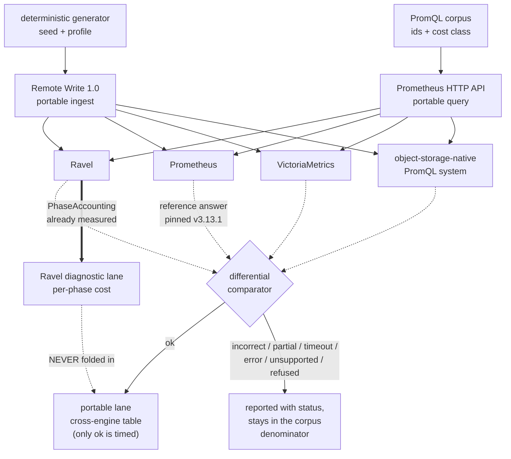

# ADR-0927: MetricsBench, a reproducible metrics and PromQL benchmark contract

Status: Accepted. The original decisions were implemented by PRs #932, #947,
#948, #955, #1013, #1337 and #1510; the 2026-10-26 amendment at the end of
this file records decisions under epic #2821 whose implementation is routed
to tasks named there and not yet in the tree. Issue #927, task T1 of the
epic. Builds on ADR-0044
(per-query cost accounting), ADR-0070 (store request scheduling and the
performance gate), ADR-0075 (published numbers are measured against real S3),
ADR-0015 (Remote Write ingest), ADR-0025/ADR-0030 (accepted PromQL
divergences), and ADR-0108 (native histograms through range evaluation).

## Context

Ravel has a reproducible ClickBench implementation for logs and analytical
SQL. It has no equivalent for metrics, which is the signal Ravel is primarily
built for. What exists today, verified against `origin/main`:

- **No PromQL benchmark corpus.** Every metrics benchmark hardcodes a single
  query string: `query_latency_bench` defaults to `bench_gauge`,
  `pushdown_crossover` has one `const QUERY`. There is nothing to extend.
- **A correctness corpus does exist**, and it is good:
  `crates/ravel-promql-difftest` runs 242 entries across 10 files against a
  pinned real Prometheus **v3.13.1**, scoring 133/133 constructs on the
  non-experimental surface.
- **The PromQL read path is already fully instrumented.** `PhaseAccounting`
  (`crates/ravel-query/src/phase_accounting.rs:214`) splits every
  `QueryAccounting` counter across four phases (resolve, plan, probe, scan)
  and is constructed on every query at `engine.rs:1261`.
- **That phase data is discarded at the response boundary.** It reaches no
  JSON field, no `/metrics` family, and no reader outside two engine unit
  tests.
- **No performance-regression comparator exists.** ADR-0070 decision 3's
  Tier B is specified and unbuilt: there is no `bench/baselines/` and no
  baseline-diff CI job.
- **No checked-in report renderer exists.** Post-hoc analysis is a Python
  script embedded in a Markdown runbook.

Stage 0 of the epic process is deliberately skipped, and this records why: a
benchmark epic delivers the measuring apparatus. There is no metrics baseline
to profile because producing the first one is the deliverable. Aiming this
work with a profile would be circular.

## Decision

### 1. Two lanes, and the boundary between them is load-bearing

**The portable lane** is the only basis for cross-engine comparison: Prometheus
Remote Write for ingest, the Prometheus HTTP query API for reads. Every
participating system receives the same logical samples and the same queries.

**The Ravel diagnostic lane** explains a Ravel result and is never folded into
a cross-engine score. It reports what portable APIs cannot: per-phase
object-store cost, segments considered and pruned, cache behaviour, and
commit-acknowledgement latency.

A figure from the diagnostic lane may never appear in a comparison table.

### 2. Remote Write 1.0 is the cross-engine ingest baseline

Ravel accepts both 1.0 and 2.0 (`services/ravel-server/src/remote_write.rs`,
content-type negotiated, 415 otherwise). 1.0 is chosen because it is the
version every candidate comparator accepts without configuration. Remote
Write 2.0 and OTLP are **separate lanes**, reported separately, never compared
against a 1.0 figure as though protocol overhead were identical.

**Remote Read is not used.** `/api/v1/read` does not exist in Ravel, there is
no handler and no ADR proposing one. Any comparison design that assumed a
portable read-back path must not.

The 2026-10-26 amendment adds to this decision: in the portable lane Ravel
is driven through `ravel-server`'s own `/api/v1/write` like every
comparator, the out-of-order anomaly is a genuine out-of-order sample under a
frozen receiver window, and each receiver's accepted set is digested and
compared across rows.

### 3. Acknowledgement semantics are reported, never normalised

Ravel's Remote Write surface is **strict-mode only, unconditionally**: a 2xx
means the data object and its commit record are both durably stored (the
2026-10-27 amendment, section E, corrects this to "every point ravel-server
admitted is durable"), and the response carries `x-ravel-commit-token`. Buffered mode exists but Remote Write
cannot reach it; it is an OTLP-only header.

Every ingestion result states what that system's acknowledgement means. A
durable-on-ack latency is never placed in the same column as a buffered ack
without the distinction on the same row.

This also fixes a measurement trap: an OTLP-based comparison **could**
accidentally measure a non-durable ack. The portable lane's use of Remote
Write forecloses it.

Ack is not visibility. Default `--max-flush-delay` is 2 s; the MetricsBench
Ravel row runs 500 ms (see the flush-setting amendment below). The harness passes
the returned commit tokens as `min_commit_token` for deterministic
read-your-write rather than sleeping, because sleeping measures the flush
delay and calls it query latency.

### 4. The correctness oracle already exists and is reused, not rebuilt

`crates/ravel-promql-difftest` is the oracle: pinned Prometheus v3.13.1, a
histogram-aware comparator, and per-entry float tolerance for the ADR-0025
residue. MetricsBench consumes it rather than growing a second comparator.

A query is timed for competitive reporting **only after** its result passes
correctness, and this applies to **every participating engine, not only
Ravel**. VictoriaMetrics and the object-storage-native system are compared
against the same reference answer on the same terms; an engine whose result
diverges is reported `incorrect` and is not timed, exactly as Ravel would be.
Timing an unverified competitor result while gating our own would flatter them,
and timing ours while gating theirs would flatter us. Neither is a measurement.

Prometheus is the source of the reference answer and is therefore not compared
against itself. Its own results are timed on the same rule, with correctness
trivially satisfied; the report says so rather than leaving Prometheus'
correctness column blank.

Incorrect, partial, timed-out and unsupported responses stay visible in the
report and stay in the corpus denominator.

### 5. The corpus follows the ClickBench corpus contract exactly

`benchmarks/metrics/` gains a `CorpusFile`-shaped artifact: a `version`, an
entry list, `#[serde(deny_unknown_fields)]`, stable ids, and a gate that
refuses the corpus rather than silently accepting a degraded one. The five
ordered checks of `gate_corpus` are reused: all-or-none classification,
unique ids, non-empty construct list, non-blank modification reason, and every
construct known to the registry.

The registry for PromQL is `ravel-promql-difftest`'s `REGISTRY`, the analog of
`ravel_sql::conformance::registry()`.

Queries are classified by expected physical work: metadata-only,
single-series, selective multi-series, high-fan-out, full-range, join,
histogram, and long-range. That class is a typed enum on the entry, not a
comment.

### 6. Every outcome has a status, and refusals are not gaps

This is the decision most likely to be got wrong later, so it is stated
explicitly. The distinction that matters most is between an engine that
*cannot* answer and an engine that *declines* to, but a status set has to
cover every way a query ends, not only the interesting ones.

Every outcome has exactly one status, and each status states its membership in
three separate denominators. "The denominator" alone is ambiguous and must not
appear in a report (the 2026-10-26 amendment adds two rules here: an
empty oracle answer is timed only for an entry marked intended-empty, and
each comparator's budget-error signatures are tabulated so a budget refusal
lands in `refused` on every engine):

- **corpus**: the query is in the corpus for this profile. Every status below
  is in it. This is the denominator a coverage claim divides by.
- **correctness**: the result was comparable to the oracle's, whether or not it
  matched.
- **timing**: the latency figure is admissible in a performance table.

| status | meaning | corpus | correctness | timing |
|---|---|---|---|---|
| `ok` | answered, oracle agrees | yes | yes | **yes** |
| `incorrect` | answered, oracle disagrees | yes | yes | no |
| `partial` | answered, but from an incomplete result set: the engine returned data together with a partial or warning signal (the 2026-10-27 amendment, section A, retires "or warning": only a completeness signal sets `partial`) | yes | yes | no |
| `timeout` | no answer within the per-query deadline | yes | no | no |
| `error` | transport or server error that is not one of the above | yes | no | no |
| `unsupported_construct` | the engine does not implement it | yes | no | no |
| `refused` | the engine implements it and deliberately declined, returning no result. Carries a required `reason`: `budget` (subquery point caps, `TooManySegments`, `RequestBudgetExceeded`, per-selector ceilings) or `partial_coverage` (Ravel's 503 when coverage is incomplete and `allow_partial` was not set) | yes | no | no |

Only `ok` is timed. Everything else is reported with its status and stays in
the corpus denominator, so a coverage or success rate is always over the whole
corpus and a system cannot improve its score by failing.

**A status the harness cannot emit is a hole in this contract.** `timeout`
specifically: the harness must enforce the per-query deadline around the
**complete** operation, response body parsing included, and map expiry to
`timeout` rather than to `error`. A client with no configured timeout, or one
that bounds only the request and not the body read, records an expiry as a
generic transport failure, and `timeout` never appears however many queries
exceed the deadline. `reqwest::Client::new()` has no default async timeout, so
this is the default outcome rather than an unlikely one.

The same applies to every status: a harness that cannot distinguish two
statuses must not report either, because collapsing them silently is worse
than declaring the distinction unmeasured.

**A refusal is not a correctness result.** `refused` produces no answer, so
there is nothing for the oracle to compare and it is outside the correctness
denominator. Folding a refusal into correctness would let an engine that
declined to answer count as having been checked. This is why Ravel's
partial-coverage 503 is `refused` with reason `partial_coverage` rather than
`partial`: the 503 returns no data at all, whereas `partial` means data arrived
with a completeness caveat attached.

**Precedence, when a partial result also diverges.** Correctness is evaluated
on whatever data was returned. A `partial` response whose returned data
disagrees with the oracle is recorded `incorrect`, not `partial`: a wrong
answer is a wrong answer, and the incompleteness is recorded in the same row as
a separate flag. `partial` therefore means "incomplete and, as far as it goes,
correct". Neither status is timed, so the precedence affects what a reader
learns, not the performance table.

`partial` and `timeout` are separate statuses rather than folded into `error`
because they mean different things about the engine: a partial result is a
completeness decision, a timeout is a cost outcome, and an error is neither.

**The statuses are per engine, not per query.** The same query may be `ok` on
Prometheus and `refused` on Ravel. A cross-engine table shows the status
alongside each engine's figure, never a single row status.

Prometheus and VictoriaMetrics return data for several shapes Ravel refuses on
budget. Reporting those as `unsupported_construct` would misattribute a
deliberate ceiling as a capability gap. Reporting them as successes would be
worse.

**Recording rules are out of scope for v1.** Ravel has no recording-rule
concept. `ravel-alerting` models alerting rules with a threshold condition,
not Prometheus `record:` semantics. (Since #1711, `GET /api/v1/rules` does
serve the loaded alerting rule set in the Prometheus response shape.) The epic
lists them; this ADR removes them from v1 and names the gap rather than
carrying an acceptance criterion nothing can satisfy.

**Alert expressions are in scope only as PromQL, not as rule semantics**, and
the boundary is worth stating because "representative alert expressions" in the
epic could otherwise be read as the whole rule surface. What is in v1: the
PromQL *expression* an alert would evaluate, run as an ordinary instant query
and classified by the table above like any other. What is out, with no
counterpart in Ravel to measure:

- `for:` duration and the pending-to-firing state machine;
- alert `labels:`/`annotations:` templating;
- `keep_firing_for:`;
- rule-group evaluation order, interval and staleness between groups;
- `ALERTS` / `ALERTS_FOR_STATE` synthetic series;
- `/api/v1/alerts`, which serves this process's current evaluator state
  (#2665), not Prometheus's alert bookkeeping, so there is still nothing
  comparable to measure; and recording rules on `/api/v1/rules`, which serves
  alerting rules only.

A corpus entry that needs any of those is not written, rather than written and
reported `unsupported_construct`: the category means the engine cannot evaluate
a query it was given (the 2026-10-27 amendment, section D, widens it to a
payload class the engine cannot store), and these are not queries. The gap is recorded here so it
is visible without a corpus entry standing in for it.

### 7. The diagnostic lane exposes what is already measured

The main implementation cost is smaller than the epic implies, and in a
different place. `PhaseAccountingSnapshot` is computed per PromQL query and
thrown away. T6 is: surface it at the response boundary and consume it in the
report, following `sql_latency.rs`'s existing `wire_bytes_by_phase` pattern
built off `QueryPhase::ALL` so a new phase cannot be silently dropped.

Counters that are structurally dead are **not** designed against, and are
listed so a later reader does not mistake a zero for a measurement:
`AccountedOp::Head`, `s3_bytes[List]` and `segments_pruned` are never recorded
anywhere in production. `peak_intermediate_bytes` is SQL-only and is always
zero on a PromQL query.

### 8. Request counts are logical-call counts, and the report says so

`object_store` retries **below** `InstrumentedStore` with `max_retries = 10`.
One `get()` that retried nine times records one request while S3 bills ten.

Every request figure in this repository is therefore a logical-call count, not
a billed-request count. Under throttling the real bill exceeds every counted
number. Issue #928 closed the measurement gap this decision named: a
per-operation `attempts` counter (`StoreMetrics::record_attempt`, surfaced as
`ravel_store_attempts_total` at `/metrics`) is filled in by the S3 adapter's
counting HTTP connector *below* `object_store`'s retry loop, so `attempts -
calls` is the billed retry overhead. The MetricsBench harness itself does not
install that connector, so its own request figures stay logical-call counts and
every cost estimate in a MetricsBench report carries this caveat next to the
figure, not in a footnote.

The existing honest representation is reused rather than reinvented:
`RequestCounts::backend_bills_requests` already distinguishes "these counts
are real but free" (MemoryStore) from "these counts are billable" (S3),
instead of a misleading zero.

### 9. Per-query cost never comes from process-global counters

`bench-s3.yml` derives its request counts from a process-global
`StoreMetrics` snapshot pooled across ingest and query. That is precisely the
alternative ADR-0044 rejected, and it cannot attribute a regression to a
query. MetricsBench's per-query cost comes from the per-query
`QueryAccounting` handle, always.

Ingestion and query phases are recorded separately for the same reason.

### 10. Publishability follows ADR-0075 decision 3

MinIO is valid for correctness, conformance and CI. It is **not** an
acceptable substrate for a performance or cost claim, because removing
per-request fees is exactly what makes a request-count defect invisible. Only
the real-S3 lane produces publishable Ravel performance and cost numbers.

### 11. Three orthogonal profiles, pre-registered before the first run

Cardinality, history and churn move independently. Collapsing them into one
scale factor makes a regression unattributable, so each profile varies one
axis and pins the others.

| profile | active series | samples/series | scrape | duration | churn | total samples |
|---|---|---|---|---|---|---|
| `cardinality` | 1,000,000 | 360 | 15 s | 90 m | none | 360,000,000 |
| `history` | 10,000 | 172,800 | 15 s | 30 d | none | 1,728,000,000 |
| `churn` | 50,000 concurrent | 8,640 | 15 s | 36 h | 20%/h | ~432,000,000 |
| `ci` | 1,000 | 120 | 15 s | 30 m | 5%/h | 120,000 |

The `ci` profile exercises the same code paths and is **marked
non-comparable** in the artifact itself. It cannot be presented as a
performance result. The 2026-10-26 amendment records the correction to this
table's `ci` churn figure (the manifest declares 0, not 5%/h; the row above
is left as written), makes the stream's time anchor an
explicit on-grid run parameter, and gives each profile a declared
range-evaluation grid.

Every profile records exact active-series count, total series created,
samples per series, scrape interval, duration, total samples, label
cardinalities, and logical input bytes.

### Bands pre-registered for the first reference run

These are **acceptance gates on the harness, not performance targets**. They
fail the run when the measurement is not trustworthy, and say nothing about
whether Ravel is fast.

1. Statement count and failure identity are exact. A run over a different
   query count is not comparable and voids the pass before any timing.
2. Correctness must be 100% of the *comparable* set. Any query whose result
   diverges from the oracle moves to `incorrect` and out of the timing
   denominator, and the run reports how many did.
3. **Variance is measured by a pre-registered calculation, not by judgement.**
   "Within the observed band" is not a rule until the band is defined, and two
   runners applying different definitions to the same results is the failure
   this clause exists to prevent. The calculation, fixed here:

   - **Minimum five behaviour-identical passes** per regime before any
     performance conclusion. Two passes give a range, not a variance; five is
     the smallest count at which a single outlier does not dominate the
     statistic below.
   - **Statistic: the per-query relative median absolute deviation**, taken
     over each query's per-pass medians, reported as a percentage of the
     median. Chosen over standard deviation because a single slow pass from an
     unrelated host event should not widen the band it is being measured
     against.
   - **Outliers are not discarded.** A pass is excluded only for a recorded
     external cause (a host event, a failed comparator container, an aborted
     run), the exclusion and its reason appear in the report, and the run is
     repeated to restore the minimum count. A pass excluded for being slow,
     with no named cause, is data.
   - **The band is per query and per regime.** Not per class: a class band
     would need an aggregation rule over its members' bands, and any such rule
     (mean, max, a percentile) makes the pass/fail verdict for one query depend
     on how noisy its neighbours were. A query is compared against its own
     band, which is the only comparison that stays deterministic as the corpus
     grows.

     Class-level figures are still reported, as the **distribution** of
     per-query bands within a class, because that is what shows a metadata-only
     query and a high-fan-out aggregation have different noise floors. They are
     descriptive and never a gate.
   - **Cold and warm carry different floors and are never compared to each
     other**, nor is one derived from the other.

   A regression claim requires the delta to exceed **that query's own band**
   for the regime. A delta inside the band is reported as no change, not as a
   small improvement.
4. Ingested sample count must equal generated sample count minus explicitly
   reported rejections. A silent drop fails the run.
5. Every figure the report claims is present exactly once and inside its
   band; absent-but-expected fails identically to out-of-band.

The 2026-10-26 amendment changes this list: band 1 depends on each
profile's declared range-evaluation grid (section E), band 4 becomes the
per-type line accounting of section D, and section B adds band 6, the
cross-row accepted-set digest. The 2026-10-27 amendment, section D, computes
band 6 per payload class.

## Lane boundary

## Rejected alternatives

**Remote Write 2.0 as the cross-engine baseline.** It carries less wire
overhead and Ravel supports it, but it is not universally accepted by
candidate comparators without configuration, and a protocol difference would
sit inside a comparison that claims to isolate the engine. Kept as a separate
lane.

**A new benchmark-only counter set.** Rejected by the epic and by ADR-0044:
counters that exist only for the benchmark drift from the ones production
reports, and the benchmark stops measuring the shipping system. Any missing
metric extends `QueryAccounting` and its funnels.

**Deriving per-query cost from `StoreMetrics` deltas**, as `bench-s3.yml`
does. ADR-0044 rejected it when the accounting was designed; the reason has
not changed. Ingest, fold, compaction and concurrent queries share those
counters.

**A second correctness comparator.** `ravel-promql-difftest` already pins a
real Prometheus and handles label ordering, tolerance, NaN, stale markers and
histograms. A benchmark-local comparator would be a second source of truth
that can disagree with the first.

**Deleting or rewriting queries Ravel cannot answer.** A corpus that drops its
failures reports a denominator that flatters the system under test. They stay,
classified.

**Waiting for the index plane (#849) or cache-independence (#913) to land.**
The baseline's value is capturing the before and after. Waiting produces one
number and no delta.

**A single scale factor.** Rejected in the epic and restated here because it
is the most tempting simplification: one knob makes profiles comparable to
each other and makes every regression unattributable.

## Consequences

**What this buys.** Ravel becomes measurable on its primary signal, against
named systems, on a disclosed configuration, with correctness gating timing.
The diagnostic lane makes a Ravel regression attributable to a phase rather
than to "queries got slower".

**What it does not buy.** It does not make Ravel fast, and it is likely to
document places where Ravel is slower than a purpose-built TSDB. Finishing
this epic means Ravel can be measured honestly.

**New obligations.** A corpus and its digests must be versioned; a report
schema gains a version and cannot be changed silently; comparator deployments
are pinned by image digest. Two report types exist today, `SqlLatencyReport`'s
`Provenance` and `report.rs`'s `Environment`, and they carry different
things: provenance has no git commit, toolchain, digest or hardware
identification, while `Environment` has commit and toolchain but no
object-store accounting. **T7 must reconcile them; extending one in ignorance
of the other produces a third shape.**

**A renderer is new work with no structure to extend.** There is no
checked-in renderer in the repository. The precedent is a Python script inside
a Markdown runbook, and T7 explicitly requires better; that is a departure
from precedent, not an extension of it.

**Real-S3 dependency.** Publishable latency and cost claims need the real-S3
lane, credentials and a bucket. Correctness, CI and MinIO diagnostic runs do
not.

**Retry blindness was a recorded gap, closed by #928.** Naming it here did not
fix it; the follow-up this ADR anticipated ("a retry counter below
`InstrumentedStore`") landed as the per-operation `attempts` counter
(`ravel_store_attempts_total`). A published request count that was taken as a
logical-call count (this bench, and ClickBench figures published before #928)
still under-reports by the retry factor; the billed count is now observable
wherever the S3 counting connector is installed (the server's `/metrics`).

**One known defect will corrupt a lane if ignored.** Flight SQL records a
statement's cost into the `/metrics` aggregator twice, pinned at
`services/ravel-server/tests/query_cost_surfaces.rs:649`. Any lane driving
Flight SQL and reading `ravel_query_*` sees 2x until it is fixed.

Refs: #927, #51, #365, #573, #849, #913

## Amendment (2026-10-26): the portable lane drives Ravel over HTTP, anomalies are the same logical data on every receiver, and the stream is a pure function of its run parameters

<!-- amendment-applies: sections="2. Remote Write 1.0 is the cross-engine ingest baseline|6. Every outcome has a status, and refusals are not gaps|11. Three orthogonal profiles, pre-registered before the first run|Bands pre-registered for the first reference run" pointer="2026-10-26 amendment" -->

Context. Before the first portable query run (epic #2821, milestones #938
and #940), an independent review of the contract against the code on
`main` at cec01d088 found that the lane as built could hand four engines
four different datasets while every per-row band passed. The findings and
their evidence are on issue #2821 (comment 6407154211, 2026-10-26). This
amendment records the decisions that close them. It changes no persistent
format and no status in decision 6.

### A. Ravel is driven through its own HTTP surface in the portable lane

The replay lane writes to Ravel through an in-process `IngestRouter`
(`crates/ravel-bench/src/metrics_ingest.rs`, `replay_into_ravel`) and
queries through an in-process `QueryEngine` (`query_after_replay`). That
path never runs `ravel_remote_write::normalize_resolved`, so it skips the
event-time admission `ravel-server` applies on `/api/v1/write`
(`crates/ravel-remote-write/src/normalize.rs`, `checked_event_ts`, bounded
by `--max-ingest-lag`, default 2 h, ADR-0010 section 8). A 30-day history
profile replayed in-process is accepted in full; the same stream sent to
the shipped server is rejected almost entirely.

Decision: in the portable lane, Ravel is one more comparator. It is
deployed from `deploy/metricsbench/` at the same resource envelope as the
others, written through `/api/v1/write` and queried through
`/api/v1/query`, `/api/v1/query_range`, `/api/v1/labels`,
`/api/v1/label/<name>/values` and `/api/v1/series`. The ingest limits a
historical replay needs (`--max-ingest-lag` covering the profile's span,
which drives both the admission bound and the catalog listing window) are
set explicitly in that deployment and
disclosed in the report's substrate block, exactly as every comparator's
ingest window is. The in-process path stays as the diagnostic lane's
replay (decision 1 and decision 7), and its report row says
`endpoint: in-process` so it is never read as the portable row.

### B. The out-of-order anomaly is an out-of-order sample, never a duplicate timestamp

The generator shifts a selected instance-step by exactly two scrape
intervals (`crates/ravel-bench/src/metrics_gen.rs`, the `shifted` branch
in the step loop of `generate_into`, which hands the shifted timestamp to
`emit_instance`), so the shifted sample carries a timestamp the
series already emitted, with a different value. Receivers disagree on
that. The review's reading of each receiver, which T1c verifies by
reading back every receiver after the replay: Prometheus 3.13 rejects the
Remote Write 1.0 request on the first duplicate-timestamp or out-of-order
sample and rolls back its appender, Mimir rejects the sample and keeps the
rest of the request, VictoriaMetrics accepts both samples, and Ravel keeps
the later-written value at query time (docs/catalog-and-mvcc.md,
cross-segment duplicate samples, the one receiver whose rule is pinned in
this repository).
The lane counts any non-retryable 4xx as the whole batch dropped
(`replay_over_http`), so the report shows identical `dropped_samples` for
receivers that stored different sets.

Decision: the shift lands strictly between scrape points (one and a half
intervals back, computed as `3 * interval_ms / 2`, exact because every
profile's scrape interval is a whole number of seconds), so the sample is
out of order and never a duplicate. This retires the generator's pinned
invariant that every timestamp stays on the scrape grid: after the change
only unshifted samples do. A shifted sample is not always a regression on
its series (two consecutive shifted steps leave the second half an
interval ahead of the first; the 2026-10-27 amendment, section B, corrects
this: two consecutive shifted samples of one series stay one full interval
apart), so the generator test keeps counting shifted and regressed samples
separately and its pinned counts move with the new offset.
Every receiver runs a frozen, disclosed out-of-order window longer than
the shift: Prometheus `storage.tsdb.out_of_order_time_window`, Mimir
`limits.out_of_order_time_window`, VictoriaMetrics' default acceptance
stated as such, and Ravel's own rule stated next to its deployment. The
lane reads each receiver's per-sample outcome (the Remote Write response
body and the receiver's written-samples header or counter), never a
per-batch status alone, and each row carries a digest of its accepted
`(series, timestamp, value bits)` set. Band 6, new: every portable row's
accepted set must equal its expected set, which is the generated stream
minus that row's named payload exclusions (section D; a row's `offered`
set is exactly this, so the expected-set digest is the digest of what the
row offered). Every portable row carries the same exclusion set (the
2026-10-27 amendment, section D, computes band 6 per payload class and lets
a receiver exclude a class it cannot store), because
the portable lane sends every payload type it carries to every receiver;
a lane that excludes a type another portable row carries is a diagnostic
row (the 2026-10-27 amendment, section D, keeps such a receiver portable
when the class is one it cannot store). The run fails when any two portable
rows' expected-set digests differ or any row's accepted-set digest differs
from its expected-set digest (the 2026-10-27 amendment, section D, applies
both comparisons per payload class). The
portable lane's drop budget is zero: a dropped or rejected sample on any
receiver fails this band, and a row that needs a non-zero budget is a
diagnostic row, not a portable one. The generator change moves
the workload manifest to version 2 with its own digest; version 1 streams
stay reproducible from the version-1 manifest.

### C. The stream is a pure function of its run parameters

`metricsbench_ingest` anchors the first step at `now - steps * scrape`, an
arbitrary millisecond, and the generator's BLAKE3 digest covers
timestamps, so no two runs produce the same digest and the report records
neither seed, manifest digest, anchor nor stream digest.

Decision: `--anchor-ms` is an explicit run parameter with no default, like
`--profile`, and must sit on the scrape grid (a multiple of the profile's
scrape interval in milliseconds). The report records the manifest version
and digest, the seed, the anchor, the generator's stream digest, and the
parsed-stream digest per payload type. A chunked or streaming generation
must produce the same bytes and digest as one-shot generation for the same
parameters, pinned by test. Two runs with equal parameters produce equal
digests, pinned by the smoke test.

### D. Every generated line is counted by type, and a comparator row is banded

`parse_logical_stream` skips native-histogram and staleness lines and
malformed lines without a count, and `metricsbench_ingest` bands only the
Ravel row. The nightly artifact shows the gap (119,775 generated, 107,736
offered, zero rejected, 2026-10-25 run).

Decision: every line is classified as a scalar, a native histogram, a
staleness marker, or a typed malformed line, and band 4 becomes two
equations, both required: the classification identity
`scalar + native_histogram + stale_marker + malformed == generated_lines`
with `malformed == 0` for a generator stream, and the offering identity
`offered + excluded_native_histogram + excluded_stale_marker == generated_lines`
per row, which keeps the original band's anchor on the generated count so
a line that never reached a receiver still fails the run unless it is
counted under a named exclusion. The 2026-10-25 nightly artifact fails the
second equation as the lane stands today. A lane that does not carry a
payload type reports it as a named exclusion, never as absent. Staleness
markers travel as the Prometheus stale NaN bit pattern, reusing
`ravel_promql_difftest::generator::STALE_MARKER_BITS` rather than adding
another declaration, exempted from the non-finite rejection exactly for
that pattern.
Every row, comparator rows included, is banded on
`offered == accepted + rejected + dropped` (the 2026-10-27 amendment,
section D, adds a per-class unsupported term for a class the receiver
cannot store) and on its declared drop budget, and the row records
rejections by HTTP status.

### E. Range evaluation grids and empty answers

Six corpus entries are `eval: range` and nothing declares their start,
end or step, so band 1 (statement identity) is undefined for them. Two
join entries can never produce a result on the generated data
(`mb_join_cpu_on_build_version` has two `version` matches per
`(job, instance)`; `mb_join_saturated_and_busy` thresholds a rate the
generator cannot reach), and the two native-histogram entries compare an
empty answer with an empty answer while no receiver has ever received a
native histogram.

Decision: each profile declares its range-evaluation grid
(`range_eval: {start_offset_secs, end_offset_secs, step_secs}`) relative
to the stream's newest sample, and the corpus gate checks that every range
entry's window plus lookback fits inside the profile's span. An entry whose
oracle answer is empty is timed only when the entry is marked
intended-empty; otherwise the case is an invalid fixture and the
experiment, not the engine, is reported as failed. The three `absent`
entries are not empty answers: `absent()` and `absent_over_time()` return
a one-sample vector with value 1 when the argument is empty, and the
manifest guarantees the absent metric is never emitted, so they are
ordinary non-empty cases. The two native-histogram entries
(`mb_histogram_native_p95`, `mb_histogram_native_fraction`) are the
empty-answer cases today, because no receiver has yet received a native
histogram; T5 marks them intended-empty with a reason naming T1c, and T1c
removes the marker when native histograms reach the wire, at which point
an empty answer on either is again an invalid fixture. The two
join entries are repaired under a corpus version bump with their
modification reasons recorded, and the corpus gate checks that every
`group_left`/`group_right` key is unique on the right side under the
manifest.

### F. Comparator limits are frozen, and budget refusals land in `refused` on every engine

Decision: every comparator's ingest window and query limits that the
corpus can reach are set explicitly and disclosed in `deploy/metricsbench/`
(Prometheus `--query.max-samples`, `--query.timeout`,
`--query.lookback-delta`; VictoriaMetrics `-search.latencyOffset`,
`-search.maxPointsPerTimeseries`, `-search.maxSamplesPerQuery`,
`-search.maxQueryDuration`, `-search.maxUniqueTimeseries`; Mimir
`querier.query_store_after`, `querier.query_ingesters_within`,
`bucket_store.sync_interval`, `compactor.cleanup_interval`,
`querier.max_samples`, `max_fetched_chunks_per_query`; the 2026-10-27
amendment, section C, removes `querier.max_samples` from the Mimir bounds
and names the ones that fire), and the status
mapper carries a per-engine table of budget-error signatures so a limit
that fires lands in `refused` with reason `budget` rather than in `error`.
A historical replay into Mimir is followed by a readiness precondition
(the bucket index lists blocks covering the replay's oldest sample) before
the first statement, stamped into the report.

### G. Correction to the profile table

The `ci` row in decision 11 says churn 5%/h. The manifest
(`benchmarks/metrics/workload.json`) declares
`churn_basis_points_per_hour: 0` for `ci`, the generator tests pin it, and
`benchmarks/metrics/README.md` is corrected in the same change. The table
row is left as written and this paragraph is the correction.

Consequences. Task routing under #2821: T1b (replay accounting: required
on-grid anchor, comparability tied to it, provenance digests, the two
band-4 equations, rejections by status), T1c (payload types on the wire:
staleness markers, native-histogram wire shape, per-sample receiver
outcomes, accepted-set digest and band 6; removes the intended-empty
marker from the two native-histogram entries), T4c (comparator limits and
Mimir read-path intervals), T4d (Ravel's own `deploy/metricsbench`
deployment at the comparators' envelope), T5 (corpus and workload version
2: generator shift, join repairs, range grids, corpus gates), T3 (status
mapper and budget table).
Nothing here changes a persistent format: the workload manifest and corpus
are benchmark artifacts versioned by their own `version` field, not frozen
storage contracts.

## Amendment (2026-10-27): warnings never set `partial`, Mimir's query bounds, band 6 per payload class, and what a Ravel Remote Write 2xx acknowledges

<!-- amendment-applies: sections="3. Acknowledgement semantics are reported, never normalised|6. Every outcome has a status, and refusals are not gaps|Bands pre-registered for the first reference run|Amendment (2026-10-26): the portable lane drives Ravel over HTTP, anomalies are the same logical data on every receiver, and the stream is a pure function of its run parameters" pointer="2026-10-27 amendment" -->
<!-- amendment-supersedes: phrase="together with a partial or warning signal" pointer="2026-10-27 amendment" -->
<!-- amendment-supersedes: phrase="the data object and its commit record are both durably stored" pointer="2026-10-27 amendment" -->
<!-- amendment-supersedes: phrase="`querier.max_samples`, `max_fetched_chunks_per_query`" pointer="2026-10-27 amendment" -->
<!-- amendment-supersedes: phrase="Every portable row carries the same exclusion set" pointer="2026-10-27 amendment" -->
<!-- amendment-supersedes: phrase="leave the second half an interval ahead of the first" pointer="2026-10-27 amendment" -->
<!-- amendment-supersedes: phrase="a lane that excludes a type another portable row carries is a diagnostic row" pointer="2026-10-27 amendment" -->
<!-- amendment-supersedes: phrase="`offered == accepted + rejected + dropped`" pointer="2026-10-27 amendment" -->
<!-- amendment-supersedes: phrase="the category means the engine cannot evaluate a query it was given" pointer="2026-10-27 amendment" -->

Context. Implementing the status mapper (T3), the comparator limits (T4c)
and the payload types on the wire (T1c) under epic #2821 found five places
where the text above says something the engines or the code do not do.
Issue #3304 collects them. This amendment changes no persistent format.

### A. `partial` and warnings

Decision 6's status table defines `partial` as data returned "together with
a partial or warning signal". The status mapper never lets a warning or an
info change a status: it records them as annotations and compares `status`
and `data` only (`crates/ravel-bench/src/metrics_correctness.rs:39-47`, and
the test `warnings_and_infos_are_recorded_and_never_change_the_status` at
`:940`). A Prometheus or Mimir warning reports a condition of the
evaluation, such as a mix of histogram and float inputs (the test fixture
at `metrics_correctness.rs:942` uses that warning text), not a missing part
of the result.

Decision: "or warning" is retired. `partial` is reachable only on an engine
with a completeness signal: Ravel's top-level `partial: true` and
VictoriaMetrics' `isPartial: true`
(`crates/ravel-bench/src/metrics_correctness.rs:684-690`). The Prometheus
v3.13.1 HTTP API envelope (`docs/querying/api.md` at tag v3.13.1) carries
`status`, `data`, `errorType`, `error`, `warnings` and `infos` and no
completeness field, and the mapper reads none for Mimir 3.2.3 either
(`metrics_correctness.rs:689`). On those two engines `partial` is
unreachable by construction, not because the harness cannot see it. The
MetricsBench Prometheus configures no `remote_read` (none appears under
`deploy/metricsbench/`), so it has no remote source whose failure could
surface as a warning on an incomplete answer.

### B. The out-of-order shift keeps consecutive shifted samples one interval apart

Section B of the 2026-10-26 amendment places a shifted sample one and a
half intervals back, off the scrape grid. The generator subtracts
`3 * interval_ms / 2` from the step's own timestamp
(`crates/ravel-bench/src/metrics_gen.rs:635-637`), and step `n` is stamped
at `base + n * interval`. Two consecutive shifted samples of one series, at
steps `n` and `n + 1`, therefore land at `base + (n - 1.5) * interval` and
`base + (n - 0.5) * interval`: one full interval apart from each other. The
shift moves samples off the grid; it does not halve the sample spacing.

### C. Mimir's query bounds

Section F of the 2026-10-26 amendment lists `querier.max_samples` among the
Mimir limits that bound a query. Mimir 3.2.3 queriers run the Mimir query
engine (MQE) by default (`deploy/metricsbench/docker-compose.yml:262-268`),
and MQE does not enforce `querier.max_samples`: with it set to 100, a query
over 28,801 samples returned 200 (`deploy/metricsbench/README.md:104-105`,
issue #3304). The value stays frozen for the Prometheus engine Mimir falls
back to for expressions MQE does not support
(`deploy/metricsbench/README.md:112-113`), but it is not one of the bounds
on the default engine.

Decision: `querier.max_samples` is removed from the list of Mimir limits
that bound a query. The Mimir bounds that do fire are
`limits.max_fetched_chunks_per_query`,
`limits.max_estimated_memory_consumption_per_query` (frozen at 2 GiB,
2,147,483,648 bytes, since #3305; `deploy/metricsbench/README.md:89`),
`limits.max_total_query_length` and `querier.timeout`
(`deploy/metricsbench/README.md:87-91`). The status mapper's budget table
carries a signature for each of the four
(`crates/ravel-bench/src/metrics_correctness.rs:371-390`).

### D. Band 6 is computed per payload class

VictoriaMetrics v1.115.0's Remote Write parser reads only `labels` (field
1) and `samples` (field 2) of each `TimeSeries` and skips every other field
without an error (`lib/prompb/prompb.go` at tag v1.115.0,
`TimeSeries.unmarshalProtobuf`). A native histogram sent to it is dropped
and the request still answers 2xx, so section B's rule that every portable
row carries the same exclusion set would fail band 6 on VictoriaMetrics for
a class it cannot store, not for a sample it lost.

Decision: band 6 is computed per payload class: scalar, stale marker and
native histogram (the classes of section D of the 2026-10-26 amendment).

- A class a receiver cannot store, shown by that receiver's pinned source
  or its documentation, is excluded from band 6 for that receiver only. The
  citation is recorded in that receiver's report row; an exclusion with no
  citation is not an exclusion.
- Corpus entries that need an excluded class are classified
  `unsupported_construct` on that engine, and stay in its corpus
  denominator. This widens decision 6's definition of that status from
  "cannot evaluate a query it was given" to also cover "cannot store a
  payload class the query needs". Such an engine evaluates the query and
  answers an empty result, which the data comparison would otherwise call
  `incorrect`. The status comes from a declaration, not from the response:
  the query runner reads the receiver's ingest row, finds the class in its
  cited unsupported classes, and sets `unsupported_construct` before any
  data comparison, with the citation as the row's message. The query is
  still sent and its answer recorded, so an engine version that starts
  storing the class shows up as a changed answer. The status mapper's
  response-driven path never produces this status for a 2xx answer, and
  does not need to.
- Every other row is still compared on that class, and every row is still
  compared on every class it does not exclude.
- A receiver that drops part of a class it does support still fails band 6.
  The drop budget of the 2026-10-26 amendment stays zero.
- The exclusion applies on the receiving side only. The lane still sends
  every payload class to every portable receiver, so every portable row's
  offered set, and its expected-set digest, is the same whole stream, and
  the cross-row equality of expected-set digests holds for every class. The
  comparison of a row's accepted set against its expected set is made only
  for the classes that row does not exclude.
- The points of an excluded class that a receiver acknowledged but cannot
  store are counted in that row's own per-class unsupported counter, not in
  `excluded_native_histogram` or `excluded_stale_marker`. Those two count
  what the lane never sent. Band 4's per-row identity gains the term:
  offered equals accepted plus rejected plus dropped plus unsupported, per
  class. A receiver with an excluded class stays a portable row; it is not
  a diagnostic row.

### E. What a Ravel Remote Write 2xx acknowledges

Decision 3 says a Ravel Remote Write 2xx means "the data object and its
commit record are both durably stored". That is true of what was written
but says nothing of what was not. ADR-0051 pins partial admission on Remote
Write (`docs/adrs/0051-tenant-admission-control.md:136-144`): an
active-series cap breach drops the over-cap series and lowers the written
count inside a 2xx (`services/ravel-server/src/remote_write.rs:507-512`),
and points rejected in normalization are counted as dropped
(`remote_write.rs:280-288`, `:479`) while the request still answers 204
(`remote_write.rs:593`). The written counts travel only in the Remote Write
2.0 response headers (`remote_write.rs:608-616`), and the portable lane
sends 1.0 (decision 2), so a portable-lane 2xx from Ravel carries no count
of what was kept.

Decision: decision 3's sentence is corrected to: a Ravel Remote Write 2xx
means every point ravel-server admitted is durable (strict mode only,
`remote_write.rs:461-462`). The MetricsBench Ravel row's acceptance is
confirmed by reading the data back, the accepted-set digest of band 6, not
by the response.

Consequences. Decision 6's `partial` row, decision 3's acknowledgement
sentence, and sections B and F of the 2026-10-26 amendment carry inline
pointers here. Task routing under #2821 is unchanged: T3 already maps
warnings as recorded here, T4c owns the Mimir budget table, and T1c owns
band 6 and the per-class exclusions.

## Amendment (2026-10-28): Ravel's per-query ceilings join the frozen limits

<!-- amendment-applies: none reason="adds Ravel's two newly configurable per-query ceilings to the set the 2026-10-26 amendment section F already requires every comparator to freeze and disclose; retires no earlier wording" -->

Context. Section F of the 2026-10-26 amendment freezes and discloses every
comparator's query limits that the corpus can reach, and section A makes
Ravel one more comparator. Ravel's series and sample ceilings were compiled
in at 10,000 and 10,000,000 with no flag, so the portable Ravel row would
have refused 15 of 21 cardinality entries (13 before native histograms were
on the wire), 5 of 24 history entries and 12 of 22 churn entries for a
reason no comparator shares (decision recorded on
#2821 and #3306). #3306 made both configurable as `--max-series` and
`--max-samples`.

Decision: the portable lane freezes Ravel's `--max-series` at 1,000,000 and
`--max-samples` at 500,000,000 in `deploy/metricsbench/ravel.yml`, disclosed
in that directory's "Frozen limits" table, with the other frozen limits.
`--max-series` equals VictoriaMetrics' `-search.maxUniqueTimeseries` and the
cardinality profile's active series. `--max-samples` equals Prometheus'
`--query.max-samples` and Mimir's `querier.max_samples`. The counts are not
the same quantity on each engine: Ravel counts total materialized samples
after dedup, Prometheus peak resident samples. The bytes behind Ravel's
counts are bounded by its memory budget, whose `memory exhausted` refusal is
a budget refusal like any other comparator's.

Consequences. A Ravel image for the portable lane must carry both flags
(main after #3306, or a release after 0.27.0). Neither flag has a
limits-file key: per-tenant query limits are not enforced today, and a key
there would disclose a per-tenant bound that does not exist.

## Amendment (2026-10-28): the portable replay keeps requests in flight the way a Prometheus sender does

<!-- amendment-applies: none reason="adds the portable replay's sending model, which no earlier decision states; band 6 is already defined over each row's accepted set, so an order-independent digest of that set retires no earlier wording" -->

Context. The first smoke pass on a dedicated box (#2821, comment 6460233909)
replayed `ci` on all four portable rows and then stalled in `cardinality`'s
ingest. The lane sends one Remote Write request, waits for its response, and
only then sends the next. Ravel answers once the points are durable
(decision 3), which happens when the tenant buffer ages past the 2 s flush
delay, so each request took about 2.1 s: 1,054 requests in 37 minutes,
measured from ravel-server's `ravel_cpu_gate_inline_total{site="remote_write_snappy"}`.
At 500 points a request that is about 240 points per second, and
cardinality's 360,000,000 samples would take about 420 hours. `ci` sends
120,000 samples, 240 requests that take about 8 minutes on the Ravel row at
that rate, inside the nightly's timeout, and no ingest figure was banded to
catch it. A real sender does not wait on
one request at a time: Prometheus' remote-write queue manager spreads series
over shards, and each shard keeps its own request in flight. No earlier
decision says how many requests the replay keeps in flight, so the lane's
sequential loop was an unstated choice, and on a durable-on-ack receiver it
measured the flush delay rather than ingest.

Decision:

1. **Shards and batch size come from Prometheus' own defaults.** The
   replay keeps `S` shard queues and sends at most `B` points per request.
   `S` is 50 and `B` is 2,000, the `queue_config` defaults of the pinned
   Prometheus v3.13.1 (`docs/configuration/configuration.md` at tag
   v3.13.1: `[ max_shards: <int> | default = 50 ]` and
   `[ max_samples_per_send: <int> | default = 2000]`). Every portable row
   uses the same `S` and `B`. Prometheus scales its shard count between
   `min_shards` and `max_shards` as it goes; the replay does not model that
   and holds `S` fixed, which is disclosed in the row's `client_behavior`.
2. **A series always goes to the same shard, and a shard has one request
   in flight.** The shard is a stable hash of the point's canonical series
   identity modulo `S`. Each shard sends its next request only once the
   previous one has answered, so every series reaches every receiver in
   offered order, the out-of-order sample of the 2026-10-26 amendment,
   section B, included, and at most `S` requests are in flight at once.
   A shard sends when it holds `B` points or the stream has ended.
3. **Retries back off the way Prometheus does.** A 429 or 5xx response, or
   a transport error, is retried after a delay that starts at 30 ms and
   doubles up to 5 s (`[ min_backoff: <duration> | default = 30ms ]`,
   `[ max_backoff: <duration> | default = 5s ]`), up to the row's retry
   limit, and the batch is then dropped as before. Prometheus by default
   does not retry a 429 (`[ retry_on_http_429: <boolean> | default = false ]`);
   the replay does, because a dropped point fails band 4 and the zero drop
   budget, and the row's `client_behavior` says so.
4. **Ingest figures are measured over wall time.** `elapsed_secs` becomes
   the wall time from the first request sent to the last response
   received, marked `elapsed_basis: "wall_in_flight"`, because with `S`
   requests in flight a sum of per-request times counts the same second up
   to `S` times. Generating the stream runs concurrently with sending, and
   its busy time is reported as `generation_secs`; a row whose
   `generation_secs` is at least 90% of its `elapsed_secs` is marked
   `sender_bound: true`, since its throughput then says more about the
   generator than about the receiver. `ack_latency_ms` stays per request,
   from send to response, and now includes queueing inside the receiver
   behind the other requests in flight. A durable-on-ack receiver's ack
   latency still cannot fall below its flush interval, whatever `S` is.
   Ingest figures from before this amendment carry
   `elapsed_basis: "timed_segments"` and are not compared with figures
   measured after it.
5. **The digests do not depend on arrival order.** With `S` requests in
   flight, responses arrive in no fixed order, so each class's expected and
   accepted digest is the sum, modulo 2^256, of the BLAKE3 hash of each
   point's encoding, the one the offered digest already uses: series,
   timestamp and value bits for a sample, and every encoded field for a
   native histogram. Band 6 already
   compares sets, so its rule does not change. The sum is a multiset
   digest: a point accepted twice changes it. Every lane computes it the
   same way, the in-process row included, so the cross-row comparison
   still holds.
6. **A Ravel row keeps the newest commit token per shard.** Responses for
   one Ravel shard can arrive out of order, so the row keeps, for each
   shard, the token with the highest `(epoch, seq)`. Tokens on one shard
   from two different writer ids cannot be ordered against each other, and
   the row is refused when that happens; the portable deployment runs one
   ravel-server.
7. **A replay that cannot finish says so early.** Each HTTP row takes a
   ceiling on its ingest wall time; the in-process row sends no requests
   and takes none. Once a row has been sending for 60 s,
   the replay projects its total wall time from the points offered so far
   and the points the stream will offer, and stops with a typed error
   naming the row, the projection and the ceiling when the projection is
   over. `deploy/metricsbench/run.sh` passes a ceiling per profile, stated
   next to the profile's pre-registration. The stall this amendment answers
   was found by hand, an hour into a run whose `ingest.log` stays empty
   until the step ends.

Consequences. Band 4's identities are sums, so they hold under any arrival
order and are unchanged. Every row's `client_behavior` describes the shard
model, the backoff and the fixed `S`. Predicted, not measured: with 50
shards of 2,000 points each answered about every 2.1 s, Ravel's row offers
about 47,600 points per second. At that rate the Ravel row takes about
2.1 hours for `cardinality` (360,000,000 samples), 2.5 hours for `churn`
(432,000,000) and 10.1 hours for `history` (1,728,000,000). The per-profile
ceilings are about twice those: 14,400 s, 18,000 s and 72,000 s, and 600 s
for `ci`. A `history` run therefore needs a box that stays up longer than
ten hours. The smoke pass that follows this amendment pre-registers each
profile's figures on #2821 before it runs.

## Amendment (2026-10-29): the portable stack's local object store is s3s-fs

<!-- amendment-applies: none reason="records which local S3 server the portable stack runs; decision 10 still limits any local store to correctness, CI and diagnostics, and no earlier text names the server" -->

Context. The portable stack in `deploy/metricsbench` runs one local
S3-compatible server that both Ravel and Mimir write to. It has been RustFS,
capped at one CPU and 2 GiB. Experiment E1 on #2821 (comment 6481431272,
then the mid-run reading) replayed the `cardinality` stream into Ravel under
`--strict-flush-policy arrival`. RustFS sat at 99.86% of its one CPU while
ravel-server sat at 0.42%, about 74 PUTs per second. The same stream fed to
Prometheus from the same sender reached about 188,000 points per second, so
the store, not the sender or Ravel, bounded the Ravel row. On the ClickBench
entry, ADR-3217 measured RustFS reading a whole 1 MiB erasure block for each
small ranged GET, and the same main's cold sum at 342.7 s on RustFS against
157.7 s on s3s-fs.

Decision: the portable stack's local object store is s3s-fs, the
file-system backend of the s3s project. The binary is the
`s3s-fs-0.17.0-ravel.1` release of the `NOFireAI/s3s` fork, checked against
that release's SHA256SUMS, the same build the ClickBench entry runs. It keeps
RustFS's resource envelope, one CPU and 2 GiB, so the store implementation is
the only thing that changes, and both Ravel and Mimir use it. The envelope
and the binary's checksum are disclosed beside the other frozen settings.

Consequences. Decision 10 is unchanged: s3s-fs, like RustFS or MinIO before
it, is valid for correctness, CI and diagnostic runs, and only the real-S3
lane produces publishable Ravel performance and cost figures. Figures
measured on RustFS are not compared with figures measured on s3s-fs; each
run's provenance records the store. Raising the store's envelope, if a run
shows it still binds, is a separate disclosed change.

## Amendment (2026-10-29): the Ravel row runs a disclosed 500 ms flush delay

<!-- amendment-applies: sections="3. Acknowledgement semantics are reported, never normalised" pointer="flush-setting amendment" -->

Context. Decision 3 makes a Ravel Remote Write 2xx durable-on-ack, so a
request waits for the flush that stores its points. With the shipped
`--max-flush-delay` of 2 s that flush comes when the tenant buffer ages
past 2 s, and the replay of the 2026-10-28 amendment then offers about
42,000 points per second whatever the store. Experiment E2 on #2821
(pre-registration comment 6484279730, readout comment 6496922852) replayed
the `cardinality` stream into the Ravel row alone on s3s-fs, one variable
per row, same image (`manual-0bf5fed`), harness and box class:

| Ravel setting | points/s | `.rseg` objects | ack p50 | wall time | source |
|---|---|---|---|---|---|
| shipped default (`--max-flush-delay 2s`) | 42,142 | 14,560 | 2,098 ms | 8,525 s | comment 6496922852 |
| `--max-flush-delay 500ms`, `--max-flush-delay-idle 40s`, `--min-flush-bytes 262144` | 114,356 | 15,252 | 792 ms | 3,142 s | comment 6496922852 |
| `--strict-flush-policy arrival` (ADR-2793) | 175,769 | 347,412 | 26.7 ms | 2,044 s | comment 6496922852 |

Every row accepted all 323,353,241 samples and 35,928,092 histograms with
accepted digests equal to expected, no retries, no abandoned flushes and
no shed buffers. No row was sender-bound: the generator finished in 1,456
to 1,528 s on each, so the shipped default measured Ravel's flush clock,
not its ingest path. Arrival writes 22.8 times the 500 ms row's objects
for 1.54 times its rate, and a series read over its 347,412 objects ran
past its 120 s deadline.

Decision: the MetricsBench Ravel row runs `--max-flush-delay 500ms`,
`--max-flush-delay-idle 40s` and `--min-flush-bytes 262144`, on every
profile and in both the portable and the real-S3 lanes. The three move as
the set ravel-server requires (ADR-0076 decision 4); the idle delay and
the byte threshold keep their shipped values, so only the active-tenant
flush age changes. The setting is a deployment setting disclosed beside
the frozen limits and recorded in each run's effective configuration; it
is not a change to Ravel's shipped default, which stays 2 s. Decision 3
is unchanged: a 2xx still means durable, and the row's ack latency cannot
fall below its 500 ms flush interval.

Rejected: the shipped default, because it reports the flush clock as
Ravel's ingest rate; and arrival, because its object count is a read-path
cost the row would carry into every query. A floor on how often arrival
flushes one (shard, tenant) would give arrival's latency at a bounded
object rate; it changes ADR-2793's stated PUT bound and needs its own
amendment there before this lane could adopt it.

Consequences. Figures measured under the 2 s default are not compared with
figures measured under this setting; each run's effective configuration
records which. The frozen-limit rows that derive from a 2 s flush cadence
(`--max-segments`, `--max-s3-requests`) are restated for 500 ms in the
change that sets the flags. The setting does not give the row a
cardinality read-back: at about 15,000 objects the series listing is
refused by the host memory floor on both the default and this setting
(#3434), and until that is fixed the row's cardinality result is a
refusal, and #3433's series count stays untested.
