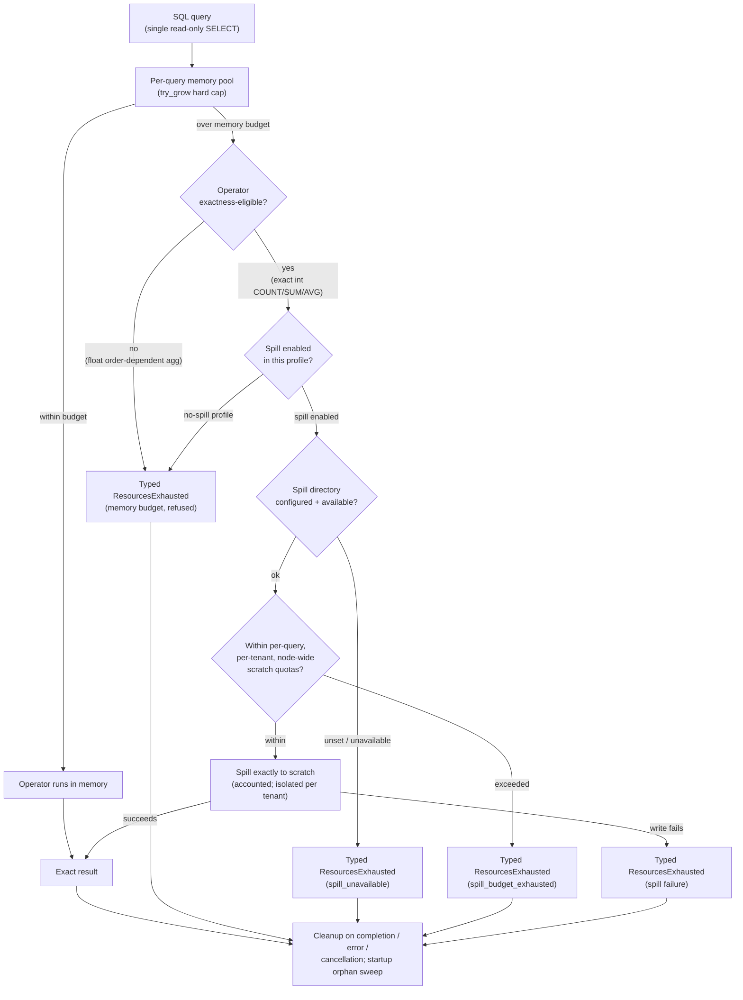
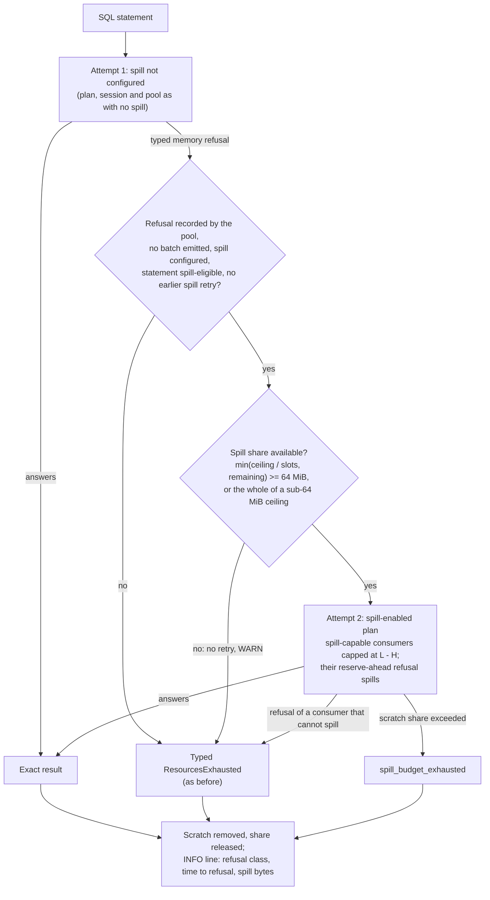

# ADR-0954: Bounded ephemeral spill for eligible SQL operators

Status: Accepted (2026-08-30)

Amends ADR-0013 (the "spilling stays disabled" clause) and ADR-0102
decision 3,
`docs/adrs/0102-intra-segment-scan-partitioning-and-spill-policy.md:270-302`
(the disabled disk manager). It does not touch either document in place;
both stand as written and are read together with this one.

Every reference below to "ADR-0102 decision 3" means that line range, the
normative Decision. ADR-0102's Context item 3 (same file, lines 51-63)
describes the *pre-decision* runtime in the present tense ("A
high-cardinality final aggregation ... most likely spills silently to local
disk today"); it records the problem ADR-0102 then fixed, not the state
after it. It is therefore not the text this ADR amends, and a bare
"ADR-0102" reference that lands a reader there reads as contradicting both
ADRs. Line ranges are given at each reference for that reason.

## Context

ADR-0013 established the SQL memory model: "budget exhaustion is an error,
never a partial result; spilling stays disabled." ADR-0102 decision 3
(lines 270-302) then made that literal in code, configuring
`RuntimeEnvBuilder::new().with_disk_manager_builder(DiskManagerBuilder::default().with_mode(DiskManagerMode::Disabled))`
so that an aggregation or `ORDER BY` over budget fails with a typed
`ResourcesExhausted` instead of silently spilling to DataFusion 54's
accidental default (`DiskManagerMode::OsTmpDirectory` with a 100 GB
ceiling), on a node whose disk is supposed to be disposable.

That posture is correct for what it defended against. It also refuses a
class of statement that a datastore advertising general analytical SQL is
expected to answer. Issue #837 measured the driver: ClickBench q33's
grouping is 1:1 with its rows -- 99,997,493 distinct groups from
99,997,497 rows -- so its hash aggregation needs O(D) aggregate state with
D approximately equal to N. Under a fixed per-query memory budget that
statement is refused. Refusing it is acceptable for an experimental
release; it is not a viable long-term property for a general analytical
SQL surface.

This ADR changes the rule for exceeding the memory budget: for explicitly
eligible operators it becomes a transition to a second, independently
bounded resource (ephemeral scratch), not a refusal and not a silent
degradation. Every other failure mode still produces a typed error.

The decision recorded here was made by the repository owner (issue #954).
This document records it, its reasoning, and the corrections to the
earlier #837 analysis that produced it.

## Decision

Every SQL query has independently enforced memory and scratch budgets.
Exceeding the memory budget may trigger exact spill for explicitly
eligible operators. Exceeding the scratch budget, unavailable scratch
capacity, or spill failure produces a typed `ResourcesExhausted` error.
Spill is per-query ephemeral execution state, is never committed, and is
never used for recovery. No partial result is returned.

This is the new invariant. It replaces "spilling stays disabled"
(ADR-0013) and "spill is a typed error, not silent degradation, achieved
by disabling the disk manager" (ADR-0102 decision 3, lines 270-302). It
preserves
ADR-0013's actual concern -- a partial result masking a budget problem --
because spill still produces the exact result or a typed error, never a
partial one.

### Why the old rule changed

1. **ADR-0102's rationale conflated transient execution state with durable
   state.** This is the load-bearing correction. ADR-0102 decision 3 (lines
   270-302) and its "Amend ADR-0013 to sanction bounded local-disk spill"
   rejected alternative (lines 345-355) both rest on the premise that a
   compute node retaining query
   state on local disk violates "compute is disposable, only object storage
   is durable." That premise does not hold: spill files are no more durable
   than the identical query state held in RAM. If the worker dies
   mid-query, the query fails either way; committed Ravel state remains
   exclusively in object storage either way. Disposable compute requires
   that no *durability* depend on local disk; it does not require zero local
   I/O. The invariant that survives is "no durability may depend on local
   disk," and ephemeral per-query scratch does not touch it.

2. **Spill does not produce a partial result.** ADR-0013's stated concern
   was "a partial result masking a budget problem." Spill does not create
   one: an eligible operator that spills produces the exact result or a
   typed error, nothing in between. What changes is only that exceeding the
   RAM budget becomes a transition to another explicitly bounded resource
   (the scratch budget), which itself fails typed when exhausted, rather
   than an immediate refusal. ADR-0013's concern is preserved, not weakened.

3. **The measured driver.** Issue #837 established that q33's grouping is
   1:1 with rows (99,997,493 groups from 99,997,497 rows), so the hash
   aggregation needs O(D) memory with D approximately N. Refusing such a
   statement is acceptable for an experimental release and is not a viable
   long-term property for a datastore advertising general analytical SQL.

### Two corrections to the earlier #837 analysis

<!-- amendment-applies: none reason="corrects claims from the external issue #837 analysis; neither retired phrase appears elsewhere in this document" -->

Both are load-bearing and are recorded here as corrections to that
analysis, not as new claims.

- **"No exact bounded algorithm exists" is too absolute.** The defensible
  statement is: over unsorted input, an exact one-pass implementation
  without external state, repeated scans, or a proven uniqueness or order
  constraint requires O(D) aggregate state. That is a statement about
  one-pass in-memory execution, not about the problem. External sorting,
  hash partitioning with spill, repeated partitioned scans, and distributed
  aggregation are all exact alternatives that bound memory by using another
  resource. Bounded exact execution exists; it just cannot be one-pass and
  purely in-memory at once.

- **"Local spill is the only path at any scale" is wrong.** It is the most
  practical path for Ravel's current single-node executor. Distributed
  repartitioning across workers and object-store-backed scratch are exact
  alternatives too. Local spill was chosen over them for now on executor
  complexity, not correctness: distributed repartitioning needs a shuffle
  transport, worker membership, and failure handling the executor does not
  have today, and object-store scratch adds per-spill-batch round-trip
  latency and its own lifecycle management to the hot path. Local ephemeral
  spill reuses DataFusion's existing disk-manager machinery and adds the
  least new surface. See Rejected alternatives.

### Normative implementation requirements

All nine are normative. Each states the reason it exists; a change that
drops the reason drops the requirement.

1. **A hard per-query memory cap, held across spill by in-pool sort
   headroom.** Spill is triggered by the memory budget being reached, so that
   budget must be a real ceiling first. This is the existing
   `TenantDelegatingPool::try_grow` per-query limit; without it there is no
   defined point at which an eligible operator begins to spill. The cap
   stays hard *through* the spill, not only up to it: DataFusion's
   grouped-hash spill reserves the transient headroom it needs to sort each
   emitted batch out of the same pool, not out of an allowance above it. In
   the locked dependency
   (`datafusion-physical-plan-54.1.0/src/aggregates/row_hash.rs:1241-1269`)
   `spill()` emits all groups with `EmitTo::All`, calls `clear_shrink(0)` to
   free the group hash state before it reserves so the pool has room, then
   `self.reservation.try_grow`s the estimated sort memory and returns a typed
   `ResourcesExhausted` if even that will not fit. So spilling never routes
   around the cap: what the cap bounds is pool-accounted bytes, and the sort
   headroom is charged to the same bound. The peak the cap must accommodate
   is one emitted batch plus its sort reservation held together (the group
   state having been freed first), so the effective ceiling for steady-state
   group state is below the configured pool by that worst-case headroom; an
   operator sizing the pool must leave that room. The gap the cap does *not*
   close is between pool-accounted bytes and process RSS (allocator overhead,
   Arrow buffer rounding, the emitted-batch-plus-sort peak): that gap is not
   bounded by reasoning and is validated only by the peak-RSS measurement
   required in the implementation-constraint section below, consistent with
   that section's rule that the memory-bound claim is a measurement result,
   not a consequence of enabling spill. Open question for the implementation:
   whether to leave the sort headroom implicit (configure the pool below the
   volume/RSS ceiling) or to model it as a named reserve. This ADR fixes the
   validation, not that choice.

2. **Per-query, per-tenant, and node-wide spill quotas.** The scratch
   budget of the invariant is three independent ceilings, mirroring the
   memory model's per-query and per-tenant structure and adding a node-wide
   one. The per-query quota bounds one statement; the per-tenant quota
   bounds one tenant's concurrent statements so a single tenant cannot fill
   the volume; the node-wide quota bounds the shared multi-tenant process so
   the sum of tenants cannot exhaust the disk and stall every query. Any one
   exceeded produces the typed `ResourcesExhausted` of the invariant.

   The three quotas are enforced by *reservation*, not by observing free
   space: a check-then-write against observed headroom lets concurrent
   spilling queries each see room and collectively overrun a quota. The
   discipline this ADR requires:

   - **What and when.** Before a batch is written to scratch, the query
     reserves the bytes it is about to write against all three counters
     (per-query, per-tenant, node-wide) in one atomic step. The reservation,
     not the subsequent write, is the point a quota is enforced; a reservation
     that would push any counter over its ceiling fails, and the query
     produces `spill_budget_exhausted` (requirement 5) without writing.
   - **Atomicity.** The per-tenant and node-wide counters are shared across
     queries, so their check-and-increment must be a single atomic operation
     (an atomic compare-and-add, or a lock held across check and increment),
     never a read followed by a later add. Reserving against all three in one
     step, and rolling back the ones already taken if a later one fails,
     keeps the counters consistent under concurrency. This is the requirement;
     the exact primitive (per-node in-process counters versus a shared
     accountant) is an implementation open question, because the node-wide
     counter's authority depends on whether one process owns the scratch
     volume (see requirement 7's shared-directory case).
   - **Failure mid-spill.** A query whose spill fails partway (a reservation
     denied for a later batch, a write error, cancellation) releases its
     entire outstanding reservation as part of the same termination path that
     deletes its files (requirement 7). Reservation lifetime is tied to the
     spilled bytes on disk: bytes accounted but not yet deleted stay reserved;
     a counter is decremented only as the corresponding files are removed, so
     a crash between write and cleanup cannot make a counter under-count live
     usage.
   - **Reclaim after a crash.** A process that dies mid-spill leaves both
     orphaned files and, for any cross-process (node-wide) counter, a
     reservation it can no longer release. The node-wide counter is therefore
     reconstructed from the scratch volume's actual contents at startup, in
     the same sweep that removes orphans (requirement 7), rather than
     persisted and trusted across a restart; per-query and per-tenant counters
     live only for the process and are gone with it. Making the node-wide
     counter authoritative across processes that do not share memory is the
     open question flagged above; until it is settled the safe posture is one
     spilling process per scratch volume (requirement 7). (Amended: see the
     cache-dir spill default amendment below, which makes the configured
     ceiling one process-wide bound that each query reserves its cap from;
     per-tenant and cross-process quotas remain open.)

3. **An explicitly configured spill directory, never DataFusion's
   accidental default.** ADR-0102's Context item 3 (lines 51-63) documented
   that leaving the disk manager unconfigured silently selected
   `DiskManagerMode::OsTmpDirectory` with a 100 GB ceiling -- the exact
   behavior decision 3 (lines 270-302) then disabled. Enabling spill must not
   reintroduce that by omission: the spill directory is set explicitly to a
   path an operator chose for ephemeral storage, with its own capacity
   understood, never the OS temp directory and never the 100 GB default
   ceiling. An unset directory is a configuration error, not a fall-through
   to the OS default (amended: see the cache-dir spill default amendment
   below, which derives the directory and its ceiling from `--cache-dir` when
   no spill environment names one, and keeps spill off when neither does;
   amended again by the refusal-retry spill amendment below, which turns
   spill on under the working directory when nothing else configures it).

4. **Exactness-aware eligibility, not an operator-name allowlist.**
   Eligibility is decided by whether spilling an operator yields the
   bit-exact same result as running it in memory, not by the operator's
   name. q33's integer `COUNT`, integer `SUM`, and exact integer `AVG` are
   eligible: their fold is associative and commutative over exact types, so
   partitioning, spilling, and re-merging cannot change the result.
   Order-dependent float aggregation stays refused until spill preserves its
   deterministic folding contract (ADR-0022, ADR-0024's sequential fold),
   because DataFusion's grouped-hash spill re-orders the fold (see the
   implementation constraint below). The distinction must be exactness and
   not operator identity because this repo's bit-exact invariant (ADR-0013's
   `f64::to_bits` differential gate) makes a name-based allowlist unsafe:
   `AVG` is exact over integers and order-sensitive over floats, so the
   operator name alone does not determine whether spill is safe. An
   allowlist keyed on the name would admit the unsafe case with the safe
   one. This matches ADR-0094's exact-typed classification (count/sum/min/
   max over non-float always exact, avg/mean over float never, any float
   GROUP BY key disqualifies, fail-closed on classification error), reused
   as the eligibility gate rather than duplicated.

   The classifier implementing this gate also refused every `Sort` node,
   because nothing proved a spilled run ties rows with equal sort keys in the
   same order as the in-memory run. The cache-dir spill default amendment
   below admits a `Sort` over a spill-exact aggregate once its sort key is
   made total over the aggregate's group keys.

   The classifier admitted only `count`, `sum` over an exact integer and
   `avg` over `Int64`, narrower than the classification above. The exact
   min, max and integer avg spill amendment below widens it to `min`/`max`
   over non-float types and to `avg` over every integer width Ravel's `avg`
   computes exactly.

5. **Typed `spill_budget_exhausted`, `spill_unavailable`, and cleanup
   errors.** The invariant's three failure modes (scratch budget exceeded,
   scratch capacity unavailable, spill failure) must be distinguishable at
   the API, not collapsed into one opaque string, so an operator can tell a
   tenant that overran a quota from a node with no working scratch volume
   from a spill that failed mid-write. Each maps through
   `SqlError::ResourcesExhausted` with a distinct message, matching the
   established "budget exhaustion is a typed error" convention
   (`bytes_scanned_exceeded` in ravel-query).

   `spill_budget_exhausted`, `spill_unavailable`, and the cleanup-error
   identifier are stable, machine-readable codes, not display strings. An
   operator alerting on spill failure keys on the code, so:

   - The code is a distinct field on the error, carried alongside the
     human-readable message, not extracted by matching the message text. It
     surfaces wherever the typed error does: the query API response and the
     spill accounting of requirement 6, using the same shape as the existing
     `bytes_scanned_exceeded` identifier in ravel-query rather than a new one.
   - The identifier is a compatibility contract: the message wording may be
     reworded freely, but the code string is fixed once shipped and is not
     changed by a message rewrite. Adding a new spill failure mode adds a new
     code; it never renames or repurposes an existing one. An alert written
     against `spill_budget_exhausted` keeps firing on the same condition
     across releases.

   The exact string spellings and where the field is declared are an
   implementation detail; that they are stable, message-independent, and
   append-only is the requirement.

6. **Spill accounting in query diagnostics.** Bytes written and read,
   file count, the operator that spilled, spill duration, and peak disk
   usage are reported per query, under the phase that issued them, matching
   the repo's cost-is-a-first-class-output rule. Without this a spilling
   query's true footprint is invisible and the memory-bound claim below
   cannot be checked against measurement.

7. **Cleanup on completion, error, and cancellation, plus startup orphan
   cleanup.** Spill files are ephemeral; leaking them fills the scratch
   volume and turns requirement 2's quota into a slow crash. Every query
   termination path (success, typed error, client cancellation) removes its
   own files, and process startup sweeps files orphaned by a previous
   worker that died before it could clean up -- the crash case the
   disposable-compute model explicitly allows.

   Three points the cleanup rule must settle, because getting them wrong
   ranges from a slow leak to destroying a live process's data:

   - **Orphan lifetime.** An orphan lives at most until the next startup
     sweep; it is never left indefinitely. The steady-state expectation is
     zero orphans, because every in-process termination path deletes its own
     files; an orphan exists only for files a crash left behind, and the
     bound on their lifetime is the time to the next process start plus one
     sweep. This ADR does not add a background reaper on the assumption that
     crashes are rare and startup is frequent on disposable compute; whether a
     periodic in-process sweep is also needed (long-lived processes, rare
     restarts) is an open question for the implementation, not a mechanism
     fixed here.
   - **Cleanup failure.** A delete that itself fails (an I/O error unlinking a
     spill file) must not be swallowed and must not fail the query's result:
     the query has already produced the exact result or its typed error, and
     cleanup runs after. A failed cleanup is reported through the cleanup-error
     code of requirement 5 and surfaced in diagnostics (requirement 6), and
     the file it could not remove is left for the startup sweep to reclaim.
     Cleanup failure degrades to the orphan path; it never silently loses
     track of a file.
   - **A scratch directory shared by two processes.** Startup cleanup that
     deletes files it does not own would destroy a concurrently running
     process's live spill -- a data-destroying bug. This ADR requires that a
     spill file be attributable to the process that owns it and that the
     startup sweep delete only files no live process owns. The safe default
     is exclusive ownership of a scratch directory: each process spills under
     a subdirectory keyed to its own instance identity, and the sweep removes
     only subdirectories whose owning process is provably gone, never the
     shared root wholesale.

     **A pid-liveness check is not ownership proof and must not be used as
     one.** A PID is reusable, so a live PID can belong to an unrelated
     process while the original owner is gone, and a PID that looks dead can
     be recycled between the check and the delete. Both directions produce the
     data-destroying outcome this requirement exists to prevent. Ownership
     must rest on an OS-level advisory lock held for the owner's lifetime, or
     on a non-reusable process-instance token, checked atomically with the
     removal. A process that cannot establish
     exclusive ownership of its scratch path, or prove a candidate orphan's
     owner is dead, must not sweep -- it treats the volume as read-shared and
     leaves foreign files alone. The exact ownership mechanism (per-process
     subdirectory plus an advisory lock or instance token, or one spilling
     process per volume as requirement 2's reclaim note assumes) is an
     implementation open question;
     the invariant fixed here is that no sweep ever deletes a file a live
     process owns. The cache-dir spill default amendment below settles the
     mechanism for a `--cache-dir` spill root: a per-process subdirectory
     plus an advisory lock on an owner file inside it.

8. **Isolation and protection of spilled tenant data.** Spill holds a
   tenant's query state on a shared multi-tenant node's disk. One tenant's
   spill files must not be readable by another tenant's query and must not
   outlive the query that wrote them, preserving ADR-0013's single-tenant
   `SessionContext` isolation and ADR-0009 tenant isolation on the local
   disk that spill newly introduces to the SQL path.

9. **A no-spill deployment profile.** Environments without safe ephemeral
   storage (no writable scratch volume, or one whose contents could leak or
   persist) must be able to disable spill entirely, reverting to the
   memory-budget-refuses posture. This preserves ADR-0102 decision 3's
   (lines 270-302) disabled-disk-manager behavior as an explicit deployment
   choice rather than deleting
   it: an operator who cannot meet requirements 3, 7, and 8 selects this
   profile and keeps the pre-this-ADR guarantee that no query state ever
   reaches local disk.

### Implementation constraint: the memory-bound claim needs measurement

DataFusion 54.1.0's grouped hash spill path materializes all current groups
with `EmitTo::All` and sorts that batch before writing it
(`datafusion-physical-plan-54.1.0/src/aggregates/row_hash.rs:1241-1269`,
`spill()`). Enabling the disk manager therefore does not by itself prove a
strict memory bound: as requirement 1 records, that sort headroom is
reserved from the same pool via `self.reservation.try_grow` after the group
state is freed, so the *pool-accounted* peak stays under the cap -- but
pool-accounted bytes are not process RSS. Allocator overhead, Arrow buffer
rounding, and the emitted batch held together with its sort reservation at
the moment of emission can put peak RSS above the configured pool. Related
bounded-emission limitations are tracked upstream as DataFusion #24072.

The consequence for this ADR is a rule, not just a caveat: the claim that
an eligible operator now runs within a bounded memory footprint is
established only by measuring peak RSS against a declared overhead on the
real workload, never by reasoning from "spill is enabled." A statement that
enabling spill makes q33 fit in budget is not a result until the peak-RSS
measurement backs it, pre-registered with its expected band per the repo's
measurement discipline.

This is a normative requirement on the implementation, not only a caution:
the memory-bound claim must be validated by a q33-scale peak-RSS test run
against the locked dependency version (DataFusion 54.1.0), and requirement 1
holds only for the pool sizing that test shows keeps peak RSS within its
declared band. The test pins peak RSS, not merely that the query completes:
a q33 (or q33-scale) grouped aggregation is run under a configured pool with
spill enabled, its peak RSS measured, and the assertion is that the measured
peak stays within the pre-registered band above the pool. Because the sort
headroom that pushes the peak up is DataFusion-version-specific
(`EmitTo::All`-plus-sort behavior can change across releases; #24072 tracks
the upstream direction), the test is bound to the locked 54.1.0 and is
re-validated on any DataFusion bump before requirement 1's claim is
re-asserted. Until that measurement exists, the memory-bound property is a
requirement to be demonstrated, not an established result. The `EmitTo::All`-plus-sort behavior is also the
concrete reason order-dependent float aggregation is ineligible
(requirement 4): the sort re-orders the fold, breaking the deterministic
folding contract that float exactness depends on.

## Relationship to ADR-0013 and ADR-0102

**ADR-0013.** The Decision's clause "budget exhaustion is an error, never a
partial result; spilling stays disabled" is amended: the final three words,
"spilling stays disabled," are superseded. "Budget exhaustion is an error,
never a partial result" still stands and is strengthened -- it now also
covers the scratch budget. ADR-0013's hard-cap paragraph (scan, sort, and
aggregate reserve through the enforced `try_grow` path) stands unchanged;
the memory cap is the trigger point for spill, not something spill removes.
ADR-0013's "memory ceilings are best-effort for joins" amendment stands
untouched: joins reach the pool through the infallible `grow` path and are
not among the eligible operators here, so nothing about their best-effort
accounting changes.

**ADR-0102.** Decision 3 (lines 270-302, "Disable the disk manager
explicitly; spill is a typed error, not silent degradation") is superseded
in its mechanism: the
disk manager is no longer configured to `DiskManagerMode::Disabled` for
deployments that enable spill. Decision 3's *goal* -- that a budget
overrun is a typed error and never a silent local-disk write -- is kept.
What changes is that the typed error now fires at the scratch-budget
boundary rather than at the first byte of spill, and eligible operators
reach that boundary by spilling exactly rather than by refusing at the
memory boundary. ADR-0102's "Leave the disk manager unconfigured (status
quo)" rejected alternative (lines 356-361) still stands: this ADR does not
leave it unconfigured, it configures an explicit spill directory
(requirement 3). ADR-0102's "Amend ADR-0013 to sanction bounded local-disk
spill" rejected alternative (lines 345-355) is the decision this ADR
reverses, on the corrected premise in "Why the old rule changed" item 1.

ADR-0102's typed-error machinery is kept and extended, not deleted. The
issue-#740 amendment (lines 596-660) and its `MSG_SPILL_DISABLED_MARKER`
re-attribution in
`crates/ravel-sql/src/error.rs` (`resources_exhausted_reattributed`, which
rewrites a refused pool error from the query's own pool figures at the
`PinnedStream::poll_next` seam) remains the shape for producing an
attributed typed error; the new `spill_budget_exhausted`,
`spill_unavailable`, and cleanup errors of requirement 5 extend that
surface rather than replacing it. Decisions 1, 2, and 4 of ADR-0102
(intra-segment partitioning, lines 81-147; ADR-0094 in place, lines 148-269;
the group-by scaling benchmark, lines 304-326) are untouched; only decision
3's disable-the-disk-manager mechanism is superseded.

**ADR-0036.** ADR-0036 rejected io_uring "on structural grounds," resting
in part on the finding that Ravel's data plane has "no local file I/O to
accelerate: no WAL, no mmap, no temp-file spill, no local cache." Bounded
ephemeral spill makes the "no temp-file spill" half of that premise no
longer literally true for the SQL execution path. This ADR does not reopen
or re-decide io_uring: spill is bounded per-query ephemeral scratch on the
execution path, not a durable hot data-plane path, and the rest of
ADR-0036's rejection (that accelerating the socket path would mean
replacing the async runtime under hyper) is unaffected. The premise change
is recorded here so a future io_uring reconsideration starts from the
corrected fact rather than the stale one; whether it warrants reopening
that question is out of this ADR's scope. (Flagged in the report as a
premise ADR-0036 states that this decision changes.)

## Rejected alternatives

- **Raise the per-query memory budget instead of spilling.** Rejected: it
  is unbounded -- q33 needs O(D) with D approximately N, so there is no
  fixed budget that admits arbitrary high-cardinality statements, only a
  larger one that fails a larger query. It also makes the benchmark
  unreproducible below roughly 24 GB, tying the result to hosts with that
  much RAM. ADR-0088's operator-configurable budget remains the escape
  hatch for a specific query that genuinely needs more memory; it is not a
  general answer to unbounded cardinality.

- **Leave q33 refused (the pre-this-ADR status quo).** Rejected: acceptable
  for an experimental release, not viable long-term for a surface
  advertising general analytical SQL. This is the #837 driver stated as its
  own alternative and rejected on the same ground.

- **Distributed repartitioning across workers.** Rejected for now: exact,
  but far more complex for the current executor -- it needs a shuffle
  transport, worker membership, and cross-worker failure handling the
  single-node executor does not have. A correct alternative, deferred on
  complexity, not correctness.

- **Object-store-backed scratch.** Rejected for now: exact, and it keeps
  all I/O on object storage, but it adds per-spill-batch round-trip latency
  to the execution hot path and its own object lifecycle and cleanup
  surface. More complex than reusing the local disk manager for a bounded
  ephemeral working set, and deferred on complexity, not correctness.

## Consequences

- An eligible high-cardinality statement (q33's integer `COUNT`/`SUM`/exact
  integer `AVG`) that was refused with `ResourcesExhausted` now completes by
  spilling exactly, subject to the scratch budgets. An ineligible statement
  (order-dependent float aggregation) is still refused until spill preserves
  its folding contract.
- Exceeding the scratch budget, unavailable scratch, or a spill failure is a
  typed `ResourcesExhausted`, distinguishable by requirement 5's three
  variants. The failure surface grows; it does not become silent.
- Query diagnostics gain spill accounting (requirement 6), so a spilling
  query's disk footprint is visible and the memory-bound claim is checkable.

What does not change:

- Object storage remains the sole source of truth. Spill is per-query
  ephemeral execution state.
- No durability or recovery path reads spill. Spill is never committed and
  is never read back by any process other than the query that wrote it,
  within that query's lifetime.
- No partial result is ever returned. Every path yields the exact result or
  a typed error.
- Data objects, commit records, manifests, and index objects remain
  immutable; no persistent format changes. This ADR is runtime execution
  configuration and behavior only.

## Diagram

Budget and spill decision flow, with the typed error boundary at each
resource. Every "over budget" edge from a resource that has no exact
bounded continuation produces a typed `ResourcesExhausted`.

## Amendment (2026-10-03): spill under --cache-dir by default, and a tie-ordered Sort (issue #2416)

<!-- amendment-applies: sections="Normative implementation requirements" pointer="cache-dir spill default amendment" -->

This is the cache-dir spill default amendment. It changes requirements 2,
3, 4 and 7 as follows; everything else in the Decision stands.

**Requirement 3: where the spill directory and its ceiling come from.** A
deployment no longer has to name a spill directory for spill to be on.
`ravel-server` resolves the spill configuration once at startup, first
source wins:

1. `--sql-spill off`: spill is disabled, whatever the environment or
   `--cache-dir` says. This is requirement 9's no-spill profile as a flag.
   The flag's other value, `auto`, is the default.
2. `RAVEL_SQL_SPILL_DIR` and `RAVEL_SQL_SPILL_MAX_BYTES` both set: that
   directory and that per-query ceiling, as before this amendment. (The
   ceiling is per process, as requirement 2 below says for every source; see
   the per-process spill ceiling correction.)
3. `--cache-dir` set and `RAVEL_SQL_SPILL_DIR` unset: the directory is
   `<cache-dir>/sql-spill/<instance-id>`. The ceiling is
   `RAVEL_SQL_SPILL_MAX_BYTES` when it is set alone, and otherwise
   `derive_spill_max_bytes`. Its input is the free bytes measured once at
   startup on the volume backing `<cache-dir>/sql-spill`, less the bound
   on the read cache's disk tier in the same directory
   (`cache_max_bytes + catalog_cache_max_bytes`, zero under
   `--disable-cache`), saturating at zero. The ceiling is half that input,
   capped at four times `memory_budget_bytes`, and raised to 1 GiB when
   that cap is below it. When half the input is itself below 1 GiB, spill
   is disabled instead, so a derived ceiling is never below 1 GiB and never
   more than half of what the read cache leaves free. With the host's
   memory unknown the budget is unbounded and only the half-of-free clause
   and the 1 GiB threshold apply.
4. Otherwise spill is disabled. (The refusal-retry spill amendment below
   replaces this item with the working directory as a fourth source.)

`RAVEL_SQL_SPILL_DIR` set without `RAVEL_SQL_SPILL_MAX_BYTES`, or
`RAVEL_SQL_SPILL_MAX_BYTES` set alone with no `--cache-dir`, still refuses
startup, now with an error that names the missing variable. Requirement 3's
purpose is kept: the directory is never the OS temp directory and the
ceiling is never DataFusion's 100 GB default; a derived directory sits under
the path the operator already chose for ephemeral local storage. The
instance identity is the `process_id` of the process's `WorkerSet`, drawn
fresh at each process start, which every mode builds; the same id is
written as a `sys/maintain/workers/<process_id>` heartbeat only by a
process that runs the maintenance loop (`maintain` mode). No second
identity is minted for spill.
Startup logs the outcome as two `performance default resolved` lines,
`sql_spill_dir` and `sql_spill_max_bytes`, each with a `source` of `env`,
`cache-dir`, `env-override`, `derived`, `flag-off`, `unset` or, for the
disabled case of item 3, `cache-dir-insufficient-space` on both lines
together with a WARN line. When item 3 derived the ceiling or disabled
spill for lack of space, the `sql_spill_max_bytes` line also carries
`free_bytes` and `read_cache_bytes`, the measured free bytes and the bound
subtracted from them.

**Requirement 2: the ceiling is one process-wide bound.** The resolved
ceiling (`SpillConfig::max_bytes`, derived or configured) bounds the scratch
of all the queries one `SqlExecutor` serves together, which in `ravel-server`
is the whole process. A query the eligibility gate admits reserves its own
disk-manager cap from that ceiling before its scratch directory is created:
the ceiling, or what remains of it if that is less. A query that would get
less than 64 MiB (or less than the whole ceiling, when the ceiling is below
64 MiB) runs with spill disabled, and the reason is logged at WARN. The
reservation is released when the query's scratch directory is removed, on
completion, error and cancellation alike. A query admitted while no other
holds a reservation reserves the whole ceiling, so while it runs a
concurrent eligible query runs with spill disabled; that is the price of
the bound. (The refusal-retry spill amendment below replaces the
whole-ceiling reservation with fixed shares, reserved on a spill retry or,
for a statement that keeps the per-statement decision, at planning.) The
per-tenant quota is not implemented, and nothing bounds the sum across
processes, so several processes sharing one cache volume can together hold
more than one ceiling: one spilling process per volume stays the safe
posture.

**Requirement 4: a `Sort` over a spill-exact aggregate is eligible.** Before
planning, `rewrite_sort_group_key_tie_order` appends to every `Sort` whose
input is an `Aggregate` with no float group-by key and only `count`, `sum`
or `avg` aggregate functions, or a `Projection` directly over one, the
aggregate's group-by expressions that are not already sort terms, in group
order, ascending with nulls last, as trailing sort terms; `fetch` is
unchanged. Group keys are unique per aggregate output row, so the sort key
becomes total and a run that spills and a run that stays in memory order
tied rows identically. Each group key is the aggregate's own qualified
output column: a projected expression counts as that key only when it is
that column, bare or under one alias, and a sort term covers it only when it
is exactly the column the projection exposes it as. A key the projection
drops is projected through it under a reserved tiebreak name, sorted on, and
removed again by a projection back to the statement's schema.

The rewrite is applied to the plan a statement executes whenever that plan
has a `Sort` of this shape, whatever the spill setting (on, off, or
disabled by `--sql-spill off`): the gate reads only the `Sort`'s input
shape, the group keys' types and the aggregate function names, never
argument types or spill eligibility, because that plan has not been
through the analyzer whose type coercion eligibility depends on (an `avg`
over an `Int32` column is exact only once its argument is coerced to
`Int64`). The order is therefore total and the same in every
configuration, including for a `sum` or `avg` over floats, which never
spills. A `Sort` over any other aggregate function is left as written: it
can never be eligible, and a trailing term would keep a `max` or `min`
top-k from the bounded aggregate of issue #1402, whose gate requires a
single sort term. For a statement that does not spill, the cost
is comparing the extra terms on rows whose earlier terms tie, plus carrying
a projected-through key column to the sort.
The spill decision is taken on the separately planned classification plan;
a statement granted spill re-checks eligibility on its executed plan after
the rewrite and, when that fails, runs with the disk manager disabled. A
rewrite that cannot be applied (a reserved name already in use) leaves the
plan as it was, which keeps it ineligible rather than failing the statement.
A `Sort` the rewrite does not reach (over grouping sets, over a `HAVING`
filter, or over nested projections) is left unchanged and stays ineligible.
(The exact min, max and integer avg spill amendment below adds `min` and
`max` to the functions this rewrite accepts, keeps a single-term `min`/`max`
top-k as written, and lets the rewrite reach a `Sort` over a `HAVING`
filter.)

**Requirement 7: the ownership mechanism.** A process whose spill resolved
under `--cache-dir` creates `<cache-dir>/sql-spill/<instance-id>` and takes
an exclusive `flock` on an owner file inside it before it serves any query,
and holds that lock until its shutdown completes; the kernel releases it on
any exit, including a crash.

The startup of a process that serves SQL (a query-serving mode, in a build
with the `sql` feature) sweeps `<cache-dir>/sql-spill` once, whenever three
conditions hold: `--cache-dir` is set, `--sql-spill` is not `off`, and
`<cache-dir>/sql-spill` already exists. A `maintain` or `gateway` process
does not sweep. The sweep runs first, before the
free space under `--cache-dir` is measured and whatever spill then resolves
to: it also runs when spill resolves to the `RAVEL_SQL_SPILL_DIR` pair's
directory, or resolves off because that free space is too little. The
measurement therefore sees the bytes the sweep reclaimed, and a volume that
was under the derived ceiling's floor only because of orphan roots resolves
spill on at that start. The sweep does not create `<cache-dir>/sql-spill`,
and it runs before this process creates its own root. A root under
`<cache-dir>/sql-spill` is removed only when this process can take that
root's lock itself. A root whose lock is held, or whose ownership cannot be
settled (no owner file, any other lock error), is left in place. The sweep
logs nothing for a held lock and a WARN with the path and the error for an
unsettled one; after the sweep, `ravel-server` lists `<cache-dir>/sql-spill`
again and logs each directory still there at INFO with its path and a
reason, which for a `.swept-` tree says its removal failed or is still in
progress in another process. A `.swept-` tree an earlier sweep moved aside
but did not finish deleting (see below) is deleted without a lock check:
the sweep creates that name only while it holds the orphan's lock. The
sweep lists `<cache-dir>/sql-spill` and removes only entries of that
listing; it does not check that `sql-spill` or a root's lock file is not a
symbolic link, so the guarantee that nothing outside it is touched holds
for a directory the server itself created. A process under
`--sql-spill off` does not sweep. A process that cannot take its own root's
lock refuses startup with an error naming the path, after the sweep has
run. Orphans live until the next start of a SQL-serving process on that
cache directory with spill not off, as requirement 7's orphan-lifetime rule
already allows.

The ownership check and the removal happen under one hold of the orphan's
lock. Holding it, the sweep checks that the root's lock path still names
the file it locked, renames the root aside to a `.swept-` name in the same
directory, releases the lock, and only then deletes the renamed tree. A
process starting at the same moment under the same instance id may have
opened the old lock file; after taking its own lock it checks that the lock
path still names the file it locked (same device and inode), and when it
does not, creates its root again and locks that, refusing startup if this
happens twice. The lock is the kernel's advisory `flock`, which only proves
ownership among processes on one host: on a network mount whose lock calls
are local to each client (NFS mounted `nolock` or `local_lock`), a sweep
on one host can take, and delete, another host's live root. The cache
directory of a process whose spill is not `off` must be on a local volume,
since its startup sweep runs wherever its spill resolves.

## Correction (2026-10-14): the spill ceiling is per process

<!-- amendment-applies: sections="Amendment (2026-10-03): spill under --cache-dir by default, and a tie-ordered Sort (issue #2416)" pointer="per-process spill ceiling correction" -->

This is the per-process spill ceiling correction (issue #2948). Item 2 of
the amendment's requirement 3 calls the `RAVEL_SQL_SPILL_MAX_BYTES` value
of the environment pair a per-query ceiling. It is not: whichever source
supplies it, the resolved `SpillConfig::max_bytes` is the one ceiling of
the amendment's requirement 2. `SqlExecutor::new` builds one `SpillBudget`
from it, every query granted spill reserves its cap from that budget, and
`ravel-server` builds one executor per process and shares it across its
HTTP, mTLS and Flight SQL surfaces. The environment pair therefore sets the
directory and the process-wide ceiling. Nothing else in the amendment
changes. The refusal-retry spill amendment below divides this ceiling into
shares.

## Amendment (2026-11-06): exact min, max and integer avg spill (issue #3899)

<!-- amendment-applies: sections="Normative implementation requirements|Amendment (2026-10-03): spill under --cache-dir by default, and a tie-ordered Sort (issue #2416)" pointer="exact min, max and integer avg spill amendment" -->

This is the exact min, max and integer avg spill amendment (issue #3899).
Requirement 4 classifies `count`, `sum`, `min` and `max` over non-float
types as always exact and `avg` as exact over integers, as ADR-0094 does.
The eligibility gate implemented less than that: `count`, `sum` over an
exact integer and `avg`/`mean` over `Int64`. ClickBench row 29, which groups
by a `regexp_replace` of a string and computes `AVG(length(..))`,
`COUNT(*)` and `MIN` of that string with a `HAVING` filter and an
`ORDER BY` the average, was therefore refused on the memory budget on a
4 GB host even with spill configured. The gate now matches requirement 4:

1. `min` and `max` are eligible over integers, decimals, booleans, strings
   (`Utf8`, `LargeUtf8`, `Utf8View`), binary, dates, times and timestamps,
   plain or as a dictionary's values. Their partial state is the running
   extreme in the argument's own type and a merge keeps the smaller (or
   larger) of two states, so the extreme does not depend on how the input
   was split or the order the parts merge in. A float argument stays
   refused, and so does every type not named here (durations, intervals,
   nested types).
2. `avg` and `mean` are eligible over `Int8` to `Int64` and `UInt8` to
   `UInt32`, plain or as a dictionary's values: the widths Ravel's `avg`
   coerces to `Int64` and averages with an exact `i128` numerator. `UInt64`
   stays refused, since that `avg` widens it to `Float64` and folds it as a
   float.
3. The tie-order rewrite of the cache-dir spill default amendment's
   requirement 4 accepts `min` and `max` among its aggregate functions,
   except for a `Sort` the bounded aggregate of issue #1402 would bound.
   That check is made on the logical plan. Two of its conjuncts call the
   rule's own helpers in `bounded_topk.rs`: the `LIMIT` (the `Sort`'s own
   fetch, or that of a `Limit` above it plus its `OFFSET`) no larger than
   `bounded_topk_max_limit`, and the group key and `min`/`max` result
   types that DataFusion's priority map supports, with no float result. A
   dictionary-encoded string key is checked as the `Utf8View` the physical
   plan groups it as. The rest restate the rule's structural refusals: the
   rule installed (a `bounded_topk_max_limit` is set), a `LIMIT` present,
   one sort term naming the output column of an aggregate whose only
   aggregate expression is one `min` or `max` with no `FILTER` clause,
   whose one argument is a column of the aggregate's input that is not
   nullable, descending for `max` and ascending for `min`, a single GROUP
   BY key, and nothing but an optional `Projection` between the `Sort` and
   the aggregate (no `HAVING` filter). A test plans each of its cases,
   including every pairing of an `Int64`, `Utf8`, dictionary, `Boolean` or
   `Binary` key with one of those or a timestamp argument, through the rule
   and requires the two to agree. That gate requires exactly one sort term,
   so a trailing tiebreak would take the top-k away from it. Such a `Sort`
   is left as written and stays spill-ineligible, as it was before this
   amendment; any other `Sort` over a single `min` or `max` gets the
   tiebreak.
4. The rewrite also reaches a `Sort` whose input is a `HAVING` filter
   directly over the aggregate, or a `Projection` directly over that
   filter. The filter only drops aggregate rows, so the group keys still
   identify each row it keeps and the appended terms make the order total.
   The bounded aggregate refuses a `HAVING` filter under its sort, so this
   takes no top-k from it.

DataFusion's grouped-hash spill path merging spilled partial states of
Ravel's `min` over strings, `max` over integers and `avg` over `Int32`
returns the in-memory result value for value, the average bit for bit, and
so does the row 29 shape; `crates/ravel-sql/tests/spill.rs` pins both with
nonzero spill counters.

## Amendment (2026-11-07): spill only after a refusal, shared scratch, and spill on by default (issue #3899)

<!-- amendment-applies: sections="Normative implementation requirements|Amendment (2026-10-03): spill under --cache-dir by default, and a tie-ordered Sort (issue #2416)|Correction (2026-10-14): the spill ceiling is per process" pointer="refusal-retry spill amendment" -->

This is the refusal-retry spill amendment.

### Refusal-retry context

ClickBench was run through its own harness on c6a.large (2 vCPU, 4 GB),
c6a.xlarge (8 GB) and c6a.2xlarge (16 GB) (issue #3899). On v0.30.1 with
spill off, the stock configuration, the three machines refused 9, 4 and 1
statements, every one a typed memory-budget refusal.

With spill on through the environment pair, some refused statements
answered, but three properties of the decision above cost the rest:

1. **An eligible statement is planned without repartitioning whether or
   not it spills.** The disk-manager permission is decided per statement
   before execution, and `RepartitionExec`, which no logical-plan
   classification sees, would hold it. On c6a.2xlarge the hot time of the
   statements that answered both ways rose 1.73x. Rows 34 to 36, which
   never needed spill, ran about 3.2x slower.
2. **Each eligible statement reserves the whole process ceiling.**
   Concurrent statements then ran without spill: the concurrent phase
   logged 243 `SQL spill disabled for this statement` warnings.
3. **The query pool is first come, first served.** A c6a.large measurement
   with requirement 6's per-consumer attribution showed this in every
   refusal of an eligible statement:
   - the asker was a scan that cannot spill, asking for 82 KB to 1.34 MB;
   - the top holder was one spill-capable final aggregate, holding 99.4%
     to 99.9% of the per-query limit;
   - consumers that cannot spill held 2.2 MB to 6.1 MB at their peak.

   The aggregate filled the pool to the limit and never spilled. One more
   refusal had the same cause from another side: an aggregate reserve-ahead
   refusal of a spill-capable final aggregate on the process envelope
   (853,958,589 bytes asked) failed the statement where a spill was
   available.

### Refusal-retry decision

1. **Spill is a second attempt, not a plan property.** Every statement
   first runs as if spill were not configured. That holds at every read of
   the spill configuration, not only the scratch reservation: the plan, the
   session, the column-statistics decision and the pool are those of a
   server with spill unconfigured.
   The hash exchange under its final aggregate is floored by ADR-1195's
   first-attempt floor amendment.

   When that attempt fails with a memory-budget refusal, the statement
   retries once with spill allowed, but only if all of these hold:
   - the attempt's pool recorded the refusal as a typed signal, not a
     message, and the refusal is the statement's own: its per-query
     limit; or a tenant budget, process budget or aggregate reserve-ahead
     refusal at which its own bytes on the refusing budget (its pool's
     charged bytes, plus, on the process budget, those of its aggregate
     envelopes among the process's `width` largest, the only envelope bytes
     the budget holds) were at least half of SQL execution's reserved bytes
     on that budget. A reserve-ahead refusal is a refusal of the shared
     process budget, so it takes the same test. On the process budget SQL
     execution's bytes are the budget's reserved total less the fetch
     layer's reservations (`MemoryBudget::sql_reserved`; the fetchers'
     buffers and the caches that reserve through the same path, among them
     the catalog's cached decodes and the decoded column-block cache, are
     listed at `MemoryBudget::fetch_reserved`): spilling frees only SQL
     memory, and memory a cache or a fetch buffer holds says nothing about
     another statement contending. The statement's fetch reservations are
     not counted in its own bytes either: they are made on the shared
     budget with no per-statement figure. A fetch-layer refusal does not
     count, because spilling does not shrink fetch buffers. Note
     (2026-11-07, second review of the M2 fix): the M2 fix first compared
     the statement's bytes against the process budget's whole reserved
     total, fetch layer included. On a 4 GB host running one statement at
     a time the decoded column-block cache and the fetch buffers can hold
     as much of the budget as SQL does, so a lone statement read as holding
     under half and stopped retrying, although the M2 run's
     single-statement phase depended on those retries (c6a.large: 22
     process budget and 3 aggregate reserve-ahead refusals; c6a.xlarge: 11
     and 1). Note (2026-11-07, review of
     the M2 fix): the M2 fix first retried every reserve-ahead refusal and
     counted every envelope of the pool, including envelopes outside the
     `width` largest that the process budget does not hold; under
     concurrent load another statement could fill the process budget and
     this statement's small envelope growth could earn a retry that wrote
     nothing. Note (2026-11-07, the M2
     verification run): this bullet first counted every tenant and
     process budget refusal and a fetch-layer refusal of the process
     budget with an accounted cause. In the c6a.2xlarge concurrent phase
     (10 connections) the error ratio rose to 0.360 from 0.119; the first
     refusals were 62 tenant budget and 26 process budget refusals, mostly
     other statements' reservations, and 16 of the 43 retried statements
     wrote no spill bytes. On c6a.large row 9 a fetch-layer refusal was
     retried and failed the same way on all three tries;
   - no batch was emitted;
   - spill is configured;
   - the statement's classification plan is spill-eligible under
     requirement 4;
   - the statement has not retried for spill before.

   The retry re-resolves, is planned with spill allowed, and runs within
   the same statement deadline. Its result or typed error is the
   statement's; nothing is assembled across attempts. These are returned as
   they are, with no retry:
   - a refusal after emission;
   - a second refusal;
   - `spill_budget_exhausted` and `spill_unavailable`;
   - a deadline;
   - a host memory gate refusal.

   Exactness is unchanged: the retry is the path this ADR already admits.
   Flight SQL keeps the per-statement decision until it has the same retry.
2. **A spill-enabled query pool keeps headroom for what cannot spill.** In
   the retry's pool, a spill-capable consumer is refused, and so spills,
   once the bytes charged to spill-capable consumers plus their aggregate
   envelopes would exceed the query limit `L` less a headroom `H`.
   Consumers that cannot spill may use that headroom. `H` is `max(64 MiB,
   10% of L)`. At its 64 MiB floor, which binds on small hosts, that is
   about eleven times the 6.1 MB non-spillable peak the c6a.large
   measurement found, and more where 10% of `L` is larger. The peak is set
   by the data, not by `L`. `H` is re-derived if a later measurement finds
   a peak above it. Note (2026-11-07, the M2 verification run): a
   spill-capable consumer is also refused once its own charged plus
   enveloped bytes would exceed its fair share, `L - H` divided by the
   number of spill-capable consumers registered in the pool, DataFusion's
   `FairSpillPool` rule. A grow within the asker's share is admitted even
   when the total is over `L - H`, up to a hard bound of `L - H/2` (`H/2`
   by integer division): no checked grow of a spill-capable consumer takes
   the total past it, within its share or not, so half of `H` is always
   left to consumers that cannot spill. The consumer over its share is
   refused at its next checked grow, and until then the total may stay
   above `L - H`, up to `L - H/2`. On c6a.large row 14 the whole-pool cap
   alone refused the outer final aggregate, holding 14 MB, every time,
   while the inner aggregate held 734 MB and never got the refusal that
   would make it spill. Note (2026-11-08, the M3 fix): a spill-enabled
   session's disk manager bounded DataFusion's spill merge fan-in at 2 (a
   constant in `crates/ravel-sql/src/session.rs`, replaced by the setting
   in the fan-in choice note below); a
   spill-disabled one keeps DataFusion's default, 0, which is unbounded. A
   spilled aggregate replays its runs through DataFusion's multi-level merge,
   which with no bound seats one read buffer per run until the pool refuses a
   grow, and the re-aggregation behind the merge grows on the same pool with
   no spill to fall back on, so the first refusal it meets fails the
   statement. With the merge left that room, the ClickBench row 35 shape
   failed its retry at a spill-mode cap of 50% of the unlimited peak, the
   final aggregate's replay asking past the cap, and the row 14 shape at
   70%. The cost is extra merge passes that rewrite the runs: in the
   issue's sweep of the two shapes at caps of 30% to 100% of the unlimited
   peak, fan-in 2 wrote up to 2.4 times the spill bytes of the unbounded
   merge (row 35 at 80%: 57.5 MB against 24.3 MB). It passed 15 of the 16
   cells, against 13 unbounded and 13 at fan-in 4, 8 and 16. Fan-in 3 also
   passed 15 and wrote fewer bytes in the cells measured, but it is one step
   from fan-in 4, which fails row 35 at 50%, so 2 is kept for the margin.
   The remaining failure,
   row 14 at 40%, fails at every fan-in swept: the lone aggregate's replay
   outgrows its fair share. DataFusion 55 raises a fan-in of 1 to 2, so 2 is
   the smallest bound it applies. Note (2026-11-08, spill compression): a
   spill-enabled session writes its spill files as lz4_frame
   (`SpillDecision::SPILL_COMPRESSION` in `crates/ravel-sql/src/session.rs`,
   logged at startup as the `sql_spill_compression` setting); a
   spill-disabled one keeps DataFusion's default, uncompressed. The scratch
   quota counts live spill-file bytes, and the multi-level merge takes runs
   first in, first out and keeps a pass's inputs on disk until the pass
   ends, so at fan-in 2 the live peak is the spilled bytes `S` plus the
   largest pass output: at most about 1.67 times `S` for any number of equal
   runs, and below 2 times `S` when the last run is smaller. `S` is now the
   compressed bytes. In the M4 c6a.large readout (issue #3899) ClickBench
   row 33 spilled about 6.5 GB uncompressed and failed every try against
   its 9,437,761,536-byte scratch quota. On the fixtures in
   `crates/ravel-sql/tests/spill.rs` lz4_frame wrote, as the operators'
   spilled-bytes metric counts them (bytes in the files on disk):
   - the integer-keyed row 33 shape, 8,835,488 bytes against 33,183,392
     uncompressed, a ratio of 3.76. Its retry takes a merge pass and peaked
     at about 8.70 MB live against 32.69 MB, about 1.79 times its first runs'
     bytes because its last run was the smallest; it fits a 16 MiB quota
     only compressed;
   - the string-keyed q33 shape, 1,090,336 bytes against 8,094,736, 7.42;
   - random 128-byte binary keys, 13,697,776 bytes against 15,229,920, 1.11:
     Arrow IPC writes a buffer the codec does not shrink uncompressed, so
     incompressible data costs CPU and no extra disk.

   lz4_frame rather than zstd: it costs less CPU on a 2-vCPU host, and a
   spill file is written and read once per merge pass. Still exposed: a
   statement whose spill does not compress and whose `S` exceeds about 60%
   of its scratch share (50% when its runs differ in size) still gets the
   typed `spill_budget_exhausted` error.

   Note (2026-11-08, the fan-in choice, issue #3899): the fan-in is now
   `SpillConfig::merge_fan_in`, default 2 (`DEFAULT_SPILL_MERGE_FAN_IN` in
   `crates/ravel-sql/src/config.rs`), set at startup with
   `--sql-spill-merge-fan-in`. `0` is DataFusion's unbounded merge and `1`
   is refused at startup. The startup log's `sql_spill_merge_fan_in` line
   reports the value and whether it came from the flag. DataFusion's merge
   is first in, first out: each pass takes the first F runs of its queue,
   writes their merge while the inputs are still on disk, queues the output
   behind the rest, and releases the inputs when the pass ends. The scratch
   peak is therefore the spilled bytes S plus the largest intermediate
   merge output, and since no pass but the last reads every run, it stays
   under 2S at any F. S counts spill-file bytes on disk, as the scratch
   quota does, so under the spill compression note above it is the
   lz4_frame bytes. It depends on the run count N and on the size of the
   last run, which holds the remainder of the input. No closed form in F
   alone fits the measurements below: `1 + 1/F` predicts 1.25 for F = 4 at
   about 16 runs, a power of 4, which needed 1.44 to 1.46. With runs of
   equal size the worst N for a fan-in F is F + 1, where the first pass
   rewrites F of the F + 1 runs, at about `1 + F / (F + 1)` times S: 1.67
   at F = 2 and more at every larger F (1.75 at 3, 1.8 at 4, 1.89 at 8). A
   last run smaller than the others lifts that toward 2S at any F, which is
   why the F + 1 cells below sit above those figures. The smallest scratch
   quota the row 33 shape passed at, over S, with the lower figure failing
   and the upper passing, measured before spill files were compressed, so
   over uncompressed S:

   | Runs N | F = 2 | F = 3 | F = 4 | F = 8 |
   |---|---|---|---|---|
   | 4 | 1.52-1.54 | 1.80-1.82 | 1.00-1.02 | 1.00-1.02 |
   | 5 | 1.52-1.54 | 1.69-1.71 | 1.92-1.93 | 1.00-1.02 |
   | 9 | 1.51-1.52 | 1.34-1.36 | 1.46-1.48 | 1.93-1.95 |
   | about 16 | 1.54-1.56 | 1.61-1.62 | 1.44-1.46 | 1.41-1.43 |
   | 34 | 1.51-1.52 | 1.72-1.74 | 1.46-1.48 | 1.23-1.25 |

   The unbounded merge passed at 1.00-1.02 with 9 runs. At 34 runs and
   the c6a.large figure of 6.48 GB spilled uncompressed, F = 8 needs 7.96 to 8.07 GB,
   against a margin of 8.0 GB on the 9.44 GB share; F = 2 needs 9.8 GB,
   over the share. The replay room at the geometry of a 4 GB host (row 35
   at 1.6 million groups, row 14 at 1 million, the process budget at the
   unlimited peak) separated nothing: every fan-in of 2, 3, 4 and 8, and
   the unbounded merge, answered at spill-mode caps of 40%, 50% and 70%
   with the unlimited rows. Spill files written:

   | Shape | Cap | F = 2 | F = 3 | F = 4 | F = 8 | Unbounded |
   |---|---|---|---|---|---|---|
   | row 35 | 40% | 14 | 11 | 10 | 8 | 8 |
   | row 35 | 50% | 12 | 9 | 8 | 7 | 7 |
   | row 35 | 70% | 8 | 6 | 6 | 5 | 5 |
   | row 14 | 40% | 14 | 11 | 10 | 9 | 9 |
   | row 14 | 50% | 12 | 9 | 9 | 8 | 8 |
   | row 14 | 70% | 10 | 8 | 8 | 7 | 7 |

   Below those caps, 8 and the unbounded merge failed and passed at the
   same caps (row 35 failed at 7% and 8%, row 14 at 5% to 12%). 2 is
   chosen for its bound: with runs of equal size its worst case over every
   run count is the least of any bounded fan-in, where 8's peak turns on
   where N falls (1.93 to 1.95 times S at 9 runs, 1.23 to 1.25 at 34). It
   also seats the fewest runs in the merge that replays a spilled
   aggregate. At the small geometry of the issue #3967 tests (200,000
   groups, a cap that seats about six runs) 8 replays like the unbounded
   merge and fails row 35 at 50% and row 14 at 70%, which 2 passes. The
   cost is the c6a.large row 33 cell above: at 34 runs 2 needs 1.51 to 1.52
   times S, 9.8 GB, over that host's 9.44 GB share, where 8 fit. Those
   figures are uncompressed; lz4_frame shrinks S by the spill's
   compression ratio, and the cell has not been measured on that host
   with compressed spill files. The row 33 tests in
   `crates/ravel-sql/tests/spill.rs` pin the bound with integer keys and
   S in lz4_frame bytes: with 3, 4, 5, 6 and 8 runs of about equal size a
   quota of 1.70 times S answers (peaks 1.65-1.66, 1.54-1.55, 1.50-1.51,
   1.65-1.66 and 1.54-1.55), with 4 runs 1.45 is refused, and 3 runs whose
   last is small (peak 1.93-1.94) are refused at 1.70 and answer at 2.
   Uncompressed spill files bisect to the same peaks over their own S.
3. **In a spill-enabled pool, a reserve-ahead refusal of a spill-capable
   consumer is a spill trigger, not a failure.** The same refusal of a
   consumer that cannot spill is unchanged, and so is any refusal in a
   pool whose query may not spill.
4. **The process ceiling is shared in fixed shares.** `slots =
   clamp(floor(ceiling / 8 GiB), 1, 4)`. A statement whose first attempt
   was refused reserves `min(ceiling / slots, remaining)` before its spill
   retry.
   - When that is under 64 MiB, the statement does not retry: the first
     attempt's refusal is returned, with the reason logged at WARN.
   - The earlier exception for a ceiling below 64 MiB, which only an
     explicit `RAVEL_SQL_SPILL_MAX_BYTES` can set (a derived ceiling is
     never below 1 GiB), is kept: its single share is the whole ceiling,
     and the retry runs with it.
   - A ceiling under 16 GiB keeps one slot, so one spilling statement at a
     time, as before.
   - A statement that keeps the per-statement decision (Flight SQL, until
     it has the retry) reserves one share the same way, at planning. When
     no share of at least the minimum remains, it runs with spill disabled,
     and the reason is logged at WARN.
   - A plan-time statement therefore never holds more than one share. Where
     the ceiling has two or more slots, the retries keep the others. Where
     it has one, which is a ceiling under 16 GiB or the sub-64 MiB
     exception, that one share is the whole ceiling, as it is for a retry.
5. **Spill is on by default.** With no `--sql-spill off`, no environment
   pair and no `--cache-dir`, spill resolves as item 3 of the cache-dir
   spill default amendment does, with two differences: the process's
   working directory takes the place of the cache directory, and there is
   no read cache to subtract. The root is
   `<working directory>/sql-spill/<instance-id>`, with the same owner lock
   and startup sweep. The ceiling is `derive_spill_max_bytes`, unchanged.

   Spill resolves off, with a WARN, in three cases:

   | condition | `source` |
   |---|---|
   | the directory sits on tmpfs or ramfs | `cwd-tmpfs` |
   | it cannot be read, or the spill directory cannot be created, measured or locked | `cwd-unavailable` |
   | half its free bytes is under 1 GiB | `cwd-insufficient-space` |

   With spill on this way, both startup lines read `source="cwd-default"`,
   and `unset` is no longer reported.

   The working-directory default applies only when neither spill
   environment variable is set. `RAVEL_SQL_SPILL_MAX_BYTES` set alone with
   no `--cache-dir` still refuses startup, as item 3 of the cache-dir
   amendment says, and is not read as a ceiling for the working directory.
   An explicit ceiling therefore always comes with an explicit place.

   The precedence is `--sql-spill off`, then the environment pair, then
   `--cache-dir`, then the working directory. This replaces requirement
   3's sentence that an unset directory is a configuration error. Its
   purpose stands: the directory is never the OS temp directory and never
   memory-backed, and the ceiling is never DataFusion's 100 GB default.

   The repository's container image sets no working directory of its own.
   It runs in `/home/nonroot`, the working directory of its distroless
   `nonroot` base image:
   - Under the operator the root filesystem is read-only, so the server
     resolves `cwd-unavailable`, unless the container mounts a volume and
     names it.
   - Run on its own, `/home/nonroot` is writable and spill is on, in the
     image's overlay storage.

The ordering matters: item 5 without item 1 would bring the repartition-free
plan back to every eligible statement on every default deployment.

### Refusal-retry rejected alternatives

- **Keep the repartitioned plan and enable the disk manager on it.** An
  enabled session is not the same session when nothing spills.
  DataFusion 55.2's final aggregate reserves four more bytes per group for
  spill sorting and registers as spill-capable, which ends the
  last-release hold. A statement that fits today could be refused, or
  spill. This remains the path to parallel spill, once the exchange spill
  is classified and the bucketed final aggregate can spill.
- **Grant spill per operator at run time.** This is exact, but DataFusion
  reads the permission from the session's runtime environment per stream.
  It needs a wrapper that hands classified operators a different task
  context, so it is deferred on complexity. Item 1 already removes the
  cost it would remove.
- **Cap the consumers that cannot spill.** A non-spillable consumer
  refused at its cap fails the query just as it does at the limit. The cap
  moves the failure; it does not create room.
- **Shrink the aggregate reserve-ahead envelope on small limits.** The
  envelope stands for an allocation DataFusion makes before it reserves.
  Shrinking it trades a typed refusal for memory no budget sees. Item 3
  makes the envelope refusal a spill point instead.
- **One share per expected concurrent query (`ceiling / Q`).** A
  high-cardinality statement's spill is set by the data, not the host:
  q33's is several gigabytes on every box. A sixteenth of the ceiling
  would refuse it on the larger box.
- **Default under the OS temp directory.** On several distributions it is
  tmpfs, which is memory. Inside a cgroup it is charged to the memory limit
  spill exists to protect.
- **Leave spill off and set it in the benchmark entry.** A deployment on
  defaults would keep refusing statements this ADR says must answer.

The exact min, max and integer avg spill amendment above extends the
tie-order rewrite through a `HAVING` filter. That change is separate, and
it is measured on the statement it moves.

### Refusal-retry consequences

- A statement that answered before this amendment runs the same plan and
  session whether or not spill is configured.
- An eligible statement refused for memory runs twice: once to the
  refusal, and once with spill. It returns the exact result or a typed
  error. The refused attempt's time is part of its latency. One INFO line
  names the refusal class, the time to refusal and the retry's spill bytes.
- A spilling query's non-spillable consumers keep `H` of its limit.
- Up to four queries spill at once on a ceiling of 32 GiB or more. A
  ceiling under 16 GiB still admits one spilling query at a time.
- A deployment with no spill configuration now writes to its working
  directory when a statement needs to spill. `--sql-spill off` restores
  requirement 9's no-spill profile.
- A container whose working directory is on overlay storage counts spill
  against the pod's ephemeral storage, so it should name a volume
  explicitly. The operator does not yet render one (issue #3916).
- Unchanged: object storage is the only durable store, spill is per-query
  ephemeral state no other process reads, and no partial result is
  returned.
- 2026-11-08: an unordered `GROUP BY ... LIMIT n` with an aggregate, the
  shape of ClickBench row 18 that issue #3985 saw refused and retried, no
  longer builds every group in its final aggregate and so no longer reaches
  this retry on that table; see the unordered GROUP BY LIMIT amendment
  below.

### Refusal-retry diagram

## Amendment (2026-11-08): an unordered GROUP BY ... LIMIT no longer reaches the refusal-retry (issue #3985)

<!-- amendment-applies: sections="Amendment (2026-11-07): spill only after a refusal, shared scratch, and spill on by default (issue #3899)" pointer="unordered GROUP BY LIMIT amendment" -->

This is the unordered GROUP BY LIMIT amendment. ClickBench row 18,
`SELECT "UserID", "SearchPhrase", COUNT(*) FROM logs GROUP BY "UserID", "SearchPhrase" LIMIT 10`,
charged 2.5 to 2.8 GB in its final aggregate on an 8 GB host and was
occasionally refused at the process limit, then answered through this
ADR's refusal-retry about 25 s slower (issue #3985). ADR-3985 places a
`FirstGroupsExec` under the final aggregate of an unordered
`GROUP BY ... LIMIT n` with at least one aggregate and `n + s` at most
`SqlConfig::bounded_groups_max_limit` (default 1024), so each final
partition holds at most `n + s` groups and the answer stays exact. That
shape no longer reaches the retry through its group table. Nothing in the
refusal-retry design changes: an ordered top-k by `count` or `sum`, such as
row 17, and an unordered limit over a `HAVING` filter still build every
group and keep the retry.
