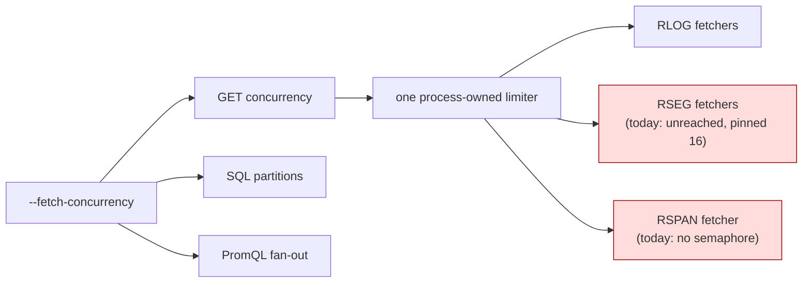

# ADR-1195: Unbundle `--fetch-concurrency`, and make GET concurrency a process-wide limit

- Status: Accepted (2026-10-14).
- Implemented: `GetLimiter` in `crates/ravel-query/src/limiter.rs`, with the
  flags and the shared limiter wired in `services/ravel-server/src/config.rs`
  and `services/ravel-server/src/lib.rs`.
- Date: 2026-09-03
- Refs: #1195, #1191, #1170, #1185, ADR-0087, ADR-0088, ADR-0107

## Context

`--fetch-concurrency` is one flag driving four consumers:

```text
crates/ravel-query/src/engine.rs:358, :369        with_max_concurrent_gets()  RLOG GET semaphore
services/ravel-server/src/query.rs:333            with_max_concurrent_gets()  RLOG GET semaphore
crates/ravel-sql/src/session.rs:540               with_target_partitions()    DataFusion partitions
crates/ravel-query/src/engine.rs:1366,1784,2092   buffer_unordered()          PromQL fan-out
```

This coupling is documented, not accidental: `docs/reference/ravel-server-flags.md:39`
names all three effects, and ADR-0088's amendment records the derived default
`max(8, 2 x cores)` while noting "it also sets the SQL scan partition count".
This ADR supersedes that part of ADR-0088's decision.

Two defects sit behind the one name.

**The GET-concurrency half never reaches two of the three fetchers.** The RSEG
`SegmentFetcher` is constructed bare at every site, so it keeps the compiled
`DEFAULT_MAX_CONCURRENT_GETS = 16` (`crates/ravel-query/src/fetcher.rs:127`)
whatever the operator sets: `crates/ravel-query/src/engine.rs:374`,
`services/ravel-server/src/query.rs:306`,
`services/ravel-server/src/distrib.rs:796`,
`services/ravel-server/src/cache_warm.rs:99`. `SpanSegmentFetcher` has no
semaphore at all (`crates/ravel-query/src/span_fetcher.rs:169-193`). PromQL and
the SQL metrics path therefore ignore the knob that documents itself as governing
their GET concurrency.

**A permit count is not a node limit.** `get_semaphore` is a field on each
fetcher instance (`crates/ravel-query/src/fetcher.rs:579`), and fetchers are
constructed independently per query engine, per SQL executor, and — in the
distributed path — per fragment request (`distrib.rs:796`). Giving each one N
permits admits a multiple of N concurrent GETs against the store, with no
process-level ceiling anywhere.

The performance case for raising GET concurrency on the whole-object path does
not survive scrutiny and is deliberately not claimed here. Stock at concurrency
32 against 256 measured 525.0 s against 486.0 s, but the implied per-statement
fixed cost differs by 1.1 s between those runs and the byte volume differs by
3.2%, so the 7.4% is not attributable to concurrency (#1185). This ADR is a
correctness and reachability fix. The configuration where concurrency
demonstrably matters is the ranged path (596.3 s of transfer at 32 against
171.0 s at 256), and selecting that path is ADR-1196's decision, not this one.



## Decision

**Three named knobs**, each with its own flag, unit and derived default:

| Flag | Unit | Governs | Derived default |
|---|---|---|---|
| `--store-get-concurrency` | count of permits | concurrent GETs against the object store, process-wide | `max(8, 2 x cores)` |
| `--sql-partition-count` | count of partitions | DataFusion `target_partitions` (`crates/ravel-sql/src/session.rs:540`) | `max(8, 2 x cores)` |
| `--promql-fetch-fanout` | count of in-flight futures | `buffer_unordered` width (`crates/ravel-query/src/engine.rs:1366,1784,2092`) | `max(8, 2 x cores)` |

Every unit is a positive integer count. Zero is rejected during configuration
resolution, before any fetcher or SQL session is constructed, and
`EngineConfig::validate` gains the same check for direct construction. Today
nothing rejects it: `with_max_concurrent_gets` silently converts zero to one
and the SQL session applies `.max(1)` to the partition count, so an operator
who sets zero gets one without being told. A refused startup is the honest
answer to a value that has no meaning. All three
formulas are today's single derived default, so **no default moves**: the split
changes which knob an operator turns, not what an untouched deployment does. The
`max(8, ...)` floor and the `2 x cores` factor come from
`MIN_DERIVED_FETCH_CONCURRENCY` and `FETCH_CONCURRENCY_PER_CORE`
(`services/ravel-server/src/config.rs:1548-1553`) and are carried over unchanged
so that the three can diverge later, deliberately, rather than by accident here.

No default moves. The SQL partition default in particular stays where it is:
`crates/ravel-sql/src/session.rs:540-544` sets `target_partitions` immediately
above `with_repartition_aggregations`, which ADR-0094 and ADR-0954 depend on, and
moving it silently would put those in scope. (While the count is derived, the
hash exchange under a final aggregate has at least 16 partitions: see the
first-attempt floor amendment below.)

**GET concurrency becomes one process-owned limiter**, an `Arc` constructed once
and shared by every query-side fetcher, replacing the per-fetcher semaphore. The
RSEG `SegmentFetcher` and `SpanSegmentFetcher` are wired to it at every
construction site. The flag then means what it says: a **process-wide** ceiling
on concurrent store GETs.

Process-wide, not node-wide: an `Arc` coordinates the fetchers inside one server
process and cannot see a second process on the same host. A node running two
`ravel-server` processes can still issue twice this number of concurrent GETs,
and nothing here changes that. A node-wide bound would need a mechanism outside
the process, which this ADR does not propose.

**Legacy precedence is explicit.** `--fetch-concurrency` remains, setting all
three. Supplying it together with any of the new flags is a **startup error**
naming both, not a silent precedence rule.

**Compatibility changes are named, not denied.** Three behaviours change for
existing deployments:

- **RSEG fetchers start honouring the limit, and are shared.** For a
  deployment with no explicit legacy value they move from the compiled
  `DEFAULT_MAX_CONCURRENT_GETS = 16` to the derived default, 32 on a 16-core
  host. For a deployment that set `--fetch-concurrency` explicitly, the
  alias now reaches RSEG too, so RSEG moves to THAT value: a deployment on
  `--fetch-concurrency=8` takes RSEG from 16 down to 8, and one on `64`
  raises it to 64. Either way RSEG becomes subject to a shared ceiling it
  previously escaped, and either way the change is a consequence of the
  operator's existing setting finally applying where it was documented to.
- **RSPAN fetchers are constrained for the first time.** `SpanSegmentFetcher`
  has no semaphore today, so its GET concurrency is bounded only by its caller.
  Wiring it to the limiter is a restriction, not a raise, and it is the one
  change here that can make a workload slower. Span-heavy deployments should be
  told so in the release notes rather than discovering it.
- The distributed fragment path stops being able to exceed the node limit by
  constructing a fetcher per fragment.

All three are the point of the change. None is invisible, so the release notes say
so rather than claiming no deployment is affected.

## Rejected alternatives

**Leave the flag bundled and document it better.** It is already documented
(`ravel-server-flags.md:39`); documentation is not the defect. The defects are
that two fetchers ignore the knob and that no ceiling is process-wide.

**Keep the per-fetcher semaphore and just wire it everywhere.** Simpler, and it
fixes reachability. Rejected because it leaves the multiplication: the
distributed path constructs a fetcher per fragment, so per-fetcher permits give
no node-level bound at all, which is the property an operator setting this flag
believes they are buying.

**Move the SQL partition default at the same time.** Tempting, since 256
partitions cost roughly 19 GB of process peak in measurement. Rejected: that
number is a whole-process peak that also contains the read cache and up to
11.24 GB of cached corpus, so it does not isolate the partition cost, and
changing that default pulls ADR-0094's aggregation gate into scope.

## Consequences

- The knob an operator sets for GET concurrency starts governing every fetcher
  and the process as a whole.
- ADR-0088's amendment is superseded in the part that records `fetch_concurrency`
  as the single knob for both scan fan-out and GET concurrency. That supersession
  takes effect when this ADR is accepted and implemented; while it is `Proposed`,
  ADR-0088 and the production wiring are unchanged and remain authoritative.
- ADR-0107 sizes the RLOG fetch pool from the same flag and is **not** reconciled
  here. Implementation must decide which of the three new knobs that sizing
  follows, and record the answer in ADR-0107, before the split lands. Until then
  ADR-0107 stands as written.
- Three flags where there was one, plus a deprecated alias. The reference doc and
  the derived-defaults table both change.
- No performance claim. If a benchmark moves on this change alone, that is a
  finding to investigate, not the expected outcome.

## Amendment (2026-11-09): the hash exchange under a final aggregate has at least 16 partitions (issue #4014)

<!-- amendment-applies: sections="Decision" pointer="first-attempt floor amendment" -->

This is the first-attempt floor amendment. The derived `--sql-partition-count`
default does not move, and neither does the session's `target_partitions`.
What changes is that, when the count is derived, the hash exchange feeding a
final grouped aggregate has at least 16 partitions.

### First-attempt floor context

ClickBench statement 9 on c6a.large (2 vCPU, 4 GB) runs at the derived count
of 8, `max(8, 2 x cores)`. Its final aggregate builds 8 hash tables of about
165 MB, and the aggregate reserve-ahead holds about 288 MB of the process
budget for the next doubling. The statement answered in memory only at a
process budget of about 2.40 GB or more. A c6a.large derives 2.30 to 2.41 GB,
so about half of server lifetimes took ADR-0954's spill retry: 31 s against
12 s in memory (#4014 comment 6734808033).

At 16 partitions each table is half the size, and so is the reserve held for
the next doubling of the widest tables. The in-memory threshold fell to 2.10
to 2.20 GB: at 2.20 GB, 9 of 9 tries answered in memory against 0 of 9 at 8
partitions. Across the 43 ClickBench statements the in-memory times stayed
flat at 16. The 7 statements that took the retry ran 3 to 14 percent slower
when the retry also planned 16 partitions, because it wrote about twice the
spill files and needed one more merge pass at fan-in 2 (#4014 comment
6741262204).

Those figures were measured with the floor applied to the whole session's
`target_partitions`. That moved every scan too, because the scan providers
read their fan-out from it (`crates/ravel-sql/src/logs_provider.rs:627`,
`crates/ravel-sql/src/provider.rs:361`,
`crates/ravel-sql/src/spans_provider.rs:503`): the logs fast path, the
small-object plan skip, the plan-pass directory reads and the metrics scan's
memory. The decision below floors only the final aggregate's exchange, and it
has not been measured again on c6a.large. The effect at the exchange alone is
pinned by `the_partition_floor_answers_in_memory_where_the_engine_count_retries`
(`crates/ravel-sql/tests/spill.rs`): on an 8-partition session, with the
envelope width of a 2-core host, a two-key `GROUP BY` with a top-10 answers
in memory under a process budget on which the same statement with an
8-partition exchange takes the spill retry. It fit from 25,956,288 bytes of
process budget at the floor and from 32,445,360 at 8 partitions.

### First-attempt floor decision

1. **The hash exchange under a final aggregate has at least 16
   partitions.** `FinalExchangeFloor`
   (`crates/ravel-sql/src/exchange_floor.rs:44`) rewrites an `AggregateExec`
   in mode `FinalPartitioned` whose direct input is a `RepartitionExec` with
   `Hash(exprs, n)` and `n` below `SqlConfig::first_attempt_min_partitions`
   (default `DEFAULT_FIRST_ATTEMPT_MIN_PARTITIONS`, 16): the exchange becomes
   `Hash(exprs, floor)` over the same input, keeping `preserve_order`. It
   never inserts an exchange, and an `n` at or above the floor, or a floor of
   0, leaves the plan as it is. It is the first of Ravel's appended physical
   optimizer rules (`crates/ravel-sql/src/session.rs:900`), so every later
   rule matches the final aggregate over the exchange it runs with. The
   session's `target_partitions` stays at `sql_partition_count`.
2. **The spill retry is untouched.** Its session is
   `SpillDecision::Enabled`, which ADR-0954 plans repartition-free, so it has
   no hash exchange to widen. More partitions on the retry would cost spill
   files and a merge pass. A plan-time statement (Flight SQL, pinned plans)
   planned with spill is the same.
3. **An explicit count turns the floor off.** ravel-server passes the floor
   of 16 only when `sql_partition_count` was derived.
   `--sql-partition-count`, or the legacy `--fetch-concurrency`, sets the
   floor to 0, and every attempt plans the given count. An operator who set
   a count chose it, and raising it would override that choice without
   saying so. No flag sets the floor.
4. **Startup says which.** ravel-server logs
   `setting="sql_first_attempt_partitions"` with the partition count of the
   hash exchange under a final aggregate as `value` and a `source`:
   `derived-floor` (a derived count under 16, raised to 16), `derived` (a
   derived count of 16 or more, unchanged) or `flag` (an explicit count,
   unchanged).
5. **Every other read of the count keeps the engine count, except the
   envelope width.** The scan providers and the SQL I/O shape's scan fan-out
   (`SqlExecutor::sql_io_shape`) read `sql_partition_count`. The aggregate
   reserve-ahead envelope width (`process_envelope_width`) bounds how many
   aggregate streams run at once, and the floored final aggregate runs at the
   floor, so it reads `max(sql_partition_count, floor)` while the floor is on
   and `sql_partition_count` when it is 0 (`SqlConfig::aggregate_stream_count`).
   The width is that count capped at the host's `available_parallelism`, so
   for a derived count the floor leaves it as it was: the floor applies only
   below 8 cores, where both counts exceed the core count. A test sets the
   host side of the cap with `SqlExecutor::with_envelope_parallelism`, a
   test seam production never calls, so a figure that moves with the width
   does not move with the test host's cores.
6. **A plan that co-partitions its inputs is left as it is.** An
   `InterleaveExec`, a `Partitioned` `HashJoinExec` or `SymmetricHashJoinExec`,
   or a `SortMergeJoinExec` pairs partition `i` of one input with partition
   `i` of another, so widening one input's exchange alone breaks that
   pairing. The rule skips any plan holding one of them rather than widen
   every exchange the pairing covers.

### First-attempt floor consequences

- On a host with fewer than 8 cores and a derived count, the exchange under
  a final aggregate has 16 partitions where it had the derived 8 to 14. On 8
  or more cores the derived count is already at least 16 and nothing
  changes.
- Each final stream carries a fixed cost, so the floor raises that cost on a
  small host: the top-keys heaps and first-groups filters keep one per
  stream, and a bucketed final aggregate holds about 17 MB per stream
  (16,987,032 bytes per stream in `top_keys`, 19,146,864 in
  `bucketed_final_aggregate`), where 16 streams exhaust a 256 MiB pool that
  their 4 or 8 fit. Under a bounded top-k aggregate the 16 streams' fixed
  cost puts the peak at 2,100,224 bytes at both 20,000 and 200,000 keys
  (`bounded_topk_aggregate`). Those tests set the floor to 0;
  `first_groups`' pool test runs at the floor under a 4 MiB pool, and so do
  `top_keys`' rule-on and rule-off comparisons, whose rule-off envelope is the
  widest of 16 streams of about 7 MB.
- Bucketed final aggregation (opt-in) with a derived count on a host under 8
  cores runs 16 bucketed streams of about 17 to 19 MB each, about 290 MB,
  against about 150 MB at 8. A deployment that turns it on sizes its query
  pool for that, or sets `--sql-partition-count`.
- The operators above a widened final aggregate, up to the next exchange or
  merge, run at 16 streams. In a `COUNT(DISTINCT)` plan that includes the
  outer partial aggregate, which sits on the inner final aggregate: ClickBench
  statement 9's shape on an 8-partition session scans at `RoundRobinBatch(8)`,
  hashes into 16 partitions from 8 for the inner final aggregate, and into 16
  from 16 for the outer one (`crates/ravel-sql/tests/final_exchange_floor.rs`).
- Scans and the first partial aggregate keep the engine count, and with them
  the logs fast path, the small-object plan skip, the plan-pass directory
  reads and the metrics scan's memory: `logs_limit_hint` keeps its figures,
  no verdict read on a `LIKE ... LIMIT` and one directory read per object for
  a top-k, at the default floor.
- A statement with no hash exchange under a final aggregate keeps its plan:
  one whose aggregates are not exact-typed (ADR-0094), a spill-enabled
  attempt, and a statement with no grouped aggregate.
- A spill-enabled attempt whose executed plan fails the spill re-check is
  rebuilt without spill (`SqlExecutor::plan_pinned_with`), and that session's
  exchange is widened like a first attempt's.
