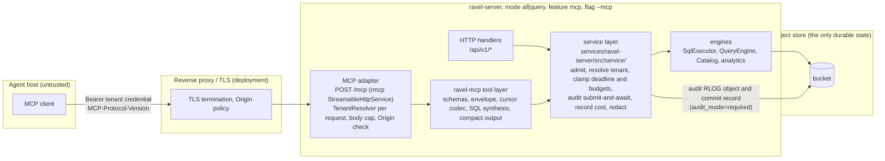

# ADR-1374: A first-party MCP server, a shared query service layer, and an agent result contract

Status: Proposed
Date: 2026-09-07
Epic: #1374
Reviewed revision: `2b8c2a51ddcd844e3362ad4513d314c01fa35b6f`

**Amendment (2026-09-08, #1468).** Three changes. D4 adds the
`missing_argument` failure class, already used in the Time paragraph. D4 and
D5 state that a cursor or evidence reference for the wrong tenant fails with
`cursor_invalid`, the same class as a forged token. D2 and D4 add the
optional `plan` envelope block: `ravel_explain_query` returns the plan shape
there, and the effective schema goes in `data.columns` with zero rows.

## Context

An AI agent that investigates an incident or a security event needs four
things from a telemetry database. It needs to find what data exists without a
guess. It needs to run bounded queries with a known cost. It needs to move
between metrics, logs, and traces on exact identifiers. It needs to hand back
a finding that a person can check again. Ravel has the query engines for this
work. It does not have an agent-facing surface, and several controls that an
agent would depend on are not in place for human callers either.

The facts below were checked by symbol at the reviewed revision. Each row
names the path and symbol, never a line number.

### What exists

| Capability | State | Evidence |
|---|---|---|
| Tenant authentication: static bearer, OIDC JWT, durable `sys/auth`, mTLS proxy header | shipped | `crates/ravel-tenant-resolve/src/lib.rs::TenantResolver::resolve` |
| SQL statement gate: one `SELECT`, no DDL, no DML, no `COPY`, no `CREATE EXTERNAL TABLE`, no `EXPLAIN`, no `SET` | shipped, structural | `crates/ravel-sql/src/validate.rs::validate`, `::reject_writes_in_query` |
| Empty table-function registry, empty object-store registry (a Parquet session's is `SingleStoreRegistry`; see the Parquet registry amendment below), `information_schema` off | shipped | `crates/ravel-sql/src/session.rs::build_session`, `::EmptyObjectStoreRegistry` |
| Five SQL tables; one table per statement when written, several since ADR-2904 (see the ADR-2904 amendment below) | gated (`sql`) | `crates/ravel-sql/src/session.rs::SessionTable`, `executor.rs::refuse_cross_signal` (the single-snapshot entry points that keep the one-table rule) |
| Declared typed attribute columns, 60 s refresh horizon | shipped, CLI-declared | `services/ravel-server/src/declared_columns.rs::TenantConfigDeclaredColumns` |
| Metric metadata (type, unit, help), one object per tenant | shipped | `crates/ravel-query/src/http/metadata_cache.rs::MetadataCache::get` |
| Metric name postings under `__name__` equality | shipped | `crates/ravel-catalog/src/catalog.rs::resolve_fanout` |
| Exemplars, window applied to rows | shipped | `services/ravel-server/src/exemplars.rs::run` |
| Trace by id through the `spans` table, skip index per block | shipped | `crates/ravel-sql/src/spans_pushdown.rs::extract_spans`, `crates/ravel-rspan/src/skip_index.rs::SkipIndex::candidate_blocks` |
| Analytics `change_point` and `summary` over PromQL range results | shipped | `services/ravel-server/src/analytics.rs::run`, `crates/ravel-analytics/src/lib.rs` |
| Per-query budgets: segments, store requests, series, samples, deadline, SQL memory. Each one is a typed error, never a truncation | shipped | `crates/ravel-query/src/segment_admission.rs::admit`, `::request_budget_exceeded` |
| Cost estimate as an upper envelope, reported after the query | shipped | `crates/ravel-sql/src/cost.rs`, `ravel_types::accounting::CostEstimate` |
| Fleet-global query concurrency ceiling | shipped | `crates/ravel-query/src/query_admission.rs::QueryAdmissionController::try_admit` |
| Cancellation by future drop, no spawn between transport and engine | shipped | `services/ravel-server/src/sql.rs::CostGuard` |
| Read-your-write lower bound (`min_commit_token`) | shipped, except exemplars | `crates/ravel-query/src/http/params.rs::decode_commit_tokens` |
| Snapshot pinned across two requests | Flight ticket only, MAC, deadline-bound, process-local key | `crates/ravel-sql/src/flight_ticket.rs::FlightTicket`, `::TicketKey` |
| Partial-coverage flag with a consent gate | PromQL and analytics only | `crates/ravel-query/src/http/handlers.rs::gate_partial` |
| Per-phase cost split | PromQL only. SQL reports pooled counters | `crates/ravel-query/src/http/json.rs::phase_costs` |

### What is missing

| Gap | Evidence |
|---|---|
| Authorization below the tenant. `resolve` returns a bare `TenantId`. `AuthError` cannot say "authenticated, not permitted" | `crates/ravel-tenant-resolve/src/lib.rs::TenantResolver` |
| Operator identity. Any tenant token can trigger a fold | `services/ravel-server/src/fold_on_demand.rs::run` |
| SQL `start`/`end` as a row filter. The window reaches only `Catalog::resolve`. No provider constructor receives it. An absent window means the last hour | `crates/ravel-sql/src/executor.rs::SqlRequest::window`, `services/ravel-server/src/sql.rs::build_request` |
| A cost estimate before the query runs. `EXPLAIN` is refused. The plan text exists only in the bench | `crates/ravel-sql/src/executor.rs::PinnedQuery::create_physical_plan` |
| A budget that a caller can lower, other than the deadline | `services/ravel-server/src/sql.rs::SqlBody` |
| Per-tenant query budgets. The `--limits-file` entries are parsed and inert | `services/ravel-server/src/config.rs::LimitsConfig` |
| Effective schema over HTTP. Only a Flight statement returns the declared columns | `crates/ravel-sql/src/flight/service.rs::get_flight_info_statement` |
| Enumeration of log attribute keys or values | no map-key function in `crates/ravel-sql/src/session.rs::ADMITTED_SCALARS` |
| Query audit records. Every sink is `NoopQueryAuditSink`. `AuditPipeline::spawn` has no non-test caller. No `--audit-mode` flag (#1187) | `services/ravel-server/src/query.rs::build_sql_state`, `crates/ravel-maintain/src/audit_pipeline.rs` |
| Row ordering, row identity, pagination, row cap. The scan declares no order. `logs` has no unique key. HTTP buffers the whole result | `crates/ravel-sql/src/output.rs::QueryOutput`, `crates/ravel-sql/src/logs_schema.rs::logs_fields` |
| Missing-parent disclosure on traces | `docs/guides/traces.md`, "Incomplete traces" |
| Pruning on `logs.trace_id`. It is a fixed column with a residual filter only | `crates/ravel-sql/src/logs_pushdown.rs::FIXED_LOG_COLUMNS` |
| A service layer. Handlers call the engines. Analytics, exemplars, and the fold route take no admission permit. Two PromQL routes have no audit seam. Exemplars record no cost | `services/ravel-server/src/lib.rs::start`, no `.layer` on either `axum::serve` |
| Any MCP server. The only MCP in the tree is the `graft` development tool configuration | `gh issue list --search MCP` returns nothing related |

### The protocol and the SDK

The current MCP specification is `2026-07-28`. It has no `initialize`
handshake, no protocol session, no GET stream, and no SSE resumption. Each
request carries its protocol version in `_meta` and in the
`MCP-Protocol-Version` header. A server must validate the `Origin` header.
On Streamable HTTP, a closed stream is a cancellation. Stateful tools mint an
explicit handle and bind that handle to the authenticated user. The legacy
revision `2025-11-25` still uses `initialize` and `Mcp-Session-Id`, and most
deployed clients speak that revision. Authorization is optional in the
specification. When a server uses OAuth 2.1, it must publish protected
resource metadata (RFC 9728) and must bind tokens to its own audience.

The Rust SDK `rmcp` 3.2.0 serves both revisions. It mounts on axum 0.8 as a
tower service. It delivers cancellation through `on_cancelled`. Its `auth`
feature is an OAuth client, not a token validator. Its versions of tokio,
serde, and schemars match the workspace.

Reference servers give three lessons. The Grafana server lists 110 tools at
about 44,000 tokens and tracks that as a defect. The ClickHouse server
enforces read-only at the engine (`readonly=1`) and marks its regex gate as
advisory. The Elastic Agent Builder binds the tenant scope at authoring time,
never through an agent argument.

## Decision

### D1. One service layer, one tool layer, one native adapter

Ravel gets a transport-independent tool layer in a new crate, `ravel-mcp`. It
gets a shared application-service layer in `services/ravel-server/src/service/`.
The MCP adapter mounts `rmcp::StreamableHttpService` on the query router at
`POST /mcp`, behind the cargo feature `mcp` and the flag `--mcp`. Both are off
by default. The HTTP handlers keep their parsing and encoding. They call the
service layer for admission, tenant resolution, deadline and budget clamps,
audit submit-and-await, cost recording, partial-coverage consent, and error
redaction. The MCP tools call the same service layer.

The service layer comes first because the handlers already differ. A new
transport that calls the engines directly makes one more copy of the policy.

The adapter is native, not a standalone binary. Every missing capability that
an agent needs lives below the HTTP surface. These capabilities are the
explain path, the effective schema, the row cap, cost on cancel, budget
lowering, and audit. A standalone server needs those server changes too. It also adds a second credential hop.
In-process, the MCP endpoint is the resource server and the tenant credential
is the token.



Trust boundaries. The agent host is untrusted. Every argument, cursor, and
evidence reference is data until the server checks it against the credential.
The tenant credential is the only authority. A cursor is a name, not a
capability. The server compares the tenant hash inside a cursor with the
resolved tenant on every call. The tool layer never touches the store. Only
the engines touch the store, through the budgets of the service layer.
Telemetry content is untrusted text. The server returns it inside typed
fields and never interprets it.

### D2. Nine tools, three resources, two prompts

The default profile is read-only. Tool names carry the `ravel_` prefix. Each
tool declares an input schema and an output schema. The `structuredContent`
of each result is the envelope of D4. The text block is a compact rendering
of the same data, not a second copy of the rows. Every tool carries the
annotations `readOnlyHint: true`, `destructiveHint: false`, and
`openWorldHint: false`. Annotations are hints and carry no authority. Six
Ravel Agents tools, one of them a write, join this catalog under both the
`mcp` and `agents` features and flags; see the Ravel Agents write tools
amendment below.

| Tool | Purpose | Prerequisite |
|---|---|---|
| `ravel_capabilities` | Protocol and server version, enabled tools, effective budget ceilings, dialect summaries, tenant hash, enabled signals. Zero store reads | none |
| `ravel_describe_data` | Per signal: effective schema (fixed and declared columns), indexed keys, metric families with type and unit (one bounded page), freshness watermark, coverage window, exact catalog row counts where they exist (retired by the committed row count amendment below: the count is an upper bound, marked approximate) | D3 explain path, `MetadataCache`, one resolve per signal |
| `ravel_find_labels` | Metric names for a selector, label names, or label values for one label under a selector. The result says if the list is declared, observed, or exact. An unfiltered tenant-wide list is refused, and the refusal names the bounded form | label machinery through the service layer |
| `ravel_explain_query` | Validate SQL or PromQL, resolve the snapshot, return the target table, the effective schema in `data.columns` with zero rows, the admitted segment count, the estimate against the effective budget, and the plan shape in `plan`. No scan | D3 `SqlExecutor::explain` |
| `ravel_query_sql` | One `SELECT` over one table, with a required `time_range` applied as a row filter, `max_rows`, budgets that can only be lowered, and a keyset cursor | D3 |
| `ravel_query_promql` | Instant or range evaluation, partial-coverage consent, step alignment, the two log pseudo-metrics | `QueryEngine` through the service layer |
| `ravel_search_logs` | Typed log search compiled to SQL. Uses indexed and declared predicates, `has_word`, severity, and trace id. Orders by `ts`. Groups rows by attribute set and hoists shared attributes once | D3 |
| `ravel_get_trace` | Spans of one trace id inside a required window, the span tree, the missing parents, and the orphans. An optional logs leg, reported as an unindexed scan with its own cost (the span-tree amendment below records the tree's columns and defers the logs leg) | `spans_pushdown` fast path |
| `ravel_analyze_timeseries` | `change_point` or `summary` over a PromQL range result. The output says "heuristic", the minimum point count, and if it was downsampled | `analytics.rs::run` through the service layer, which adds admission |

Phase 2 tools: `ravel_compare_windows` and `ravel_correlate_signals`
(exemplar to trace to logs, exact ids only).

Rejected tool candidates: `ravel_find_metrics` and `ravel_find_label_values`
(merged into `ravel_find_labels`), `ravel_read_result` (a cursor lives on the
tool that made it), and the three operator tools (they need an operator
principal, and they show process-wide state).

Resources: `ravel://dialect/sql`, `ravel://dialect/promql`, and the template
`ravel://schema/{signal}`. Prompts: `incident_triage` and `entity_timeline`.
Each prompt names its version and its tools. No resource or prompt carries
data that a tool cannot return.

The `tools/list` result for the nine tools must serialize in less than
24 KiB. A test pins the exact byte band. Tools are listed in a fixed order.

### D3. Engine and server prerequisites

1. `RequestBudgets` in `ravel-query`: `max_bytes_scanned`,
   `max_store_requests`, and `max_segments`, each optional. The name
   `max_store_requests` is the one canonical name on the wire, in the tool
   schemas, and in the envelope. It maps to the existing
   `EngineConfig::max_s3_requests` ceiling, which keeps its name. A schema
   test asserts the serialized field name. `clamp` can only lower a ceiling.
   The admission and scan checks read the clamped value. PromQL entry points
   take `Option<RequestBudgets>`. `None` keeps the current behavior.
2. `SqlRequest::row_window`, default `false`. When `true`, each table
   provider applies `ts_col >= start AND ts_col < end` above the scan. The
   column is `ts` for `samples` and `logs`, `start_ts` for `spans`, and
   `ts_ns` for `alerts` and `audit`. The outcome reports the applied
   predicate. The HTTP body keeps `false` until a client opts in.
3. `SqlExecutor::explain`: validate, resolve, admit, compute the effective
   schema, run the estimator with `unknown` components, and render the plan
   text. No data GET. A test asserts the data GET count.
4. `SqlRequest::max_rows`. The stream stops after `max_rows + 1` rows. The
   outcome reports `row_cap_hit`.
5. A query service layer in `services/ravel-server/src/service/`. Analytics
   and exemplars gain an admission permit. PromQL gains cost on cancel.
   `labels` and `label_values` gain the audit seam. The service layer
   finalizes usage before it maps an outcome to an error. The outcomes that
   map to an error are an audit failure, a partial-result refusal, an
   evaluation failure, and a deadline. A cancellation is transport-level:
   the tool future is dropped, no envelope is produced, and the usage
   record is its only result. A drop guard in the pattern of
   `sql.rs::CostGuard` records the spend on every path, including the
   dropped one. As a result, the D6 usage figures and the D7
   cancelled-spend figure are never omitted. One test per path asserts the
   recorded figures.
6. `AuditPipeline::spawn` in `lib.rs::start` for query modes. Flags
   `--audit-mode required|best-effort` (default `required`) and
   `--audit-text`. This closes #1187. MCP tool calls submit
   `query.language = mcp:<tool>`.

### D4. The result envelope

Every tool returns one envelope:

```json
{
  "status": "ok | ok_bounded | ok_page | error",
  "failure": null,
  "data": {"columns": [], "rows": [], "row_count": 0},
  "plan": null,
  "scope": {"signal": "", "table": "", "time_range": {}, "predicates_applied": [], "order_by": []},
  "ids": {"query_id": "", "audit_ref": ""},
  "visibility": {"snapshot_id": "", "watermark_hour": "", "pinned": false, "min_commit_tokens_applied": []},
  "coverage": {"complete": true, "partial": false, "fragments": [], "unindexed_predicates": []},
  "accuracy": {"exact": true, "approximation": null, "lower_bound_count": false},
  "presentation": {"max_rows": 200, "row_cap_hit": false, "bytes_cap_hit": false, "rows_omitted": 0, "cells_truncated": 0, "metadata_elided": 0, "effective_max_response_bytes": 524288, "floor_applied": false, "cursor": null},
  "budget": {"effective": {}, "actual": {}, "estimate": {}, "estimate_is_upper_envelope": true},
  "evidence": [{"ref": "", "covers": "data.rows", "sha256": ""}],
  "warnings": [],
  "next_steps": [{"action": "", "detail": ""}]
}
```

The 2026-09-13 amendment's item 7 renames `watermark_hour` above to
`ingest_watermark_hour`, and this skeleton keeps the original name.

`plan` carries the plan text that `ravel_explain_query` returns and stays
`null` on every other tool.

The four status values are different facts. `ok` is a complete query. A
query with zero matches is `ok`. A query whose `LIMIT` the data did not fill
is `ok`. `ok_bounded` means that the row cap stopped the result, more rows
exist, and no cursor exists because the statement has no total order.
`ok_page` means that a cap stopped the result and a cursor exists. The cap
is the row cap, the byte cap, or both, and `presentation` says which.

`max_response_bytes` bounds the serialized `structuredContent`, that is, the
whole envelope as JSON. When the envelope exceeds the cap, the server drops
rows from the end of `data.rows` until the envelope fits. `data.row_count`
keeps the count of rows that the query produced. `presentation.bytes_cap_hit`
becomes `true` and `presentation.rows_omitted` carries the number of dropped
rows. The text block is rendered from the truncated `data`, so the two
representations never differ. When the statement has a total order, the
cursor points at the last kept row and the status is `ok_page`. The omitted
rows are then reachable on the next page. When it has no total order, the
status is `ok_bounded`.

A page always keeps its first row when the query produced one. (This is a
rule of the byte cap; see the equal-group bound amendment below for the row
cap.) When the first row alone does not fit under the cap, the server keeps
the row and shortens its cells. The cell budget is `max(256 B, (cap - fixed_part) /
column_count)`, where `fixed_part` is the serialized size of the envelope
without `data.rows`. The rule applies to every cell type. A number, a
timestamp, a boolean, or a hex binary id never exceeds 64 B and is never
shortened. A string cell longer than the budget is cut to the budget,
including the trailing marker. A map cell or another structured cell that
exceeds the budget is serialized to its JSON text first. That text is cut
the same way and returned as a string. `presentation.cells_truncated` carries the count
of shortened cells. The evidence hash covers the full canonical row, not
the shortened one. So `data.rows` is never empty while `rows_omitted` is
positive, a retained row always fits, and a cursor always has a last kept
row. Two tests cover this rule: a row with a 1 MiB body and a row with a
1 MiB map, each under the floor cap. Each asserts one row, one truncated
cell, zero omitted rows, and the exact serialized size under the cap.

The fixed part of the envelope is bounded so that it always fits. The server
floors `max_response_bytes` at 256 KiB, and the default is 512 KiB. A caller
value below the floor is raised to the floor.
`presentation.effective_max_response_bytes` carries the cap in force and
`presentation.floor_applied` says if the floor raised it. This floor is a
minimum on the presentation cap and is not a raise of any query budget.
Every variable-length field outside `data.rows` has a count bound and a
per-entry serialized-size bound:

- `data.columns`: at most 256 entries of 160 B each (name, type, and JSON
  overhead), 40 KiB in total
- `scope.predicates_applied` and `scope.order_by`: at most 16 entries of
  512 B each, 16 KiB in total
- `visibility.min_commit_tokens_applied`: at most 64 entries of 128 B each,
  8 KiB in total
- `coverage.fragments`: at most 64 entries of 160 B each, 10 KiB in total
- `coverage.unindexed_predicates`: at most 16 entries of 256 B each, 4 KiB
  in total
- `warnings`: at most 16 entries, `next_steps`: at most 8 entries,
  `evidence`: at most 16 entries, each entry at most 512 B, 20 KiB in total
- the scalar fields together: at most 4 KiB

The sum of these bounds is 102 KiB. That is less than half of the 256 KiB
floor, so a retained row always has at least 154 KiB. A projection wider
than 256 columns is an `invalid_argument` failure whose `next_steps` says to
name the columns. When a list exceeds its bound, the server keeps the first
entries and sets `presentation.metadata_elided` to the number of dropped
entries. A test serializes an envelope with zero rows and every field at its
bound. The test asserts the exact size, which must be less than 106,496
bytes.
The byte cap, the row cap, and analytic
downsampling are three separate facts in the envelope. A downsampled
analytic sets `exact: false` and names the method.
Missing coverage sets `complete: false` and names the reason. A budget
failure or a deadline is an `error`. The server never returns a partial exact
aggregate as `ok`. A `COUNT` over `logs` or `spans` sets
`lower_bound_count: true`, because ingest is at-least-once (retired by the
envelope-claims amendment below: the field is reserved and always `false`,
and a consented partial PromQL result reports `exact: false`).

Time. Every data tool requires a time input. There is no default window.
Inputs are RFC 3339 strings or integer nanoseconds as strings. Range tools
take `time_range`, a half-open interval. `ravel_query_promql` has two modes.
Range mode takes `time_range` and `step`. Instant mode takes
`evaluation_time`, one instant, and no `time_range`. A request with both
fields, or with neither, is an `invalid_argument` failure. A test covers
both modes. An absent time input on any other data tool is a
`missing_argument` failure. Outputs carry timestamps as nanosecond strings.
The `scope` block reports the 5 m metric lookback and the step alignment.

Precision. Integers and timestamps are JSON strings, because nanosecond epochs
exceed 2^53. Floats keep `NaN`, `+Inf`, and `-Inf` as strings. Finite floats
are numbers with the sign of zero preserved (the rule of
`output.rs::float_to_json`). Binary is hex. Maps are objects.

Failure classes: `unauthorized`, `invalid_argument`, `missing_argument` (a
required argument is absent), `validation` (the engine text, safe to echo),
`unsupported`, `budget_estimate_exceeds_ceiling`, `budget_exceeded` (with the
counter that tripped; the envelope-claims amendment below says where
`failure.counter` carries it), `deadline`, `unavailable` (retryable),
`snapshot_invalidated` (retryable once), `cursor_expired`, `cursor_invalid`,
and `internal` (fixed message). A failure is a tool result with
`isError: true`, so the model can correct itself. Protocol errors are for
malformed JSON-RPC and unknown tools only. Every failure carries
`next_steps`.

A cursor or evidence reference presented for the wrong tenant fails with
`cursor_invalid`. The class matches a forged token, so the failure leaks no
tenant-mismatch signal.

### D5. Consistency, cursors, and evidence references

Each call resolves its own snapshot. Two calls share a snapshot only when the
second call carries a cursor from the first. The cursor pin is valid until
`min(remaining query deadline, protection_horizon - grace)`. This is the
Flight ticket rule. (Corrected by the call-deadline amendment below: the
minting call's deadline does not bound a cursor, which lives until
`horizon - grace` from its mint.) The envelope reports `snapshot_id` (a hash of the pinned
segment set), the watermark hour, the applied commit tokens, and `pinned`. A
commit token is a read-your-write lower bound. It is not a snapshot identity.

A cursor is a token with a keyed MAC, minted with a process-local key in the
`TicketKey` pattern. It carries the tenant hash, the tool, the argument hash,
the keyset position, and the deadline. It also carries the pinned segment
set, with the pending erasure predicates and the declared columns. (The
declared columns are now pinned as a fixed-size digest of the set; see the
declared-set digest amendment below.) The server stores nothing. A page
re-executes the statement against the pin with a keyset predicate. A cursor
from a dead process fails with `cursor_expired`. Only the process that minted
a cursor can redeem it. The documentation says this, and it names sticky
routing as the option for a load balancer. The server also compares the
tenant hash inside the token with the resolved tenant on every redemption. A
cursor or evidence reference from another tenant fails with
`cursor_invalid`, the same class a forged token gets, so the failure leaks no
tenant-mismatch signal.

`ravel_query_sql` mints a cursor only when the `ORDER BY`, plus a
deterministic tiebreak that the tool appends, is a total order over the
projection. `ravel_search_logs` orders by
`(ts, observed_ts, trace_id, span_id, body_hash)`. (It orders and pages by
`(ts, observed_ts)` instead; see the search-logs amendment below.) That
tuple is not unique, because `logs` has no row identity and ingest is
at-least-once. A strict
keyset predicate would skip an equal row on the next page. So a page never
ends inside a group of equal tuples. The tool fetches `k + 1` rows. When
the last kept tuple equals the first omitted tuple, the tool drops that
whole equal group from the page. The cursor then points at the last
complete group.
If no complete group fits in the page, the status is `ok_bounded` with no
cursor and a `next_steps` entry that says to narrow `time_range`. (The rows
the page has are still returned; see the equal-group bound amendment
below.) The same
rule applies to `ravel_query_sql` when its appended tiebreak is not unique.
`ravel_get_trace` orders by `(start_ts, span_id)`. A test paginates a
fixture with equal tuples across a page boundary and asserts that every row
appears exactly once (superseded by the span-tree amendment below: the tool
mints no cursor, so there is no page boundary).

An evidence reference is a token of the same family. It adds the sha256 of
the canonical row bytes. Redemption re-executes against the pin while the pin
is valid and compares hashes. After the deadline, redemption re-executes
fresh, reports `pinned: false`, and reports if the hash matched. A matching
hash proves identical bytes and nothing more. No reference carries an object
key, a tenant name, or a credential.

### D6. Budgets

The effective budget is the minimum of the server ceiling, the enforced
tenant ceiling, and the caller value. A caller can lower `deadline`,
`max_rows`, `max_bytes_scanned`, `max_store_requests`, and
`max_response_bytes`. A caller cannot raise a ceiling.
`ravel_explain_query` returns the estimate beside the effective budget. When
the estimate exceeds the budget, the tool returns
`budget_estimate_exceeds_ceiling` and the factor to narrow by. An `unknown`
estimate component is not zero and does not pass (scoped by the 2026-09-12
amendment, and narrowed for Parquet tables by the Parquet explain amendment
below). Retries and snapshot
re-resolution run inside the same deadline and their cost is added. (One
deadline bounds the whole tool call, every service call it makes included;
see the call-deadline amendment below, which also records a lookup whose
cost is not added.)
Enforcement is process-local. The fleet concurrency ceiling is the only
cross-replica control, and the envelope says so. Usage is reported as
requests and bytes by kind: wire, cache-served, decompressed. Usage is never
reported as money.

Defaults: `max_rows` 200 with a ceiling of 5,000. `max_response_bytes`
512 KiB with a floor of 256 KiB (D4). 100 metric families per describe
page. 2,000 segments for label resolution. The evaluation can change these
values.

An investigation-wide budget across calls is Phase 2. A caller-supplied
bundle id is not trustworthy.

### D7. Security

- The `TenantResolver` chain of the deployment authenticates every MCP
  request on the headers of that request. No session, cursor, or reference
  replaces this step. No tool argument names a tenant.
- Authorization is at the tenant level, because that is what exists. The
  default profile has read tools only. The fold route, ingest, erasure,
  legal holds, retention, alert rules, and maintenance are not reachable
  through MCP. An operator profile needs a principal model and its own ADR.
  The `agents` capability is that model for one write, `ravel_agent_send`;
  see the Ravel Agents write tools amendment below.
- Transport: `POST /mcp` only. The server validates `Origin` against
  `--mcp-allowed-origins` and answers 403 on a mismatch. The body cap is
  1 MiB. Each tool call takes one admission permit. (A `ravel_search_logs`
  call with predicates takes two, one after the other; see the
  call-deadline amendment below.) The deadline is clamped.
  Header validation is per revision. For a `2026-07-28` request, the server
  requires `MCP-Protocol-Version`, `Mcp-Method`, and `Mcp-Name`, and answers
  400 on a mismatch with the body. For a `2025-11-25` request, the server
  requires neither `Mcp-Method` nor `Mcp-Name`, accepts `initialize`, and
  handles `Mcp-Session-Id` with the in-memory session manager of `rmcp`.
  Each legacy request re-authenticates. An `initialize` without a
  credential is refused. One test sends a `2025-11-25` `initialize` and one
  test sends a `2026-07-28` `tools/call`, and each asserts its own header
  rule.
- Phase 1 uses the bearer chain. Phase 2 serves the RFC 9728 document when
  an OIDC resolver is configured, after a check that `OidcResolver` validates
  the audience claim.
- SQL text passes through `validate.rs` unchanged. The MCP layer adds no
  second gate. A test tries each escape route through the tool.
- Telemetry text is returned inside typed fields only. The server never puts
  it into a tool description, a prompt, or `next_steps`. The documentation
  says that no server-side sanitization makes a model immune to injection.
- No tool fetches a URL, runs a shell, reads a file, or connects to a
  caller-supplied address.
- The only writes are audit records and cost metrics, apart from the agent
  input that `ravel_agent_send` accepts (the Ravel Agents write tools
  amendment below). With `audit_mode=required`, a failed audit write fails
  the call. An agents tool call submits no query audit record: it runs the
  agents route in process, and the agents routes audit only reconcile and
  sweep.
- The adapter must not `tokio::spawn` between the transport and the engine.
  A dropped tool future is the cancellation. `CostGuard` records the spend
  of a cancelled call. Progress notifications go out at phase boundaries
  when the client supplied a `progressToken`.

### D8. Validation

Protocol tests use an `rmcp` client against the real router for both
revisions. Every output schema validates every fixture result. A build
without the `mcp` feature serves no `/mcp`. Before the epic closes, the MCP
Inspector and one production client are run by hand, and the versions go
into the ledger.

Adversarial tests cover these cases:

- parity with `/api/v1/sql`, the row window, and schema drift between two
  pages
- tenant isolation with two hashes on every path, and cursor replay across
  tenants
- expired and revoked credentials during pagination, and malformed arguments
- budget enforcement, where `unknown` is not equal to zero
- cancellation, and audit write faults with the `FaultStore` counter asserted
- redaction, and precision at 2^53, `-0.0`, and NaN payloads
- pagination under fold and compaction, late data, missing spans, and partial
  federation
- hostile telemetry content

Each regression test is shown to fail first. The executor report names the
flipped line.

The agent evaluation is a set of hypotheses, not results. A corpus of at
least 24 investigations over a known fixture includes cases whose correct
answer is "no data in scope" and "not visible yet". Two profiles run on the
same engine, budgets, model, and tasks: a baseline with the two raw query
tools and `ravel_capabilities`, and the full profile. The runner records
correctness, evidence completeness, completion, tool calls, and invalid
queries. It also records wall time, store requests and bytes, and response
bytes. Each record names the model and version, 5 runs, and cold and warm
conditions. Targets: half the invalid
queries and one third fewer store requests per completed task, with equal or
better correctness. No result goes into this ADR before it is measured.

No new TLA+ model. Cursors and evidence references are process-local tokens
with no durable state and no cross-process protocol. The suite models
durable protocols. A pinned snapshot can outlive its deadline while GC
advances. That case is the in-flight reader case that `LifecycleGC` already
covers. The cursor deadline uses the same protection-horizon rule as Flight
tickets.
A `ravel-sim` scenario paginates through fold, compaction, and sweep and
asserts snapshot identity per page.

### D9. Packaging and rollout

The cargo feature `mcp` implies `sql`. The cursor codec of D5 reuses the
Flight pin codec (`flight_ticket.rs`, `TicketKey`), which `ravel-sql` gates
behind `flight-sql` today. `ravel-sql` gains a smaller feature, `pin-codec`,
that carries only that module and no `arrow-flight` dependency. Both
`flight-sql` and `mcp` enable `pin-codec`. A CI build check compiles
`ravel-server` with `sql,mcp` and without `flight-sql`, so an `mcp` build
never depends on Flight. The published image builds
`sql,flight-sql,otap,agents,mcp`; `agents` arrived with ADR-3331. The operator
needs no new Service port, and no `RavelCluster` field sets `--mcp` yet
(`spec.query.mcp` now sets it; see the RavelCluster MCP amendment). The flag
`--mcp` is off by default. `--mcp-allowed-origins` is required when `--mcp`
is set on a non-loopback listener, or startup fails. The server serves
protocol revisions `2026-07-28` and `2025-11-25`. The new external
dependency is `rmcp` 3.2 with `rmcp-macros`. No persistent format changes.
The HTTP `/api/v1/sql` behavior is unchanged unless a client sends the new
optional body fields.

Documentation: `docs/guides/mcp-server.md` (renamed from
`docs/guides/agents.md` by ADR-3331 decision 1), `docs/reference/mcp.md` rendered from
the catalog by a drift test, a README section, the `/mcp` row in
`docs/reference/http-api.md`, and one transport line in
`docs/architecture.md`.

## Rejected alternatives

| Alternative | Reason it lost |
|---|---|
| Native MCP without a service layer | The handlers already differ on admission, audit, and cost recording. A third copy of the policy repeats the defect that the inventory found. |
| A standalone Rust MCP server over `/api/v1/*` | It needs every engine and server prerequisite of D3. It adds a credential hop that the MCP authorization rules treat as token passthrough, unless the server keeps its own user-to-tenant map, which is new durable state. It stays a Phase 2 option for a Ravel that cannot be rebuilt. |
| Flight SQL as the execution path | Flight is gRPC only. The operator's query Service exposes HTTP only. Issue #1293 leaves its resolver chain without the loopback guard. Flight stays the source of the pin codec. |
| One `ravel_query` tool with a `language` field | Reference servers that merged query languages report worse tool selection. SQL and PromQL have different time contracts. |
| One tool per endpoint | The Grafana server tracks 110 tools at about 44,000 tokens as a defect. |
| The MCP Tasks extension | Every Phase 1 call ends inside the query deadline or fails typed. The extension is optional and most clients do not support it. |
| Durable result handles in the bucket | A new object family, a sweeper, an erasure inventory entry, and a GC interaction for every call. Inline results and MAC'd re-execution cursors cover Phase 1. |
| A text-level SQL allowlist in the MCP layer | `validate.rs` is a structural gate. A second regex gate is the advisory check that ClickHouse marks as "not a security boundary". |
| stdio as a Phase 1 transport | An in-process stdio server runs with object-store credentials, which is the cross-tenant trust model of the CLI. A stdio bridge to the HTTP endpoint is a client and is Phase 2. |
| A separate listener for MCP | A listener is a trust boundary only when it terminates TLS. The mTLS listener does not. A listener becomes useful with a separate credential class. |

## Consequences

- HTTP callers get the row-window fix, the explain path, lowerable budgets,
  and audit records, because the service layer serves both transports.
- `ravel-server` gains one crate dependency (`rmcp`) behind a feature, and
  one new workspace crate (`ravel-mcp`).
- Analytics, exemplars, and the two label routes change behavior: they take
  an admission permit and submit an audit event. This is a fix of a gap, not
  a regression, and the ADR names it here.
- The decomposition has nine waves. High-risk tasks (T1, T2a, T4) ride
  alone. The task table and the wave plan are in the epic issue.
- Open decisions, each with a default:
  - the endpoint is on the public listener
  - Phase 1 uses bearer credentials only
  - legacy session mode is on by default
  - the numeric defaults of D6 apply
  - `time_range` is required and has no default
  - resources and prompts stay minimal
  - audit records carry `query.language = mcp:<tool>`
- Recorded uncertainties:
  - if `OidcResolver` checks the `aud` claim
  - the `rmcp` attribute syntax for output schemas
  - the exact `tools/list` byte figure. The first serialization sets it and
    a test then pins it
- Pre-existing defects to work around: #1293, #1296, #362, #1187, #1306,
  #1304.
- Documentation drift found during the review is reported in the epic
  issue and is not fixed here. The three items that mislead an agent are:
  - the SQL `start`/`end` marked required in `docs/reference/http-api.md`
  - the `audit` table described as "including the query-audit trail"
  - the global "one snapshot per query" statement in
    `docs/consistency-model.md`

**Amendment (2026-09-09, #1379).** Three changes, each matching what
shipped. D4's `presentation` block carries three elision counters, not one:
`metadata_elided` for dropped list entries, `entries_truncated` for entries
kept but cut, and `scalars_truncated` for scalar fields cut or dropped under
their 4 KiB allowance. D4 and D5 name the evidence digest field
`blake3_256`, because the digest is BLAKE3-256 and a field called `sha256`
cannot be verified by a reader who trusts the name. D5 states that an
evidence reference presented after its pin has passed redeems as unpinned,
re-executing fresh, rather than failing as expired.

**Amendment (2026-09-09, #1501).** D4 bounds the scalar fields, including
`presentation.cursor`, to 4 KiB together. D5 requires the cursor to carry
the pinned segment set, and one `SegmentPin` costs about 250 B plus
base64: the 2,000-segment admission figure in D6 yields a token of several
hundred KiB, over the whole 256 KiB response floor. This amendment
replaces the segment-enumeration cursor with a resolve-input cursor and
gives it its own bound.

1. A cursor pins its snapshot by resolve inputs, not by segment
   enumeration: the tenant hash, the signal, the half-open time range, the
   minimum commit-token watermark the page was resolved against, the
   pending erasure predicates in force, the declared column set (pinned as
   its digest since the declared-set digest amendment at the end of this
   file), and the keyset position (the last tuple of the page and the
   `ORDER BY` it was taken under). Redemption re-resolves the snapshot
   against that watermark deterministically. When the re-resolve cannot
   reproduce the pinned watermark (a compaction past the protection
   horizon, a newer erasure), redemption fails with `cursor_expired` and
   the caller re-runs the query. A tampered or wrong-tenant token stays `cursor_invalid`. The
   dead-process rule, the tenant binding, the tool and argument-hash
   binding, and the deadline clamp are unchanged.
2. The cursor leaves the 4 KiB scalar allowance of D4 and gets its own
   4 KiB bound, accounted for in the fixed part of the envelope. The
   maximal fixed part is now the D4 list bounds plus the 4 KiB scalar
   allowance (102 KiB, unchanged) plus the new 4 KiB cursor bound, 106 KiB,
   which stays under the 256 KiB floor. A cursor over its bound is a
   server defect, not a client-visible degradation: the envelope reports
   it as an `internal` failure rather than silently paging without a
   cursor. `ravel_query_sql` narrows this for a cursor the page's own order
   values put over the bound (the query-sql amendment at the end of this
   file).
3. Evidence references are unchanged: each pins one row's segment with a
   `SegmentPin`, and the pin-codec reuse of D9 stays for them.
4. The shipped cursor codec (segment enumeration) is replaced by the
   resolve-input form before the first paging tool ships (#1380); until
   then no tool mints a cursor.

**Amendment (2026-09-10, #1501, #1529).** Corrects the amendment above. Its
item 1 said redemption "re-resolves the snapshot against that watermark
deterministically" and fails `cursor_expired` when it "cannot reproduce the
pinned watermark", without saying what reproducible means. There is no
reading of it that a redemption can test. ADR-0010 gives no ordering over
commit tokens to test one with: `seq` is monotonic only per (writer_id,
epoch, shard) and gaps in it carry no meaning, and `epoch` is informational
only, so two tokens from different writers have no relative position at
all. The pinned watermark is a resolve input and only that: it is what page
2 resolves against, in place of a fresh resolution, which is what makes the
re-resolve deterministic. Whether a pinned token can still be satisfied is
the catalog's answer at resolve time, given by resolving the token's own
identity, and its failure is `UnsatisfiableToken`, not a cursor outcome.

A redemption refuses a structurally valid, correctly bound cursor as
`cursor_expired` in exactly two cases, which are the two the amendment above
meant by a compaction and a newer erasure:

1. Its effective deadline, already clamped to `protection_horizon - grace`
   by the rule D5 states, has passed. Past that instant a sweep is free to
   compact away what the pin resolves to, so the clamp already is the
   compaction check and no second mechanism is added for it.
2. An erasure predicate is in force at redemption that the cursor did not
   pin, over the cursor's own signal, whose half-open event-time window
   overlaps the cursor's half-open time range. A windowless predicate has no
   event-time restriction and so overlaps every range. Intersection is
   defined on the signal and the range only: a predicate's matchers are
   tested against a record's labels or attributes, and a cursor holds no
   records, so no matcher-level analysis is attempted. An erasure that does
   not intersect that scope leaves the cursor redeemable, and a predicate
   the cursor pinned that is no longer in force is not a mismatch.

A tampered or wrong-tenant token stays `cursor_invalid`, unchanged. So do
the dead-process rule, the tenant binding, and the tool and argument-hash
binding.

Two corrections to the same amendment's own text. Its item 3 said "Evidence
references are unchanged: each pins one row's segment with a `SegmentPin`".
That was never true. `EvidenceRef` carries the tenant hash, the tool, the
argument hash, a `blake3_256` digest of the referenced row, and its mint and
deadline timestamps; it has never held a `SegmentPin`, and it needs none,
because redemption re-executes the reference's own call and compares
digests. Its item 2 gave the maximal fixed part as 106 KiB, which counts
only the bounds D4 documents: the metadata list bounds (100,824 B) plus the
4 KiB scalar allowance come to 102 KiB, and the new 4 KiB cursor bound takes
that to 106 KiB. The implementation reserves 110,600 B, because on top of
those documented bounds it also counts the empty-envelope skeleton (852 B),
a bounded skeleton slack for counters and status words widening (512 B), and
the identity-warning allowance `finish` may still spend (220 B).
`MAXIMAL_FIXED_PART` in `crates/ravel-mcp/src/envelope.rs` is the constant
carrying that real total, and it is the figure the floor guard compares
against the 256 KiB `max_response_bytes` floor.

**Amendment (2026-09-11).** Three corrections.

1. The 2026-09-09 amendment reports an over-bound cursor as an `internal`
   failure. That holds only when the envelope carries no other failure. An
   envelope that already failed keeps its class, message, and counter, which
   say why the call failed. The cursor is dropped on both paths. On the
   second, the drop increments `presentation.metadata_elided` and pushes a
   warning naming the bound. So a dropped cursor is never silent.
2. D9 says the cursor codec reuses the Flight pin codec, and that
   `flight-sql` and `mcp` both enable `pin-codec`. Neither is true. The
   cursor codec follows the Flight ticket pattern but shares no code with
   it. `ravel-mcp` enables no `ravel-sql` feature and reads nothing from
   `flight_ticket`. An `mcp` build needs no pin codec. The 2026-09-09
   amendment kept that reuse for evidence references. They never used it: a
   reference carries a digest, and redemption re-executes its own call.
3. The erasure check above sees only predicates in force at redemption. An
   erasure that arrives after a mint and completes before the redemption is
   in neither set. The check is sound only while the maximum cursor lifetime
   is shorter than the minimum time an erasure takes to complete. The
   maximum cursor lifetime is a deployment's protection horizon minus a 24 h
   grace. The horizon is operator-set and defaults to 25 h 05 m, so the
   lifetime is 1 h 05 m. The grace is a constant in
   `crates/ravel-mcp/src/cursor.rs` that no configuration moves. The minimum
   erasure completion is the seal wait in
   `crates/ravel-maintain/src/erasure_rewrite.rs`. It is the ingest lag plus
   one bucket span plus the seal margin, 4 h 05 m with defaults. Nothing
   asserts the relationship. `ravel-mcp` cannot assert it either: the horizon
   reaches the crate per call as an absolute instant. Raising the horizon to
   30 h leaves a 6 h cursor lifetime and opens the window. The 2026-09-10
   amendment says a redemption refuses a cursor in exactly two cases. Those
   are the two a redemption can detect, not every case that breaks a page.

**Amendment (2026-09-12).** Six changes.

1. D6's rule that an unknown estimate component is not zero and does not
   pass is scoped, not weakened. An unknown component is never read as zero.
   Where the component has a budget ceiling, unknown fails the comparison and
   the tool returns `budget_estimate_exceeds_ceiling`. Where it has no
   ceiling, the estimate names the component unbounded and reports
   `estimate_is_upper_envelope: false` rather than refusing the call. The
   reason is structural. `estimated_decompressed_bytes` is unbounded for
   logs, spans, alerts and audit: those estimators pass a literal zero,
   because their scan paths never record decompressed bytes. `EffectiveBudgets`
   holds `max_bytes_scanned`, `max_store_requests` and `max_segments` and
   nothing else, so that component has no ceiling to fail against. A literal
   reading of the rule refuses every logs explain, on the signal an agent
   most needs. The shipped adapter already reports each unbounded component
   as a warning and performs no comparison at all, so this corrects a rule
   that has never had an implementation. The Parquet explain amendment
   below narrows this item for Parquet tables.
2. D2: `ravel_explain_query` is SQL-only in its first shipped phase. A
   statement that fails SQL validation returns the `validation` class with
   the engine's own text, and a `next_steps` entry naming
   `ravel_query_promql`. A statement that is not a `SELECT` returns
   `unsupported`. A PromQL explain path is a prerequisite for a later phase.
   No such path exists anywhere in the tree today: the only explain is
   `SqlExecutor::explain`.
3. D5: the 2026-09-10 amendment's list of redemption refusals is exhaustive
   in exactly two cases. It gains a third. A declared column set observed at
   redemption that differs from the set the cursor pinned is
   `cursor_expired`.
4. D5: `min_commit_watermark` is empty for every tool in this phase. No MCP
   input struct declares `min_tokens`, so read-your-write is not reachable
   from this surface. A redemption passes the cursor's own mint instant as
   the resolve's `now_ns` (its resolve instant only, and not the request's
   `now_ns`; see the resolve-instant amendment below). That instant bounds
   which ingest-hour buckets are listed, not which records those buckets
   hold. So the pagination guarantee
   is three-part. A row is never repeated (an order term computed from
   other rows mints no cursor so that this holds; see the other-rows order amendment below). A row may appear on a later page.
   A late-arriving row that sorts before the cursor position is silently
   omitted from every page. The third part is the one a caller must know.
5. D2: `ravel_find_labels` states whether its list is complete for the
   requested window, and that the list is observed from data over that
   window. The declared, observed and exact trichotomy is narrowed to what
   the metadata outcomes support. `LabelsOutcome` and `LabelValuesOutcome`
   carry the names, a partial flag and warnings, and no basis. A basis field
   on the metadata path is named here as a follow-up, not promised by this
   phase.
6. D1 bookkeeping: the tool layer owns envelope finishing. Finishing is the
   row cap, the byte fit, status resolution, cursor minting and `next_steps`.
   The module doc of `crates/ravel-mcp/src/service.rs` gives a reason for the
   port returning finished envelopes. That reason is superseded for the
   envelope frame. It still holds for the `data` block, which the adapter
   keeps building.

**Amendment (2026-09-13).** Seven contract decisions and one correction. The
correction is item 6.

1. `FindLabelsInput.filter` is a case-sensitive substring match over the
   strings the tool is about to return. It applies after the list is
   produced and before the page cap. So a returned page is complete for that
   filter, and a truncation report means more matches genuinely exist. The
   filter is reported in `scope.predicates_applied`. It is case-sensitive
   because label names and values are exact byte strings and canonical series
   identity is exact. A case-insensitive match would need a Unicode
   case-folding rule that nothing else in the system defines. An empty filter
   string is `invalid_argument`, not a match of everything. A filter does not
   satisfy the rule that refuses an unfiltered tenant-wide list. That rule
   keys on a selector or a label name, each of which bounds the resolution. A
   filter bounds only the output, so a request carrying a filter and neither
   of the other two is still refused.
2. `ravel_find_labels` takes no `evidence_ref` in this phase. The input is
   removed from the tool rather than accepted and ignored, and the tool emits
   no `evidence` block. Nothing defines what a label list attests to, and the
   port between the tool layer and the engine does not carry what minting a
   reference would need. `FindLabelsInput` still declares the field today;
   issue #1605 is the follow-up that removes it.
3. A paged `ravel_describe_data` pins page one's freshness watermark into the
   cursor, and every later page reports that same value. A page sequence that
   re-measures per page describes a moving state, with nothing telling the
   agent that two pages disagree because time passed rather than because the
   data differs.
4. That freshness watermark is the maximum `ingest_hour_bucket` across the
   segments in the resolved snapshot. It is not the catalog fold watermark.
   Four reasons, each a live constraint:
   - The fold watermark is a cost boundary, not a freshness one. A resolve
     serves hours at or below it from snapshot parts and lists everything
     above it live, so a query already sees data the watermark does not
     cover, and docs/consistency-model.md states that the fold never changes
     which commits a query sees.
   - Its lag is large. An hour seals only once `now >= end(hour) +
     max_flush_lifetime + clock_skew_allowance + fold_safety_margin`. Six
     terms separate an acknowledged write from a watermark that covers it:
     up to 1 h from the write itself to `end(hour)`, which the seal
     condition's own `end(hour)` implies; then `max_flush_lifetime` 1 h,
     `clock_skew_allowance` 5 m and `fold_safety_margin` 15 m at their
     defaults; then the fold's 5 m interval and the 30 s HEAD cache. The
     worst case is their sum, 2 h 25 m 30 s, which this ADR and
     docs/reference/mcp.md both quote as about 2 h 25 m. Reporting that as
     freshness would tell an agent its data may be hours stale while it holds
     an answer resolved a minute ago.
   - It is the costlier of the two. The value is not on the returned
     `Snapshot`; it lives in a crate-private struct, so a query-path caller
     needs a ravel-catalog signature change or an extra HEAD GET outside the
     catalog's 30 s cache. The maximum `ingest_hour_bucket` over
     `Snapshot::segments` is an in-memory fold over a vector the caller
     already owns.
   - It is ingest time, not event time, so a client's clock cannot move it.

   Event-time bounds are a different quantity. `min_event_ts_ns` and
   `max_event_ts_ns` across the resolved set describe what the data covers
   and belong in the `coverage` block, not in `visibility`.

   The pinned value is page one's measurement. A later page may have resolved
   over a superset, because the live listing above the fold watermark picks
   up whatever committed since. The cursor has always pinned resolve inputs
   and a lower bound rather than an enumeration, and this field is the same
   kind of thing.

   The pinned watermark is a new cursor field, so `CURSOR_VERSION` goes from
   4 to 5, with a test that a version 4 token decodes as invalid, matching
   the one that already exists for version 3. That is the only earlier-layout
   test in `crates/ravel-mcp/src/cursor.rs` today: the other two tests that
   manipulate a version byte cover a future cursor version and an evidence
   token, neither of which is an earlier cursor layout.
5. A redeeming resolve runs at the cursor's `mint_ns`, not at the redeeming
   call's clock. This restates and explains the rule the 2026-09-12
   amendment's item 4 already settled. It is not a refinement of that rule
   and does not override it; what is new here is the reason. A page sequence
   that re-lists at the current instant walks a moving snapshot, and pinning
   a watermark while resolving against a later one makes the pin decorative.
   Nothing in the code states the rule today and there is no production
   caller, so this is where the reasoning is recorded.
6. Correction. D5 defines `visibility.snapshot_id` as a hash of the pinned
   segment set. The amendment that replaced the segment-enumeration cursor
   with the resolve-input cursor deleted that set, and the code followed it
   at `CURSOR_VERSION` 4, so the set exists nowhere in the system. No later
   amendment respecifies the derivation. `snapshot_id` is a hash over seven
   inputs: the tenant hash, the signal, the half-open time range, the
   minimum commit-token watermark, the pending erasure predicates, the
   declared column set, and the resolve instant. Two calls resolving the same
   seven report the same `snapshot_id`. It identifies those inputs, not the
   segments they resolved to.

   Each of the seven avoids a collision across resolves that are not the
   same resolve. Without the tenant hash, two tenants resolving the same
   signal over the same window report a byte-identical `snapshot_id` over
   disjoint data. Without the resolve instant, two calls a day apart over
   the same historical window report the same id while resolving different
   segment sets. The live listing above the fold watermark picks up
   whatever committed in between. A cursor pins the same resolve inputs
   plus its keyset position, which is why every page of one sequence
   reports the same id. A redemption is not an exception. The 2026-09-12
   amendment's item 4 makes a redeeming resolve run at the cursor's own
   `mint_ns`. So every page of one sequence resolves at one instant.

Two further decisions follow from item 4. Both are settled here rather than
left to the implementation.

7. The envelope field is `visibility.ingest_watermark_hour`, not
   `visibility.watermark_hour`, and it carries the decimal unix hour as a
   JSON string. Two separate points.

   The name. `watermark_hour` is already the fold watermark's name
   system-wide: docs/catalog-and-mvcc.md makes HEAD's `watermark_hour`
   authoritative, and ravel-catalog and ravel-maintain carry that field
   through `SnapshotPartRef` and `PartHeader`. Item 4 defines the envelope's
   quantity as explicitly not that one, so keeping the shared name would
   leave a reader to conclude from the name that a cost boundary is a
   freshness claim. Nothing populates the field today, which makes the rename
   free now and impossible once an agent reads it.

   The rendering, previously unstated anywhere. The value is the decimal unix
   hour -- the count of whole hours since the epoch -- as a JSON string, per
   D4's precision rule that integers travel as JSON strings. It is not
   `YYYYMMDDHH`, and it is not the catalog's `YYYYMMDDTHH` object-key text.
   The field keeps its 32 B scalar sub-bound: that bound measures the value,
   which the rename does not touch.
8. An empty resolve reports the field absent, in its own words. The watermark
   is the greatest ingest hour among the segments the resolve returned, so a
   resolve that returned none has no value to report even though it measured.
   That is exactly the state `ravel_describe_data` exists to answer, and D8
   requires the agent corpus to cover it.

   D4 types the field as a string, so an empty resolve serializes `""`, the
   same as an operation that never reports freshness at all. The `warnings`
   entry is what separates them, and the two entries say different things:
   `visibility.ingest_watermark_hour is not reported by this operation` for
   the operation that does not measure, and
   `visibility.ingest_watermark_hour is absent: this operation resolved no
   segments` for the resolve that measured and found nothing. A caller that
   reads the first wording on an empty tenant concludes its own freshness is
   unknowable through this tool rather than that the window it asked about is
   empty, which is the opposite of what the call established.

## Amendment (2026-09-29): Parquet sessions install `SingleStoreRegistry`

<!-- amendment-applies: sections="What exists" pointer="Parquet registry amendment" -->

ADR-2040 decision D4 replaces ADR-0013's first invariant for Parquet tables.
A query session that reads a Parquet table installs `SingleStoreRegistry`,
which answers exactly `ravel-pq://<tenant_hash>/` with that query's
`TenantParquetStore`, errors for every other URL, and refuses
`register_store`. Every other session keeps `EmptyObjectStoreRegistry`. The
text above that treats the empty object-store registry as holding for every
session holds for every session that reads no Parquet table; the code is
`crates/ravel-sql/src/session.rs` and `crates/ravel-parquet/src/store.rs`.

## Amendment (2026-10-29): Ravel Agents write tools (ADR-3331 decision 10)

<!-- amendment-applies: sections="D2. Nine tools, three resources, two prompts|D7. Security" pointer="Ravel Agents write tools amendment" -->

ADR-3331 decision 10 adds a second catalog, `agents_tool_catalog()` in
`crates/ravel-mcp/src/catalog.rs`, with six tools in this order:
`ravel_agent_describe`, `ravel_agent_send`, `ravel_agent_operation`,
`ravel_agent_state`, `ravel_agent_events`, `ravel_agent_blocked_effects`.
They join `tools/list` after the nine tools of D2 only when the server is
built with both the `mcp` and `agents` features and run with both `--mcp`
and `--agents`. In every other build or run, `tools/list` is the D2 catalog
byte for byte.

D2 changes in two places:

1. Not every tool is read-only. `ravel_agent_send` accepts an input into an
   agent's inbox, so it carries `readOnlyHint: false`, `destructiveHint:
   false`, `idempotentHint: true` and `openWorldHint: false`. It takes a
   required idempotency key: a resend with the same key answers the
   operation the first call accepted and accepts nothing new. The other five
   agents tools carry the D2 annotations. The D2 rule that annotations carry
   no authority stands.
2. The 24 KiB bound covers the combined catalog. Measured, `tools/list` is
   15,700 bytes with the nine tools and 23,589 bytes with all fifteen,
   against the 24,576-byte budget (the Parquet explain amendment below
   restates both); both figures are pinned in
   `services/ravel-server/tests/mcp_agents_e2e.rs`.

D7 changes in two places:

1. The principal model D7 asks for exists for this one write. An agents
   tool call is not a second implementation of the agents API: the MCP
   adapter calls the agents client routes in process with the request's own
   headers, so the route's resolver and its `agents` capability check decide
   the call, and a principal without the capability gets the route's 403 as
   an MCP error envelope. No operator surface becomes reachable through MCP;
   the fold route, ingest, erasure, legal holds, retention, alert rules and
   maintenance stay out.
2. The writes are no longer only audit records and cost metrics: an
   accepted `ravel_agent_send` input is written by the agents store, under
   the agents store's own durability and compare-and-swap rules.

## Amendment (2026-11-01, ADR-2904): a SQL statement may name several tables

<!-- amendment-applies: sections="What exists" pointer="ADR-2904" -->

The "What exists" table recorded the SQL surface as one table per
statement. ADR-2904 replaces that rule: a statement on the HTTP SQL
endpoint or over Flight SQL may name several signal tables and the
tenant's Parquet tables, with one snapshot resolved per named signal.
Only the entry points that read a single snapshot keep the one-table
rule (`refuse_cross_signal` in `crates/ravel-sql/src/executor.rs`). The
MCP adapter calls the HTTP-path executor, so `ravel_query_sql` admits a
join; ADR-2904's #2915 amendment records that the one-table refusal
decision 9 promised for the MCP tools is owed by whoever ships them. The
query-sql amendment below ships `ravel_query_sql` with that refusal.

## Amendment (2026-11-02): a Parquet explain names its unbounded figures and does not refuse

<!-- amendment-applies: sections="D6. Budgets|Consequences" pointer="Parquet explain amendment" -->
<!-- amendment-supersedes: phrase="15,700 bytes" pointer="Parquet explain amendment" -->
<!-- amendment-supersedes: phrase="23,589 bytes" pointer="Parquet explain amendment" -->

The 2026-09-12 amendment's item 1 says an unknown estimate component that
has a budget ceiling fails the comparison. For a Parquet table that rule
refuses every explain, and the refusal protects nothing, so it is narrowed
for Parquet tables.

1. On a Parquet table, `estimated_requests` and `estimated_store_bytes` are
   unbounded and both have ceilings (`max_store_requests` and
   `max_bytes_scanned`). The estimator fills them from the manifests for a
   cold cache and a full scan, and neither bounds the query: an uncached
   footer or column chunk costs requests beyond the one per file it counts,
   and a range read again after eviction costs store bytes it already
   counted once (`unbounded_estimate_components` in
   `crates/ravel-sql/src/executor.rs`, its doc at line 1453 and its body at
   lines 1461 to 1481).
2. Explain runs no scan, and the Parquet reader enforces both ceilings at
   scan time: `ReadLimits::admit` counts each store request and the wire
   bytes of its body against `max_s3_requests` and `max_bytes_scanned`, and
   refuses the request that would cross either before it is issued
   (`crates/ravel-parquet/src/limits.rs`, module doc lines 14 to 24, `admit`
   at line 171).
3. So `ravel_explain_query` on a Parquet table names both components
   unbounded, reports `estimate_is_upper_envelope: false`, adds a warning
   that the ceiling is not checked by the explain and that the reader
   enforces it at scan time, and does not refuse. An unbounded component
   with a ceiling on any other table still refuses with
   `budget_estimate_exceeds_ceiling`, and an unbounded component with no
   ceiling (`estimated_decompressed_bytes` on every table but `samples`)
   still names it unbounded and passes.

The D6 comparison the tool ships is: `estimated_requests` against
`max_store_requests`, `estimated_store_bytes` against `max_bytes_scanned`,
and `segments_admitted` against `max_segments`. Recent-exempt segments are
not admitted and do not count, as the engine's own segment budget does not
count them. When any bounded figure exceeds its ceiling, the narrowing
factor is the largest ratio of figure to ceiling over the dimensions that
exceed, not their sum.

Shipping the explain changed its catalog description to name SQL only, and
`ravel_find_labels` no longer declares `evidence_ref` (2026-09-13 item 2).
`tools/list` was then 15,648 bytes with the nine tools and 23,537 bytes
with all fifteen. Since the committed row count amendment below it was
15,652 bytes with the nine tools and 23,541 bytes with all fifteen. Since
the query-sql amendment below it was 15,733 bytes with the nine tools and
23,622 bytes with all fifteen. Since the query-promql amendment below it
was 15,972 bytes with the nine tools and 23,861 bytes with all fifteen.
Since the analyze-timeseries amendment below it was 16,297 bytes with the
nine tools and 24,186 bytes with all fifteen. Since the search-logs
amendment below it was 16,058 bytes with the nine tools and 23,947 bytes
with all fifteen, and since the span-tree amendment below it is 16,177
bytes with the nine tools and 24,066 bytes with all fifteen, against the
24,576-byte budget; both
figures are pinned in
`crates/ravel-mcp/src/catalog.rs` and
`services/ravel-server/tests/mcp_agents_e2e.rs`.

## Amendment (2026-11-02, #3648): the RavelCluster MCP amendment, `spec.query.mcp` sets `--mcp` on query pods

<!-- amendment-applies: sections="D9. Packaging and rollout" pointer="RavelCluster MCP amendment" -->
<!-- amendment-supersedes: phrase="no `RavelCluster` field sets `--mcp` yet" pointer="RavelCluster MCP amendment" -->

D9 says no `RavelCluster` field sets `--mcp`. `spec.query.mcp` now does, on
the query Deployment only, and the default stays off.

1. The block carries `enabled` (default `false`), `allowedOrigins` (default
   empty) and an optional `maxBodyBytes` (minimum 1). With `enabled: true`
   the operator renders `--mcp`, then `--mcp-allowed-origins` with the
   entries comma-joined, then `--mcp-max-body-bytes` when `maxBodyBytes` is
   set. An absent block, or `enabled: false`, renders no MCP flag
   (`desired_query_deployment` in `services/ravel-operator/src/reconcile.rs`).
2. Two CEL rules on the `mcp` property enforce D7 at admission. The query
   pods listen on `0.0.0.0`, where the server refuses `--mcp` with an empty
   allowlist, so `enabled: true` needs at least one origin. An entry may not
   be empty or contain a comma, because the server splits the flag value on
   commas (`QUERY_MCP_NEEDS_ORIGINS_RULE` and `QUERY_MCP_ORIGIN_SHAPE_RULE`
   in `services/ravel-operator/src/crd.rs`).
3. A request with no `Origin` header is still accepted, as D7 ships, so the
   allowlist governs browser clients only.

## Amendment (2026-11-02, #3657): the declared-set digest amendment, a cursor pins a digest of the declared column set

<!-- amendment-applies: sections="D5. Consistency, cursors, and evidence references|Consequences" pointer="declared-set digest amendment" -->

The 2026-09-09 amendment, item 1, pins the declared column set in the
cursor, and the codec carried every column verbatim. A cursor grew with
the number of declared typed attribute columns, so a wide logs tenant
overran the 4 KiB cursor bound of that amendment's item 2. A
`ravel_describe_data` page one over 4,000 declared columns with 90-byte
keys minted a 507,045 B cursor, and the call failed as `internal`. At
redemption the pinned set is only compared with the observed one for
equality (the 2026-09-12 amendment, item 3), and every later use of the
set reads the observed one, so the cursor now pins a fixed-size digest of
it.

1. The digest is BLAKE3-256 in derive-key mode under the context
   `ravel-mcp cursor declared_column_set v1`. Each column encodes as its
   key's byte length (`u64`, little-endian), the key bytes, then a one-byte
   type tag. The encodings are sorted and deduplicated, and the hash covers
   their count and then each encoding behind its own length. The order the
   resolve lists the columns in, and any repeats, do not change the digest;
   a column's key or type does. The digest is 32 bytes for any set
   (`declared_column_set_digest` in `crates/ravel-mcp/src/cursor.rs`).
2. `confirm` computes the digest of the declared column set the redeeming
   resolve observed and compares it with the pinned one. A difference is
   `cursor_expired`, as the 2026-09-12 amendment, item 3, says of a
   differing set, and the same columns in another order redeem. The
   `snapshot_id` derivation of the 2026-09-13 amendment, item 6, is
   unchanged and still hashes the set itself: a redeemed page derives it
   from the set `confirm` accepted, which hashes to the same id as the
   minting page's set because that hash also sorts and deduplicates.
3. `CURSOR_VERSION` moves from 5 to 6. A version-5 token fails the header
   check as `cursor_invalid`, the class every token of another version gets.
4. The pending erasure predicates stay in the cursor whole. `confirm` reads
   them by membership: a newer erasure expires the cursor only when it is
   pending at redemption, is not among the pinned predicates, and overlaps
   the page's window. A pinned predicate that completed between mint and
   redemption therefore still redeems, and a digest of the set would expire
   that cursor. The next page's `snapshot_id` is also derived from the
   pinned predicates. Their size grows with the number of predicates the
   minting resolve reported pending and with their matchers' lengths, and
   `ravel-mcp` bounds neither. A cursor they push over its bound is still
   the `internal` failure of the 2026-09-09 amendment, item 2, except on
   `ravel_query_sql` (the query-sql amendment below).
5. The token fields that grow with tenant data, with their bounds. The
   pending erasure predicates are item 4. The keyset position is a kind tag
   and one name: an indexed key is at most 128 bytes
   (`MAX_KEY_INDEX_COLUMN_KEY_LEN` in
   `crates/ravel-catalog/src/tenant_config.rs`), and no length bound applies
   to a declared column key or a metric family name. The minimum commit
   watermark holds one token per shard but is empty for every tool, as the
   2026-09-12 amendment, item 4, records. The `ORDER BY` and the tool name
   are constants of the minting tool, and every other field has a fixed
   size. That describes `ravel_describe_data`'s position; the query-sql
   amendment below adds `ravel_query_sql`'s, a typed tuple of row values.

## Amendment (2026-11-02, #3664): the committed row count amendment, `ravel_describe_data` reports its row count as an upper bound

<!-- amendment-applies: sections="D2. Nine tools, three resources, two prompts" pointer="committed row count amendment" -->
<!-- amendment-supersedes: phrase="exact catalog row counts where they exist" pointer="committed row count amendment" -->

D2's `ravel_describe_data` row promises "exact catalog row counts where
they exist". The count the tool reports, `committed_rows` on the `table`
row, is summed from commit records. It counts rows before duplicate
collapse and before any pending erasure, so it is an upper bound on the
rows a reader sees, and page one still reported `accuracy.exact: true`.
Counting the rows a reader sees needs segment reads, which the tool does
not do, so the count stays as it is and is marked instead.

1. Page one, the only page that carries the `table` row, reports
   `accuracy.exact: false` and `accuracy.approximation` set to
   `COMMITTED_ROWS_APPROXIMATION` in
   `crates/ravel-mcp/src/tools/describe_data.rs`: "committed_rows is an
   upper bound: summed from commit records, counted before duplicate
   collapse and before pending erasure". A later page carries no `table`
   row and reports `exact: true`.
2. The `table` row no longer carries `committed_rows_note`. It said what
   the approximation now says, in the envelope field D4 defines for it.
3. The catalog description ends "committed row count (an upper bound)"
   instead of "exact row counts where available". That moves `tools/list`
   from 15,648 to 15,652 bytes with the nine tools and from 23,537 to
   23,541 bytes with all fifteen, still under the 24,576-byte budget.

## Amendment (2026-11-02, #3663): the resolve-instant amendment, a later SQL page resolves at page one's instant on the call's own clock

<!-- amendment-applies: sections="Consequences" pointer="resolve-instant amendment" -->
<!-- amendment-supersedes: phrase="the resolve's `now_ns`" pointer="resolve-instant amendment" -->

The 2026-09-12 amendment, item 4, has a redemption pass the cursor's mint
instant as the resolve's `now_ns`. On the SQL path one field,
`SqlRequest::now_ns`, fed both the catalog resolve and every other instant
the executor reads, so a later page carrying page one's instant would also
have run its declared-column and key-index lookups, stamped the tenant's
last-touch and written its audit record at page one's instant.
`ravel_describe_data` already carries the two apart
(`DescribeRequest::resolve_at_ns` and `caller_now_ns`); the SQL path now does
too. No MCP tool serves SQL yet, so no caller saw the earlier behavior.

1. `SqlExecutor::execute_accounted_at` takes the resolve instant beside the
   request, and `SqlRequest::now_ns` is the call's own clock. `SqlRequest`
   gains no field. Every other entry (`execute`, `execute_accounted_with`,
   explain, the Flight resolve, the lowered-statement path) resolves at the
   request's `now_ns`, so its two instants are equal.
2. The resolve instant feeds what describes the snapshot: the catalog
   listing's end hour, the catalog request estimate, the column-statistics
   load, the lane request budget's fold-lag figure, and the access-intent
   classification (whole-lane read, window covering all history).
3. The call's clock feeds what describes the call that runs now: the
   declared-column and key-index cache lookups and their freshness horizon,
   the tenant's idle-eviction last-touch, and the audit record's timestamp.
   The audit record's window stays the statement's window.
4. `QueryService::sql_execute_at` and the port's `QueryBackend::sql_execute`
   take the resolve instant as `resolve_at_ns`, and the draft reports it as
   its own `resolve_at_ns`. `QueryService::sql_execute`, behind
   `/api/v1/sql`, passes the request's `now_ns` for both.
5. `Draft::pinned_to` takes the declared column set `confirm` accepted and
   sets it on the draft. The declared-set digest amendment, item 2, has a
   redeemed page derive its `snapshot_id` from that set; until now the
   draft kept the set it was built with, and only the caller's convention
   kept the two equal. `ravel_describe_data` passes the set its resolve
   observed, the one it confirmed.

## Amendment (2026-11-02, #3683): the query-sql amendment, `ravel_query_sql` ships, and a page with no cursor position ends bounded

<!-- amendment-applies: sections="Consequences|Amendment (2026-11-01, ADR-2904): a SQL statement may name several tables|Amendment (2026-11-02): a Parquet explain names its unbounded figures and does not refuse|Amendment (2026-11-02, #3657): the declared-set digest amendment, a cursor pins a digest of the declared column set" pointer="query-sql amendment" -->

`ravel_query_sql` is served (`crates/ravel-mcp/src/tools/query_sql.rs`),
the sixth tool body. It keeps D2, D3 and D5 as written, and records here
the choices they leave open and the one place it departs.

1. The statement is checked from its text before any backend call, in
   this order: `ravel_sql::refuse_several_tables` (the one-table refusal
   ADR-2904's #2915 amendment says the MCP tools owe; `invalid_argument`
   with a `split_the_statement` next step), `ravel_sql::validate_query` (a
   write or any other non-query statement is `unsupported`, any other
   failure `validation`), then `ravel_sql::plan_page`. A planner refusal is
   `invalid_argument` naming the planner's reason, with a
   `rewrite_the_statement` next step. That includes a float `ORDER BY`
   term (`OrderTermNotRepresentable`): the statement as written cannot be
   paged without losing rows after a NaN, and ordering by another column
   pages the same rows, so it is the caller's argument to change. The one
   planner answer that is not a refusal is `NoOrdering`, a statement with
   no `ORDER BY` over a table with no row identity (the other-rows order amendment below adds a second). It runs as written,
   unpaged, and a capped result is `ok_bounded` with no cursor and an
   `add_an_order_by` next step.
2. `time_range` is required and is applied as a half-open row filter
   (`SqlRequest::row_window`), as the D2 row says. The executor's row cap
   is the effective `max_rows`, so it returns the D3 `k + 1` row. Under a
   total order the page keeps `k` rows and resumes after the last one;
   under an order that is not total D5's equal-group rule applies, with
   group equality compared on the typed order values, floats by bit
   pattern.
3. The keyset position is a typed tuple: the last kept row's value for
   each effective `ORDER BY` term, read from the result's Arrow arrays
   rather than from the rendered cells, encoded by
   `crates/ravel-mcp/src/resume_tuple.rs`, beside the rendered effective
   `ORDER BY`. The port's `QueryBackend::sql_execute` takes the order
   column names and the draft carries each row's tuple
   (`Draft::order_tuples`). The argument hash covers the statement, the
   window and the effective `max_rows`; a cursor presented with another of
   any of them, or whose position names another `ORDER BY`, does not
   decode, or has another arity or a non-finite value, is
   `cursor_invalid`. A later page redeems, re-plans with the position,
   resolves at the cursor's mint instant while its audit record and
   redemption deadline use the call's own clock (the resolve-instant
   amendment), and confirms before it reports rows.
4. The departure. The 2026-09-09 amendment, item 2, makes a cursor over
   its 4 KiB bound an `internal` failure, because the fields it then
   carried came from the server and the tenant's catalog, never from a
   row's values. This
   tool's position is a row's own values, and a `Str` or `Binary` order
   column of a few KiB puts the cursor over the bound on data the caller
   chose to order by. So on `ravel_query_sql` a cursor over the bound,
   whatever field put it there, is not minted: the page is `ok_bounded`
   with no cursor, a `no cursor:` warning naming the length, and a
   `narrow_time_range` next step. Two more boundaries end the same way: a
   last row whose order values could not be read, and an order value that
   is NaN or infinite. The planner refuses every float term, so the second
   is reached only through a value the backend reads under a type the
   planner did not foresee. Every other tool keeps item 2 as written.
5. `evidence_ref` stays in the input schema and is refused as
   `unsupported`; this build mints no evidence reference for a SQL row.
6. Serving the tool moves the served count from five to six and the
   catalogued count from four to three. The `evidence_ref` field
   description moves `tools/list` from 15,652 to 15,733 bytes with the nine
   tools and from 23,541 to 23,622 bytes with all fifteen, under the
   24,576-byte budget.

## Amendment (2026-11-02, #3695): the query-promql amendment, `ravel_query_promql` ships, and its row cap counts series

<!-- amendment-applies: sections="Amendment (2026-11-02): a Parquet explain names its unbounded figures and does not refuse" pointer="query-promql amendment" -->

`ravel_query_promql` is served (`crates/ravel-mcp/src/tools/query_promql.rs`),
the seventh tool body. It keeps D2's two modes and D4's precision rule as
written, and records here the choices they leave open.

1. The mode is checked from the arguments before any backend call.
   `evaluation_time` together with `time_range` or `step`, none of the
   three, `time_range` without `step`, and `step` without `time_range` are
   each `invalid_argument`, with a next step naming the two modes.
2. The range is half-open, as D2 says of every `time_range`. The engine's
   range is closed, so the tool sends `end_ns` minus one millisecond as its
   end; steps run from `start_ns` while below `end_ns`. An `end_ns` not
   after `start_ns` is `invalid_argument`. The scope reports the instant or
   the range as nanosecond strings and, after the query in
   `predicates_applied`, one line for the instant or the step alignment
   (start, step, and the last step in nanoseconds) and one for the 5 m
   lookback, which an end-to-end test pins equal to the engine's
   `DEFAULT_LOOKBACK_NS`.
3. The engine evaluates in milliseconds. An `evaluation_time`, range bound
   or step that is not a whole millisecond is `invalid_argument` naming the
   value, not rounded: rounding would evaluate an instant the caller did
   not name and report the one it did.
4. `step` is a duration with a unit (`30s`, `1m`, `1h30m`). A bare number,
   zero, or a negative step is `invalid_argument`; a bare number reads as
   seconds to the HTTP API and is the one spelling an agent and a person
   disagree on.
5. Partial coverage is refused as `unavailable`, the class the HTTP route's
   503 maps to, unless `allow_partial_coverage` is true, with a next step
   that names the argument. The service's own refusal, which names the HTTP
   parameter `allow_partial`, is rewritten to name this argument.
6. A vector or matrix result is one row per series: the label set, then
   `ts_ns` and `value` as parallel arrays (and `histogram` only when a step
   of the series is a native histogram). `max_rows` (default 200, ceiling
   5,000) counts series, not samples, and a capped result is `ok_bounded`
   with no cursor: neither the D2 row nor D5 gives this tool one, and a
   PromQL result has no order a cursor could resume. So the server's
   `promql_instant` and `promql_range` ports stop before the caps and the
   tool groups, caps and fits once. A scalar or string result is one
   `value` row.
7. `evidence_ref` stays in the input schema and is refused as
   `unsupported`.
8. `ravel_log_lines` and `ravel_log_bytes` are evaluated as the HTTP API
   evaluates them; the tool adds no handling of its own, and an end-to-end
   test counts both over a logs tenant.
9. Serving the tool moves the served count from six to seven and the
   catalogued count from three to two. The input descriptions move
   `tools/list` from 15,733 to 15,972 bytes with the nine tools and from
   23,622 to 23,861 bytes with all fifteen, under the 24,576-byte budget.
10. A range of more than 11,000 steps is `invalid_argument` before the
    backend call, with a next step naming the smallest whole-millisecond
    step that fits, or to narrow `time_range`. 11,000 is the engine's
    `DEFAULT_MAX_RANGE_POINTS`; past it the engine refuses as `unsupported`
    with no next step, naming the HTTP route's `step_ms`. `ravel-mcp` does
    not depend on the engine, so the tool holds `MAX_RANGE_POINTS`, which
    an end-to-end test pins equal to the engine's constant, as item 2 does
    for the lookback.
11. A series whose samples do not fit `max_response_bytes` stays an object
    of parallel arrays. D4 shortens an oversized cell by serializing it to
    text and cutting the text, which would turn `samples` into a string no
    caller can read as arrays, so this tool fits its series before D4's
    fit runs: whole series are kept in order, the first that does not fit
    keeps the longest prefix of its samples that does, with `ts_ns`,
    `value` and `histogram` cut to one length and `samples_omitted` a
    string count, and the series after it are dropped. A series none of
    whose samples fit is dropped when an earlier one was kept.
    `cells_truncated` counts the cut series and `rows_omitted` every series
    dropped, the result is `ok_bounded`, and a next step says to widen
    `step`, narrow `time_range` or narrow the query.

## Amendment (2026-11-03, #3721): the analyze-timeseries amendment, `ravel_analyze_timeseries` ships, one row per series, refusing partial coverage

<!-- amendment-applies: sections="Amendment (2026-11-02): a Parquet explain names its unbounded figures and does not refuse" pointer="analyze-timeseries amendment" -->

`ravel_analyze_timeseries` is served
(`crates/ravel-mcp/src/tools/analyze_timeseries.rs`), the eighth tool body.
It keeps D2's row and D4's precision rule, and records here the choices
they leave open and the places it departs from the row.

1. The range arguments are `ravel_query_promql`'s, checked by the same
   function (`crates/ravel-mcp/src/tools/promql_range.rs::eval_range`),
   before any backend call: whole milliseconds, a step with a unit, the
   end after the start, at most 11,000 steps, the half-open range sent to
   the engine with a closed end one millisecond earlier. Both tools answer
   the same message for the same bad range, and a unit test asserts it
   with a backend that panics if called. An `op` other than
   `change_point` or `summary` is `invalid_argument`.
2. The call crosses the port as one typed `AnalyticsCall` (query, start,
   closed end and step in milliseconds, op, min tokens, deadline, partial
   consent), which the server's adapter maps field for field to the
   service's `AnalyticsRequest` and sends through
   `QueryService::analytics`, the method `POST /api/v1/analytics` calls.
   Admission, the deadline clamp, the usage record, the audit event and
   the partial-coverage gate are the service's.
3. The result is one row per series: the label set, the op's figures, and
   `points`, `nan_excluded`, `downsampled`, `min_points` and
   `too_few_points`. `change_point` needs 22 non-NaN points and
   bucket-averages a series over 2,000 points to 2,000 (the adapter always
   asks for downsampling, where the HTTP route makes it opt-in); `summary`
   needs one and never downsamples. A series under its minimum is a row
   with `too_few_points: true` and null figures, not a failed call. Both
   ops are reported as heuristics: `accuracy.exact` is `false` and
   `accuracy.approximation` names the method, the minimum, and how many
   series were downsampled. `summary`'s figures are exact over the step
   values, but the step values are a lookback sample of the stored
   samples, which is why it is labelled a heuristic too.
4. Partial coverage is refused as `unavailable`. D2's row gives the tool no
   consent argument, and the rows carry no per-series coverage, so an
   analysis over a subset of the series would read as complete. The
   tool sends no consent, rewrites the service's refusal so it does not
   name the HTTP parameter, and adds next steps to retry or to read the
   partial series through `ravel_query_promql` with
   `allow_partial_coverage: true`. An envelope that reports partial
   coverage anyway is refused the same way.
5. Departing from the row's inputs: `max_rows` is accepted (default 200,
   ceiling 5,000, counting series, `ok_bounded` with no cursor past it, as
   on `ravel_query_promql`), and `max_bytes_scanned`, `max_segments` and
   `max_store_requests` are refused as `unsupported`, because
   `QueryService::analytics` takes no per-request scan budget. A query
   matching more than 1,000 series is `budget_exceeded`, the HTTP route's
   own series cap. `evidence_ref` stays in the input schema and is refused
   as `unsupported`, so the row's `evidence` block is not emitted.
6. Serving the tool moves the served count from seven to eight and the
   catalogued count from two to one. The input descriptions move
   `tools/list` from 15,972 to 16,297 bytes with the nine tools and from
   23,861 to 24,186 bytes with all fifteen, under the 24,576-byte budget.

## Amendment (2026-11-03, #3725): the search-logs amendment, `ravel_search_logs` ships and pages by `(ts, observed_ts)`

<!-- amendment-applies: sections="D5. Consistency, cursors, and evidence references|Amendment (2026-11-02): a Parquet explain names its unbounded figures and does not refuse" pointer="search-logs amendment" -->
<!-- amendment-supersedes: phrase="(ts, observed_ts, trace_id, span_id, body_hash)" pointer="search-logs amendment" -->

`ravel_search_logs` is served (`crates/ravel-mcp/src/tools/search_logs.rs`),
the ninth tool body, so every catalog name now has one. This search-logs
amendment records the owner decision of 2026-11-02 on its page order and
the choices D2's row leaves open.

1. Page order (owner decision, 2026-11-02). D5's tuple
   `(ts, observed_ts, trace_id, span_id, body_hash)` cannot be built:
   `trace_id` and `span_id` are nullable, and `ravel_sql::plan_page` does
   not page on a term that may be NULL, and `logs` has no `body_hash`
   column. The tool orders and pages by `(ts, observed_ts)` only, with D5's
   equal-group rule: a page never ends inside a group of rows equal on that
   pair. When a group does not fit in a page, the tool returns the rows it
   has, `ok_bounded`, mints no cursor, and adds a `narrow_time_range` next
   step. The rule was needed for the five-column tuple too, since
   at-least-once ingest can store a record twice.
2. Inputs. `predicates` is a typed list of `{key, op, value}`, with `op`
   one of `eq` and `ne` (one string), `in` (a non-empty list of strings)
   and `exists` (no value). A key must be one of the tenant's typed
   attribute columns, or `trace_id` when it is an indexed key, as the
   describe path reports them at the call's own clock; any other key is
   `invalid_argument` with a next step naming `ravel_describe_data`, and a
   value that does not parse as the column's type is `invalid_argument`
   too. `severity` is one of `trace`, `debug`, `info`, `warn`, `error` and
   `fatal`, meaning that level or above. `trace_id` is 32 hexadecimal
   characters in either case. `has_word` must hold a letter or digit,
   because a term the tokenizer reduces to no word matches every row.
   `time_range` is required. Every check but the key lookup runs before
   any backend call, and the key lookup runs before any statement.
3. The filters compile to one `SELECT * FROM logs WHERE ... ORDER BY "ts",
   "observed_ts"`, with `time_range` applied as a row filter. Every caller
   value reaches the text through one function, `render_literal`, which
   quotes a string with its quotes doubled and renders bytes as
   `X'<hex>'`; `has_word` is the `ravel_sql::HAS_WORD_UDF` function over
   `body`. The statement then passes the same one-table rule, SQL
   validation and page planning as a `ravel_query_sql` statement.
4. A later page resolves at page one's instant and is checked against the
   pin as on `ravel_query_sql`. The cursor binds the compiled statement (so
   every filter), `time_range` and the effective `max_rows`.
5. Output. D2's "groups rows by attribute set" is read as the attribute key
   set: rows stay in page order, a column `__ravel_group` numbers each
   row's key set in order of first appearance on the page, a column
   `__ravel_group_attrs` on the group's first row lists the attributes (key
   and value) every row of the group on the page carries, and each row's
   `attrs` keeps the rest. Grouping by the whole attribute map would make
   every attribute shared by definition and split rows that differ in one
   value into separate groups. Groups are computed per page. The two
   columns take the `__ravel_` prefix of the `logs` schema's synthetic
   names because a declared attribute column may be named `group` or
   `group_attrs` and `SELECT *` returns it; the tenant config's declaration
   check does not yet refuse a declared key starting `__ravel_`.
   (Superseded: it now does; see the reserved-prefix amendment below.)
6. `evidence_ref` stays in the input schema and is refused as
   `unsupported`, so no `evidence` block is emitted, as on the other query
   tools.
7. Serving the tool moves the served count from eight to nine and the
   catalogued count from one to zero. Typed predicates replace the
   free-form `predicates` schema, and the `TimeRange` type no longer has a
   doc comment, which the schema repeated in each of the seven tools that
   take a time range. Together they move `tools/list` from 16,297 to
   16,058 bytes with the nine tools and from 24,186 to 23,947 bytes with
   all fifteen, under the 24,576-byte budget.

## Amendment (2026-11-03, #1382): the span-tree amendment, `ravel_get_trace` reports each span's depth and parent

<!-- amendment-applies: sections="D2. Nine tools, three resources, two prompts|D5. Consistency, cursors, and evidence references|Amendment (2026-11-02): a Parquet explain names its unbounded figures and does not refuse" pointer="span-tree amendment" -->
<!-- amendment-supersedes: phrase="A test paginates a fixture with equal tuples across a page boundary" pointer="span-tree amendment" -->

D2's row gives `ravel_get_trace` the span tree, the missing parents and the
orphans, plus a logs leg. This span-tree amendment records how the tree is
reported, why the tool mints no cursor, and that the logs leg is deferred.

A. Where the tree is computed. The tool body
   (`crates/ravel-mcp/src/tools/get_trace.rs`) computes it over the rows the
   lookup returns. The lookup is unchanged: the same statement and window
   rule as `GET /api/traces/{trace_id}`, ordered by `(start_ts, span_id)`,
   and the rows keep that order. The server's `trace_lookup` now stops
   before the D6 caps and returns every row the executor produced, with the
   executor's own row cap in `presentation.row_cap_hit`, so the tool can
   apply the caps first and label the rows that survive them.
B. Output. Two columns come first in every row. `__ravel_parent` is `root`
   when the span's `parent_span_id` is null, `present` when a returned span
   has that id, `cycle` when following parents from the span leads back to
   it, and otherwise `missing` when the result is complete and
   `not_returned` when it is not. Complete means no row cap and no byte cap
   fired, no row was omitted, and coverage is complete, so an absent parent
   in a capped result is never called `missing`. `__ravel_depth` counts the
   span's returned ancestors: 0 for a root and for a span whose parent is
   absent, null for a span on a cycle and for one whose ancestors lead into
   one. When two rows share a span id, the first in row order is the parent
   its children resolve to. The walk is iterative and marks the path it is
   on, so a cycle ends it, and a child that starts before its parent (clock
   skew) still resolves. Order of work: the tool truncates to `max_rows`,
   adds both columns holding the widest value each can take (the depth as
   the larger of the row count and 10, which is at least as wide as any
   real depth and as `null`, and the label `not_returned`, the longest),
   reserves both next steps, runs the byte fit, then writes the real values
   and drops the steps that do not apply. Each of those writes keeps or
   shortens what the fit measured, so the tree adds no byte after the fit.
   The `__ravel_` prefix follows the `logs` schema's
   synthetic names, as on `ravel_search_logs`; it is a convention, not a
   guarantee, since nothing yet refuses a declared attribute starting
   `__ravel_` (issue #3730).
   (Superseded: now refused; see the reserved-prefix amendment below.)
C. No cursor. A trace over `max_rows` (default 200, ceiling 5,000) is
   `ok_bounded` with `row_cap_hit` set and no cursor. A trace is one
   bounded object an agent reads whole, and a tree labelled per page would
   call a parent on a later page `not_returned`. D5's ordering sentence
   stays in force; its paginated equal-tuple test has nothing to test and
   is superseded.
D. Next steps. A `missing` parent under a `time_range` adds
   `widen_time_range`, since the parent may start outside the window. A
   `not_returned` parent adds `raise_max_rows` (up to 5,000, or narrow
   `time_range`). Any other result carries neither, including a `missing`
   parent with no `time_range`, where widening has nothing to widen.
E. The logs leg is deferred and still owed under #1382; D2's row keeps it.
   Its acceptance test is `logs_leg_reports_unindexed_scan_cost`: the leg
   reports its scan as unindexed, with its own cost. Until it ships,
   `include_logs: true` is refused as `unsupported`, and the message names
   `ravel_search_logs` with a `trace_id` predicate and a `time_range` as
   the call that serves a trace's logs today.
F. The new description and the `include_logs` input doc move `tools/list`
   from 16,058 to 16,177 bytes with the nine tools and from 23,947 to
   24,066 bytes with all fifteen, under the 24,576-byte budget.

## Amendment (2026-11-03, #1386): the equal-group bound amendment, a page with no complete group keeps its rows

<!-- amendment-applies: sections="D4. The result envelope|D5. Consistency, cursors, and evidence references" pointer="equal-group bound amendment" -->

D5 says a page on which no complete group fits is `ok_bounded` with no
cursor, and does not say which rows it carries. D4 says a page always keeps
its first row. This equal-group bound amendment states how the two meet, as
`ravel_query_sql` and `ravel_search_logs` already behave: both finish a page
through `Draft::finish_page` (`crates/ravel-mcp/src/draft.rs`).

1. When the equal-group rule finds no complete group inside the row cap,
   the server returns the rows it has, up to the row cap, sets the status
   to `ok_bounded`, mints no cursor, adds a `narrow_time_range` next step,
   and warns `no cursor: no complete group of rows equal under the order
   fits one page`. The `one_group` case of
   `a_grouped_page_holds_back_its_open_trailing_group` in `draft.rs` pins
   this: five equal rows under a row cap of four return four rows.
2. D4's first-row guarantee is a rule of the byte cap: the byte fit never
   drops the first row and shortens its cells instead. It says nothing about
   the row cap, which item 1 governs.

## Amendment (2026-11-03, #3749): the other-rows order amendment, an aggregate or window order term carries no cursor

<!-- amendment-applies: sections="Consequences|Amendment (2026-11-02, #3683): the query-sql amendment, `ravel_query_sql` ships, and a page with no cursor position ends bounded" pointer="other-rows order amendment" -->

The 2026-09-12 amendment, item 4, says a row is never repeated across a
walk, and that a row arriving late is at worst omitted. Both parts assume
that a row's position under the order is a function of that row alone. A
cursor pins the ingest hours page one listed, not what they hold, so a row
committed into one of those hours after page one is read by every later
page. `ravel_query_sql` minted a cursor on a `count(...)` order term, the
window form `count(*) OVER ()` included, and a late row changes a count:
under `SELECT ts, count(*) AS c FROM samples GROUP BY ts ORDER BY c, ts`,
page one served the `ts = 10` group with its count of 1, two `ts = 10` rows
were then committed into page one's hour, and the rest of the walk served
the `ts = 10` group again, now sorted after the cursor (#3749, the blocking
finding of review #1388). This other-rows order amendment closes that.

1. An `ORDER BY` term whose value is computed from rows other than its own
   carries no cursor. `ravel_sql::plan_page` answers
   `PagePlanError::OrderTermFromOtherRows` for it, before the per-term
   checks of the order. The class is any call whose name is an aggregate
   or window function the SQL session admits (`ADMITTED_AGGREGATES`,
   `REWRITE_ONLY_AGGREGATES`, `ADMITTED_WINDOWS` in
   `crates/ravel-sql/src/session.rs`), any call that carries `OVER`,
   `FILTER`, `WITHIN GROUP`, a null treatment, `DISTINCT` or `ALL`, an
   argument-list clause or parameters, whatever its name, and any subquery.
   Each counts anywhere inside the term (`-count(*)`,
   `nullif(count(*), 0)`), whether the term is written in the `ORDER BY` or
   names a projected alias that defines it. `count(...)` was the only
   function an order term could carry before this; it no longer can, and
   no function is admitted.
2. The statement is not refused. `ravel_query_sql` treats this outcome as
   the query-sql amendment, item 1, treats `NoOrdering`: it runs the
   statement as written, unpaged, and returns the rows up to `max_rows`; a
   capped result is `ok_bounded` with no cursor and an
   `order_by_the_rows_own_columns` next step saying that the order uses a
   value computed from other rows and that paging needs an order on the
   row's own non-null columns. The planner names the outcome
   and the tool maps it (`Unpaged` in
   `crates/ravel-mcp/src/tools/query_sql.rs`); the tool does not classify
   planner error text.
3. A grouping column stays an order term a cursor resumes on. A late row
   can add a group, which item 4's third part covers, but it cannot change
   the key of a group already served.
4. The ClickBench corpus, with each trailing row limit set aside, planned
   22 of its 43 statements as pages before this. It now plans 1, and 27
   answer `OrderTermFromOtherRows` and run unpaged: the other 21 that
   planned, each ordered by a count, and 6 that were refused before for
   an order term that was not a column or not proven non-null
   (`the_clickbench_corpus_page_plan_outcomes_are_pinned` in
   `crates/ravel-sql/src/page_plan.rs`).
5. Not covered: an alias defined by an aggregate inside a derived table or
   a CTE resolves as opaque, and such a statement is still refused as
   `OrderTermNullabilityUnknown` (`invalid_argument`) rather than run
   unpaged. It mints no cursor either way.

## Amendment (2026-11-03, #3751): the envelope-claims amendment, three envelope fields say only what the code measured

<!-- amendment-applies: sections="D4. The result envelope" pointer="envelope-claims amendment" -->
<!-- amendment-supersedes: phrase="`lower_bound_count: true`" pointer="envelope-claims amendment" -->

The #1388 review found three D4 fields claiming more than the served code
measures. This envelope-claims amendment makes each say what the code does.

1. A `ravel_query_promql` result returned under
   `allow_partial_coverage: true` with `coverage.partial: true` reports
   `accuracy.exact: false`, and `accuracy.approximation` is
   `PARTIAL_APPROXIMATION` in `crates/ravel-mcp/src/tools/query_promql.rs`,
   saying the result omits the data the query could not reach. D4 gives a
   partial answer no status of its own, and `ok_bounded` and `ok_page` say
   a cap stopped the result, so the status stays `ok` when no cap did; the
   rule "never a partial exact aggregate as `ok`" holds because the result
   is no longer exact. `partial_coverage_is_refused_without_consent_and_returned_with_it`
   pins it.
2. `accuracy.lower_bound_count` stays in the envelope and is reserved: no
   tool sets it, and it is `false` on every envelope. D4's reason,
   at-least-once ingest, points the other way: a retry can store a log or
   span row twice and logs and spans have no query-time dedup
   (docs/consistency-model.md), so a `COUNT` there is an upper bound on
   distinct records, as the committed row count amendment already says of
   `committed_rows`. `ravel_query_sql` also does not classify a statement's
   aggregates, so it cannot tell a count from another aggregate.
   `query_sql_count_over_logs_leaves_lower_bound_count_unset` in
   `services/ravel-server/tests/mcp_e2e.rs` counts a duplicated log line as
   two rows with the flag `false`.
3. `budget_exceeded` names the counter that tripped in `failure.message`.
   `failure.counter` is set only where the MCP server enforces the limit
   itself, today the 1,000-series cap of `ravel_analyze_timeseries`
   (`series`). A budget the query service enforces reaches the adapter as a
   `ServiceError`, which carries the class and the redacted message and no
   counter, so `failure.counter` is `null` there rather than parsed from
   the message. `a_service_budget_failure_names_its_counter_in_the_message_only`
   in `services/ravel-server/src/mcp/envelope.rs` pins each engine budget.

## Amendment (2026-11-03, #3730): the reserved-prefix amendment, a new declared key starting `__ravel_` is refused

<!-- amendment-supersedes: phrase="does not yet refuse a declared key starting `__ravel_`" pointer="reserved-prefix amendment" -->
<!-- amendment-supersedes: phrase="it is a convention, not a guarantee, since nothing yet refuses a declared attribute starting `__ravel_`" pointer="reserved-prefix amendment" -->

The search-logs amendment (item 5) and the span-tree amendment (B) name
the tool columns `__ravel_group`, `__ravel_group_attrs`, `__ravel_depth`
and `__ravel_parent` after the `logs` schema's synthetic names, and say
that nothing refuses a declared attribute key with that prefix. This
reserved-prefix amendment records that the tenant config's declaration
check now refuses one.

1. `ravel_catalog::validate_typed_attr_columns` refuses a declared typed
   attribute column whose key starts with `__ravel_`
   (`TypedAttrColumnError::ReservedPrefix`). The comparison is
   case-sensitive, as the synthetic names are spelled, so `__Ravel_x`,
   `_ravel_x` and `ravel_x` are ordinary keys. The rule binds every path
   that takes a new declaration: `ravel-server`'s `--typed-attr-column`
   and `--typed-attr-column-tenant` flags, `ravel-cli typed-attr-column
   set`, and a durable `set_tenant_config` write.
2. The one exception is a tenant config record stored before the rule. It
   is read, not re-validated: it decodes, the server's declared-column
   overlay still applies its list, and a write that carries a stored
   `__ravel_` key through unchanged (a write of another field) succeeds. A
   write that adds a `__ravel_` key the stored record does not already
   declare is refused. Such a record is the only way a declared column can
   still take one of the tool columns' names.

## Amendment (2026-11-03, #3753): the call-deadline amendment, one deadline per tool call, and a cursor outlives the call that minted it

<!-- amendment-applies: sections="D5. Consistency, cursors, and evidence references|D6. Budgets|D7. Security" pointer="call-deadline amendment" -->
<!-- amendment-supersedes: phrase="`min(remaining query deadline, protection_horizon - grace)`" pointer="call-deadline amendment" -->

Findings S5 and S8 of review #1388. A `ravel_search_logs` call with
predicates makes two service calls, the declared-column lookup and then the
statement, and each ran under a whole effective deadline of its own, so the
call could run for twice its deadline. And D5 bounds a cursor by the
minting call's remaining deadline, which no tool implements. This
call-deadline amendment settles both.

1. D6: one deadline bounds the whole tool call. It is the effective
   deadline (the caller's `deadline_ms` included), measured from the moment
   the adapter receives the call. Every service call the tool makes runs
   under what is left of it, never under more than the effective deadline,
   and a service call that would start with nothing left fails the tool
   call as `deadline` without running, without taking an admission permit
   and without reaching the store. `ServiceBackend::with_call_start` in
   `services/ravel-server/src/mcp/service_impl.rs` fixes the instant, which
   the adapter's `call_tool` reads as its first step. Pinned by
   `search_logs_lookup_and_statement_share_one_deadline` and
   `a_service_call_with_no_time_left_fails_as_deadline_before_the_store` in
   `services/ravel-server/tests/mcp_e2e.rs`, which run under a paused
   clock with the store held by `FaultStore` gates.
2. D6: the lookup's reads are not added to the call's cost.
   `budget.actual` on a `ravel_search_logs` page counts the statement only,
   and every page of a call that ran the lookup carries
   `UNCOUNTED_LOOKUP_WARNING` (`crates/ravel-mcp/src/tools/search_logs.rs`)
   saying so. The lookup is a catalog and metadata read with no budget of
   its own to report against, and summing two service calls' accounting is
   a change to the backend contract that this amendment does not make. The
   warning is pinned by
   `a_page_says_its_spend_leaves_out_the_declared_column_lookup` in the
   same file.
3. D7: a `ravel_search_logs` call with predicates takes two admission
   permits, one for each service call, one after the other. The service
   layer takes and releases each permit; the call never holds two at once,
   so it cannot deadlock against itself at a concurrency ceiling of 1, and
   both permits sit inside the one deadline of item 1. Taking one permit
   for the whole tool call in the adapter as well would hold it while the
   service layer asks for a second, which deadlocks at a ceiling of 1.
   Every other tool call makes one service call and takes one permit.
4. D5: a cursor lives until `horizon - grace` from its `mint_ns`, where
   `horizon` is the deployment's protection horizon as a duration and
   `grace` is `GRACE_NS` (24 h). `mint_ns` is page one's resolve instant: a
   later page resolves at it (`Draft::pinned_to`) and carries it into the
   cursor it mints, so every cursor of one walk shares one window, counted
   from page one. The minting call's deadline
   does not bound it. The Flight ticket rule fits a ticket, which is
   redeemed inside the query that issued it; a cursor is redeemed by a
   later tool call, after the client has read the page, by which time the
   minting call's deadline has normally run out, so the rule as written
   would expire nearly every cursor before its first redemption. What a
   redemption needs is that the sweeper still protects what the pin
   resolves to, and the horizon clamp is that check (the 2026-09-10
   amendment, item 1). Each redemption runs under its own call's deadline.
   The implementation already did this: every tool that mints a cursor
   passes `i64::MAX` as its requested deadline to `Cursor::mint`
   (`crates/ravel-mcp/src/cursor.rs`), which clamps it to
   `mint_ns + horizon - GRACE_NS`, and a redemption re-clamps against its
   own call's horizon. Pinned by
   `a_cursor_lives_until_the_horizon_less_grace_not_the_calls_deadline` in
   `crates/ravel-mcp/src/tools/search_logs.rs`. Evidence references are
   not changed by this amendment.
