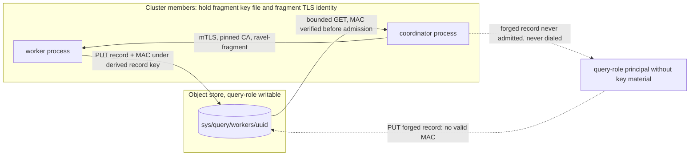

# ADR-1918: Authenticated query-worker registry records

Status: Accepted (2026-10-21). Builds on ADR-0071 (distributed read fan-out)
and ADR-1689 (slice capability and fragment listener consolidation). Issue
#1918.

## Context

Every distributed query process publishes one heartbeat record at
`sys/query/workers/<uuid>` (`crates/ravel-fleet/src/query_workers.rs`). Both
distributed lanes route from the live set built out of those records: the
PromQL lane ranks owners by rendezvous hash over the record UUIDs
(`services/ravel-server/src/distrib.rs`, `ranked_owners`), and the SQL lane
assigns slice `k` to `workers[k % len]` in UUID order
(`crates/ravel-sql/src/distributed.rs`). Each coordinator dials the
`fragment_endpoint` a record names.

The record is plain JSON with four fields and no MAC
(`query_workers.rs:147-153`). It is written with `PutMode::Overwrite`, and the
shipped query role grants `s3:PutObject` on the whole `sys/query/workers/*`
prefix (`deploy/iam/query.json`, statement `QueryWrite`). S3 cannot scope a
PUT to the writer's own UUID. The live-set reader checks that the key parses as
a UUID, that the body's `process_id` matches the key, and that the stamp is
fresh. None of these checks keeps out a writer who is not a cluster member,
and the module docs say so (`query_workers.rs:118-122`, `:309-312`; also
`docs/guides/distributed-query.md:420-426`).

When #1918 was filed, a forged record let an attacker harvest tenant bearer
tokens, because the SQL lane sent the client credential in cleartext. ADR-1689
removed that path. Today both lanes dial only over TLS with a client
certificate, pin the cluster fragment CA, and check the fixed server name
`ravel-fragment`. `Cli::validate` refuses `--distributed-query` without
`--fragment-listener`, `--fragment-key-file`, and the three
`--fragment-tls-*` files (`services/ravel-server/src/config.rs:7777-7848`).
An endpoint without a CA-signed certificate never receives a fragment
capability or a slice ticket, and never returns rows.

So the attack is now forged membership by anyone with query-role S3 write and
no cluster key material. Measured against the code at `65f8bf9cf`:

- **Tarpit.** A record naming an endpoint that accepts TCP and then stays
  silent hangs every query routed to it until the query deadline. The connect
  timeouts (3 s PromQL, 5 s SQL) cover TCP only. `fragment_client_tls` sets no
  TLS handshake timeout, and the attempt has no timeout of its own, so the
  re-dispatch and local fallback never run and the endpoint is never
  quarantined. One record is enough.
- **Targeting.** Tenant hashes are visible through ListBucket on `t/`. A
  writer can grind UUIDs offline until one wins the rendezvous ranking for a
  chosen `(tenant, signal, shard)`. On the SQL lane, a UUID that sorts first
  gets slice 0, and it is also the re-dispatch target for every other slice.
- **Fast-failing endpoints.** A record that fails the handshake costs up to
  two connect attempts per slice before fallback. The PromQL quarantine
  re-admits any record with a newer stamp, which the writer controls. The SQL
  lane has no quarantine.
- **Arbitrary outbound dials.** Coordinators open TCP and send a TLS
  ClientHello to any `host:port` a record names.
- **Unbounded GET.** The reader fetches a record object in full, with no size
  limit, on every coordinator, every heartbeat interval H (60 s).

The query role can already rewrite catalog `HEAD`, snapshot and index objects,
so this ADR does not claim that the query role is harmless. It claims
something narrower: joining the fleet should take cluster key material, not
only bucket write.

Every process that may join already holds such material. `--fragment-key-file`
is mandatory with `--distributed-query`, every process in a cluster reads the
same file (the operator mounts one Secret, `fragmentKeySecretRef`), and the
file supports rotation: the first key mints and every key verifies.

A first attempt (task `d529e64a`, result ref
`refs/heads/task/d529e64a-6693-4cca-99b1-786920e3de1e/result`, commit
`dceb3c405`) added a MAC but wired no key in the production start path, so
every process saw a live set of one. At the time no fragment key was required,
and that was the blocker recorded on #1918. The key is mandatory now, so the
blocker is gone. The branch is 1660 commits behind and its claim layout
includes `flight_sql_endpoint`, which no longer exists. It is reference
material only, not a merge candidate.

## Decision

1. **Each heartbeat object carries a MAC over its record.** The object becomes
   `{"mac": "<64 hex>", ...record fields}`: a private envelope that flattens
   `QueryWorkerRecord`, whose public field set is unchanged. The MAC is
   `blake3::keyed_hash(record_key, claim)`. `claim` is the length-prefixed
   (u64 big-endian) `process_id` and `fragment_endpoint`, followed by
   `protocol_version` (u32 BE) and `started_unix_ns` (i64 BE). Every field the
   reader acts on is covered. Binding `process_id`, which must equal the key's
   UUID, stops a signed record from being moved to another key.

2. **The record key is derived from the fragment key file, never the raw key.**
   For each file key, `record_key = blake3::derive_key("ravel query worker
   record v1", file_key)`. This follows `derive_surface_key` in
   `crates/ravel-sql/src/flight_ticket.rs`. A record MAC and a fragment
   capability MAC are made under different keys, so neither verifies as the
   other. Rotation follows the file: the first derived key mints, and a record
   verifies under any derived key.

3. **Keys are required by type.** The `QueryWorkers` constructor takes a
   record-key set that cannot be empty; constructing one from an empty list is
   a typed error. No builder defaults to "no keys". The production start path
   (`services/ravel-server/src/lib.rs`, where the heartbeat's `QueryWorkers` is
   constructed) passes the keys loaded from `--fragment-key-file`. A process
   therefore cannot be built that publishes unsigned records, or that rejects
   every sibling because it has no key. That was the failure of `d529e64a`.

4. **The reader verifies before admitting.** `live_set` admits a sibling only
   when its MAC verifies under one of the reader's keys, compared in constant
   time. The existing UUID, `process_id` and staleness checks stay. Rejected
   records are skipped, never fatal to the whole read, and are counted under a
   closed reason label as `ravel_query_worker_record_rejects_total{reason}`.
   The checks run in this order, and a record is counted under the first one
   it fails:
   - The key does not parse as a UUID: skipped, not counted.
   - The object's LIST mtime is outside the liveness window: skipped before
     the GET, not counted. A dead worker leaves such a record in normal
     operation.
   - The body is longer than the bound in decision 5: `oversize`.
   - The body does not decode, or its `process_id` does not match its key:
     `malformed`. A garbage overwrite, the eviction path in Consequences,
     lands here.
   - No MAC: `missing_mac`. A MAC that verifies under no key: `bad_mac`.
   - The MAC verifies and the stamp is `DRAINED_STAMP_NS`: skipped as a drain,
     not counted. A graceful shutdown writes exactly this record, so counting
     it would fire on every rolling deploy. A replay of a worker's own drained
     record is signed the same way and cannot be told apart from a real drain.
   - The MAC verifies but any other stamp is outside the liveness window:
     `stale_stamp`. The object's mtime was fresh, and a live worker re-stamps
     its record with its current clock on every write, so this pair is a
     replayed older heartbeat or a clock skewed past the window. Both are
     worth an operator's attention.

   The counters are per-reason `AtomicU64`s in a metrics handle that
   `QueryWorkers` owns in `ravel-fleet` and exposes by reference, the shape
   of the capability-reject counters in `services/ravel-server/src/distrib.rs`.
   The server's metrics endpoint snapshots that handle and renders the family
   beside `ravel_distrib_fragment_capability_rejects_total`, every reason from
   zero, so the series exists before the first reject.

5. **The record read is bounded.** The reader issues a range read of
   4096 + 1 bytes. A response longer than 4096 bytes means the object is
   larger than the bound, and the record is counted as `oversize` and skipped
   without being decoded. A real record is under 300 bytes.

6. **No protocol version change and no transition mode.** The record is
   transient heartbeat state, not a frozen format (ADR-1689 decision 3 made the
   same call), and the fragment wire protocol does not change, so
   `PROTOCOL_VERSION` stays 5. `QueryWorkerRecord` does not deny unknown
   fields, so an older reader ignores `mac` and keeps routing to newer
   workers. A newer reader rejects an older worker's unsigned record. During a
   rolling deploy, new coordinators therefore stop routing to old workers, and
   those slices run on the next-ranked worker or locally. The rollout is
   correct and loses fan-out for its duration. Before v1 there is no
   compatibility window to protect (owner decision, 2026-09-10), so the
   partition is accepted and not engineered around.

7. **No endpoint policy at the dial sites.** Once records are authenticated,
   only a holder of the fragment key file can name a dial target, and that
   holder is already a cluster member with the fragment TLS identity. A static
   allowlist would duplicate an authority that the MAC and the pinned CA already
   enforce, and pod addresses are assigned dynamically, so the only list that
   works is the whole pod CIDR. See Rejected alternatives.

## Rejected alternatives

- **Scope the IAM grant to the writer's own key.** S3 policy cannot tie a
  `PutObject` resource to a UUID the writer generates at startup. The prefix
  grant cannot be narrowed by configuration.
- **A separate publish credential and a prefix the query role cannot write.**
  This needs a second credential per query pod and an IAM role split in every
  deployment. Any holder of that credential can still forge and evict. The MAC
  gives the same admission property with key material every process already
  holds.
- **Per-process asymmetric signatures.** ADR-1689 chose not to require
  per-process identity: any certificate the cluster CA signed means "a
  fragment worker of this cluster". Per-process signing keys would need an
  issuer and a trust list that nothing else in the design has, and they would
  stop no attacker the shared-key MAC lets through, since the threat is a
  principal with no key material at all.
- **Sign with the raw fragment key.** The `d529e64a` branch did this. A record
  MAC and a capability MAC would then share a key, and the byte layouts would
  be the only thing keeping them apart. A derived key separates them by
  construction, at no cost.
- **Transition mode (accept unsigned records with a warning).** This leaves
  the hole open for as long as any process publishes unsigned records. Its
  only purpose would be to protect older readers during a rolling deploy, and
  there is no such constraint before v1.
- **Refuse startup without a key.** Already enforced: `Cli::validate` refuses
  `--distributed-query` without `--fragment-key-file`. Decision 3 adds the
  same guarantee at the type level for every non-CLI construction.
- **Endpoint allowlist at both dial sites.** Pod addresses are dynamic, so in
  practice the allowlist is the pod CIDR. That admits every address a forger
  on the pod network could use, while making operators maintain one more
  setting that can drift from the network. An operator-rendered egress
  NetworkPolicy has the same problem, and the policy rendered today is
  ingress-only on purpose.
- **A per-UUID high-water stamp, so a replayed older record is rejected.**
  Each reader would remember the newest stamp it has admitted per UUID and
  refuse anything older, which would stop replay of a worker's own drained
  record. It does not change the eviction consequence: overwriting the record
  with garbage evicts the worker just as well and needs no replay. The state
  is also per reader and not durable, so a coordinator that has just started
  has no high-water marks and admits any replay in its first read.

## Consequences

- A principal holding query-role S3 write but no fragment key file can no
  longer add a member to the live set or change where an existing member's
  traffic goes. This closes the tarpit, targeting, fast-fail, outbound-dial and
  unbounded-GET paths described in Context for that principal.
- **Eviction remains.** The same principal can overwrite a legitimate worker's
  record with garbage, or replay one of that worker's older signed records,
  including a drained record. Readers then reject the worker or treat it as
  stale or drained, and drop it until its next heartbeat lands. A writer who
  keeps overwriting keeps the worker out. The cost is lost capacity, not wrong
  answers and not hung queries: that worker's slices go to the next-ranked
  worker or run on the coordinator. Closing eviction needs a prefix the query
  role cannot write, and that is the separate-credential design rejected
  above.
- A holder of the fragment key file is a cluster member, as before. Any query
  pod can still forge records, harvest capabilities, and return rows on the
  SQL lane. That is the ADR-1689 trust model and this ADR does not change it.
- `ravel_query_worker_record_rejects_total` is the operator-visible sign of
  either a rollout in progress (`missing_mac` from old workers) or a forger
  (`bad_mac`, `oversize`, `malformed` for a garbage overwrite, and
  `stale_stamp` for a replayed older heartbeat). A replayed drained record is
  the one eviction that leaves no count, for the reason given in decision 4.
- A process whose fragment key file shares no key with its siblings no longer
  sees them, and they no longer see it. Today such a process already fails
  every PromQL fragment, because capabilities verify only under shared keys.
  It now also drops out of SQL slice routing, so a key mismatch shows up as
  loss of fan-out plus `bad_mac` counts. Test fixtures that give two processes
  disjoint fragment key files (`services/ravel-server/tests/sql_ticket_key_file_e2e.rs`)
  must share at least one key.
- Docs that change with the implementation:
  `docs/guides/distributed-query.md` (the admission paragraph at `:420-426`
  and the trust description), `docs/guides/observability.md` (the metric
  catalog, beside `ravel_distrib_fragment_capability_rejects_total`), the
  module docs in `query_workers.rs`, and the ADR index.
- Out of scope and filed separately: a TLS handshake timeout and a per-attempt
  timeout on both lanes. A legitimate worker that hangs mid-handshake stalls
  queries the same way a tarpit does, so this is a robustness fix of its own
  (#3129). The maintain-worker registry (`crates/ravel-fleet/src/worker_set.rs`,
  `sys/maintain/workers/`) has the same shape under the maintain role, and no
  shared key exists there to derive from (#3130).
