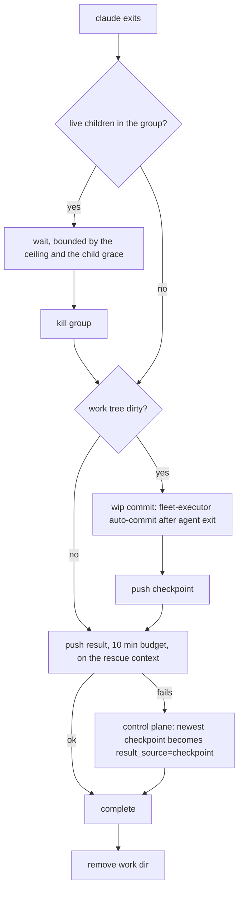

# ADR-2867: Ravel development speed, seven structural changes

Status: Accepted (2026-10-11). Issue: #2867 (epic). Owner-approved proposal:
"Ravel development speed: structural changes" (2026-10-11), compiled from
six sessions' own epics.

## Context

Over 2026-10-10 and 2026-10-11 the sessions working this repository
reported where their hours went. Seven losses recur, and none is in the
code being built. The epic body (#2867) carries the full table with the
issue and comment each figure comes from; the shape is:

| Loss | Sessions | Order of magnitude |
|---|---|---|
| Fleet executors lose finished work | 5 | about 10 h of executor time and 7 redispatches on two epics (#2793, #2662); #2858 four turn-ends on backgrounded gates |
| Measurement needs a laptop and a live login at every phase | 3 | about 5 h of boxes stalled on one SSO expiry; 24 h of wall for 4 h of compute on the first #2720 A/B |
| Fleet review re-derives findings already fixed | 4 | 5 of 9 rounds across three PRs; 17 rounds on one docs-only ADR (#2707) |
| Long-lived PRs on hub files serialize epics | 4 | #2774 blocked three workstreams for two days and needed a 41-commit rebase |
| The executor's gate is not CI's gate; flakes rerun | 3 | two extra CI cycles on #2833; six reruns or ejections from two flaky tests (#2783, #2851) |
| Specs carry numbers nobody checked | 2 | about 6 h on #2666's three wrong premises; ADR-2773's band predicted 22.7 % and 5 points were real |
| Attribution needs a chain of single-question box runs | 2 | about a day on #2795 and the regression is still unlocated |

What the two repositories do today (read on 2026-10-11, claude-fleet at
3bb5c18, ravel at 0d33ab7ed):

- **Harness (NOFireAI/claude-fleet).** `commitOnDeath` runs only when the
  agent exited abnormally (`internal/executor/executor.go:2253-2260`); a
  normal exit with uncommitted changes is torn down with the work directory
  (`stream_timeout_death_test.go:185` pins that). Nothing checks for live
  children in the agent's process group at turn end (`runner.go:280-291`
  waits on stdout EOF, cancel or deadline only). A forced daemon shutdown
  after the drain timeout cancels the context every rescue path uses, so
  commit-on-death, the result push and the rescue bundle all fail at once
  while the deferred `removeTree` still runs (`executor.go:749-752, 2375,
  3569-3572`). A reaped task is re-queued with its dispatch `commit_sha`
  unchanged (`internal/queue/queue.go:1585-1650`) and the next claim checks
  that out (`executor.go:1867`); the checkpoint ref pushed every heartbeat
  (`executor.go:3387-3425`) is read back by nothing. A final push that
  exhausts its 10-minute retry writes a rescue bundle on the executor host
  and leaves no result ref (`executor.go:2370-2401, 2629-2662`). The
  control plane receives each executor's disk and memory figures in its
  announce (`internal/api/api.go:674-688`) and uses them only for display;
  tasks cannot state a disk or memory need, and `label_selector` is a
  preference with a 2-minute grace, after which any executor claims the
  task (`queue.go:1204-1259`).
- **Review bot (same repository, `cmd/fleet-review-bot`).** One row per
  round stores `head_sha`, `task_id` and the info comment id
  (`internal/reviewbot/state.go:60-91`); no review id, finding or verdict
  is stored, and the only per-PR query returns open jobs. The reviewer's
  prompt (`spec.go:68-112`) tells it to diff the whole PR against the
  merge base and hands it the PR's existing inline comments with "do not
  re-report a resolved finding"; it gets no previous review body, no
  verdict and no diff since the last reviewed head.
- **Measurement (ravel).** `scripts/bench/fresh-box.sh` launches, drives
  over ssh or SSM from the laptop step by step, copies results back with
  scp, and terminates; it records the tier-B baseline only. ClickBench has
  no launcher in the tree: the runbook's sections 5 to 11 are hand-run
  shell, `bench.json` stays on the box, and the pre-registered bands live
  in issue comments, in Python constants inside the runbook's inline
  script, and in `benchmarks/clickbench/parquet/prereg.toml`. Nothing
  uploads a result to S3; nothing evaluates a band on the box.
- **Gates (ravel).** The fleet-task-spec template mandates
  `cargo clippy --workspace --all-targets` on every executor
  (`.claude/skills/fleet-task-spec/SKILL.md:128, 204-207, 386-388`), the
  workspace-wide step that the 4-hour ceiling kills on a Pi.
  `scripts/gates.sh -p ravel-query` skips the `sql` and `flight-sql` lanes
  although CLAUDE.md promises them for that crate; `scripts/affected-tests.sh`
  runs no feature lane, so `sql`-gated tests never run on an executor. The
  shape guard `assert-struct-literals-current.sh` runs only from
  `pr-review-status.sh`, after the PR exists.
- **Duplicate guards (ravel).** `assert-no-duplicate-dispatch.sh` compares
  whole file paths; `check-duplicate-work.sh` compares whole-diff patch ids
  and shared files. Six source files exceed 13,000 lines
  (`services/ravel-server/src/config.rs` 18,575;
  `services/ravel-server/src/metrics.rs` 16,726;
  `crates/ravel-query/src/log_fetcher.rs` 14,659;
  `crates/ravel-catalog/src/catalog.rs` 13,763;
  `services/ravel-server/src/maintain.rs` 13,421;
  `crates/ravel-sql/src/logs_scan.rs` 13,101), so two
  edits anywhere in one of them read as a collision. No PR size or lifetime
  rule exists beyond the three-review-round cap.
- **Claims (ravel).** The CLAIMS AUDIT paragraph tells an executor to
  recompute every number against the tree; nothing checks it. ADRs and
  `docs/internal/` are outside `check-doc-claims.py` by ADR-1658 decision
  2, and a band table's basis figure cites its source only when the author
  remembered (ADR-2677 decision 8 does for some rows; ADR-2707's
  acceptance table does for none).

## Decision

Seven changes, in the proposal's order. Each names the mechanism, the
acceptance test and the owner. The epic's acceptance is the same table as
the Context, re-read one week after the last change lands.

### 1. The fleet harness keeps finished work

In claude-fleet:

1. **Turn end waits for the agent's children.** When `claude` exits,
   `Run` checks the task's process group; if members are alive it waits,
   bounded by the remaining task ceiling and a new
   `FLEET_EXECUTOR_CHILD_GRACE` (default 30 min), then kills the group.
   Only then does `execute` continue.
2. **Commit-on-death runs on every exit with a dirty tree**, not only
   abnormal ones: the `runErr != nil` guard becomes "the work tree has
   uncommitted changes", with a message that says which exit it was.
   `CommitOnDeath_NormalExitUnchanged` inverts into a test that a normal
   exit with a dirty tree produces the wip commit and pushes it as a
   checkpoint.
3. **The rescue paths get their own context.** Commit-on-death, the final
   push and the rescue bundle run on a fresh context bounded by
   `FLEET_EXECUTOR_RESCUE_BUDGET` (default 90 s) that a drain-timeout or
   second-SIGTERM `hardCancel` does not touch; `removeTree` runs after
   them, never before.
4. **A reaped task resumes from its checkpoint.** On claim, the executor
   fetches `refs/heads/task/<id>/checkpoint`; if it exists and descends
   from the dispatch commit, it is checked out instead and the spec is
   prefixed with a fixed continuation paragraph naming both SHAs. The
   result then descends from the checkpoint, so `chooseCheckpointRef`
   keeps one line.
5. **A failed final push promotes the last checkpoint.** When the push
   retry budget ends with no result ref, the control plane records the
   newest checkpoint ref as the task's result with `result_source:
   checkpoint`, and `fleet_status` says so. The rescue bundle stays as it
   is.
6. **Resource floors become claim constraints.** A task may carry
   `min_disk_gb` and `min_mem_gb` (dispatch MCP and CLI parameters); the
   control plane's `pickTask` skips an executor whose last announce is
   below either, with no grace fallback. A gated ravel task declares 54 GB
   and 16 GB in its spec, so a Pi never claims one.

### 2. A measurement kit that runs on the box

In ravel, `benchmarks/clickbench/kit/`:

1. `launch.sh` (laptop, the only credentialed step): resolves the A and B
   SHAs, writes `run.toml` (SHAs, lanes to run, concurrency, the band file
   path) and uploads it with the kit tarball to
   `s3://<bucket>/runs/<run-id>/in/`, then runs `run-instances` with a
   user-data that pulls that prefix, verifies the sha256 of every file,
   starts `box/run.sh`, and arms `shutdown -h +600` with terminate
   behaviour. The instance role, not the laptop, holds every later
   credential.
2. `box/run.sh`: bootstrap (runbook section 6), load, compact, fold and
   declare (section 7) with the fold precondition checked, then the
   phases `run.toml` names: the 43-statement benchmark per arm, the q29
   probe, the concurrent phases, each logging every call's statement,
   outcome, duration and refusal class to `calls.jsonl` (that is change
   7's kit half). It writes `results.json` in the shape each lane already
   parses: the 43-statement lane's report is `SqlLatencyReport` with its
   `entries` of `EntryReport` (`crates/ravel-bench/src/sql_latency.rs`),
   which is what the runbook's section 9 `analyse.py` reads from
   `bench.json` today (statement `id`, `min_ms`, `error`,
   `per_run_accounting`); the Parquet lane's is `ClickBenchParquetReport`
   (`crates/ravel-bench/src/clickbench_parquet/report.rs`). Each is
   extended by a `bands` block with pass, miss or inconclusive per
   pre-registered band read from the band file, and an evidence tarball
   to `s3://<bucket>/runs/<run-id>/out/`, writes `DONE` or `FAILED` beside
   them, and terminates the instance.
3. `fetch.sh` (laptop): waits for `DONE` or `FAILED` under a wait bound,
   downloads `results.json`, prints the band table, and exits non-zero on
   any miss, on `FAILED`, on the bound, and with a distinct code when S3
   could not be reached.
4. Bands live in one file per lane, `benchmarks/clickbench/bands/<lane>.toml`,
   with the existing `parquet/prereg.toml` moved under it; the issue
   comment that pre-registers a run links the file and its commit, and the
   kit refuses a band file with a placeholder value, as `parse_prereg`
   already does. The runbook's section 9 constants (the T2 bands inside
   its inline `analyse.py`, registered against #913) become
   `bands/t2.toml`, and that script reads the file instead of carrying the
   figures, so the kit's on-box evaluation and the laptop check read one
   band set; until that lands with change 2 the hand-run path keeps its
   constants and the kit's acceptance is judged by the band file, not by
   the script.

Acceptance: a dry-run mode exercises every step with a stub `aws` and a
stub box (the pattern `fresh-box.test.sh` uses), and one real run of the
43-statement lane on main produces a `results.json` whose figures the
runbook's section 9 checks accept. Owners: ravel-perf and store-00.

### 3. Delta fleet review

In claude-fleet's review bot:

1. The `jobs` row gains `review_id`, `verdict` and `findings` (the parsed
   findings as JSON: path, line, severity, text) for every completed
   round.
2. On a new `review` for a PR with a completed round, `BuildSpec` adds a
   "Previous round" section: the previous head SHA, each previous finding,
   and the instruction to run `git diff <prev_head>..HEAD` first and to
   classify every previous finding as fixed (cite the current-head line
   that fixes it), open (cite the current-head line where it still
   stands) or new. The whole-PR diff stays available for new findings.
3. `BuildReviewRequest` drops any repeated finding whose cited line is not
   in the current head (the diff lines it already computes), and posts the
   classification table at the top of the review body. A finding reported
   open with a current-head citation is a real round; one with no citation
   is not posted.

Acceptance: a golden spec for the second round; a `result_test` case where
a previous finding's line no longer exists and the finding is dropped; a
test that a classification with every finding fixed produces a review body
and no inline comments. Owner: store-00, as fleet tasks against
NOFireAI/claude-fleet (the owner's decision of 2026-10-11: the sessions do
the claude-fleet changes; rollout stays the owner's manual runbook steps).

### 4. PR shape rules and hub-file splits

In ravel:

1. CLAUDE.md gains three rules under Commits: one behaviour change per
   PR; a dependency upgrade PR carries the upgrade, its test re-pins and
   nothing else, with any new mechanism stacked as its own PR; a PR with
   dependents open past 24 hours is split or landed, not grown.
2. `assert-no-duplicate-dispatch.sh` accepts `path#symbol` and
   `path:L10-L80` entries in `DISPATCH_PATHS` and tests them against the
   open PR's patch hunks for that file (the paginated files endpoint
   already returns the patch); a bare path keeps today's whole-file rule.
   A `docs/` path collides only when the same heading section changes.
3. Two move-only splits, each a single same-day commit in a window when
   no open PR touches the file, with a `git log --follow` check that
   blame survives (now a line-residue check; see the move-check
   amendment below): the ingest handlers into `decode`, `admission` and
   `mode` modules (store-96, after #2797), and `logs_scan.rs` into its
   plan, scan and threshold parts (ravel-perf, after #2774; landed as
   cd569a12b with a fourth part, `batch`).

Acceptance: guard cases for a hunk overlap, a same-file different-hunk
pass, and a docs same-section collision; `cargo check` on each split with
`git diff --stat` showing moves only. Owners: ravel-perf (rules, guard),
store-96 and ravel-perf (splits).

### 5. Executors run CI's gate, scoped; shape guards before the PR; flakes fixed

In ravel:

1. The fleet-task-spec template replaces workspace clippy with
   `scripts/gates.sh -p <crates>`, and `gates.sh` scoped mode gains the
   reverse-dependency closure that `affected-tests.sh` computes, runs the
   `sql` and `flight-sql` lanes when `ravel-query` is in scope (the
   documented promise), and `affected-tests.sh` runs the `sql`-gated
   tests when `ravel-server` is in the closure. Doc-only and test-only
   rounds run `cargo check -p` plus the crate's tests. The PreToolUse hook
   refuses `cargo clippy --workspace` when the checkout is a fleet clone,
   keyed on the fleet-clone path test alone (the `/fleet/work/` and
   `/var/lib/fleet` test inside `isExemptCheckout`, not the whole
   function: its `RAVEL_GUARD_ALLOW_PRIMARY` escape belongs to the worktree
   rule and must not switch this refusal off). The hook sees only the
   command text, so `gates.sh` itself refuses to run unscoped (no `-p`)
   when its checkout is a fleet clone, with the same path test; the hook
   covers the hand-typed spelling, the script covers its own. The escape
   hatch is `RAVEL_GATES_ALLOW_UNSCOPED=1`, in the shape of
   `ALLOW_DESTRUCTIVE=1`: a genuinely cross-crate task sets it to run the
   workspace gate CLAUDE.md requires, and `verify-dispatch-gates.sh` sets
   it for its own unscoped run so a verification host under the fleet root
   still produces a gates-pass receipt.
2. `fleet-result-merge.sh` runs `assert-struct-literals-current.sh`
   before `gh pr create`, so a shape break is a local refusal, not a CI
   cycle.
3. The two flakes are fixed, not rerun: `sql_topk_threshold_skip.rs`'s
   `order_by_ts_limit_skips_and_reports_through_the_endpoint` asserts
   the invariant that holds on every run (scanned plus skipped equals
   total, bodies equal) and pins the pruning count in a unit test that
   controls block order (#2851); the remaining half of #2783 is closed
   with the test that fixed it named.

Acceptance: the hook's suite refuses `cargo clippy --workspace` under a
`/var/lib/fleet` path and allows it in a linked worktree; a `gates.sh`
case shows `-p ravel-query` selecting the `sql` and `flight-sql` lanes and
`-p ravel-logseg` pulling `ravel-ingest` into the closure; a merge-script
case shows the shape guard refusing before the PR step; the TopK endpoint
test passes 50 consecutive runs quiet and 50 under a concurrent build, and
its new order-controlled test fails under both flips (skip made a no-op;
threshold published after the scan). Owners: store-43 (template, gates,
hook, merge script), store-00 (#2851, #2783 closure).

### 6. Specs cite their numbers

In ravel:

1. The fleet-task-spec template's CLAIMS AUDIT gains: every number in a
   spec or an ADR band table names its source as a comment id, a report
   path, or `file:line`, and a profile-derived band cites exclusive leaf
   shares (corrected by the share-kind amendment below). The paragraph
   stays advisory for specs (nothing parses a spec);
   the check that makes the rule bite is item 2's guard on the ADR tables
   that specs copy their numbers from.
2. `scripts/guards/check-adr-band-sources.sh`: in every ADR, a table whose
   header names a band, bar, target or miss must carry a source token in
   each basis cell (an issue comment link, an `s3://` or `bench/` report
   path, or a `measured <date>` stamp); exit 1 names the cell, exit 70
   when no band table is found at all. Wired into `gates.sh` and the
   doc-scripts job, cases first. `check_docs.py`'s TRACKER rule stays as
   it is: ADRs are history scope and may cite issues.
3. Backfill, in the same commit as the guard, so the gate lands green:
   every ADR band table that fails the rule on the day the guard lands is
   sourced in that commit. On 2026-10-11 the anchored scan finds eight
   ADRs with such a table (ADR-2707's acceptance table and ADR-2677's
   decision 8 rows among them); each basis cell gets the comment id,
   report path or `measured <date>` stamp its figure came from, or, where
   the figure was a prediction with no measurement behind it, the cell is
   marked `predicted` and the guard accepts that token too, so a reader
   can tell the two apart. There is no cutoff and no allowlist.

Acceptance: the guard's suite covers a cell without a source (exit 1
naming it), a sourced cell, a `predicted` cell and a tree with no band
table (exit 70); the guard exits 0 on the commit that lands it. Owner:
ravel-hardening.

### 7. Instrumentation that answers "where did the time go" in one run

1. CPU-gate handoff and post-return time per site, as counters, by an
   ADR-1702 amendment (ravel-hardening).
2. The kit's `calls.jsonl` per concurrent call (part of change 2).
3. `EXPLAIN ANALYZE` on an operator-only diagnostics path: a
   `ravel-cli sql explain --analyze` that runs the statement in the
   embedded session against the tenant and prints the physical plan with
   metrics, so no HTTP surface changes (store-00, after #2774). `ravel-sql`
   is a dev-dependency of `ravel-cli` today, so the subcommand lands behind
   a new off-by-default `ravel-cli` feature `sql-explain` that makes
   `ravel-sql` an optional dependency; the default `ravel-cli` build and
   the workspace gate's feature unification (which rests on the
   dev-dependency on `ravel-server` with `sql`) are unchanged, and the
   feature is compiled by CI's `all-features` job and by a
   `-p ravel-cli --features sql-explain` line added to the `features` lane.
4. One `perf record` of a hot run per statement in the kit, as an opt-in
   lane (part of change 2).

Acceptance: both gate counter families appear on the scraped `/metrics`
with their site labels and an artificial delay inside the gate lands in
the handoff counter only; a stub concurrent phase writes one `calls.jsonl`
line per call and the band evaluation reads pooled error and QPS from it;
`ravel-cli sql explain --analyze` over an in-memory tenant prints the
physical plan with per-operator `elapsed_compute` and output rows for a
grouped aggregate (and the slice-compaction node's own metrics once #2774
is on main) while the HTTP endpoint still refuses `EXPLAIN`. Owners: ravel-hardening (item 1),
ravel-perf (items 2 and 4), store-00 (item 3).

## Rejected alternatives

- **Dropping the pre-PR Opus checkpoint review for small PRs.** It is the
  only review that reproduces: it caught buffered writes acknowledged and
  dropped (#2675), a takeover oracle that never took over (#2666), a
  proptest seed-replay bug (#2837), the `samples.labels` runtime failure
  (#2774) and two T2 blockers in #2707. Rejected.
- **Raising the three-round review cap, or re-enabling auto-merge.** The
  rounds still find real defects; the loss is the re-posts, which change 3
  removes. Rejected.
- **A blanket ban on Sonnet executors.** The four lost tasks shared long
  gates plus backgrounding, which change 1 fixes for every model. Rejected.
- **Disabling `run_in_background` in the executor's tool configuration.**
  It is a Bash parameter, not a tool, so `--disallowed-tools` cannot
  target it, and no CLI switch for it was found; change 1's turn-end wait
  makes it harmless instead.
- **Sequential arms on one box as a cost saving.** m38 ran the same binary
  50 % slower hot after six hours with an unchanged store. Paired fresh
  boxes launched together stay the rule; a single box is for an in-box A/B
  with alternating controls and a drift check against its own baseline.
- **Widening bands for noisy statements.** A bimodal 0.2 s statement is
  reported as bimodal. Rejected.
- **A "files under rewrite" board as the hub-file answer.** The duplicate
  guard's hunk view is that board, published before specs are written;
  the splits are move-only commits, since a split that is itself a
  long-lived PR recreates the problem.
- **Fix rounds running `cargo check -p` and the crate's tests only** (the
  Pi-ceiling argument). Hand-picked commands missed sql-lane errors on
  #2833 twice; code rounds run `gates.sh -p` on amd64, doc and test rounds
  run check plus crate tests.

## Consequences

- Executor losses stop being a redispatch story: a normal exit with a
  dirty tree, a drain-timeout redeploy and a failed final push each leave
  a result or a checkpoint that the control plane names. The cost is up to
  the child grace per task at turn end, and a 90 s rescue window on
  shutdown.
- Measurement runs need the laptop for one command and read results from
  S3; an SSO expiry mid-run costs nothing. Per-call logs make a
  concurrent miss attributable to statements.
- Fleet reviews after round one report fixed, open and new; a repeated
  finding without a current-head citation does not post. Round counts per
  PR drop toward the number of real defects.
- Specs and ADRs carry checkable numbers; a band whose basis has no
  source fails the docs gate.
- Two hub files are split; the other large files are left until a PR
  collides on them, with the hunk-level guard telling two edits apart in
  the meantime.
- Two repositories change. The claude-fleet half ships only when the
  owner rolls out fleet-cp, the executors and the review bot by the
  runbook's manual steps; until then the ravel half stands on its own.

## Amendment: a profile-derived band names its share kind (issue #2879)

<!-- amendment-applies: sections="6. Specs cite their numbers" pointer="share-kind amendment" -->

Change 6 item 1 required a profile-derived band to cite exclusive leaf
shares. The only profile-derived band in the tree when the rule was
written, ADR-2773's, was computed from inclusive shares ("Inclusive shares
of statement CPU (a frame counts once per stack)",
`docs/adrs/2773-hot-path-materialization.md:99`). Requiring exclusive
shares would have made that band non-compliant without making it wrong:
an inclusive share is the right basis for a band on a frame and its
callees, and an exclusive one for a band on the frame's own work.

What item 1 requires instead: a profile-derived band cites the shares it
was computed from and says whether they are inclusive or exclusive. The
fleet-task-spec CLAIMS AUDIT paragraph states that rule (T11, #2879).
Item 2's guard does not parse share kinds: it checks that each band row
carries a source token, and whether the cited shares are the kind the
band states is a reviewer's check.

## Amendment: a split's move check is its line residue (issue #2875)

<!-- amendment-applies: sections="4. PR shape rules and hub-file splits" pointer="move-check amendment" -->
<!-- amendment-supersedes: phrase="`git log --follow` check that blame survives" pointer="move-check amendment" -->

Change 4 item 3 named a `git log --follow` check that blame survives a
move-only split. That check cannot pass for these splits. `--follow`
tracks one file's renames, and a split cuts several new files out of one
that keeps existing. On the first split (T7, PR #2955), `git log
--follow` at the default rename threshold lists only the split commit for
both new files, `ingest_mode.rs` (27 lines) and `ingest_decode.rs` (1,319
lines). Lowering the threshold far enough makes it follow (`-M30%` on
`ingest_decode.rs`, `-M5%` on `ingest_mode.rs`), but a threshold tuned
per file is not a bar a split can be held to.

`git blame -C -C -C` does not replace it as a bar either. Its copy
detection is a heuristic whose answer depends on how much of a file is
blamed at once. On the `logs_scan.rs` split (cd569a12b), a whole-file
blame attributes 1,080 of `plan.rs`'s 1,475 lines to the split commit,
and re-blaming the file in 10-line ranges still leaves about 100 lines
there, though they are moved bodies. It stays useful for finding where a
line came from, not for deciding whether a split moved it.

What item 3 requires instead is the split commit's line residue on both
sides, over every path the commit touches: the lines it adds that it
does not also remove, and the lines it removes that it does not add
back, compared as sorted multisets.

    git show --format= -U0 <split> > split.diff || exit 1
    grep -E '^\+' split.diff | grep -vE '^\+\+\+ (b/|/dev/null)' | cut -c2- | sort > added
    grep -E '^-' split.diff | grep -vE '^--- (a/|/dev/null)' | cut -c2- | sort > removed
    comm -23 added removed
    comm -13 added removed

The first command runs on its own so a mistyped ref stops the check
instead of producing an empty diff that reads as a clean move. The
header filter matches git's `a/`, `b/` and `/dev/null` prefixes, not any
line that starts with `++` or `--`.

A pure move leaves only the lines a split has to write: blank lines, the
new modules' doc headers and `mod` declarations, `use` lines and their
continuations, attributes on a moved test module, visibility qualifiers
such as `pub(crate)` on items that crossed a module boundary, references
rewritten to the new module path (call sites, doc links, doc text that
names a file), doc prose rewrapped around such a reference, lines rustfmt
reflowed because one of those edits changed their length, and closing
delimiters. The reviewer reads every added-side residue line against
that list. Every removed-side residue line must be the earlier form of an
added-side line (the same item before its visibility qualifier or path
changed), or the old file's own header, `use` or blank line. A line
outside the list on either side means the split did more than move. In
particular, a function the split drops outright adds nothing and shows
only as an unpaired removed line. Edits the commit body names, such as a
guard's file list or a deduplication, are read against the body.

Both splits have been checked this way. The `logs_scan.rs` split
(cd569a12b, which also produced a fourth part, `batch`) adds 9,845 lines
and removes 9,827, with residues of 81 added and 63 removed lines. Every
residue line is in the list. Two of the added ones are a function
signature rustfmt reflowed after its visibility changed. The removed ones
are the same items and fields before they gained `pub(super)`. The ingest
split (T7, PR #2955 at 373dfd091) adds 1,558 lines and removes 1,506,
with residues of 119 and 67. Every residue line is in the list, apart from
two edits its commit body names. One is the guard file-list edit. The
other shows only on the removed side: two byte-identical copies of
`retry_after_seconds`, in `otlp_http.rs` and `remote_write.rs`, became
one in `ingest_admission.rs`. Blame did not show that change; the
removed-side residue does.
