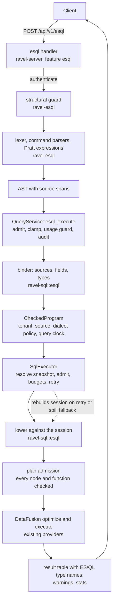

# ADR-2887: ES|QL query frontend over the existing tabular engine

- Status: Accepted; implementation tracked on epic #2887
- Refs: #2887, ADR-0013, ADR-0022, ADR-0023, ADR-0035, ADR-0044, ADR-0090,
  ADR-0097, ADR-0954, ADR-1374, ADR-2040

## Context

Users who run Elasticsearch write ES|QL: a piped language in which each
command consumes the table the previous one produced. Ravel answers SQL and
PromQL. A user moving to Ravel has to rewrite every saved query, and the
rewrite is not mechanical, because ES|QL differs from SQL in null handling,
multivalued fields, type conversion, implicit limits and the order in which
a pipeline applies its stages.

The goal is that an existing ES|QL query runs unchanged and returns what
Elasticsearch would return. That is a language frontend with its own
parsing, field resolution, types, functions, operators and result
semantics, connected to the engine Ravel already has. A parser alone does
not deliver it.

### What the engine provides, and where it stops

All references are to main at `c8c39bcb2`.

`ravel-sql` links DataFusion 54 and owns the table providers, pruning,
physical execution, the per-tenant memory pool, spill (ADR-0954) and cost
accounting (ADR-0044). `SqlExecutor` wraps them in one driver: validate,
resolve one catalog snapshot, admit against segment and request budgets,
plan, execute under a deadline, and retry once when a pinned segment has
gone and nothing was emitted. `QueryService` in `ravel-server` adds
admission, deadline and budget clamping, usage recording on failure and
cancellation, and audit.

Five facts about that driver decide the shape of this design:

1. Every public entry point takes SQL text, and the text drives more than
   planning. The target signal, the cross-signal check and the Parquet
   table names all come from `statement_tables(sql)`
   (`crates/ravel-sql/src/executor.rs:3162`), which one execute request
   calls three times (`executor.rs:1571`, `:1917`, `:2438`).
2. One query builds its plan against three different sessions: a throwaway
   session for spill and exactness classification
   (`executor.rs:1977-1988`), the executed session (`executor.rs:2222`),
   and a rebuilt session on the snapshot retry (`executor.rs:1577`) or the
   spill fallback (`executor.rs:2251-2258`). Each session registers its own
   table provider over its own snapshot.
3. Validation runs on the sqlparser syntax tree
   (`crates/ravel-sql/src/validate.rs:286`). The function allowlist
   deregisters names from the session, and its own documentation says it
   governs name resolution only (`crates/ravel-sql/src/session.rs:52-53`).
   The single check that reads the logical plan is
   `refuse_unadmitted_planned_shapes` (`executor.rs:4398`).
4. `now()` and every other clock function are deregistered in every session
   (`session.rs:394-404`), because the SQL differential gate cannot attest
   a nondeterministic function.
5. A session registers exactly one signal table (`session.rs:895-929`;
   only the Parquet arm registers several), and a
   statement naming two signal tables is refused as `CrossSignalQuery`.

Outside the driver:

- Audit redaction has a `"sql"` arm; any other language is redacted with
  the PromQL redactor (`services/ravel-server/src/config.rs:512-521`).
- The pre-parse complexity guard is a mirror of the SQL tokenizer. It
  exists because a deep tree aborts the process on a 2 MiB worker stack.
- `ravel-cli` has no query subcommand and no HTTP client. The MCP
  `ravel_query_sql` tool is catalogued but returns `NotShipped`
  (`crates/ravel-mcp/src/tools/mod.rs:65-83`).
- Logs carry no per-record identity. List and map attribute values are
  stored as canonical bytes and surface in `attrs` as hex text; the SQL
  surface has no typed multivalue access. Declared typed columns cover
  `Str`, `I64`, `Bool` and `Bytes` only.
- The `samples` table exposes scalar values and leaves native histograms
  out.

### Size of the whole

The released language has source, processing, relational, branching, time
series, search and inference commands and several hundred function
signatures. That is a program of several epics. This ADR fixes the
contract and the architecture for the whole program and scopes one epic:
the contract itself, a complete parser, and one execution path through the
real server. Everything else is named under Consequences as follow-up
work, each with its own decision record where it needs one.

## Decision

### D1. The compatibility target is a pinned release, recorded in a manifest

The target is the released ES|QL language of Elasticsearch 9.5.5. A
checked-in manifest, `crates/ravel-esql/manifest/esql-9.5.5.toml`, lists
every released command, syntax variant, function and alias, type,
directive and parameter form. Each entry records:

- whether the release marks it preview;
- its state at three layers: parser, binder, executor;
- any backend or data resource it needs (a search index, an enrichment
  policy, an inference endpoint);
- the test that is its evidence.

Features that exist only in development builds of the pinned release are
not in the manifest. Released preview features are in it, marked preview.
A later Elasticsearch release is a new manifest file and a new profile with
a visible diff; it never widens an existing claim.

### D2. Three measures, and a gap is a gap

`docs/esql-conformance.md` is generated from the manifest and the test
results by a cargo test, the way `docs/sql-conformance.md` is generated
today. It reports three figures separately:

| Measure | Passing means |
|---|---|
| Syntax coverage | Every valid released form parses; every invalid form produces a bounded, located error. |
| Execution compatibility | A valid program resolves fields and types, executes, and returns compatible values, schema, ordering guarantees and warnings. |
| Transport compatibility | The request and response options that are implemented work through the endpoint. |

The scoring rule differs from ADR-0035 on purpose. ADR-0035 scores the SQL
and PromQL surfaces on the claimed subset, and an intentional rejection
counts as conforming. Here the denominator is the whole manifest. A valid
entry that Ravel rejects stays in the denominator as an execution gap,
however clear the rejection. Negative tests (invalid input is refused) are
counted on their own line and never raise the positive figures. ADR-0035
and the SQL and PromQL scores are unchanged.

"Full support" may be claimed only when the manifest has no gap. Until
then the report says which entries work.

### D3. An independent implementation

The upstream grammar, function registry and test fixtures carry the
Elastic License 2.0. None of them is copied, translated or paraphrased
into this repository. The lexer, the parser, the manifest inventory and
every test case are written here, from the published language reference.

That has a cost this ADR states plainly. The published reference moves
with later releases and lists features the pinned release gates behind
development builds. Without the tagged grammar or the released binary,
nothing authoritative checks that the manifest is exactly the released
9.5.5 surface. So, until the licensing question below is answered:

- the manifest is authored against the published reference for the 9.5
  line, and says so in its header;
- "complete" in D5 means complete against that manifest;
- the syntax coverage figure is labelled as measured against the
  published reference, not against the released binary;
- expected results are authored by hand from the published reference.

Running the released binary as a test oracle, and checking in responses
recorded from it, needs a licensing review first (see Open questions). A
yes turns the manifest into one reconciled against observed behavior and
adds differential evidence to every measure. The architecture is the same
either way; the strength of the claim is not.

### D4. Two layers: a pure language crate, and lowering inside `ravel-sql`

`crates/ravel-esql` is a new pure Rust crate: lexer, parser, syntax tree,
language types, function signatures and the typed program a binder
produces. It depends on no Arrow, no DataFusion and no object store,
as `ravel-promql` and `ravel-analytics` do not. Its one internal
dependency is `ravel-promql`, for the embedded PromQL region (D5), which
is itself free of all three. It adds no external
dependency: the lexer and parser are hand-written (D5).

`crates/ravel-sql/src/esql/` holds everything that needs the engine:
binding against table schemas, lowering to DataFusion logical plans, plan
admission, and result encoding. It follows the existing `src/flight/`
module-directory shape. Keeping it inside `ravel-sql` preserves the
boundary ADR-0013 drew: one crate links DataFusion, and no Arrow type
crosses out of it.

### D5. Parser

A lexer with command-aware modes (source patterns and identifiers lex
differently from expressions), one parser per command, and a Pratt parser
for expressions. Every node keeps its source span and the original
spelling of identifiers. Embedded PromQL is a separately delimited region
handed to `ravel_promql::complexity_guard::parse_guarded`; it is never
split on `|`.

The parser accepts the complete released syntax in this epic, including
the commands that have no executor yet. A parsed command without an
executor fails at binding with a typed `Unsupported` error naming the
command and its span.

`ravel_esql::parse` is the only parse entry. Before it builds any tree it
applies structural limits: statement bytes, token count, nesting depth,
pipeline stages and branch count. Every later walk over the tree is
bounded by those limits, which is what the SQL complexity guard does for
SQL. A gate script enforces the single entry the way
`check-guarded-sql-parse.sh` does.

Parameters are bound as typed values, never interpolated into text.
Identifier and source parameters are resolved through the same binder
path as literal names, so they are checked against the same authorized
metadata.

### D6. The executor takes a checked program, not a plan value

`SqlExecutor` gains a second statement form beside SQL text. Internally
the driver works on:

- the statement's target tables, which for ES|QL come from the bound
  program's resolved sources instead of `statement_tables(sql)`;
- a lowering it can run more than once.

Context fact 2 is why the input is a lowering, not a `LogicalPlan`: a
table scan binds to the provider of the session it was built in, and one
query has up to three sessions. The ES|QL path hands the driver a
`CheckedProgram` and the driver calls `esql::lower(&program, &session)`
wherever it turns SQL text into a plan today. There are two such sites on
this path, and both must be routed:

- the classification plan, built in the throwaway session by
  `analyzed_classification_plan` (`executor.rs:2975`,
  `state.create_logical_plan(sql)`), which decides spill and exactness;
- the executed plan (`executor.rs:2222`, `ctx.sql(sql)`), which runs again
  on the snapshot retry and on the spill fallback rebuild.

Wiring only the second leaves every ES|QL query without a classification
plan. Admission, the
request-budget check, the spill decision, the retry contract, accounting
and the deadline are the same code for both forms. `build_session`, the
providers and `PinnedStream::start` are already public; the ES|QL path
does not call them directly, because doing so would skip all of the above.

A `CheckedProgram` carries the tenant, the resolved source, the dialect
policy version, the schema it was bound against and the query clock. It
has no public constructor outside the binder.

### D7. Plan admission closes the bypass

Context fact 3 means a programmatic plan passes none of today's
validation. The ES|QL path therefore validates the plan itself, after
lowering and before execution, on every session it is lowered against:

- Every plan node kind must be on an admitted list. Write nodes, DDL,
  table functions and unlisted extension nodes are refused.
- Every table scan must name the one source the program was bound to.
- Every scalar, aggregate and window function in every expression must be
  on the ES|QL dialect policy list, and must be the instance registered in
  that session. Lowering obtains functions by name from the session
  registry and never from a DataFusion function handle. That is what keeps
  the total-order `min`/`max` (ADR-0023) and the sequential-fold `avg`
  (ADR-0022) in force, since the session registers them under the built-in
  names.

The ES|QL dialect policy is a separate list from the SQL allowlist. The
SQL session, its allowlist and its conformance score do not change. In
this epic the ES|QL policy admits a subset of what SQL already admits
(D9), so no function enters an ES|QL session that the exactness rule has
not already covered.

A failure of plan admission is an internal error, not a user error: it
means lowering produced something the binder should have refused. A test
tampers with a lowered plan and asserts the refusal.

### D8. One query clock, as a literal

`NOW()` lowers to a timestamp literal taken from the request's `now_ns`,
captured once per request. No clock function is registered in any
session, and the retry lowers against the same literal. SQL's exclusion
of clock functions is unchanged.

### D9. What executes in this epic

Commands: `ROW`, `FROM` (one source), `WHERE`, `EVAL`, `KEEP`, `DROP`,
`RENAME`, `STATS ... BY` with per-aggregate `WHERE`, `SORT`, `LIMIT`.

Aggregates: `COUNT`, `SUM`, `MIN`, `MAX`, `AVG`. Grouping function:
`BUCKET` over a timestamp with a fixed duration. Scalars: comparison,
boolean and arithmetic operators, `NOW()`, and date arithmetic with
duration literals. Types: `keyword`, `long`, `double`, `boolean`,
`date_nanos`, `null`.

Each stage binds against the output schema of the stage before it. After
`STATS` only the aggregates and grouping keys exist. `KEEP` and `DROP`
expand wildcards and fix column order. `EVAL` and `RENAME` follow the
release's replacement and collision rules.

Pipeline order is preserved. `SORT ... | LIMIT 100 | STATS ...`
aggregates the 100 selected rows: lowering puts the limit under the
aggregate, and a test asserts that the optimized plan keeps it there. The
implicit final row limit of the release is applied to the final stage
only and never to the input of an aggregate.

Everything else in the manifest is reported as an execution gap.

### D10. Sources and fields without a dataset catalog

In this epic `FROM` accepts exactly one source name, `logs`. Any other
name, any pattern and any list of more than one source is refused with a
typed error that names the source. One source per query keeps the
cross-signal rule and the one-snapshot-per-query contract as they are.

The other signal tables wait for their own field model. `spans`, `alerts`
and `audit` name their event time differently (`start_ts`, `ts_ns`), and
spans merge attributes in the opposite precedence to logs. `samples` reads
labels through `label()`, not a map subscript, and its name-filter
pushdown is a third place where the driver plans SQL text
(`executor.rs:2872`), which D6 does not need to touch while metrics stay
out. Each is an execution gap in the manifest.

A pattern such as `logs-prod-*` is not treated as an alias for the `logs`
table. That would return every log in the tenant for a query that asked
for one dataset.

Field names resolve in this order:

1. `@timestamp` is `ts`, typed `date_nanos`. `message` is `body`.
2. A native column name.
3. A declared typed column (ADR-0090), with its declared type.
4. Any other name is an attribute key, read as `get_field(attrs, key)`,
   typed `keyword`, null when the record lacks it.

Native columns outside the D9 type set are typed as follows.
`severity_num` and `flags` are `long`. `trace_id`, `span_id` and a
declared `Bytes` column are `keyword`, rendered as lowercase hex, which is
how an attribute holding bytes already reads. The `attrs` map is not a
field: `FROM logs` with no `KEEP` projects the native columns except
`attrs` and the declared columns, and attribute keys are reached by name
through rule 4.

Rule 1 shadows an attribute of the same name: a record carrying an
attribute key `message` or `@timestamp` cannot be read by that name in
this epic. That is recorded in the manifest beside the rule 4 divergence.

Rule 4 is a known divergence, recorded in the manifest: Elasticsearch
refuses a field absent from every mapping, and Ravel cannot tell an
unmapped field from an absent one until fields are declared in a catalog.
List and map values read through rule 4 arrive as their hex rendering;
multivalued fields are an execution gap in this epic.

`METADATA _index`, `_id` and `_score` parse and are refused at binding.

### D11. The time window is derived or stated, never defaulted

Catalog resolution needs a time window before any data is read. The SQL
endpoint defaults it to the last hour. An ES|QL query carries its own
time predicate, so a silent default would return one hour of data for a
query that asked for a day.

The binder derives the window from conjunctive bounds on `@timestamp` in
the `WHERE` stages that come before the first `LIMIT`, `STATS`, or stage
that redefines `@timestamp`:

- A lower and an upper bound give the window.
- A lower bound alone gives a window that ends at the query clock. This is
  the common shape, `WHERE @timestamp >= NOW() - 1 hour`.
- No lower bound gives a window that starts at the Unix epoch. The binder
  looks nothing up to choose it. Such a query is valid ES|QL and is not
  refused for its shape. The catalog's own bound on window width
  (`CatalogError::WindowTooWide`) and the segment and request budgets
  decide whether it runs, and a refusal is the same typed error SQL
  returns for the same window. The response stats state the window that
  was used.

The derived window is also applied to rows; see the row filter amendment
below.

The request may also pass `start` and `end`. They narrow the window and
are applied as a filter on `@timestamp`, so they change the result and
are visible in the request, never implied. `ROW` queries need no window
and no catalog access.

This epic does not change the catalog's bound on window width, so a
query with no lower bound may be refused on every tenant until a later
decision narrows the window another way. A test drives such a query
through catalog resolution and asserts what happens: the error, if there
is one, is the catalog's window or budget error and names the window,
and is never a parse or verification error.

### D12. Service and transport

`ravel-server` gains an `esql` cargo feature that implies `sql`.
`QueryService::esql_execute` runs the same steps as `sql_execute_timed`:
admit, clamp deadline and budgets, usage guard, execute, record usage
before audit, audit, record cost. The structural guard and the parse run
before admission is taken, and a parse or bind failure reads no catalog
and no data.

`POST /api/v1/esql` takes `{"query", "start"?, "end"?, "timeout"?,
"params"?}` and returns Ravel's existing envelope,
`{"status": "success", "data": {"columns": [{"name", "type"}], "rows":
[[...]]}, "warnings"?, "stats"}`, with ES|QL type names in `type`. The
Elasticsearch response shape belongs to the later `POST /_query` adapter.
The route is attached to both the primary and the mTLS service. Errors use the
existing status table. A parse error, a verification error and a valid
program that needs an unimplemented capability are all 400 `bad_data`,
as every SQL validation refusal is, the first two with line and column.
422, 503, 504 and 500 keep the meaning they have for SQL.

Audit records the language as `esql` with its own redaction arm, built on
the ES|QL lexer so that string and number literals are tokenized and
structure is kept.

There is no partial coverage on this surface, as there is none on SQL: a
deadline or a budget breach is a typed failure and partial state is
discarded.

### D13. Spill and resource accounting

The commands in D9 lower to node kinds the spill classifier already
knows (projection, filter, aggregate, sort, limit, values). ES|QL plans go
through the same classification on the analyzed plan and the same
re-check on the executed plan. No operator is added to the eligible set
by this ADR. A later operator (a join, a window, an extension node) is
ineligible until its own decision classifies it.

### D14. Gates

- `scripts/gates.sh` and `ci.yml` get an `esql` feature lane (clippy and
  tests for `ravel-server --features esql`), and `ravel-esql` joins the
  path filter that selects the SQL area.
- The single-parse-entry guard for `ravel-esql` runs in `gates.sh` and the
  doc-scripts job.
- Property tests cover the lexer and parser: arbitrary bytes produce a
  typed error or a tree, never a panic, and a printed tree parses back to
  itself.
- The conformance document is byte-compared by its generating test.

## Rejected alternatives

**Generate SQL text from ES|QL and run it through the SQL path.** It
reuses every existing check for free. It loses because SQL text cannot
carry what ES|QL needs: the query clock (SQL sessions have no `now()`),
names that change at every stage, a limit that must stay under an
aggregate, and later multivalue kernels and warnings. It also adds a
second parser to every query and puts ES|QL at the mercy of the SQL
allowlist, which exists to protect a different conformance claim.

**Hand `SqlExecutor` a `LogicalPlan`.** Simplest signature. It fails on
context fact 2: the plan would bind to one session's provider, and the
retry and the spill fallback rebuild the session over a new snapshot.

**Build sessions directly from the public pieces (`build_session`, the
providers, `PinnedStream::start`).** No change to the driver. It skips
admission, the request-budget check, the spill decision, the retry
contract and accounting installation, which are the guarantees the query
surface makes.

**Admit ES|QL's functions by widening the SQL allowlist.** One list to
maintain. It would put `now()`, the variance family and unverified
aggregates into SQL sessions, where ADR-0022 and ADR-0097 excluded them
for reasons that still hold.

**Rely on the session registry for validation, as SQL does.** Context
fact 3: the registry stops a name from resolving. A plan built in code
does not resolve names unless lowering chooses to, so the registry alone
proves nothing about it. D7 makes the check explicit.

**Generate the parser from the upstream ANTLR grammar.** Exact syntax
coverage on day one. The grammar is under the Elastic License 2.0, the
generator adds a build dependency and a runtime crate the workspace does
not have, and generated error recovery does not give located errors in
the shape D12 needs.

**A parser-combinator or lexer-generator crate.** Less code. Every
candidate is a new external dependency; none is in
`[workspace.dependencies]`. Command-aware lexing and Pratt parsing are
small enough to own, and owning them keeps the structural limits in one
place.

**Put the parser inside `ravel-sql`.** One crate fewer. The parser would
then compile only with DataFusion, could not be tested or fuzzed without
it, and its type names would run into the SQL parse guard, which scans
`crates/ravel-sql/src/` for parser identifiers.

**Treat a source pattern as an alias for a signal table.** It makes the
plan's example queries run unchanged today. It returns the wrong rows,
which is worse than a refusal.

**Default the time window to the last hour, as the SQL endpoint does.**
Familiar. A query that asks for a day would silently answer for an hour.

**Refuse a query with no time bound.** It keeps every query cheap to
resolve. It rejects a valid program for its shape, including
`FROM logs | SORT @timestamp DESC | LIMIT 100`, which is the first thing a
user types. Budgets already exist to refuse the expensive case.

**Admit all five signal tables as sources now.** More of the engine is
reachable at once. Only `logs` has a field model that maps onto ES|QL
fields today; the others would each ship a guess.

**Score conformance as ADR-0035 does.** One scoring model across
languages. Under it a frontend that cleanly rejects most of the language
scores well, which is the opposite of what the figure is for here.

**Persist the dataset catalog in this epic.** It would let the example
queries keep their `logs-prod-*` source. It adds an object key prefix, a
frozen contract, before any query has executed through the frontend and
before field mapping rules have met real data. It is its own epic.

## Consequences

- An ES|QL query can run through the real server over one signal table,
  under the same admission, budgets, accounting, audit and spill rules as
  SQL, with no change to what SQL admits. In this epic that table is
  `logs`.
- The conformance report will show low execution compatibility for a long
  time. That is the intended reading: the denominator is the released
  language.
- `executor.rs` and `session.rs` are hub files. The task that adds the
  checked-program statement form is high risk, touches both, and rides
  alone in its wave.
- No persistent format changes. No object key, proto, segment layout or
  identity encoding is touched.
- Existing ES|QL queries do not yet run unchanged: sources must be named
  as Ravel signal tables until the dataset catalog exists.
- README, `docs/reference/http-api.md`, `docs/guides/query.md`,
  `docs/guides/audit.md` and the CLAUDE.md gate text change with the
  endpoint.

### Follow-up epics

Each depends on this one. Those marked with a decision need their own ADR.

1. Logical dataset catalog (decision; object key layout): tenant-scoped
   dataset definitions with membership predicates, source aliases and
   patterns, field mappings, schema union and conflicting-type rules,
   `SET unmapped_fields`, `_index`. `ravel-pqtable` is the template for
   the persisted object.
2. Types and function families: multivalued fields with their own kernels,
   conversions, the remaining aggregates (each with its approximation and
   tie contract), dates and time zones, IP and version types, `DISSECT`,
   `GROK` and the other parsing commands, warnings.
3. Record identity (decision; segment format): `_id` needs a persisted
   identity that survives compaction and distinguishes duplicate records.
4. Relations and branching (decision; multi-source snapshot consistency,
   spill classes): a query-scoped set of pinned sources, subqueries,
   `LOOKUP JOIN`, `ENRICH`, `INLINE STATS`, `FORK`, `FUSE`.
5. Time series: `TS`, `PROMQL` through `ravel-promql`, series metadata
   commands, a metrics adapter that carries histograms.
6. Search and inference (decision; derived indexes): analyzers, phrase and
   query-string matching, `_score`, vectors, `COMPLETION`, `RERANK`.
7. Transport and clients: the Elasticsearch-shaped `POST /_query`
   adapter, a CLI query command, an MCP tool, a capabilities report,
   Flight.
8. Performance gate: equivalent ES|QL and SQL plans compared on the same
   build, with thresholds ratified from measured baselines.

## Open questions

- May the released Elasticsearch 9.5.5 image be run as a differential
  test oracle in CI, and may responses recorded from it be checked in?
  This needs a licensing answer. The architecture does not depend on it.
  How strongly the syntax coverage and execution compatibility figures can
  be stated does (D3): without an oracle they are claims against the
  published reference.

## Amendment: the derived window is also a row filter

<!-- amendment-applies: sections="D11. The time window is derived or stated, never defaulted" pointer="row filter amendment" -->

D11 derives the window the catalog resolves, and its first implementation
used that window only to choose which segments to read. A segment is read
when its event-time range overlaps the window, so the bounds the binder
fills in (the query clock as the end when the query gives no upper bound,
the Unix epoch as the start when it gives no lower bound) decided which
rows came back by segment layout. A row timestamped after the query clock
was returned when its segment also held earlier rows and dropped when the
whole segment lay after the clock, so the same query over the same data
could change its answer after compaction.

The derived window is therefore also applied to every row the scan
returns, through the executor's existing row-window filter. A row outside
the window is never returned, whatever the segment layout.

Consequences:

- A query with no upper bound returns no row timestamped after the query
  clock. Elasticsearch returns such future-dated documents. This is a
  divergence, recorded in the manifest beside D10's.
- The window and its row filter apply to the stored event timestamp. A
  query that redefines `@timestamp` with `EVAL` or `RENAME` before its
  `WHERE` gets no window from that `WHERE`, so it reads from the epoch to
  the query clock on the stored timestamp: a row stored after the clock is
  not returned even when its redefined `@timestamp` passes the `WHERE`.
- A query with no lower bound returns no row timestamped before the Unix
  epoch.
- A lower bound later than the query clock with no upper bound returns no
  rows. It is not refused.
- The `WHERE` predicates stay filters as well; the window narrows what is
  read and what is returned, and never widens either.
