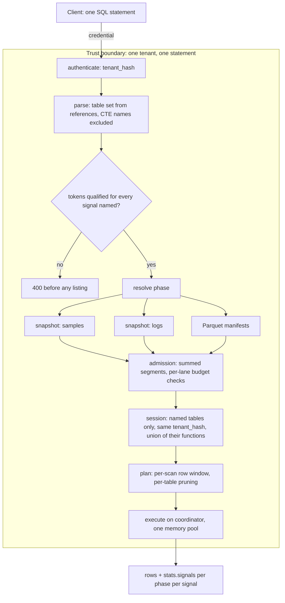

# ADR-2904: Cross-signal SQL statements

Status: Accepted
Date: 2026-10-11
Epic: #2904
Amends: ADR-0033 ("One SQL endpoint, two tables, exactly one registered per
session", and Rejected alternatives C and D), ADR-0045 decision 5, ADR-1101
decision 1, ADR-2040 (a Parquet table beside a signal table)

## Context

The SQL surface serves five signal tables (`samples`, `logs`, `spans`,
`alerts`, `audit`) and the tenant's Parquet tables. A statement may name one
signal table, or any number of Parquet tables, and nothing else. A statement
that names two signal tables, or a signal table beside a Parquet table, is
refused with `SqlError::CrossSignalQuery` (HTTP 400, gRPC `InvalidArgument`)
before any catalog listing. `SqlExecutor::statement_tables`
(`crates/ravel-sql/src/executor.rs`) counts the names and
`resolve_parquet_target` refuses the Parquet case.

ADR-0033 gave four reasons. Each is checked here against the tree at
099b0e845.

1. **No use case in v1.** This was a statement about demand, and demand
   moved. Joining a trace's spans to the logs that carry its `trace_id`,
   an alert's firing window to the samples that drove it, or an audit record
   to the statement's own spans, are all one join. Today each is two
   statements and a client-side join over two separately resolved snapshots.
2. **No operator semantics.** Joins are already reachable. `validate.rs`
   refuses no `JOIN`, a self-join on `logs` and a `UNION ALL` of two `logs`
   branches are tested (`crates/ravel-sql/tests/query_accounting.rs`), and
   Parquet tables join each other (`tests/parquet_tables.rs`). The join
   operators, their memory accounting through the per-query pool, and
   `CompactSlices`'s treatment of join build sides already ship.
3. **One snapshot per statement.** This is real. `Catalog::resolve` takes
   one signal, `Snapshot` carries no signal, and no ordering exists between
   two signals of one tenant (`docs/concepts.md`: "No transaction, snapshot,
   or ordering guarantee spans two tenants or two signals of one tenant").
   Decision 2 below says what a multi-signal statement gets instead.
4. **Minimal session surface.** Also real, and kept: decision 4 registers
   the tables a statement names and nothing more.

What actually blocks a multi-signal statement is not the rejection. It is
that the executor was written knowing there is one table, and four pieces of
it return wrong rows, not an error, once there are two:

- `collect_filter_predicates` gathers every `Filter` in the plan with no
  table attribution. The result prunes the metrics snapshot by `__name__`
  postings and gates the logs column-statistics load. In a join, a predicate
  written for one table would prune the other table's snapshot.
- `apply_row_window` plants one time column on every `TableScan`. The five
  tables use three different columns (`ts`, `start_ts`, `ts_ns`).
- `LikeToUdf` rewrites every `LIKE` in the session to the logs evaluator. It
  is registered only when `logs` is the session's table, which stops being a
  scope the moment `samples` is registered beside it.
- `min_commit_token` values carry no signal and are resolved under the one
  signal the statement targets. Handed to a second signal's resolve, a valid
  token is either unsatisfiable or, if another signal happens to hold a
  commit with the same shard, writer, epoch and sequence, satisfied by the
  wrong commit.

The first of these may already bite a single-signal statement with two scans
(`SELECT ... FROM samples WHERE __name__ = 'a' UNION ALL SELECT ... FROM
samples`: one `__name__` matcher is collected, and it would prune the
snapshot both branches read). That is unconfirmed. Decision 5's acceptance
test covers the shape and settles it either way.

Authorization does not change shape. A principal is a tenant and a `ddl`
flag (`crates/ravel-tenant-resolve`); there is no per-signal or per-table
grant, and `audit` and `alerts` are readable on the same terms as the other
three (ADR-1101). A caller who can run a join can already run both of its
sides.

This ADR makes no performance claim. No statement accepted today changes
cost.

## Decision

### 1. A statement may name several tables

A statement may name any subset of the five signal tables together with the
tenant's Parquet tables. The existing bound of 16 non-signal names per
statement stays. The table set is still decided from the parsed table
references, CTE names excluded, before any catalog listing, by the same
`referenced_base_tables` walk.

`SqlError::CrossSignalQuery` is no longer returned by the HTTP or Flight SQL
statement paths. It remains the typed refusal for the surfaces that keep a
one-table rule (decision 9).

### 2. One snapshot per named signal, resolved together, with no order between them

A statement that names N signal tables resolves N snapshots, one per signal,
in the resolve phase and before any planning or scan. All N resolves use the
same injected `now_ns` and the same request window. Each snapshot is pinned
for the whole statement exactly as the single snapshot is today.

The guarantee is per signal and nothing more:

- Each table's rows come from one immutable snapshot of that signal.
- There is no atomicity or ordering across the snapshots. A statement may
  see a span whose log lines are not yet visible, or the reverse. This is
  the guarantee `docs/concepts.md` already states for a correlated read; a
  join does not strengthen it.
- The retry contract applies to the statement. A retry resolves every
  signal again; it never mixes a first-attempt snapshot of one signal with a
  second-attempt snapshot of another.

A caller that needs a lower bound on what each side has seen uses commit
tokens (decision 3). That is the only cross-signal consistency tool, and it
is a lower bound per signal, not a common point.

`docs/consistency-model.md` ("A query resolves one snapshot") and
`docs/concepts.md` are amended to say "one snapshot per signal the query
reads".

### 3. `min_commit_token` is qualified by table on a multi-signal statement

`CommitToken` and its encoding do not change. The request parameter gains an
optional table qualifier: `logs:<token>`. Base64url contains no colon, so
the form is unambiguous.

- A qualified token is resolved under its table's signal only.
- A statement that names one signal table accepts an unqualified token and
  applies it to that signal, as today. It also accepts a qualified token
  that names that table.
- A statement that names two or more signal tables refuses an unqualified
  token with a 400 that names the tables it could have meant.
- A token qualified with a table the statement does not read, or with a
  Parquet table, is a 400.

An unsatisfiable token stays `503 unavailable` and now names the table.

### 4. The session registers the tables the statement names, for one tenant

Security invariant 2 becomes: a per-query, single-tenant `SessionContext`
that registers exactly the tables the statement names. Every provider in it
is built from the same `tenant_hash` the request authenticated as. Nothing
is cached or shared across statements. A table the statement does not name
is not registered and its snapshot is not resolved, so a single-signal
statement issues the same catalog requests as before.

Scalar functions are the union over the named tables: `label` and
`label_match` when `samples` is named, `has_word` when `logs` is named. The
aggregate, scalar, window and table-function allowlists are unchanged and
still run for every session.

The `LIKE` rewrite becomes column-scoped. `LikeToUdf` rewrites a `LIKE`
only when every column its operands reference is a column of `logs`. Any
other `LIKE` is evaluated by the engine's built-in operator, as it is in a
session without `logs` today.

### 5. Plan-derived work is attributed per table

Nothing derived from the plan may assume the plan has one table.

- **Row window.** Each `TableScan` gets the request window on its own
  table's event-time column. The reported window predicate becomes one entry
  per table.
- **Snapshot pruning from predicates.** A predicate may prune table T's
  snapshot only when every row that any scan of T contributes to the result
  must satisfy it. The executor derives the candidate predicates per scan,
  from that scan's own columns, and keeps a prune only when it holds for
  every scan of T. A shape it cannot classify contributes no prune. This
  covers the `__name__` postings prune on `samples` and the column-statistics
  gate on `logs`.
- **Supported shape, pinned by a test.** `FROM samples s JOIN logs l ON ...
  WHERE s.__name__ = 'x'` prunes the metrics snapshot by `x` and does not
  touch the logs snapshot. A filter inside one branch of a `UNION` prunes
  nothing shared with the other branch.
- **Single-scan physical rules** (`AttrsPerKeyProjection`,
  `MetadataOnlyAggregate`, `TopKLateMaterialization`) already decline on a
  branching plan and stay as they are. They may fire on a subtree that is a
  single `logs` scan chain, as they do today under a self-join.

### 6. Admission and budgets are per statement; lane checks are per signal

- `max_segments` is checked against the sum of segments admitted across the
  statement's snapshots.
- The cost estimate is the sum of the per-signal estimates, and the response
  carries the per-signal terms.
- The request-budget and fold-lag checks of ADR-0075 and ADR-1306 are proven
  per signal lane. Each lane is checked as it is today, and the statement is
  refused if any lane is refused, naming the table. The statement has one
  request budget, and the pre-flight check holds the sum of the lanes'
  requirements against it.
- Issue #1409 is unchanged: only the `samples` provider enforces the lowered
  byte and store-request budgets at scan time. A multi-signal statement
  inherits that gap for each non-`samples` table it names, and the docs say
  so until #1409 lands.

### 7. Cost is reported per phase, per signal

The existing `stats` totals keep their meaning and are sums over the
statement. A new `stats.signals` array has one entry per named signal table,
in a fixed order (`samples`, `logs`, `spans`, `alerts`, `audit`), each
present exactly once, with:

- `table`
- `segments` and `segmentsPruned` for that signal's snapshot
- `phases`, the same per-phase shape as `stats.phases` (`resolve`, `plan`,
  `probe`, `scan`), counting only that signal's requests and bytes

For every counter, the per-signal entries plus the Parquet share sum to the
statement total. A single-signal statement has one entry. `EXPLAIN` carries
the same list. `stats.pruning.segments` is documented as the sum, and its
"the one snapshot" wording goes.

### 8. Joins run on the coordinator

A statement that names more than one table never fans out. The distributed
samples scan stays a single-table, metrics-only path, and `EXPLAIN` reports
that the statement ran locally. Join operators run under the statement's one
memory pool. `repartition_joins` stays off. A plan containing a join stays
ineligible for spill, as it is today, so a join that exceeds the tenant's
memory budget fails with the existing typed memory error.

### 9. What keeps the one-table rule

- **Paging.** `page_plan` keeps refusing a multi-table statement with
  `PagePlanError::CrossSignal`. A page identity over a join is a separate
  decision.
- **MCP.** `ravel_query_sql` stays one `SELECT` over one table (ADR-1374).
  Its cursor and envelope carry one `signal`, and its snapshot identity
  hashes one signal. The MCP tool refuses a multi-table statement with
  `CrossSignalQuery` before any listing.

### 10. Flight SQL carries one segment group per signal

The Flight ticket holds one flat segment list and one erasure list with no
signal tag, so it cannot pin two snapshots. The ticket moves to version 9:
segments and pending erasure predicates are grouped under a signal tag, one
group per named signal. `GetFlightInfo` pins every snapshot and `DoGet`
executes against exactly those. A version 8 ticket is refused after the
upgrade; tickets live no longer than their deadline. Slice tickets keep
their meaning (a subset of one metrics snapshot).

The ticket is a short-lived, authenticated message between Ravel processes,
not one of the persistent formats, so this is a version bump inside
`flight_ticket.rs` and not a format change under the frozen-contract rule.

### 11. A Parquet table beside a signal table

Allowed, on the same terms. When a statement names at least one Parquet
table the session carries the tenant's Parquet store registry and read
limits, as a Parquet-only session does today, and the signal tables are
registered beside them. Parquet tables take no commit tokens and have no
entry in `stats.signals`.

### Shape

## Rejected alternatives

**A. Keep the rule and add dedicated correlation routes.** Each route fixes
one join shape and one pair of signals. Ten pairs of five tables, each with
its own parameters and response shape, is more surface than one join, and
none of them composes with a `WHERE` or an aggregate the caller chooses.

**B. One consistent point across signals.** A statement would read every
signal as of one commit point. No such point exists: each signal has its own
catalog HEAD, and "nothing in the write path establishes a total order
across shards". Building one needs a coordinator in the write path, which
the disposable-process model refuses. Rejected for the cost of the
guarantee, not for lack of wanting it.

**C. Apply an unqualified token to every named signal.** A logs token is
unsatisfiable under `samples`, so every read-your-write join would fail.

**D. Apply an unqualified token to whichever signal satisfies it.** Tokens
carry no signal, and sequence numbers are per writer and shard, so a token
can be satisfied by an unrelated commit in the wrong signal. The caller
would get a statement that claims a lower bound it did not enforce.

**E. Put the signal in `CommitToken`.** It would remove the qualifier. It is
also a change to a frozen contract, with a version bump and every issued
token to consider, to save a prefix the caller can write.

**F. Register all five tables in every session.** Simpler planning, but it
resolves five snapshots for every statement, widens the function surface of
every session, and makes an unintended cross join a typo away.

**G. Ship HTTP first and refuse multi-signal statements over Flight SQL.**
Both transports close through `plan_pinned`. Two rules for one statement
text is a conformance split users would hit by changing client library.

**H. Distributed fan-out for joins in this epic.** The worker fragment, the
slice ticket and the gate estimate are all metrics-only. Distributing a join
is its own design (which side moves, where the join runs) and nothing here
depends on it.

**I. Leave the join to the client.** That is today's behaviour: two
statements, two request budgets, the join in application memory, and no
single response that says what each side read.

## Consequences

- A statement that was a 400 now runs. Clients that relied on the refusal as
  a guard against accidental cross joins lose it; the memory budget and
  `max_segments` are what bound such a statement.
- The consistency documents state a weaker sentence than before in the
  general case ("one snapshot per signal") because the general case now
  includes more than one signal. Single-signal statements are unchanged.
- The executor's per-statement types (`Resolved`, `PinnedResolve`,
  `SqlOutcome.target`, `ExplainReport.target`, `SessionTable`) move from one
  signal to a set. This is most of the work and it is concentrated in
  `executor.rs` and `session.rs`.
- Per-table attribution replaces whole-plan collection for pruning. If the
  two-scan shape named in Context is confirmed as a present defect, this
  fixes it, and the changelog says so.
- The Flight ticket version moves to 9. Tickets minted before an upgrade
  fail after it.
- Paging and MCP keep the one-table rule and now hold it themselves instead
  of inheriting it from the executor.
- Documents that restate the old rule are amended when the behaviour lands,
  in the same commits: ADR-0033, ADR-0045, ADR-1101, ADR-2040 (amendment
  sections with pointers), `docs/query-engine.md`,
  `docs/consistency-model.md`, `docs/concepts.md`, `docs/guides/query.md`,
  `traces.md`, `alerting.md`, `audit.md`, `cost-model.md`,
  `docs/reference/http-api.md`, `README.md`, and the generated
  `docs/sql-conformance.md`, whose cross-signal row moves from
  "Intentionally rejected" to supported.
- No persistent format changes: no RSEG, RLOG or RSPAN layout, no protobuf
  schema, no commit token, no object key.
