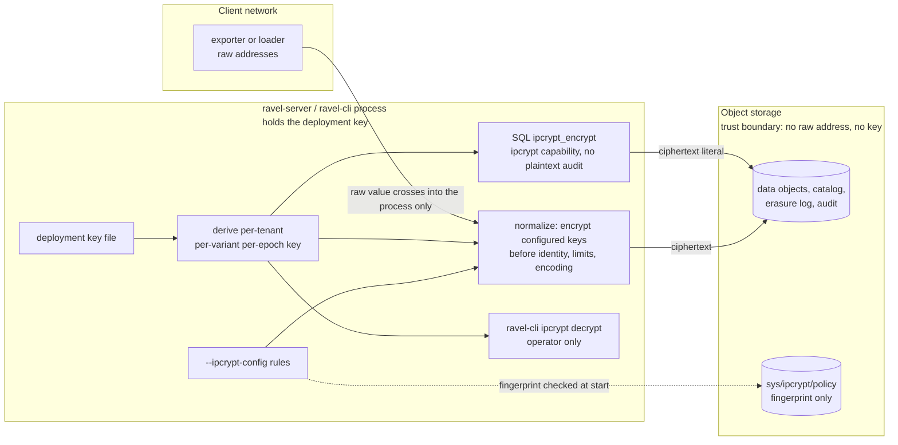

# ADR-2993: IPCrypt pseudonymization of IP-valued attributes

Status: Accepted (2026-10-16)
Date: 2026-10-15
Epic: #2993

## Context

Telemetry carries client and peer IP addresses in attribute values:
`client.address`, `source.address` and `network.peer.address` on spans
and logs, `instance` and custom labels on metrics. An IP address that
identifies a client is personal data, and ADR-0062 already treats IPs
as PII inside query text. Today every one of them is stored as sent,
in every data object, for the tenant's whole retention. The only
privacy tools in the tree act after the fact:

- selective subject erasure (ADR-0064), which matches exact `key=value`
  pairs;
- audit query-text tokenization (ADR-0062 decision 2e).

Nothing can keep an address out of storage in the first place. The
ingest path has no attribute transformation hook of any kind. Each
signal decodes, then runs one pure normalize function, and writes what
it returns.

IPCrypt (draft-denis-ipcrypt-14, Informational, no RFC yet) defines
keyed encryption of a 16-byte IP address. An IPv4 address is first
mapped to `::ffff:a.b.c.d`.

| Variant | Key | Output | Primitive | Reveals |
|---|---|---|---|---|
| ipcrypt-deterministic | 16 B | 16 B, an IPv6 address | one AES-128 block | equality |
| ipcrypt-pfx | 32 B, two halves that must differ | the same family as the input | a bitwise PRF over two AES-128 keys | equality and shared prefixes |
| ipcrypt-nd | 16 B | 24 B: an 8-byte random tweak, then the ciphertext | KIASU-BC | nothing, until the tweak collides after about 2^32 uses |
| ipcrypt-ndx | 32 B | 32 B: a 16-byte random tweak, then the ciphertext | single-block AES-XTS | nothing, until about 2^64 uses |

The draft recommends the deterministic variant where linkability is
acceptable (logs, rate limiting, deduplication) and pfx for subnet
analytics. The non-deterministic variants are for sharing data where
records must not be correlatable. ClickHouse 26.10 ships
`ipcryptEncrypt`/`ipcryptDecrypt` and the `ipcryptPrefix` pair
(deterministic and pfx only). Vector's `encrypt_ip` covers the same two
variants. Both take the key as a function argument. libsodium 1.0.21
implements all four variants.

Facts in this tree that constrain the design:

- **Metric series identity is computed inside normalization**
  (`ravel-otlp` and `ravel-remote-write` normalizers, with
  `SeriesIdMemo` caches keyed by the label set). A transform applied
  after normalization would store encrypted labels under the identity
  of the raw ones.
- **Every ingest surface reaches storage through the `ravel-ingest`
  routers.** That covers OTLP metrics, logs and traces over HTTP and
  gRPC, Remote Write, OTAP, and `ravel-cli load`. But the routers receive
  already-normalized records, after identity is fixed.
- **Value types differ by signal.** Metric labels and span attributes
  are strings. Log attributes are typed (`AttrValue`). Log resource and
  scope attributes are encoded into a canonical stream blob during
  normalization.
- **Derived keys have a precedent.** The deployment key
  (`--tenant-hash-key-file`, 32 bytes) already derives the tenant-prefix
  hash key, the recovery-manifest AEAD key and the audit token key, each
  through `blake3::derive_key` with its own context string. A deployment
  run with `--tenant-hash-unkeyed` has no deployment key.
- **No AES block cipher is in `Cargo.lock`.** `ring` exposes no raw
  block API. The reference Rust implementation, `ipcrypt-rs` 0.10 (ISC,
  by the draft's author), implements all four variants on RustCrypto
  `aes` 0.9 without `unsafe` in its own code. Its default feature
  `random` pulls `rand`, which only the non-deterministic variants need.
  ISC is on `deny.toml`'s allow list.
- **Normalizers take positional arguments, not an options struct.** Each
  entry point takes the tenant, the decoded request, a limits struct and
  the ingest time. The limits structs (`IngestLimits`, `LogIngestLimits`,
  `SpanIngestLimits`) are built once per process, shared by every tenant,
  and have a `Default` that hundreds of call sites use. The log and trace
  normalizers take no tenant at all.
- **`ravel-cli load` does not call the normalizers.** It reimplements
  their label building, limits and series identity for its columnar
  inputs, in its own modules.
- **Some checks run before normalization, on raw lengths.** The projected
  label-byte bound (`ravel-otlp`'s `label_projection`, which must never
  undercount) and OTAP's raw-length checks both measure the values as
  sent.
- **Metric label names are sanitized** (except on Remote Write, which
  stores them as sent; see the Remote Write label-name amendment below).
  `client.address` is stored as `client_address` on every metric
  surface, and Remote Write carries only the sanitized form (both
  false for Remote Write: see the Remote Write label-name amendment
  below). Log and span attribute keys are stored as sent.
- **Span events and links are stored as encoded protobuf blobs** inside
  reserved span attributes, so their attributes never pass through the
  span attribute conversion.
- **SQL scalar functions are registered per query against a fail-closed
  allow-list** (`ADMITTED_SCALARS`, ADR-0097). DataFusion folds an
  `Immutable` function with literal arguments into a literal before the
  pushdown extractors run. The query audit is off by default; when it is
  on, query text reaches the audit table verbatim unless redaction is on.
  No per-function privilege exists: a principal is a tenant plus a `ddl`
  flag. The static token grammar accepts exactly one suffix, `;ddl`,
  split at the last `;`, and the ingest router shares that parser. The
  durable `sys/auth` resolver and Flight SQL authentication resolve a
  tenant only, so neither can grant `ddl` today.
- **Erasure matchers are a conjunction.** An ADR-0064 request matches a
  record only when every matcher matches it, and v1 has no disjunction.
- **The least-privilege IAM templates name `sys/` objects one by one**
  (`deploy/iam/gateway.json`, `query.json`, `maintain.json`). A new
  `sys/` key is unreadable under them until it is added.

## Decision

**0. Threat model.** The parties this protects against are:
- anyone who can read object storage or its backups;
- anyone who receives an export of the data;
- **readers of the tenant's own data who do not hold the IPCrypt
  capability below.** None of these holds the deployment key.

Without a key, deterministic ciphertext is a stable pseudonym: equal
addresses can be correlated, but an address cannot be recovered.

A caller who can encrypt chosen addresses under the tenant's key can
recover addresses in bulk. IPv4 has only 2^32 of them, so sweeping a
range and joining against the stored values works. That makes
encryption a privileged operation, like decryption. Decisions 6 and 7
gate it accordingly.

The deployment key holder, the operator, is trusted: it can derive
every tenant's key.

**1. An operator declares which attribute keys hold IP addresses, per
tenant, in a policy file.** `--ipcrypt-config <file>` names a TOML file
in the `--limits-file` shape: a `[defaults]` table and `[tenants.<id>]`
overrides. Tenant ids are hashed once the tenant-hash scheme is
installed, as `--tenant-kms-config` entries are. Each entry lists rules:

- `key`: the attribute key as the client sends it, for example
  `client.address`. On the metric surfaces (OTLP metrics, OTAP and
  Remote Write) the rule matches the sanitized label name that key is
  stored under (`client_address`), derived with the same sanitizing
  function the normalizers use (on Remote Write the name is stored as
  sent and only the lookup sanitizes it: see the Remote Write
  label-name amendment below). On logs and traces it matches the key
  as sent. Two rule keys that sanitize to the same label name are
  refused;
- `variant`: `deterministic` or `prefix` (ipcrypt-pfx);
- `epoch`: a positive integer, default 1, the epoch new data is written
  under;
- `retired_epochs`: the earlier epochs whose data is still retained,
  default none.

One key may carry one rule. The file is read by `ravel-server`, by
`ravel-cli load`, which apply it identically, and by `ravel-cli erase
submit`, which translates matchers with it (decision 8). Changing it takes a
restart, like every other CLI-only per-tenant setting. A
durable per-tenant record in `TenantConfig` is deliberately not part of
this ADR: it is a frozen protobuf whose new field needs a reader-first
rollout, and a file covers the deployments this epic is for. A
follow-up adds it under the format-change procedure if a deployment
needs rules changed without a restart.

All three readers (`ravel-server`, `ravel-cli load` and `ravel-cli erase
submit`) refuse a non-empty policy when the process has no deployment
key to derive from. That covers `--tenant-hash-unkeyed`, and also a v1
bucket started with neither tenant-hash flag. All three also refuse a file they cannot parse, a duplicate
key, an empty key, or an epoch of zero. Deployments and tenants with no
rules are untouched, byte for byte.

**2. Keys are derived, never stored.** For tenant `t`, variant `v` and
epoch `e`:

    key = blake3::derive_key("ravel ipcrypt v1 " + v, deployment_key || tenant_hash(t) || e as u64 little-endian)

The output is truncated to 16 bytes for `deterministic`. All 32 bytes
are used for `prefix`, and a derivation whose two halves are equal is
refused. The context string separates these keys from every other key
the deployment key derives. No key material reaches object storage, a
log line, or a metric. The derivation is a pure function, tested
against fixed vectors in its own crate.

**3. Values are encrypted inside normalization, before identity, limits
and encoding.** Every normalizer entry point takes the tenant's resolved
rules as a new positional parameter of a type with no `Default`. It is
not a field of the limits structs, which are per process and defaulted
everywhere. That covers the OTLP metrics, logs and traces entry points
(the `_with_exemplars`, `_with_metadata` and `_projected` forms
included), the Remote Write entry points and the OTAP entry points. The
rules are applied to the merged attribute or label set:

- before metric series identity is computed and before the `SeriesIdMemo`
  lookup, so identity is the identity of the stored labels. The memo and
  OTAP's group cache are built per call and keyed on raw values; because
  encryption is deterministic for a fixed rule set, a raw key still
  names one stored label set, and neither cache outlives the call or
  crosses tenants;
- before label and attribute size limits, so the limits see the bytes
  that are stored;
- before log stream attributes are canonically encoded, so resource and
  scope attributes are covered;
- on exemplar labels, and on the attributes of span events and links
  before those are encoded into their blobs.

The same parameter is added to every label-byte projection the server
computes outside a normalizer and passes in:
- `ravel-otlp`'s `project_resolved_label_bytes`,
  `project_log_resolved_label_bytes` and
  `project_span_resolved_label_bytes`;
- `ravel-otap`'s `prepare_batch` and its own
  `project_resolved_label_bytes`, which the OTAP path charges to the
  budget.

Because the parameter has no default, an ingest path that calls a
normalizer or a projection without a rule set (an empty one when the
tenant has none) does not compile.

`ravel-cli load` does not call the normalizers, so the compiler cannot
guard it. Its label-building paths call the same `ravel-ipcrypt` apply
function at the same points, and the acceptance test in Consequences,
which scans the store after a load, is what guards them.

A check that runs before encryption counts each value under a rule at
its largest encrypted length: 47 bytes (a bracketed IPv6 address, a
colon and a five-digit port), or the raw length when that is larger.
That keeps the projected label-byte bound and OTAP's raw-length checks
from undercounting. It also counts a value the rule will leave unchanged,
such as a hostname, at 47 bytes. So a request near the bound may be
refused where it would have fitted, which is the safe direction.

What is encrypted, given a rule's key:

- **A value that parses as an IP address.** It is replaced by the
  variant's ciphertext as canonical address text (RFC 5952 for IPv6):
  - `deterministic` always yields an IPv6 address;
  - `prefix` yields the input's family.
- **`ip:port` and `[ipv6]:port`.** The address is replaced and the port
  is kept. The bracketing follows the ciphertext's family. So under
  `deterministic`, `1.2.3.4:443` becomes `[<ipv6>]:443`. The SQL
  functions render the same way, so a literal matches what ingest
  stored.
- **Anything else is left unchanged and counted.** That covers a
  hostname, an address with a zone id, a non-string log value, and free
  text. A hostname in an address attribute is common and is not personal
  data in the sense this ADR addresses.

Log bodies and free text are out of scope. Only exact attribute values
under a configured key are encrypted.

Counter `ravel_ingest_ipcrypt_values_total{signal, variant, outcome}`,
with `outcome` either `encrypted` or `unparsed`, makes the policy's reach
visible. An operator alerts on `unparsed` to find keys whose values are
not what the rule assumed.

**4. Only the deterministic and prefix variants are offered.** Both keep
the properties the rest of the system relies on:
- exact-match erasure (ADR-0064);
- the exact-key index (ADR-2707, still Proposed; the property is assumed
  for it, not yet shipped);
- equality predicates and pushdown;
- `GROUP BY`;
- dictionary compression of repeated values.

**5. The library is `ipcrypt-rs` with default features off.** It is
pinned in one new crate, `ravel-ipcrypt`, which owns the policy types,
the file parser, the key derivation, value parsing and rendering, and
the counter's outcome type. The crate's tests pin every
`ipcrypt-deterministic` and `ipcrypt-pfx` vector from the draft's
machine-readable `test_vectors.json`, and the vector file is checked
in. The new `Cargo.lock` entries are `ipcrypt-rs`, `aes` and their
RustCrypto dependencies. Disabling the `random` feature keeps `rand` out
of `ravel-ipcrypt`'s dependency graph (the 2026-10-17 correction
below narrows this), since the offered variants need no randomness.

**6. A SQL function encrypts with the tenant's key. It takes no key
argument and needs the `ipcrypt` capability.** It comes in two forms:
- `ipcrypt_encrypt(ip, epoch)`;
- `ipcrypt_prefix_encrypt(ip, epoch)`.

Each returns the stored form of an address under the calling tenant's
derived key at the given epoch. The epoch is required. A `query`-mode
process does not read the policy file, so it cannot know a rule's
current epoch.
A default of 1 would match only retired data once a rule rotates, and
return zero rows that read as "never seen". To match across a rotation,
a query ORs one comparison per epoch.

Choosing a variant or epoch that the rule does not use also matches
nothing, with no error. The function takes an address, not a rule. The
docs' query guide tells readers to take both values from the rule.
Behaviour:

- **Pruning.** Both functions are `Immutable`, so
  `attrs['client.address'] = ipcrypt_encrypt('203.0.113.7', 1)` folds to a
  literal and prunes like any equality predicate.
- **No key in the query.** There is no key argument, so no key ever
  appears in query text, the audit table, or a plan.
- **Wiring.** The functions are built in `build_session` from the
  tenant's derived keys and added to `ADMITTED_SCALARS` for every signal
  table; `build_session` gains the tenant and principal it needs. They
  are built per session from that session's tenant key, so a folded
  literal or a cached plan cannot carry one tenant's ciphertext into
  another tenant's query. Each function also gets a row in `ravel-sql`'s
  conformance registry (`RAVEL_SCALAR_UDFS`), and the admitted-scalar
  row count moves with it. The conformance fixture session holds a test
  deployment key and the `ipcrypt` capability, so the row's example
  runs.
- **Epoch argument.** Any positive epoch is accepted. Encrypting under an
  epoch no rule ever used reveals nothing about stored data, since
  nothing is stored under that key, and a capability holder may already
  encrypt under every epoch that is in use.
- **Capability gate.** The functions are registered only for a principal
  holding a new `ipcrypt` capability, the way `ddl` gates DDL (ADR-2040
  decision 4). Without it, the call is refused like any unknown function.
  Per decision 0, this is what stops an ordinary reader from reversing
  the pseudonymization by encrypting guesses. The capability is granted
  in two ways:
  - **Static token.** The suffix after the last `;` becomes a
    comma-separated capability list drawn from `ddl` and `ipcrypt`, each
    at most once and the list never empty. So `acme;ddl`, `acme;ipcrypt`
    and `acme;ddl,ipcrypt` all name tenant `acme`, and an existing
    `;ddl` token parses as it does today. Any other suffix is refused.
    The ingest router shares the parser and ignores the capabilities.
  - **OIDC.** A boolean claim named by a new flag beside
    `--oidc-ddl-claim`.

  Durable `sys/auth` tokens and Flight SQL authentication resolve a
  tenant only, and grant neither `ddl` nor `ipcrypt` under this ADR. A
  capability field on `sys/auth` entries is a format change for a later
  ADR.
- **No plaintext audit record.** The functions are not registered when
  the process would write query text to the audit table in plaintext,
  that is, when the query audit is on under the `Plaintext` text policy.
  There, the literal address in `ipcrypt_encrypt('203.0.113.7', 1)` would
  be written verbatim into object storage, past the very boundary this
  ADR draws. With the audit off (the default) nothing is written, and
  under redaction the query text is stored as a keyed token. That token
  is deterministic, so the same address queried twice is linkable across
  audit records, which is the same linkability the stored pseudonym
  already has. A key argument would instead put the key itself in the
  audit table under `Plaintext`, and a linkable token of the key under
  redaction.
- **No deployment key.** On a deployment without one, the functions are
  not registered.
- **Port forms.** A string the function cannot parse as an address
  returns NULL, and the `ip:port` forms of decision 3 are accepted, so a
  literal matches what ingest stored.

**7. Decryption is an operator action, not a query function.**
- `ravel-cli ipcrypt decrypt --tenant <id> --variant <v> [--epoch <e>]
  <value>...` recovers addresses.
- `ravel-cli ipcrypt encrypt` does the reverse.

Both read the deployment key from the same file `ravel-server` uses. A
SQL decrypt function is rejected below. Whoever holds the deployment key
can already derive every tenant's key, so a CLI that needs that key adds
no new holder.

**8. Erasure by IP matches the stored ciphertext.** When a tenant has a
rule for a matcher's key, `ravel-cli erase submit` encrypts that
matcher's value under the rule before it submits the erasure request.
- **Policy.** `erase submit` takes `--ipcrypt-config`. Like a writer, it
  reads the `sys/ipcrypt/policy` marker unconditionally, and refuses on
  the same conditions as decision 9: a fingerprint mismatch (a missing
  or stale file included) or a failed read. A missing file would
  otherwise submit the raw address, match nothing, and report a
  successful erasure of zero records.
- **Rule lookup.** The matcher key is looked up the way decision 1
  matches rules for the request's `--signal`. For the metric signals the
  key is sanitized first, so `client_address` finds the rule written as
  `client.address` (the Remote Write label-name amendment below adds
  that the matcher must still spell the label as it is stored).
- **One request per epoch.** Matchers in one request are a conjunction,
  so two ciphertexts of one address in the same request would match no
  record. `ravel-cli` therefore submits one request per configured
  epoch (the rule's `epoch` and each of its `retired_epochs`). Each
  request carries the full matcher set with that epoch's ciphertext, so
  data written under an older epoch is matched too.
- **Several encrypted matchers.** When more than one matcher carries a
  rule key, it submits one request per combination of those rules'
  epochs. It refuses, before submitting anything, when that would be
  more than 16 requests, and names the rules whose epoch lists multiply.
  The operator then drops `retired_epochs` whose data has aged out of
  retention, or submits fewer encrypted matchers per command.
- **Request ids.** With one request, the supplied or generated
  `--request-id` is used unchanged. With several, each id is derived
  deterministically from that base id and the request's epochs, as a
  UUID-shaped blake3 hash. Retrying the whole command with the same
  `--request-id` therefore re-submits the same requests. Each one is
  idempotent under ADR-0064's existing retry rule, so a retry finishes
  the epochs a failed run left out instead of conflicting with the ones
  it finished.
- **Reporting.** It reports the base id and every derived id it
  submitted, and the erasure counts as their sum.
- **Non-addresses.** A raw value that is not an address is submitted
  unchanged, matching how ingest stored it.

The request records the encrypted value, never the raw one: the
erasure log is itself retained data.

Erasure stays exact-match, as ADR-0064 defines it. A stored `ip:port`
value is matched only by a matcher carrying the same port, and an
erasure request for a bare address does not reach it. That limit exists
for raw values today; encryption does not widen it, and the erasure
guide says so.

**9. Every writing process must carry the same policy, and a process that
does not refuses to write.**
- **The marker.** The policy's fingerprint is recorded in a new object,
  `sys/ipcrypt/policy`. That is a new key prefix under `sys/`. The
  fingerprint is blake3 over the canonical rule set: tenant hashes, keys,
  variants and epochs. It holds no key material and no raw tenant id.
- **Encoding.** The marker is a new protobuf message,
  `IpcryptPolicyMarker`, in `proto/ravel/sys.proto`, with a version
  field. That follows ADR-0050, which put `sys/tenancy` and the later
  `sys/gc` record in the same file. No existing message is touched. The
  implementing task adds the key's row to the key layout table in
  `docs/catalog-and-mvcc.md` in the same commit as the code that writes
  it.
- **First write.** A process whose local policy is non-empty and that
  finds no marker creates it with `CreateIfAbsent`. A process that loses
  that race re-reads the marker and compares, as below.
- **Startup check, unconditional for every writer.** Every `ravel-server`
  start in a mode that ingests (`all` and `gateway`), and every
  `ravel-cli load` run, reads the marker, whether or not `--ipcrypt-config`
  was given. The forgotten-flag case is exactly a process with an empty
  policy on a bucket whose marker is not empty, so the read cannot depend
  on the flag. `ravel-cli erase submit` reads it too (decision 8).
  `query` and `maintain` processes write no new attribute values, so
  they do not read it.
  - No marker and an empty local policy: the process proceeds and writes
    no marker.
  - A marker whose fingerprint differs from the process's own, an empty
    policy included: the process refuses to start or load, and names
    both fingerprints.
  - A marker read that fails for any reason other than absence (an
    error from the store, a body that does not decode, an unknown
    version): the process refuses. It does not proceed as if the marker
    were absent.
- **Replacing the policy.** Changing the policy is an explicit step:
  `ravel-cli ipcrypt set-policy --ipcrypt-config <file>` replaces the
  marker with a CAS on its current ETag. Processes then restart with the
  new file.
- **Access.** The shipped IAM templates name `sys/` objects one by one,
  so the implementing task adds `sys/ipcrypt/policy` to them:
  - `gateway.json`, for ingesting servers and `ravel-cli load`, gets:
    - the key in `GatewayListBootstrapKeys`, so a read of the absent
      marker answers not-found rather than AccessDenied;
    - read;
    - a create-only put conditioned on `s3:if-none-match: "*"`, like
      `GatewayProvCreate`, so a gateway credential cannot replace the
      marker;
  - `admin.json`'s `AdminWrite` statement gets the put that
    `set-policy`'s CAS and a first create need. Admin already reads
    `sys/*`, which covers `erase submit`.

  The same commit updates `deploy/iam/README.md` and the template suite
  that pins every statement (`crates/ravel-commit/tests/iam_templates.rs`).
  In the README it updates the per-key table and adds the key to the
  bootstrap-key table ("Read by, and what absence means"). This is not
  an upgrade accommodation: a fresh deployment on the shipped templates
  needs the same grants, because a read of an absent key without list
  access answers AccessDenied, and the unconditional read would then
  refuse to start every ingesting process.

The tenancy marker (`sys/tenancy`, ADR-0050) is the precedent. Without
this check, a forgotten flag on one process (most likely a `ravel-cli
load` run) would store raw addresses with nothing failing: the required
normalizer input of decision 3 only catches a forgotten code path, not a
forgotten flag.

**Rotation.** Bumping a rule's epoch changes the key for new data only.
- Equality between data written before and after the bump is lost.
  A query passes each epoch it wants to match to the SQL function
  (decision 6), ORing one comparison per epoch to span a rotation.
- Erasure matches every configured epoch, with one request per epoch
  (decision 8).
- Old epochs are listed in the rule (`retired_epochs`) for as long as
  data under them is retained.

## Rejected alternatives

- **Query functions only, with the key as an argument (the ClickHouse
  and Vector shape).** Raw addresses would still be stored in every
  object, which is the exposure this epic exists to remove. A key
  argument also puts key material into query text, which reaches the
  audit table verbatim unless redaction is on. Even under redaction it
  is tokenized deterministically, so it is linkable across queries.
- **Carry the rules as a field of the limits structs.** It would avoid a
  new parameter on every normalizer entry point. But those structs are
  per process while the rules are per tenant, and every literal and
  most call sites take `Default`, so a forgotten rule set would compile
  as an empty one and store raw addresses.
- **Encrypt in the `ravel-ingest` routers.** It is the one chokepoint
  every surface shares, but it runs after normalization. Metric series
  identity, the memo caches, the size limits and the log stream-attribute
  encoding have all consumed the raw values by then. Recomputing identity
  in the router would duplicate normalization's identity code for one
  feature.
- **A tenant-supplied key.** The key would have to be stored. Object
  storage is the only durable store, and a key there is readable by
  everyone who can read the data it protects. A per-tenant KMS-wrapped
  key could work; it adds a KMS round trip to every process start and a
  key-loss failure mode. Deriving from the deployment key matches how
  every other tenant-scoped secret in the tree is made.
- **The non-deterministic variants (nd, ndx) at ingest.** Every stored
  value would differ:
  - erasure by value could not find a subject's records;
  - equality predicates, `GROUP BY` and the exact-key index would return
    nothing useful;
  - dictionary compression of repeated values would be lost.

  They suit exporting a dataset to a third party, which is a different
  feature and can reuse `ravel-ipcrypt` later.
- **A SQL decrypt function.** Even behind the `ipcrypt` capability, a
  decrypt function turns any query result into raw addresses in bulk.
  Recovering an address for an investigation is rare and belongs with
  the operator who holds the key. A capability holder can already
  confirm a specific address with `ipcrypt_encrypt`.
- **Ungated SQL encryption, treating every tenant reader as trusted.**
  Simpler, and it matches ClickHouse and Vector, where the key is
  whatever the caller passes. But any reader could then recover
  addresses by encrypting a swept range and joining. Pseudonymization
  would then protect only against storage readers, not against the
  tenant's own users, who are often the reason it is wanted.
- **Detect policy drift with a fingerprint gauge instead of a marker.** A
  `/metrics` gauge per process is cheaper and needs no new key prefix.
  But it reports drift after raw addresses are already stored, and a
  short `ravel-cli load` run would never be scraped at all.
- **A durable `TenantConfig` field now.** It is a frozen-format change
  with a reader-first rollout, for the convenience of changing rules
  without a restart. It is deferred, not rejected.
- **Implementing the cipher on `aes` directly.** That is about 300
  lines of block-cipher code, including KIASU-BC's round-key tweak
  schedule, written and reviewed here instead of by the draft's author.
  We would pin the same vectors either way. If `ipcrypt-rs` stops being
  maintained, this is the fallback, and the vectors make the switch
  checkable.
- **Format-preserving IPv4 output (32-bit).** The draft discourages it,
  and neither offered variant needs it.
- **Encrypt every value that looks like an address, whatever its key.**
  It would guess, it would rewrite version strings and other dotted
  quads, and it would make the stored data depend on a heuristic. Rules
  name keys.

## Consequences

- A tenant with rules stores no raw address under a configured key, on
  any ingest surface. One acceptance test ingests a known address
  through each surface:
  - OTLP metrics, logs and traces over HTTP and gRPC, with the address
    also in a span event and a span link;
  - Remote Write samples and exemplars;
  - OTAP;
  - `ravel-cli load`.

  It then scans every byte of every object in the bucket for that
  address, and asserts it is absent. It looks for the text form, the 4-
  and 16-byte binary forms, and the lowercase-hex encoding of each,
  because span event and link blobs are stored hex-encoded. The scan covers catalog, index, statistics and `del/`
  objects, not just data objects. It also asserts that the ciphertext is
  present. A control run of the same ingest with the policy off must
  find the raw address, so a scan that cannot see through compression
  fails instead of passing.
- **Cost.**
  - `deterministic` is one AES-128 block per configured value.
  - `prefix` is 64 AES operations per IPv4 and 256 per IPv6. A test pins
    the operation count, not a time.
  - Tenants without rules pay one empty-rule-set check per record.
- **Text forms and size.** An IPv4 value under `deterministic` is stored
  as IPv6 text. A test pins the canonical text form of each variant. A
  stored value grows to at most 39 bytes, or 47 in the `[ipv6]:port`
  form, and the size limits see the stored length.
- **Exact semantics hold.** Equality, `GROUP BY`, `count(DISTINCT)`,
  exact-match erasure and the exact-key index behave on ciphertext
  exactly as on the raw values, with the `ip:port` limit of decision 8.
  Under `prefix`, grouping the stored addresses by network prefix
  (parse, mask to a /24 or a /64, group) matches the same grouping of
  the raw addresses. Grouping by a prefix of the stored text does not:
  RFC 5952 text drops leading zeros and compresses zero runs, so two
  IPv6 values in one /64 need not share a text prefix. Range
  predicates and CIDR containment on raw addresses are not supported on
  encrypted keys, and the docs say so.
- **A new principal capability.** `ipcrypt` joins `ddl` in
  `ravel-tenant-resolve`'s `Principal`. The static token suffix becomes
  a capability list (decision 6), shared with the ingest router, and a
  new OIDC claim flag grants it.
- **New flag and metric.**
  - `--ipcrypt-config` on `ravel-server` and `ravel-cli`.
  - `ravel_ingest_ipcrypt_values_total`.
  - The new SQL functions.
  - The `ravel-cli ipcrypt` subcommands.

  These go into `docs/reference/ravel-server-flags.md`, the metrics
  reference, `docs/ingest.md` (a new pseudonymization section),
  `docs/guides/`, the SQL function list, and README.md. The IAM
  templates and `deploy/iam/README.md` gain `sys/ipcrypt/policy`
  (decision 9).
- **Losing the deployment key loses the addresses.** Every stored
  address under a rule becomes unrecoverable, and no `ipcrypt_encrypt`
  call can match stored data again, because no key derived from a
  different deployment key produces the same ciphertext. Keeping the
  deployment key is already a recovery requirement (ADR-0050); this
  ADR adds a consequence to losing it.
- **Deployment-key rotation is out of scope.** The epoch mechanism
  rotates per-rule keys under one deployment key (keys are per tenant,
  variant and epoch; see the 2026-10-17 correction below). A new
  deployment key changes every derived key at once, for every tenant
  and epoch, and
  needs its own ADR.
- **Persistent formats: one new `sys/` object, no changed format.**
  Ciphertext is an ordinary attribute value. `sys/ipcrypt/policy` is a
  new prefix, not a change to an existing one. It is a small Class C
  metadata record, a new versioned message in `proto/ravel/sys.proto`
  (decision 9), added to the key layout in `docs/catalog-and-mvcc.md`.
  Data written before a rule was added stays as it was:
  the policy is not retroactive, and the docs say to use erasure or
  retention for older data.
- **Reachability.** The decision 3 rule set is a required parameter of
  every normalizer entry point, which covers every server ingest path at
  compile time. `ravel-cli load`, which has its own label-building
  paths, is covered by the acceptance test above, which drives the
  shipped entry points of both binaries.
- **Supply chain.** `ipcrypt-rs`, `aes` and its RustCrypto dependencies
  join `Cargo.lock` and pass `cargo deny`.

## Correction (2026-10-17): `rand` reachability and the key scope

<!-- amendment-applies: sections="Decision|Consequences" pointer="2026-10-17 correction" -->
<!-- amendment-supersedes: phrase="keeps `rand` out" pointer="2026-10-17 correction" -->
<!-- amendment-supersedes: phrase="per-rule keys" pointer="2026-10-17 correction" -->

This corrects two statements of fact. No decision changes.

- **`rand` (decision 5).** Disabling the `random` feature (one of
  `ipcrypt-rs`'s default features) keeps `rand` out of `ipcrypt-rs`'s
  own dependencies. The marker of decision 9 needs an object-store
  client, so `ravel-ipcrypt` puts it behind a `marker` cargo feature
  that is off by default (#3052). With the default features,
  `ravel-ipcrypt` has no `rand` in its dependency graph. With `marker`
  on, which the ingesting server (#3048) and `ravel-cli` (#3049) turn
  on, `rand` arrives through `ravel-object-store`. The offered variants
  still need no randomness, and no key is ever generated.
- **Key scope (Consequences, rotation).** Decision 2 derives a key from
  the tenant, the variant and the epoch. The attribute key a rule names
  is not an input. Rules that share a tenant, variant and epoch
  therefore share a key, and their ciphertexts of one address are
  byte-identical: under `deterministic`, a value stored under
  `client.address` can be joined to the same value stored under
  `source.address`. That is the same correlation equal addresses
  already allow within one key. An operator who wants two keys
  unjoinable gives their rules different epochs or variants.

## Amendment (2026-10-18): Remote Write label names

<!-- amendment-applies: sections="Context|Decision" pointer="Remote Write label-name amendment" -->
<!-- amendment-supersedes: phrase="Remote Write carries only the sanitized form" pointer="Remote Write label-name amendment" -->

The Context said Remote Write carries only sanitized label names. It
does not. Remote Write stores label names as sent (ADR-0015's
no-sanitization rule), and a Prometheus 3 sender using UTF-8 names, or
an OpenTelemetry exporter that does not translate names, sends
`client.address` with its dots. Decision 1 looks rules up on the
metric surfaces by the sanitized rule key, here `client_address`, so
looking up such a label by its name as sent would miss the rule, and
the raw address would be stored.

- **Matching.** On Remote Write, a label name is sanitized with the
  same function the OTLP normalizers use, for rule lookup only, and
  the sanitized name is matched as decision 1 says for the metric
  surfaces. So `client.address` and `client_address` both match the
  rule written as `client.address`. The stored label name is unchanged
  (still as sent). Decision 1 already refuses two rule keys that
  sanitize to the same name, so one label cannot match two rules.
- **The `instance` label.** OTLP metrics carry `job` and `instance`
  labels derived from the `service.name` and `service.instance.id`
  resource attributes, and a rule matches them by those label names.
  A rule on `service.instance.id` therefore covers that attribute on
  logs and traces but not the metric `instance` label, and a rule on
  `instance` covers the metric label but not logs and traces. An
  operator who wants both writes both rules, and the pseudonymization
  section #3048 adds to `docs/ingest.md` says so.
- **Erasure.** Decision 8 is otherwise unchanged. Its rule lookup
  already sanitizes the matcher key for the metric signals, so the
  value is encrypted correctly. But ADR-0064 matches metric series
  labels exactly, so an erase matcher must name the label as stored.
  A series received over Remote Write as `client.address` is matched
  by `client.address`, not `client_address`. A tenant that receives
  both spellings submits one erasure request per spelling, and the
  erasure note #3049 adds to `docs/deletion-and-gc.md` says so.

The code change lands with #3047's pull request, which adds the
`ravel-remote-write` lookup and a test that a dotted label name is
encrypted.
