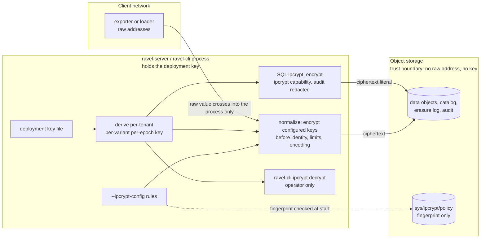

# ADR-2993: IPCrypt pseudonymization of IP-valued attributes

Status: Accepted (approved by the maintainer on 2026-10-15)
Date: 2026-10-15
Epic: #2993

## Context

Telemetry carries client and peer IP addresses in attribute values:
`client.address`, `source.address` and `network.peer.address` on spans
and logs, `instance` and custom labels on metrics. ADR-0062 names IP
addresses as personal data. Today every one of them is stored as sent,
in every data object, for the tenant's whole retention. The only
privacy tools in the tree act after the fact:

- selective subject erasure (ADR-0064), which matches exact `key=value`
  pairs;
- audit query-text tokenization (ADR-0062 decision 2e).

Nothing can keep an address out of storage in the first place. The
ingest path has no attribute transformation hook of any kind. Each
signal decodes, then runs one pure normalize function, and writes what
it returns.

IPCrypt (draft-denis-ipcrypt-14, Informational, no RFC yet) defines
keyed encryption of a 16-byte IP address. An IPv4 address is first
mapped to `::ffff:a.b.c.d`.

| Variant | Key | Output | Primitive | Reveals |
|---|---|---|---|---|
| ipcrypt-deterministic | 16 B | 16 B, an IPv6 address | one AES-128 block | equality |
| ipcrypt-pfx | 32 B, two halves that must differ | the same family as the input | a bitwise PRF over two AES-128 keys | equality and shared prefixes |
| ipcrypt-nd | 16 B | 24 B: an 8-byte random tweak, then the ciphertext | KIASU-BC | nothing, until the tweak collides after about 2^32 uses |
| ipcrypt-ndx | 32 B | 32 B: a 16-byte random tweak, then the ciphertext | single-block AES-XTS | nothing, until about 2^64 uses |

The draft recommends the deterministic variant where linkability is
acceptable (logs, rate limiting, deduplication) and pfx for subnet
analytics. The non-deterministic variants are for sharing data where
records must not be correlatable. ClickHouse 26.10 ships
`ipcryptEncrypt`/`ipcryptDecrypt` and the `ipcryptPrefix` pair
(deterministic and pfx only). Vector's `encrypt_ip` covers the same two
variants. Both take the key as a function argument. libsodium 1.0.21
implements all four variants.

Facts in this tree that constrain the design:

- **Metric series identity is computed inside normalization**
  (`ravel-otlp` and `ravel-remote-write` normalizers, with
  `SeriesIdMemo` caches keyed by the label set). A transform applied
  after normalization would store encrypted labels under the identity
  of the raw ones.
- **Every ingest surface reaches storage through the `ravel-ingest`
  routers.** That covers OTLP metrics, logs and traces over HTTP and
  gRPC, Remote Write, OTAP, and `ravel-cli load`. But the routers receive
  already-normalized records, after identity is fixed.
- **Value types differ by signal.** Metric labels and span attributes
  are strings. Log attributes are typed (`AttrValue`). Log resource and
  scope attributes are encoded into a canonical stream blob during
  normalization.
- **Derived keys have a precedent.** The deployment key
  (`--tenant-hash-key-file`, 32 bytes) already derives the tenant-prefix
  hash key, the recovery-manifest AEAD key and the audit token key, each
  through `blake3::derive_key` with its own context string. A deployment
  run with `--tenant-hash-unkeyed` has no deployment key.
- **No AES block cipher is in `Cargo.lock`.** `ring` exposes no raw
  block API. The reference Rust implementation, `ipcrypt-rs` 0.10 (ISC,
  by the draft's author), implements all four variants on RustCrypto
  `aes` 0.9 without `unsafe` in its own code. Its default feature
  `random` pulls `rand` 0.10, which only the non-deterministic variants
  need. ISC is on `deny.toml`'s allow list.
- **SQL scalar functions are registered per query against a fail-closed
  allow-list** (`ADMITTED_SCALARS`, ADR-0097). DataFusion folds an
  `Immutable` function with literal arguments into a literal before the
  pushdown extractors run. Query text reaches the audit table verbatim
  unless audit redaction is on. No per-function privilege exists: a
  principal is a tenant plus a `ddl` flag.

## Decision

**0. Threat model.** The parties this protects against are:
- anyone who can read object storage or its backups;
- anyone who receives an export of the data;
- **readers of the tenant's own data who do not hold the IPCrypt
  capability below.** None of these holds the deployment key.

Without a key, deterministic ciphertext is a stable pseudonym: equal
addresses can be correlated, but an address cannot be recovered.

A caller who can encrypt chosen addresses under the tenant's key can
recover addresses in bulk. IPv4 has only 2^32 of them, so sweeping a
range and joining against the stored values works. That makes
encryption a privileged operation, like decryption. Decisions 6 and 7
gate it accordingly.

The deployment key holder, the operator, is trusted: it can derive
every tenant's key.

**1. An operator declares which attribute keys hold IP addresses, per
tenant, in a policy file.** `--ipcrypt-config <file>` names a file in the
format the other per-tenant config files use. It holds a process
default and per-tenant overrides, with tenant ids hashed at load as
`--tenant-kms-config` does. Each tenant entry lists rules:

- `key`: the exact attribute key or label name;
- `variant`: `deterministic` or `prefix` (ipcrypt-pfx);
- `epoch`: a positive integer, default 1, the epoch new data is written
  under;
- `retired_epochs`: the earlier epochs whose data is still retained,
  default none.

One key may carry one rule. The file is read by `ravel-server` and by
`ravel-cli load`, and both apply it identically. Changing it takes a
restart, like every other CLI-only per-tenant setting. A
durable per-tenant record in `TenantConfig` is deliberately not part of
this ADR: it is a frozen protobuf whose new field needs a reader-first
rollout, and a file covers the deployments this epic is for. A
follow-up adds it under the format-change procedure if a deployment
needs rules changed without a restart.

`ravel-server` refuses to start with an `--ipcrypt-config` under
`--tenant-hash-unkeyed`, since there is no key to derive from. It also
refuses a file it cannot parse, a duplicate key, an empty key, or an
epoch of zero. Deployments and tenants with no rules are untouched,
byte for byte.

**2. Keys are derived, never stored.** For tenant `t`, variant `v` and
epoch `e`:

    key = blake3::derive_key("ravel ipcrypt v1 " + v, deployment_key || tenant_hash(t) || e as u64 little-endian)

The output is truncated to 16 bytes for `deterministic`. All 32 bytes
are used for `prefix`, and a derivation whose two halves are equal is
refused. The context string separates these keys from every other key
the deployment key derives. No key material reaches object storage, a
log line, or a metric. The derivation is a pure function, tested
against fixed vectors in its own crate.

**3. Values are encrypted inside normalization, before identity, limits
and encoding.** Each normalizer takes the tenant's resolved rules as a
required field of the options it already receives. They are applied to
the merged attribute or label set:

- before metric series identity is computed and before the `SeriesIdMemo`
  lookup, so identity is the identity of the stored labels;
- before label and attribute size limits, so the limits see the bytes
  that are stored;
- before log stream attributes are canonically encoded, so resource and
  scope attributes are covered;
- on exemplar labels too.

Required means no normalizer can be called without a rule set (an empty
one when the tenant has none). That makes a new ingest path that forgets
the policy a compile error, not a silent leak.

What is encrypted, given a rule's key:

- **A value that parses as an IP address.** It is replaced by the
  variant's ciphertext as canonical address text (RFC 5952 for IPv6):
  - `deterministic` always yields an IPv6 address;
  - `prefix` yields the input's family.
- **`ip:port` and `[ipv6]:port`.** The address is replaced and the port
  and syntax are kept.
- **Anything else is left unchanged and counted.** That covers a
  hostname, an address with a zone id, a non-string log value, and free
  text. A hostname in an address attribute is common and is not personal
  data in the sense this ADR addresses.

Log bodies and free text are out of scope. Only exact attribute values
under a configured key are encrypted.

Counter `ravel_ingest_ipcrypt_values_total{signal, variant, outcome}`,
with `outcome` either `encrypted` or `unparsed`, makes the policy's reach
visible. An operator alerts on `unparsed` to find keys whose values are
not what the rule assumed.

**4. Only the deterministic and prefix variants are offered.** Both keep
the properties the rest of the system relies on:
- exact-match erasure (ADR-0064);
- the exact-key index (ADR-2707);
- equality predicates and pushdown;
- `GROUP BY`;
- dictionary compression of repeated values.

**5. The library is `ipcrypt-rs` with default features off.** It is
pinned in one new crate, `ravel-ipcrypt`, which owns the policy types,
the file parser, the key derivation, value parsing and rendering, and
the counter's outcome type. The crate's tests pin every
`ipcrypt-deterministic` and `ipcrypt-pfx` vector from the draft's
machine-readable `test_vectors.json`, and the vector file is checked
in. The new `Cargo.lock` entries are `ipcrypt-rs`, `aes` and their
RustCrypto dependencies. Disabling the `random` feature keeps
`rand` 0.10 out.

**6. A SQL function encrypts with the tenant's key. It takes no key
argument and needs the `ipcrypt` capability.** It comes in two forms:
- `ipcrypt_encrypt(ip [, epoch])`;
- `ipcrypt_prefix_encrypt(ip [, epoch])`.

Each returns the stored form of an address under the calling tenant's
derived key, at the given epoch or 1. Behaviour:

- **Pruning.** Both functions are `Immutable`, so
  `attrs['client.address'] = ipcrypt_encrypt('203.0.113.7')` folds to a
  literal and prunes like any equality predicate.
- **No key in the query.** There is no key argument, so no key ever
  appears in query text, the audit table, or a plan.
- **Wiring.** The functions are built in `build_session` from the
  tenant's derived keys and added to `ADMITTED_SCALARS` for every signal
  table. They are built per session from that session's tenant key, so
  a folded literal or a cached plan cannot carry one tenant's ciphertext
  into another tenant's query.
- **Capability gate.** The functions are registered only for a principal
  holding a new `ipcrypt` capability, the way `ddl` gates DDL (ADR-2040
  decision 4). Without it, the call is refused like any unknown function.
  The capability is granted with a static token suffix (`;ipcrypt`) or an
  OIDC claim, through the same resolver path `ddl` uses. Per decision 0,
  this is what stops an ordinary reader from reversing the
  pseudonymization by encrypting guesses.
- **Audit redaction required.** The functions are registered only when
  audit query-text redaction is on. Under the default `Plaintext` policy
  the literal address in `ipcrypt_encrypt('203.0.113.7')` would be
  written verbatim into the audit table in object storage, past the very
  boundary this ADR draws. Under redaction it is stored as a keyed token.
- **No deployment key.** On a deployment without one, the functions are
  not registered.
- **Port forms.** A string the function cannot parse as an address
  returns NULL, and the `ip:port` forms of decision 3 are accepted, so a
  literal matches what ingest stored.

**7. Decryption is an operator action, not a query function.**
- `ravel-cli ipcrypt decrypt --tenant <id> --variant <v> [--epoch <e>]
  <value>...` recovers addresses.
- `ravel-cli ipcrypt encrypt` does the reverse.

Both read the deployment key from the same file `ravel-server` uses. A
SQL decrypt function is rejected below. Whoever holds the deployment key
can already derive every tenant's key, so a CLI that needs that key adds
no new holder.

**8. Erasure by IP matches the stored ciphertext.** When a tenant has a
rule for a matcher's key, `ravel-cli` encrypts that matcher's value
under the rule before it submits the erasure request.
- One matcher is written per configured epoch, newest first, so data
  written under an older epoch is matched too.
- A raw value that is not an address is submitted unchanged, matching
  how ingest stored it.

The request records the encrypted value, never the raw one: the
erasure log is itself retained data.

Erasure stays exact-match, as ADR-0064 defines it. A stored `ip:port`
value is matched only by a matcher carrying the same port, and an
erasure request for a bare address does not reach it. That limit exists
for raw values today; encryption does not widen it, and the erasure
guide says so.

**9. Every writing process must carry the same policy, and a process that
does not refuses to write.**
- **The marker.** The policy's fingerprint is recorded in a new object,
  `sys/ipcrypt/policy`. That is a new key prefix under `sys/`. The
  fingerprint is blake3 over the canonical rule set: tenant hashes, keys,
  variants and epochs. It holds no key material and no raw tenant id.
- **Encoding.** The marker is a new protobuf message,
  `IpcryptPolicyMarker`, in `proto/ravel/sys.proto`, with a version
  field. That follows ADR-0050, which put `sys/tenancy` and the later
  `sys/gc` record in the same file. No existing message is touched. The
  implementing task adds the key's row to the key layout table in
  `docs/catalog-and-mvcc.md` in the same commit as the code that writes
  it.
- **First write.** A process whose local policy is non-empty and that
  finds no marker creates it with `CreateIfAbsent`. A process that loses
  that race re-reads the marker and compares, as below.
- **Startup check, unconditional.** Every `ravel-server` start and every
  `ravel-cli load` run reads the marker, whether or not `--ipcrypt-config`
  was given. The forgotten-flag case is exactly a process with an empty
  policy on a bucket whose marker is not empty, so the read cannot depend
  on the flag.
  - No marker and an empty local policy: the process proceeds and writes
    no marker.
  - A marker whose fingerprint differs from the process's own, an empty
    policy included: the process refuses to start or load, and names
    both fingerprints.
  - A marker read that fails for any reason other than absence (an
    error from the store, a body that does not decode, an unknown
    version): the process refuses. It does not proceed as if the marker
    were absent.
- **Replacing the policy.** Changing the policy is an explicit step:
  `ravel-cli ipcrypt set-policy --ipcrypt-config <file>` replaces the
  marker with a CAS on its current ETag. Processes then restart with the
  new file.

The tenancy marker (`sys/tenancy`, ADR-0050) is the precedent. Without
this check, a forgotten flag on one process (most likely a `ravel-cli
load` run) would store raw addresses with nothing failing: the required
normalizer input of decision 3 only catches a forgotten code path, not a
forgotten flag.

**Rotation.** Bumping a rule's epoch changes the key for new data only.
- Equality between data written before and after the bump is lost.
  Queries pass the old epoch to the SQL function to match old data.
- Erasure matches every configured epoch.
- Old epochs are listed in the rule (`retired_epochs`) for as long as
  data under them is retained.

## Rejected alternatives

- **Query functions only, with the key as an argument (the ClickHouse
  and Vector shape).** Raw addresses would still be stored in every
  object, which is the exposure this epic exists to remove. A key
  argument also puts key material into query text, which reaches the
  audit table verbatim unless redaction is on. Even under redaction it
  is tokenized deterministically, so it is linkable across queries.
- **Encrypt in the `ravel-ingest` routers.** It is the one chokepoint
  every surface shares, but it runs after normalization. Metric series
  identity, the memo caches, the size limits and the log stream-attribute
  encoding have all consumed the raw values by then. Recomputing identity
  in the router would duplicate normalization's identity code for one
  feature.
- **A tenant-supplied key.** The key would have to be stored. Object
  storage is the only durable store, and a key there is readable by
  everyone who can read the data it protects. A per-tenant KMS-wrapped
  key could work; it adds a KMS round trip to every process start and a
  key-loss failure mode. Deriving from the deployment key matches how
  every other tenant-scoped secret in the tree is made.
- **The non-deterministic variants (nd, ndx) at ingest.** Every stored
  value would differ:
  - erasure by value could not find a subject's records;
  - equality predicates, `GROUP BY` and the exact-key index would return
    nothing useful;
  - dictionary compression of repeated values would be lost.

  They suit exporting a dataset to a third party, which is a different
  feature and can reuse `ravel-ipcrypt` later.
- **A SQL decrypt function.** Even behind the `ipcrypt` capability, a
  decrypt function turns any query result into raw addresses in bulk.
  Recovering an address for an investigation is rare and belongs with
  the operator who holds the key. A capability holder can already
  confirm a specific address with `ipcrypt_encrypt`.
- **Ungated SQL encryption, treating every tenant reader as trusted.**
  Simpler, and it matches ClickHouse and Vector, where the key is
  whatever the caller passes. But any reader could then recover
  addresses by encrypting a swept range and joining. Pseudonymization
  would then protect only against storage readers, not against the
  tenant's own users, who are often the reason it is wanted.
- **Detect policy drift with a fingerprint gauge instead of a marker.** A
  `/metrics` gauge per process is cheaper and needs no new key prefix.
  But it reports drift after raw addresses are already stored, and a
  short `ravel-cli load` run would never be scraped at all.
- **A durable `TenantConfig` field now.** It is a frozen-format change
  with a reader-first rollout, for the convenience of changing rules
  without a restart. It is deferred, not rejected.
- **Implementing the cipher on `aes` directly.** That is about 300
  lines of block-cipher code, including KIASU-BC's round-key tweak
  schedule, written and reviewed here instead of by the draft's author.
  We would pin the same vectors either way. If `ipcrypt-rs` stops being
  maintained, this is the fallback, and the vectors make the switch
  checkable.
- **Format-preserving IPv4 output (32-bit).** The draft discourages it,
  and neither offered variant needs it.
- **Encrypt every value that looks like an address, whatever its key.**
  It would guess, it would rewrite version strings and other dotted
  quads, and it would make the stored data depend on a heuristic. Rules
  name keys.

## Consequences

- A tenant with rules stores no raw address under a configured key, on
  any ingest surface. One acceptance test ingests a known address
  through each surface:
  - OTLP metrics, logs and traces over HTTP and gRPC;
  - Remote Write samples and exemplars;
  - OTAP;
  - `ravel-cli load`.

  It then scans every byte of every object written to the store for
  that address, in both text form and 4- and 16-byte binary form, and
  asserts it is absent. It also asserts that the ciphertext is present.
- **Cost.**
  - `deterministic` is one AES-128 block per configured value.
  - `prefix` is 64 AES operations per IPv4 and 256 per IPv6. A test pins
    the operation count, not a time.
  - Tenants without rules pay one empty-rule-set check per record.
- **Text forms and size.** An IPv4 value under `deterministic` is stored
  as IPv6 text. A test pins the canonical text form of each variant. A
  stored value grows to at most 39 bytes plus any port, and the size
  limits see the stored length.
- **Exact semantics hold.** Equality, `GROUP BY`, `count(DISTINCT)`,
  exact-match erasure and the exact-key index behave on ciphertext
  exactly as on the raw values, with the `ip:port` limit of decision 8. Under `prefix`, prefix grouping of the stored text (a /24
  on IPv4, a /64 on IPv6) matches grouping of the raw addresses. Range
  predicates and CIDR containment on raw addresses are not supported on
  encrypted keys, and the docs say so.
- **A new principal capability.** `ipcrypt` joins `ddl` in
  `ravel-tenant-resolve`'s `Principal`, with the same token and claim
  syntax.
- **New flag and metric.**
  - `--ipcrypt-config` on `ravel-server` and `ravel-cli`.
  - `ravel_ingest_ipcrypt_values_total`.
  - The new SQL functions.
  - The `ravel-cli ipcrypt` subcommands.

  These go into `docs/reference/ravel-server-flags.md`, the metrics
  reference, `docs/ingest.md` (a new pseudonymization section),
  `docs/guides/`, the SQL function list, and README.md.
- **Losing the deployment key loses the addresses.** Every stored
  address under a rule becomes unrecoverable, and no `ipcrypt_encrypt`
  call can match stored data again, because no key derived from a
  different deployment key produces the same ciphertext. Keeping the
  deployment key is already a recovery requirement (ADR-0050); this
  ADR adds a consequence to losing it.
- **Deployment-key rotation is out of scope.** The epoch mechanism
  rotates per-rule keys under one deployment key. A new deployment key
  changes every derived key at once, for every tenant and epoch, and
  needs its own ADR.
- **Persistent formats: one new `sys/` object, no changed format.**
  Ciphertext is an ordinary attribute value. `sys/ipcrypt/policy` is a
  new prefix, not a change to an existing one. It is a small Class C
  metadata record, a new versioned message in `proto/ravel/sys.proto`
  (decision 9), added to the key layout in `docs/catalog-and-mvcc.md`.
  Data written before a rule was added stays as it was:
  the policy is not retroactive, and the docs say to use erasure or
  retention for older data.
- **Reachability.** The decision 3 rule set is a required normalizer
  input, and the acceptance test above drives the shipped binaries'
  entry points. Together they prove the capability is constructed on
  every path.
- **Supply chain.** `ipcrypt-rs`, `aes` and its RustCrypto dependencies
  join `Cargo.lock` and pass `cargo deny`.
