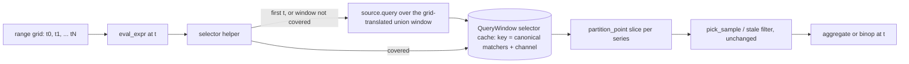
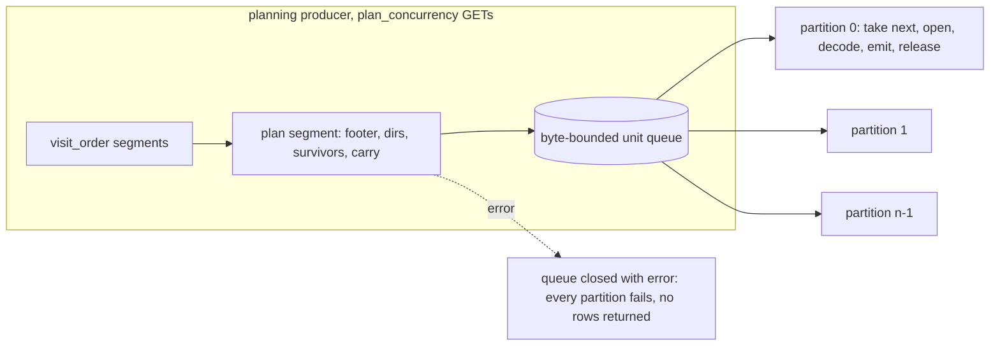
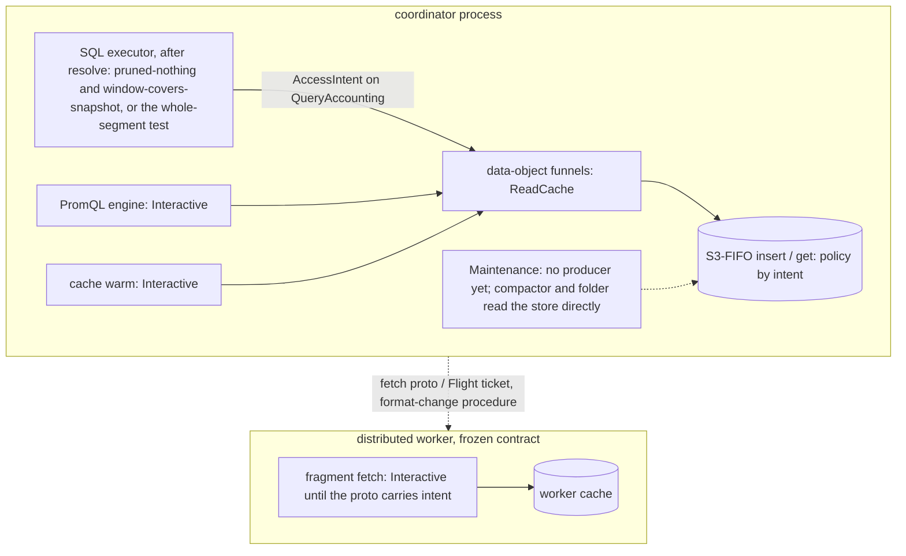

# ADR-3072: the 2026-10-18 performance audit as five tracks

Status: Proposed. Issue: #3072 (epic). Source: "Ravel performance audit, a
concrete path to 2x" (NOFireAI, 18 October 2026), reviewed at main
212730442471, workspace version 0.24.0.

## Context

The audit recommends five changes. Two of them already have an accepted
decision and an open epic, one has an open ticket that asks for a decision
first, one was deferred by an earlier ADR with the shape of a later decision
named, and one has no decision anywhere. This ADR puts the five under one
program so they are measured against one contract, and adds a decision only
where none exists.

| Track | Audit change | Decision today | This ADR |
|---|---|---|---|
| P1 | Prepare PromQL selectors once; bounded, borrowed windows for compound range queries | none; `crates/ravel-promql/src/eval.rs:854-862` names per-selector cursoring as the point where multi-selector trees need it (it attributes this to ADR-0021 §1, which specifies only the selector prefetch plan) | decision 1 |
| P2 | Build the row path's attribute columns from decoded columns | ADR-2773 D4, epic #2815, task #2789 | nothing new; the program drives #2789 and the #2815 re-measurement |
| P3 | Finish exact-key read wiring for logs | ADR-2707, epic #2961 (T11 #2762, T12 #2763, writer fix #3039 landed in PR #3071) | nothing new; reported here, driven on #2961 |
| P4 | Stream segment planning into scanning | ticket #1272, which asks for an ADR amendment before implementation | decision 2 |
| P5 | Scan-aware cache admission; memory refusal cause and attribution | ADR-2677 decision 3 deferred (#2681); #2990; #2999 | decision 3 |

### P1: what the code does today

A compound range query (`sum by (service_name) (rate(http_requests_total[5m]))`)
resolves to `RangeCore::Generic` (`eval.rs:1533-1534`) and is evaluated by
`eval_instant_over_grid`, which calls `eval_expr` once per grid step
(`eval.rs:884-891`). Each step's selector reaches storage through
`eval_vector_selector` (`eval.rs:1003`, `:1022`) or `eval_matrix_selector`
(`eval.rs:1060`), one `source.query` and one `source.query_histograms` per
selector per step. `MergedSource::query` (`crates/ravel-query/src/engine.rs:4883-4925`)
filters the whole pool by every matcher, then clips each matched series
with a linear filter over its entire sample vector, cloning the label set
and collecting a fresh `Vec<Sample>`. The samples were prefetched once for
the whole range: `prefetch_metric_plans` unions every selector's padded
window (`engine.rs:1935-1942`, padding in `selector_fetch_window` at
`engine.rs:3520-3550`),
so the per-step cost is CPU and allocation, not a store round trip.

Bare selectors (`eval_range_selector`, `eval.rs:1257-1264`) and range
functions over a selector (`eval_range_matrix_reduction`, `eval.rs:1370-1404`)
already fetch once over the grid's combined window and walk forward-only
cursors. The compound shape does not.

Two facts bound the design. `pick_sample` binary-searches the series and
checks the left-open lookback bound itself (`eval.rs:1769-1794`), so handing
it a sorted superset of the step's window returns the same sample. Per-step
windows are monotone in the step timestamp for a selector directly under the
top-level grid, with or without `offset` or `@` (`eval.rs:1328-1335`,
`:1591-1621`), but a selector inside a subquery restarts its inner grid at
every outer step (`eval.rs:1125-1140`), so a forward-only cursor is only
valid outside subqueries while a binary search is valid everywhere.

### P4: what the code does today

`compute_plan_counts` (`crates/ravel-sql/src/logs_scan/plan.rs:312`)
plans every relevant segment under `buffer_unordered(plan_concurrency)`
(`plan.rs:352-353`) and stores the result in a `OnceCell` on the exec
(`mod.rs:1102`); every partition stream awaits it before draining anything
(`plan.rs:255-256`, `scan.rs:1485-1517`). Assignment (`owned_work`,
`plan.rs:682-800`) has three modes, each needing the whole pass first: with a
read cache and a confirmed TopK, `global_deal` sorts every row group across
all segments by its blocks' least stored timestamp and deals that interleaved
list (`plan.rs:459`, `:490-528`); with a cache and no TopK, row groups go
`i % n` over a counter that runs on across segments; without a cache,
segments go `j % n`. All three need the survivor total for the effective
stride (`plan.rs:427-433`). The carry keeps the first `plan_concurrency` whole
objects to complete and forces every later one to `None` (`plan.rs:376-392`),
which is then re-fetched at `scan.rs:1663-1672`. A kept whole object stays
reserved until the exec drops, because `owned_work` clones it (`plan.rs:730`,
`:764`, `:791`) and the reservation rides inside the `Bytes`
(`crates/ravel-query/src/reserved_bytes.rs`); only the directories release on
their last owner (`CarriedDirsSlot`, `plan.rs:81-133`).

The barrier is load-bearing in four places a streaming design has to
replace: partition 0 records the per-segment totals and `plan_full_reads`
for every segment at the barrier (`scan.rs:1495-1503`); planning errors are
not cached, so a waiting partition may re-run the pass after a failure
(`plan.rs:196-198`); the snapshot `NotFound` retry rule is "retry once before
the first batch, fail `SnapshotInvalidated` after it", and its doc says the
post-emission branch "becomes reachable the moment the scan fetches lazily
per segment" (`crates/ravel-sql/src/executor.rs:47-62`, `:4736-4748`); and
`MemoryBudget::reserve` refuses at once rather than waiting
(`crates/ravel-memory/src/lib.rs:441-450`), so a byte-bounded queue cannot
block on the accountant. The post-emission branch is already reachable
today through Flight SQL, which streams batches and fails
`SnapshotInvalidated` once rows are on the wire
(`crates/ravel-sql/src/flight/stream.rs:16-28`), through the whole-segment
fast path, and through unplanned sub-bound opens; no logs test pins it.

The predicate-free whole-segment fast path and its ranged prefetch pipeline
already stream per partition without the barrier (`mod.rs:2410-2437`,
`:2996-3001`); the sub-bound bypass does not (unplanned segments still wait
behind planned ones, `plan.rs:244-262`, `:311-315`), and the striped route
never prefetches (`docs/query-engine.md:506-509`).

### P5: what the code does today

Every data-object funnel on the query side reaches the cache through
`ReadCache` (`crates/ravel-query/src/fetcher.rs:464-617`), whose methods take
a key and a fetch closure and nothing about the caller; the one admission
point is `S3Fifo::insert` (`crates/ravel-cache/src/s3fifo.rs:144`). The ghost
list is `min(max_bytes / max_entry_bytes, max_entries)` keys
(`s3fifo.rs:101-105`); with the server's 64 MiB entry cap
(`services/ravel-server/src/store.rs:21-65`) an 11.5 GB cache remembers about
171 keys, so a repeated scan of a few thousand objects larger than the cache
serves nothing on every pass (#2615, #2639 W2, ADR-2677 decision 3 and its
deferral). The compactor and the folder read the store directly
(`crates/ravel-maintain/src/compact.rs:284`; `crates/ravel-catalog/src/fold.rs:1335`,
`:2471`, `:3172`, `:3260`, `:3388`, `:4128`) and reach no cache at all; the
catalog byte cache (`crates/ravel-catalog/src/catalog.rs:105-114`) is reached
only by the query-side resolve (`snapshot_resolve.rs:495`, `:835`) and takes
no `QueryAccounting`. So the maintenance scans ADR-0046 decision 6 defends
against do not pass through either cache today.

The query engine has two signals that approximate "this statement reads
everything", neither of which reaches the cache and neither of which is that
statement exactly. `PlanClass::ExhaustiveScan` is computed at
`crates/ravel-sql/src/executor.rs:3487-3496`, inside `into_shape` after the
drain, as "a single metrics lane whose resolve pruned no segment"
(`segments_pruned == 0`; `io_shape.rs:197-199`); its inputs are known after
resolve, and a one-series dashboard query over a tenant whose segments all
carry that metric name is `ExhaustiveScan` too. For logs the whole-segment
fast-path test (`mod.rs:2410-2437`) runs in `execute()`, after the plan reads
have gone through the cache.

`TenantMemoryAccountant::try_grow` maps every `MemoryBudget::try_reserve`
error to `GrowRefused::Process`, which carries the whole `MemoryExhausted`
with its `cause` (`crates/ravel-sql/src/memory.rs:198-216`); `try_charge` then
formats it as an accounted limit breach without reading that cause
(`memory.rs:566-577`), which is #2990. No
test drives `ExhaustionCause::HostMemory` through `try_charge`. On VmRSS
(#2999), the ledger covers fetch buffers, the SQL pool, decoded blocks and
dictionaries and the catalog decoded caches, and leaves out by design the
allocator's retention, the S3-FIFO bookkeeping, the ingest baseline, the
handoff overlap and a GROUP BY's live allocation running ahead of its
reservation (ADR-1170 constraint 4; `crates/ravel-sql/tests/group_by_reservation_lag.rs`).

### Stage 0 (pre-registered 2026-10-18 on #3072; results are appended to the epic body)

| Track | Harness | Prediction | Miss | Basis |
|---|---|---|---|---|
| P1 | `query_latency_bench`, memory store, compound vs bare, 1 h x 1000, 24 h x 200, 24 h x 1000 series | `MergedSource::query` called once per grid step for the compound arm and once for the bare arm; evaluate share of compound wall at least 70 % at 24 h x 1000; compound wall at least 5x bare | evaluate share under 50 %, or ratio under 2x | measured 2026-10-18: calls 61 / 1441 / 1441 compound and 1 bare (HIT); every series walked whole per step, ratio 1.0000 (HIT); evaluate share 71.6 / 87.0 / 91.7 % (HIT); compound over bare 3.30x / 7.80x / 10.73x (1 h under the 5x target, both 24 h shapes HIT); profile at 24 h x 1000: 77.6 % of samples in `MergedSource::query`'s per-sample timestamp test, rate and aggregation 5.4 %; issue #3072 comment 6253165175 |
| P2 | ADR-2773 P2 procedure on current main (`sql_latency_bench --generate`) | rp_map_full 19,300 to 20,200 cpu_ms, ov_key_gb 2,400 to 2,580 cpu_ms, within 0.7x to 1.4x | rp_map_full under 0.5x | measured 2026-10-18: overflow arm ov_key_gb 2,830 / 2,610 / 2,700 cpu_ms, 54.3 us per row, 1.11x (HIT), issue #3072 comment 6252814695; arm A at 500,000 records rp_map_full 8.92 / 7.04 / 8.78 us per row, inside the 7 to 14 us band (HIT), and its per-row ratio to rp_key_gb 19.6x to 26.2x under that report's own 30x bar, a scale effect of the fixed per-object open cost at 500,000 rows, issue #3072 comment 6253044527 |
| P4 | `sql_latency_bench --generate --inject-get-delay-ms 30`, 25 objects of 20,000 records | cold first batch at or after 0.9x of the plan pass; planning share at least 30 % | first batch well before the plan pass ends | measured 2026-10-18: MISS on this lane, planning share 0.016 %, because 82 KB generated objects sit under the 512 KiB range threshold and the plan pass fetches nothing; the above-bound record is ADR-2707 Stage 0 q20 on real S3, plan 1,133 of 2,359 GETs and 602 MB of 1.48 GB (docs/adrs/2707-exact-key-index-for-spans-and-logs.md:91-92); issue #3072 comment 6252814695 |
| P5 | same dataset, `--cache-bytes` at half the corpus, 4 runs | runs 2 to 4 serve under 5 % of read bytes from cache | over 30 % | measured 2026-10-18 on the scanning statement: 3.9 %, 3.9 %, 11.9 % (HIT); the count-only statement opens no segment and was inconclusive; issue #3072 comment 6252814695 |

## Decision

### 1. Compound PromQL range queries fetch each selector once and slice per step

1a. `MergedSource::query` and `query_histograms` clip a series by two
`partition_point` searches on `ts_ns` instead of a linear filter. The
`SeriesSource` contract already requires ascending `ts_ns`
(`crates/ravel-promql/src/source.rs:17-21`, `:57-61`); equal timestamps, which
log-derived series may carry (`source.rs:40-55`), stay inside the slice since
both searches are on the bound value. Matcher evaluation is unchanged here;
1b removes the repeats.

1b. `QueryWindow` (`eval.rs:523-549`, every literal is in `eval.rs`) gains a
private `RefCell<HashMap<SelectorKey, Rc<CachedSelector>>>`. `SelectorKey` is
the matcher set in canonical form (name, operator kind, pattern text, value;
sorted) plus the channel (float or histogram), since `LabelMatcher` has no
`Hash` (`source.rs:99-123`). `CachedSelector` holds the window fetched and the
`Vec<SeriesData>` the source returned, in source order. `eval_vector_selector`,
`eval_matrix_selector` and `eval_histogram_matrix_selector` ask the cache
first: a request whose window lies inside the entry's window is answered by
slicing each series with `partition_point` and then running today's
`pick_sample`, `pick_histogram`, left-open and stale filters unchanged on the
slice (`eval.rs:1007`, `:1025`, `:1067-1073`, `:1197`); a series whose slice
is empty is dropped as today. A miss, or a request outside the entry's
window, fetches the union of the request and the request translated across
the grid (`[req.start - (eval_ts - ctx.start_ns), req.end + (ctx.end_ns -
eval_ts)]`, clamped to `i64`), replaces the entry, and increments a
per-query refetch counter exposed through the annotations' debug surface
for tests. For a selector directly under the top-level grid this is one
fetch per selector whatever its `offset` or `@`; for a plain or `@`-pinned
subquery it is one fetch too, since the first outer step's first inner step
already spans the grid. A subquery whose inner grid runs past `ctx.end_ns`
(a negative subquery offset, `f(x[1h:1m] offset -1h)`) translates to a window
that ends at `ctx.end_ns` and refetches once per inner step past it, which is
today's call count for that shape and never a wrong answer, since the union
always contains the request; the task passes the enclosing grid's own bounds
through `ctx` for subquery evaluation so the translation uses the inner grid,
and the refetch band below covers that shape. The fetch is lazy: it runs at the first selector evaluation, so
every check that today sees zero source queries before a refusal
(`eval.rs:3472`, `:3562`, `:3645`) still does. The instant path, the
`Selector` and `Call` arms and `query_precomputed_count` are unchanged; the
cache is populated only when the evaluator is inside a range grid or a
subquery, which is where the repeats are.

1c. Forward-only cursors are not added. A `partition_point` per step is
`O(log n)`, which already removes the full-vector walk the audit counted
(8,330,421 timestamp visits against 36,264 comparisons on its one-series
model); a cursor would be valid only outside subqueries (Context, P1) and
buys a constant factor on top. Borrowed or reference-counted sample windows
(the audit's second stage) are deferred: the cache already cuts allocation
from one owned copy per selector per step to one per selector per query, and
switching `SeriesData` to shared storage changes every `SeriesSource`
implementor. The epic re-measures after 1a and 1b; if evaluate share at
24 h x 1000 series is still above 40 %, a follow-up ticket carries the
borrowed-window change with its own band.

Acceptance (the task's tests, re-run at checkpoint):

| check | target | miss | basis |
|---|---|---|---|
| compound arm wall, 24 h x 200 and 24 h x 1000, same harness and box class as Stage 0 | at most 0.50x of the Stage 0 compound median (744.7 ms and 5,699.7 ms); the Stage 0 profile puts 77.6 % of the 24 h x 1000 wall in the clip alone, so 0.50x is cleared if the clip goes | over 0.6x | predicted (audit page 1); Stage 0 figures from issue #3072 comment 6253165175 |
| compound arm wall, 1 h x 1000 | at most 0.65x of the Stage 0 median (96.5 ms, of which prefetch is 32.5 ms and unchanged by this decision, so 0.50x of the wall would need the clip to be 76 % of evaluate at 240 samples per series, where the linear walk is a smaller share than at 24 h) | over 0.75x | predicted; Stage 0 split from issue #3072 comment 6253165175 |
| bare arm wall, each shape | within 5 % of Stage 0 | over 5 % slower | predicted (audit page 3) |
| `MergedSource::query` calls, compound arm, 24 h / 60 s | 1 per distinct selector (1 for the Stage 0 query), refetches 0 | any more | predicted |
| `MergedSource::query` calls for `f(x[1h:1m] offset -1h)` over the 24 h grid, and for a plain subquery | at most 2 per distinct selector | more | predicted (the negative-offset subquery is the shape the grid translation does not cover on its own) |
| difftest, five new Generic range entries: `offset`, negative `offset`, `@ start()`, a subquery argument, a stale marker inside the window | bit-identical to pinned Prometheus | any difference | predicted; today's corpus has three Generic range entries (`corpus/aggregate.txt:144`, `corpus/binop.txt:171`, `corpus/histogram_native.txt:186`) and none of these shapes |
| every existing per-step test (`eval.rs:2044`, `:2198`, `:2231`, `:2532`, `:3301`, `binop.rs:1352`, `functions/mod.rs:1564-1810`) | unchanged | any edit beyond the two count assertions below | predicted |
| `repeated_nested_subquery_reevaluation_is_rejected_by_shared_budget` (`eval.rs:3600`) | still rejects on the shared budget; its `query_count() == 10` becomes the new exact count with the claim restated in the test name | the budget check moves or weakens | predicted |

### 2. The logs scan plans and scans in one bounded pipeline

2a. Planning becomes a producer: one task per statement walks the segments
in `visit_order` (`plan.rs:864-870`), plans each under the same
`plan_concurrency` GET bound, and publishes one `PlannedUnit` per segment, or
per complete row group when `stripe_blocks` is on, carrying the footer, the
directories, the surviving blocks and any whole-object payload the plan
read. Units go into a byte-bounded queue whose capacity is the carry
contract ADR-0107's #835 amendment already states, `plan_concurrency` objects
times object size; the producer waits on the queue, never on
`MemoryBudget`, since the budget refuses rather than waits (Context, P4).
Each unit's reservation is the one its `Bytes` already carries and is
released when its last owner finishes it (several row-group units of one
segment share one carried whole object), the rule `CarriedDirsSlot` applies
to directories today.

2b. Partitions consume. The declared partition count stays what
`compute_properties` declares; the `total_blocks` cap on the effective stride
(`plan.rs:427-433`) goes, and a partition that finds the queue closed runs
empty, as partitions past the stride do today (`mod.rs:1095-1101`). Ownership
is take-next: a free partition takes the next unit in publication order, so
a complete row group stays with one owner (dictionary reuse) and no prefix
sum over survivors is needed. Under a read cache and a confirmed TopK,
today's `global_deal` orders row groups by their least stored timestamp
across every segment (`plan.rs:459`, `:490-528`), which the earliest-first
pruning of `mod.rs:16-20` rests on; a publication order per segment in
`visit_order` keeps segment-level order only and gives up the cross-segment
interleaving, since recovering it needs every segment planned first, which
is the barrier. That is a pruning trade, not a correctness change, and the
acceptance table bands the TopK statements of the cohort separately. The
dealt shape becomes nondeterministic across runs and the tests that pin
`i % n` striping (`plan.rs:874-2280` `owned_work_tests`,
`tests/logs_uncached_assignment.rs`) are rewritten to pin the properties
instead: every surviving row group is consumed exactly once, by one
partition, in publication order per partition.

2c. What the barrier did, done elsewhere. The producer records the
per-segment totals and `plan_full_reads` when it publishes each unit
(replacing partition 0's recording at `scan.rs:1495-1503`). A producer
error closes the queue with that error and every consumer fails with it,
and `fail` frees its reservations as today (`scan.rs:1377-1387`); the HTTP
executor's drain returns `Err` without a partial result
(`executor.rs:4080-4105`), and Flight SQL streams batches and already fails
`SnapshotInvalidated` after emission (`flight/stream.rs:16-28`). A snapshot
`NotFound` while planning a later segment after the first batch was emitted
fails the statement `SnapshotInvalidated`, exactly as the retry rule already
states for that case (`executor.rs:47-62`); the branch is reachable today
through Flight SQL, the whole-segment fast path and unplanned sub-bound
opens and has no logs test, so the task adds one on the logs route.

2d. Scope. The whole-segment fast path and its prefetch pipeline are
unchanged. The sub-bound bypass publishes an unplanned unit without a plan
read, so sub-bound segments no longer wait behind planned ones. The
distributed worker fragment runs the same exec and inherits the change.
`plan_init_elapsed` becomes the producer's wall time; `planning_wait_elapsed`
becomes each consumer's wait for its first unit; `first_batch_elapsed` is
the figure that must move.

2e. Amendments the task writes in its commit: ADR-0107's #835 amendment
retires "Survivor counts, stats, and footers for every relevant segment are
still held until the shared pass returns" (its peak-bytes sentence stands);
ADR-0102 decision 1's flattened block-striping assignment is amended to
take-next ownership over the published units. The same wording lives in
`docs/query-engine.md` twice (the striped-route section from :515, and the
"How many partitions, and the read-cache precondition (ADR-0102)" subsection
under "SQL over logs" at :4184-4187, which states the `i % n` deal), in
`mod.rs:9-16` (block units), `mod.rs:182-186` (the held-until-the-pass
sentence), `mod.rs:1090-1101` (the `segments` and `target_partitions` field
docs) and `plan.rs:640-666` (the `owned_work` doc); every one is updated in
the same commit, and `scripts/guards/check-amendment-integrity.sh` pins the
retired phrase.
`logs_selective_scan_amplification.rs::plan_carry_peak_bytes_bounded_by_plan_concurrency`
is rewritten: re-fetches 0, peak intermediate bytes at most the queue
capacity.

Acceptance:

| check | target | miss | basis |
|---|---|---|---|
| the planning cohort on the reference host: every suite statement whose cold `stats.timings.planInitMs` is at least 30 % of its wall in the current-main rebaseline (decision 4), objects above the 512 KiB range threshold | first batch at most 0.5x of the plan pass wall; cold wall at most 0.75x of the rebaseline, per statement | first batch over 0.9x, or wall over 0.85x | predicted (audit page 6); the generated memory-store lane cannot carry this check, its objects sit under the threshold (Stage 0 P4) |
| segment re-fetches on the fallback branch (one probe GET plus the ranged block GETs per dropped carry), `SEGMENTS = 8`, `BUDGET = 2` | 0 | any | predicted; today `SEGMENTS - BUDGET` segments re-fetch (`tests/logs_selective_scan_amplification.rs:1564-1580`) |
| TopK statements of the planning cohort (ordered `LIMIT` over above-bound objects), cold | at most 1.05x of the rebaseline per statement | over 1.10x | predicted; the per-segment publication order gives up `global_deal`'s cross-segment interleaving (decision 2b) |
| peak intermediate bytes | at most `plan_concurrency` x object size (unchanged contract) | over it | predicted (ADR-0107 #835 amendment) |
| peak RSS on the Stage 0 P4 shapes | at most 1.10x of Stage 0 | over 1.10x | predicted (audit page 6) |
| result rows, every corpus statement | identical to main | any difference | predicted |
| `an_open_that_prunes_differently_from_the_plan_fails_closed` (`plan.rs:1907`), the snapshot retry tests (`tests/snapshot_retry.rs:172`, `:342`) | green, plus the post-emission `SnapshotInvalidated` test on the logs route | any red | predicted |

### 3. The cache admits by access intent; memory refusals name their cause

3a. `AccessIntent { Interactive, BulkScan, Maintenance }` travels with
`QueryAccounting`, which every data-object funnel already receives
(`fetcher.rs`, the `log_fetcher.rs` whole, extent, front-section, block and
run paths, `span_fetcher.rs`; Context, P5), and is read at `S3Fifo::insert`
and `get`. `admit_blocks_from_whole` (`log_fetcher.rs:7553`), an insert-only
path with no accounting, takes the intent of the whole-object read it
splits. The SQL executor sets the intent once per statement after resolve,
before any segment read: `BulkScan` when the statement is a single metrics
lane whose resolve pruned no segment (`segments_pruned == 0`, the input
`PlanClass::ExhaustiveScan` is later computed from) AND the resolved window
covers every segment of the tenant's snapshot, or when the logs scan's
whole-segment test would pass for the statement's relevant segments (the
same predicate-free, window-covering conjunction, evaluated on the resolved
segment list before the plan reads); `Interactive` otherwise, including the
one-series dashboard query whose metric name prunes nothing. The PromQL
engine sets `Interactive`; cache warming sets `Interactive` (it fills for
later interactive reads). `Maintenance` has no producer in this ADR: the
compactor and the folder reach no cache (Context, P5), so the variant is
reserved for a later maintenance funnel and nothing sets it here. Distributed
workers keep `Interactive` until the fetch proto and Flight ticket carry the
field, which is a frozen-contract change under the format-change procedure
and is filed as its own ticket, not folded in here. Intent is admission
policy only: it never skips a fresh read and never changes what a hit
returns.

3b. Policy. `Interactive` reads are admitted and promoted exactly as today.
`BulkScan` reads do not raise `freq` on a hit and are admitted into a
scan region bounded to a configured share of `max_bytes` (default 50 %,
`--cache-bulk-share`); within the region, admission is a deterministic
stable subset, keyed by `hash(key) mod M` against a threshold derived from
the region's bytes and the tenant's previous bulk pass byte total, so the
same keys are served on every later pass and a loop larger than the region
serves its stable fraction instead of nothing. The region may grow into
bytes the interactive queues are not using and never evicts a `main`-queue
interactive entry. `Maintenance` reads, once a funnel sets them, are admitted
to the small queue only and never promoted (today's scan-resistant path);
until then the arm is defined and unexercised. Bookkeeping for the region
(the per-tenant pass total and the threshold) is charged inside `max_bytes`
and bounded by key count. The disk tier keeps today's policy until its
mixed-size cases are measured. The mechanism inside the region is the
implementing task's to refine; the tests below are the contract.

3c. `try_grow` already preserves `ExhaustionCause` inside
`GrowRefused::Process` (`memory.rs:208-211`); the change is in `try_charge`,
which formats a `HostMemory` refusal as a host-memory gate closure naming
`available` and `floor`, the `Display` `MemoryExhausted` already has
(`crates/ravel-memory/src/lib.rs:521-536`), and leaves the accounted message
byte-for-byte. The gate refusal is counted
under `ravel_memory_gate_refusals_total` as today; the SQL stats error class
stays `ResourcesExhausted`. A test drives `HostMemory` through `try_charge`
and pins the text. This is #2990.

3d. Attribution before tuning (#2999). One measurement task on the
reference host (c6a.4xlarge, real S3, the 10-connection phase) samples every
second: VmRSS, `MemAvailable`, jemalloc `allocated`/`active`/`resident`/
`mapped`/`retained`, `ravel_memory_reserved_bytes` per component, the two
caches' resident bytes and the SQL pool. The overshoot is split into
allocator retention (`resident - active`), unaccounted live (`active -
reserved - caches`) and the baseline, each with a share. The fix task is
specified from that split and not before: retention above half the overshoot
means decay or purge tuning on gate closure; unaccounted live above half
means reserving the named class. Pre-registered: VmRSS peak 30.1 to 31.9 GB
against the 29.8 GB budget (#2999); the split is the unknown.

Acceptance:

| check | target | miss | basis |
|---|---|---|---|
| `s3fifo` loop test: N keys over a cache of C < N entries, all `BulkScan` | at least 0.8 x C/N of touches served on passes 2 and 3, served set unchanged between them | under 0.8 x C/N, or the set changes | predicted (ADR-2677 decision 3, audit page 7) |
| hot-set test at server geometry: 16 KiB `Interactive` ranges (33 MB) against a loop of 25 MB `BulkScan` objects over an 11.5 GB cache | at least 99 % hot-set hits | under 99 % | predicted (ADR-2677 deferral, variant 2's failure at 0.07) |
| hot set established while the scan is running | at least 99 % after establishment | under 99 % | predicted (ADR-2677 deferral, variant 3's failure) |
| an interactive metrics statement whose resolve prunes no segment (one series, one hour, over a tenant whose segments all carry the metric name), run beside a concurrent `BulkScan` loop | classified `Interactive`; at least 99 % hot-set hits for its ranges | classified `BulkScan`, or under 99 % | predicted (decision 3a's trigger excludes it; this row is what keeps it excluded) |
| `s3_fifo_scan_resistance_*` and `disk_tier_survives_repeated_scans_via_s3_fifo_eviction` | green | any red | predicted |
| region bookkeeping bytes | at most 1 % of `max_bytes`, inside the cap | over 1 %, or outside the cap | predicted (ADR-2677 deferral: 0.3 to 0.8 GB outside the budget was the parked policy's cost) |
| Stage 0 P5 shape, `--cache-bytes` at half the corpus | runs 2 to 4 serve at least 40 % of read bytes from cache | under 25 % | predicted (ADR-2677 band at :373) |
| `try_charge` on `HostMemory` | message names the host gate, `available` and `floor`; accounted message unchanged | the accounted text changes, or the cause is absent | predicted |
| #2999 attribution report | every sampled figure present at every peak, shares sum to the overshoot within 5 % | a missing figure | predicted |

### 4. One measurement contract for the program

There is no production replay corpus in this repository, so the audit's
"production replay" lane is the per-track harness: each track's Stage 0
command, re-run on the same executor class with the candidate binary, A/B
interleaved, five rounds, the load average beside every figure. The suite
lane is ClickBench on the reference host (c6a.4xlarge, loopback RustFS and
same-region S3 as separate lanes), current main rebaselined first and the
candidate measured against that rebaseline, all 43 statements reported, the
hot total compared only after the rebaseline exists. The program claims the
per-track targets above; it does not claim a 2x of the hot total, which the
audit's own arithmetic (page 2: a 30 % component made 2x faster moves the
query 1.18x) says the five tracks cannot deliver on their own. The
capacity lane (completed QPS at a fixed p95 and error ceiling) is reported
for P5.

## Rejected alternatives

- **P1, a new evaluator or a vectorised engine.** The repeats are in one
  arm; the other two arms already have the single-fetch shape. Replacing the
  evaluator re-litigates ADR-0007 and ADR-0021 for a constant-factor problem.
- **P1, caching inside `MergedSource` keyed by matcher set.** The engine
  does not see the selector shape (`offset`, `@`, subquery), so it cannot
  size the window or know when to drop the entry, and `TestSource` and any
  future source would not benefit. The evaluator owns the grid.
- **P1, borrowed windows first.** It changes every `SeriesSource` implementor
  for an allocation saving the cache already takes from per step to per
  query; kept as the conditional follow-up in decision 1c.
- **P4, a larger `plan_concurrency` or a global GET-concurrency increase.**
  The audit cuts it (page 9): it changes the measurement and turns latency
  into refusals under the memory gate.
- **P4, keeping the barrier and widening the carry budget.** Retention then
  scales with corpus size, which is the bound the #835 amendment exists to
  hold.
- **P5, a reuse-distance policy.** Three variants were built and simulated
  under #2681 and each either served nothing to a later loop or starved a
  rarely touched hot set (ADR-2677 deferral). A loop entry and a hot entry
  touched once per long interval present the same reuse distance; intent
  separates them by what issued the read.
- **P5, a larger cache or a larger host.** Cut by the audit (page 9); the
  reference host already runs at its memory ceiling (#2999).
- **P5, tuning the allocator before attributing the overshoot.** A retention
  fix applied to an unaccounted-live problem changes nothing and costs a
  measurement cycle; decision 3d orders them.

## Consequences

- P1 adds one owned copy of each distinct selector's samples per range
  query, bounded by the prefetched set; the per-step copies it replaces were
  each that size. The two tests that pin exact source-call counts move with
  the claim; everything else that pins per-step semantics is unchanged by
  construction, since the slice feeds the same helpers.
- P4 makes the dealt shape nondeterministic across runs and trades the
  `i % n` tests for property tests. The post-emission `SnapshotInvalidated`
  branch becomes reachable and is pinned. The queue is the retention bound;
  the budget is still never waited on.
- P5 adds a field to `QueryAccounting`, a flag to the server, and a region to
  the RAM tier; the disk tier and the distributed worker are unchanged until
  their own tickets. `docs/guides/caching.md`'s "LRU" wording (#2738) is
  corrected by the P5 task since it rewrites that section.
- P2 and P3 land through their own epics; this ADR adds no decision there and
  the program's ledger on #3072 links their results. Stage 0 found two defects
  on the P2 route that are filed, not folded in: the overflow row path reads
  every object twice and reports zero opens (#3074), and the bench's cache
  counters pool catalog-cache hits with the read cache off (#3075). #3074 is
  separated from D4's CPU band before #2815 re-measures, or the byte-side
  cost is attributed to the wrong fix.
- Every band in this ADR is predicted and is replaced by a measured row with
  its comment link when the task lands; a band that misses is investigated
  before the track closes, not widened.
