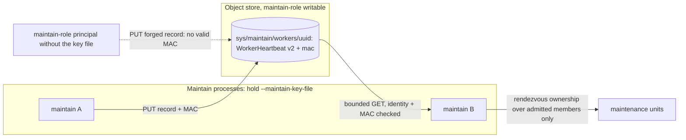

# ADR-3130: Authenticated maintain-worker registry records

Status: Accepted (2026-10-21). Applies the ADR-1918 decision to the
maintain-worker registry of ADR-0065, and amends ADR-0065 decision 1 (the
heartbeat payload and the live-set admission rule). Changes the frozen `WorkerHeartbeat`
message in `proto/ravel/sys.proto` (additive field, `format_version` 1 to 2).
Issue #3130, epic #1918.

## Context

Every `--mode maintain` process writes a `WorkerHeartbeat` protobuf to
`sys/maintain/workers/<process_id>` every H (60 s) with `PutMode::Overwrite`
(`crates/ravel-fleet/src/worker_set.rs`). The live set built from those
records decides, by rendezvous hash, which process owns each maintenance unit:
per-shard retention and compaction, sweeps, subject erasure, query-audit and
alert retention, scrub rotation, the catalog fold, and the query-worker reap
(`services/ravel-server/src/maintain.rs`, `owns_unit`; `scrub.rs`; `fold.rs`).
Two readers build it: the maintain heartbeat task and scrub, each with its own
LIST and GETs.

The record carries no MAC, and `deploy/iam/maintain.json` grants the maintain
role `s3:PutObject` on `sys/maintain/*` (statement `MaintainWrite`) and
`s3:DeleteObject` on `sys/maintain/workers/*`. Any principal holding that role
can write a fresh record and join the live set. The reader also never checks
the body's `process_id` against the key (`sys.proto` says "the reader takes
identity from the key").

The effect is starvation, not a crash. ADR-0065 rejected per-unit leases on
purpose (`docs/adrs/0065-leased-distributed-maintenance.md`): a unit is taken
over only when its owner's heartbeat goes stale. A forged member that keeps its
stamp fresh owns its units, and nobody does that work: retention, compaction,
erasure, the fold. `ravel_maintain_units_stalled` counts only units a real
process owns and fails, so a phantom owner never shows up there. The only sign
is an inflated `ravel_maintain_workers_live`. Tenant hashes are listable under
`t/`, so a forger can try UUIDs offline until one wins chosen units. A single
real maintain process is exposed the same way: the phantom takes units away
from it.

Unlike the query tier, a maintain process holds no cluster key that fits.
`Cli::validate` refuses `--fragment-key-file` and `--sql-ticket-key-file`
outside query mode (`services/ravel-server/src/config.rs`). The deployment key
(`--tenant-hash-key-file`) is accepted in every mode, but it is absent on an
unkeyed bucket, which is the operator default without
`deploymentKeySecretRef`, and its fingerprint is pinned in `sys/tenancy`, so it
can never rotate. The operator generates no Secrets: every key is a
user-supplied Secret ref, because its RBAC grants Secrets `get` only.

Two constraints differ from ADR-1918:

- The record is protobuf in the frozen `sys.proto`, classified
  `("WorkerHeartbeat", Immutable(&[1]))` in
  `crates/ravel-catalog/tests/sys_proto_format_version_classification.rs`.
  Adding a field goes through the format-change procedure.
- `WorkerSet` is built in every mode, because its `process_id` also names the
  SQL spill root (`services/ravel-server/src/lib.rs`). A key required by the
  `WorkerSet` constructor would force gateway and query processes to hold a
  maintain key they never use.

## Decision

1. **A maintain key file.** New flag `--maintain-key-file`, in the format of
   `--fragment-key-file`: one 64-hex-character key per line, the first key
   mints and any key verifies, parsed by the same `parse_fragment_keys`.
   `Cli::validate` requires it with `--mode maintain` and refuses it in every
   other mode, since no other mode reads the registry. That includes
   `--mode all`: it keeps a solo live set for its whole life
   (`services/ravel-server/src/lib.rs`, the `Mode::All` branch) and spawns
   neither the maintain heartbeat task nor scrub, so it never writes or reads
   a registry record. Every maintain process in a cluster reads the same file.

   Rotation takes three steps. A one-step swap to a file holding only the new key
   splits the live set for the length of the rollout: old-key pods reject
   new-key MACs and the reverse, and each side owns units the other also owns.
   So: (1) append the new key after the old one everywhere and roll the pods;
   (2) move the new key to the first line (the minting key) and roll again;
   (3) remove the old key and roll a third time. Step 3 must wait until step 2
   has finished on every pod. It can happen any time after that, but until it
   does, the old key still verifies.

2. **`WorkerHeartbeat` gains `bytes mac = 5`, and `format_version` moves to
   2.** The MAC is `blake3::keyed_hash(record_key, claim)`, where
   `record_key = blake3::derive_key("ravel maintain worker record v1",
   file_key)`. ADR-1918 (PR #3152) derives its query-worker record key under
   the context `"ravel query worker record v1"`, so even a deployment that
   reused one key file for both would never have a query record MAC verify as
   a maintain one. `claim` is built from field values, not
   encoded protobuf bytes, since protobuf encoding is not canonical:
   `format_version` (u32 BE), `process_id` (u64 BE length prefix, then the
   bytes), `started_unix_ns` (i64 BE), `heartbeat_unix_ns` (i64 BE). Before v1
   there is one supported version (ADR-0027's regime), so readers accept
   exactly `{2}`. A version-1 record is rejected as `missing_mac`, not decoded
   through a dual path. Migration class C (an immutable metadata record,
   additive change). The classification table entry becomes `Immutable(&[2])`.
   `docs/catalog-and-mvcc.md` and the `WorkerHeartbeat` row of ADR-0066's R1
   classification table (`docs/adrs/0066-format-migration-machinery.md`,
   whose read set `{1}` would otherwise contradict this decision) are amended
   in the implementation commit, the row in place with an ADR-3130 note as the
   ADR-1746 and ADR-2135 rows there already are.

3. **Keys are required where membership happens, not where identity is
   made.** `WorkerSet::new` keeps building identity in every mode. Writing a
   heartbeat and reading the live set both require a non-empty
   `MaintainRecordKeys`, either as an argument or through a membership handle
   that can only be built from one. Building one from an empty list is a typed
   error, and nothing defaults to no keys. The production maintain spawn
   (`maintain::spawn`, with its heartbeat task) and scrub pass the keys loaded
   from `--maintain-key-file`. No production code path can publish or admit an
   unsigned record.

4. **The reader verifies identity and MAC before admitting.** Both live-set
   readers, the maintain heartbeat task and scrub, run these checks in this
   order and count a record under the first one it fails, as
   `ravel_maintain_worker_record_rejects_total{reason}`:
   - The key is this process's own: skipped, not counted (the reader always
     includes its own record).
   - The key does not parse as a UUID: skipped, not counted.
   - The object's LIST mtime is outside the liveness window: skipped before
     the GET, not counted. A dead worker leaves such a record in normal
     operation.
   - The record GET is a range read of 4096 + 1 bytes. A response longer than
     4096 bytes is `oversize`, rejected without being decoded.
   - The body does not decode, or its `process_id` does not equal the key's
     UUID: `malformed`. A garbage overwrite lands here.
   - `format_version` is not 2, or the `mac` field is empty: `missing_mac`.
     A version-1 record from an older process lands here. A MAC that is not
     32 bytes, or verifies under none of the reader's keys (compared in
     constant time): `bad_mac`.
   - The MAC verifies but `heartbeat_unix_ns` is outside the liveness window:
     `stale_stamp`. The object's mtime was fresh and a live process stamps
     every write with its current clock, so this is a replayed older record
     or a clock skewed past the window. The maintain registry has no drained
     stamp, so nothing is exempt here.

   These are the reasons and the order ADR-1918 decision 4 uses for the query
   registry, restated so this ADR stands on its own. A rejected record is
   skipped. A transport error on a GET keeps each reader's behaviour today:
   the heartbeat task fails the read and keeps its last live set, and scrub
   falls back to the solo live set for that cycle. The counters are
   per-reason `AtomicU64`s in a handle owned in `ravel-fleet`, snapshotted by
   the server and rendered from zero on the maintain process's /metrics, and
   the family is added to `docs/guides/observability.md`.

5. **The operator renders the mount from a required Secret ref.** The
   `RavelCluster` CRD gains `spec.maintain.keySecretRef` (a `LocalSecretRef`
   holding the key file under `keys`, like `fragmentKeySecretRef`). The
   maintain Deployment mounts it, passes `--maintain-key-file`, and includes
   the Secret's resourceVersion in its pod-template checksum, so a rotation
   rolls the pods. A cluster with `spec.maintain.enabled` (the default) and no
   `keySecretRef` withholds the maintain Deployment only. The render error is
   captured, as `distributed_query_render_error` is for a missing
   distributed-query Secret ref (`services/ravel-operator/src/reconcile.rs`),
   and it ends at a `Degraded` condition naming the field. The error is not
   propagated out of `desired_objects`: every existing cluster hits this path
   on upgrade, and the gateway and query tiers must keep reconciling until
   the Secret exists. No pod is rendered with a flag set that fails
   `Cli::validate`. The operator still
   generates no Secrets. `deploy/docker-compose` needs no key file: its only
   ravel-server runs `--mode all`.

6. **Land as one pull request.** The server half makes the flag mandatory, and
   the operator half renders it. Landed apart, either an operator-managed
   maintain tier refuses to start, or the operator renders a flag the server
   rejects. The two tasks are stacked and merged together.

## Rejected alternatives

- **Derive the record key from the deployment key.** Unkeyed buckets, the
  operator default and docker-compose, have no deployment key, so those
  clusters would get no protection. The key's fingerprint is pinned in
  `sys/tenancy`, so it can never rotate, and a leaked key would stay valid for
  the life of the bucket. It is also held by every tier and by the operator,
  which widens the set of holders for no benefit.
- **Reuse the fragment key file.** It is query-tier material, and maintain mode
  refuses it on purpose. Mounting it on maintain pods would hand them the key
  that mints query capabilities, which maintain processes have no other reason
  to hold.
- **Narrow the IAM grant.** S3 cannot scope a PUT to the writer's own UUID,
  the same reason as in ADR-1918.
- **Operator-generated key Secret.** This would need Secrets `create`/`patch`,
  and issue #126's `get`-only posture refuses that on purpose.
- **Put the MAC in a sibling object.** Two objects cannot be written
  atomically. A reader would see a record without its MAC, or a MAC without
  its record, on every heartbeat race, and would have to treat that as
  rejected.
- **Add the field without bumping `format_version`.** The classification test
  and the single-version regime both require the bump. The bump also makes an
  old reader skip a new record under its existing `format_version > 1` guard,
  instead of decoding it and ignoring the MAC.
- **A per-unit work lease, so a phantom owner's units are taken over.**
  ADR-0065 rejected this because a live but wedged worker starves its own
  units under any lease that a fresh heartbeat renews. Authenticating
  membership removes the phantom without reopening that decision.

## Consequences

- A principal holding maintain-role S3 write but not the key file can no
  longer add a member to the maintain live set. This closes the starvation
  path in Context.
- **Eviction remains, and it is cheaper than on the query tier.** The maintain
  role can overwrite or delete a legitimate member's record. Other members
  then drop it and take over its units. The evicted process still counts
  itself as a member, so it keeps working its own units too. The result is
  duplicated, idempotent work (ADR-0065's stated failure mode), not lost work.
- Every maintain deployment must provision a key file. Under the operator,
  that means creating a Secret and naming it in `spec.maintain.keySecretRef`;
  a cluster with the maintain tier enabled and no ref is refused with a status
  condition. There is no
  default key, because a key shipped with the code authenticates nothing.
- During a rolling deploy, old processes skip version-2 records (their
  `format_version > 1` guard) and new processes reject version-1 records. Each
  side sees a partial live set and may own units the other side also owns, so
  work is duplicated, idempotently, until the rollout completes.
- `sys/maintain/memo/<process_id>` sits under the same `sys/maintain/*`
  PutObject grant. A forged memo snapshot seeds verdicts for owned units
  (`seed_memo_from_snapshots`). It is the same class of exposure on a
  different record, and it is filed as its own issue (#3155) rather than folded in
  here.
- Docs updated with the implementation: `docs/catalog-and-mvcc.md` (the
  heartbeat record), the `WorkerHeartbeat` row of ADR-0066's R1 table (read
  set `{2}`), an inline pointer to this ADR in ADR-0065 decision 1 at its
  payload and admission rule (the precedent is ADR-0065's existing pointers
  to ADR-1693), `docs/reference/ravel-server-flags.md` (regenerated),
  `docs/guides/kubernetes.md`, `docs/guides/operations/deployment.md` (with
  the three-step rotation from decision 1), `docs/guides/observability.md`,
  the doc comments in `worker_set.rs` that call the key "self-owned" or
  "single writer per key", and the ADR index.
