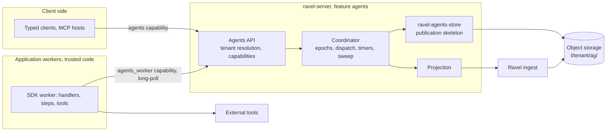

# ADR-3331: Ravel Agents, a durable agent runtime on object storage

Status: Proposed (2026-10-27). Adds a new persistent namespace
(`t/<tenant_hash>/ag/`), a new protobuf file (`proto/ravel/agents.proto`),
and a new cargo feature (`agents`) on `ravel-server`. Changes no existing
persistent format, no commit-token meaning, and no telemetry contract. The
one existing rule it tightens: `ag` becomes a reserved Parquet table name
(decision 2). Amends ADR-1374 (decisions D2 and D7: a write profile for MCP
tools; D9: the MCP guide's path) and ADR-0068 (a second simulation driver
family). Epic #3331.

Source documents: `ravel-agents-implementation-plan.md` and
`ravel-agents-claude-prompt.md` (26 October 2026). Their baseline was
0473fbf2; this ADR is written against bbf69ed7 (`origin/main` on
2026-10-27), and every file reference below is to that tree.

## Context

A developer who builds an application on Ravel has nowhere to keep an
agent's working state. Ravel stores telemetry: immutable data objects,
create-if-absent commit records, a per-tenant catalog HEAD advanced by
conditional writes (`docs/architecture.md`, `docs/catalog-and-mvcc.md`).
The SQL surface is analytical. None of that gives an agent a stable
identity, a mailbox, durable state, durable tool calls or timers, and
reconstructing ownership or completion from analytical queries would be
wrong by design (`docs/consistency-model.md`: a commit token is a
read-your-write token for one signal, not a transaction).

The pieces that a durable runtime needs already exist as contracts and
seams:

- `ravel-object-store` exposes `PutMode::CreateIfAbsent` and
  `PutMode::CasVersion(Version)`, returns the opaque `Version` from every
  GET (`GetOutcome.version`, `crates/ravel-object-store/src/lib.rs:173-180`),
  and maps conditional failures to `AlreadyExists` and `PreconditionFailed`
  (`lib.rs:688-693`). `ravel-fleet` already does GET-then-CAS in production
  (`crates/ravel-fleet/src/claim.rs:509-518`).
- `FaultStore::DuplicateDelivery` applies a conditional put and then
  reports a lost acknowledgement (`crates/ravel-object-store/src/fault.rs:864-866`),
  and the shared TLA+ store module has `PutCasVersionLostResponse`
  (`formal/tla/common/RavelObjectStore.tla:196-199`). "Write applied,
  response lost" is already representable in tests and models.
- `ravel-sim` provides seeded clocks, seeded identities, gate scripts and
  a reproducibility digest (ADR-0068), and `ravel_commit::rng::RngSource`
  is the one blessed identity seam.
- The TLA+ suite has per-area discovery, negative controls, reachability
  probes, measured bands and a traceability check (`scripts/check-tla.sh`,
  ADR-1113).
- `ravel-server` has a feature-plus-runtime-flag pattern for opt-in
  surfaces (`mcp`: `services/ravel-server/src/config.rs:3250-3262`,
  `lib.rs:3713-3719`), per-tenant KMS routing by key prefix
  (`crates/ravel-object-store/src/kms_routing.rs:112-140`), typed budgets,
  and an MCP tool catalog (`crates/ravel-mcp`).

Three things the plan assumed do not exist and must be decided here: a
canonical key-encoding scheme for user-supplied names (there is only the
`is_addressable_key` validator, `lib.rs:398-431`), resource scopes on
principals (there are two booleans, `ddl` and `ipcrypt`,
`crates/ravel-tenant-resolve/src/lib.rs:54-58`), and any Node toolchain
(no `package.json`, lockfile or Node version policy anywhere in the tree).
Two facts shape the protocol more than the plan expected: on S3 the CAS
`Version` is the ETag, which is a content hash
(`crates/ravel-object-store/src/s3.rs:1945-1952`), so two identical HEAD
writes get the same token; and the `agents` word already names the MCP
guide (`docs/guides/agents.md`, `README.md:360`).

## Decision

### 1. Product name, crates and feature gate

The product is **Ravel Agents**. The existing MCP guide moves from
`docs/guides/agents.md` to `docs/guides/mcp-server.md` and its README
heading becomes "MCP server for AI agents", so the two surfaces do not
share a page name. The move updates every link to the old path:
`README.md:363`, `docs/README.md:66`, `docs/reference/mcp.md:15` and `:82`,
`docs/adrs/1374-agent-mcp-server.md:530` (an amendment to ADR-1374 D9,
which names that path as the MCP documentation) and
`docs/adrs/1658-documentation-claims-registry.md:18` and `:176`.
`scripts/check_docs.py` resolves relative links, so a missed one fails the
doc gate. The MCP tools stay under the `mcp` feature; the new runtime is
the `agents` feature.

New workspace crates, each pinned by path and version in
`[workspace.dependencies]`:

| Crate | Contents | Ships |
|---|---|---|
| `ravel-agents-core` | Agent identity and key builders, canonical hashing, protobuf codecs for `agents.proto`, the HEAD record model, typed commands and errors, and the pure transition kernel | yes |
| `ravel-agents-store` | The publication skeleton over `ObjectStoreBackend`: read HEAD, resolve an operation id, store dependencies, CAS, receipts, bounded indexes, logical quotas, per-phase request counters | yes |
| `ravel-agents-runtime` | Coordinator: activation and ownership epochs, worker protocol types, FIFO turn dispatch, step and effect journal, timers, wake hints, the authoritative reconciliation sweep, unloading, and the history projection | yes |
| `ravel-agents-client` | Rust client over HTTP: create, send, call, result, resolve, cancel, state, events | yes |
| `ravel-agents-sim` | Dev-only: the independent sequential reference machine, the multi-worker step scheduler, deterministic drivers over `ravel-sim` seams, the nightly seed batch example | never a dependency of a shipping crate |

Server integration lives in `services/ravel-server/src/agents/` behind
`#[cfg(feature = "agents")]`. The TypeScript SDK lives in `sdk/typescript/`.
Four crates instead of the plan's three because the Rust client must not
pull the runtime, and the simulation crate must stay out of every shipping
dependency graph (ADR-0068's dev-only rule, which cargo does not enforce).

### 2. Namespace and key layout

All agent objects live under the tenant prefix, so per-tenant KMS routing
and the tenant IAM scope apply without new machinery:

| Key | Mutability | Write mode |
|---|---|---|
| `t/<tenant_hash>/ag/<agent_id>/head` | the one mutable record per agent | `CreateIfAbsent` once, then `CasVersion` |
| `t/<tenant_hash>/ag/<agent_id>/o/<object_hash>` | immutable: payloads, state snapshots, index pages, step transcripts, history pages | `CreateIfAbsent`; on `AlreadyExists` the writer reads back and compares the content hash |
| `t/<tenant_hash>/ag/_wake/<due_bucket>/<agent_id>` | advisory wake hint; may be absent, duplicated, stale, or early | `Overwrite`; deleted after the authoritative root no longer needs it |
| `t/<tenant_hash>/ag/_dir/<agent_id>` | advisory listing entry for bounded pagination | `CreateIfAbsent` |

`agent_id` is `hex(blake3("ravel-agent-v1" || len(kind) || kind || len(key) || key)[..16])`,
built with the length-prefixed scheme of `SeriesId::compute`
(`crates/ravel-types/src/lib.rs:425-470`). The raw `kind` and `key` are
stored in HEAD. Hashing rather than a restricted charset means any UTF-8
key is accepted, no user input reaches an object path, and the agent set
is not enumerable from the key alone. `object_hash` is the blake3-256 of
the object bytes, so a retried upload is idempotent by construction. Every
key the crate builds is checked with `is_addressable_key` before any store
call and a failure is a typed `KeyError`.

The segment `ag` joins `IAM_GRANT_SEGMENTS` in
`crates/ravel-pqtable/src/names.rs`. That retroactively refuses a Parquet
table named `ag`, which `validate_table` accepts today; an existing table of
that name stops resolving and its manifests classify as
`StrayClass::ReservedName` through the existing repair path
(`crates/ravel-pqtable/src/repair.rs:380-416`), which is the migration.
The segment gets explicit rows in every
`deploy/iam/*.json` template (the gateway and query roles may GET, PUT and
list under `t/*/ag/*`; the maintain role may only list and GET), and gets
its rows in the `docs/catalog-and-mvcc.md` key table. The telemetry sweep
rules enumerate fixed signal prefixes and never touch `ag/`; this ADR adds
no sweep. Live garbage collection of agent objects is out of scope for
this release and stays disabled.

### 3. The HEAD record

`proto/ravel/agents.proto` (new file, registered in
`crates/ravel-proto/build.rs`) defines `AgentHead` with
`uint32 format_version = 1` first. `AgentHead` is a CAS-mutable record in
ADR-0066's vocabulary: it is read, modified and written back under CAS, so
every additive field change to it bumps `format_version` (ADR-0066
amendment R1). The classification test in
`crates/ravel-catalog/tests/sys_proto_format_version_classification.rs`
widens its scope to this file and stays in `ravel-catalog`; the agents gate
lane in decision 14 therefore names `-p ravel-catalog` so the row is checked
in scope, not only at merge. Format version 1 is the only supported version
until milestone 6; a HEAD with a newer version is a typed
`UnsupportedFormat` state that is read but never CAS-written.

HEAD carries, as fields or as references to immutable index pages:

- tenant hash, kind, key, `incarnation`, `root_revision`;
- `owner_id`, `epoch`, owner lease hint (advisory);
- `state_version`, state object reference and size;
- inbox page reference, `next_accept_seq`, receipt index page reference;
- active turn: input id, turn id, base state version, handler version
  and digest, cancellation state;
- step transcript reference, effect journal reference, outbox reference;
- timer table reference and timer generation counter;
- result index reference, committed event page reference and event seq;
- lifecycle status (`active`, `tombstoned`), logical quota counters
  (referenced bytes, mailbox depth, receipt count, timer count).

`root_revision` increases by one on every successful CAS and
`incarnation` increases on every recreate after a tombstone, so canonical
HEAD bytes never repeat and the S3 ETag token cannot alias two states. A
HEAD is never deleted. `destroy` sets `tombstoned`; `create` on a
tombstoned agent bumps the incarnation in the same HEAD, and every handle
(operation id, effect id, step id, timer id) carries the incarnation it was
minted under, so a stale handle is refused by a typed `AgentGone`.

HEAD is written with a CRC32C upload checksum as the catalog fold does.
HEAD bytes are capped at 256 KiB and a command that would exceed the cap
fails typed (`BudgetExceeded`) before any store call. Milestone 1 uses a
bounded inline inbox and receipt list with hard caps; milestone 6 replaces
them with bounded immutable index pages so that send, receipt lookup and
wake read at most one page of history. The page references are new fields,
so milestone 6 is format version 2, rolled out readers before writers as
ADR-0066 requires: a version 1 writer that decoded a version 2 HEAD would
drop the page references on re-encode and CAS away accepted messages. A
version 1 binary refuses a version 2 HEAD as `UnsupportedFormat`; the
milestone 6 task ships the reader one release before the writer.

### 4. The publication rule

Every durable command runs the same skeleton in `ravel-agents-store`:

1. GET HEAD; keep `GetOutcome.version` as the CAS token.
2. Resolve the command's operation id against the receipt index. Same id
   and same request hash: return the recorded handle or result. Same id,
   different hash: `IdempotencyConflict`.
3. Validate preconditions against the root (incarnation, epoch, active
   turn, base state version, cancellation state, quotas).
4. Build the immutable dependencies inside the memory budget.
5. PUT each dependency with `CreateIfAbsent`; on `AlreadyExists` read back
   and compare the content hash.
6. CAS HEAD from the observed version to the new root with
   `root_revision + 1`.
7. Return success only when the CAS returned `Ok`.

`PreconditionFailed` means re-read and revalidate from step 1, up to a
bounded attempt count; the command is never replayed against a root whose
epoch, active turn or base state version differs from what it validated.
A `Transient`, `Timeout` or `Throttled` error after the CAS is an unknown
outcome: the caller re-reads HEAD and resolves its own operation id
through the receipt index, which survives later root revisions. While the
store stays unavailable the API returns `OutcomeUnknown` with the operation
handle, never a manufactured success and never a fresh id.

The store crate counts GET, PUT, CAS, LIST and conflict per phase
(resolve, build, store, publish) in its own counters; `InstrumentedStore`
bills a conditional put as a plain put and this ADR does not change it.

### 5. Messages, ordering and operation states

A request id is supplied by the client or generated by the SDK, scoped to
tenant, agent incarnation and handler, and recorded with the blake3 of
the canonical handler name and payload. Enqueue is one CAS that links the
payload object, allocates `accept_seq`, and records the receipt. Turns run
one at a time per agent in `accept_seq` order. No cross-agent order or
transaction exists.

Operation states: `accepted`, `running`, `blocked`, `completed`, `failed`,
`cancelled`. A client wait that times out changes nothing; cancellation is
its own idempotent command. Receipts and results are retained for the
agent's lifetime in v1; there is no expiry and no eviction. An agent whose
receipt index reaches its logical cap refuses new sends with
`MailboxFull` or `BudgetExceeded` rather than dropping anything.

### 6. Ownership, turns and rebase

Activation and takeover are a CAS that increments `epoch` and sets
`owner_id` in HEAD. Every owner-constrained worker command carries tenant,
incarnation, owner id, epoch, turn id and base state version, and the
coordinator validates them at publication against the HEAD it is about
to CAS. Heartbeats, placement and expiry choose when a takeover is
attempted; only the epoch advance revokes. A worker that was paused past
its lease can still run its handler; it cannot commit.

Starting a turn durably binds one accepted input to a turn id, the base
state version and the handler version and digest. The final turn CAS
publishes the new state version and reference, the consumed input and its
result, buffered events, timer changes and newly committed effect intents
together. A completion that loses the CAS to a concurrent enqueue re-reads
and rebases: if epoch, active turn, handler version and base state version
still match, it reapplies its transition on the new root and preserves the
newly accepted inputs; otherwise it fails typed (`OwnershipLost` or
`IncompatibleHandler`). A terminal handler failure consumes the input with
a failure result and unchanged state under the handler's retry policy
(bounded attempts, then dead-letter). A crash is not a terminal failure;
the same turn resumes under the next owner.

### 7. Durable steps and tools

Two layers: a pure transition kernel in `ravel-agents-core` (used by the
protocol, the TLA+ traceability rows and the reference-machine tests), and
an async handler runner in each SDK built on durable steps.

A step id is derived from incarnation, turn id and step key. The journal
records tool name, tool version, canonical input hash and, on completion,
the result object and its hash. A completed step replays from its record;
a step key reused with a different tool identity or input hash fails
`NonDeterministicReplay` and blocks the turn. Steps are sequential in
this release; a second concurrent `ctx.step` is refused by the SDK with a
typed error. The runner provides recorded time and seeded random values
through the context; the SDK does not claim to make arbitrary handler
code deterministic.

Every external effect has a committed intent, then a committed attempt
authorization, before the tool runs. Each tool declares one recovery
policy:

| Policy | After an ambiguous attempt |
|---|---|
| `provider_idempotency` | Re-dispatch with the same effect id and exact input; only valid when the adapter documents the provider's deduplication scope and lifetime |
| `at_least_once` | Re-dispatch; duplicate execution and billing are possible and documented |
| `manual` | No automatic re-dispatch. The effect enters `EffectInDoubt` until an authenticated reconciliation attaches a verified result or authorizes another attempt |

A result-completion endpoint accepts an authenticated result for a
previously authorized attempt, after the original worker died too. It
records only that effect's result; the current owner still commits the
turn. A late result after cancellation or takeover is retained as
evidence and does not resurrect work. Two different final results for one
attempt are a typed conflict. Reconciliation commands are idempotent,
require the `agents_admin` capability, and write an audit record; they
never rewrite history.

### 8. Timers, hints and the sweep

A timer has a stable id and a generation in HEAD. Firing is one CAS that
marks the generation delivered and enqueues the timer message; a stale
hint for a delivered or cancelled generation enqueues nothing, and a
cancellation that arrives after the firing CAS returns `AlreadyFired`.

Wake hints under `_wake/` are accelerators only. The coordinator runs a
fair, bounded-per-pass reconciliation sweep over `t/<tenant_hash>/ag/`
for every admitted tenant that lists HEADs and acts on any accepted
work, due timer or active turn the hints missed. The sweep's LIST and GET
counts per pass are metrics and a milestone 6 benchmark. Safety never
depends on clocks; timer accuracy and takeover speed do, and the guide
states the assumption (monotonic local clocks, bounded skew between
coordinators).

### 9. Server integration and authorization

- Cargo feature `agents` on `ravel-server`, off by default, with the
  three runtime crates as optional version-pinned path dependencies.
- Runtime flag `--agents`, declared in every build; a build without the
  feature refuses it at `Cli::validate` instead of ignoring it. Valid only
  under `--mode all` and `--mode query`; mounted on both the public and
  the mTLS router inside the query block, like `--mcp`. A dedicated agents
  process is a query-mode process with `--agents` and no query traffic;
  a `Mode::Agents` is deferred.
- Two new capabilities on `Principal`: `agents` (client operations) and
  `agents_worker` (worker registration, turn commits, effect completion),
  plus `agents_admin` (reconciliation), each granted by the static token
  suffix and an OIDC claim flag through the existing chain
  (`crates/ravel-tenant-resolve/src/lib.rs:54-134`,
  `services/ravel-server/src/tenant.rs:124-200`). Tenant resolution runs
  on the transport before any store read.
- Budgets, each a flag, a `ServerConfig` field, a `MetricsState` field
  and a render family: activation concurrency, long-poll concurrency,
  an agents memory reservation taken from `ravel_memory::MemoryBudget`,
  and per-tenant logical quotas (agents, mailbox depth, state bytes,
  receipt count, timer count) enforced inside `ravel-agents-store`.
  Telemetry ingest and query budgets are not charged.
- Worker transport: HTTP long-poll with an explicit deadline capped at
  20 s (under the 25 s shutdown drain), its own body limit, and its own
  admission; it never takes a query permit.
- Routes under `/api/v1/agents/...`: create, send, call, operation,
  result, resolve, cancel, state, events (bounded pages with a durable
  cursor), timers, effects, reconcile, worker poll, worker commit, effect
  complete, plus `GET /api/v1/agents/inspector`, a single embedded page
  served under the feature.
- Health: the coordinator contributes readiness through the
  `IngestHealth` seam; `/metrics` gains one `render_agents_families`
  call fed by a snapshot struct owned by the runtime crate, so later
  families never touch `metrics.rs` again.
- Published image: source-only until milestone 6, when the feature joins
  the Dockerfile list and the README support matrix row flips.

The worker is a trusted process. An agent identity is not a security
boundary for hostile code; the tool-runner seam in the SDK is where a
sandbox integration would attach later.

### 10. MCP tools

Six tools join a second catalog, `agents_tool_catalog()` in
`crates/ravel-mcp`, merged into `tools/list` only when the server is
built with both `mcp` and `agents` and run with both flags:
`ravel_agent_describe`, `ravel_agent_send`, `ravel_agent_operation`,
`ravel_agent_state`, `ravel_agent_events`, `ravel_agent_blocked_effects`.
`send` is the first mutating tool; it is annotated `readOnlyHint: false`,
requires the `agents` capability on the resolved principal, and takes an
idempotency key. This amends ADR-1374 D2 (read-only catalog) and D7
(write profile needs a principal model): the capability is that model.
The `mcp` feature gains the gates and CI lane it lacks (#2502) in the
same epic, because the agents tools cannot be gated by a lane that does
not exist. The combined `tools/list` must stay under the existing
24,576-byte budget; the task that adds the catalog measures it.

### 11. Developer experience

- `ravel-cli agents`: `dev` (starts the RustFS compose stack if not
  healthy, waits for the bucket, runs `store qualify`, starts the server
  with `--agents` and a dev token, prints the scaffold command), `scaffold`,
  `list`, `inspect`, `operation`, `events`, `effects`, `reconcile`. Read
  commands read the store directly like every other `ravel-cli` command;
  commands that need a running server use `ravel-agents-client`, which
  brings `reqwest` to `ravel-cli` as a new direct dependency. Every
  command has `--json`. The dev command refuses to run on the memory
  store.
- TypeScript SDK in `sdk/typescript/`: one npm workspace,
  `@ravel/agents` with `client`, `worker`, `tools` and `testing` entry
  points; the client entry has no server-only imports, enforced by a
  bundle test. Node 22 pinned by `.node-version` and `setup-node` at a
  commit SHA; `package-lock.json` checked in; `npm ci`, typecheck, lint,
  unit tests and a compile-time negative-test suite run in a `sdk` CI
  job gated on an `sdk_area` output of the `changes` job. The package is
  never published by this epic.
- Wire compatibility: the Rust side writes golden JSON fixtures for
  every protocol message into `sdk/fixtures/` from a Rust test, and the
  TypeScript suite decodes and re-encodes them; neither runtime spawns
  the other.
- Scaffold: one agent, one deterministic local tool fixture, generated
  client types, and tests; no paid API key. `demo/agents-kill-and-recover.sh`
  sends a message, kills the worker inside a step, restarts it, and
  asserts the same operation recovers (`at_least_once`) or blocks
  (`manual`), following `demo/kill-and-recover.sh`.
- Typed errors on every surface: `AgentGone`, `IdempotencyConflict`,
  `OutcomeUnknown`, `OwnershipLost`, `IncompatibleHandler`,
  `NonDeterministicReplay`, `EffectInDoubt`, `MailboxFull`,
  `BudgetExceeded`, `StoreUnavailable`, `UnsupportedFormat`, each carrying
  the safe ids and a retry hint.

### 12. Projection into Ravel

Committed history projects asynchronously into logs and traces with a
stable event id (`agent_id`, incarnation, event seq), the turn, message
and effect ids, state version, handler version and trace context.
Payloads are redacted by default. In a process that holds an ingest
buffer the projector writes through `LogIngestRouter` and
`SpanIngestRouter`; in `--mode query` it needs `--agents-projection-endpoint`
naming a gateway, and `--agents-projection off` is the only other
accepted value, so projection is never silently absent. Delivery may
duplicate; the stable event id is the deduplication key for queries, and
the guide says so. Projection lag is a metric. A projection failure
never changes a committed transition, and the canonical history stays in
the agent store for re-projection.

### 13. Verification

**TLA+ area `formal/tla/agents/`** with three MC modules:
`MCAgentProtocol` (enqueue, identities, root publication, takeover, turn
completion, cancellation, timer delivery), `MCAgentEffects` (active turn,
step intent, attempt authorization, external execution with response
loss, result publication, replay, manual resolution) and
`MCAgentIntegrated` (takeover, enqueue, one tool step, final completion,
a timer and cancellation race). Each instantiates
`common/RavelObjectStore.tla` unchanged; the external provider is modelled
inside `AgentEffects`. Every read, immutable write, HEAD CAS, acknowledge,
crash, recovery, discovery, external execution, response loss and result
record is its own action.

Properties checked: `AcceptedImpliesRecoverable`,
`PublishedReferencesComplete`, `RequestIdentityStable`,
`OneLogicalCompletion`, `TurnCommitAtomic`, `NoStaleOwnerCommit`,
`NoLostConcurrentEnqueue`, `MonotonicIdentity`,
`StepTranscriptCompatible`, `DispatchRequiresCommittedAuthorization`,
`PolicyControlsRedispatch`, `TimerGenerationDeliveredOnce`,
`CancellationRespected`, `TenantIncarnationIsolation`. Liveness is
conditional on eventual store availability, a surviving compatible worker,
fair discovery and fairly served contention, with `EffectInDoubt` a valid
blocked terminal. Invariants read the modelled store or recorded witnesses.

Negative controls, one switch each with an `.expect`: early ack, HEAD
before dependency, stale-root overwrite, epoch checked outside the CAS,
cursor advanced without result, request-id hash mismatch, receipt
discarded, dispatch before intent, ambiguous manual attempt retried, stale
timer generation fired, early wake hint forgotten, step input drift.
Reachability probes are negative-lane `*-reachable.cfg` configs in the
suite's vocabulary (must-violate, exit 12): crash, lost response,
takeover, competing senders, duplicate physical execution under
`at_least_once`, blocked effect.

Budgets: exhaustive `budget_s` 3000, 3000 and 3000. The bound is the
160-minute per-area job in `tla-nightly.yml`, and `scripts/check-tla.test.sh`
asserts at least 600 s of headroom under it, so 9000 s is the largest sum
an area may carry today and this area sits exactly on it, as the
maintenance area does; any later increase raises the workflow ceiling in
the same change. Smoke configs land with the specs;
`live` and `positive` configs land unbanded and a measurement task writes
`bands.tsv` and `results.md` from a real run. `traceability.md` lands in
the same wave as the kernel symbols it names; rows for not-yet-built code
sit under a design heading as prose. The area joins the `ci.yml` TLA
matrix and `EXPECTED` string, `tla-nightly.yml`, and the `formal_area`
path regex gains `crates/ravel-agents-`.

**Simulation** in `ravel-agents-sim`: the production store and runtime
crates driven over `MemoryStore`, `FaultStore` (`DuplicateDelivery` for
applied-and-lost conditional writes, `FailedConditionalWrite` for
rejected ones), seeded clocks and `RngSource`. A deterministic step
scheduler runs several worker tasks on the current-thread runtime and
releases their gated store calls in a scripted order; a worker crash is
an aborted task at a gate. Client-visible histories are checked against
an independent sequential reference machine that is not the kernel.
Every failure prints the seed and the schedule; minimized failures become
named regression tests. The schedules required by the plan (competing
senders, lost CAS followed by later revisions, death at every boundary,
suspended worker after takeover, completion racing enqueue and
cancellation, tool loss under every policy, late results, timer races and
bad hints, cold restart, corrupt dependency, unsupported format, tenant
mismatch, hostile keys, quotas, handler change, recovery storm beside
telemetry traffic) are the acceptance tests of milestones 1 to 4.

**Real backend**: the RustFS compose store runs the conditional-outcome
and worker-replacement tests in the k8s-nightly chaos lane; a CAS against
an absent key on S3 and RustFS is pinned there, since today only
`MemoryStore` pins it.

### 14. Gates and CI

`scripts/gates.sh` gains `want_agents` (clippy and tests for
`-p ravel-server --features agents`, tests selected by name because the
new flags change `cli_reference`, plus `-p ravel-catalog` for the
classification test) and `want_mcp`, mirrored in
`scripts/affected-tests.sh` and `scripts/gates.test.sh`. `ci.yml` gains a
`features-agents` job, a `features-mcp` job, lint clippy steps, `changes`
outputs for `agents_area` and `sdk_area`, and the `sdk` job. The epic asks
the owner to add `features-agents` and `sdk` to the protected-branch
required checks at approval time; until then they are advisory.

### 15. Milestones

| Milestone | Delivers | Exit |
|---|---|---|
| 0 Contracts | this ADR, `agents.proto`, key module, crate skeletons, gate and CI lanes, docs skeleton, TLA smoke specs | lanes green on main |
| 1 Durable kernel | create, send, read, resolve, pure turn commit, receipts, quotas, inline indexes, kernel and store sim tests, traceability rows | a killed worker is replaced without losing an accepted message or duplicating a result |
| 2 Runtime and SDK | worker protocol, epochs, FIFO dispatch, unloading, TypeScript schemas, client, worker and test harness, typed example | an SDK example survives competing sends and takeover; stale commands are refused at publication |
| 3 Steps and tools | pinned handlers, step journal, intents, attempts, policies, completion endpoint, cancellation | response-loss tests pass under every policy; manual tools block visibly |
| 4 Timers and discovery | timer generations, atomic firing, hints, sweep, liveness tests, TLA effects and integrated models | fire and cancel races and bad hints covered by models and tests |
| 5 Developer experience | dev and scaffold commands, inspector page, CLI, event resume, MCP tools, Rust client, projection | the kill-and-recover walkthrough runs from a clean checkout with no API key |
| 6 Release hardening | paged indexes, bounded cold wake, resource isolation, migration refusal tests, benchmarks with pre-registered bands, operator guide, image flip | the feature matrix matches executable tests; no unbounded root or history load |

Benchmarks report GET, PUT, CAS, LIST, bytes and conflicts per accepted
message, turn, step and activation, cold and warm, for one hot agent, many
agents, a dormant population, index growth, a recovery storm, a slow
store, and the feature disabled. Price inputs are labelled assumptions.

## Rejected alternatives

- **Telemetry catalog as the transaction manager.** The catalog HEAD is
  per tenant and per signal and folds on a schedule; an agent needs a
  record of its own that commits in one CAS. Lost: the plan forbids it
  and the fold cadence makes acceptance latency unbounded.
- **Delete and recreate HEAD on reset.** On S3 a recreated HEAD with the
  same bytes carries the same ETag token, so a stale worker's CAS could
  succeed against the new incarnation. Lost to the tombstone and
  incarnation rule.
- **Restricted-charset agent keys in the path.** Human-readable listings,
  but every key would be user input in an object path, and the key set
  would be enumerable. Lost to the hashed segment, which also matches how
  tenants are addressed.
- **A new `Mode::Agents`.** Clean isolation, but it touches every
  `matches!(config.mode, ...)` site in `lib.rs` and `config.rs` and the
  maintain, fold and alert spawn guards. Lost for this release; a
  query-mode process with `--agents` gives the same capacity isolation.
- **gRPC worker transport on the tonic listener.** Streams exist there,
  but the admission layer on that listener is ingest-shaped (byte budget,
  pending acks), and the SDK would need a gRPC client in both languages.
  Lost to HTTP long-poll with a deadline under the shutdown drain.
- **HEAD messages inside `sys.proto`.** `sys.proto` is a frozen contract
  and every edit to it goes through the format-change procedure; a new
  file keeps it untouched, and the classification test widens its scope
  to the new file instead.
- **Reusing the MCP cursor codec for event cursors.** It is MAC-keyed by a
  per-process secret and does not survive a restart. Lost to a durable
  cursor that is the committed event seq.
- **One crate for everything.** Fewer workspace rows, but the Rust
  client would depend on the runtime and the simulation crate could not
  stay dev-only. Lost.
- **A pnpm workspace.** Lower install time, but it adds a toolchain to
  pin and verify; npm ships with the pinned Node. Lost for the first
  release.

## Consequences

- Durability of accepted work rests on `CreateIfAbsent` and `CasVersion`
  of the qualified backend and nothing else. Every claim in the guide
  names that contract and the fault schedules it was tested under.
- Every durable command costs at least one GET and one CAS; a turn with
  one tool call costs five publications. The guide states this before any
  optimisation, and milestone 6 measures it.
- `EffectInDoubt` is a first-class state. The runtime never claims
  exactly-once external effects; it claims exactly-once logical
  completion within an incarnation.
- The epic touches hub files once each, in a fixed order: contracts and
  skeletons, then the server seam, then the crates in parallel, then the
  TLA area, then measurement, then CLI, MCP, SDK and projection.
- Out-of-scope findings from reconnaissance, reported here and not fixed:
  `--mcp` is inert in a build without the feature; the `mcp` feature has
  no test lane (#2502); ADR-1374 D9 says the image ships `mcp` and the
  Dockerfile does not; `docs/reference/mcp.md` is hand-maintained though
  ADR-1374 D9 says a drift test renders it; CLAUDE.md says `unsafe` is
  denied while `Cargo.toml` forbids it; `docs/guides/getting-started.md`
  says `make demo` builds release while the script runs debug; ADR-0066
  finding 2 about the format-change skill is stale.
