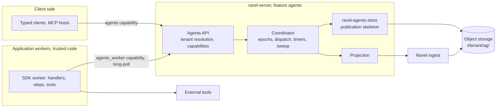
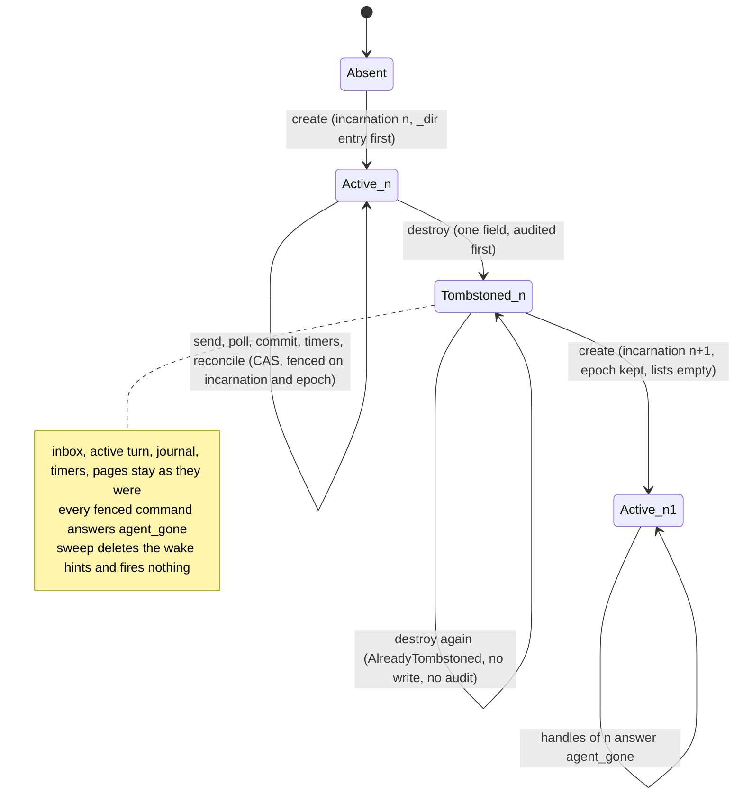
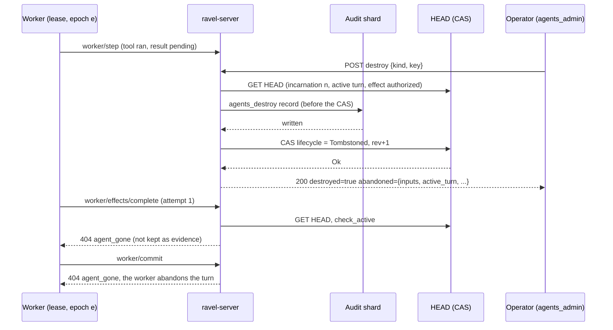

# ADR-3331: Ravel Agents, a durable agent runtime on object storage

Status: Proposed (2026-10-27). Adds a new persistent namespace
(`t/<tenant_hash>/ag/`), a new protobuf file (`proto/ravel/agents.proto`),
and a new cargo feature (`agents`) on `ravel-server`. Changes no existing
persistent format, no commit-token meaning, and no telemetry contract. The
one existing rule it tightens: `ag` becomes a reserved Parquet table name
(decision 2). Amends ADR-1374 (decisions D2 and D7: a write profile for MCP
tools; D9: the MCP guide's path) and ADR-0068 (a second simulation driver
family). Epic #3331.

Source documents: `ravel-agents-implementation-plan.md` and
`ravel-agents-claude-prompt.md` (26 October 2026). Their baseline was
0473fbf2; this ADR is written against bbf69ed7 (`origin/main` on
2026-10-27), and every file reference below is to that tree.

## Context

A developer who builds an application on Ravel has nowhere to keep an
agent's working state. Ravel stores telemetry: immutable data objects,
create-if-absent commit records, a per-tenant catalog HEAD advanced by
conditional writes (`docs/architecture.md`, `docs/catalog-and-mvcc.md`).
The SQL surface is analytical. None of that gives an agent a stable
identity, a mailbox, durable state, durable tool calls or timers, and
reconstructing ownership or completion from analytical queries would be
wrong by design (`docs/consistency-model.md`: a commit token is a
read-your-write token for one signal, not a transaction).

The pieces that a durable runtime needs already exist as contracts and
seams:

- `ravel-object-store` exposes `PutMode::CreateIfAbsent` and
  `PutMode::CasVersion(Version)`, returns the opaque `Version` from every
  GET (`GetOutcome.version`, `crates/ravel-object-store/src/lib.rs:173-180`),
  and maps conditional failures to `AlreadyExists` and `PreconditionFailed`
  (`lib.rs:688-693`). `ravel-fleet` already does GET-then-CAS in production
  (`crates/ravel-fleet/src/claim.rs:509-518`).
- `FaultStore::DuplicateDelivery` applies a conditional put and then
  reports a lost acknowledgement (`crates/ravel-object-store/src/fault.rs:864-866`),
  and the shared TLA+ store module has `PutCasVersionLostResponse`
  (`formal/tla/common/RavelObjectStore.tla:196-199`). "Write applied,
  response lost" is already representable in tests and models.
- `ravel-sim` provides seeded clocks, seeded identities, gate scripts and
  a reproducibility digest (ADR-0068), and `ravel_commit::rng::RngSource`
  is the one blessed identity seam.
- The TLA+ suite has per-area discovery, negative controls, reachability
  probes, measured bands and a traceability check (`scripts/check-tla.sh`,
  ADR-1113).
- `ravel-server` has a feature-plus-runtime-flag pattern for opt-in
  surfaces (`mcp`: `services/ravel-server/src/config.rs:3250-3262`,
  `lib.rs:3713-3719`), per-tenant KMS routing by key prefix
  (`crates/ravel-object-store/src/kms_routing.rs:112-140`), typed budgets,
  and an MCP tool catalog (`crates/ravel-mcp`).

Three things the plan assumed do not exist and must be decided here: a
canonical key-encoding scheme for user-supplied names (there is only the
`is_addressable_key` validator, `lib.rs:398-431`), resource scopes on
principals (there are two booleans, `ddl` and `ipcrypt`,
`crates/ravel-tenant-resolve/src/lib.rs:54-58`), and any Node toolchain
(no `package.json`, lockfile or Node version policy anywhere in the tree).
Two facts shape the protocol more than the plan expected: on S3 the CAS
`Version` is the ETag, which is a content hash
(`crates/ravel-object-store/src/s3.rs:1945-1952`), so two identical HEAD
writes get the same token; and the `agents` word already names the MCP
guide (`docs/guides/agents.md`, `README.md:360`).

## Decision

### 1. Product name, crates and feature gate

The product is **Ravel Agents**. The existing MCP guide moves from
`docs/guides/agents.md` to `docs/guides/mcp-server.md` and its README
heading becomes "MCP server for AI agents", so the two surfaces do not
share a page name. The move updates every link to the old path:
`README.md:363`, `docs/README.md:66`, `docs/reference/mcp.md:15` and `:82`,
`docs/adrs/1374-agent-mcp-server.md:530` (an amendment to ADR-1374 D9,
which names that path as the MCP documentation) and
`docs/adrs/1658-documentation-claims-registry.md:18` and `:176`.
`scripts/check_docs.py` resolves relative links, so a missed one fails the
doc gate. The MCP tools stay under the `mcp` feature; the new runtime is
the `agents` feature.

New workspace crates, each pinned by path and version in
`[workspace.dependencies]`:

| Crate | Contents | Ships |
|---|---|---|
| `ravel-agents-core` | Agent identity and key builders, canonical hashing, protobuf codecs for `agents.proto`, the HEAD record model, typed commands and errors, and the pure transition kernel | yes |
| `ravel-agents-store` | The publication skeleton over `ObjectStoreBackend`: read HEAD, resolve an operation id, store dependencies, CAS, receipts, bounded indexes, logical quotas, per-phase request counters | yes |
| `ravel-agents-runtime` | Coordinator: activation and ownership epochs, worker protocol types, FIFO turn dispatch, step and effect journal, timers, wake hints, the authoritative reconciliation sweep, unloading, and the history projection | yes |
| `ravel-agents-client` | Rust client over HTTP: create, send, call, result, resolve, cancel, state, events | yes |
| `ravel-agents-sim` | Dev-only: the independent sequential reference machine, the multi-worker step scheduler, deterministic drivers over `ravel-sim` seams, the nightly seed batch example | never a dependency of a shipping crate |

Server integration lives in `services/ravel-server/src/agents/` behind
`#[cfg(feature = "agents")]`. The TypeScript SDK lives in `sdk/typescript/`.
Four crates instead of the plan's three because the Rust client must not
pull the runtime, and the simulation crate must stay out of every shipping
dependency graph (ADR-0068's dev-only rule, which cargo does not enforce).

### 2. Namespace and key layout

All agent objects live under the tenant prefix, so per-tenant KMS routing
and the tenant IAM scope apply without new machinery:

| Key | Mutability | Write mode |
|---|---|---|
| `t/<tenant_hash>/ag/<agent_id>/head` | the one mutable record per agent | `CreateIfAbsent` once, then `CasVersion` |
| `t/<tenant_hash>/ag/<agent_id>/o/<object_hash>` | immutable: payloads, state snapshots, index pages, step transcripts, history pages | `CreateIfAbsent`; on `AlreadyExists` the writer reads back and compares the content hash |
| `t/<tenant_hash>/ag/_wake/<due_bucket>/<agent_id>` | advisory wake hint; may be absent, duplicated, stale, or early | `Overwrite`; deleted after the authoritative root no longer needs it |
| `t/<tenant_hash>/ag/_dir/<agent_id>` | advisory listing entry for bounded pagination | `CreateIfAbsent` |

A create writes the `_dir` entry before the HEAD write and fails when it
cannot (see the directory amendment below).

`agent_id` is `hex(blake3("ravel-agent-v1" || len(kind) || kind || len(key) || key)[..16])`,
built with the length-prefixed scheme of `SeriesId::compute`
(`crates/ravel-types/src/lib.rs:425-470`). The raw `kind` and `key` are
stored in HEAD. Hashing rather than a restricted charset means any UTF-8
key is accepted, no user input reaches an object path, and the agent set
is not enumerable from the key alone. `object_hash` is the blake3-256 of
the object bytes, so a retried upload is idempotent by construction. Every
key the crate builds is checked with `is_addressable_key` before any store
call and a failure is a typed `KeyError`.

The segment `ag` joins `IAM_GRANT_SEGMENTS` in
`crates/ravel-pqtable/src/names.rs`. That retroactively refuses a Parquet
table named `ag`, which `validate_table` accepts today; an existing table of
that name stops resolving and its manifests classify as
`StrayClass::ReservedName` through the existing repair path
(`crates/ravel-pqtable/src/repair.rs:380-416`), which is the migration.
The segment gets explicit rows in every
`deploy/iam/*.json` template (the gateway and query roles may GET, PUT and
list under `t/*/ag/*`; the maintain role may only list and GET), and gets
its rows in the `docs/catalog-and-mvcc.md` key table. The telemetry sweep
rules enumerate fixed signal prefixes and never touch `ag/`; this ADR adds
no sweep. Live garbage collection of agent objects is out of scope for
this release and stays disabled.

### 3. The HEAD record

`proto/ravel/agents.proto` (new file, registered in
`crates/ravel-proto/build.rs`) defines `AgentHead` with
`uint32 format_version = 1` first. `AgentHead` is a CAS-mutable record in
ADR-0066's vocabulary: it is read, modified and written back under CAS, so
every additive field change to it bumps `format_version` (ADR-0066
amendment R1). The classification test in
`crates/ravel-catalog/tests/sys_proto_format_version_classification.rs`
widens its scope to this file and stays in `ravel-catalog`; the agents gate
lane in decision 14 therefore names `-p ravel-catalog` so the row is checked
in scope, not only at merge. Format version 1 is the only supported version
until milestone 6; a HEAD with a newer version is a typed
`UnsupportedFormat` state that is read but never CAS-written.

HEAD carries, as fields or as references to immutable index pages:

- tenant hash, kind, key, `incarnation`, `root_revision`;
- `owner_id`, `epoch`, owner lease hint (advisory);
- `state_version`, state object reference and size;
- inbox page reference, `next_accept_seq`, receipt index page reference;
- active turn: input id, turn id, base state version, handler version
  and digest, cancellation state;
- step transcript reference, effect journal reference, outbox reference;
- timer table reference and timer generation counter;
- result index reference, committed event page reference and event seq;
- lifecycle status (`active`, `tombstoned`), logical quota counters
  (referenced bytes, mailbox depth, receipt count, timer count).

`root_revision` increases by one on every successful CAS and
`incarnation` increases on every recreate after a tombstone, so canonical
HEAD bytes never repeat and the S3 ETag token cannot alias two states. A
HEAD is never deleted. `destroy` sets `tombstoned`; `create` on a
tombstoned agent bumps the incarnation in the same HEAD, and every handle
(operation id, effect id, step id, timer id) carries the incarnation it was
minted under, so a stale handle is refused by a typed `AgentGone`. The
route that issues `destroy`, and what the tombstone leaves in HEAD, are in
the destroy amendment below.

HEAD is written with a CRC32C upload checksum as the catalog fold does.
HEAD bytes are capped at 256 KiB and a command that would exceed the cap
fails typed (`BudgetExceeded`) before any store call. Milestone 1 uses a
bounded inline inbox and receipt list with hard caps; milestone 6 replaces
them with bounded immutable index pages so that send, receipt lookup and
wake read at most one page of history. The page references are new fields,
so milestone 6 is format version 2, rolled out readers before writers as
ADR-0066 requires: a version 1 writer that decoded a version 2 HEAD would
drop the page references on re-encode and CAS away accepted messages. A
version 1 binary refuses a version 2 HEAD as `UnsupportedFormat`; the
milestone 6 task ships the reader one release before the writer (replaced
by the index-page amendment below: reader and writer ship together, and the
next CAS migrates a version 1 HEAD).

### 4. The publication rule

Every durable command runs the same skeleton in `ravel-agents-store`:

1. GET HEAD; keep `GetOutcome.version` as the CAS token.
2. Resolve the command's operation id against the receipt index. Same id
   and same request hash: return the recorded handle or result. Same id,
   different hash: `IdempotencyConflict`.
3. Validate preconditions against the root (incarnation, epoch, active
   turn, base state version, cancellation state, quotas).
4. Build the immutable dependencies inside the memory budget.
5. PUT each dependency with `CreateIfAbsent`; on `AlreadyExists` read back
   and compare the content hash.
6. CAS HEAD from the observed version to the new root with
   `root_revision + 1`.
7. Return success only when the CAS returned `Ok`.

`PreconditionFailed` means re-read and revalidate from step 1, up to a
bounded attempt count; the command is never replayed against a root whose
epoch, active turn or base state version differs from what it validated.
A `Transient`, `Timeout` or `Throttled` error after the CAS is an unknown
outcome: the caller re-reads HEAD and resolves its own operation id
through the receipt index, which survives later root revisions. While the
store stays unavailable the API returns `OutcomeUnknown` with the operation
handle, never a manufactured success and never a fresh id.

The store crate counts GET, PUT, CAS, LIST and conflict per phase
(resolve, build, store, publish) in its own counters; `InstrumentedStore`
bills a conditional put as a plain put and this ADR does not change it.

### 5. Messages, ordering and operation states

A request id is supplied by the client or generated by the SDK, scoped to
tenant, agent incarnation and handler, and recorded with the blake3 of
the canonical handler name and payload. Enqueue is one CAS that links the
payload object, allocates `accept_seq`, and records the receipt. Turns run
one at a time per agent in `accept_seq` order. No cross-agent order or
transaction exists.

Operation states: `accepted`, `running`, `blocked`, `completed`, `failed`,
`cancelled`. A client wait that times out changes nothing; cancellation is
its own idempotent command. Receipts and results are retained for the
agent's lifetime in v1; there is no expiry and no eviction. An agent whose
receipt index reaches its logical cap refuses new sends with
`MailboxFull` or `BudgetExceeded` rather than dropping anything.

### 6. Ownership, turns and rebase

Activation and takeover are a CAS that increments `epoch` and sets
`owner_id` in HEAD. Every owner-constrained worker command carries tenant,
incarnation, owner id, epoch, turn id and base state version, and the
coordinator validates them at publication against the HEAD it is about
to CAS. Heartbeats, placement and expiry choose when a takeover is
attempted; only the epoch advance revokes. A worker that was paused past
its lease can still run its handler; it cannot commit.

Starting a turn durably binds one accepted input to a turn id, the base
state version and the handler version and digest. The final turn CAS
publishes the new state version and reference, the consumed input and its
result, buffered events, timer changes and newly committed effect intents
together. A completion that loses the CAS to a concurrent enqueue re-reads
and rebases: if epoch, active turn, handler version and base state version
still match, it reapplies its transition on the new root and preserves the
newly accepted inputs; otherwise it fails typed (`OwnershipLost` or
`IncompatibleHandler`). A terminal handler failure consumes the input with
a failure result and unchanged state under the handler's retry policy
(bounded attempts, then dead-letter). A crash is not a terminal failure;
the same turn resumes under the next owner.

### 7. Durable steps and tools

Two layers: a pure transition kernel in `ravel-agents-core` (used by the
protocol, the TLA+ traceability rows and the reference-machine tests), and
an async handler runner in each SDK built on durable steps.

A step id is derived from incarnation, turn id and step key (superseded:
see the step identity amendment below, which derives it from the accept
sequence so a retry replays the failed attempt's steps). The journal
records tool name, tool version, canonical input hash and, on completion,
the result object and its hash. A completed step replays from its record;
a step key reused with a different tool identity or input hash fails
`NonDeterministicReplay` and blocks the turn. Steps are sequential in
this release; a second concurrent `ctx.step` is refused by the SDK with a
typed error. The runner provides recorded time and seeded random values
through the context; the SDK does not claim to make arbitrary handler
code deterministic.

Every external effect has a committed intent, then a committed attempt
authorization, before the tool runs. Each tool declares one recovery
policy:

| Policy | After an ambiguous attempt |
|---|---|
| `provider_idempotency` | Re-dispatch with the same effect id and exact input; only valid when the adapter documents the provider's deduplication scope and lifetime |
| `at_least_once` | Re-dispatch; duplicate execution and billing are possible and documented |
| `manual` | No automatic re-dispatch. The effect enters `EffectInDoubt` until an authenticated reconciliation attaches a verified result or authorizes another attempt |

A result-completion endpoint accepts an authenticated result for a
previously authorized attempt, after the original worker died too. It
records only that effect's result; the current owner still commits the
turn. A late result after cancellation or takeover is retained as
evidence and does not resurrect work. Two different final results for one
attempt are a typed conflict. Reconciliation commands are idempotent,
require the `agents_admin` capability, and write an audit record; they
never rewrite history.

### 8. Timers, hints and the sweep

A timer has a stable id and a generation in HEAD. Firing is one CAS that
marks the generation delivered and enqueues the timer message; a stale
hint for a delivered or cancelled generation enqueues nothing, and a
cancellation that arrives after the firing CAS returns `AlreadyFired`.

Wake hints under `_wake/` are accelerators only. The coordinator runs a
fair, bounded-per-pass reconciliation sweep over `t/<tenant_hash>/ag/`
for every admitted tenant that lists HEADs (see the directory amendment
below: it lists the `_dir` index) and acts on any accepted
work, due timer or active turn the hints missed. The sweep's LIST and GET
counts per pass are metrics and a milestone 6 benchmark. Safety never
depends on clocks; timer accuracy and takeover speed do, and the guide
states the assumption (monotonic local clocks, bounded skew between
coordinators).

### 9. Server integration and authorization

- Cargo feature `agents` on `ravel-server`, off by default, with the
  three runtime crates as optional version-pinned path dependencies.
- Runtime flag `--agents`, declared in every build; a build without the
  feature refuses it at `Cli::validate` instead of ignoring it. Valid only
  under `--mode all` and `--mode query`; mounted on both the public and
  the mTLS router inside the query block, like `--mcp`. A dedicated agents
  process is a query-mode process with `--agents` and no query traffic;
  a `Mode::Agents` is deferred.
- Two new capabilities on `Principal`: `agents` (client operations) and
  `agents_worker` (worker registration, turn commits, effect completion),
  plus `agents_admin` (reconciliation, the sweep and destroy; see the
  destroy amendment below), each granted by the static token
  suffix and an OIDC claim flag through the existing chain
  (`crates/ravel-tenant-resolve/src/lib.rs:54-134`,
  `services/ravel-server/src/tenant.rs:124-200`). Tenant resolution runs
  on the transport before any store read.
- Budgets, each a flag, a `ServerConfig` field, a `MetricsState` field
  and a render family: activation concurrency, long-poll concurrency,
  an agents memory reservation taken from `ravel_memory::MemoryBudget`,
  and per-tenant logical quotas (agents, mailbox depth, state bytes,
  receipt count, timer count) enforced inside `ravel-agents-store`.
  Telemetry ingest and query budgets are not charged.
- Worker transport: HTTP long-poll with an explicit deadline capped at
  20 s (under the 25 s shutdown drain), its own body limit, and its own
  admission; it never takes a query permit.
- Routes under `/api/v1/agents/...`: create, send, call, operation,
  result, resolve, cancel, state, events (bounded pages with a durable
  cursor), timers, effects, reconcile, worker poll, worker commit, effect
  complete, plus `GET /api/v1/agents/inspector`, a single embedded page
  served under the feature. `POST /api/v1/agents/destroy` joins the table
  under `agents_admin` (see the destroy amendment below).
- Health: the coordinator contributes readiness through the
  `IngestHealth` seam; `/metrics` gains one `render_agents_families`
  call fed by a snapshot struct owned by the runtime crate, so later
  families never touch `metrics.rs` again.
- Published image: source-only until milestone 6, when the feature joins
  the Dockerfile list and the README support matrix row flips.

The worker is a trusted process. An agent identity is not a security
boundary for hostile code; the tool-runner seam in the SDK is where a
sandbox integration would attach later.

### 10. MCP tools

Six tools join a second catalog, `agents_tool_catalog()` in
`crates/ravel-mcp`, merged into `tools/list` only when the server is
built with both `mcp` and `agents` and run with both flags:
`ravel_agent_describe`, `ravel_agent_send`, `ravel_agent_operation`,
`ravel_agent_state`, `ravel_agent_events`, `ravel_agent_blocked_effects`.
`send` is the first mutating tool; it is annotated `readOnlyHint: false`,
requires the `agents` capability on the resolved principal, and takes an
idempotency key. This amends ADR-1374 D2 (read-only catalog) and D7
(write profile needs a principal model): the capability is that model.
The `mcp` feature gains the gates and CI lane it lacks (#2502) in the
same epic, because the agents tools cannot be gated by a lane that does
not exist. The combined `tools/list` must stay under the existing
24,576-byte budget; the task that adds the catalog measures it. The
catalog gains no destroy tool (see the destroy amendment below).

### 11. Developer experience

- `ravel-cli agents`: `dev` (starts the RustFS compose stack if not
  healthy, waits for the bucket, runs `store qualify`, starts the server
  with `--agents` and a dev token, prints the scaffold command), `scaffold`,
  `list`, `inspect`, `operation`, `events`, `effects`, `reconcile`, and
  `destroy` (see the destroy amendment below). Read
  commands read the store directly like every other `ravel-cli` command;
  commands that need a running server use `ravel-agents-client`, which
  brings `reqwest` to `ravel-cli` as a new direct dependency. Every
  command has `--json`. The dev command refuses to run on the memory
  store.
- TypeScript SDK in `sdk/typescript/`: one npm workspace,
  `@ravel/agents` with `client`, `worker`, `tools` and `testing` entry
  points; the client entry has no server-only imports, enforced by a
  bundle test. Node 22 pinned by `.node-version` and `setup-node` at a
  commit SHA; `package-lock.json` checked in; `npm ci`, typecheck, lint,
  unit tests and a compile-time negative-test suite run in a `sdk` CI
  job gated on an `sdk_area` output of the `changes` job. The package is
  never published by this epic.
- Wire compatibility: the Rust side writes golden JSON fixtures for
  every protocol message into `sdk/fixtures/` from a Rust test, and the
  TypeScript suite decodes and re-encodes them; neither runtime spawns
  the other.
- Scaffold: one agent, one deterministic local tool fixture, generated
  client types, and tests; no paid API key. `demo/agents-kill-and-recover.sh`
  sends a message, kills the worker inside a step, restarts it, and
  asserts the same operation recovers (`at_least_once`) or blocks
  (`manual`), following `demo/kill-and-recover.sh`.
- Typed errors on every surface: `AgentGone`, `IdempotencyConflict`,
  `OutcomeUnknown`, `OwnershipLost`, `IncompatibleHandler`,
  `NonDeterministicReplay`, `EffectInDoubt`, `MailboxFull`,
  `BudgetExceeded`, `StoreUnavailable`, `UnsupportedFormat`, each carrying
  the safe ids and a retry hint.

### 12. Projection into Ravel

Committed history projects asynchronously into logs and traces with a
stable event id (`agent_id`, incarnation, event seq), the turn, message
and effect ids, state version, handler version and trace context.
Payloads are redacted by default. In a process that holds an ingest
buffer the projector writes through `LogIngestRouter` and
`SpanIngestRouter`; in `--mode query` it needs `--agents-projection-endpoint`
naming a gateway, and `--agents-projection off` is the only other
accepted value, so projection is never silently absent. Delivery may
duplicate; the stable event id is the deduplication key for queries, and
the guide says so. Projection lag is a metric. A projection failure
never changes a committed transition, and the canonical history stays in
the agent store for re-projection. The fields as projected, the
loopback-only endpoint and the time rule are in the projection-as-built
amendment below.

### 13. Verification

**TLA+ area `formal/tla/agents/`** with three MC modules:
`MCAgentProtocol` (enqueue, identities, root publication, takeover, turn
completion, cancellation, timer delivery), `MCAgentEffects` (active turn,
step intent, attempt authorization, external execution with response
loss, result publication, replay, manual resolution) and
`MCAgentIntegrated` (takeover, enqueue, one tool step, final completion,
a timer and cancellation race). Each instantiates
`common/RavelObjectStore.tla` unchanged; the external provider is modelled
inside `AgentEffects`. Every read, immutable write, HEAD CAS, acknowledge,
crash, recovery, discovery, external execution, response loss and result
record is its own action.

Properties checked: `AcceptedImpliesRecoverable`,
`PublishedReferencesComplete`, `RequestIdentityStable`,
`OneLogicalCompletion`, `TurnCommitAtomic`, `NoStaleOwnerCommit`,
`NoLostConcurrentEnqueue`, `MonotonicIdentity`,
`StepTranscriptCompatible`, `DispatchRequiresCommittedAuthorization`,
`PolicyControlsRedispatch`, `TimerGenerationDeliveredOnce`,
`CancellationRespected`, `TenantIncarnationIsolation`. Liveness is
conditional on eventual store availability, a surviving compatible worker,
fair discovery and fairly served contention, with `EffectInDoubt` a valid
blocked terminal. Invariants read the modelled store or recorded witnesses.

Negative controls, one switch each with an `.expect`: early ack, HEAD
before dependency, stale-root overwrite, epoch checked outside the CAS,
cursor advanced without result, request-id hash mismatch, receipt
discarded, dispatch before intent, ambiguous manual attempt retried, stale
timer generation fired, early wake hint forgotten, step input drift.
Reachability probes are negative-lane `*-reachable.cfg` configs in the
suite's vocabulary (must-violate, exit 12): crash, lost response,
takeover, competing senders, duplicate physical execution under
`at_least_once`, blocked effect.

Budgets: exhaustive `budget_s` 3000, 3000 and 3000. The bound is the
160-minute per-area job in `tla-nightly.yml`, and `scripts/check-tla.test.sh`
asserts at least 600 s of headroom under it, so 9000 s is the largest sum
an area may carry today and this area sits exactly on it, as the
maintenance area does; any later increase raises the workflow ceiling in
the same change. Smoke configs land with the specs;
`live` and `positive` configs land unbanded and a measurement task writes
`bands.tsv` and `results.md` from a real run. `traceability.md` lands in
the same wave as the kernel symbols it names; rows for not-yet-built code
sit under a design heading as prose. The area joins the `ci.yml` TLA
matrix and `EXPECTED` string, `tla-nightly.yml`, and the `formal_area`
path regex gains `crates/ravel-agents-`.

**Simulation** in `ravel-agents-sim`: the production store and runtime
crates driven over `MemoryStore`, `FaultStore` (`DuplicateDelivery` for
applied-and-lost conditional writes, `FailedConditionalWrite` for
rejected ones), seeded clocks and `RngSource`. A deterministic step
scheduler runs several worker tasks on the current-thread runtime and
releases their gated store calls in a scripted order; a worker crash is
an aborted task at a gate. Client-visible histories are checked against
an independent sequential reference machine that is not the kernel.
Every failure prints the seed and the schedule; minimized failures become
named regression tests. The schedules required by the plan (competing
senders, lost CAS followed by later revisions, death at every boundary,
suspended worker after takeover, completion racing enqueue and
cancellation, tool loss under every policy, late results, timer races and
bad hints, cold restart, corrupt dependency, unsupported format, tenant
mismatch, hostile keys, quotas, handler change, recovery storm beside
telemetry traffic) are the acceptance tests of milestones 1 to 4.

**Real backend**: the RustFS compose store runs the conditional-outcome
and worker-replacement tests in the k8s-nightly chaos lane; a CAS against
an absent key on S3 and RustFS is pinned there, since today only
`MemoryStore` pins it.

### 14. Gates and CI

`scripts/gates.sh` gains `want_agents` (clippy and tests for
`-p ravel-server --features agents`, tests selected by name because the
new flags change `cli_reference`, plus `-p ravel-catalog` for the
classification test) and `want_mcp`, mirrored in
`scripts/affected-tests.sh` and `scripts/gates.test.sh`. `ci.yml` gains a
`features-agents` job, a `features-mcp` job, lint clippy steps, `changes`
outputs for `agents_area` and `sdk_area`, and the `sdk` job. The epic asks
the owner to add `features-agents` and `sdk` to the protected-branch
required checks at approval time; until then they are advisory.

### 15. Milestones

| Milestone | Delivers | Exit |
|---|---|---|
| 0 Contracts | this ADR, `agents.proto`, key module, crate skeletons, gate and CI lanes, docs skeleton, TLA smoke specs | lanes green on main |
| 1 Durable kernel | create, send, read, resolve, pure turn commit, receipts, quotas, inline indexes, kernel and store sim tests, traceability rows | a killed worker is replaced without losing an accepted message or duplicating a result |
| 2 Runtime and SDK | worker protocol, epochs, FIFO dispatch, unloading, TypeScript schemas, client, worker and test harness, typed example | an SDK example survives competing sends and takeover; stale commands are refused at publication |
| 3 Steps and tools | pinned handlers, step journal, intents, attempts, policies, completion endpoint, cancellation | response-loss tests pass under every policy; manual tools block visibly |
| 4 Timers and discovery | timer generations, atomic firing, hints, sweep, liveness tests, TLA effects and integrated models | fire and cancel races and bad hints covered by models and tests |
| 5 Developer experience | dev and scaffold commands, inspector page, CLI, event resume, MCP tools, Rust client, projection | the kill-and-recover walkthrough runs from a clean checkout with no API key |
| 6 Release hardening | paged indexes (see the index-page amendment below), bounded cold wake, resource isolation, migration refusal tests, benchmarks with pre-registered bands, operator guide, image flip | the feature matrix matches executable tests; no unbounded root or history load |

Benchmarks report GET, PUT, CAS, LIST, bytes and conflicts per accepted
message, turn, step and activation, cold and warm, for one hot agent, many
agents, a dormant population, index growth, a recovery storm, a slow
store, and the feature disabled. Price inputs are labelled assumptions.

## Rejected alternatives

- **Telemetry catalog as the transaction manager.** The catalog HEAD is
  per tenant and per signal and folds on a schedule; an agent needs a
  record of its own that commits in one CAS. Lost: the plan forbids it
  and the fold cadence makes acceptance latency unbounded.
- **Delete and recreate HEAD on reset.** On S3 a recreated HEAD with the
  same bytes carries the same ETag token, so a stale worker's CAS could
  succeed against the new incarnation. Lost to the tombstone and
  incarnation rule.
- **Restricted-charset agent keys in the path.** Human-readable listings,
  but every key would be user input in an object path, and the key set
  would be enumerable. Lost to the hashed segment, which also matches how
  tenants are addressed.
- **A new `Mode::Agents`.** Clean isolation, but it touches every
  `matches!(config.mode, ...)` site in `lib.rs` and `config.rs` and the
  maintain, fold and alert spawn guards. Lost for this release; a
  query-mode process with `--agents` gives the same capacity isolation.
- **gRPC worker transport on the tonic listener.** Streams exist there,
  but the admission layer on that listener is ingest-shaped (byte budget,
  pending acks), and the SDK would need a gRPC client in both languages.
  Lost to HTTP long-poll with a deadline under the shutdown drain.
- **HEAD messages inside `sys.proto`.** `sys.proto` is a frozen contract
  and every edit to it goes through the format-change procedure; a new
  file keeps it untouched, and the classification test widens its scope
  to the new file instead.
- **Reusing the MCP cursor codec for event cursors.** It is MAC-keyed by a
  per-process secret and does not survive a restart. Lost to a durable
  cursor that is the committed event seq.
- **One crate for everything.** Fewer workspace rows, but the Rust
  client would depend on the runtime and the simulation crate could not
  stay dev-only. Lost.
- **A pnpm workspace.** Lower install time, but it adds a toolchain to
  pin and verify; npm ships with the pinned Node. Lost for the first
  release.

## Consequences

- Durability of accepted work rests on `CreateIfAbsent` and `CasVersion`
  of the qualified backend and nothing else. Every claim in the guide
  names that contract and the fault schedules it was tested under.
- Every durable command costs at least one GET and one CAS; a turn with
  one tool call costs five publications. The guide states this before any
  optimisation, and milestone 6 measures it.
- `EffectInDoubt` is a first-class state. The runtime never claims
  exactly-once external effects; it claims exactly-once logical
  completion within an incarnation.
- The epic touches hub files once each, in a fixed order: contracts and
  skeletons, then the server seam, then the crates in parallel, then the
  TLA area, then measurement, then CLI, MCP, SDK and projection.
- Out-of-scope findings from reconnaissance, reported here and not fixed:
  `--mcp` is inert in a build without the feature; the `mcp` feature has
  no test lane (#2502); ADR-1374 D9 says the image ships `mcp` and the
  Dockerfile does not; `docs/reference/mcp.md` is hand-maintained though
  ADR-1374 D9 says a drift test renders it; CLAUDE.md says `unsafe` is
  denied while `Cargo.toml` forbids it; `docs/guides/getting-started.md`
  says `make demo` builds release while the script runs debug; ADR-0066
  finding 2 about the format-change skill is stale.

## Amendment (2026-10-27): step and effect identity follow the input, not the attempt

<!-- amendment-applies: sections="7. Durable steps and tools" pointer="step identity amendment" -->
<!-- amendment-supersedes: phrase="A step id is derived from incarnation, turn id and step key" pointer="step identity amendment" -->

The checkpoint review of the first kernel (#3334) showed that deriving
effect identities from the turn id, which carries the failed-attempt count,
minted a fresh effect id on every retry. A `manual` effect left in doubt by
a retryable handler failure was then re-dispatched under the new id, and a
`provider_idempotency` retry would have sent the provider a different key.

Decision 7 now reads: a step id and an effect id are derived from the
incarnation, the input's accept sequence and the step or intent key. The
turn id alone carries the attempt count. A retry of the same input reuses
the failed attempt's step transcript and effect journal, so a completed
step or effect replays from its record and an authorized attempt without a
result keeps its identity. `FailTurn` is refused with `EffectInDoubt` while
any effect of the active turn is authorized without a recorded result or is
in doubt, so a retry cannot start until reconciliation resolves the
attempt. An `at_least_once` effect that was never authorized may be
dispatched on the retry, which its policy allows. The kernel tests
`a_retry_reuses_the_effect_and_step_identities_of_the_failed_attempt`,
`fail_turn_is_refused_while_a_manual_attempt_is_in_doubt` and
`fail_turn_is_refused_while_an_attempt_is_authorized_without_a_result`
pin this.

## Amendment (2026-10-28): the sweep lists the directory, and the directory is complete

<!-- amendment-applies: sections="8. Timers, hints and the sweep|2. Namespace and key layout" pointer="directory amendment" -->
<!-- amendment-supersedes: phrase="that lists HEADs" pointer="directory amendment" -->

The sweep in `ravel-agents-runtime` (#3348) cannot list HEADs within a
bounded pass: HEAD keys sit one level below each `<agent_id>`, among that
agent's objects, so a flat listing of `t/<tenant_hash>/ag/` pages through
every object of every agent, and the delimited listing that would return
one prefix per agent (`list_delimited`) takes no page token or start key,
so a pass can neither cap it nor resume it. The directory half of the
sweep lists the `_dir/` index instead, which pages and resumes after a
key, and reads HEAD for each entry. Review of that change found the
index was not complete: a create wrote its `_dir` entry after the HEAD
write and only logged a failure, so an agent whose entry PUT failed and
whose wake hint was also lost had a due timer no pass reached.

Decision 8 now reads: the sweep lists `_wake/` hints and then the `_dir/`
index, and reads HEAD for every agent either one names. Three rules make
the index complete:

- A create writes the `_dir` entry with `CreateIfAbsent` before the HEAD
  write that creates the incarnation, and a create whose entry cannot be
  written fails with `StoreUnavailable` and writes no HEAD. So every agent
  that has a HEAD has an entry. An entry without a HEAD is harmless: the
  sweep reads HEAD, finds it absent and skips it. The store test
  `a_create_whose_dir_entry_fails_writes_no_head` pins this.
- A create that finds the agent already active writes the entry again,
  as before.
- When the sweep reaches an agent through a hint, finds its HEAD, and the
  directory half did not list the agent's entry in the same pass, it
  writes the entry back with one `CreateIfAbsent` PUT. The repair issues
  no read and at most one PUT per HEAD read of the wake half, so the
  pass's GET budget bounds it. The runtime test
  `a_hint_reached_agent_gets_its_missing_dir_entry_back` pins one PUT when
  the entry is missing and none when it is listed.

The entry stays advisory in one sense: a reader never acts on it without
reading HEAD. The key layout and the write mode in decision 2 are
unchanged.

## Amendment (2026-10-28): index pages, a per-list representation, and migration on the next CAS

<!-- amendment-applies: sections="3. The HEAD record|15. Milestones" pointer="index-page amendment" -->
<!-- amendment-supersedes: phrase="the milestone 6 task ships the reader one release before the writer" pointer="index-page amendment" -->

Milestone 6 (#3359) moves the five indexes HEAD carries (inbox, receipts,
results, events and timers) out of the root record into immutable index
pages. Decision 3 now reads as follows for those lists.

- **Representation.** HEAD format version 2 carries one `PageDirectory`
  per list, fields 35 to 39 of `AgentHead`: a representation (`INLINE` or
  `PAGED`), the `PageRef`s of the sealed pages in key order, and
  `tail_from`, the first key still held inline. A `PageRef` records the
  page's first key, object reference, entry count, marked count
  (scheduled timers, cancelled results), referenced bytes and lookup
  fingerprints; an events `PageRef` also records the lowest and highest
  `accept_seq` of its events, fields 8 and 9, which the decoder refuses
  inverted or on any other list
  (`pages::tests::an_inverted_or_misplaced_accept_range_is_refused`). It
  records no due time: a sealed timer page never holds a timer that can
  fire, so field 5, once `min_due_unix_ns`, is reserved. A version 1 HEAD decodes
  with every list `INLINE` and no pages (`head::tests::a_version_one_head_decodes_with_every_list_inline`).
- **Pages.** A page is an `o/<object_hash>` object holding the existing
  `InboxPage`, `ReceiptPage`, `ResultPage`, `EventPage` or `TimerTable`
  message at object format version 1. It holds at most
  `Limits::max_page_entries` entries; an append past that is refused with
  `PageFull`, and a directory past `Limits::max_index_pages` pages with
  `DirectoryFull`, both surfaced as `BudgetExceeded`
  (`a_full_page_refuses_the_next_append_typed`,
  `a_full_directory_refuses_the_next_page_typed`). A command writes every page it seals
  with `CreateIfAbsent` before the HEAD CAS that first references it
  (store test `pages_are_written_before_the_cas_that_references_them`). A
  lost CAS re-runs the kernel, seals byte-identical pages and meets the
  objects the first attempt wrote under the same hashes
  (`a_lost_cas_reuses_the_page_hash_on_retry`).
- **Sealing.** The open tail stays inline. A full page of the tail seals
  when its entries can no longer change: inbox, receipts and events seal
  any full page, results seal below the oldest pending input, and timers
  seal below the lowest generation still scheduled, so a sealed timer page
  never holds a timer that can fire.
- **Reads.** A command names the pages it needs before it runs
  (`Kernel::pages_needed`); the store GETs those and no others. A send of a
  new request reads HEAD and no page, a repeat send and a receipt lookup
  read at most one receipt page, a wake reads no timer page, and events
  are read by `event_seq` range from the page holding the cursor
  (`send_receipt_lookup_and_wake_read_at_most_one_index_page_each` at 13
  and 49 inputs, `events_are_read_by_seq_range`). A receipt is found by
  request id, not by accept sequence, so a key range over receipt pages
  cannot answer the lookup. Each receipt `PageRef` carries the sorted
  4-byte blake3 fingerprints of its request ids instead of a bloom filter:
  exact membership with no false negatives, a false-positive read only on
  a 32-bit collision, and 4 bytes per entry against a bloom filter's
  roughly 1.2 bytes at 1% that would cost an expected 0.64 extra reads
  across 64 pages. Two receipts sealed under one fingerprint are each
  found by their own request id at one page read
  (`colliding_receipt_fingerprints_resolve_to_their_own_receipts`). A
  command whose missing page the planner did not name loads every sealed
  page, is answered as the planned path answers it, and is counted in
  `planner_misses` (`a_planner_miss_loads_every_page_and_is_counted`).
- **Production read paths.** No server or runtime path reads every page
  of every list. The
  runtime's reload of a loaded root and the sweep's per-agent visit read
  HEAD alone (`AgentStore::read_head_shallow`; a visit to an agent with
  sealed pages costs one GET,
  `sweep::tests::a_visit_reads_only_the_head_of_an_agent_with_sealed_pages`),
  and a dispatch scan then attaches the inbox page holding the first input and the
  one holding the active input, one GET each, before it offers the agent.
  A resumed turn loads its input's page
  (`a_takeover_resumes_a_turn_whose_input_is_on_a_sealed_inbox_page`,
  and `cold_restart_resumes_the_active_turn_at_two_entries_a_page`).
  On the server, over a 770-turn history with 12 sealed pages per list
  (`agents_e2e::hot_routes_read_one_page_of_a_deep_history`, which pins
  each sequence below GET by GET):
  - a result wait reads HEAD, one results page and the output object;
  - a resolve of a request whose receipt is sealed reads HEAD, the
    receipts page its fingerprint names and the results page holding its
    outcome;
  - an events page reads HEAD, then the events pages from the one holding
    the cursor onward until it holds `limit` events, then their payloads.
    With `K` entries a page that is at most `ceil(limit / K) + 1` pages,
    the `+ 1` for a cursor partway through a page; the test's pages from
    the start and from a cursor into sealed history each read one. The
    oldest retained seq is the first sealed page's first key, so a cursor
    into sealed history is served, not refused `cursor_expired`;
  - an operation-filtered events page applies the filter before the
    limit and stops loading pages only once it holds `limit` matching
    events (the page that says the operation is terminal looks one event
    past the limit). It GETs only the events pages whose `accept_seq`
    range holds the operation and skips the rest with no GET, so a page
    whose operation has fewer matching events than that after the cursor,
    the terminal page among them, reads HEAD and normally one events page
    (one of 12 in the test). A reconciliation's audit event carries its
    effect's input, older than the events before it, and widens its
    page's range down to that input, so a filtered read can also GET the
    pages such events widened over its operation, at most
    `max_index_pages` (store tests
    `an_operation_read_skips_pages_outside_its_accept_range`,
    `an_audit_event_widens_its_page_range_and_is_read_for_its_operation`);
  - a poll reads HEAD for `BeginTurn`, the state and payload objects, and
    HEAD again for the route's recorded time, and no sealed page. That
    holds when the runtime already holds the agent's root and the input is
    on the open inbox page, as in the test; a cold root adds the scan's
    inbox page reads above, and an input on a sealed page adds its page;
  - a state read attaches every inbox page, so its mailbox lists every
    queued input (129 queued over two sealed pages in the test);
  - a timers read reads HEAD and attaches every timer page, so it lists
    the delivered and cancelled generations sealed there
    (`agents_timers_e2e::timers_route_lists_delivered_timers_on_sealed_pages`,
    70 delivered timers over one sealed page).
  `AgentStore::read_head_full` GETs every page and is the inspection read
  of the simulator, the tests and the CLI's `inspect`, `effects` and
  `operation` commands; the CLI's `list` reads HEAD alone and its
  `events` reads as the route does
  (`agents_commands::events_and_list_read_only_the_pages_they_print`).
- **Byte cap.** The guard keeps a page reserve: a guarded command is
  refused while HEAD could not hold the `PageRef`s that the results and
  events its pending work will append can still seal into
  (`kernel::tests::pages::a_guarded_publish_keeps_the_index_page_reserve`,
  `the_index_reserve_covers_the_exempt_page_growth`), and a HEAD stays
  under `max_head_bytes` with its lists at `max_index_pages`
  (`head_stays_under_the_cap_with_every_list_at_max_pages`).
- **Migration.** The first CAS by a version 2 writer on a version 1 HEAD
  seals every inline list in that same command and writes version 2. A
  maximal inline HEAD under the byte cap migrates in one CAS and lands
  under the cap (`one_cas_migrates_a_maximal_inline_head_under_the_byte_cap`,
  store test `a_version_one_head_migrates_on_the_next_cas`). A HEAD already
  paged is left as it is.

Rollout replaces the readers-before-writers sequence decision 3 stated,
and in doing so departs from ADR-0066's readers-first rule under the
pre-1.0 regime ADR-0531 keeps in force. The basis is that no released
build contained the agents crates when version 2 landed: they landed after
v0.27.0, the `agents` feature of `services/ravel-server/Cargo.toml` is not
among its default features (the crate declares none), and the published
image's `Dockerfile` then built `ravel-server` with
`--features sql,flight-sql,otap` only. The 0.27.0 section of
`CHANGELOG.md` carries no agents entry either. That basis ends with the
image flip of decision 9: the `Dockerfile` now builds
`--features sql,flight-sql,otap,agents`, so the first release cut from
a tree with that flip ships the version 2 reader and writer together, and
every later HEAD format change finds released builds in the field and
follows ADR-0066's readers-first order. The sequence guarded against a
version 1 writer re-encoding a version 2 HEAD and dropping its page
references. A version 1 build refuses any HEAD whose
format version is above 1 as `UnsupportedFormat` before it decodes the
rest, and so never re-encodes one
(`head::tests::a_version_one_reader_refuses_a_version_two_head`, store test
`a_newer_head_format_is_unsupported_and_never_written`). Reader and writer
therefore ship in one release. During a mixed rollout a version 1 node
answers `UnsupportedFormat` with `RetryHint::Never` for an agent a version
2 node has written; no accepted message is lost, but that agent is
unavailable through the version 1 node. A writer rollback is impossible
once a version 2 HEAD exists: a version 1 build cannot read it, and
nothing rewrites a version 2 HEAD back to version 1.

Costs this leaves in place: a timer page cannot seal past a timer still
scheduled, so history behind a long-lived timer stays inline until it
fires or is cancelled; `AgentStore::read_head_full`, the inspection read,
GETs every page; a poll reads HEAD twice; a state read GETs every inbox
page; a timers read GETs HEAD and every timer page; an
operation-filtered events page GETs, besides HEAD, the events pages
whose `accept_seq` range holds its operation: normally one, more only
where reconciliation audit events widened ranges over it, at most
`max_index_pages`; and a command whose page need
the planner did not name falls back to loading every sealed page HEAD
references, with a warning and a `planner_misses` count. The events,
results and timers lists are never pruned, and each stops at
`max_index_pages * max_page_entries` entries (32,768 at the defaults):
events, one or more per committed turn; results, one per settled
input, so after that many lifetime inputs; timers, one entry per
distinct timer key, which stays after the timer is delivered or
cancelled (a reschedule replaces its key's entry), since `max_timers`
counts only scheduled ones. The publish that would seal a page past that bound
is refused `BudgetExceeded`. The agent stays consistent but refuses new
work for good: this release gives an operator no way to trim any of the
three lists.

## Amendment (2026-10-29): projection as built (issue #3360)

<!-- amendment-applies: sections="12. Projection into Ravel" pointer="projection-as-built amendment" -->

Decision 12 lists the ids and versions a projected record carries. The
committed history holds fewer of them than that list assumes, and the
first projector (#3360) projects what it holds.

Fields. Each committed event is one log record and each committed turn one
span. A record carries the stable event id, the agent id, incarnation,
event seq, the turn id, the event type, and the input's accept seq as its
message id. It carries no per-event state version and no handler version:
an event entry records neither, and adding them changes the HEAD and page
formats, which needs its own ADR. Effects are not projected; the effect
journal stays readable through the effects routes.

Endpoint. A process without an ingest buffer projects over OTLP gRPC to
`--agents-projection-endpoint`, naming the tenant in the `x-ravel-tenant`
header and presenting no credential. Until the credential model lands on
issue #3360, the endpoint is accepted only as plain `http://` on a
loopback host (`localhost`, `127.0.0.0/8` or `[::1]`), and any other host or
an `https://` URL refuses startup with an error naming the issue. So
`--mode query` with `--agents` takes `--agents-projection off`, a loopback
gateway, or runs as `--mode all`. `--agents-projection off` beside an
endpoint refuses too, since the two contradict.

Time. An event entry records no time. A record takes its turn's
`finished_unix_ns` from the committed result when the projector's shallow
HEAD read holds it (the open results page), and otherwise the projecting
process's clock when it read the event; the `agent.time_source` attribute
says which. Nothing is restamped at delivery. A re-projected turn older
than the log ingest window is refused as too old, which the projector
counts and skips; it never blocks the agent's later events.

Duplicates. The projection cursor is in memory only, so every process that
serves or sweeps a tenant projects each agent it touches from its first
event: up to `max_index_pages * max_page_entries` (32,768) duplicate records
per agent per process start, at about 520 GETs per full-history agent at
the default backlog. Nothing rate-limits this. The stable event id is the
deduplication key, as decision 12 says, and `docs/agents.md` gives the
query.

## Amendment (2026-10-31): destroy is served, and a tombstone changes one field (issue #3478)

<!-- amendment-applies: sections="3. The HEAD record|9. Server integration and authorization|10. MCP tools|11. Developer experience" pointer="destroy amendment" -->

### Context

Decision 3 says `destroy` sets `tombstoned` and `create` on a tombstoned
agent bumps the incarnation. The kernel has the command
(`Kernel::tombstone`, `Command::Tombstone`), the store executes it, the
TLA+ model has `Destroy` and `Recreate`, and three tests pin the pair
(`a_tombstoned_agent_is_gone_until_recreated_under_a_new_incarnation`,
`every_fenced_command_refuses_a_stale_fence`,
`create_on_a_tombstoned_agent_bumps_the_incarnation`). Nothing a client or
an operator can reach issues it: no row of the `ROUTES` table, no
`ravel-cli agents` command, no `ravel-agents-client` method, no SDK call
and no MCP tool. The index-page amendment above closes with the
consequence: an agent at its receipt cap (the 1,025th message per
incarnation at the defaults) or at a 32,768-entry list cap "refuses new
work for good: this release gives an operator no way to trim any of the
three lists". The only workaround is a new key, and the capped agent's
HEAD and objects stay in the bucket (live garbage collection is out of
scope, decision 2).

This amendment makes destroy reachable and defines what it does to
everything a live agent can hold. It adds no HEAD field, no object kind
and no key, so no frozen format moves.

### Decision

**The route.** `POST /api/v1/agents/destroy` joins the `ROUTES` table
under `agents_admin`, on the activation lane, mounted on both listeners
like every other agents route. The request is
`DestroyAgentRequest { agent: AgentRef, incarnation: Option<u64> }`; the
response is
`DestroyAgentResponse { agent_id, incarnation, destroyed: bool, abandoned }`,
where `abandoned` counts what the tombstone left behind:
`{ inputs, active_turn: bool, effects_in_doubt, effects_authorized,
timers_scheduled }`, read from the HEAD the tombstone was applied to.
Status codes: 200, 401, 403, 404, 413, 422, 500, 503. The wire types live
in `ravel-agents-core::wire` with golden fixtures `destroy_agent_request`
and `destroy_agent_response` in `sdk/fixtures/`, paired by the SDK's
`WIRE_FIXTURES` in the same change, since the SDK test refuses a fixture
without a schema.

**The kernel command is unchanged.** `Command::Tombstone` stays a
one-field transition: `lifecycle` becomes `Tombstoned`, `root_revision`
advances, and nothing else in HEAD moves. No input is settled, no result is
written, no effect is failed, no timer is cancelled, no page is sealed and
no event is appended. The reason is the byte cap: destroy exists for agents
at a cap, and a tombstone that wrote results, events or a lifecycle event
would be refused `BudgetExceeded` exactly there.
`the_lifecycle_commands_publish_at_the_byte_cap` already pins that the
tombstone and the recreate publish at the cap, and the tombstone's
precondition row stays `IncarnationMatches, HeadBelowByteCap` with no
page needs.

**The incarnation fence does the rest.** Every command except `Create`
runs `check_incarnation`, which runs `check_active`, before its other
per-command checks (`Kernel::apply` runs the string and page checks
first, so an oversized string still answers `BudgetExceeded`;
`Tombstone` first answers a HEAD already tombstoned at that incarnation
with `AlreadyTombstoned`), so after the tombstone every handle minted under that incarnation answers
`AgentGone` (HTTP 404, retry `never`): operation handles on `operation`,
`result`, `cancel` and `events`; step and effect handles on `worker/step`,
`worker/effects/complete`, `worker/effects/fail`, `effects/{effect}` and
`reconcile`; timer handles on `timers/cancel`; the lease on
`worker/commit`, and on `worker/heartbeat` through the heartbeat change
under Runtime state below, since that route issues no kernel command.
`AgentStore::resolve` refuses a
handle whose HEAD is tombstoned the same way. That is the defined error
the issue asks for, and it is the error the old handles already answer
after a recreate, so a client learns nothing new.

Case by case, for an agent destroyed at incarnation `n`:

| What the agent held | At destroy | Afterwards |
|---|---|---|
| Queued inputs (inbox) | stay in HEAD, never consumed; counted in `abandoned.inputs` | their handles answer `agent_gone`; a `call` or `result` wait in flight ends with `agent_gone` because the handler notifies the tenant's waiters and the wait re-reads HEAD |
| The active turn and its lease | stay in HEAD; `abandoned.active_turn` is true; no epoch bump | the owner's next heartbeat, step, effect report or commit answers `agent_gone`; the worker abandons the turn without retry; handler code already running finishes on its own, as a pause past the lease does (decision 6) |
| Effects in doubt, and attempts authorized without a result | stay in the journal; counted in `abandoned.effects_in_doubt` and `abandoned.effects_authorized` | `reconcile` answers `agent_gone`; a late result for the old incarnation answers `agent_gone` and is not kept as evidence (the evidence index drops the agent's entries, since nothing can reconcile them) |
| Scheduled timers | stay `Scheduled`; counted in `abandoned.timers_scheduled` | the sweep's `fire_due` returns at once for a non-active HEAD and `armed_in` is false, so the next pass deletes the agent's wake hints and fires nothing; a timer id carries its incarnation, so a stale hint never fires on incarnation `n+1` |
| Steps, receipts, results, events, pages | stay in HEAD and in `o/` | unreadable through the routes (`state`, `timers`, `effects`, `events` answer `agent_gone`); `ravel-cli agents list` shows the agent as `tombstoned`; the bytes stay in the bucket under the frozen key layout until a later garbage collection |
| The `_dir` entry | stays | a recreate writes it again with `CreateIfAbsent`, which meets the existing entry |
| The projection | unchanged: the committed history of incarnation `n` was projected as it was committed, and a tombstone appends no event | the projector's cursor resets on the next root of incarnation `n+1`; event ids and trace ids carry the incarnation, so the new history never collides with the old |

**A later create under the same key** is decision 3 as written:
`Reply::Created { incarnation: n + 1 }`, the epoch kept, the owner cleared,
every list and the index empty, `timer_generation` 0. Its handles are new
and the old ones answer `agent_gone`. The `state` route, the inspector and
`ravel-cli agents inspect` then show incarnation `n + 1` with no history.

**Concurrency.** Destroy is a CAS on HEAD like every command, so the
publication rule orders it against anything in flight:

- Destroy against a worker commit. Whichever CAS lands first wins. Commit
  first: the result is in HEAD and the destroy that follows tombstones a
  HEAD that holds it; the result is then unreadable through the routes
  like the rest of the history, which is accepted (destroy is an operator
  action, and nothing is lost from the bucket). Destroy first: the commit's
  bounded re-read runs `check_active` and fails `agent_gone`; the worker
  abandons. No interleaving writes a result into a tombstoned HEAD.
- Destroy while a lease is held. The lease is in-memory state of the
  process that granted it and `owner_id` and `epoch` in HEAD. Destroy does
  not advance the epoch: `check_incarnation` runs before `check_owner` in
  every owner-fenced command, so the incarnation is the stronger fence and
  an epoch bump would add a write for nothing.
- Destroy against a concurrent create. A create on an active HEAD is
  `Exists` and writes nothing, so the pair can only serialise as destroy
  then create (incarnation `n + 1`) or create-noop then destroy.
- Two destroys. The second finds `Tombstoned` at the same incarnation and
  answers `AlreadyTombstoned`, which the route reports as 200 with
  `destroyed: false` and the same `abandoned` counts, writing nothing and
  auditing nothing, the way a repeated reconcile is answered from HEAD.
  The route therefore reads HEAD without the routes' `read_head` helper,
  which answers `agent_gone` for a tombstoned HEAD.
- `incarnation` pinned in the request and not current. `agent_gone`,
  nothing written: an operator who typed the destroy against incarnation
  `n` must not tombstone the `n + 1` a colleague just created. Omitted, the
  route destroys the current incarnation.
- The agent does not exist (no HEAD). `agent_gone`, nothing written, not
  audited: the kernel's `apply` on an absent HEAD refuses every command but
  `Create`.
- The agent's HEAD is a newer format. `unsupported_format`, as every write
  route answers; a version this build cannot read is never CAS-written.

**Runtime state.** The coordinator that serves the destroy drops the
agent from its loaded set, forgets its lease, prunes its open attempts and
reconcile hand-overs, forgets its evidence entries and notifies the
tenant's result waiters. Another process serving the same tenant learns
of the tombstone on its next HEAD read, and its loaded root is a cache
(decision 6: only the fence revokes; the cache chooses when to look).
Today that cache never lets go of a destroyed agent with queued inputs:
`Coordinator::candidates` and `Coordinator::offer` test no lifecycle, and
`unload_idle` keeps any root with inbox entries, so every poll the agent
wins would end in `agent_gone` from `BeginTurn`, without end. This
amendment changes the runtime in four places: `Coordinator::heartbeat`,
which runs no kernel command and today tests only the incarnation, owner,
epoch and turn its reloaded HEAD still carries, answers `agent_gone` for a
HEAD whose lifecycle is not `Active`, so a heartbeat is fenced like the
owner's other calls; `candidates` and `offer`
skip a root whose lifecycle is not `Active`; `unload_idle` drops a
non-active root whatever its inbox and its active turn hold; and an
`agent_gone` refusal anywhere on the dispatch path replaces the loaded
root with the HEAD that refused it and moves the scan on to the next
candidate instead of failing the poll. The refusal can come from
`Takeover`, which an unowned agent or one whose lease expired meets
before any `BeginTurn`, or from `BeginTurn`. A process that did not serve
the destroy therefore offers the agent at most once more, to the first
poll whose command reads the tombstone, and the sweep's next load of the
agent skips it. Two runtime tests pin this: one for the coordinator that
served the destroy, and one for a second coordinator on the same store
that did not, with an unowned agent so the refusal comes from
`Takeover`.

**Audit.** A destroy that changes HEAD writes one `kind=agents_destroy`
record to the tenant's audit shard before the CAS, naming the tenant, the
agent id, the incarnation destroyed, the caller's tenant and capabilities,
and the `abandoned` counts as the route read them before the CAS. Those
can differ from the response's counts, which come from the HEAD the
tombstone was applied to: a send, an authorization or a timer that lands
between the route's read and the winning CAS attempt changes them, since
`AgentStore::publish` re-reads HEAD on every attempt. The response is the
authoritative count; the audit record states the operator's intent and
what HEAD held when it was formed. The order is the one reconcile uses: in
required audit mode a refused submission refuses the destroy with
`store_unavailable` and nothing changes; the cost is a record for a
destroy whose CAS then lost, which names an intent that did not apply. A
repeat, a non-existent agent and a pinned incarnation that is not current
write no record, since they change nothing.

**Capability.** `agents_admin`, not `agents`. Destroy discards inputs the
sender was acknowledged for and abandons effects in doubt; it is the same
class of decision as reconcile, which is why the operator guide keeps
`agents_admin` off application and worker tokens.

**Surfaces.** `ravel-agents-client::AgentsClient::destroy(agent,
incarnation)`; `ravel-cli agents destroy --kind K --key KEY
[--incarnation N] --url URL --token T [--json]`, through the client so
the destroy is audited, with the same shape as `agents reconcile`; the
TypeScript client's `agent(kind, key).destroy({ incarnation? })`, which
needs the configured token to hold `agents_admin`. No MCP tool: the MCP
catalog's agents tools (decision 10) run under the `agents` capability of
the resolved principal and have no admin capability model, and a tool that
discards work does not belong in a catalog an AI agent calls.

### Rejected alternatives

- **Settle what the agent holds at destroy**: write a `Cancelled` result
  for every queued input, fail every effect in doubt, cancel every timer
  and append a lifecycle event. Lost: each of those grows HEAD or seals a
  page, and the agents destroy exists for are at a cap, where the kernel
  refuses that growth `BudgetExceeded`. The incarnation fence already gives
  every old handle one defined answer, and the `abandoned` counts make the
  drop visible instead of hiding it in a result list nobody can read.
- **Refuse destroy while a turn is active, a lease is held or an effect is
  in doubt.** Lost: an operator at a cap cannot clear the block first,
  because `reconcile` with `record_result` writes a result and is refused
  at the byte cap; and a lease holder is fenced by the CAS whatever the
  route does. The refusal would protect nothing and strand the agent.
- **Advance the epoch in the same CAS**, takeover-style, to revoke the
  lease. Lost: `check_incarnation` runs before `check_owner`, so the
  incarnation is already the stronger fence, and a recreate keeps the
  epoch anyway; the extra field change buys nothing.
- **Destroy under the `agents` capability.** Lost: it discards accepted
  work and abandons effects in doubt, which is the decision class
  `agents_admin` was introduced for; application tokens hold `agents`.
- **Delete HEAD and the agent's objects.** Lost twice over: the original
  rejected alternative (a recreated HEAD with the same bytes carries the
  same ETag and a stale CAS could land), and live garbage collection is
  out of scope for this release with a frozen key layout.
- **Keep a late result for a destroyed incarnation as evidence.** Lost:
  the evidence index exists so a reconcile can attach the result, and no
  reconcile can reach a tombstoned incarnation; keeping entries nobody can
  settle fills a bounded index with dead rows.
- **Audit after the CAS.** Lost for the reason reconcile audits before: a
  crash or a refused submission between the two leaves a destroyed agent
  with no record, which is the case the audit exists for.
- **Record the destroy as an event in the agent's history** instead of, or
  beside, the audit record. Lost: at the byte cap it cannot be written,
  and the history of a tombstoned incarnation is unreadable through the
  routes anyway. The audit shard is the durable record.
- **An MCP `ravel_agent_destroy` tool.** Lost: decision 10's catalog has
  no admin capability model, and a destructive tool does not belong in a
  catalog an AI agent calls on its own.
- **A `--force` flag for a destroy with a lease held.** Lost: there is no
  non-force mode to contrast it with; destroy always lands under CAS, and
  a flag that changes nothing teaches operators the wrong model.

### Consequences

- An operator can retire a capped agent and reuse its key. The
  `abandoned` counts in the response and the audit record say what was
  dropped, so a destroy is never silent about accepted work.
- A destroyed incarnation's HEAD, pages and objects stay in the bucket,
  listed as `tombstoned` by `ravel-cli agents list`, until garbage
  collection exists. A tenant that destroys and recreates often grows its
  `ag/` prefix; the objects are already counted in the store's byte
  figures.
- Every client that holds a handle, lease or effect of a destroyed
  incarnation sees `agent_gone` and must treat it as terminal (retry
  `never`), which the SDK runner does by abandoning the turn.
- The `agents_admin` capability now covers a third route; the operator
  guide's capability table, the HTTP API reference, the storage spec's
  guarantee rows ("Destroy tombstones" moves from "kernel and store only"
  to shipped, the lifetime-limit row loses "no route destroys an agent")
  and the README limitation list change in the commits that ship each
  surface.
- Nothing in `proto/`, the key layout or the HEAD format changes. A later
  decision that wants a per-agent destroy record in the store needs a HEAD
  field and a format version, and is not taken here.

### Tests

Already pinned, and unchanged by this amendment: kernel
`a_tombstoned_agent_is_gone_until_recreated_under_a_new_incarnation`
(tombstone, repeat, old handles refused, recreate at `n + 1` with the
epoch kept and empty lists), `every_fenced_command_refuses_a_stale_fence`
(every fenced command on a tombstoned root answers `AgentGone`),
`the_lifecycle_commands_publish_at_the_byte_cap` (tombstone and recreate
publish at the cap); store `create_on_a_tombstoned_agent_bumps_the_incarnation`
(one CAS, the `_dir` entry kept); sim reference
`recreate_after_destroy_refuses_the_old_handle`; TLA+ `Destroy` and
`Recreate` rows in `formal/tla/agents/traceability.md`.

New tests the delivering tasks add, each named so the matrix can cite
it:

- kernel `a_tombstone_changes_only_the_lifecycle_and_the_root_revision`:
  the HEAD after a tombstone equals the HEAD before it in every field but
  those two, with queued inputs, an active turn, an authorized effect, an
  effect in doubt and a scheduled timer present.
- store `a_destroy_racing_a_commit_lands_in_cas_order_and_the_loser_is_agent_gone`:
  both orders, with the loser's re-read refused `AgentGone` and no result
  in a tombstoned HEAD.
- runtime `a_destroyed_agent_is_dropped_from_the_loaded_set_and_never_offered_to_a_poll`
- runtime `a_coordinator_that_did_not_serve_the_destroy_stops_offering_the_agent_after_one_refused_dispatch`
  and `a_hint_of_a_destroyed_incarnation_fires_nothing_and_is_deleted`.
- server `audit::tests::the_destroy_event_names_tenant_agent_incarnation_counts_and_caller`;
  `every_route_refuses_a_token_lacking_its_capability` covers the new row
  by reading the table.
- e2e `destroy_fences_the_lease_holder_audits_once_and_a_recreate_starts_incarnation_two`
  in `agents_effects_e2e.rs` (which reads the audit shard): a client token
  is 403; the worker holding the lease gets 404 on heartbeat, effect
  completion and commit; `operation`, `result` and `state` answer 404; the
  repeat answers `destroyed: false` and writes no second record; the audit
  shard holds exactly one `agents_destroy` record; `create` answers
  incarnation 2 with `created: true` and the old operation handle stays
  404. Also `destroy_of_an_unknown_agent_or_a_stale_incarnation_is_agent_gone_and_not_audited`.
- client `ravel_agents_client::tests::destroy_posts_the_agent_and_decodes_the_response`;
  CLI `agents_commands::destroy_renders_the_response_and_needs_a_token`.
- SDK `client.test.ts` "destroy posts kind, key and incarnation and decodes
  destroyed and abandoned"; e2e `e2e/destroy.test.ts` "destroy fences a
  worker holding a lease and a recreate starts incarnation two", against a
  real server.
