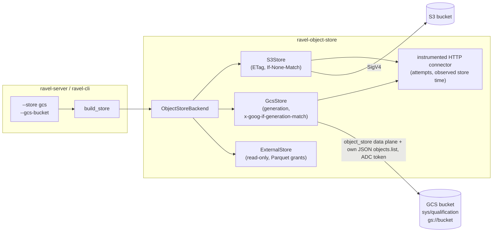

# ADR-3456: Native GCS object store backend

- Status: Accepted (2026-10-29)
- Date: 2026-10-29
- Refs: #3456, ADR-0002, ADR-0008, ADR-0050, ADR-0055, ADR-1685, ADR-2040, ADR-2637

## Context

Object storage is Ravel's only durable store. The commit protocol (ADR-0002)
and every CAS-mutable record (catalog `HEAD`, tenant config, agent HEADs)
rest on two primitives: create-if-absent and compare-and-swap on a version
token. ADR-0008 put `object_store` behind Ravel's own `ObjectStoreBackend`
trait so that a backend with different precondition headers, named there as
"GCS generation preconditions", could be added without touching commit code.

Today `--store` accepts `memory` and `s3`. The S3 path cannot be pointed at
GCS's S3-compatible XML API. Measured on 2026-10-29 with curl and an OAuth
token against a fresh bucket in us-central1 (#3456):

| Request | Required | GCS answered |
|---|---|---|
| PUT `If-None-Match: *` on an existing key | 412 | 200, object overwritten |
| 8 concurrent `If-None-Match: *` PUTs on a new key | one 200 | eight 200s, last writer wins |
| PUT `If-Match: <wrong etag>` | 412 | 200, object overwritten |
| PUT `x-goog-if-generation-match: 0`, twice | 200, then 412 | 200, then 412 |
| PUT `x-goog-if-generation-match: <wrong>`, then the right generation | 412, then 200 | 412, then 200 |
| GET `If-Match: <current etag>`, then `If-Match: <wrong etag>` | 200, then 412 | 200, then 412 |
| GET `?generation=<current>`, then the same generation after an overwrite | 200, then 404 | 200, then 404 |

On PUT, the XML API ignores the S3 conditional headers and honours only its
own generation headers. On GET it honours `If-Match`, and a generation
selector naming a replaced generation answers 404 (the GET rows were measured
the same day, against the same bucket). `ravel-cli store qualify` would refuse such a bucket, so
the S3 path is unusable on GCS rather than unsafe. Separately, organisation
policies commonly forbid service-account keys
(`constraints/iam.disableServiceAccountKeyCreation` refused the HMAC key in
the measurement project), so the S3 path would have no credential to sign
with either.

A GCS client already ships: `ExternalStore`'s GCS arm reads granted Parquet
files (ADR-2040). It is read-only by design. `put`, `put_multipart` and
`delete` return `ReadOnly`, and it reports `create_if_absent` and
`cas_version` as false (`crates/ravel-object-store/src/external.rs`).

## Decision

### D1. A `GcsStore` backend in ravel-object-store

`crates/ravel-object-store/src/gcs.rs` adds `GcsStore`, a full read-write
`ObjectStoreBackend` over `object_store::gcp::GoogleCloudStorage` (the
workspace's `object_store` 0.14 already enables `gcp`). It is a separate
type from `ExternalStore`, which stays read-only.

- **Version token.** The token is the object's GCS generation, as a decimal
  string, on every path: `put` results, `head`, `get`, `list` entries and
  `pin_of`. The ETag is never used as a token. A generation is assigned by
  GCS on every write and never reused for a key, so a token cannot alias two
  states.
- **Put modes.**
  - `CreateIfAbsent` sends `x-goog-if-generation-match: 0`. A 412 maps to
    `AlreadyExists`.
  - `CasVersion(v)` sends `x-goog-if-generation-match: v`. A 412 maps to
    `PreconditionFailed`.
  - `Overwrite` sends no precondition.

  `object_store` 0.14 sends both headers itself: `PutMode::Create` as
  generation 0, and `PutMode::Update` from `UpdateVersion::version`, failing
  with `MissingVersion` when it is absent. A test asserts each header on the
  wire against an in-process fake endpoint, so an upgrade that changes this
  fails CI.
- **Reads.** Ranged and suffix reads use `get_opts`. A pinned read keeps the
  `get_pinned` contract (`ObjectStoreBackend::get_pinned`): the pin's
  version is the generation, sent as the `generation` selector (which
  `get_opts` does for `GetOptions::version`), so a generation that no longer
  exists answers 404 and maps to `NotFound`. The pin's ETag, when present,
  goes out as `If-Match` on the same request (`GetOptions::if_match`), so
  GCS evaluates it on the wire, as the trait requires; GCS answers a mismatch
  with 412 (measured above), which maps to `PreconditionFailed`. For a pin
  with no version, that `If-Match` is the whole mechanism. A generation
  precondition header is not used for reads: it would turn a vanished
  generation into `PreconditionFailed`, which the trait reserves for a
  changed object.
- **Listing.** `GcsStore` does not list through `object_store`. ADR-2637
  removed `Path`-based listing from `S3Store`: `Path::parse` fails a whole
  page on a key it rejects, and resuming from `Path::from(last_key)`
  re-delivers or skips keys that `Path` re-encodes. Every base backend's
  listing must instead hand raw keys to `classify_objects` and
  `classify_prefixes`, so unaddressable keys are reported in
  `ListPage::unaddressable` rather than failing the page. `GcsStore`
  therefore carries its own listing client, beside `s3/list.rs`:
  - It calls the JSON API's `objects.list`
    (`storage/v1/b/<bucket>/o`), sending `prefix`, `delimiter` and
    `startOffset` as raw names. The response carries names as JSON strings,
    with no URL encoding to undo.
  - It sends `maxResults` on every page, and resumes from the service's
    opaque `pageToken`, never from a re-encoded key.
  - It authenticates with the same Application Default Credentials as the
    data-plane client, and runs through the shared connector (D3).

  The page size is a `GcsStore` constructor argument, and it is what
  `store qualify --list-page-size` passes. So the cross-page probes test the
  size the store really serves. `object_store`'s GCS client hard-wires its
  page size and offers no setter, which is a second reason not to list
  through it.
- **Multipart.** `multipart: false`. A single GCS upload takes objects far
  larger than any Ravel object, so no caller needs it.
- **Upload checksum.** `upload_checksum: false` in this ADR. CRC32C through
  `x-goog-hash` is follow-up work. The capability is not mandatory, and full
  reads are counted on `ravel_store_get_unverified_total`, as they are for S3
  with stored checksums off.

### D2. Credentials: Application Default Credentials only

`GcsStore` authenticates the way `object_store` does when no explicit
credential is given. That means Application Default Credentials: GKE
Workload Identity or the metadata server in a cluster, or
`GOOGLE_APPLICATION_CREDENTIALS` where an operator chooses to point at a key
file. There are no Ravel flags carrying credentials, so no secret ever
passes through Ravel's configuration. A hidden `--gcs-endpoint` sets the
base URL, for tests against a fake endpoint only. When it is set, the
backend identity records it (D5), so a qualification taken against a fake
endpoint cannot read as one taken against the real bucket.

### D3. The same instrumentation as S3

The S3 store observes every HTTP attempt through its own connector
(`s3/connector.rs`). That connector feeds `ravel_store_attempts_total` and
`observed_store_time_ns`, and the ingest clock-lag check (ADR-1685) reads the
second. A backend without it reports zero attempts and turns the clock-lag
check off without saying so. `GcsStore` installs the same connector through
`GoogleCloudStorageBuilder::with_http_connector`. Per-operation call and
byte counters come from the shared instrumentation wrapper, so the per-phase
cost split covers GCS exactly as it covers S3.

### D4. Error classification by status, not by S3 error codes

S3 errors are classified from S3 XML error codes (`SlowDown`,
`NoSuchBucket`). `GcsStore` classifies from the HTTP status and
`object_store`'s typed errors:

- 429 and 503 are throttling (retryable);
- 404 on an object is `NotFound`;
- 404 on the bucket is a hard error;
- 412 is the precondition outcome named in D1;
- 401 and 403 are credential errors.

GCS limits writes to one object name to about one per second; a 429 on a
CAS-mutable key (catalog `HEAD`) retries like any throttle.

### D5. Selection, identity and qualification

- `--store gcs` with `--gcs-bucket` (env `RAVEL_GCS_BUCKET`) on ravel-server
  and on every ravel-cli command that takes `--store`.
- The backend identity is `gs://<bucket>`, or `gs://<bucket>@<endpoint>`
  when `--gcs-endpoint` is set, the same shape as `s3://<bucket>@<endpoint>`.
  It is written into `sys/qualification` by `store qualify` and compared at
  server startup exactly as `s3://` is.
- The conformance suite runs unchanged: it takes `&dyn ObjectStoreBackend`.
  A GCS bucket is qualified by running `ravel-cli --store gcs store qualify`
  against it. The server refuses to start on an unqualified bucket, as it does
  for S3.

### D6. Explicit refusals under `--store gcs`

Each of these flags is an S3 control-plane feature with no GCS
implementation in this ADR. Startup refuses the combination with an error
naming the flag. None of them is accepted and ignored:

- `--s3-*` flags, including `--s3-upload-integrity` and
  `--s3-request-stored-checksum`.
- `--s3-kms-key` and `--tenant-kms-config`. Customer-managed encryption on
  GCS is a bucket default key (CMEK) set outside Ravel.
- `--require-bucket-protection`. The bucket-protection probes are S3
  control-plane calls with no GCS implementation, so a server asked to
  require protection on GCS refuses to start rather than starting
  unverified (ADR-0050).

`ravel-cli store verify-protection` under `--store gcs` refuses too: it
exits non-zero with an error saying that GCS bucket protection is not
checked, rather than printing a report of conditions it never probed.

### D7. Ravel's own bucket stays ungrantable as a Parquet location

ADR-2040 D4 refuses a Parquet grant that resolves to Ravel's own bucket. The
config-time check (`RavelBucket::is_reached_by` in ravel-sql) builds Ravel's
side as an S3 address, so under `--store gcs` a GCS grant naming Ravel's
bucket would pass it. The profile side already resolves a GCS profile to a
GCS address. What changes is Ravel's own side: it is built from the
configured store, a GCS bucket under `--store gcs`, instead of always from
the S3 configuration. A GCS profile on Ravel's GCS bucket is then refused at
config time, as an S3 profile on Ravel's S3 bucket is today. This ships in the
same release as `--store gcs`, never after it.

### D8. Out of scope, filed as follow-ups

- **The operator.** Its CRD requires `storage.s3`, and it hard-codes
  `--store s3 --require-bucket-protection`. GCS in the CRD is a CRD change of
  its own.
- **CRC32C upload integrity** (`upload_checksum: true` on GCS).
- **GCS bucket-protection probes**: retention policy, object versioning,
  soft delete.
- **ravel-bench's own store selection.**

## Rejected alternatives

1. **S3 path against GCS's XML API with HMAC keys.** Measured above: GCS
   ignores the S3 conditional headers, so create-if-absent and CAS do not
   exist on that path. HMAC keys are also refused by a common organisation
   policy.
2. **Teach `S3Store` to send `x-goog-*` headers when the endpoint is
   `storage.googleapis.com`.** That makes the S3 adapter's correctness depend
   on recognising a hostname. It still needs HMAC keys. And it mixes ETag and
   generation as tokens inside one type, which is the aliasing ADR-0008 kept
   out of commit code.
3. **Make `ExternalStore`'s GCS arm writable.** `ExternalStore` exists to be
   unable to write. ADR-2040's isolation argument for granted buckets rests
   on that, and a writable mode on the same type removes it.
4. **An S3-compatible proxy in front of GCS (s3proxy and similar).** It adds
   a stateful process in the commit path whose own precondition handling
   would need qualifying, and it breaks the rule that every compute process
   is disposable and stateless beside the store.

## Consequences

- Ravel runs on GKE with Workload Identity and a GCS bucket, with no
  long-lived credentials in its configuration.
- Commit-protocol, catalog, agents and maintenance code is unchanged. All
  of it reaches the store through the trait, and the conformance suite is the
  gate a GCS bucket must pass.
- CI cannot reach a real bucket. The trait mapping (headers sent, statuses
  mapped) is tested against an in-process fake endpoint in every CI run. The
  contract suite runs against a real bucket when `RAVEL_GCS_TEST_BUCKET` is
  set, the same opt-in shape as the RustFS and floci lanes. The first real
  qualification, from an image built on main, is recorded on #3456 before
  `--store gcs` is called supported.
- Persistent formats, the key layout and the qualification record schema are
  unchanged. `backend_identity` is a free-form string, and `gs://` is a new
  value of it.
- GCS's per-object write rate (about one write per second per object name)
  bounds how often one CAS-mutable key can change. The catalog `HEAD` is
  written at most once per fold (`--fold-interval-secs`, default 300), far
  below it. A Ravel Agents HEAD (ADR-3331) is CAS'd once per state
  transition of one agent, so an agent stepping faster than about once a
  second on GCS sees throttle retries, counted like any other throttle.
  Nothing is lost: the CAS either lands or is retried.
