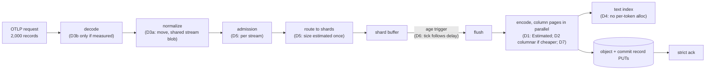

# ADR-3492: Cut logs ingest CPU per line for 120k lines/s on 8 vCPU

- Status: Accepted (2026-10-30)
- Date: 2026-10-30
- Refs: #3492, #3476, #1507, ADR-0002, ADR-0070, ADR-0109, ADR-1702, ADR-1737, ADR-2135, ADR-3456

## Context

The VictoriaMetrics logs-benchmark ran on GKE, one instance per
n2d-standard-8 node with 8 vCPU (#3476). The workload is OTLP/HTTP protobuf
logs: 2,000 records per request, about 50 of 5,000 streams per request, and
30 to 40 attributes per record. The harness keeps 32 requests in flight,
64,000 lines in all.

| Instance | Stored lines/s |
|---|---|
| VictoriaLogs | 118.5k |
| Ravel, strict acks at a 250 ms flush delay | 60.0k |
| Ravel, buffered acks | about 78k (empty bucket) |

Both Ravel rows ran on GCS.

A `perf` profile of `ravel-server` held at saturation used 7.9 of 8 cores. The
flat profile ran 30 s at 499 Hz; the DWARF call graphs ran 12 s at 99 Hz. One
sample was taken per arm:

| Phase (inclusive unless noted) | Bloom scope `all` | Bloom scope `text` | Basis |
|---|---|---|---|
| Stored rate | 78.5k lines/s, ~101 us CPU/line | 85.8k lines/s, ~92 us CPU/line (n=1, 5 min after the first arm; the bucket grew between them) | measured 2026-10-30 |
| Flush encode, `RlogWriter::build_object` | 64.5% | 57.9% | measured 2026-10-30 |
| `block::write_block`, inclusive (self) | 26.7% (15.3%) | 31.2% (18.3%) | measured 2026-10-30 |
| `rlog_codec::string_shape` | 6.5% | 6.9% | measured 2026-10-30 |
| zstd compression | 3.3% | 4.0% | measured 2026-10-30 |
| Text index, `writer::insert_text` | 13.3% | under 2% | measured 2026-10-30 |
| OTLP handler | 30.8% | 37.0% | measured 2026-10-30 |
| prost decode | 15.2% | 18.3% | measured 2026-10-30 |
| normalize | 8.4% | 9.8% | measured 2026-10-30 |
| libc memcpy, self, flat profile | about 15.5% | not split | measured 2026-10-30 |
| jemalloc, self, flat profile | about 10% | not split | measured 2026-10-30 |

At 100% of 8 vCPU, 120k lines/s allows at most 66 us of CPU per line. That is
about 35% below today's. The cost is not in compression. It is in choosing
encodings, building row structures and copying strings:

- **Every candidate is encoded and sealed.** `write_block` encodes every
  candidate encoding of every page and zstd-seals each one before keeping the
  smallest (`block.rs:220-277`, `page.rs:92-105`; ADR-2135 decision 4).
- **Every string column is sorted per block.** `string_shape` sorts and
  dedups each block's string column by byte comparison, `body` included
  (`rlog_codec.rs:372-382`).
- **The OTLP flush runs the row writer.** It builds a `BTreeMap` per row
  (`writer.rs:2243-2322`), clones every string value twice, and finds each
  row's value with a linear scan per (plan, row) (`block.rs:560-580`). The
  columnar writer writes byte-identical objects (ADR-0109 decision 7). It
  exists for columnar input, and nothing prevents the OTLP flush from using it.
- **The tokenizer allocates per token.** It allocates a `Vec` per token and
  deduplicates through SipHash (`tokenizer.rs:21`, `bloom.rs:161, 196`).
- **Normalize clones what it owns.** prost decodes every string into an owned
  `String`. `normalize_logs_projected` owns the request but clones each value
  again (`logs_normalize.rs:416, 531, 874, 980`), and copies the
  stream-attribute blob into every record (`:408`).
- **Admission and size estimates repeat per record.** Admission probes one
  stream id per record (2,000) instead of per distinct stream (about 50),
  under one mutex (`admission.rs:1024-1075`). `est_record_bytes` runs twice
  per record (`log_router.rs:586`, `log_shard.rs:548`).

The strict path also waits. The age trigger is checked on a fixed 200 ms tick
(`ingest/config.rs:836`), and each request waits for the slowest of the shards
it touched. With 50 streams that is every shard (`log_router.rs:689-701`).

Run 2 also issued 13.8M GETs: 18.6k per stored-rows poll interval on
average, or about 2.4k/s at the plateau. Nothing has attributed them. They are
not the `count(*)` itself, which folds to the commit records' exact
`sample_count` (`ravel-sql/src/logs_scan/mod.rs:3035`) without reading
footers or blocks. They keep issuing during the very run the exit criteria
use, while the full test grows the bucket to about 10^9 rows.

Constraints:

- **Determinism.** The writer's output must remain a pure function of its
  input. Compaction reuses probe bytes because the encode is deterministic
  (`ravel-maintain/src/rlog.rs:2015-2021`). The row and columnar writers must
  produce identical bytes (ADR-0109). `tests/golden_bytes_v5.rs` pins the
  default writer's output.
- **Readers don't care which candidate the writer picked.**
  `docs/log-segment-format.md` says: "A reader never needs to know which
  candidates the writer considered: the tag makes each page
  self-describing."
- **Not a format change.** The format-change procedure applies to changes in
  the RLOG layout, an encoding tag, a version, the object key layout, the
  schemas under `proto/`, or identity encodings. Nothing here touches any of
  them, so no format version changes.

## Decision

### D0 (wave 0, before any code). Attribute the GETs; confirm compaction

**GETs.** A test reproduces the stored-rows poll against a tenant that has not
been folded, at the object count Run 2 reached. It reports GETs per phase:
resolve, plan, probe, scan. The phase that owns them gets its own fix, decided
on this epic before the exit run. A fix that caches resolved commit records
across queries, or that folds sooner, is a separate decision record.

**Compaction.** The benchmark deployment (`--mode all`, tenant named by its
token) is watched past the fold's seal horizon. The check confirms that logs
compaction rewrites the ingest objects. D1's size bound holds only until
compaction rewrites an object, so if compaction never runs there, that bound
is permanent instead.

### D1. The ingest flush chooses page encodings by estimate

`RlogConfig` gains a page-choice mode with two values:

- `Exhaustive`, the default and today's behaviour;
- `Estimated`.

Only the logs ingest flush, where it builds its `RlogConfig` in
`log_shard.rs`, selects `Estimated`. Compaction, erasure rewrite,
`ravel-cli load` and every test that does not name the mode keep
`Exhaustive`.

Under `Estimated`:

- **i64 pages.** One pass computes the statistics each candidate's raw size
  depends on: minimum and maximum, run count, delta range, delta-of-delta
  range, and the GCD of offsets. Only the candidate with the smallest computed
  raw size is encoded, then sealed once. Equal sizes break ties by today's
  priority order.
- **String pages.** The candidate that the `distinct / total <= 0.5`
  heuristic ranks first is encoded and sealed alone.
- **Distinct count.** The distinct count that feeds the heuristic comes from
  a hash map over the page's values, not a sort of every row. When
  dictionary wins, its entries are still sorted ascending by byte value, as
  `docs/log-segment-format.md` requires for tag 7, but the sort runs over the
  distinct values only.
- **Row-group dictionary.** The pass that seals it again is skipped for
  columns whose block choice was plain.

The choice is a function of the page's values alone, so the same input still
yields the same bytes.

This amends ADR-2135 decision 4; the amendment is in ADR-2135 itself.
`docs/log-segment-format.md`'s "Encoding choice" paragraph is amended in the
same change to describe both modes.

### D2. The OTLP flush uses the columnar writer, if it measures cheaper

`rows_to_batch` builds Arrow arrays, which copy the strings again. So D2 can
move cost rather than remove it. D1 also removes part of the same
`write_block` self time.

D2 is therefore adopted only if `logseg_encode`, extended to the benchmark's
shape (2,000 records, 40 attributes, 50 streams), shows less CPU per record
for `rows_to_batch` plus the columnar writer than for the row writer. It is
measured both with and without D1.

`tests/differential.rs` gains a case at that shape. It asserts that the two
paths produce byte-identical output, which is ADR-0109 decision 7.

### D3. Decode and normalize stop copying strings

**D3a.** `normalize_logs_projected` consumes the request and moves values out
of it instead of cloning them. Two further steps follow:

- the per-stream attribute blob is shared, not copied into every record.
  `NormalizedLogRecord` is built in ravel-ingest, so this lands with D5's
  ravel-ingest change, not with the ravel-otlp move;
- the label-projection walk is folded into the normalize pass where nothing
  charges the projection first. The server keeps projecting before it
  normalizes, because ADR-2708 decision 2 bounds each OTLP request by its
  projected resolved-label bytes, and the server refuses an oversized
  request before any record is built (`label_charge_allocations` pins
  that).
  Folding it there needs that decision amended, and only after the shared
  blob stops per-record memory growing with stream width.

The OTLP gRPC logs path uses the same tonic types and the same normalize, so
it gets the change unchanged.

**D3b,** only if D3a's measurement leaves prost decode as the largest
remaining handler cost:

- vendor the OTLP logs protos with the hot `string` fields retyped as `bytes`
  (the same wire type), so they decode as slices of the request body;
- give `ChunkedBody` a slicing `copy_to_bytes`;
- validate UTF-8 once, in normalize, with the same refusal prost gives today.

The vendored files live under `crates/ravel-otlp/`, not under the frozen
`proto/`, and a test checks they differ from upstream only in the retyped
fields. HTTP and gRPC then both decode into the vendored types, so normalize
keeps one input type. The wire format and the set of accepted requests are
unchanged.

### D4. The tokenizer stops allocating per token

`tokenizer::tokens` gains an ASCII fast path and yields byte slices instead
of `Vec`s. The bloom builder deduplicates through a non-SipHash hasher.

The tokens and the bloom bits are unchanged, so objects stay byte-identical
and the golden-bytes test holds.

### D5. Admission per stream; size estimated once

Stream admission probes the request's distinct stream ids instead of one per
record. Two things stay as they are:

- **Mixed requests at the cap.** When a request mixes new and existing
  streams at the active-stream cap, each record's outcome stays what
  per-record admission gives today. A differential test pins this against the
  per-record path.
- **The metric.** `series_admitted_total` keeps counting records.

`est_record_bytes` is computed once per record and carried to the shard.

### D6. The flush tick follows the flush delay

The shard's flush tick becomes `min(200 ms, max_flush_delay / 4)`, with a
25 ms floor. Startup validation states the new bound. The ADR-1737
sub-floor hold is `max_flush_lifetime` less one `flush_tick`, so a shorter
tick makes it longer: at a 25 ms tick it is 175 ms longer than today. At the
shipped 2 s delay the tick stays at 200 ms and the hold is unchanged.

### D7. A flush encodes its column pages in parallel

A logs flush is one write-gate job today, so its encode latency is serial in
the number of lines it holds. With fewer shards each flush holds more lines.
To keep that encode time short, a flush encodes the column pages of a block as
separate jobs.

Today a write-gate job below the gate's inline floor (1 MiB for the server's
write gate) runs on the caller's thread and never takes a permit
(ADR-1702 decision 4). Each column page of a 7.5k-line flush is far below
that floor, so page jobs submitted one by one would all run inline and in
series. The floor therefore applies to the flush as a whole, as it does
today: a flush at or above the floor dispatches its page jobs to the
blocking pool, and each page job takes one write-gate permit, whatever its
own size. A flush below the floor stays one inline job. The gate still
bounds total encode concurrency. This amends ADR-1702 decision 4 for the logs
ingest flush only; the amendment is in ADR-1702 itself. The flush assembles the sealed pages in
the column order the writer uses today, so the object's bytes are identical to
a serial encode. A test pins that equality on the benchmark's shape and on the
golden corpus.

Two cases fall back to the serial single-job encode:

- a block too small to be worth splitting, below a page-count floor stated in
  the code;
- a flush that would wait on the gate for longer than the serial encode would
  take.

### D8. The benchmark runs 2 shards at a 100 ms flush delay

The owner chose this configuration for the benchmark's strict-ack row:

- `--shards 2`;
- `--max-flush-delay 100ms`, set together with `--max-flush-delay-idle` and
  `--min-flush-bytes` (Ravel refuses the delay alone), so D6 gives a 25 ms
  tick;
- the aged strict policy.

It is disclosed with the benchmark's other non-default flags. Neither value
becomes a Ravel default: the shipped `--shards 4` and 2 s delay are unchanged.

It writes `shards / delay` = 20 objects/s and 20 commit records/s. That is a
quarter of the 80 objects/s that 8 shards at the same delay would write, at
the GCS class A rate of about $0.005 per 1,000 PUTs.

### What strict acks can reach

The harness's 64,000 lines in flight mean throughput is 64,000 lines ÷ ack
time, so 120k lines/s needs an ack of at most 0.53 s. The prediction below
assumes D1 to D6 bring flush encode to about 30 us per line. Each flush is one
gate job.

| Configuration | Predicted ack | Predicted strict lines/s | Basis |
|---|---|---|---|
| aged, 250 ms delay, tick 62.5 ms, 4 shards | wait for the slowest shard's age about 262 ms, encode 7.5k lines about 225 ms, two PUTs on the slowest of 4 about 250 ms: **about 0.74 s** | **about 87k** | predicted from Run 2's PUT latency (mean 85 ms, p99 at or under 0.5 s, measured 2026-10-30) |
| aged, 250 ms delay, 8 shards | about 284 ms + 112 ms + 260 ms = **about 0.66 s** | **about 98k** | predicted, same basis |
| arrival, 8 shards | flush cycle c = 0.17 / (1 - 120k x 30 us / 8) = about 0.31 s; ack about 1.5c plus tail = **about 0.55 s** | **about 116k** | predicted, same basis |
| aged, 100 ms delay, 8 shards | about 114 ms + 45 ms + 260 ms = **about 0.42 s** | about 150k, with about 80 objects/s written | predicted, same basis |
| **aged, 100 ms delay, 2 shards, tick 25 ms, D7 (D8, chosen)** | wait for the slower of 2 shards' age about 92 ms; encode 7.5k lines (225 ms serial) over the write gate's default 4 permits on 8 vCPU: about 56 ms when one flush has the gate, about 112 ms when both shards flush on the same tick and split it; two PUTs on the slower of 2 about 230 ms: **about 0.38 to 0.43 s** | **ack-path capacity about 145k to 170k, at 20 objects/s** | predicted, same basis |
| aged, 100 ms delay, 1 shard | about 0.35 s | not viable: the single shard actor would need about 1.2 s/s, scaling the measured 0.14 s/s per shard at about 70k | predicted from the shard on-actor time measured 2026-10-29 |

CPU work alone takes **buffered** acks to about 120k, but **strict 250 ms**
only to about 87-98k: the 250 ms age and two sequential PUTs use most of the
budget. At a 100 ms delay the ack path stops binding. With 2 shards and D7 it
has about 145k to 170k of capacity at the default permit count, above the
120k target, so the strict row is then bound by CPU.

150k lines/s on 8 vCPU allows at most about 53 us of CPU per line, about 47%
below today. D1 to D6 target 30 to 35% at bloom scope `all`, the scope the
exit uses: from 101 us, that is 66 to 71 us per line, a CPU-bound ceiling of
about 113k to 122k. At the 30% end that misses the 115k exit by about 2%. In
that case the epic stays open and the next cuts are D2 and D3b, each adopted
only if it measures cheaper; neither the exit nor the bloom scope is
relaxed to close the gap. Reaching 150k needs those further cuts and whatever
D0 finds behind the GETs.

The two objects written per flush (data, then commit record) stay sequential
under the commit protocol (ADR-0002). Fewer than about 20 objects/s at this
latency would need one object per tick carrying every shard's data, which is
a cross-shard group commit. That changes the object key layout and the commit
protocol, so it needs its own ADR and is out of scope here.

### Verification and exit criteria

- **Allocation pins in CI.** CPU timings are not gated on hosted runners
  (ADR-0070), but per-record allocation counts are deterministic. Each task
  adds pins on decode plus normalize per record, the flush per record, and the
  tokenizer per token. Each pin is shown failing against the old code.
- **Encode benchmark.** `logseg_encode` gains the benchmark's shape and the
  `Estimated` mode, and reports CPU per record and the size ratio between the
  two modes.
- **Live checks.** After each wave, one instance is held at a fixed offered
  rate on the #3476 setup for 10 minutes, interleaved against the previous
  image (at least 3 alternations). Each check is pre-registered on #3492.
- **Byte-identical parallel encode.** D7's equality with the serial encode is
  pinned by a test.
- **Exit.** At bloom scope `all`, in the upstream ingest test on the same
  hardware:
  - Ravel stores **at least 115k lines/s buffered**;
  - Ravel stores **at least 115k lines/s strict** in the D8 configuration (2
    shards, 100 ms), at about 20 objects/s;
  - `Estimated` objects are at most 10% larger than `Exhaustive` ones on the
    benchmark corpus, measured before compaction.

  150k is the stretch target. It is reached only if CPU per line falls to
  about 53 us, which is the D2 and D3b condition above.

## Rejected alternatives

1. **A lower zstd level at ingest.** Compression is 3 to 4% of CPU, so a
   faster level moves little and costs bytes.
2. **Bloom scope `text` by default.** It measured +9%, but n=1, taken minutes
   apart while the bucket grew. It also changes what attribute token searches
   can prune on every tenant. D4 recovers most of the tokenizer cost without
   changing what is indexed. The scope stays a per-tenant choice.
3. **Build the text index at compaction instead of ingest.** L0 objects are
   what recent-data searches read, and they would lose pruning until
   compacted.
4. **More shards, or the arrival policy, for the strict row.**
   - **8 shards at 100 ms:** predicted about 150k, but at 80 objects/s, 4x
     D8's PUT count.
   - **Arrival with 8 shards:** predicted about 116k, with about 26
     objects/s (8 shards over the 0.31 s flush cycle) and as many commit
     records.

   D8 reaches more ack-path capacity with fewer objects, because D7 removes
   the encode latency that made fewer shards slow.
5. **One shard.** It is predicted to saturate the single shard actor at
   about 1.2 s/s.
6. **A cross-shard group commit** (one object per tick). It changes the key
   layout and the commit protocol, so it is out of scope.
7. **Bigger nodes.** The benchmark fixes the hardware, and the target is
   per-core efficiency.

## Consequences

- No persistent format changes and no format version changes. ADR-2135
  decision 4 is amended for the ingest writer only. ADR-1702 decision 4 is
  amended for the logs ingest flush only (D7).
- `Estimated` ingest objects can be up to 10% larger, by the exit bound, until
  compaction rewrites them. D0 confirms that compaction runs on the benchmark
  deployment.
- Strict-ack latency drops at small flush delays (D6) and with cheaper flushes
  (D1 to D5). The shipped 2 s default behaves as before.
- The benchmark's strict row moves from 4 shards at 250 ms to 2 shards at
  100 ms (D8). Objects written go from about 16/s to about 20/s, each a little
  under 0.6 MB at 150k lines/s. Today's 250 ms row is predicted at about
  87-98k even after the CPU work.
- D7 divides a flush's encode latency by the number of permits the flush
  gets, at most its page count. Latency still grows with the lines per
  flush: larger flushes (fewer shards, longer delays) need the encode
  latency checked again. A burst of flushes still competes for the same
  permits as today.
- D3b, if adopted, adds vendored OTLP protos that must be re-vendored when
  upstream changes them.
