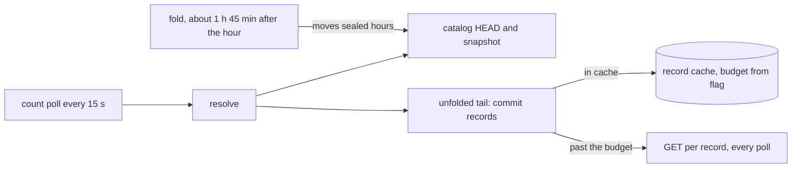

# ADR-3513: An operator-set byte budget for the per-tenant record caches

- Status: Accepted (2026-10-30)
- Date: 2026-10-30
- Refs: #3513, #3492, #3476, #1236, ADR-1170, ADR-1199, ADR-3492

## Context

ADR-3492 decision 0 attributed the GETs the logs benchmark's stored-rows poll
issues. The harness runs `SELECT count(*) AS n FROM logs` over the last seven
days every 15 s, one poll at a time. Every GET is a resolve-phase commit-record
GET: `count(*)` is answered from each commit record's `sample_count`, and no
data object is read (`crates/ravel-sql/tests/logs_count_get_attribution.rs`).
For N unfolded commit records:

- a cold query issues N commit-record GETs plus the catalog HEAD, and the
  server's provisioning check adds one more;
- a repeat query issues none while N fits the per-process commit-record cache,
  and N minus the cache's entry bound on every query once it does not;
- after a fold, a query reads the HEAD and one snapshot part.

The cache bound is derived from shard count and flush delay
(`derive_cache_capacity_per_tenant`, `crates/ravel-catalog/src/config.rs`) and
clamped so the commit-record cache and the L1 compaction cache together stay
within 45 MB per tenant (`MAX_RECORD_CACHE_BYTES_PER_TENANT`) at 900 bytes per
entry (`RECORD_CACHE_ENTRY_BYTES`). That is 25,000 entries. No flag moves it.

A fold seals an ingest hour only `max_flush_lifetime` plus the clock-skew
allowance and the fold safety margin after the hour ends, and
`max_flush_lifetime` cannot go below the ingest floor without a code change
(#1236). On the benchmark bucket, the fold wrote the snapshot that seals hour
`20261030T00` at 02:44:56, 1 h 45 min after the hour ended (`gcloud storage
ls -l` of `catalog/l/snap/`, measured 2026-10-30). So the unfolded tail holds
the current hour plus up to about 1 h 45 min of earlier commits, about
2 h 45 min at worst.

ADR-3492 decision 8 runs the benchmark's strict row at 2 shards and a 100 ms
flush delay, about 20 commit records per second. Its unfolded tail reaches
about 200,000 records, eight times the cache. Each poll would then re-read up
to about 175,000 records. At the Run 2 rate of 2.4k GETs/s that is about
$83 a day of GCS class B requests per polled tenant (2,400 x 86,400 / 1,000 x
$0.0004), and the reads take CPU on the ingesting node. The same cost reaches
every logs query over the unsealed tail, not only `count(*)`: every plan
resolves every listed record.

ADR-3492 decision 0 says a fix that caches resolved commit records across
queries is a separate decision record. This is that record.

## Decision

### 1. One flag sets the per-tenant record-cache byte budget

`--catalog-record-cache-max-bytes-per-tenant <bytes>` sets the byte budget the
commit-record cache and the L1 compaction cache share per tenant. It replaces
the 45 MB constant in the clamp. Each cache gets half, as today
(`RECORD_CACHES_PER_TENANT` = 2), and the entry bound is the derived capacity
clamped to `budget / (900 x 2)`.

- Unset, the budget is 45 MB and every figure is today's.
- A value below 45 MB is refused at startup: the derivation's floor
  (`DEFAULT_CACHE_CAPACITY_PER_TENANT`, 10,000 entries) already assumes
  18 MB, and a lower cap would make some deployments' derived bound smaller
  than today's.
- `--disable-cache` keeps its meaning: the record caches stay at the flat
  10,000-entry floor and the flag is refused beside it.

### 2. The budget stays outside ADR-1170's shares, and startup says so

The record caches sit outside ADR-1170's carved shares today: their bound is
per actively queried tenant, and the operator subtracts the per-tenant figure
times the number of tenants queried at once from what the host has left
(`MAX_RECORD_CACHE_BYTES_PER_TENANT`'s doc,
`crates/ravel-catalog/src/config.rs`). That stays so. A per-tenant budget
cannot be charged against a process budget without knowing how many tenants
are queried, which is the process-wide follow-up below.

The startup log names the budget, the entry bound it gives, and the
worst case for one actively queried tenant. The `--disable-cache` help and
the operations guide that state today's 45 MB figure state the flag beside
it.

### 3. The benchmark sizes it from the measured tail and says so

The ADR-3492 exit run sets the flag to hold the decision-8 tail with margin,
400 MB (about 222,000 entries), and the write-up states the value, the
worst-case memory it allows per tenant, and the flush cadence that creates the
tail. It also states what the flag does not remove: the first poll after a
process start reads every unfolded record; about one HEAD GET every second
poll (30 s HEAD cache, 15 s poll); and one LIST page per 1,000 commit keys.

## Rejected alternatives

1. **Answer `count(*)` from a running summary.** A per-shard running count
   changes the write path, and ADR-1199 already rejects writer-owned live
   manifests. An aggregate kept in query memory is a cache with the same
   restart behaviour as this one and helps only metadata-only plans. An
   incremental partial fold of the tail is ADR-1199 decision 3, specified
   and held behind its measured gate (decision 4).
2. **Raise the 45 MB constant for everyone.** The per-tenant worst case
   multiplies by the number of actively queried tenants; a deployment with
   many quiet tenants would pay for a tail only one hot tenant has.
3. **An entry-count flag.** The cap is already in bytes, and records that
   carry declared column statistics are larger than 900 bytes, so an entry
   count would misstate the memory it allows.
4. **Shorten `max_flush_lifetime`.** It shrinks the tail for every tenant and
   process, but lowering the ingest floor needs its own decision (#1236).

## Consequences

- A deployment with a dense unsealed tail can stop re-reading it on every
  query, at a memory cost it chooses. No startup check bounds that cost
  against the process budget, as today; the operator multiplies it by the
  tenants queried at once.
- The budget is per tenant: a process with many actively queried tenants
  multiplies it. A process-wide budget with a per-tenant floor is the
  follow-up that removes that multiplication.
- The cache is per process and starts cold; a restart or another query
  process pays the full tail once.
- The benchmark's per-query `io` figures (`unfolded_segments_resolved`,
  `unfolded_records_served_from_cache`) become evidence for ADR-1199
  decision 4's gate.
