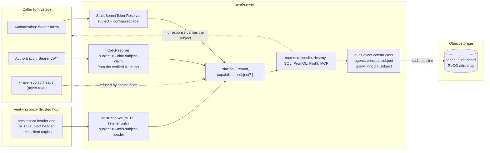

# ADR-3541: An optional subject on the principal, recorded in audit records

- Status: Accepted (2026-11-01)
- Date: 2026-11-01
- Refs: #3541, #3408, #3525, ADR-0042, ADR-0050, ADR-0062, ADR-0072,
  ADR-2040, ADR-2993, ADR-3331

## Context

A request resolves to a `Principal` (`crates/ravel-tenant-resolve/src/lib.rs`):
a tenant and five capability booleans (`ddl`, `ipcrypt`, `agents`,
`agents_worker`, `agents_admin`). Three resolvers build one:

- `StaticBearerTokenResolver`, from the `--tenant-token TOKEN=TENANT[;CAPS]`
  flags and the `--tenant-token-file` lines `Cli::parse_tenant_principals`
  parses (`services/ravel-server/src/config.rs`); the capability suffix is
  split by `split_tenant_suffix`, which `ravel-ingest-router` shares;
- `OidcResolver`, from a verified JWT: the tenant from `--oidc-tenant-claim`
  and each capability from its own boolean claim flag (`--oidc-ddl-claim`
  and siblings). No other claim is read; `sub` in particular is never read;
- `MtlsResolver`, from the proxy-forwarded header `--mtls-header` (default
  `x-ravel-client-cert-cn`) on the dedicated `--mtls-listener` only
  (ADR-0050 decision 1). The header value is the tenant id itself.

A fourth, `DurableBearerResolver` (`services/ravel-server/src/lifecycle_refresh.rs`),
resolves a token against the durable `sys/auth` map (ADR-0072 decision 4). It
resolves a tenant only and grants no capability.

Three audit writers name the caller:

- `agents_reconcile_audit_event` and `agents_destroy_audit_event`
  (`services/ravel-server/src/agents/audit.rs`) record
  `agents.principal.tenant` and `agents.principal.capabilities`;
- `query_audit_event` (`crates/ravel-maintain/src/query_audit.rs`), reached
  through `QueryControls::audit` for the PromQL, SQL, ES|QL, analytics,
  exemplars and trace surfaces and directly by the Flight SQL stream, records
  `query.tenant` only.

So two admins of one tenant who hold `agents_admin` write identical
`agents_reconcile` and `agents_destroy` records, and every query record of a
tenant looks the same whoever ran the query. The operations guide and the
HTTP reference say so today. Issue #3408 established that this is an audit
gap and not a correctness one: the double dispatch it was first blamed for
was fixed in #3525 without identity, and the kernel's own event stream must
stay free of caller identity (ADR-3331 decision 3, decision 12).

What the audit record attribute set is, in format terms: an RLOG record's
`attrs` is a free attribute map. The frozen parts of RLOG
(`docs/log-segment-format.md`) are the segment layout and the canonical
encoding of an attribute set, not which keys a writer puts in it. The
`audit` SQL table exposes the map as `attrs['key']`
(`crates/ravel-sql/src/audit_schema.rs`) and prunes on nothing but `kind`.
ADR-0062 added `query.language` values and ADR-3331 added the whole
`agents_*` record kinds with no version bump. Adding attributes to these
records is therefore not a frozen-format change and needs no bump. The
`Principal` struct is in-process state, not a persisted format. The one
frozen object near this decision is `sys/auth` (`TokenHashEntry` in
`proto/ravel/sys.proto`), and this ADR does not touch it.

## Decision

### 1. `Principal` gains an optional subject

```rust
pub struct Principal {
    pub tenant: TenantId,
    pub ddl: bool,
    pub ipcrypt: bool,
    pub agents: bool,
    pub agents_worker: bool,
    pub agents_admin: bool,
    pub subject: Option<Subject>,
}

pub struct Subject {
    value: String,        // 1..=255 bytes, every byte in 0x21..=0x7E
    source: SubjectSource // StaticToken | Oidc | Mtls
}
```

`Subject::new(source, value)` is the only constructor and it refuses a value
that is empty, longer than 255 bytes, or holds any byte outside printable
non-space ASCII. 255 is the OIDC bound on `sub`; the charset keeps control
characters, whitespace and non-ASCII out of audit records and error paths
without a second normalisation step. The subject carries its source because
a static label `alice` and an OIDC `sub` of `alice` are different claims
made by different parties, and a reader of the record must be able to tell
them apart.

A subject is attribution only. It grants nothing and is read by no
authorization check. `Principal::tenant_only` sets it to `None`, and every
`Principal` literal in the workspace names the field (the agents audit
writer destructures `Principal` without `..` on purpose, so the build
fails until the writer lists the new field).

### 2. Absent when not configured, never invented

A principal has a subject only when one of the sources below produced one.
No source derives a subject from the token itself (a hash prefix, a
position in the token file), from the tenant, or from the connection. A
record written for a principal with no subject omits the subject
attributes entirely; it never writes an empty string or a placeholder.

### 3. Sources, in shipping order

**Static token label (ships first).** The capability list after `;` in a
`TOKEN=TENANT;CAPS` pair accepts one entry of the form `subject=LABEL`,
beside or instead of capability words:

```text
--tenant-token 'tok1=acme;agents_admin,subject=alice'
--tenant-token 'tok2=acme;agents_admin,subject=bob@example.com'
--tenant-token 'tok3=acme;subject=ci-deploy'
```

`split_tenant_suffix` parses it, so `--tenant-token`, `--tenant-token-file`
and `ravel-ingest-router`'s `--tenant-token` all accept it (the router
discards it as it discards capabilities). A label is 1 to 64 bytes drawn
from `A-Z a-z 0-9 . _ @ + -`, a strict subset of the `Subject` bound, so an
email address or a service name fits and a comma, semicolon, space or `=`
cannot. The entry appears at most once per pair. Because the pair's
suffix starts after the tenant side's last `;`, a `subject=` entry placed
before a capability word (`acme;subject=alice;ddl`) would otherwise land
in the tenant id. The guard that refuses a capability word inside the
tenant segment therefore also refuses a tenant segment that is `subject`
or starts with `subject=`, so a misplaced label refuses startup instead of
naming a tenant. Anything else refuses
startup with the same error shape the capability words use: the message
names the argv position or the file and line, never the pair text, because
for the file source that text is the bearer token. The pair is still split
on its first `=`, so the `=` in `subject=` stays on the tenant side.

Two tokens may carry the same label: rotation needs the old and new token
of one person to name the same subject. A label is not a secret. It is
chosen to be written into audit records that the tenant's own SQL reads
through the `audit` table, so it must not be a token, a password or
anything the operator would mind a tenant reading.

**OIDC claim (ships first).** `--oidc-subject-claim CLAIM` names the claim
whose value becomes the subject, with `SubjectSource::Oidc`. There is no
default: unset, no claim is read and the resolver behaves as it does
today. Set without `--oidc-issuer`, startup is refused, as for every other
`--oidc-*-claim`. The usual value is `sub`; `email` or
`preferred_username` are valid choices where a deployment prefers a
readable name, with the issuer's guarantees on that claim being the
deployment's to judge. The claim is read from the verified claim set only,
after signature, issuer, expiry and audience checks, the way the tenant
claim is read. Whatever claim is chosen is written into audit records
that any holder of a token for that tenant reads through the `audit`
table, so choosing `email` or `preferred_username` writes each end user's
identifier where the tenant can read it. That is the decision this flag
makes: pick a claim the operator is content for the tenant to read.

A claim that is missing, not a JSON string, empty, or outside the
`Subject` bound leaves the subject absent. The request is still
authenticated: the flag configures an audit attribute, not an
authentication rule, and the issuer already controls which tokens carry
the claim. Each dropped value increments
`ravel_auth_subject_dropped_total{source="oidc",reason}` with `reason` one
of `missing`, `not_string`, `empty`, `too_long`, `charset`, so a
deployment that expected every token to carry one can see that it does
not.

**mTLS subject header (ships last).** The value `MtlsResolver` reads today
is the tenant id, so it carries no information beyond the tenant. A
subject needs a second forwarded header. `--mtls-subject-header HEADER`,
valid only with `--mtls-enabled`, names it; unset, the mTLS resolver sets
no subject. The value is recorded verbatim as the proxy set it, and Ravel
does not parse it. It is bounded by the `Subject` rule, whose charset has
no space, and dropped to absent with the same counter under
`source="mtls"` when it fails that rule. Most certificate subject DNs in
RFC 4514 form contain a space (`CN=Alice Smith,O=Example Corp`), so the
proxy must forward a value without one: a SAN such as an email address or
a URI, or a single CN component that has no space. The flag's help text
and the configuration guide say so, and a DN forwarded with a space shows
up as `reason="charset"` on the counter rather than as a subject. The
charset stays as it is because widening it for one source would widen it
for every source, and a space is the character most likely to make a
recorded value ambiguous to a reader. It is read on the `--mtls-listener` chain only, under exactly the
trust rule of the tenant header: the proxy verifies the certificate and
strips any client-supplied copy. The public listeners never contain an
`MtlsResolver`, so the header has no effect there whatever a client sends.
The tenant reads the recorded value through the `audit` table like any
other subject, so a certificate DN that names a person is written where
the tenant can read it. Choosing what the proxy forwards is the moment
that decision is made.

Not a source: `DevHeaderTenantResolver` sets no subject. `DurableBearerResolver`
sets no subject, because `sys/auth` entries hold no label; giving them one
is an additive field on the frozen `TokenHashEntry` with a `format_version`
move from 2 to 3 and is a follow-up under the format-change procedure, not
part of this decision. A token in `sys/auth` therefore writes subject-less
records until that lands.

### 4. The subject never comes from the caller

The only request header any resolver reads for a subject is the mTLS
subject header on the mTLS listener, which the proxy owns. No resolver
reads a client-supplied `x-ravel-subject` or similar, on any listener, and
none will: an attribution the caller can choose is not an attribution. The
static label and the OIDC claim are bound to a credential the server
verified, which is the property that makes them evidence.

### 5. What is recorded, and where

Two attributes per record, both omitted when the principal has no subject:

| Record kind | Attributes added |
|---|---|
| `agents_reconcile`, `agents_destroy` | `agents.principal.subject`, `agents.principal.subject_source` |
| `query` (every `query.language`) | `query.principal.subject`, `query.principal.subject_source` |

`subject_source` is `static_token`, `oidc` or `mtls`. The query records
keep `query.tenant` as it is; `query.principal.subject` is the first
`query.principal.*` attribute and the prefix is chosen to match the agents
records, so a reader learns one name for "who" across both kinds.

The plumbing: `agents_reconcile_audit_event` and `agents_destroy_audit_event`
already take the `Principal` and read the field. `query_audit_event` lives
in `ravel-maintain`, which does not depend on `ravel-tenant-resolve` and
must not: that crate pulls in axum, reqwest and jsonwebtoken. So it gains
a parameter of plain values, an `AuditSubject { value, source }` of
strings defined in `ravel-maintain`, and `ravel-query` converts a
`Subject` into it. `QueryControls::audit` passes it through; every
surface that audits resolves the caller with `authenticate_principal`
(the agents routes and the SQL handler already do) and hands the
converted subject to the audit step.

The Flight SQL path has no principal today: `FlightAuth::tenant` returns a
`TenantHash`, and the trait states only what Flight needs without seeing a
credential. `FlightAuth` (today `tenant` and `min_commit_tokens`, with
seven implementations) therefore gains a third required method,
`audit_subject(&self, metadata) -> Result<Option<AuditSubject>, Status>`,
with no default implementation, so every implementation states its answer,
and an `Err` refuses the statement as one from `tenant` does. The server's
implementation resolves the principal from the same `DoGet` metadata it
already authenticates. `ravel-sql` gains no dependency on
`ravel-tenant-resolve`: it sees only the plain `AuditSubject`. The MCP
authentication step stores the principal, not only the tenant, in the
request extension, so records written on an MCP tool's behalf carry it.
No new crate dependency results from this decision.

### 6. Audited, not logged, and never answered

The subject is written to audit records and nowhere else. It is not
added to tracing spans, request logs, metric labels, startup output or
the `Debug` of any config type, so a label or an OIDC subject does not
reach a log pipeline with a retention the audit shard does not share. No
route answer changes: no response body, header or error names the
resolved subject, and a 401 or 403 says nothing about what was resolved.
A reader finds the subject where the rest of the trail is, in the
`audit` table:

```sql
SELECT ts, attrs['kind'] AS kind, attrs['agents.principal.subject'] AS who
FROM audit
WHERE attrs['kind'] = 'agents_destroy'
```

### 7. Migration: none

Every existing `--tenant-token` pair, token file, OIDC and mTLS
configuration parses unchanged and yields a principal with no subject.
There is no new required flag, no change to any existing flag's meaning,
and no on-disk or in-bucket format change. Adding a subject is editing the
token file or setting one flag, then restarting, like adding a capability.
The operator's `tenantTokensSecretRef` rendering cannot carry a label,
for the same reason it cannot carry a capability today: a Secret key
admits no `;`. A CRD field for per-token labels and capabilities is a
follow-up.



## Rejected alternatives

- **Caller identity in `Authority::Reconcile` or the kernel's audit event.**
  Lost: it needs a HEAD `format_version` bump (ADR-3331 decision 3,
  ADR-0066 R1) and writes operator identity into the history decision 12
  projects into the agent's own record. Decided against in #3408 and not
  reopened here.
- **A subject derived from the token (a keyed-hash prefix, or the token's
  position in the file).** Lost: it invents an identity nobody configured,
  changes on every rotation so one person reads as two, and a stable
  prefix of a keyed hash is a correlation handle for anyone who reads the
  audit shard.
- **A separate `--tenant-token-subject TOKEN=LABEL` flag or label file.**
  Lost: the token then sits in argv twice and in two sources that can
  drift; the file source needs the inline form anyway; and a label file
  keyed by token hash asks operators to compute keyed hashes by hand.
- **Reading OIDC `sub` always, with no flag.** Lost: `sub` is a stable
  personal identifier at most issuers, and every other claim this
  resolver reads is named by an explicit flag. A deployment that did not
  agree to store it in a 90-day audit trail should not find it there after
  an upgrade.
- **Refusing a token whose subject claim is missing.** Lost: it turns an
  audit attribute into an authentication rule, and a misconfigured claim
  name would lock every OIDC caller out. The issuer controls which tokens
  carry the claim; the counter makes a missing one visible.
- **Trusting an `x-ravel-subject` request header on the public listeners.**
  Lost: the subject would be whatever the caller typed, which is the
  opposite of attribution, and it is the same forgeable class ADR-0050
  confined the tenant header to the mTLS listener for.
- **Parsing the mTLS certificate subject in Ravel.** Lost for the reason
  `MtlsResolver` already gives for the tenant: a second, weaker parser of a
  format Ravel never sees. The proxy chose the value; Ravel records it.
- **Writing the subject to request logs and spans as well.** Lost: logs are
  not the evidential trail, their retention is the log pipeline's, and a
  label chosen for a 90-day audit shard would then live wherever logs go.
- **Echoing the resolved subject in responses** (the reconcile and destroy
  bodies, or 403 errors). Lost: no client needs it, and an error that names
  what was resolved helps enumerate labels.
- **Requiring labels to be unique per tenant.** Lost: rotation needs two
  tokens with one label. Uniqueness of attribution is the operator's
  choice, not a parser rule.
- **A subject on `sys/auth` entries in this decision.** Lost for scope:
  `TokenHashEntry` is frozen, the change is a proto field and a format
  version move under the format-change procedure, and the durable resolver
  grants no capability today, so no `agents_admin` caller comes through
  it.

## Consequences

- `ravel-tenant-resolve` gains `Subject`, `SubjectSource` and
  `Principal::subject`; every `Principal` literal in the workspace names
  the field, and the agents audit writer's exhaustive destructure extends.
- `split_tenant_suffix` accepts the `subject=LABEL` entry; the capability
  error text in `ravel-server` and `ravel-ingest-router` names it.
- New flags: `--oidc-subject-claim` and, last, `--mtls-subject-header`.
  `docs/reference/ravel-server-flags.md` is regenerated with each
  (`services/ravel-server/tests/cli_reference.rs` fails otherwise).
- New metric family `ravel_auth_subject_dropped_total{source,reason}`.
- `query_audit_event` and `QueryControls::audit` take the subject; every
  audited surface resolves a principal rather than a bare tenant.
- Docs updated in the same commits: the ingest guide's token syntax, the
  agents operations guide and HTTP reference (the "two admins of one tenant
  are not told apart" sentences become "are told apart when their tokens
  carry a subject"), the audit guide's attribute lists for `query` and the
  agents kinds, and the operator CRD doc's note that the Secret rendering
  carries neither capabilities nor labels.
- The agents end-to-end suite gains a test that drives reconcile and
  destroy through the real routes under two admin tokens with different
  labels and reads both subjects back from the audit shard; the audit
  pipeline suite gains the same for `POST /api/v1/sql`.
- Follow-ups, each its own issue: a label field on `sys/auth` entries
  (format change), a CRD surface for per-token capabilities and labels,
  and an optional "subject required" posture for OIDC if a deployment asks
  for one.
