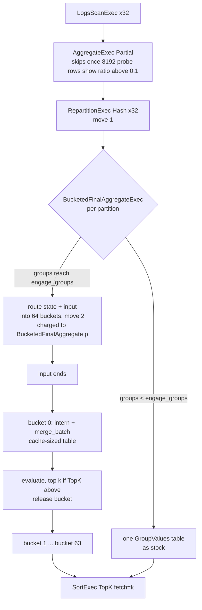

# ADR-3565: A bucketed final aggregate for fixed-width group keys, with exact per-bucket top-k

- Status: Accepted (2026-11-01)
- Date: 2026-11-01
- Refs: #3565, #3231, #1402, ADR-0013, ADR-0102, ADR-0825

## Context

Every heavy ClickBench GROUP BY runs one plan shape:
- a partial aggregate that gives up once its first 8192 probe rows show a group ratio above 0.1 (`crates/ravel-sql/src/session.rs:488-512`), which every statement here does;
- a 32-way hash `RepartitionExec`;
- a 32-way `AggregateExec mode=FinalPartitioned`.

Each final partition grows one DataFusion group table until its input ends, then emits every group. q33 groups by (WatchID, ClientIP): 99,997,493 groups over 99,997,497 rows, measured 2026-10-31 (#3565 comment 6549461554; the row count is the corpus's `rows_expected`, `docs/internal/clickbench-aws-runbook.md:576`), so all but 4 rows open a new group and the final almost never hits. That is 3.1M groups per partition, at about 120 MiB of table per partition (`dfbench-20261031T2032Z`, `table_MiB` for s33).

Measured on the reference machine (c6a.4xlarge, 8 cores, 32 MiB L3):

- **Cost.** In `prof028-20261030T1244Z` (#3231 comment 6525280440), the aggregate operator holds 68.0% of q33's server CPU, and hashing plus the group-key table hold 44.6%. Find and insert in the final are 37.9% of q33 (#3231 comment 6542264518, section 3).
- **Memory.** On `fullmain-20261031T1700Z` (main d29c8c5be), q33's query ledger peaks at 11.8 GB of intermediate bytes to return 10 rows, and q34/q35 at 9.2-9.4 GB. That ledger figure is the high-water mark of charged bytes (`crates/ravel-sql/src/memory.rs:1519-1524`), and the stock final's consumers are charged at the reserve-ahead factor, 1.25 by default (`memory.rs:1312-1318`; `AggregateReserveAhead::DEFAULT` sets `undercount_factor: 1.25` at `memory.rs:471`, selected by `config.rs:515`), so the bytes the tables asked for are about 9.4 GB, 94 B per group, and the ledger shows 118 B. The asked bytes are not recorded today; decision 3 adds them. Process VmHWM per q33 call is 16.0 GB on the c6a and 17.3 GB on the c8g (#3565 comments 6549550573, 6549461554), but the allocator keeps its arenas between calls (RSS is 14.8-15.8 GB before each later q33 call on the c6a), so VmHWM is a process figure, not a per-call one. #3516's top-k pre-filter did not move this, because it acts after the table is complete. #1402 established that no single-pass exact pruning exists for COUNT or SUM: a running count is a lower bound, and exact pruning needs an upper bound.
- **Memory latency.** The component benchmark ran three times. All three are invalid under their own pre-registration: A/A spread in growth mode, with presized rows clean. Run 3 isolated the cause as first-touch page-fault cost varying 9-19% between processes on this instance type, so the bench track stopped (run 1: #3231 comment 6548915738; run 2, THP off: 6549060076; run 3, one process per repetition: 6549496800). Its figures are reproduced observations, not a passed gate. It puts q33's key stream at:
  - 48 ns/row on one thread;
  - 92 ns/row per thread at 8 threads, one per core;
  - 175 ns/row per thread at 16 threads on 8 cores.

  So 16 threads interning do no more work per second than 8. That is the signature of a memory-bound loop, not a compute-bound one.
- **Counters.** c6a.4xlarge exposes no hardware event (`pmuX-20261031T2049Z`). On a c8g.4xlarge (Neoverse V2, `pmuA3-20261031T2227Z`, #3565 comment 6560647859, pre-registered in comment 6548953902, six events at 29-49% running share): q33's server cycles are 35.5% stalled on memory (`stall_backend_mem / cycles`), with 1.14 DTLB walks and 8.7 cache misses per 1k instructions, against 11.5%, 0.40 and 6.4 for the scan control q02. q36 (four Int64 keys, 9.8M groups) is 39.1% memory-stalled, q16 31.7%, q34/q35 33%, q19 23.4%, the SearchPhrase statements q13-q15 14.5-14.9%. The IPC predictions missed (q33 2.19) because they were written for a 4-wide core; the stalled share and the walk rate are what separate the group-by statements from the scans.
- **Where the misses are.** The `cache-misses` fill profile of q33 (same box and comment) puts 0.44 of all samples under the final (`FinalMarker`), and 0.40 of all samples in the group table probe itself (a subset of the 0.44; every share in this document is a share of all of the statement's samples) (hashbrown `match_tag` 0.13, the group-index `push` 0.10, `find_inner` 0.05, `fix_insert_index` 0.03); 0.36 under the 32-way hash `RepartitionExec` outside the final (the `take_native` scatter 0.20, the per-partition output writes the rest); 0.19 in Ravel's decode and scan; 0.007 under `create_hashes`. q16 and q36, the other fixed-width-key statements in the set, have the same shape (final 0.33-0.34, repartition 0.40, decode 0.26-0.27). q19, whose key carries `SearchPhrase`, sits between (final 0.34, repartition 0.34, decode 0.28). The other string statements do not: q34 is decode-led (0.40) with the final at 0.27 and `create_hashes` at 0.08, and q13 is decode 0.57 against final 0.15. For q33, q16 and q36 the final (0.44, 0.33, 0.34) and the exchange (0.36, 0.40, 0.40) together hold 0.73-0.79 of the DRAM misses; in this document "the exchange" means the whole `RepartitionExec` share and "the scatter" means its `take_native` part alone. Two ceilings follow for q33, and they are different: a change that only removes the final's probe misses can recover at most 0.40 x 0.355 = 0.14 of its cycles, and a change that also removes the exchange's misses at most the whole stalled share, 0.355.
- **Bucketing.** Splitting one partition's input into 64 hash buckets and aggregating them one after another with a small reused table (V1, which approximates apache/datafusion#25724) gave, run 1 / run 2:
  - s33 (two Int64 keys, unique): 0.657 / 0.653 on one thread with reused pages, 0.510 with fresh pages (run 3), and 0.638 at 8 threads (run 1);
  - s16 (one Int64 key): 0.91;
  - s32: 0.90;
  - every shape with a string key was slower in every run: s17 1.363 / 1.440 / 1.326, s19 1.149 / 1.078 / 1.017, s34 1.392 / 1.402 / 1.159.

  Because no component band counts as met, the gate for this ADR is the end-to-end paired A/B in decision 6, step 3, and nothing is enabled before it passes.

  At 8 threads, 41 of s33's 59 ns/row is routing: hashing, gathering and copying the row into its bucket. Bucketing trades the cache miss for a second move of the row, after the one the exchange already made.

DataFusion 55.2 has no hook to give the final aggregate a different group table. `AggregateExec::execute_typed` and `FinalHashAggregateStream` are private. #25724 is a draft on DataFusion main and targets a later release. So a Ravel version is a Ravel `ExecutionPlan` that replaces the final aggregate. The parts it needs are public in 55.2:
- `GroupValues`, `new_group_values` and `GroupValuesColumn`;
- `AggregateFunctionExpr::create_groups_accumulator`;
- `GroupsAccumulator::{merge_batch, evaluate}`;
- `create_hashes`;
- the `AggregateExec` accessors.

## Decision

### 1. `BucketedFinalAggregateExec`, behind `SqlConfig::bucketed_final_aggregation` (off by default)

*Amendment 1 below records what the implementation and the A/B measured against this section; read it with this one.*

A physical optimizer rule replaces `AggregateExec mode=FinalPartitioned` with `BucketedFinalAggregateExec` when every condition below holds. Otherwise the plan is unchanged.

Conditions:
- the config field is `Some`; `None` is the default and installs no rule;
- every group key is a fixed-width, non-float primitive that `new_group_values` dispatches to a primitive table: integer, date, timestamp, time or interval. No string, dictionary, view, float, boolean, Decimal128, Duration or nested key (boolean lands on `GroupValuesRows`, not the 16-byte-entry table the bucket sizing assumes; Decimal128 and Duration do dispatch to a primitive table but are outside this whitelist until measured, and the applicability test pins their refusal);
- a single grouping set, with no grouping sets or ROLLUP;
- every aggregate supports a `GroupsAccumulator`, and every state field is a primitive or Decimal128. A `COUNT(DISTINCT)` that survives the logical rewrite (q10, where `AVG` beside it keeps `SingleDistinctToGroupBy` from firing) has a `List` state field and is refused; q05 and q09 qualify only because that rewrite turns them into a GROUP BY on `UserID` under a plain aggregate, and the applicability test pins both outcomes;
- no aggregate carries an ordering requirement, and the aggregate carries no limit options.

The rule runs after `BoundedTopKAggregate` (which, when `bounded_topk_max_limit` is set, walks down from the `SortExec` in `rewrite` and refuses nodes it does not know, `bounded_topk.rs:162-222`, so #1402's bound for MIN/MAX-ordered top-k is kept) and before `CompactSlices` and `AggregateProfileRule`. The last two recognise only `AggregateExec`, so the new exec charges its own memory (decision 3) and does its own top-k (decision 4). Because `CompactSlices` no longer sits above this exec, every batch the exec emits owns its buffers: a bucket's evaluated output is cut into `batch_size` batches by copy, never by slice, so no operator above charges one batch the whole bucket's buffers (#2720's overcharge, #3516's per-batch cut). An applicability test pins the rule's position relative to all three.

Per output partition, the exec runs in two phases.

**Phase 1: single table, then route.**
- It starts with one `GroupValues` table and one set of accumulators, exactly as the stock final.
- Once the table holds `engage_groups` groups (default 65,536, the size at which #25724 measured engaging later to be worse than never), it routes instead.
  - It evaluates the table's state (`GroupsAccumulator::state(EmitTo::All)` plus `GroupValues::emit`).
  - It routes those rows, and every later input row, into `2^bits` buckets.
- A row's bucket is the top `bits` bits of a hash taken with a Ravel-fixed seed that differs from `REPARTITION_RANDOM_STATE` (seed 0, `repartition/mod.rs:650`). With seed 0, the bucket would be correlated with the partition the row is already in.
- Each bucket holds its rows column by column in fixed-size chunks (`routed_chunk_rows`, default 8192) appended to a list, keys plus accumulator state. Chunks, not doubling vectors, so the resident slack is at most one chunk per bucket per column, and the retained bytes are the routed bytes plus that bound.

**Phase 2: one bucket at a time.**
- When input ends, the exec aggregates bucket 0, emits it, releases its buffers, then moves on to bucket 1.
- One `GroupValues` and one accumulator set are reused across buckets, with `clear_shrink`.
- `bits` defaults to 6 (64 buckets). For q33 that puts about 49k groups, about 2 MiB of table, in each bucket. Locality is a property of the concurrent set, not of one partition: the reference machine polls up to 16 partitions at once on 8 cores with a 32 MiB L3, so the live working set of bucket tables is 16 x 2 MiB = 32 MiB, the size of the L3 rather than a fraction of it, before the routed chunks being read and the output being written are counted. The default therefore buys the L3 the chance to hold the tables, not a guarantee; `bits` 7 (128 buckets, about 1 MiB per table) is the first alternative to measure. The default is a starting point taken from #25724; the A/B in decision 6 decides it, and `bits` is a config field so it can move without a code change.

The exec yields between batches in phase 1 and between buckets in phase 2. A dropped stream and the memory-breach check in `PinnedStream::poll_next` (`executor.rs:5440-5456`, the `self.breach.message()` check at the top of the poll) therefore act at the granularity of one routed batch in phase 1 and one bucket in phase 2. Under skew that granularity is coarse: in the 90%-one-key fixture one bucket holds 90% of the partition's retained input, so a phase-2 cancellation can be a partition's worth of work late. That is no worse than the stock final, which yields per input batch and emits per output batch.

### 2. Exactness

Every group lands in exactly one bucket, because the bucket is a function of the key alone. A bucket's groups are complete once input ends. Each bucket runs the same `merge_batch` and `evaluate` over the same state the stock final would see, so the results are the same.

What may differ:
- Output row order differs. SQL leaves it unspecified without ORDER BY.
- Float accumulation order is out of scope by construction, because float keys are refused. Float state (`avg` over floats) is refused too, so no float sum is reassociated: `exact_typed` already sends float aggregates away from `FinalPartitioned`.
- NULL keys hash like any other value and group as DataFusion groups them.

A differential test runs every ClickBench GROUP BY shape that qualifies, plus fixtures for NULL keys, all-NULL keys, a single group, skewed keys (90% of rows in one key) and unique keys. Each runs at 1, 4 and 32 partitions, with the config on and off, and asserts identical sorted answers.

### 3. Memory

*Amendment 1 below records what the implementation and the A/B measured against this section; read it with this one.*

Every byte the exec retains in its buckets is charged before it is retained, to one consumer per partition named `BucketedFinalAggregate[p]`. Phase 1's stock table is the exception, and it is bounded: it is charged by `size()` after each batch, which is the #3181 undercount `AggregateReserveAhead` covers for the stock consumers (`memory.rs:48-57`) and does not cover here, and it holds at most `engage_groups` groups: 65,536 groups at 53 B of keys and state is 3.3 MiB, and with the table's load factor (0.5-0.875) and doubling slack counted as the Context does, the undercount is bounded at about 2 x 3.3 MiB, under 7 MiB per partition.

The pool records charged bytes only. `peak_intermediate_bytes` is the high-water mark of the charged total, and the stock final's consumers are charged at the reserve-ahead factor while this exec's are charged at 1.0, so that figure cannot compare the two arms. PR1 adds `peakAskedIntermediateBytes` to the query stats beside it: the high-water mark of the bytes consumers asked for, before any factor, on both arms alike. That is the memory gate's figure.

That name matches none of the prefixes in `crates/ravel-sql/src/memory.rs:392-419`, so:
- the charge is one-to-one on query, tenant and process (`grow_charged`/`try_grow_charged`, `memory.rs:1422/1438`);
- there is no reserve-ahead factor and no held release.

Charging:
- Phase 1's table is charged by its `size()` after each batch, as DataFusion does (bounded as above).
- A routed batch is charged at its bucket buffers' new capacity before it is appended.
- Phase 2's reused table is charged by `size()` after each batch, bounded by one bucket.
- A refused grow returns the pool's `ResourcesExhausted`, which surfaces as the query's error.

Nothing spills. A query with spill configured never reaches `FinalPartitioned` (`session.rs:618`), so the rule never fires there (ADR-0013 unchanged).

*The bucket spill amendment below (2026-11-10) changes this for ADR-0954's refusal retry: the retry of an admitted shape keeps its `FinalPartitioned` final, converted to this exec, and the exec spills its routed chunks once. It also corrects the sentence above for the first attempt.*

Peak per partition = retained bucket input + one bucket's table and accumulators.
- For unique keys (q33), the retained state rows are about the size of the groups. Bucketing therefore lowers the peak: the table's 0.5-0.875 load factor and doubling slack are gone, and one bucket's table is about 1/64 of a partition's.
- For repeated keys, retained input is up to R times the group state (R = rows per group). This is why string keys are refused: their rows also carry the string bytes.

### 4. Exact per-bucket top-k

*Amendment 1 below records what the implementation and the A/B measured against this section; read it with this one.*

When the exec's output reaches a `SortExec` with `fetch = k` through `ProjectionExec` nodes that pass the sort keys as bare columns and through a fetch-less `CoalescePartitionsExec`, each bucket's evaluated output is cut to its own top k before it is emitted. That is `TopKPrefilter::above`'s reach rule (`compact_slices.rs:329-345`), reused as is. Ravel plans with `repartition_sorts(false)` (`session.rs:620`), so the top-k over a 32-partition final is one global `SortExec` above a `CoalescePartitionsExec`, the shape the TopK pre-filter's reach rule is written for (`docs/query-engine.md:1722-1726`, the `tests/compact_slices.rs` q34 shape test), and that is the shape the rule matches; a `preserve_partitioning` sort is not required and never appears here.

It is exact for the reason `compact_slices.rs:141-146` gives for a batch:
- a bucket's groups are complete;
- a row outside its bucket's top k has k rows ahead of it that reach the same TopK.

At a tie on the k-th value, which tied row survives may differ, which SQL allows. Nothing is pruned before a bucket is complete, so #1402's counterexample does not apply.

What this buys:
- The TopK input falls from every group to at most `64 x k` rows per partition.
- The table memory of each bucket is released before the next bucket is aggregated. It does not lower the retained input.

### 5. Fused routing: only after decision 1 clears its A/B

*Amendment 1 below records what the implementation and the A/B measured against this section; read it with this one.*

The exchange and the bucket router each move every row once. A fused exec that replaces `RepartitionExec(Hash)` and the final together would let each producer:
- hash once for the partition and the bucket;
- sort a chunk of rows by (partition, bucket) with one copy;
- ship the chunk with its bucket offsets.

The final would then read each bucket as slices of those chunks, with no router copy. It would still hash every row once more in phase 2, because `GroupValues::intern` hashes with the private `AGGREGATION_HASH_SEED` (`group_values/mod.rs:100`): decision 1 hashes a row three times (exchange, router, intern), fusion twice.

This is a separate decision. It needs its own amendment, its own pre-registration and its own A/B against decision 1, not against main. Hash reuse across the exchange was tried twice upstream and closed with no gain (apache/datafusion#23720, #23446). So fusion is judged by measurement, not by a count of saved passes.

What the counters say about it: the exchange holds 0.36 of q33's DRAM misses on main (0.20 of them in the `take_native` scatter, the rest in the per-partition output writes), about as much as the final's probe, and decision 1 leaves it in place. Fusion does not remove those misses; a sorted scatter still writes every row once into fresh chunks, so they move. What it removes is the router copy decision 1 adds, which the 0.36 does not contain. Its measurement needs decision 1's exec as arm A, so it is scheduled after decision 1's A/B, and only if decision 1 passes.

### 6. Delivery and bands

*Amendment 1 below records what the implementation and the A/B measured against this section; read it with this one.*

Each step is a separate PR. The switch is off in every one of them. Turning it on by default is its own PR, opened only after step 3 passes.

1. **The exec, the rule and the tests** (differential, memory-refusal and cancellation tests; applicability tests that pin every refusal condition). The switch stays off. The PR also adds a server flag, `--sql-bucketed-final-aggregation`, following `sql_parallel_final_aggregation`.
2. **Per-bucket top-k** (decision 4), with a test that pins exactness on ties and a peak-bytes assertion on a fixture.
3. **A paired A/B on the reference machine** (`cpuab`, A = main, B = main with the flag on, same binary), pre-registered on #3565 with these bands, copied from this table:

<!-- bands copied to #3565 before launch -->
| figure | band | miss | basis |
|---|---|---|---|
| q33 server CPU per call, B/A | 0.82-0.90 | > 0.94 | predicted from one derivation: V1 0.638 at 8 threads on s33 (#3231 comment 6548915738, reproduced at 0.653 single-thread in comment 6549060076) applied to the final's find+insert share of 37.9% (#3231 comment 6542264518) gives 1 - 0.379 x (1 - 0.638) = 0.863; the counters bound the latency part alone at 0.14 of cycles (probe 0.40 of misses x 0.355 stalled, #3565 comment 6560647859), so the lower edge is the extra instruction saving of a 2 MiB table over a 120 MiB one; the exchange (0.36 of misses) is untouched by decision 1 and is not in this band |
| q33 hot wall, B/A | 0.84-0.95 | > 0.98 | predicted: no lower than the CPU band's edge, because phase 2 runs after input ends and the overlap with the scan is lost, which moves wall up relative to CPU |
| q33 `peakAskedIntermediateBytes` (decision 3, factor-free on both arms), B/A | 0.45-0.75 | > 0.85 | predicted: B retains 53 B per group (12 B of keys: WatchID Int64 and ClientIP Int32; 8 B count; 8 B sum; 24 B avg state: Decimal128 numerator and Int64 count, `avg.rs:793`; one validity bit per column) over 99,997,493 groups = 5.3 GB, plus at most one 8192-row chunk per bucket per column (under 0.1 GB over 32 x 64 buckets) and one 2 MiB table per partition; A is about 9.4 GB (11.8 GB charged on `fullmain-20261031T1700Z` at the 1.25 factor, measured 2026-10-31) and is read exactly from arm A's own stat before arm B is judged |
| q33 ledger `peak_intermediate_bytes`, B/A | reported, not a gate | none | predicted: its two arms are charged at different factors (decision 3), so it is reported beside the asked figure for the factor to be read off, not judged |
| q33 VmHWM per call, B/A | reported, not a gate | none | measured 2026-10-31 (`pmuX-20261031T2049Z`, `pmu/calls.tsv`): the allocator keeps its arenas between calls, so RSS before each q33 call is already 14.8-15.8 GB and the per-call VmHWM delta reads 0.0-0.96 GB across five calls; a process high-water mark cannot gate bytes after the first call |
| q16, q32, q05, q09, q31, q36 server CPU, B/A | 0.88-1.00 | > 1.03 | predicted: V1 s16 0.91, s32 0.90 (#3231 comment 6548915738); q05 and q09 qualify through the `SingleDistinctToGroupBy` rewrite, pinned by the applicability test |
| every statement the rule refuses, q10 included, server CPU, B/A | 0.98-1.02 | > 1.03 | predicted: the plan is identical (pinned by a test) |
| 43-statement hot sum, B/A | 0.96-0.99 | > 1.01 | predicted: q05 0.583 + q09 0.851 + q16 0.687 + q31 0.816 + q32 0.875 + q33 3.133 + q36 0.658 = 7.60 s of the 35.44 s hot sum qualifies (min of tries 2 and 3 per statement, `fullmain-20261031T1700Z`, measured 2026-10-31) |
| answers | identical except q18, q25 ties | any other difference | measured 2026-10-31: q18 and q25 vary within arm A |

Two more guards:
- A concurrency row: 4 concurrent q33s under a pool sized for two must refuse cleanly, with no RSS above the pool plus caches.
- q33 must not be refused at the stock entry's pool when A is not.

## Rejected alternatives

- **Patch DataFusion with #25724.** It is a +1,939-line draft against DataFusion main, and Ravel pins 55.2. A backport is a fork of the aggregate stream to carry until the next upgrade, and the draft's spill path conflicts with ADR-0013's disabled spill. Its measurements are the evidence this ADR builds on. If it lands upstream, it replaces decision 1 at the upgrade that brings it.
- **Bucket string keys too.** Measured slower on every string shape (three runs: s17 1.363 / 1.440 / 1.326, s19 1.149 / 1.078 / 1.017, s34 1.392 / 1.402 / 1.159; #3231 comments 6548915738, 6549060076, 6549496800). Retained input carries each row's string bytes, R times the group state. #25724 dropped string bucketing for the same reason.
- **Raise the partition count so each final table is smaller.** All final partitions are polled concurrently by 16 threads, so the working set is every table at once. Locality comes only from finishing one bucket before starting the next.
- **Prefetch in the probe (hashbrown#727).** It needs an unreleased hashbrown API carried through a DataFusion fork. It is the #3231 track's, measured there (V2: s33 0.827, s19 0.825; 7-14% in run 3). It composes with this decision and is not a substitute for it on q33.
- **Prune groups before a bucket is complete.** Inexact for COUNT and SUM (#1402).
- **Reuse the repartition hash for the bucket.** The partition is `hash % 32` on seed 0, so its low bits are fixed within a partition. Reuse also failed upstream twice. The bucket takes its own seed.

## Consequences

*Amendment 1 below records what the implementation and the A/B measured against this section; read it with this one.*

- Off by default. With the switch off, no plan changes, and a test pins plan equality. The bucket spill amendment below makes one exception: ADR-0954's refusal retry installs the rule whatever the switch says.
- With it on, eligible fixed-width finals lose overlap with the scan: phase 2 starts only when input ends. That is the cost #25724 measured on its Q12.
- Ravel carries one aggregate exec of its own until DataFusion ships an equivalent. The DataFusion surfaces it uses (`GroupValues`, `GroupsAccumulator`, `create_hashes`, the `AggregateExec` accessors) are named in a test that fails to compile if any becomes private.
- The new consumer name is outside the reserve-ahead set of ADR-1170's reserve-ahead amendment (`docs/adrs/1170-process-memory-budget.md:1429-1448`, `reserves_ahead` at `memory.rs:1312-1318`), by design: the bucket buffers are charged at capacity before they are written, which is what the factor approximates for the stock tables.
- Statements outside the fixed-width set (q34, q35, q17-q19, which together are 10.4 s of the 15.1 s that the eight heavy GROUP BY statements q16-q19 and q32-q35 take in all, min of tries 2 and 3 on `fullmain-20261031T1700Z`) are not addressed by this ADR. Their DRAM misses are decode-led (q34 0.40 in the URL scan against 0.27 in the final), so the next win on them is in the read path, not the aggregate.
- Decision 1 leaves the exchange's misses, 0.36 of q33's, where they are, and adds a router copy of every row. Decision 5 is the follow-up that takes the router copy back; whether it lowers the exchange's misses or only relocates them is what its A/B against decision 1 measures.
- The ledger's `peak_intermediate_bytes` is not comparable across the two arms (reserve-ahead 1.25 on the stock consumers, 1.0 on the new one), and process VmHWM is not usable after the first call. Memory gates on the asked-bytes stat PR1 adds; if the new consumer under-reports DataFusion's own table growth in phase 2, decision 3 is amended with a factor, measured first.

## Amendment 1 (2026-11-02): what the implementation and the A/B measured

<!-- amendment-applies: sections="1. `BucketedFinalAggregateExec`, behind `SqlConfig::bucketed_final_aggregation` (off by default)|3. Memory|4. Exact per-bucket top-k|5. Fused routing: only after decision 1 clears its A/B|6. Delivery and bands|Consequences" pointer="amendment 1" -->

Status of this amendment: Accepted. Refs: #3565, #3607, #3608, #3609, #3639. The switch stays off by default.

### Corrections to the decision text

- **Decision 1, chunk slack.** Decision 6's band row said the slack is "under 0.1 GB over 32 x 64 buckets"; it is about 9x that. The q33 shape routes 6 columns at 52 B per row (8 + 4 B of keys; 8 + 8 + 16 + 8 B of state, the integer `avg` state being `Decimal128` plus `Int64`), so one chunk set per bucket is 8192 x 52 + 6 x 1024 = 432,128 B, 26.4 MiB per partition for 64 buckets and 0.885 GB at 32 partitions. The engage routes about 1,024 state rows per bucket, so every bucket allocates its first chunk at once and the 0.885 GB is charged up front (#3565, checkpoint review of #3608). The smallest shape, one Int64 key plus a count, charges 8 MiB per engaged partition, more than the 256 MiB default query ceiling at 32 partitions. `routed_chunk_rows` (default 8192) is revisited in #3639 before any default changes.
- **Decision 3, the gate figure.** `peakAskedIntermediateBytes` (#3607) is the peak of the bytes live reservations hold before any reserve-ahead factor: a held shrink lowers it while the charge stays held, so it is at most the charged peak and equals it only when no reserve-ahead consumer and no held release took part. Under a TopK the evaluated bucket batch and its sort indices are held uncharged while the cut runs, at most one bucket's evaluated output per partition (#3639 charges it).
- **Decision 4, what the cut buys.** The per-bucket cut bounds the sort's input to 2^bits x k rows per engaged partition. It does not lower whole-plan peak asked bytes: each bucket's table is charged in full before its output is cut, and buckets run one at a time (measured identical with and without the cut on the q33 shape, #3609). The per-bucket table release belongs to decision 1, not to the cut. The reach rule is `TopKPrefilter::above` as written, so a `preserve_partitioning` sort with a fetch is also cut, which is exact because each partition feeds its own TopK.
- **Decision 1, `CompactSlices`.** A converted aggregate gets neither half of that rule: the slice compaction, redundant because the exec's output batches own their buffers, and the TopK pre-filter, which decision 4 replaces inside the exec. Between #3628 and #3640 a qualifying `ORDER BY ... LIMIT k` under the switch had no cut at all.
- **Decision 5, wording.** Fusion does not "hash once": `GroupValues::intern` hashes with the private aggregation seed in phase 2 whatever the exchange does, so decision 1 hashes three times per row and fusion twice. Fusion takes back the router copy decision 1 adds; whether it lowers the exchange's misses (0.36 of q33's on main) or relocates them is what its own A/B would measure. It is not scheduled.

### The A/B

`bfab-20261102T0716Z`, c6a.4xlarge, stage `cpuab`, A = B = main 6df152450, arm B `--sql-bucketed-final-aggregation`, eight lifetimes A B B A B A A B, 1,256 timed calls, medians of the 12 timed calls per arm; pre-registration #3565 comment 6571398126, readout comment 6572771621 and its correction. Validity: every answer `success`, answers identical across arms on all 43 statements, A/A spread on the scan control 0.9%.

| figure | band | miss | result | basis |
|---|---|---|---|---|
| q33 server CPU per call, B/A | 0.82-0.90 | > 0.94 | 1.000, MISS | #3565 comment 6572771621 |
| q33 hot wall, B/A | 0.84-0.95 | > 0.98 | 1.004, MISS | #3565 comment 6572771621 |
| q33 `peakAskedIntermediateBytes`, B/A | 0.45-0.75 | > 0.85 | 0.623, PASS (9.48 GB to 5.91 GB; charged 11.83 to 5.91; VmHWM 18.25 to 13.65) | #3565 comment 6572771621 |
| q05, q09, q16, q31, q32, q36 server CPU, B/A | 0.88-1.00 each | > 1.03 | 0.825, 0.894, 0.917, 1.030, 0.999, 0.918: no miss; q05 below the band, q31 at the miss line | #3565 comment 6572771621 |
| same six, `peakAskedIntermediateBytes` B/A | reported | none | 1.13, 1.63, 1.74, 1.89, 0.84, 3.34: the chunk slack above, visible | #3565 comment 6572771621 |
| every refused statement, server CPU, B/A | 0.98-1.02 each | > 1.03 | no miss; q25 0.968, q38 0.974, q43 1.029 on 0.1-0.3 s statements | #3565 comment 6572771621 |
| 43-statement hot sum, B/A | 0.96-0.99 | > 1.01 | 0.996 | #3565 comment 6572771621 |
| answers | identical except q18, q25 ties | any other difference | identical across arms on all 43 | #3565 comment 6572771621 |

### Decision

On q33, the statement this ADR was written for, bucketing moves the memory and not the time: the latency saving the counters bounded at 0.14 of cycles is spent again on the router copy, the second hash and the chunk writes, within the run's resolution. The CPU wins land on the small fixed-width statements (q05, q09, q16, q36, 0.67 s of the 50 s hot sum) and cost them 1.1-3.3x in asked bytes. Per the pre-registered outcome rule (CPU miss with the memory gate in band), **the switch stays off by default**. The exec, the rule, the stat and the tests stay in the tree behind `SqlConfig::bucketed_final_aggregation` as a measured, reviewed option for an operator who wants q33's peak memory halved at equal CPU. No PR turns it on. Decision 5 is recorded as the only lever left on q33's CPU and is not scheduled. #3639 carries the follow-ups.

## Amendment 2 (2026-11-10): bucket spill for the refusal retry

<!-- amendment-applies: sections="3. Memory|Consequences" pointer="bucket spill amendment" -->

Status of this amendment: Accepted as a plan. Refs: #4073, epic #4072. The code is T2 (#4074); the measurement is T3 (#4075). The switch stays off by default for the first attempt.

### Bucket spill context

This is the bucket spill amendment. ADR-0954's parallel bucket spill amendment (2026-11-10) keeps the hash exchange in the refusal retry of a shape this exec's rule admits, and converts its finals to this exec. On c6a.2xlarge q33's retry today writes 8.5 GB of sort-merge spill per try at about 240 MB/s, the volume's ceiling (ADR-0954, that amendment's context). Decision 3 above has no spill: a refused grow fails the statement. This amendment decides how the exec spills, so that its routed state goes to disk once.

Two corrections to decision 3 first:
- "A query with spill configured never reaches `FinalPartitioned`" has not held since ADR-0954's refusal-retry amendment (2026-11-07): a server with spill configured runs every first attempt as if spill were unconfigured, so with the switch on the rule fires on first attempts there. The cited line has also moved; `with_repartition_aggregations` is at `session.rs:658` and the spill-enabled session's repartition-free planning at `session.rs:737`.
- The exec's consumer is registered without `with_can_spill` (`bucketed_final_aggregate.rs:884-887`), so ADR-0954's spill-mode cap (`spill_cap_admit`, `memory.rs:1703-1725`) does not apply to it today.

### Bucket spill decision

1. **When the exec spills.** In the refusal retry the exec's consumer registers `with_can_spill(true)`; on a first attempt it registers as today. In the retry a refused charge on that consumer (a routed chunk, `bucketed_final_aggregate.rs:756`, or a table, `charge_table` at line 996) is a spill trigger, not an error:
   - the stream writes every chunk it retains, for every bucket it has not yet aggregated, to that bucket's scratch file, once, releases their charge, and asks for the charge again;
   - from then on each chunk is written when it fills, and each bucket's last, partly filled chunk is written when input ends;
   - a refusal while the stream still holds its phase 1 stock table has nothing routed to write, so asking again would be refused again and item 5's typed failure would fire on a table of fewer than `engage_groups` groups. Such a refusal forces decision 1's route switch first, whatever the table's group count, and the forced route asks the pool for nothing. The table's state is evaluated as the engage evaluates it, in one batch (`EmitTo::All`, `bucketed_final_aggregate.rs:966-969`), under the table's existing charge (the state rows are no larger than the table that held them). It is not routed through open chunks: a routed chunk is allocated at `routed_chunk_rows` capacity and charged by a grow (`OpenChunk::allocate(&self.types, self.chunk_rows)` and `try_grow_named`, `bucketed_final_aggregate.rs:755-756`), up to `2^bits x c x w` across the buckets (6.8 MB per stream at item 4's q33 tuning), which the table's charge need not cover, since the refusal can arrive while this stream's table is small: the pool also refuses a grow within the consumer's own share when the spill-capable total would pass the spill-mode hard bound (`memory.rs:1724`, `within_share && after <= hard_bound`). Instead the state is taken in slices of at most `c` rows; each slice is hashed and split by bucket as the router splits a batch, and each bucket's rows of that slice are copied out as one piece, written to its bucket's file and dropped before the next slice is taken. The slice's hashes and order (8 + 4 B per row, as in the router's scratch, `bucketed_final_aggregate.rs:660-666`, plus its per-bucket offsets) and its pieces, at most `c x (w + 12)` bytes and that bookkeeping, are the forced route's only memory outside the table's charge, and are held uncharged. A stock table holds fewer than `engage_groups` groups (65,536 by default, `config.rs:454`), so the forced route writes at most `2^bits x ceil(engage_groups / c)` pieces per stream. Once every slice is written the state and the table's charge are released, and only then is the charge asked again. From there the stream is in the routed stage the bullets above describe;
   - when input ends, each bucket is read back from its file and aggregated alone, as decision 1's phase 2 aggregates it, then emitted, and its file is deleted before the next bucket starts.

   Scratch files are created through the session's disk manager (`DiskManager::create_tmp_file`, `datafusion-execution` 55.2.0 `src/disk_manager.rs:342`), so they count against the share ADR-0954 reserves for the retry, together with the exchange's spill files. Pinned by T2 #4074 (`bucket_spill_writes_each_routed_row_once`, which counts rows written against rows routed on a fixture where the trigger fires in phase 1, and again where it fires in phase 2; the phase 1 case asserts that the trigger routes and writes the stock table before the charge is asked again, that the consumer makes no grow while it does, including when the trigger is a hard-bound refusal of a table smaller than `2^bits x c x w`, and that the statement answers rather than failing with item 5's error).

   Open file descriptors are bounded by a no-tuning condition, not by closing files between appends. A file from `create_tmp_file` holds its `NamedTempFile`'s descriptor from creation until its last reference drops, which also deletes it (`disk_manager.rs:371-376`, the `tempfile: Arc<NamedTempFile>` field at line 402), and its spill writer holds a second, cloned descriptor (`open_writer`, `disk_manager.rs:575-586`). A bucket file opened per append and closed would have to leave the disk manager, and with it the quota item 8 relies on. So a stream holds at most 2 descriptors per bucket file until that bucket is read back, and its read-back adds one more for one file at a time: `2 x P x 2^bits + P` per retry, 528 for q33 on c6a.2xlarge (`P` 16, `bits` 4; item 4's table gives each M8 box), 1,056 to 4,128 on a 32-partition node at `bits` 4 to 6, and up to `2 x P x 65,536 + P` at `BUCKETED_FINAL_AGGREGATE_MAX_BITS`. Up to `slots` retries can hold theirs at once, where `slots = clamp(floor(sql_spill_max_bytes / 8 GiB), 1, 4)` (`SpillBudget::slots`, `spill.rs:188-190`): 1 on c6a.large, 2 on c6a.xlarge and 4 on c6a.2xlarge (item 4's table), and a service manager or container runtime commonly leaves the soft `nofile` limit at 1,024 (`deploy/metricsbench/README.md:299`, #3412). T2 #4074 makes ravel-server raise its soft limit to the hard limit at startup, before anything reads it, and log both values, so after T2 the soft limit is 1,024 only where the hard limit is 1,024 too. Item 4 returns no tuning when that bound, `2 x P x 2^bits + P`, exceeds `F = floor(nofile_soft / (2 x slots))`, the soft limit read once at server start after that raise (rustix's `process::getrlimit`, a safe call; the workspace's `rustix` enables only `fs`, `Cargo.toml:186`, so T2 adds the `process` feature of that existing dependency): half the limit stays with sockets, object-store connections, the exchange's spill files and everything else the process holds, and the other half is split evenly across the slots. At a soft limit of 1,024 and 4 slots `F` is 128, so q33 keeps the sort-merge retry; at the 524,288 the MetricsBench services run with it is 65,536. The cap was chosen over a narrower per-file cost because it keeps the disk manager's quota accounting and fails to a retry that already answers. Pinned by T2 #4074 (`bucket_spill_descriptor_budget`: the q33 derivation inputs return no tuning at a soft limit of 1,024 with 4 slots and `bits` 4 at 524,288, and at 4 slots with `bits` 4 a limit of 4,224 tunes and 4,223 does not, which pins the `+ P` in the condition, and a spilling fixture asserts each stream never holds more than `2^bits` scratch files open).

2. **Disk bound.** Every routed row is written at most once, in whole chunks except each bucket's last and, when the trigger fired in phase 1, the pieces of the stock state (item 1, at most `2^bits x ceil(engage_groups / c)` per stream); a piece holds only its rows, so neither adds column bytes, and each adds one message's framing. A stream with `R` routed rows of width `w` bytes, `2^bits` buckets and `routed_chunk_rows = c` therefore writes at most `R x w + 2^bits x c x w` bytes of column data before lz4_frame: the routed state once, plus at most one chunk per bucket. Arrow IPC adds its per-chunk message framing. Arrow IPC writes a buffer the codec does not shrink uncompressed (ADR-0954, refusal-retry decision item 2), so compression does not raise the bytes on disk above that. Nothing is merged, so nothing is rewritten. A bucket's file is deleted after its read-back, so live scratch falls through phase 2. The quota bounds the total in every case. Pinned by T2 #4074 (`bucket_spill_disk_within_write_once_bound`, which asserts the bound exactly on the q33 shape and on random keys).

3. **Memory bound.** Per stream, after the trigger: one bucket's table and accumulators, one open chunk per bucket per column (`2^bits x c x w` plus validity), the one chunk being read back, the router's scratch (charged with the table, `bucketed_final_aggregate.rs:989`), and before the engage the phase 1 table decision 3 bounds. Each is charged to `BucketedFinalAggregate[p]` as decision 3 charges it, except the one slice a phase 1 trigger's forced route has in flight (item 1), at most `c x (w + 12)` bytes and its per-bucket offsets, held uncharged while it is written, and the phase 1 table's undercount stays under the 7 MiB decision 3 bounds it at. ADR-0954's spill-mode pool caps that consumer at its fair share. Pinned by T2 #4074 (`bucket_spill_peak_within_share`, which asserts the consumer's peak charge against the share on the q33 shape).

4. **How `bits` and `routed_chunk_rows` are derived.** The retry derives them from the refused first attempt; they replace decision 1's defaults (`bits` 6, `routed_chunk_rows` 8192) for that retry only. With:
   - `A`, the first attempt's peak asked intermediate bytes at its refusal (decision 3's figure, all consumers);
   - `N`, the scan's total input rows, and `n`, the input rows the aggregate's scan had consumed at the refusal, both on the scan's input basis, before any filter. Counting `n` as the scan's output rows would put the two on different bases: they agree for q33, which has no WHERE, but on a filtered admitted shape `N / n` would overestimate `T` by a factor of one over the filter's selectivity and send the retry to sort-merge for no reason. Neither is read from what Ravel reports today:
     - `N` is the sum of `SegmentRef::sample_count` over the `LogsScanExec`'s segments, read from the scan node itself, in checked `u64` addition as the scan's statistics sum it (`logs_scan/mod.rs:3352-3355`). Exact and before any filter, since it is the committed row count of every segment the scan touches. `Statistics::num_rows` is not that figure: the scan reports it `Exact` only when `stats_are_exact()` holds, which is false whenever the scan carries a prune list, a content predicate, a key filter, a row filter, an erasure, or a time range narrower than its segments (`logs_scan/mod.rs:2481-2502`, `:3348-3360`), so on the filtered shapes this bullet is about it is `Absent`;
     - `n` has no source today: the scan's metrics (`logs_scan/mod.rs:1683-1706`) and the operators' `output_rows` all count after filtering, and nothing under `crates/ravel-sql/src` counts rows consumed before it. T2 #4074 adds that counter to `LogsScanExec`: every row of a segment or block a scan partition has finished counts, whether the scan decoded it, pruned it or filtered it out, on the same `sample_count` basis as `N`, so `n` reaches `N` exactly when the scan ends;
   - `P`, the retry's final partition count (ADR-0954 parallel bucket spill item 5);
   - `C`, the consumers the retry plan's nodes register `with_can_spill(true)`, counted from the built plan over every node, not only the aggregate's subtree, because the pool divides its cap by every spill-capable consumer registered in it (`ledger.spillable_registered`, `memory.rs:1719`). T2 counts it from a closed table, one per output partition of each node the table lists and none for a node it lists as registering no spill-capable consumer; where a node registers one only on some paths it is counted anyway, an over-count that only lowers `S`:
     - every `AggregateExec`, whatever its mode: each of its stream types registers exactly one consumer per partition, spill-capable or not depending on the stream (`datafusion-physical-plan` 55.2.0 `src/aggregates/hash_stream.rs:475-478` and `:1050-1053`, `grouped_hash_stream.rs:514-518`, `single_stream.rs:359-362`, `ordered_partial_stream.rs:148-154`, `ordered_final_stream.rs:287-295`, `aggregate_stream.rs:302-303`, `partial_reduce_stream.rs:174-176`);
     - every `RepartitionExec` (`src/repartition/mod.rs:494-498`; its order-preserving merge consumer, `:1732-1734`, registers without it);
     - every `SortExec` with no fetch, which builds an `ExternalSorter` when its input is not already sorted (`src/sorts/sort.rs:1427-1428`) and registers it `with_can_spill(true)` (`sort.rs:285-287`; its merge consumer, `:289-291`, without it);
     - every `BucketedFinalAggregateExec`, which in the retry registers one (item 1);
     - registering none: a `SortExec` with a fetch, which runs a `TopK` (`sort.rs:1398-1400`) registered without it (`src/topk/mod.rs:360-361`), `SortPreservingMergeExec` (`src/sorts/sort_preserving_merge.rs:354-356`), and Ravel's own nodes, whose only `with_can_spill(true)` registrations under `crates/ravel-sql/src` are in test modules. T2 completes the table with every other node an admitted plan holds, q33's `LogsScanExec` and its projections among them, each checked the same way. The no-tuning rule below binds against the table as T2 completes it, not against this list.

     A `NestedLoopJoinExec` also registers one (`src/joins/nested_loop_join.rs:1588-1590`) and is left out of the table. A plan holding any node the completed table does not list returns no tuning (below), so `C` never misses a spill-capable consumer. DataFusion 55.2 runs a partial aggregate as `PartialHashAggregateStream` (`datafusion-physical-plan` 55.2.0 `src/aggregates/mod.rs:1183-1199`), because `enable_migration_aggregate` defaults to true (`datafusion-common` 55.2.0 `src/config.rs:890`) and Ravel does not override it; that stream registers its consumer `with_can_spill(true)` (`src/aggregates/hash_stream.rs:475-478`). `GroupedHashAggregateStream` (`grouped_hash_stream.rs:518`) is the fallback when the option is off. The partial stream's refusal path emits its table early instead of failing (`hash_stream.rs:644-662`, continuing into `EmittingOnMemoryPressure` at lines 674-679), and the final merges what it emits, so the partial stays exact under the share cap;
   - `L` and `H`, the per-query limit and the spill-mode headroom of ADR-0954's refusal-retry decision; `S = (L - H) / C`, the per-stream share;
   - `w`, the routed row width in bytes, fixed by the schema because keys and state are fixed width;

   the projected table bytes are `T = A x N / n`, and
   - `bits = max(0, ceil(log2(2 x T / (P x 0.75 x S))))`: the tables projected for one stream, times a margin of 2, fit in three quarters of its share one bucket at a time;
   - `routed_chunk_rows = min(8192, floor(0.25 x S / ((2^bits + 1) x w)))`: the open chunks and the read-back chunk fit in the remaining quarter.

   The derivation returns no tuning, and ADR-0954's retry keeps its sort-merge plan, when `n` is zero or the first attempt reported none (a scan without T2's counter), when the aggregate's input holds other than one scan, when that scan is not a `LogsScanExec` or its `sample_count` sum overflows, so that there is no exact `N`, when the plan holds a node the `C` table, as T2 completes it, does not list, when `bits` would exceed `BUCKETED_FINAL_AGGREGATE_MAX_BITS` (16, `bucketed_final_aggregate.rs:150`), when `routed_chunk_rows` would fall below 1024, or when item 1's descriptor bound `2 x P x 2^bits + P` would exceed its budget `F`.

   Order. `P` comes from `FinalExchangeFloor` and `C` from the built plan, and the exec needs `bits` and `routed_chunk_rows` when it is built, so the retry runs in four steps:
   1. it plans with `BucketedFinalAggregateRule` installed at a placeholder tuning, decision 1's defaults (`bits` 6, `routed_chunk_rows` 8192);
   2. it reads `P`, `C` (every node classified by the `C` table) and the aggregate's input (the one-scan condition and that scan's `N`) from that plan;
   3. it derives the tuning; when the derivation returns none, ADR-0954's repartition-free plan is built instead and the placeholder plan is dropped;
   4. a plan transform replaces each `BucketedFinalAggregateExec` with one built from the same aggregate and top-k and the derived tuning (`BucketedFinalAggregateExec::new` and `with_topk`, `bucketed_final_aggregate.rs:310` and `:323`).

   A transform, not a re-plan: it changes no node but the bucketed exec's configuration, so the `P` and `C` the derivation read are by construction the plan that runs, where a re-plan would have to be shown to rebuild the same shape. The placeholder plan never executes. T3 #4075 pins the order: its readout checks that every `BucketedFinalAggregateExec` in the retry's plan carries the `bits` and `routed_chunk_rows` the retry's INFO line reports (ADR-0954 parallel bucket spill item 4), not the placeholder's. `C` is an upper bound on the spill-capable consumers registered at any one time: the table counts at least one per partition for every node that can register one, a plan holding a node it does not list gets no tuning, and unregistering a spill-capable consumer lowers the pool's count (`memory.rs:2391-2394`). So the live share is at least `S`. Amendment 1's 0.885 GB of up-front chunk slack at 32 partitions and 64 buckets is what the second formula removes: the slack is at most a quarter of each stream's share.

   q33 on each M8 box. The inputs are each box's startup lines (`setting=... value=... source=...`) in M7's server logs (run `m7-main-c752b054a-20261110T0800Z`, build c752b054a, #4014 comment 6766780090). On every box:
   - `T` projects to about the 9.48 GB the stock final asked (amendment 1). It is the statement's table bytes, not the box's, so the same projection is used on all three.
   - `P` is 16, the first-attempt floor (`sql_first_attempt_partitions` 16: `derived-floor` on c6a.large and c6a.xlarge, `derived` on c6a.2xlarge). `FinalExchangeFloor` widens only the exchange (`exchange_floor.rs:6-9`), so the scan and the partial aggregate keep `sql_partition_count`.
   - `C` is the partial streams plus 16 exchange outputs plus 16 bucketed streams. The `ORDER BY ... LIMIT 10` plans a `SortExec` with a fetch, a `TopK`, and the `SortPreservingMergeExec` above it registers none either, so nothing else in the plan counts.
   - `H = max(64 MiB, floor(L x 10 / 100))` (`spill_mode_headroom`, `memory.rs:1196-1199`), and `slots` is as item 1 gives it.
   - At `P` 16, `2 x T / (P x 0.75 x S)` is `T / (6 x S)`, so `bits` holds for `T` in `(2^(bits-1) x 6 x S, 2^bits x 6 x S]`.
   - `w` is 52 B (amendment 1).

   | quantity | c6a.large (2 vCPU, 4 GiB) | c6a.xlarge (4 vCPU, 8 GiB) | c6a.2xlarge (8 vCPU, 16 GiB) |
   |---|---|---|---|
   | `L`, `sql_max_query_bytes` | 1,448,258,643 B | 3,378,149,703 B | 8,186,333,184 B |
   | `H` | 144,825,864 B | 337,814,970 B | 818,633,318 B |
   | `L - H` | 1,303,432,779 B | 3,040,334,733 B | 7,367,699,866 B |
   | `sql_spill_max_bytes` / 8 GiB | 9,328,558,080 / 8,589,934,592 = 1.09 | 21,759,418,368 / 8,589,934,592 = 2.53 | 54,294,740,992 / 8,589,934,592 = 6.32 |
   | `slots`, clamped to 1 to 4 | 1 | 2 | 4 |
   | `C` | 8 partial + 16 + 16 = 40 | 8 partial + 16 + 16 = 40 | 16 partial + 16 + 16 = 48 |
   | `S = floor((L - H) / C)` | 32,585,819 B | 76,008,368 B | 153,493,747 B |
   | `T / (6 x S)` at `T` 9.48 GB | 48.5 | 20.8 | 10.3 |
   | `bits`, its ceil(log2) | ceil(5.60) = 6 | ceil(4.38) = 5 | ceil(3.36) = 4 |
   | `T` range that keeps that `bits` | 6.26 to 12.51 GB | 7.30 to 14.59 GB | 7.37 to 14.74 GB |
   | table per bucket, `T / (P x 2^bits)`, against `0.75 x S` | 9.3 MB against 24.4 MB | 18.5 MB against 57.0 MB | 37.0 MB against 115.1 MB |
   | `routed_chunk_rows`, `min(8192, floor(0.25 x S / ((2^bits + 1) x 52)))` | floor(8,146,454 / 3,380) = 2,410 | min(8192, floor(19,002,092 / 1,716) = 11,073) = 8,192 | min(8192, floor(38,373,436 / 884) = 43,408) = 8,192 |
   | open chunks per stream, `2^bits x routed_chunk_rows x 52 B` | 8.0 MB | 13.6 MB | 6.8 MB |
   | descriptor need, `2 x P x 2^bits + P` | 2 x 16 x 64 + 16 = 2,064 | 2 x 16 x 32 + 16 = 1,040 | 2 x 16 x 16 + 16 = 528 |
   | least soft `nofile` with `F` at or above the need, `2 x slots x need` | 2 x 1 x 2,064 = 4,128 | 2 x 2 x 1,040 = 4,160 | 2 x 4 x 528 = 4,224 |
   | the same at `bits` + 1 | `bits` 7: need 4,112, limit 8,224, `routed_chunk_rows` 1,214 | `bits` 6: need 2,064, limit 8,256, `routed_chunk_rows` 5,621 | `bits` 5: need 1,040, limit 8,320, `routed_chunk_rows` 8,192 |

   The smaller boxes have a smaller `L` and so a smaller `S`, which raises `bits`, and the descriptor need doubles with each bit; their fewer `slots` give each retry more of the limit. The three limits land within 96 of each other, all above 4,096: a box left at a soft limit of 4,096 returns no tuning on every M8 box, and q33 keeps the sort-merge retry there (item 1). ADR-0954's parallel bucket spill gate (M8) states the limit T3 stamps on each box and what a no-tuning outcome does to its rows. Pinned by T2 #4074 (`bucket_spill_derivation_q33_c6a_2xlarge`, which asserts `bits` 4 and `routed_chunk_rows` 8192 from the c6a.2xlarge column, with cases for the other two columns asserting `bits` 6 with `routed_chunk_rows` 2,410 and `bits` 5 with 8,192, and each column's descriptor need; and `bucket_spill_derivation_refusals`, one case per no-tuning condition).

5. **Under-shoot: a conservative derivation, and a typed error past it.** The projection can under-shoot. A prefix's group rate holds for the rest of the scan only when groups arrive evenly, and one bucket can hold more than its even part of a stream's groups. The derivation is conservative three ways: `A` counts every consumer's asked bytes, not only the tables; the margin is 2; and `S` is computed at the planning count `C`. A bucket whose table still cannot be charged when the stream retains nothing left to write fails the statement with the pool's typed `ResourcesExhausted`.

   The failure predicate is a product, because the one margin of 2 is shared by two conditions. With:
   - `r`, the rate miss: the table bytes all buckets need, measured after the run, over the projected `T`;
   - `s`, the skew: the largest bucket's table bytes over its even part of those, `1 / (P x 2^bits)` of them, so stream imbalance across the exchange and bucket imbalance within a stream both count;

   the largest bucket's table is `r x s x T / (P x 2^bits)`, and the derivation gave each bucket's table at least `2 x T / (P x 2^bits)` of budget. A statement can fail this way only when `r x s > 2`: a 1.5x rate miss with 1.4x skew fails although neither factor reaches 2. The bound is one-sided, because rounding `bits` up and counting every consumer in `A` leave more than the margin; `r x s <= 2` with the failure observed would mean a charge this derivation does not count. The predicate is about a refusal on the stream's own share. The pool can also refuse a grow that stays within that share, when the spill-capable total would pass the spill-mode hard bound because another consumer holds more than its share (`memory.rs:1724`); its message says so ("over the spill-mode hard bound", `memory.rs:1743-1750`, where a refusal over the stream's own share says "over the spill-mode cap" or "over its fair share", `:1751-1766`). A typed failure carrying that message is not an under-shoot, whatever `r x s` is, and T3 reports it apart. This is the pre-registered predicate T3 #4075 judges a null against. No partial result is returned, no group is dropped, and there is no third attempt (ADR-0954 parallel bucket spill item 3).

   A recursive split was the alternative: re-route a bucket that does not fit into sub-buckets by the next bits of the same hash, which stays exact. It was not chosen because it writes the bucket it splits again. Its disk bound would then depend on how far the projection missed, which cannot be pre-registered, and the bytes written are the lever the retry is disk-bound on. If the M8 gate shows a null from an under-shoot, the split is the follow-up, with its own amendment and measurement. Pinned by T2 #4074 (`bucket_spill_late_groups_fail_typed`: a fixture whose groups arrive after the refusal point at four times the prefix's rate fails with `ResourcesExhausted`, returns no rows, and leaves no scratch file).

6. **Exactness.** Decision 2 is unchanged. The bucket is a function of the key alone (the top `bits` bits of a hash on `BUCKET_HASH_SEED`, `bucketed_final_aggregate.rs:653`), so all of a key's state rows land in one bucket's file. Arrow IPC with lz4_frame is lossless, so the rows read back are the rows written. A bucket's `merge_batch` sees the same state rows as in memory, in file order rather than arrival order; decision 2 already holds for any order, because no float state is admitted. Decision 4's per-bucket top-k is unchanged: a bucket's groups are complete once its file is read. Pinned by T2 #4074 (`bucket_spill_matches_in_memory_answer`: the decision 2 fixtures, NULL and all-NULL keys, a single group, 90%-one-key skew and unique keys, at 1, 4 and 16 partitions, spilled against unspilled, identical sorted answers).

7. **Counters.** The exec reports, per operator, DataFusion's typed spill metrics (`spill_count`, `spilled_bytes`, `spilled_rows`), so `accumulate_spill_counts` (`spill.rs:816`) reads it as it reads every other operator, plus `bucket_spill_bytes_read`. Bytes written and read are the bytes of its scratch files on local disk, Arrow IPC after lz4_frame, framing included; the read figure counts whole files read once, with no range reads. ADR-0954's parallel bucket spill item 4 carries them into `SpillRetryReport` as the bucket phase. Pinned by T2 #4074 (`spill_retry_report_splits_exchange_and_bucket_bytes`).

8. **Typed errors and cleanup.**
   - The scratch quota exceeded: DataFusion's spill writer refuses the write (`disk_manager.rs:478-500`), and Ravel types it `spill_budget_exhausted` (`executor.rs:6393`). Pinned by T2 #4074 (`bucket_spill_quota_is_typed`).
   - A scratch write or read fault: surfaced as an IO error, which Ravel types `SpillUnavailable` (`spill_error`, `executor.rs:6385-6400`). Pinned by T2 #4074 (`bucket_spill_write_fault_is_typed`, with an injected write failure).
   - Cancellation: dropping the stream drops its scratch files, whose `RefCountedTempFile` returns their bytes to the disk manager's count (`disk_manager.rs:437-452`), and its reservation; the query's `SpillScratch` removes the scratch directory on drop, best effort (`spill.rs:366-372`), and the share is released. Pinned by T2 #4074 (`bucket_spill_cancel_releases_share_and_scratch`, asserting no file left under the scratch directory and the pool and the spill budget back at zero).

### Bucket spill bands

These are T3's (#4075) bucket-specific rows. The M8 gate is ADR-0954's parallel bucket spill gate table; every row here is a prediction made before the code exists. Each figure must be present exactly once and inside its band; anything else is a miss, so no row leaves a gap between its band and its miss.

| figure | band | miss | basis |
|---|---|---|---|
| q33 derived `bits`, c6a.2xlarge | 3 to 5 | below 3, above 5, or no tuning | predicted: item 4's table gives 4 for `T` from 7.37 to 14.74 GB; the band is widened to the miss threshold because `T` is projected from the first attempt's own refusal, and 3 or 5 is a projection outside that range with the derivation still sound; at `bits` 5 the descriptor need takes a soft `nofile` limit of 8,320 (item 4's table), so no tuning on a box stamped below the 8,320 ADR-0954's M8 gate requires is a miss of the run's preconditions, not of this row, and T3 stamps that limit beside the run |
| q33 derived `bits`, c6a.xlarge | 4 to 6 | below 4, above 6, or no tuning | predicted: item 4's table gives 5 for `T` from 7.30 to 14.59 GB, widened by one each way for the reason the c6a.2xlarge row gives; `bits` 6 takes a soft `nofile` limit of 8,256, so no tuning on a box stamped below 8,320 is a miss of the run's preconditions, not of this row |
| q33 derived `bits`, c6a.large | 5 to 7 | below 5, above 7, or no tuning | predicted: item 4's table gives 6 for `T` from 6.26 to 12.51 GB (`routed_chunk_rows` 2,410), widened by one each way for the reason the c6a.2xlarge row gives; `bits` 7 takes a soft `nofile` limit of 8,224 and `routed_chunk_rows` 1,214, still above the 1024 floor, so no tuning on a box stamped below 8,320 is a miss of the run's preconditions, not of this row |
| q33 `bucket_spill_rows_written`, c6a.2xlarge, against the `RepartitionExec` `output_rows` summed over partitions in the same run | the exchange's figure less 0 to 4 | any other count | predicted: once every stream's trigger fires, which q33 forces (6.25M state rows x 52 B = 0.325 GB per stream against a 0.153 GB share), every row reaching the final is routed and written once (items 1 and 2), except a row that meets an earlier row of its group in a phase 1 table and is merged there; the corpus has 4 such rows at most, 99,997,497 rows (`docs/internal/clickbench-aws-runbook.md:576`) over 99,997,493 groups (Context). Secondary expectation, reported and not judged: the exchange's figure is 99,997,493 to 99,997,497, depending on how many of the 4 duplicates met in one partial table |
| q33 `bucket_spill_bytes_written`, c6a.2xlarge | 1.0 to 2.0 GB | below 1.0 GB or above 2.0 GB; above 5.3 GB is also a breach of item 2's bound | predicted: 99,997,493 x 52 B = 5.2 GB before compression, at the 3.76 lz4_frame ratio of ADR-0954's integer-keyed row 33 fixture; the gap up to 5.3 GB is made a miss rather than widened, because a figure there means the compression prediction failed even though the bound held |
| q33 `bucket_spill_bytes_read` against bytes written | equal | any difference | predicted: each file is read once, whole, before it is deleted (item 1) |
| q33 retry peak asked bytes, c6a.2xlarge | 0.5 to 2.0 GB | below 0.5 GB or above 2.0 GB; above 7.78 GB, the spill-mode hard bound `L - H/2`, is also a breach of that bound | predicted: 16 streams x (37 MB of table + 6.8 MB of open chunks + under 7 MiB of phase 1 table) = about 0.82 GB, plus the exchange's and the partial streams' buffers; the gap up to 7.78 GB is made a miss rather than widened, because a peak there means item 3's per-stream accounting missed a consumer |

### Bucket spill consequences

- With the switch off, a first attempt plans as before. A refusal retry of an admitted shape runs this exec whatever the switch says, with its own derived tuning.
- Its spill writes the routed state once and has no merge pass.
- It holds two descriptors per bucket file, so a process whose soft `nofile` limit stays at 1,024 keeps the sort-merge retry for q33 (item 1's descriptor budget), and so does one at 4,096 on every M8 box (item 4's table). ravel-server raises its soft limit to the hard one at startup (T2 #4074), so the bucketed retry is out of reach only where the hard limit itself is that low.
- An under-shoot beyond the margin fails the statement typed where today's sort-merge retry could answer it. The M8 gate's null row is where that shows.
- The exec's consumer is spill-capable in the retry only, so on a first attempt it is still outside ADR-0954's spill-mode cap.
