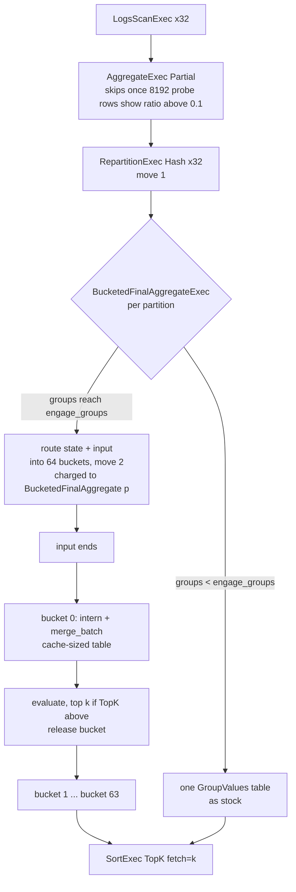

# ADR-3565: A bucketed final aggregate for fixed-width group keys, with exact per-bucket top-k

- Status: Accepted (2026-11-01)
- Date: 2026-11-01
- Refs: #3565, #3231, #1402, ADR-0013, ADR-0102, ADR-0825

## Context

Every heavy ClickBench GROUP BY runs one plan shape:
- a partial aggregate that gives up once its first 8192 probe rows show a group ratio above 0.1 (`crates/ravel-sql/src/session.rs:488-512`), which every statement here does;
- a 32-way hash `RepartitionExec`;
- a 32-way `AggregateExec mode=FinalPartitioned`.

Each final partition grows one DataFusion group table until its input ends, then emits every group. q33 groups by (WatchID, ClientIP): 99,997,493 groups over 99,997,493 rows, measured 2026-10-31 (#3565 comment 6549461554), so every row is a new group and the final never hits. That is 3.1M groups per partition, at about 120 MiB of table per partition (`dfbench-20261031T2032Z`, `table_MiB` for s33).

Measured on the reference machine (c6a.4xlarge, 8 cores, 32 MiB L3):

- **Cost.** In `prof028-20261030T1244Z` (#3231 comment 6525280440), the aggregate operator holds 68.0% of q33's server CPU, and hashing plus the group-key table hold 44.6%. Find and insert in the final are 37.9% of q33 (#3231 comment 6542264518, section 3).
- **Memory.** On `fullmain-20261031T1700Z` (main d29c8c5be), q33's query ledger peaks at 11.8 GB of intermediate bytes to return 10 rows, and q34/q35 at 9.2-9.4 GB. That ledger figure is the high-water mark of charged bytes (`crates/ravel-sql/src/memory.rs:1519-1524`), and the stock final's consumers are charged at the reserve-ahead factor, 1.25 by default (`memory.rs:1312-1318`, `config.rs:515`), so the bytes the tables asked for are about 9.4 GB, 94 B per group, and the ledger shows 118 B. The asked bytes are not recorded today; decision 3 adds them. Process VmHWM per q33 call is 16.0 GB on the c6a and 17.3 GB on the c8g (#3565 comments 6549550573, 6549461554), but the allocator keeps its arenas between calls (RSS is 14.8-15.8 GB before each later q33 call on the c6a), so VmHWM is a process figure, not a per-call one. #3516's top-k pre-filter did not move this, because it acts after the table is complete. #1402 established that no single-pass exact pruning exists for COUNT or SUM: a running count is a lower bound, and exact pruning needs an upper bound.
- **Memory latency.** The component benchmark ran three times. All three are invalid under their own pre-registration: A/A spread in growth mode, with presized rows clean. Run 3 isolated the cause as first-touch page-fault cost varying 9-19% between processes on this instance type, so the bench track stopped (run 1: #3231 comment 6548915738; run 2, THP off: 6549060076; run 3, one process per repetition: 6549496800). Its figures are reproduced observations, not a passed gate. It puts q33's key stream at:
  - 48 ns/row on one thread;
  - 92 ns/row per thread at 8 threads, one per core;
  - 175 ns/row per thread at 16 threads on 8 cores.

  So 16 threads interning do no more work per second than 8. That is the signature of a memory-bound loop, not a compute-bound one.
- **Counters.** c6a.4xlarge exposes no hardware event (`pmuX-20261031T2049Z`). On a c8g.4xlarge (Neoverse V2, `pmuA3-20261031T2227Z`, #3565 comment 6560647859, pre-registered in comment 6548953902, six events at 29-49% running share): q33's server cycles are 35.5% stalled on memory (`stall_backend_mem / cycles`), with 1.14 DTLB walks and 8.7 cache misses per 1k instructions, against 11.5%, 0.40 and 6.4 for the scan control q02. q36 (four Int64 keys, 9.8M groups) is 39.1% memory-stalled, q16 31.7%, q34/q35 33%, q19 23.4%, the SearchPhrase statements q13-q15 14.5-14.9%. The IPC predictions missed (q33 2.19) because they were written for a 4-wide core; the stalled share and the walk rate are what separate the group-by statements from the scans.
- **Where the misses are.** The `cache-misses` fill profile of q33 (same box and comment) puts 0.44 of samples under the final (`FinalMarker`), 0.40 of them in the group table probe itself (hashbrown `match_tag` 0.13, the group-index `push` 0.10, `find_inner` 0.05, `fix_insert_index` 0.03); 0.36 under the 32-way hash `RepartitionExec` outside the final (the `take_native` scatter 0.20, the per-partition output writes the rest); 0.19 in Ravel's decode and scan; 0.007 under `create_hashes`. q16 and q36, the other fixed-width-key statements in the set, have the same shape (final 0.33-0.34, repartition 0.40, decode 0.26-0.27). q19, whose key carries `SearchPhrase`, sits between (final 0.34, repartition 0.34, decode 0.28). The other string statements do not: q34 is decode-led (0.40) with the final at 0.27 and `create_hashes` at 0.08, and q13 is decode 0.57 against final 0.15. For q33, q16 and q36 the final's probe and the exchange's scatter together hold 0.72-0.76 of the DRAM misses. Two ceilings follow for q33, and they are different: a change that only removes the final's probe misses can recover at most 0.40 x 0.355 = 0.14 of its cycles, and a change that also removes the exchange's misses at most the whole stalled share, 0.355.
- **Bucketing.** Splitting one partition's input into 64 hash buckets and aggregating them one after another with a small reused table (V1, which approximates apache/datafusion#25724) gave, run 1 / run 2:
  - s33 (two Int64 keys, unique): 0.657 / 0.653 on one thread with reused pages, 0.510 with fresh pages (run 3), and 0.638 at 8 threads (run 1);
  - s16 (one Int64 key): 0.91;
  - s32: 0.90;
  - every shape with a string key was slower in every run: s17 1.363 / 1.440 / 1.326, s19 1.149 / 1.078 / 1.017, s34 1.392 / 1.402 / 1.159.

  Because no component band counts as met, the gate for this ADR is the end-to-end paired A/B in decision 6, step 3, and nothing is enabled before it passes.

  At 8 threads, 41 of s33's 59 ns/row is routing: hashing, gathering and copying the row into its bucket. Bucketing trades the cache miss for a second move of the row, after the one the exchange already made.

DataFusion 55.2 has no hook to give the final aggregate a different group table. `AggregateExec::execute_typed` and `FinalHashAggregateStream` are private. #25724 is a draft on DataFusion main and targets a later release. So a Ravel version is a Ravel `ExecutionPlan` that replaces the final aggregate. The parts it needs are public in 55.2:
- `GroupValues`, `new_group_values` and `GroupValuesColumn`;
- `AggregateFunctionExpr::create_groups_accumulator`;
- `GroupsAccumulator::{merge_batch, evaluate}`;
- `create_hashes`;
- the `AggregateExec` accessors.

## Decision

### 1. `BucketedFinalAggregateExec`, behind `SqlConfig::bucketed_final_aggregation` (off by default)

A physical optimizer rule replaces `AggregateExec mode=FinalPartitioned` with `BucketedFinalAggregateExec` when every condition below holds. Otherwise the plan is unchanged.

Conditions:
- the config field is `Some`; `None` is the default and installs no rule;
- every group key is a fixed-width, non-float primitive that `new_group_values` dispatches to a primitive table: integer, date, timestamp, time or interval. No string, dictionary, view, float, boolean, Decimal128, Duration or nested key (boolean lands on `GroupValuesRows`, not the 16-byte-entry table the bucket sizing assumes; Decimal128 and Duration do dispatch to a primitive table but are outside this whitelist until measured, and the applicability test pins their refusal);
- a single grouping set, with no grouping sets or ROLLUP;
- every aggregate supports a `GroupsAccumulator`, and every state field is a primitive or Decimal128. A `COUNT(DISTINCT)` that survives the logical rewrite (q10, where `AVG` beside it keeps `SingleDistinctToGroupBy` from firing) has a `List` state field and is refused; q05 and q09 qualify only because that rewrite turns them into a GROUP BY on `UserID` under a plain aggregate, and the applicability test pins both outcomes;
- no aggregate carries an ordering requirement, and the aggregate carries no limit options.

The rule runs after `BoundedTopKAggregate` (which, when `bounded_topk_max_limit` is set, walks down from the `SortExec` and refuses nodes it does not know, `bounded_topk.rs:138`, so #1402's bound for MIN/MAX-ordered top-k is kept) and before `CompactSlices` and `AggregateProfileRule`. The last two recognise only `AggregateExec`, so the new exec charges its own memory (decision 3) and does its own top-k (decision 4). Because `CompactSlices` no longer sits above this exec, every batch the exec emits owns its buffers: a bucket's evaluated output is cut into `batch_size` batches by copy, never by slice, so no operator above charges one batch the whole bucket's buffers (#2720's overcharge, #3516's per-batch cut). An applicability test pins the rule's position relative to all three.

Per output partition, the exec runs in two phases.

**Phase 1: single table, then route.**
- It starts with one `GroupValues` table and one set of accumulators, exactly as the stock final.
- Once the table holds `engage_groups` groups (default 65,536, the size at which #25724 measured engaging later to be worse than never), it routes instead.
  - It evaluates the table's state (`GroupsAccumulator::state(EmitTo::All)` plus `GroupValues::emit`).
  - It routes those rows, and every later input row, into `2^bits` buckets.
- A row's bucket is the top `bits` bits of a hash taken with a Ravel-fixed seed that differs from `REPARTITION_RANDOM_STATE` (seed 0, `repartition/mod.rs:650`). With seed 0, the bucket would be correlated with the partition the row is already in.
- Each bucket holds its rows column by column in fixed-size chunks (`routed_chunk_rows`, default 8192) appended to a list, keys plus accumulator state. Chunks, not doubling vectors, so the resident slack is at most one chunk per bucket per column, and the retained bytes are the routed bytes plus that bound.

**Phase 2: one bucket at a time.**
- When input ends, the exec aggregates bucket 0, emits it, releases its buffers, then moves on to bucket 1.
- One `GroupValues` and one accumulator set are reused across buckets, with `clear_shrink`.
- `bits` defaults to 6 (64 buckets). For q33 that puts about 49k groups, about 2 MiB of table, in each bucket.

The exec yields between batches in phase 1 and between buckets in phase 2. A dropped stream and the memory-breach check in `PinnedStream::poll_next` (`executor.rs:5397`) therefore act at the granularity of one routed batch in phase 1 and one bucket in phase 2. Under skew that granularity is coarse: in the 90%-one-key fixture one bucket holds 90% of the partition's retained input, so a phase-2 cancellation can be a partition's worth of work late. That is no worse than the stock final, which yields per input batch and emits per output batch.

### 2. Exactness

Every group lands in exactly one bucket, because the bucket is a function of the key alone. A bucket's groups are complete once input ends. Each bucket runs the same `merge_batch` and `evaluate` over the same state the stock final would see, so the results are the same.

What may differ:
- Output row order differs. SQL leaves it unspecified without ORDER BY.
- Float accumulation order is out of scope by construction, because float keys are refused. Float state (`avg` over floats) is refused too, so no float sum is reassociated: `exact_typed` already sends float aggregates away from `FinalPartitioned`.
- NULL keys hash like any other value and group as DataFusion groups them.

A differential test runs every ClickBench GROUP BY shape that qualifies, plus fixtures for NULL keys, all-NULL keys, a single group, skewed keys (90% of rows in one key) and unique keys. Each runs at 1, 4 and 32 partitions, with the config on and off, and asserts identical sorted answers.

### 3. Memory

Every byte the exec retains in its buckets is charged before it is retained, to one consumer per partition named `BucketedFinalAggregate[p]`. Phase 1's stock table is the exception, and it is bounded: it is charged by `size()` after each batch, which is the #3181 undercount `AggregateReserveAhead` covers for the stock consumers (`memory.rs:48-57`) and does not cover here, and it holds at most `engage_groups` groups, under 4 MiB per partition at 53 B per group.

The pool records charged bytes only. `peak_intermediate_bytes` is the high-water mark of the charged total, and the stock final's consumers are charged at the reserve-ahead factor while this exec's are charged at 1.0, so that figure cannot compare the two arms. PR1 adds `peakAskedIntermediateBytes` to the query stats beside it: the high-water mark of the bytes consumers asked for, before any factor, on both arms alike. That is the memory gate's figure.

That name matches none of the prefixes in `crates/ravel-sql/src/memory.rs:392-419`, so:
- the charge is one-to-one on query, tenant and process (`grow_charged`/`try_grow_charged`, `memory.rs:1422/1438`);
- there is no reserve-ahead factor and no held release.

Charging:
- Phase 1's table is charged by its `size()` after each batch, as DataFusion does (bounded as above).
- A routed batch is charged at its bucket buffers' new capacity before it is appended.
- Phase 2's reused table is charged by `size()` after each batch, bounded by one bucket.
- A refused grow returns the pool's `ResourcesExhausted`, which surfaces as the query's error.

Nothing spills. A query with spill configured never reaches `FinalPartitioned` (`session.rs:618`), so the rule never fires there (ADR-0013 unchanged).

Peak per partition = retained bucket input + one bucket's table and accumulators.
- For unique keys (q33), the retained state rows are about the size of the groups. Bucketing therefore lowers the peak: the table's 0.5-0.875 load factor and doubling slack are gone, and one bucket's table is about 1/64 of a partition's.
- For repeated keys, retained input is up to R times the group state (R = rows per group). This is why string keys are refused: their rows also carry the string bytes.

### 4. Exact per-bucket top-k

When the exec's output reaches a `SortExec` with `fetch = k` through `ProjectionExec` nodes that pass the sort keys as bare columns and through a fetch-less `CoalescePartitionsExec`, each bucket's evaluated output is cut to its own top k before it is emitted. That is `TopKPrefilter::above`'s reach rule (`compact_slices.rs:329-345`), reused as is. Ravel plans with `repartition_sorts(false)` (`session.rs:620`), so the top-k over a 32-partition final is one global `SortExec` above a `CoalescePartitionsExec` (`docs/query-engine.md:4883`), and that is the shape the rule matches; a `preserve_partitioning` sort is not required and never appears here.

It is exact for the reason `compact_slices.rs:141-146` gives for a batch:
- a bucket's groups are complete;
- a row outside its bucket's top k has k rows ahead of it that reach the same TopK.

At a tie on the k-th value, which tied row survives may differ, which SQL allows. Nothing is pruned before a bucket is complete, so #1402's counterexample does not apply.

What this buys:
- The TopK input falls from every group to at most `64 x k` rows per partition.
- The table memory of each bucket is released before the next bucket is aggregated. It does not lower the retained input.

### 5. Fused routing: only after decision 1 clears its A/B

The exchange and the bucket router each move every row once. A fused exec that replaces `RepartitionExec(Hash)` and the final together would let each producer:
- hash once for the partition and the bucket;
- sort a chunk of rows by (partition, bucket) with one copy;
- ship the chunk with its bucket offsets.

The final would then read each bucket as slices of those chunks, with no router copy. It would still hash every row once more in phase 2, because `GroupValues::intern` hashes with the private `AGGREGATION_HASH_SEED` (`group_values/mod.rs:100`): decision 1 hashes a row three times (exchange, router, intern), fusion twice.

This is a separate decision. It needs its own amendment, its own pre-registration and its own A/B against decision 1, not against main. Hash reuse across the exchange was tried twice upstream and closed with no gain (apache/datafusion#23720, #23446). So fusion is judged by measurement, not by a count of saved passes.

What the counters say about it: the exchange's scatter holds 0.36 of q33's DRAM misses on main, as much as the final's probe, and decision 1 leaves it in place. Fusion does not remove those misses; a sorted scatter still writes every row once into fresh chunks, so they move. What it removes is the router copy decision 1 adds, which the 0.36 does not contain. Its measurement needs decision 1's exec as arm A, so it is scheduled after decision 1's A/B, and only if decision 1 passes.

### 6. Delivery and bands

Each step is a separate PR. The switch is off in every one of them. Turning it on by default is its own PR, opened only after step 3 passes.

1. **The exec, the rule and the tests** (differential, memory-refusal and cancellation tests; applicability tests that pin every refusal condition). The switch stays off. The PR also adds a server flag, `--sql-bucketed-final-aggregation`, following `sql_parallel_final_aggregation`.
2. **Per-bucket top-k** (decision 4), with a test that pins exactness on ties and a peak-bytes assertion on a fixture.
3. **A paired A/B on the reference machine** (`cpuab`, A = main, B = main with the flag on, same binary), pre-registered on #3565 with these bands, copied from this table:

<!-- bands copied to #3565 before launch -->
| figure | band | miss | basis |
|---|---|---|---|
| q33 server CPU per call, B/A | 0.82-0.90 | > 0.94 | predicted from one derivation: V1 0.638 at 8 threads on s33 (#3231 comment 6548915738, reproduced at 0.653 single-thread in comment 6549060076) applied to the final's find+insert share of 37.9% (#3231 comment 6542264518) gives 1 - 0.379 x (1 - 0.638) = 0.863; the counters bound the latency part alone at 0.14 of cycles (probe 0.40 of misses x 0.355 stalled, #3565 comment 6560647859), so the lower edge is the extra instruction saving of a 2 MiB table over a 120 MiB one; the exchange's scatter (0.36 of misses) is untouched by decision 1 and is not in this band |
| q33 hot wall, B/A | 0.84-0.95 | > 0.98 | predicted: no lower than the CPU band's edge, because phase 2 runs after input ends and the overlap with the scan is lost, which moves wall up relative to CPU |
| q33 `peakAskedIntermediateBytes` (decision 3, factor-free on both arms), B/A | 0.45-0.75 | > 0.85 | predicted: B retains 53 B per group (12 B of keys: WatchID Int64 and ClientIP Int32; 8 B count; 8 B sum; 24 B avg state: Decimal128 numerator and Int64 count, `avg.rs:793`; one validity bit per column) over 99,997,493 groups = 5.3 GB, plus at most one 8192-row chunk per bucket per column (under 0.1 GB over 32 x 64 buckets) and one 2 MiB table per partition; A is about 9.4 GB (11.8 GB charged on `fullmain-20261031T1700Z` at the 1.25 factor, measured 2026-10-31) and is read exactly from arm A's own stat before arm B is judged |
| q33 ledger `peak_intermediate_bytes`, B/A | reported, not a gate | none | predicted: its two arms are charged at different factors (decision 3), so it is reported beside the asked figure for the factor to be read off, not judged |
| q33 VmHWM per call, B/A | reported, not a gate | none | measured 2026-10-31 (`pmuX-20261031T2049Z`, `pmu/calls.tsv`): the allocator keeps its arenas between calls, so RSS before each q33 call is already 14.8-15.8 GB and the per-call VmHWM delta reads 0.0-0.96 GB across five calls; a process high-water mark cannot gate bytes after the first call |
| q16, q32, q05, q09, q31, q36 server CPU, B/A | 0.88-1.00 | > 1.03 | predicted: V1 s16 0.91, s32 0.90 (#3231 comment 6548915738); q05 and q09 qualify through the `SingleDistinctToGroupBy` rewrite, pinned by the applicability test |
| every statement the rule refuses, q10 included, server CPU, B/A | 0.98-1.02 | > 1.03 | predicted: the plan is identical (pinned by a test) |
| 43-statement hot sum, B/A | 0.96-0.99 | > 1.01 | predicted: q05 0.583 + q09 0.851 + q16 0.687 + q31 0.816 + q32 0.875 + q33 3.133 + q36 0.658 = 7.60 s of the 35.44 s hot sum qualifies (min of tries 2 and 3 per statement, `fullmain-20261031T1700Z`, measured 2026-10-31) |
| answers | identical except q18, q25 ties | any other difference | measured 2026-10-31: q18 and q25 vary within arm A |

Two more guards:
- A concurrency row: 4 concurrent q33s under a pool sized for two must refuse cleanly, with no RSS above the pool plus caches.
- q33 must not be refused at the stock entry's pool when A is not.

## Rejected alternatives

- **Patch DataFusion with #25724.** It is a +1,939-line draft against DataFusion main, and Ravel pins 55.2. A backport is a fork of the aggregate stream to carry until the next upgrade, and the draft's spill path conflicts with ADR-0013's disabled spill. Its measurements are the evidence this ADR builds on. If it lands upstream, it replaces decision 1 at the upgrade that brings it.
- **Bucket string keys too.** Measured slower on every string shape (three runs: s17 1.363 / 1.440 / 1.326, s19 1.149 / 1.078 / 1.017, s34 1.392 / 1.402 / 1.159; #3231 comments 6548915738, 6549060076, 6549496800). Retained input carries each row's string bytes, R times the group state. #25724 dropped string bucketing for the same reason.
- **Raise the partition count so each final table is smaller.** All final partitions are polled concurrently by 16 threads, so the working set is every table at once. Locality comes only from finishing one bucket before starting the next.
- **Prefetch in the probe (hashbrown#727).** It needs an unreleased hashbrown API carried through a DataFusion fork. It is the #3231 track's, measured there (V2: s33 0.827, s19 0.825; 7-14% in run 3). It composes with this decision and is not a substitute for it on q33.
- **Prune groups before a bucket is complete.** Inexact for COUNT and SUM (#1402).
- **Reuse the repartition hash for the bucket.** The partition is `hash % 32` on seed 0, so its low bits are fixed within a partition. Reuse also failed upstream twice. The bucket takes its own seed.

## Consequences

- Off by default. With the switch off, no plan changes, and a test pins plan equality.
- With it on, eligible fixed-width finals lose overlap with the scan: phase 2 starts only when input ends. That is the cost #25724 measured on its Q12.
- Ravel carries one aggregate exec of its own until DataFusion ships an equivalent. The DataFusion surfaces it uses (`GroupValues`, `GroupsAccumulator`, `create_hashes`, the `AggregateExec` accessors) are named in a test that fails to compile if any becomes private.
- The new consumer name is outside ADR-1702's reserve-ahead set, by design: the bucket buffers are charged at capacity before they are written, which is what the factor approximates for the stock tables.
- Statements outside the fixed-width set (q34, q35, q17-q19, which together are 10.4 s of the 15.1 s cohort, min of tries 2 and 3 on `fullmain-20261031T1700Z`) are not addressed by this ADR. Their DRAM misses are decode-led (q34 0.40 in the URL scan against 0.27 in the final), so the next win on them is in the read path, not the aggregate.
- Decision 1 leaves the exchange's scatter, 0.36 of q33's misses, where it is, and adds a router copy of every row. Decision 5 is the follow-up that takes the router copy back; whether it moves the scatter's misses or only relocates them is what its A/B against decision 1 measures.
- The ledger's `peak_intermediate_bytes` is not comparable across the two arms (reserve-ahead 1.25 on the stock consumers, 1.0 on the new one), and process VmHWM is not usable after the first call. Memory gates on the asked-bytes stat PR1 adds; if the new consumer under-reports DataFusion's own table growth in phase 2, decision 3 is amended with a factor, measured first.

