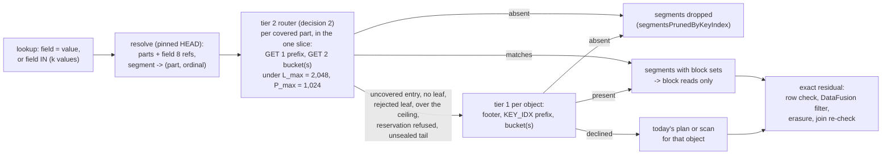

# ADR-3692: selective investigations across logs and traces, routed before payloads are fetched

Status: Proposed. Issue: #3692 (epic).
Date: 2026-11-02
Builds on: ADR-2707 (exact-key index: decisions 4, 5 and 7 and the leaf
build switch amendment), ADR-0849 (snapshot-bound index plane, sections 1
to 3), ADR-0063 (multi-part fold, sealing policy), ADR-2983 (predicate
transfer across signal joins), ADR-2904 (cross-signal SQL statements),
ADR-1199 (bounded query I/O accounting), ADR-2677 (decision 6, the TopK
threshold filter). Amends ADR-2707 (decision 4's tail build and the leaf
build switch amendment; decision 5's ceiling remainder and `P_max`
constants; the spans probe's first read) and nothing in ADR-2983 (its
Stages 0 and 1 are delivered here, its Stage 2 stays gated as written).
Changes no persistent format: the `.kidx` leaf, HEAD field 8, the KEY_IDX
section and the object key layout are read and written as
docs/catalog-and-mvcc.md "Per-part key-index leaves" specifies. The Flight
slice ticket gains a version (12) for the key-set section; versions 8 to
11 are unchanged.

## Context

A selective investigation is a query whose answer is a few rows out of a
large retained set: one trace by id, the logs that carry a rare request
id or a rare substring, the failing traces of one service in one hour and
the logs correlated to them. On main today the first tier of the
exact-key index is written into every logs and spans object (ADR-2707
decisions 2 and 3), the second tier is built per snapshot part behind a
switch that is off by default (decision 4 and the leaf build switch
amendment), and the read paths probe the first tier only (T10 #2761, T11
#2762). The consequence is measured: a folded tenant costs what an
unfolded one costs, request for request, and a lookup over a month of
retention probes every object in the month.

### Stage 0: the measured baseline

The baseline for this epic is the T12 Stage 1 measurement of ADR-2707
(#2763 comment 6276877460, 2026-10-19; one c6a.4xlarge, same-region S3,
main 1b4d29809; every call's `stats` at
`s3://ravel-clickbench-5b7101/reports/t12-2763/out/calls.jsonl`), read
again against what has landed since. It is the only per-phase profile of
these journeys on real object storage, and this ADR is aimed by it rather
than by a report. Two things have changed since it was taken and are
stated beside each figure: #3117 (the logs probe now gates on the 512 KiB
block-range threshold, landed 2026-10-21, reproduced in process and not
re-measured on the lane) and #3116 (the `keyIndex` phase now reports
decompressed bytes). The harness that produced T12 (`gen_spans.py`,
`run.sh`, `measure.py`, pinned by digest in #2763 comment 6261119071) is
not in the repository; the first task of this epic puts an equivalent
under `benchmarks/`, so the refresh and every later run are reproducible
from the tree.

| Journey | Figure on main 1b4d29809 | Phase that dominates | Source |
|---|---|---|---|
| spans trace lookup, 1 h window, cold, folded tenant (828 objects, 24 to 40 candidates) | median 0.73 s; 2.70 MB wire; per candidate object: one 65,536 B read in `probe`, 2 GETs in `keyIndex`, then 1 scan GET of 180 KB | `probe`: 24 x 64 KiB = 1.57 MB of 2.70 MB, the first read sized by a constant instead of the footer (#3118) | #2763 comment 6276877460 |
| spans trace lookup, no time range, same tenant (one covering part) | 2,429 data GETs (probe 828, keyIndex 1,600, scan 1), 55.7 MB, 2.7 s folded, 4.5 s unfolded; 827 of 828 objects pruned | `probe` and `keyIndex`: 3 GETs per object because no query reads the part's leaf, so one covering part is probed object by object (#3121) | #2763 comment 6276877460 |
| spans trace lookup, 1 h, warm | 0 data GETs, 1 resolve GET, 0.07 to 0.08 s | none | #2763 comment 6276877460 |
| q20 (`UserID = <one value>` over 398 `hits` objects), cold, unfolded | 1,013 GETs, 907 MB wire, 2.2 s median: resolve 1, plan 320 (83 MB), keyIndex 636 (1.05 MB), scan 56 (823 MB); 317 of 398 objects pruned, 81 survivors read nearly whole | `scan`: 80 objects at or under the whole-object bound were never probed (#3117, fixed 2026-10-21 in process, not re-measured on the lane) | #2763 comment 6276877460 |
| q20, cold, folded | identical to unfolded, 1,013 GETs, 907 MB | by construction: the tier-2 leaf is built and never read (#3121) | #2763 comment 6276877460 |
| spans lookup without a range, month-scale tenant (744 hour-ranged parts) and past `P_max` (2,160 parts) | not measured: a bulk load lands every span in one ingest hour and one part | unknown; the lane cannot produce hour-ranged parts | docs/adrs/2707-exact-key-index-for-spans-and-logs.md:1151 |
| `spans JOIN logs ON trace_id`, build side of 1, k/10, k and 10k traces | not measured: no join baseline exists in this repository | unknown | docs/adrs/2983-predicate-transfer-across-signal-joins.md:304 |
| rare substring over a log body | block survival on LogHub corpora (HDFS, BGL, SSH, Apache): an exact per-block trigram set keeps 1,363 of 1,365 HDFS blocks for a block id; template encoding 0.73 to 0.75 on Apache and SSH, 13 to 16 % on HDFS and BGL | the needle is an id, so every block holds its grams | #2977 comment 6221085174 |

The bottleneck this ADR attacks is the request count of a selective
lookup on a folded tenant: 3 GETs per candidate object on spans and about
1.6 on logs, against the 2 GETs per covering part ADR-2707 decision 5
specifies, plus the whole-object reads of every object a probe never
reached. The number it moves is the folded no-range spans lookup (2,429
GETs, 55.7 MB) and the folded q20 (1,013 GETs, 907 MB), each to the band
ADR-2707's acceptance table already pre-registers for them (2 GETs per
covering part plus the blocks read; under 40 GETs and 20 MB). The
journeys with no baseline (month-scale, past `P_max`, the join, the
correlated journey, the scaling arms) get one in this epic's first wave,
before any code that depends on them is measured against it.

### What exists on main, and what does not

Read from the tree at 50c104c4e on 2026-11-02.

- The leaf probe exists and nothing production calls it.
  `Catalog::probe_key_index_leaf`
  (crates/ravel-catalog/src/snapshot_format/kidx.rs:1134) validates the
  ref copies, the part binding and the tenant and signal, and reads the
  store directly: it takes no `QueryAccounting`, no access intent, no read
  cache and no memory reservation, and its only callers are tests
  (crates/ravel-catalog/src/fold.rs:12017, kidx/tests.rs:295).
- A query cannot get from a leaf match back to a segment. The resolve
  keeps the decoded parts and their `blake3` in `SnapshotWindow`
  (crates/ravel-catalog/src/snapshot_resolve.rs:72) but drops the
  `SnapshotPartRef`s and so field 8's `key_index` refs; `extract_into`
  (snapshot_resolve.rs:115) flattens entries into `SegmentRef`s
  (crates/ravel-catalog/src/snapshot.rs:40) that carry no part identity
  and no entry ordinal. A leaf answers in `(entry ordinal, block set)`.
- `P_max` and `L_point` exist only in ADR-2707's prose
  (docs/adrs/2707-exact-key-index-for-spans-and-logs.md:534); an
  unfiltered search of the crates finds no constant and no test.
- The decoder bounds a bucket frame's declared `uncompressed_len` at the
  256 MiB body ceiling before the zstd buffer is allocated
  (kidx.rs:930) but bounds neither `entry_count` nor the decoded size:
  a one-byte block delta decodes to a `u32`, so a frame at the ceiling can
  decode to about 1 GiB of `Vec<u32>` (the #3024 carry-over).
- The leaf build reads KEY_IDX sections of either RLOG version
  (`decode_key_idx` discards the version, crates/ravel-codec/src/key_idx.rs:1112;
  `section_resolves_like_the_reader` is called only on the tier-1 path,
  crates/ravel-logseg/src/key_index.rs:317), so a leaf can index a version
  1 section the tier-1 probe would decline (the #3039 carry-over on #3024).
- The spans fetcher's first read is `DEFAULT_TRACE_PROBE_BYTES` = 64 KiB
  charged to `probe` (crates/ravel-query/src/span_fetcher.rs:151, :891);
  tier 1 runs only when the caller passed no block set (:983); both
  production callers pass `None` (crates/ravel-sql/src/spans_scan.rs:715,
  :794). Passing `Some(set)` already turns tier 1 off and reads the runs
  of `set` intersected with the SKIP_IDX candidates (:1032).
- The logs keyed plan probes one object at a time above the 512 KiB
  threshold on both routes (crates/ravel-query/src/log_fetcher.rs:2485,
  :2589; crates/ravel-sql/src/logs_scan/plan.rs:535) and copies the
  caller's access intent (log_fetcher.rs:2596; the #3121 comment is
  answered by `the_key_probe_admits_under_the_callers_intent`).
- `LogQuery.key_equals` arms are ANDed and an absent arm drops the object
  (log_fetcher.rs:200), so a key set cannot be spelled as several
  `KeyEquals`; `SpansPushdown.trace_id` holds one id and a disjunction is
  refused (crates/ravel-sql/src/spans_pushdown.rs:61, :110); the planner
  rewrites `=` and `!=` only (crates/ravel-sql/src/trace_id_planner.rs:54);
  `Expr::InList` on a declared column becomes a numeric envelope only
  (crates/ravel-sql/src/logs_pushdown.rs:613). The slice ticket's key
  section is version 11 (crates/ravel-sql/src/flight_ticket.rs:426).
- The logs scan receives DataFusion's join filters at
  `handle_child_pushdown_result` (crates/ravel-sql/src/logs_scan/mod.rs:3002)
  and keeps only a `ts`-leading `DynamicFilterPhysicalExpr` as a TopK
  threshold (ADR-2677 decision 6); the spans scan has no hook
  (crates/ravel-sql/src/spans_scan.rs:416). Nothing named
  `objectsPrunedByTransfer` exists.
- `TenantDelegatingPool::grow` charges all three budgets unconditionally
  and trips `CeilingBreach`, which `PinnedStream::poll_next` turns into the
  typed memory error at the next poll
  (crates/ravel-sql/src/memory.rs:117, :1741;
  crates/ravel-sql/src/executor.rs:5656). The host gate is bypassed on the
  same path (`reserve_unchecked`, crates/ravel-memory/src/lib.rs:490). This
  is #1370 as it stands: an overshoot is detected after the fact and
  bounded by one poll, not prevented.
- Parts are hour-ranged and seal only at an hour boundary once
  `snapshot_part_max_entries` (250,000) would be crossed
  (crates/ravel-catalog/src/fold.rs:855; ADR-0063 "Sealing policy"); a
  sealed part is carried by reference and never re-encoded; the tail part
  is re-encoded by every fold that advances the watermark, and a tenant
  under the cap is one tail part for good.
- Per-query `stats` already carries `phases[]` with the `keyIndex` phase,
  `pruning.segmentsPrunedByKeyIndex` and `blocksPrunedByKeyIndex`,
  `signals[]` per table, and the `io` block of ADR-1199 T1
  (crates/ravel-sql/src/stats_json.rs:37, :121, :145;
  services/ravel-server/src/sql.rs:311); `GET /api/traces/<id>` runs
  through the same executor and returns the same object
  (services/ravel-server/src/traces.rs).

## Decision

### 1. The resolve keeps what a leaf match needs: part identity, leaf refs and entry ordinals

The pinned snapshot a statement resolves (ADR-2904 decision 2: one
snapshot per signal, read once) is what every pruning result binds to.
Today it cannot be, because the resolve drops the two facts a leaf answer
is expressed in. This decision adds them to the in-memory snapshot and
changes no stored byte.

- `SnapshotWindow` keeps, per covering part and in part order, the
  `SnapshotPartRef`'s `key_index` refs, the part's `blake3`, its
  `entry_count` and its `watermark_hour`, beside the decoded entries it
  already holds. The refs are read from the same HEAD GET the resolve
  already issues and are charged where the decoded part is charged.
- The per-segment part origin is a sibling of `Snapshot`, not a field on
  `SegmentRef`: `SegmentRef` and `Snapshot` are built by full field
  literal at 248 sites in 83 files outside ravel-catalog (snapshot.rs:156
  records this constraint, and it is why ADR-0073's origin became the
  parallel `SegmentOrigins` vector rather than a field). Decision 1 takes
  the same form: `SnapshotParts { parts: Vec<SnapshotPartHandle>, origin:
  Vec<Option<SegmentPartOrigin>> }`, returned by a new
  `Catalog::resolve_pruned_with_parts` as a third value beside the
  `Snapshot` and `SegmentOrigins` that `resolve_pruned_with_admission`
  returns today. The existing method keeps its two-value signature and
  every caller (ravel-sql's executor, ravel-server's exemplars) stays as
  it is, the way `resolve_pruned_with_generations` was added rather than
  widening a return (catalog.rs:2465); the providers that run the router
  switch to the new method in T4 and T5, whose crate scope includes
  ravel-sql. `origin[i]` is the `(part index, part-local entry ordinal)` of
  `segments[i]` (ADR-0849 section 1, the ordinal the leaf's
  `entry_ordinal` names) and `None` for a `Recent` or `TokenResolved`
  segment (snapshot.rs:166), which is never covered. A
  `SnapshotPartHandle` holds the part's `blake3`, `entry_count`,
  `watermark_hour` and `key_index` refs.
- A segment's `(part, ordinal)` is the only way a leaf match is turned
  into a data object key; the router never reads a part object or HEAD
  again, so a HEAD that moved after the resolve cannot change which
  segments a leaf prunes. The providers that run the router (decisions 3
  and 4) receive `SnapshotParts` the way they receive `SegmentOrigins`
  today, so no `ravel-sql` construction site changes shape.
- The binding check the reader runs (docs/catalog-and-mvcc.md "Binding
  and coverage": header `part_blake3` against the resolved ref, tenant and
  signal as a breach) is unchanged; the part hash it compares against is
  the pinned one.

### 2. One tier-2 router in ravel-query, shared by spans and logs

A new module `crates/ravel-query/src/key_index_route.rs` holds the one
implementation of ADR-2707 decision 5's tier-2 procedure. Both read paths
call it with the same inputs and consume the same answer; neither keeps a
private copy of the ceiling, the slice selection or the fallback rules.

**Input.** The pinned snapshot (decision 1), the signal, the tenant hash,
one `KeySet` (`field`, `key_type`, 1 to k sorted distinct `key8`s with
their full values for the residual; k = 1,024, ADR-2983 decision 5), the
statement's `PhaseAccounting` (the `keyIndex` handle, carrying the
caller's access intent), the read cache the fetcher uses for ranged
extents, and a memory reservation handle (the statement's pool through its
fallible path for SQL; the server's `MemoryBudget::try_reserve` for
`GET /api/traces/<id>`).

**Output.** For every part-sourced segment of the snapshot, one of:
`Pruned` (the index proved every key absent), `Blocks(set)` (the key set's
union of block sets for that segment, to read instead of the object's
SKIP_IDX candidates), or `Uncovered` (tier 1 decides). Plus the figures of
decision 7.

**Procedure**, per ADR-2707 decision 5 and the normative Reader in
docs/catalog-and-mvcc.md, with these choices fixed here:

- Covering parts are the window's parts; a lookup with no time bound
  covers every part. Parts are admitted in descending `entry_count`, ties
  by descending `watermark_hour`, until admitting the next part's worst
  case would exceed `L_max` = 2,048 leaf GETs for the statement or the
  admitted count would exceed `P_max` = 1,024 parts. Both are constants in
  `ravel_catalog::snapshot_format::kidx` (`KEY_INDEX_LEAF_GET_CEILING`,
  `KEY_INDEX_MAX_PROBED_PARTS`), asserted by root validation's shape lint
  as ADR-0849 section 2's part-bound point root amendment requires, and
  named by the tests that pin them. The order puts the parts with the most
  segments inside the ceiling, since a leaf GET pair prunes a part's whole
  segment list at once.
- Per admitted part, per key: `select_key_index_slice` picks the slice;
  GET 1 is `[0, prefix_len)` of that slice, issued once per (part, slice)
  the key set touches; the directory then names the buckets the keys fall
  in. GET 2 reads each distinct non-empty bucket when the key set touches
  at most `B_run` = 64 of them in that leaf. Above `B_run`, the router
  sorts the touched buckets by body offset and reads them as at most
  `B_run` ranged GETs, bridging the smallest gaps between buckets until
  the run count fits (the `bound_runs` shape the metrics path uses);
  bridged gap bytes are read and discarded. It takes that read only when
  the bridged bytes are at most `entry_count x T1_BYTES` for the part,
  with `T1_BYTES` = 11 KiB the predicted per-object cost of the tier-1
  probe the part's segments would otherwise pay (decision 3's figure for
  an absent object: the 8 KiB footer suffix, about 1 KB of prefix and
  about 2 KB of bucket); otherwise the part is `Uncovered` for this
  statement and no
  further leaf byte is read. A leaf body is the whole part's key set
  (about 240 MB for the T12 spans part), so tier 2 has no whole-body
  escape of the kind decision 6 gives tier 1 over a 2 to 6 % section;
  the bridged read is its bounded equivalent. `B_run` and `T1_BYTES` are
  predicted and confirmed or changed by the Stage 1 amendment. A bucket
  the directory says is empty costs no GET. Empty-bucket and
  distinct-bucket counts are known after GET 1, so the per-part GET count
  admitted against `L_max` is the worst case `1 + min(k, 2^bucket_bits,
  B_run)` before GET 1 and the exact count after it; the difference is
  returned to the budget.
- Before a bucket frame is decoded, the router reserves its decoded bound
  through the memory handle and decodes only when the reservation holds.
  The bound is `8 x uncompressed_len + 64` bytes per frame, derived from
  the frame grammar (an entry is at least 10 bytes on the wire and at most
  40 bytes plus a `Vec<u32>` whose length is at most the entry's delta
  bytes); `decode_frame` enforces the same arithmetic before it allocates
  (`entry_count <= uncompressed_len / 10`, the running sum of
  `block_count` at most the bytes remaining), so a frame whose header
  claims more is `Corrupted` before any buffer exists. A refused
  reservation marks the part `Uncovered` and counts it; it never fails the
  statement and never sends the part to a whole scan.
- Reads go through `Catalog::probe_key_index_leaf_with`, a new entry that
  keeps `probe_key_index_leaf`'s tenant and signal breach handling
  (`CatalogError::FieldMismatch`, `ravel_catalog_isolation_breach_total`)
  and takes the reader closure the ranged variant already accepts, so the
  bytes move through the fetcher's cached ranged read under the `keyIndex`
  phase with the caller's intent. The direct-store `probe_key_index_leaf`
  stays for the inspector and tests. A leaf is immutable and content
  addressed, so its extents are cacheable like a data object's; a warm
  lookup issues no leaf GET.
- Answers map through decision 1: `Matches` gives `Blocks(set)` to each
  named ordinal's segment (the union over the key set's matches for that
  ordinal) and `Pruned` to every other covered ordinal of the part;
  `Absent` gives `Pruned` to every covered ordinal; the header's
  `uncovered_entry_ordinals` are `Uncovered`; a `Rejected` leaf
  (`Corrupted`, `UnsupportedVersion`, `PartBindingMismatch`,
  `RequestMismatch`, `Read`) makes the whole part `Uncovered` for the
  field, with a warn log naming the leaf key and the reason and a counter
  (decision 7). A `FieldMismatch` fails the statement as it does today.
- Parts beyond the ceiling, parts without a leaf for the field, the
  unsealed tail and every `Recent` or `TokenResolved` segment are
  `Uncovered`. This amends ADR-2707 decision 5's remainder rule: an
  uncovered segment of a part the ceiling left unprobed goes to tier 1
  like every other uncovered segment, not to a scan. Tier 1 costs at most
  the footer read, one prefix and the buckets per object and drops an
  absent object without a block read; a scan reads blocks. Both are
  per-object, so the ceiling's purpose, bounding leaf GETs, is unchanged,
  and the P_max acceptance row is restated below.
- A `KeySet` with one key is the equality case. The router is the only
  tier-2 code path for both.

### 3. Spans: the router runs before the per-object path, and the first read is the footer

- `SpansTableProvider::pruned_segments`
  (crates/ravel-sql/src/spans_provider.rs:272) prunes by `ts` as today,
  then, when the pushdown holds a trace key or key set, runs the router
  over the pinned snapshot. `Pruned` segments leave the list. The scan
  passes each surviving segment's `Blocks(set)` as the `blocks` argument
  of `fetch_accounted_in_blocks` and
  `fetch_accounted_columnar_in_blocks` (span_fetcher.rs:675, :757), which
  already turns tier 1 off and reads `set` intersected with the SKIP_IDX
  candidates (:1032). `Uncovered` passes `None` and takes tier 1. The
  columnar path's row-path fallback (spans_scan.rs:777) carries the same
  block sets.
- `GET /api/traces/<trace_id>` and MCP `ravel_get_trace` run the same
  provider (services/ravel-server/src/traces.rs), so they get tier 2 with
  no change of their own; the reachability test of decision 9 drives this
  endpoint.
- The first read of `ranged_trace_scan` (span_fetcher.rs:891) is sized
  for the footer, not by `DEFAULT_TRACE_PROBE_BYTES`: a suffix of
  `min(len, KEY_INDEX_FOOTER_SUFFIX_LEN)` = 8 KiB, the length the fold
  already uses for the same footer (fold.rs:1104), chased once when the
  footer is longer. It stays in the `probe` phase, because it is the tail
  probe and not an index read; ADR-2707 decision 7 keeps `keyIndex` for
  leaf and section reads and nothing else. Today the 64 KiB probe was
  sized to cover the footer, SKIP_IDX and BLOOM in one request
  (span_fetcher.rs:147), SKIP_IDX is read unconditionally from it
  (:924), and the tier-1 probe runs only when SKIP_IDX left a candidate
  (:983). With a trace key the order changes: footer, then the KEY_IDX
  prefix and bucket, and SKIP_IDX only for an object the key is present
  in (to intersect the key's block set with the window's blocks, as the
  fetcher does today at :1032), BLOOM only when the statement has
  predicates. An object the key is absent from costs three GETs (footer,
  prefix, bucket; about 11 KB) when its footer fits the 8 KiB suffix (the
  #3702 amendment states the condition) and is dropped without reading SKIP_IDX;
  a holder costs those three plus SKIP_IDX and its block runs, and BLOOM
  with predicates. The cost of the reorder is on an object whose SKIP_IDX
  would have dropped it for free (no block in the window): it now pays
  the prefix and bucket, two small GETs, before being dropped; on the T12
  lane SKIP_IDX kept a candidate in every probed object, and the Stage 1
  run reports the count of objects dropped by SKIP_IDX after a present
  key so the trade is measured. This restates #3118's ask: bytes per
  absent candidate object move from about 66 KB to about 11 KB at the
  same three requests, and a tier-2-covered holder costs the footer,
  SKIP_IDX and its block runs. The ADR-2707 T12 acceptance amendment's
  spans bands are restated below.
- Shard routing (ADR-2707 decision 5, deferred by the spans routing
  deferral amendment, #3034) stays deferred: the lookup is exact without
  it, and with tier 2 its remaining benefit is the tier-1 probes on the
  unsealed tail's other-shard objects. It is dispatched in this epic only
  on the trigger in the Plan, and only on the proof #3034 asks for.

### 4. Logs: the router runs once per scan, before the per-segment loop

- `compute_plan_counts` (crates/ravel-sql/src/logs_scan/plan.rs:506)
  runs the router once over the scan's pinned snapshot when `LogQuery`
  carries a key or key set, before its per-segment loop. `Pruned`
  segments are removed from the scan's list and never opened, whatever
  their size: the 512 KiB block-range threshold (the #3117 amendment)
  gates the per-object tier-1 probe, not a tier-2 answer that cost the
  object nothing. `Blocks(set)` segments go to `plan_segment_keyed` with
  the set already known, which skips the prefix and bucket reads and
  restricts the plan to `set` above the whole-object bound (at or under
  it the object is read whole, as today). `Uncovered` segments take
  today's tier-1 routes unchanged (log_fetcher.rs:2485, :2589).
- The fold's leaf build skips a version 1 RLOG KEY_IDX section and lists
  the entry uncovered (fold.rs:1398 and
  crates/ravel-catalog/src/key_index_rebuild.rs:492 both go through
  `read_entry_key_index_counted`, which gains the
  `section_resolves_like_the_reader` check the tier-1 probe applies).
  The leaf header has no field that could carry the section version, so
  the reader cannot make this distinction; the writer must. The leaf
  switch has been off by default since it shipped, so no leaf in a
  deployment that kept the default holds a version 1 entry; a deployment
  that turned it on before this change repairs with `catalog fold
  --rebuild-key-index`, and the Rollout paragraph of
  docs/catalog-and-mvcc.md says so.

### 5. The tail part's leaves are built incrementally, under a pair budget; the switch defaults on after Stage 1

The leaf build switch amendment left one choice open: an incremental tail
build, smaller tail parts, or a per-(part, field) budget. The measured
shape decides it. Parts are hour-ranged and a sealed part is never
re-encoded (ADR-0063), so a sealed part's leaves are built once and cost
nothing afterwards. The tail part is re-encoded by every fold that adds an
hour, and each such fold today rebuilds its leaves from every entry's
section: `2T` ranged GETs per fold for a tail of `T` entries, up to
250,000 entries, and a tenant under the cap is one tail for good.

- **Incremental.** A fold that re-encodes the tail reads the previous
  HEAD's leaf for each (field, slice) of the previous tail part (one GET
  per leaf, already content addressed and bound to the previous part's
  hash), decodes it against the previous part's entry list (which
  `load_previous_entries` loads anyway), and carries each entry's
  `(key8, block set)` pairs forward by data object key. Sections are read
  only for entries the previous leaf did not cover: new entries, and the
  previous leaf's uncovered entries, which are retried once (read again
  on every advancing fold while they stay uncovered: the #3704 amendment).
  An entry's pairs depend only on its object's bytes, which are immutable,
  so a carried pair is exactly what a re-read would produce. The per-fold
  cost becomes `2 x new entries` section GETs plus one GET per previous
  leaf (plus the still-uncovered entries' reads, the #3704 amendment),
  and the leaf PUT bytes stay `O(T)`. When the tail seals, the sealed
  part's hash equals the last tail's (ADR-0063 content addressing), so its
  refs are carried with it and no build runs.
- **Pair budget.** The build holds every `(key8, entry ordinal)` pair of
  the part in memory (about 68 bytes each, the leaf build switch
  amendment's figure): 20 M distinct trace ids in one spans part is about
  1.4 GB. `CatalogConfig::key_index_build_max_pairs` (default 8,000,000,
  about 550 MB; the pass-end slice amendment replaces this figure with the
  bound a pass holds) bounds it. A (part, field) whose pair count would exceed
  it is built in `ceil(pairs / budget)` passes over disjoint `key8`
  ranges (the #3704 amendment states the exact pass rule, the per-pair
  cost and what the budget does not bound), each pass reading the sections again (a pass costs `2T` GETs and
  about the section bytes, 2 to 6 % of the part) and emitting the slices
  of its range; the slices tile exactly as `split_key_index_entries`
  produces them today (per pass, under the pass-end slice amendment).
  The report names the pass count. A sealed part pays it once (as does
  each advancing fold, see the pass-end slice amendment).
- **Default.** `build_key_index_leaves` defaults to on for both signals
  once the Stage 1 amendment records the per-fold figures inside their
  bands (Acceptance, rows 7 and 8) and the production reader of decisions
  2 to 4 is on main. Until then the default stays off and the flags keep
  their meaning. A logs tenant with no key-index declaration reads no
  section and writes no leaf, as today.
- Rejected here, with the reasons in Rejected alternatives: leaves for
  sealed parts only, and smaller tail parts.

### 6. Key sets: the `IN` arm on both signals, k = 1,024

This is ADR-2983 decision 8's receiving arm, delivered as its own feature
(a single-table `IN` list) with no transfer attached, so the join track
can measure it before anything is transferred.

- **Logs.** `LogQuery` gains `key_in: Option<KeyIn>` beside `key_equals`:
  one field, its declared type, 1 to k sorted distinct `key8`s. `AND`
  semantics are unchanged: `key_equals` arms and the `key_in` arm each
  must admit an object; the `key_in` arm admits an object when any of its
  keys is present and names the union of their block sets. Extraction in
  `logs_pushdown.rs`: `column IN (literals of exactly the declared type)`
  on a declared key-index column, and `trace_id IN (<16-byte or 32-hex
  literals>)` when `index_trace_id` is set; more than k distinct values,
  a mixed-type list, a `NOT IN`, or a list under `OR` carries no key (the
  envelope `NumRange` the list already produces stays). The arm stays
  `Inexact`; DataFusion's residual removes prefix collisions.
- **Spans.** `SpansPushdown` gains `trace_ids: Vec<[u8; 16]>` for
  `trace_id IN (...)`, k at most; the equality stays the one-id case. The
  planner's `IN` list reaches the pushdown as `Expr::InList` over the
  binary column; the task finds the hook that lets hex string literals in
  that list be read as 16-byte values the way `TraceIdHexLiteralPlanner`
  reads them for `=` (trace_id_planner.rs:22 says `sql_in_list_to_expr`
  consults no `ExprPlanner`), or accepts binary literals only and says so
  in docs/guides/query.md. A disjunction of equalities stays refused.
- **Tier 1 with a set.** One prefix read, then each distinct bucket when
  the set touches at most `B_run` distinct buckets of the section; above
  that, one ranged GET of the section's bucket area (2 to 6 % of the
  object) decoded for the set. Per uncovered object: at most 2 GETs plus
  the buckets, bytes at most the section. Absent on every key drops the
  object (`segmentsPrunedByKeyIndex`); present names the union of block
  sets.
- **Ticket.** The slice ticket gains version 12: the version 11 layout
  followed, on a logs block, by an optional key-set section (`field`,
  `key_type`, `key_count` up to k, `key8[key_count]`), and, on a spans
  block, by an optional trace-id list (`trace_id_count` up to k,
  `trace_id[trace_id_count]`, 16 bytes each) beside the single optional
  `trace_id` the version 9 block carries (flight_ticket.rs:1957). Versions
  8 to 11 are byte identical and pinned. Without the spans section a
  Flight-served `trace_id IN (...)` would encode as a version 9 ticket
  whose block carries one id and silently lose the list. A multi-table
  statement never produces a slice ticket (ADR-2904 decisions 8 and 10),
  so only a single-table `IN` travels.
- Transfer (ADR-2983 decisions 1 to 7, 10) is not part of this decision.
  Its Sequencing gate 1 (#1370) stands as written; see the Plan.

### 7. What the statistics say, and what the harness asserts

Additive fields, every one rendered by `stats_json.rs` and produced by
both signals' paths; a field this ADR names and the tree does not render
is a defect of the task that owns it.

- `stats.pruning.segmentsPrunedByKeyIndex` counts a segment the index
  proved every key absent from at either tier; its definition in
  `executor.rs` is restated from "opened and then read no block of" to
  "dropped by a KEY_IDX answer before or instead of a read".
  `blocksPrunedByKeyIndex` is unchanged.
- `stats.keyIndex`, a new object: `partsCovered` (parts the router
  probed at tier 2), `partsUncovered` (parts with no leaf for the field),
  `partsBeyondCeiling`, `leavesRejected`, `reservationsRefused`,
  `leafGetRequests` (the `keyIndex` phase's requests that were leaf
  reads, so the phase's total minus it is the tier-1 share),
  `keysProbed` (the key set's size). Per signal, the same object appears
  under `stats.signals[].keyIndex`. As shipped the object carries ten
  fields, not these seven (see the #3702 amendment).
- Metrics: `ravel_query_key_index_parts_total{signal, outcome}` with
  `outcome` in `covered | uncovered | beyond_ceiling | rejected |
  reservation_refused`, and `ravel_query_key_index_leaf_gets_total{signal}`.
  As shipped `outcome` has a sixth value (see the #3702 amendment).
- The fold report and `/metrics` gain `key_index_sections_read`,
  `key_index_entries_carried`, `key_index_build_passes` and
  `key_index_leaf_gets` per fold, beside the existing
  `key_index_uncovered_entries`.
- Every figure the harness of decision 8 reports has a band and is
  asserted present exactly once (CLAUDE.md "Measurement and cost
  discipline"). The per-phase `keyIndex` wire and decompressed bytes
  (#3116) are the bytes the acceptance rows band.

### 8. One harness, two lanes, pre-registered

Work package 1 of #3692 is a harness in the tree, under
`benchmarks/investigations/`, built on the ClickBench kit's box flow
(`benchmarks/clickbench/kit/box/run.sh`: `run_query` with `RQ_STATS=1`,
`calls.jsonl`, stamps) and the kit's band files, with a real-S3 lane the
kit lacks today (the kit's store is RustFS on the box). It replaces the
off-repo T12 scripts.

- **Corpus.** One generator (`gen_corpus.py`, seeded) writes correlated
  spans and logs Parquet: `N` traces x 10 spans, each log line carrying
  the `trace_id` of one of its hour's traces, 20 services, a `status`
  dimension so "failing traces of service X in hour H" selects about 50
  traces, planted rare keys (a `request_id` present in exactly one
  object; one absent) and planted rare substrings with known block
  frequency (1 block, 0.1 % of blocks, 10 % of blocks) in `body` and in a
  declared `Str` column. Seed 2707's spans recipe (200 M spans, 20 M
  traces, uniform over 24 h, pinned in #2763 comment 6261119071) is the
  spans arm at the top scale.
- **State matrix.** Unfolded (tail only); folded without leaves; folded
  with leaves; mixed (folded with leaves plus one unsealed hour); many
  covering parts (the hour-ranged lane below); 10x and 100x irrelevant
  retained data at fixed matching rows; concurrent compaction and an
  erasure in flight. Each state is stamped before the first statement
  (`catalog inspect`, `typed-attr-column show`, `rspan inspect`, `rlog
  inspect`, `inspect kidx`, the fold report) and re-stamped after any
  step that changes it, and the stamp is part of the report
  (CLAUDE.md's rule: a report without the stamp is not a result).
- **Hour-ranged lane.** `ravel-cli load` gains `--ingest-hour-stride
  <hours>`, a bench flag honored only when the signal's HEAD does not
  exist for the tenant (a fresh tenant, no sealed hour) and refused
  otherwise: each successive batch commits under an ingest hour advanced
  by the stride from a start hour the flag's companion
  `--ingest-hour-start <unix hour>` sets in the past, through the loader's
  injected clock. The resulting hours are all behind the seal margin, so
  the first fold seals them into hour-ranged parts under
  `snapshot_part_max_entries`, which `ravel-cli catalog fold` exposes as
  `--snapshot-part-max-entries` for the same lane. The load report names
  both values, and docs/guides/ingest.md says the data's ingest hours are
  synthetic. This is what makes the month-scale (744 parts) and past
  `P_max` (2,160 parts) rows measurable; the T12 lane could not.
- **Statements.** Per state: trace lookup with a 1 h window and without a
  range; the same on logs by `trace_id`; `request_id` present and absent;
  `IN` lists of 1, 10, 100 and 1,000 keys on both tables; rare and common
  substring (`LIKE '%needle%'` on the declared column, `has_word` on
  `body`); narrow and wide ranges; the journey (failing traces by service
  and hour, then their logs by `trace_id IN`, then the correlated rows
  by a `spans JOIN logs ON trace_id` with build sides of 1, k/10, k and
  10k traces, ADR-2983 Stage 0); and a nonselective control (the 43
  ClickBench statements once, cold). Cold runs restart the server and
  drop the page cache; 20 cold runs per selective statement give p50,
  p95 and p99.
- **Figures per call.** The server's `stats` (`phases[]`, `pruning`,
  `signals[]`, `io.dependencyDepth`, `timings`, `keyIndex`), wall time,
  rows, and the oracle's rows (the same statement with the index declared
  off, or against the unfolded tail; exact agreement is a check, not a
  figure). Per run: CPU seconds and peak RSS of the server from
  `/proc`, maintenance cost from the fold reports (section GETs, leaf
  PUTs and bytes, passes) and the object census (leaf bytes per part),
  and the dollar figure below.
- **Lanes.** Local (RustFS or MinIO on the box or a fleet executor):
  counter-only figures, used for development and the correctness matrix.
  Real S3 (one c6a.4xlarge per run in us-east-1, same-region bucket,
  self-terminating, `scripts/bench/fresh-box.sh` or the kit's launcher):
  every timing figure and the acceptance rows. Reports keep the lane in
  their name and are never pooled.
- **Cost per successful investigation.** `requests x $0.0004 / 1,000 +
  CPU seconds x the c6a.4xlarge hourly price / 3,600`, intra-region
  transfer at zero, plus the index's amortised maintenance: `(fold
  section GET and leaf PUT requests, leaf bytes stored for 30 days at
  $0.023 / GB-month) / lookups per month`. The report states the
  break-even lookups per part-month at which the index pays for itself,
  for each corpus, with the query-frequency assumption written beside it.
  Prices are us-east-1 list prices on the run date and are named in the
  report.
- **Pre-registration.** Every run posts its expected figures and bands
  on #3692 before it starts, as the acceptance table below does for the
  epic; a run that measures a row the table does not band pre-registers
  that row in the comment first.

### 9. Tests pin the claims; one of them drives a real entry point

- `key_index_route` carries the router's property test: a generated
  multi-part snapshot with leaves, with random uncovered ordinals,
  rejected leaves, empty buckets and a ceiling smaller than the part
  count, asserts that the router's `Pruned` set never contains a segment
  the oracle (a whole scan of the generated objects) returns a row from,
  for key sets of 1 to k keys and for both signals' key types; and that
  with the ceiling at 2 parts of 5 exactly 2 parts are probed, in the
  stated order, at most `L_max` leaf GETs are issued, and every other
  segment is `Uncovered`, never `Pruned`.
- Negative controls, each a test that fails when the named protection is
  removed: a leaf whose `part_blake3` is the previous HEAD's part
  (`PartBindingMismatch` makes the part `Uncovered`; mutant: skip the
  check, the test sees a pruned segment that holds the key); a leaf for
  another tenant under this tenant's prefix (`FieldMismatch` fails the
  statement and the breach counter moves); a key set whose last key is
  dropped before the probe (the oracle row for that key goes missing);
  a refused reservation (the part is `Uncovered`, the statement answers
  exactly, `reservationsRefused` is 1); a frame whose header claims more
  entries than its bytes allow (`Corrupted` before allocation, asserted
  on the allocator counter the test installs).
- Reachability: `services/ravel-server/tests/trace_by_id_tier2.rs`
  starts the server against a `MemoryStore` tenant whose catalog is
  folded with leaves (the fold in process, `--fold-key-index-leaves`),
  issues `GET /api/traces/<id>` and the SQL lookup, and asserts from the
  response's `stats` that `keyIndex.leafGetRequests` is 2 (the one-part
  figure; see the #3702 amendment), that the `probe` and `keyIndex` phases issued no per-object GET for a pruned
  object, that `segmentsPrunedByKeyIndex` equals the covered segments
  minus the holders, and that the rows equal the unfolded answer. The
  pattern is `spans_trace_key_index_routing.rs` and
  `trace_by_id.rs` in the same directory, which attach the tier-1 probe
  through the same entry points. A logs twin drives `/api/v1/sql` with a
  `UserID = <value>` and a `trace_id IN (...)` statement.
- The fold's incremental build is pinned by a test that folds twice with
  one new hour between, with `FaultStore` counting section GETs: the
  second fold issues exactly `2 x new entries` section GETs plus one leaf
  GET per previous leaf, the carried pairs equal a from-scratch build's
  bit for bit, and the pass count is 1; a second test sets the pair
  budget below the part's pairs and asserts the pass count, the repeated
  section reads and the identical leaf set.

## Rejected alternatives

- **Leaves for sealed parts only; the tail stays tier 1.** Zero rebuild
  cost and the simplest build, but a tenant under 250,000 entries is one
  tail for good and never gets a leaf, and a 100 GB/h tenant's tail is up
  to a day of objects (about 300,000 at 8 MiB) probed one by one on every
  no-range lookup: the shape this epic exists to remove. Lost to the
  incremental build, which covers the tail to within one fold interval
  at `2 x new entries` GETs per fold.
- **Smaller tail parts** (a lower `snapshot_part_max_entries`, or an
  age-based seal). It bounds each rebuild but multiplies parts, and the
  resolve pays one part GET per covering part (ADR-2707's own month-scale
  row counts 744 of them), against ADR-0063's reason for a large tail.
  The pair budget (decision 5) gives the memory bound without changing
  part geometry.
- **A per-(part, field) budget that leaves the field uncovered above
  it.** It bounds memory by dropping coverage exactly where coverage is
  worth most (the biggest parts). Multi-pass building keeps the memory
  bound and the coverage, at the price of repeated section reads on the
  parts that need it.
- **A scan for parts beyond the ceiling** (ADR-2707 decision 5 as
  written). A scan reads blocks; tier 1 drops an absent object at two or
  three small GETs. Both are per object, so the ceiling bounds the same
  thing either way, and tier 1 is strictly cheaper in bytes. Amended.
- **Two routers, one per signal.** The spans and logs fetchers each have
  a tier-1 probe today, written separately, and T12 found the two
  diverging (3 GETs against 1.6 per object, the 64 KiB read). The ceiling,
  the slice selection, the binding check and the fallback rules are
  signal independent; one module is what keeps the P_max test meaning the
  same thing on both paths.
- **Reading leaves through `Catalog::probe_key_index_leaf` as is.** It
  reads the store directly, with no accounting, no intent, no cache and
  no reservation; a lookup over 1,024 parts would issue 2,048 unaccounted
  GETs and a warm lookup would issue them again. The breach handling is
  kept; the reader is the fetcher's.
- **A Bloom or hash-table form for the key set** (ADR-2983 rejected
  alternative D, and the `IN`-list cap). Above k the set is not
  selective at the bucket level either; the `B_run` rule says the same
  thing per leaf after one GET.
- **Fixing #1370 in this epic.** Transfer's key set never touches the
  infallible path (ADR-2983 decision 5), the receiving arm has no join,
  and the join's own overshoot is detected and aborted at the next poll
  (`CeilingBreach`). The remaining guarantee (prevent rather than detect,
  and close the host-gate bypass of `reserve_unchecked`) is a change to
  the memory pool that #3693 owns, and ADR-2983's gate was written with
  `CeilingBreach` already in the tree. This epic consumes that work; it
  does not duplicate it.
- **Shard routing before tier 2.** Routing drops other-shard objects at
  the tail; tier 2 drops whole parts. The proof #3034 asks for covers
  every ingest path and is not written. Deferred behind a measured
  trigger rather than shipped on an unproven rule, since the lookup is
  exact without it.
- **A new persistent index for text** (trigram, n-gram, sidecar) decided
  here. #2977 measured the trigram set keeping 1,363 of 1,365 blocks for
  an id needle; whether a regex-selected n-gram set, a learned string
  summary or a compressed sidecar does better on non-id needles is a
  hypothesis with a pre-registered band (Plan, T11 to T13), and a
  rejected experiment ships nothing.
- **Re-measuring the T12 lane before this ADR.** The T12 profile is
  two weeks old, per phase, on real S3, and the mechanism behind each
  miss is read from the code and unchanged since (#3117 aside, which is
  re-measured first thing). The harness that produced it is off-repo, so
  a re-run first needs the harness this epic's first task builds; running
  it is Wave 0's second half, before any implementation wave is measured.

## Consequences

- A folded tenant's trace lookup costs 2 leaf GETs per covering part
  plus the holders' blocks, whatever the part's object count, and a
  warm lookup costs no leaf GET. The unsealed tail keeps its per-object
  cost, now about 8 KiB per candidate object instead of 64 KiB.
- The fold, with the switch on, reads `2 x new entries` sections per
  advancing fold instead of `2 x tail entries`, holds at most
  `key_index_build_max_pairs` pairs at once, and may read a large part's
  sections more than once. Leaf bytes per part stay at the measured 2 to
  6 % of part bytes.
- `IN` lists on indexed columns and on `trace_id` become index-served on
  both tables, bounded by k and `B_run`; above either bound the statement
  runs the plan it runs today.
- `stats` grows a `keyIndex` object, the slice ticket a version, the fold
  report four figures. Readers of `segmentsPrunedByKeyIndex` see tier-2
  prunes counted under the same name; the docs say so.
- Transfer (ADR-2983 Stage 2) is not delivered unless #1370 closes during
  the epic; the join track then closes with its baseline, the receiving
  arm and the recorded figures, and the transfer wave is a follow-up with
  its pre-registration already written.
- Every band below is checked on real S3 with the state stamped; a miss
  is investigated before the epic closes, as ADR-2707's table was.

## Acceptance (pre-registered; a figure outside its band is a miss, investigated before the epic closes)

Every arm runs on the harness of decision 8: one c6a.4xlarge, same-region
S3, the build's SHA stamped, state verified and stamped before the first
statement and after any step that changes it, 20 cold runs per selective
statement. "Covering parts" is the stamped part count for the window.

Row 3's three GETs hold for an object whose footer fits the 8 KiB suffix;
the #3702 amendment states the condition and the in-process figures.

| check | target | miss | source |
|---|---|---|---|
| 1. spans lookup, no time range, folded with leaves, one covering part (the T12 tenant: 828 objects) | leaf GETs = 2; GETs for objects the leaf proves absent = 0; data GETs at most 2 + holders x (footer + SKIP_IDX + block runs), 8 or fewer for a 10-span trace in one object; wire under 300 KB; 10 rows; `partsCovered` 1 | over 20 GETs, over 1 MB, any `probe` GET on a pruned object, or a row count other than the unfolded answer's | predicted from ADR-2707 decision 5 against T12's 2,429 GETs and 55.7 MB, #2763 comment 6276877460 |
| 2. spans lookup, 1 h window, cold, folded with leaves | leaf GETs = 2 x covering parts (1 or 2); data GETs as row 1; wire under 300 KB; median under 1 s | over 1 s, over 1 MB | predicted; T12 measured 2.70 MB and 0.73 s, #2763 comment 6276877460 |
| 3. spans lookup, 1 h window, cold, unfolded tail only | per candidate object the key is absent from: 3 GETs (footer at most 8 KiB in `probe`, prefix and one bucket in `keyIndex`) and at most 16 KB, no SKIP_IDX read; per holder: those plus SKIP_IDX and its block runs; `probe` wire at most 8,192 B per absent object; the count of objects SKIP_IDX dropped after a present key is reported; rows exact | over 3 GETs on an absent object, `probe` over 16 KiB per object (the old 64 KiB read), or any `keyIndex` GET on an object whose footer names no KEY_IDX | predicted; T12 measured 65,536 B per object, #2763 comment 6276877460; restates the T12 acceptance amendment's spans rows |
| 4. spans lookup, warm (second run), folded with leaves | 0 data GETs, 0 leaf GETs, 1 resolve GET | any data or leaf GET | predicted; T12 measured 0 data GETs, #2763 comment 6276877460 |
| 5. q20, cold, folded with leaves (398 `hits` objects) | leaf GETs = 2 x covering parts; objects opened = holders (1); total GETs under 40; wire under 20 MB; under 1 s; 4 rows | over 100 GETs or over 100 MB | predicted; ADR-2707's band, unreachable until the leaf is read; T12 measured 1,013 GETs and 907 MB, #2763 comment 6276877460 |
| 6. q20, cold, unfolded, post-#3117 | every object above 512 KiB probed: `keyIndex` GETs = prefix + bucket per probed object (2 x 398 minus empty buckets); objects read past the probe = holders (1); scan wire under 20 MB; 4 rows | any object above 512 KiB read whole for an absent key; over 100 GETs beyond the probe; over 100 MB | predicted from the #3117 amendment, docs/adrs/2707-exact-key-index-for-spans-and-logs.md:1229; T12 measured 81 survivors and 823 MB before the fix, #2763 comment 6276877460 |
| 7. fold with the switch on, advancing fold over an unchanged tail plus one new hour | section GETs = 2 x new entries (plus one per entry whose footer exceeds 8 KiB) plus one GET per previous leaf; `key_index_build_passes` 1 (`G` and a pass factor on the section GETs: the pass-end slice amendment); peak fold RSS under 1.5 GB at the T12 spans corpus (20 M distinct keys, budget 8 M pairs, so 3 passes on the from-scratch build of the sealed part and the report says 3) | section GETs over 2 x tail entries (a from-scratch rebuild), passes other than `ceil(pairs / budget)` (the #3704 amendment replaces this miss and the section GETs target), RSS over 2 GB | predicted; the from-scratch cost is the leaf build switch amendment's `2T`, measured by T12 as 1,656 = 2 x 828 on spans and 796 = 2 x 398 on logs, #2763 comment 6276877460 |
| 8. leaf bytes | spans at most 6 % and logs at most 2.5 % of part bytes (the logs target sits above the one measurement, 2.06 %), slices x 194 B of HEAD per (part, field) | over 2x either | predicted; T12 measured 4.40 % and 2.06 %, 194 B and 192 B, #2763 comment 6276877460 |
| 9. month-scale lane: spans lookup without a range over 744 hour-ranged parts (`--ingest-hour-stride 1`, a month) | resolve: 1 part GET per covering part; leaf GETs = 2 x 744 = 1,488; 0 tier-1 GETs on covered objects; `partsBeyondCeiling` 0; `keyIndex` decompressed bytes per part at most `8 x sqrt(body)` as ADR-2707's row states; rows exact | more than 2 leaf GETs per part, any leaf GET outside `keyIndex`, any tier-1 GET on a covered object | predicted; the ADR-2707 month-scale row, docs/adrs/2707-exact-key-index-for-spans-and-logs.md:877, unmeasured there |
| 10. past `P_max` lane: 2,160 hour-ranged parts | leaf GETs = 2 x 1,024 = 2,048 exactly; `partsBeyondCeiling` 1,136, the 1,136 smallest parts by entry count; those parts' objects probed at tier 1 (3 GETs, under 16 KB each, in `probe` and `keyIndex`), 0 leaf GETs for them; rows exact | any leaf GET for a part beyond the ceiling, more than 2,048 leaf GETs, a beyond-ceiling object read whole for an absent key | predicted; restates the ADR-2707 `P_max` row (scan remainder) per decision 2's amendment, docs/adrs/2707-exact-key-index-for-spans-and-logs.md:878 |
| 11. `IN` lists of 1, 10, 100 and 1,000 keys, folded with leaves, logs and spans | rows equal the union of the per-key equality answers (the oracle), every list size, both tables; per covered part leaf GETs at most `1 + min(distinct buckets, 64)`; `keysProbed` equals the list size; the 1,000-key list on a 13-bit leaf (8,192 buckets) is read as at most 64 bridged ranged GETs whose bytes are at most `entry_count x 11 KiB` for the part, else the part is `Uncovered` with no further leaf read, and the report says which | any row difference; over 65 leaf GETs on one part; leaf bytes over `entry_count x 11 KiB` on one part; a 1,001-key list served by the index | predicted; k and `B_run` are decision 6's constants, confirmed or changed by the Stage 1 amendment |
| 12. scaling: matching rows fixed, irrelevant retained data 10x and 100x (objects and covering parts both grow) | folded with leaves: GETs grow by at most 2 per added covering part and wire by at most the added leaf prefixes and buckets; the unfolded control grows per object | GET growth proportional to objects on the folded arm | predicted from decision 2 |
| 13. correctness matrix | exact agreement with the oracle on every statement of every state, including mixed sealed plus unsealed, concurrent compaction and an erasure in flight; the five negative controls of decision 9 each fail on their mutant | any disagreement, any control passing on its mutant | predicted; the mutants are run and quoted in the report |
| 14. join baseline (ADR-2983 Stage 0): `spans JOIN logs ON trace_id`, build sides of 1, k/10, k and 10k traces, transfer absent | per scan: objects and blocks opened, requests and wire bytes per phase, recorded as the Stage 0 figures ADR-2983 defers; no band on this first measurement; both sides' `signals[]` entries present | a scan without its `signals[]` entry, or a figure missing | predicted; ADR-2983 Sequencing, docs/adrs/2983-predicate-transfer-across-signal-joins.md:325 |
| 15. the journey: failing traces of one service in 1 h (about 50), their logs by `trace_id IN`, their rows | total GETs at most resolve + 2 x covering parts on spans for the cell's traces + `1 + min(distinct buckets, 64)` per covering part on logs for the 50-key list (about 51 on a 13-bit leaf) + 50 x (footer + SKIP_IDX + block runs) on spans + the logs holders' block reads; under 5 s cold end to end; rows exact | over 20 s, or any whole-object read of a non-holder | predicted from decisions 2 to 6 |
| 16. nonselective control: the 43 ClickBench statements, cold, this build against the build before Wave 1 on one box, paired | no statement over 5 % slower outside the lane's noise, and no GET or byte increase on any statement without a key | over 5 % on any statement, or any added request | predicted; the ADR-3072 decision 4 contract |
| 17. cost per successful investigation and break-even | the dollar figure per statement of decision 8, folded against unfolded, with the index's amortised maintenance and the break-even lookups per part-month, each named with its price basis and query-frequency assumption | a figure without its basis, or a break-even stated without the frequency it assumes | predicted; the formula is decision 8's |

## Plan

| task | decision | crates | depends on | risk |
|---|---|---|---|---|
| T1 harness and correlated corpus under `benchmarks/investigations/`, local and real-S3 lanes, the cost formula | 8 | benchmarks (shell, python), ravel-bench (a `--stats` passthrough if needed) | none | low |
| T2 hour-ranged load lane: `--ingest-hour-stride`, `--ingest-hour-start`, `catalog fold --snapshot-part-max-entries`, refused on a tenant with a HEAD | 8 | ravel-cli | none | medium |
| T3 part identity and refs in the snapshot; the router; `P_max`, `L_max`, `B_run` constants and root lint; decoded bound in `decode_frame`; `probe_key_index_leaf_with` | 1, 2 | ravel-catalog, ravel-query | none | high |
| T4 spans wiring, the footer-sized first read, reachability test on `/api/traces` | 3, 9 | ravel-query (span_fetcher), ravel-sql (spans_provider, spans_scan), ravel-server (tests) | T3 | medium |
| T5 logs wiring, version 1 skip at leaf build, reachability test on `/api/v1/sql` | 4, 9 | ravel-query (log_fetcher), ravel-sql (logs_scan), ravel-catalog (fold read_entry_key_index_counted), ravel-server (tests) | T3 | medium |
| T6 incremental tail build, pair budget and passes, fold report figures | 5, 7 | ravel-catalog (fold, key_index_rebuild, config), ravel-server and ravel-cli flags | T3 | high |
| T7 key sets: `KeyIn` on logs, `trace_ids` on spans, ticket version 12, tier-1 set probe | 6 | ravel-sql, ravel-query | T4, T5 | medium |
| T8 inspectors validate block ordinals (`rspan inspect`, `rlog inspect`, `key_idx_summary`) | the #3024 carry-over | ravel-rspan, ravel-logseg, ravel-cli | none (not with T2: same crate) | low |
| T9 Stage 1 run on real S3: rows 1 to 13 and 15 to 17; acceptance amendment; switch default on (decision 5) | all | docs, ravel-catalog config default | T4, T5, T6, T7 | low |
| T10 join baseline (row 14) in the same run; ADR-2983 citation fixes | 6, 8 | docs | T1, T7 | low |
| T11 experiment: REI regex n-gram selection against the trigram control on LogHub, non-id needles; go if block survival at most 10 % on 3 of 5 pre-registered needles at index bytes at most 5 % and build CPU at most 2x zstd | WP4 | ravel-bench (`logbody_report`) | T1 | low |
| T12 experiment: instance-optimised string fingerprints as a per-block conservative summary for `=` and `LIKE` on a declared `Str` column; go if unseen-predicate false-positive blocks at most 10 % at summary bytes at most 1 % of the column, including the long-body saturation arm | WP4 | ravel-bench | T11 (same crate) | low |
| T13 experiment: selective structural decoding (Lance) for the journey's row fetch with coalesced ranges, and a LogCloud-style compressed full-text sidecar for cold logs against bloom and postings; go if bytes at most 0.25x at GETs at most 1.5x for the fetch, and for the sidecar rare-token bytes at most 0.1x at index bytes at most 1.2x with the row mapping and deletion lifecycle costed | WP4 | ravel-bench, ravel-logseg and ravel-rspan readers (report-only) | T12 (same crate) | low |
| T14 transfer (ADR-2983 Stage 2, decisions 1 to 7 and 10, behind the session switch), then its Stage 3 run | ADR-2983 | ravel-sql, ravel-query | T7, and issue #1370 closed; not dispatched otherwise | high |
| T15 spans shard routing (#3034 proof, then wiring with `segmentsPrunedByRouting`) | 3 | ravel-ingest (tests), ravel-query, ravel-sql, ravel-types | T9 shows tail tier-1 GETs at or above 30 % of a 1 h folded lookup's GETs; not dispatched otherwise | high |
| final: reachable-feature and defaults matrix, cost breakdown, operational requirements and rollback in docs/guides/traces.md, docs/query-engine.md, docs/guides/cost-model.md and README | all | docs | T9, T10 | low |

Waves: 0 is T1 and T2 (disjoint crates), followed by the baseline run
on real S3 against main (rows 3, 6 and the unfolded halves of 1, 2, 5,
12, 14 and 15, pre-registered on #3692 first). 1 is T3 alone. 2 is T4
with T8 and T11 (three disjoint crate sets). 3 is T6 alone. 4 is T5 with
T12. 5 is T7 with T13. 6 is T9 and T10 (the run, then the amendment).
T14 and T15 dispatch only on their triggers, after wave 6. Each wave's
checkpoint review runs before its pull requests open; every acceptance
test above is named in its task's spec and re-run at the checkpoint.

## Amendment (issue #3702): what T4 shipped, and the figures its tests pin

<!-- amendment-applies: sections="3. Spans: the router runs before the per-object path, and the first read is the footer|7. What the statistics say, and what the harness asserts|9. Tests pin the claims; one of them drives a real entry point|Acceptance (pre-registered; a figure outside its band is a miss, investigated before the epic closes)" pointer="#3702 amendment" -->
<!-- amendment-supersedes: phrase="`keyIndex.leafGetRequests` is 2" pointer="#3702 amendment" -->

Task T4 wired the router into the spans `trace_id =` lookup. Its review
found the decisions above describing a smaller surface than the one that
shipped, and one figure stated without the fixture it holds for. What
changes:

- **Six outcomes, not five (decision 7).**
  `ravel_query_key_index_parts_total{signal, outcome}` has `outcome` in
  `covered | uncovered | beyond_ceiling | rejected | reservation_refused |
  skipped_by_budget`. `skipped_by_budget` is a part whose key set's bridged
  read would exceed the part's allowance (`entry_count x KEY_INDEX_T1_BYTES`),
  declined by the leaf reader and left to tier 1. Both families render for
  `signal` `spans` and `logs` and every outcome, zeros included, in every
  mode; docs/guides/observability.md lists them with their HELP text.
- **Ten statistics fields, not seven (decision 7).** `stats.keyIndex` and
  the spans entry of `stats.signals[].keyIndex` carry, in render order,
  `partsCovered`, `partsUncovered`, `partsBeyondCeiling`, `leavesRejected`,
  `reservationsRefused`, `leafGetRequests`, `leafWireBytes`, `keysProbed`,
  `skippedByBudget` and `skipIdxDropped`. `partsCovered` is a part the router
  answered from its leaves, not one it probed: a probed part can end
  rejected, refused or skipped by budget. `leavesRejected` counts a leaf that
  failed validation, a failed leaf GET, and leaf refs whose slices do not
  tile the key space. The object is present, zeros included, whenever a spans
  scan carried a pushed `trace_id`, and absent otherwise.
- **`leafGetRequests` is 2 per covering part (decision 9).** The 2 decision 9
  quotes is the one-part figure. The reachability test's fixture folds two
  parts, each covering, and reads 4: two leaf GETs per part.
- **The absent-object figure is three requests (decision 3, Acceptance
  row 3).** An uncovered object the trace is absent from costs the 8 KiB
  footer suffix in `probe` and the KEY_IDX prefix and bucket in `keyIndex`:
  three requests, the first at most 8,192 B, under 16 KiB in sum, and no
  SKIP_IDX read. Over three is a miss. The three hold when the footer fits
  the suffix; a footer longer than 8 KiB is chased once, a fourth request in
  `probe`, and the count falls when the suffix already holds KEY_IDX or the
  trace's bucket is empty. The two-request figure quoted against this row in
  review is ADR-2707's #3118 prediction ("two once #3118 sizes the first
  read"), which that ADR's tier-2 trace lookup amendment retired: sizing the
  first read cut its bytes, not its request count.
- **A refused parts charge degrades to tier 1.** The parts the router needs
  are charged to the catalog's memory budget with the snapshot; that budget
  is the process-wide one (`--memory-budget-bytes`), so the refusal comes
  under process-wide memory pressure, not from a per-statement limit.
  When the budget refuses that charge, the spans lane resolves again without
  parts, paying that resolve's requests a second time, and every segment
  takes the tier-1 probe; the statement answers exactly, `stats.keyIndex`
  reads 0 in every field including `keysProbed`, and the process counters do
  not move. docs/query-engine.md, "Tier-2 router", says so.

The figures below are pinned in process against `MemoryStore` with an exact
GET recorder.

| check | band | miss | source |
|---|---|---|---|
| uncovered object without the trace, footer within the 8 KiB suffix | 3 requests, the first at most 8,192 B, under 16 KiB in sum, no SKIP_IDX read | over 3 requests, or any SKIP_IDX read | services/ravel-server/tests/trace_by_id_tier2.rs:948 |
| two-part folded fixture, row path | `leafGetRequests` 4, 2 per covering part | other than 2 per covering part | services/ravel-server/tests/trace_by_id_tier2.rs:815 |
| two-part folded fixture, cold columnar path | holders read the suffix, SKIP_IDX and the routed run only; `leafGetRequests` 4 | any KEY_IDX read on a holder a leaf names | services/ravel-server/tests/trace_by_id_tier2.rs:1261 |
| refused parts charge | every `stats.keyIndex` field 0, `keysProbed` 0, rows exact | a failed statement, or a moved process counter | services/ravel-server/tests/trace_by_id_tier2.rs:1606 |

Refs: #3702, #3692, #3118

## Amendment (issue #3704): the pass rule, what the pair budget bounds, and uncovered entries

<!-- amendment-applies: sections="5. The tail part's leaves are built incrementally, under a pair budget; the switch defaults on after Stage 1|Acceptance (pre-registered; a figure outside its band is a miss, investigated before the epic closes)" pointer="#3704 amendment" -->
<!-- amendment-supersedes: phrase="which are retried once" pointer="#3704 amendment" -->
<!-- amendment-supersedes: phrase="passes other than `ceil(pairs / budget)`" pointer="#3704 amendment" -->
<!-- amendment-supersedes: phrase="built in `ceil(pairs / budget)` passes" pointer="#3704 amendment" -->

Task T6's checkpoint review found three statements in decision 5 and
Acceptance row 7 that the build does not hold. docs/catalog-and-mvcc.md,
"Incremental tail build" and "Pair budget", is normative; ADR-2707's
incremental tail build amendment records the mechanism. What changes:

- **An uncovered entry is read on every advancing fold.** The carry
  covers only what the previous leaves covered, so an entry they list as
  uncovered (no section, a failed read, a key8 over the body ceiling) is
  read again by each fold that re-encodes the tail, for as long as it stays
  uncovered, not once. The advancing fold's section GETs are
  2 x (new entries + entries still uncovered), plus one per such entry
  whose footer exceeds 8 KiB, on each build pass, plus one GET per
  previous leaf per fold. Row 7's
  target reads that way; its miss, over 2 x tail entries, stands.
- **The pass count is a greedy partition, not `ceil(pairs / budget)`.**
  Every field the build indexes gets a fixed share of the budget for the
  whole build, `max(1, budget / F)` for `F` fields, and each pass holds,
  per field, the longest run of whole key8s from where its last pass
  ended whose pairs fit the share, or that one key8 when its own pairs
  exceed it. A field's passes are the greedy partition `G` of its
  ascending key8 runs into groups of at most its share, which is
  `ceil(pairs / share)` only when no key8 is shared between entries: 17
  pairs over two key8s shared by four entries each take 4 passes at
  budget 6, where the ceiling is 3. A part takes as many passes as its
  slowest field. A field that a later pass finds a new uncovered entry
  for, after an earlier pass ended holding pairs, finishes its passes to
  collect every such entry and is rebuilt once, adding `G` again. Row 7's
  passes miss becomes: passes other than `G` on a build with no rebuild,
  or over `2G` on one with a rebuild. On the T12 spans corpus, where a
  trace id rarely spans two objects, `G` is about the 3 that row 7
  predicts.
- **What the budget bounds.** Every pass encodes its pairs and closes
  every slice it opened before the next pass starts, so nothing a pass
  read outlives it. On every pass, for each field, the heap's pairs at
  their peak plus the pairs of a slice left open across the pass end are
  at most `max(share, R) + 1`, `R` the field's largest key8 run and the
  `+ 1` the pair placed before a cut, and the open slice is 0; summed over
  the fields, at most `F x (max(share, R_max) + 1)` pairs, which is at
  most `budget + F` when no key8 run exceeds a share. The catalog test
  `every_pass_holds_at_most_its_share_open_slice_included` pins it. A held
  one-block pair costs about 88 B as an upper-bound estimate: a 40-byte
  entry counted twice, since its buffer grows to at most twice the pairs
  it held, and a block list of exactly its blocks, 8 B under jemalloc's
  smallest size class; the entry size, the buffer factor and the exact
  block list are pinned by tests, the size class is not. The open slice
  is not among what the budget leaves out. The budget does not bound
  these, which add to it:
  - the previous tail's leaf bytes as stored, read by one GET per leaf
    per fold and kept for the whole build so each pass can decode the
    leaves its range overlaps without a second GET (the previous fold's
    leaf bytes for that part);
  - one decoded frame of one previous leaf at a time: a frame is one
    bucket, near `4 x 2^bucket_bits` bytes decompressed for keys whose
    key8 spreads evenly (trace ids, strings, bytes), and up to the whole
    leaf body, at most the 256 MiB body ceiling, for I64 keys that share
    their high bits;
  - the KEY_IDX sections in flight, up to `fold_bucket_concurrency`
    (default 8) entries' decoded sections;
  - the encoded leaves of one pass until their PUTs, at most the leaf
    bytes of that pass's pairs;
  - per-entry bookkeeping (ordinal maps, coverage flags), linear in the
    part's entries, not its pairs;
  - a single key8 over its share, held whole, as decision 5 already says;
  - the `--rebuild-key-index` repair, which builds in one pass with no
    budget.

The figures below are pinned in process against `MemoryStore`; the real-S3
and RSS figures stay predicted until the harness measures them.

| check | target | miss | source |
|---|---|---|---|
| row 7, section GETs on an advancing fold | 2 x (new entries + entries still uncovered) per pass, plus one per previous leaf per fold | over 2 x tail entries per pass | crates/ravel-catalog/src/fold.rs:14056 |
| row 7, passes | `G`, the greedy partition per field under its share; up to `2G` with a rebuild | other than `G` without a rebuild, over `2G` with one | crates/ravel-catalog/src/fold.rs:14367; crates/ravel-catalog/src/fold.rs:14701 |
| pairs one pass holds, open slice included | at most `max(share, R) + 1` per field, open slice 0 | any pass over it | crates/ravel-catalog/src/fold.rs:14514 |
| one rebuild sees every uncovered entry | every leaf lists every uncovered entry; leaves equal to from-scratch at the same budget | a budget whose leaves differ | crates/ravel-catalog/src/fold.rs:14335; crates/ravel-catalog/src/fold.rs:14572 |
| build memory at the default budget, T12 spans corpus | held pairs at most `F x (max(share, R_max) + 1)`; peak fold RSS under 1.5 GB as row 7 | RSS over 2 GB | predicted |

Refs: #3704, #3692

## Amendment (issue #3704, fix round 2): every pass closes its slices, and row 7 counts the passes

<!-- amendment-applies: sections="5. The tail part's leaves are built incrementally, under a pair budget; the switch defaults on after Stage 1|Acceptance (pre-registered; a figure outside its band is a miss, investigated before the epic closes)" pointer="pass-end slice amendment" -->
<!-- amendment-supersedes: phrase="about 550 MB" pointer="pass-end slice amendment" -->
<!-- amendment-supersedes: phrase="pays it once" pointer="pass-end slice amendment" -->
<!-- amendment-supersedes: phrase="`key_index_build_passes` 1" pointer="pass-end slice amendment" -->
<!-- amendment-supersedes: phrase="the slices tile exactly as `split_key_index_entries`" pointer="pass-end slice amendment" -->

This amendment changes a pre-registered band, row 7, after a measurement.
Box B of this epic, on real S3 with 20 M traces, measured the logs fold at
9.06 GB peak RSS and the spans fold at 2.30 GB (#3692 comment 6646584150),
so the pair budget has to bound everything a pass holds, and the #3704
amendment's first build did not: a leaf slice stayed open across pass ends
until the body ceiling cut it, holding every earlier pass's pairs decoded.
The build now closes every slice at the end of the pass that opened it
(docs/catalog-and-mvcc.md, "Pair budget"; ADR-2707's incremental tail
build amendment, "Slice rule"). The leaf layout needs a slice's whole
body before it is written, since the bucket count is chosen from the
final body size and the frames are laid out per hash bucket, not in key8
order, so a slice cannot be streamed out as its pairs arrive. What
changes:

- **The leaves depend on the budget.** A field built in passes writes a
  slice end at every pass end, so its leaves equal a build from scratch at
  the same budget, carried or read, and after a restart; they equal a
  one-pass build only when the field fits its share. Lookups are
  unchanged: the router and ADR-2707's slice rule need only that the
  slices tile the key space.
- **Row 7, passes.** The target "`key_index_build_passes` 1" becomes the
  greedy pass count `G` of the #3704 amendment, computed over the tail's
  carried and read pairs together: for each field, the number of groups
  of whole ascending key8 runs, each group at most the field's share
  `max(1, floor(budget / F))` or one run over it, and the part's count is
  its slowest field's. A tail within the budget still takes 1. The miss
  is the #3704 amendment's: other than `G` without a rebuild, over `2G`
  with one.
- **Row 7, section GETs.** The target gains the pass factor:
  2 x (new entries + entries still uncovered) x `G` ranged GETs, plus one
  per such entry and pass whose footer exceeds 8 KiB, plus one GET per
  previous leaf, issued once per fold whatever `G` is, since the build
  keeps the leaf bytes and decodes them again in each pass. The miss is
  over 2 x tail entries x `G`.
- **Decision 5's cost.** "A sealed part pays it once" holds for the
  sealed part's own build; the tail pays the passes on every advancing
  fold while its pairs exceed the budget, carried pairs included, so a
  tail over the budget re-reads its new and uncovered entries' sections
  `G` times per fold. "About 550 MB" is replaced by the bound the #3704
  amendment states, at most `F x (max(share, R_max) + 1)` held pairs per
  pass, about 88 B each as an upper-bound estimate.

| check | target | miss | source |
|---|---|---|---|
| what a pass holds, open slice included | at most `max(share, R) + 1` per field, open slice 0 | any pass over it; it failed on the #3704 amendment's first build with a held peak of 4 and an open slice of 3 at share 1 | crates/ravel-catalog/src/fold.rs:14514 |
| advancing fold at budget 5, 9 carried and 6 read pairs | 3 passes, 6 section reads, 12 ranged GETs, 1 previous leaf GET, 3 leaves | any other figure | crates/ravel-catalog/src/fold.rs:14437 |
| advancing fold at budget 1 | 11 passes, one per key8 run | any other count | crates/ravel-catalog/src/fold.rs:14514 |
| leaves at the same budget | equal to from-scratch, carried and after a restart | a budget whose leaves differ | crates/ravel-catalog/src/fold.rs:14572 |
| row 7 at the T12 spans corpus, real S3 | `G` passes, 2 x (new + still uncovered) x `G` section GETs plus one per previous leaf | as row 7 above | predicted |

Refs: #3704, #3692
