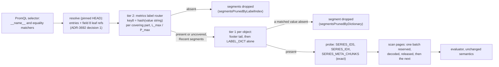

# ADR-3694: long-range metrics, routed before the probe and bounded on the read

Status: Proposed. Issue: #3694 (epic).
Date: 2026-11-05
Builds on: ADR-0020 (metric index: the `__name__` postings and the
rejection this ADR revisits), ADR-2707 (exact-key index: the `.kidx` leaf
layout and HEAD field 8), ADR-3692 (the tier-2 router and the part
binding its decision 1 adds to the resolve), ADR-1170 (process memory
budget: the fetch reservation rule), ADR-1199 (per-phase query I/O
accounting), ADR-0593 (L2 cross-hour exact compaction, designed and not
scheduled), ADR-0092 (run-merged L1 and the RSEG v7 page codecs),
ADR-0103 (aggregation pushdown narrowed to `count_over_time`), ADR-0927
(MetricsBench contract and its `history` profile), ADR-0064 (selective
subject erasure). Amends ADR-0020 (rejected alternative 5, the label
index) and nothing else. Changes no persistent format: the metrics label
index reuses the `.kidx` leaf object and `SnapshotPartRef.key_index`
(field 8) as docs/catalog-and-mvcc.md "Per-part key-index leaves"
specifies, the RSEG v7 layout is read as it is, and no proto field is
added or renumbered. The one codec question this epic opens (decision 7)
ends in a report; an adopted encoding would be its own ADR and an RSEG
version bump under the format-change procedure.

## Context

Ravel's metrics read path pays a fixed cost per data object in the query's
window, whatever the selector asks for. A one-series `rate` and a
300,000-series `sum(rate(...))` open the same objects and read the same
catalog bytes; only the page bytes differ. That cost is the floor under
every dashboard, alert and long-range query, and it grows with retained
objects, not with the answer.

### Stage 0: the measured baseline

Every figure below comes from the MetricsBench `cardinality` profile
(ADR-0927: 1,000,000 series, 360 samples each, 15 s scrape, 90 minutes,
323,353,241 accepted samples), on one m6a.4xlarge with ravel-server at 2
CPUs and 8 GiB. The tenant holds 15,220 to 15,260 L0 objects of about
1.05 MB. Two stores were used and are named per row: real S3 in
us-east-1, and s3s-fs, the portable lane's local store.

The `history` profile (10,000 series over 30 days, 1,728,000,000 samples,
the one whose statements are classed `long_range`) has never run on Ravel.
Its one run so far was a Prometheus-only falsification check (#2821
comment 6471983363, 2026-10-28). The owner's decision on 2026-11-05 is to
write this ADR on the 90-minute evidence and run `history` as wave 0, so
the long-range rows of the acceptance table carry predicted bands and are
confirmed or replaced by an amendment after that run. Section "What the
90-minute evidence cannot say" lists what that run must settle.

| Journey | Figure | Phase that dominates | Source |
|---|---|---|---|
| one-series `count_over_time`, cold, unfolded, s3s-fs, before the dictionary early return (E5) | 190.8 to 194.0 s; 96 % of it on the read gate's single permit; 14,404 gated sparse-catalog decodes at 12.7 ms each; plan 15,252 GETs 985 MB, probe 14,400 GETs 7.63 GB, scan 714 GETs | probe decode CPU | #3511 comment 6549071269 |
| same, after the dictionary early return (E8, PR 3615) | 94.0 to 94.6 s; gate 27 s (1.9 ms per object); probe bytes unchanged at 7.63 GB because all four catalog ranges arrive in one GET | probe fetch, 8.6 GB at about 92 MB/s | #3511 comment 6565071955 |
| same, frozen 120 s deadline (F3, closes #3511) | `samples.0` 91.5 s, `series` 104.9 s | fetch wave | #3511 comment 6646407715 |
| `series` listing of 1,000,000 series, cold, real S3, unfolded | 504 at 120.5 s; 29,029 GETs, 4.0 GB before the deadline; one GET per commit record plus one per fetch miss | resolve (15,248 commit-record GETs) then plan | #2821 comment 6583379446 |
| same, folded, real S3 (R6 folded read-back) | 81.0 s; `catalog_get_delta` 125 | plan and probe | #940 comment 6664968984 |
| R6 steady-state, real S3, 21 statements, every range statement opens 2,899 segments: `mb_single_counter_rate` | 9.0 s median; 3,440 GETs, 1.11 GB: plan 1,197 / 78 MB, probe 1,960 / 1,031 MB, scan 282 / 0.4 MB; graded `incorrect` on last-bit `rate` (#3788) | probe bytes, for one series | release metricsbench-r6-20261105, `out-cardinality/diagnostics.json` |
| R6 `mb_fanout_total_rate` (300,000 series) | 118.0 s median; 5,786 GETs, 2.13 GB: probe 925 MB, scan 1,151 MB; 675 MB decompressed | probe and scan both | release metricsbench-r6-20261105, `out-cardinality/diagnostics.json` |
| R6 `mb_full_range_max_by_job` and `mb_full_range_counter_increase` | 77.1 s and 67.0 s; 5,540 and 4,813 GETs; probe 898 and 741 MB; scan 979 and 985 MB | probe and scan | release metricsbench-r6-20261105, `out-cardinality/diagnostics.json` |
| R6 `mb_full_range_avg_over_time` and `mb_selective_error_ratio` | timeout at 120 s on 2 CPUs; no accounting recorded | unknown | release metricsbench-r6-20261105, `render.txt` |
| the same data compacted to 16 L1 parts (2,897 segments to 16), one m6a.4xlarge, frozen query flags | five statements 0.26x to 0.55x of the L0 time; three fail: two `fetch memory exhausted: requested 161598421 bytes` (one call reserves the sum of its coalesced runs; 32 such calls exceed the budget), one server death (unconfirmed OOM) on `avg_over_time`; probe reads 457 MB on every L1 statement whatever the selector; decompressed bytes 2.5 to 3x because a 30 m window prunes none of the hour-wide parts | fetch reservation shape, then whole-hour run decode | #3818 body |
| compacting one 4 GB shard-hour of that tenant | 39 to 46 GiB resident, 40 minutes; after #3827 about 195 B per (input, series) remains, about 10 GB for 3,800 inputs x 14,000 series | compaction memory | #3817 body, #3827 |
| retained bytes per sample, the ADR-0092 fixture (500 series x 240 samples at 15 s with 200 ms jitter), merged L1 with provenance | 2.50 (`gauge_int`), 3.00 (`counter_int_resets`, `gauge_dec2`), 8.88 (random floats); TS_PAGES 1.77 B per sample, 59 to 71 % of a merged object; VAL_PAGES 0.55 to 1.06 | timestamps | crates/ravel-bench/tests/catalog_byte_gates_golden.txt, docs/adrs/0092-run-merged-l1-and-rseg-v7.md:574 |
| `history` profile on Ravel (30 d, 10,000 series): `mb_long_range_7d_avg`, `mb_long_range_subquery_max`, `mb_long_range_predict_linear` | not measured | unknown; predicted below | #2821 comment 6471983363 (Prometheus only) |

The bottleneck this ADR attacks is the per-object cost that a selector
cannot avoid: on the folded cardinality tenant, 2,899 objects opened and
about 1 GB of catalog probed for one series (R6 `mb_single_counter_rate`),
and on the unfolded tenant 15,252 footers plus 7.63 GB of catalog for the
same one series (E8). The numbers it moves are those two statements'
object and probe counts, to the bands in "Acceptance". The second
bottleneck is the L1 read shape that makes compaction, the one lever
that already cuts object count 180x, unusable at 8 GiB (#3818). The third,
long-range object count across days (ADR-0593's L2), has no Ravel
measurement and is decided conditionally (decision 6).

### What exists on main, and what does not

- **The resolve narrows by time only, plus `__name__` postings when
  every plan shares one name key.** A `SegmentRef` carries time bounds,
  counts and identity, no label or series summary
  (`crates/ravel-catalog/src/snapshot.rs:43-104`); `include_l0_if_overlaps`
  filters on time (`crates/ravel-catalog/src/catalog.rs:4179`); the RNP1
  postings map `__name__` to entry ordinals and nothing else
  (`crates/ravel-catalog/src/snapshot_format/postings.rs:1-21`); the
  engine applies them when every selector shares one pruning key, an
  exact `__name__` value or a literal-prefix-anchored regex such as
  `^foo.*$` (ADR-0061 decision 3; `name_pruning_key`,
  `equality_name_filter` and `shared_equality_name_filter` at
  `crates/ravel-query/src/engine.rs:3881-3921`). `CompactionPart` carries
  `first_series_id` and `last_series_id` (`proto/ravel/commit.proto:99-100`)
  and neither the L1 `SegmentRef` nor the snapshot entry keeps them
  (`catalog.rs:4905`, `crates/ravel-catalog/src/fold.rs:582`).
  Segments above the fold watermark (`Recent`) are never pruned by
  postings (`snapshot.rs:131-137`); in the F3 and R6 unfolded read-backs
  every segment was `Recent`.
- **The probe fetches four catalog ranges in one GET.** At or above 4,096
  series an object's LABEL_DICT, SERIES_IDS, SERIES_IDX and
  SERIES_META_CHUNKS are coalesced into one request
  (`crates/ravel-query/src/fetcher.rs:2180-2258`, `max_runs = 1`), about
  530 KB per object on the cardinality tenant, of which SERIES_IDS is
  16 B x 23,600 series, about 378 KB. The decoder already returns empty
  after reading LABEL_DICT alone when an equality value is absent
  (`crates/ravel-segment/src/sparse.rs:1036`, PR 3615), and the fetch does
  not benefit: the bytes were already on the wire. LABEL_DICT is the first
  physical section with its own crc (`docs/segment-format.md:209-222`) and
  is a flat string dictionary of every label name and value in the object
  (`docs/segment-format.md:224-235`).
- **Metrics have no key index.** ADR-2707 scopes metrics out
  (`docs/adrs/2707-exact-key-index-for-spans-and-logs.md:707`);
  `declared_key_index_fields` is `None` for metrics
  (`fold.rs:1225-1242`). ADR-0020 rejected a label index because "build
  cost is a full catalog decode of every segment, size is unbounded"
  (`docs/adrs/0020-metric-index.md:50-55`). The first premise no longer
  holds: the fold already GETs every newly sealed object whole to derive
  its names (`fold.rs:5234` `fetch_segment_names`, called from
  `build_postings` at `fold.rs:4685`).
- **The L1 read reserves a whole call at once.** `ensure_ranges` sums every
  coalesced run of a call and reserves the total before any GET
  (`fetcher.rs:1697-1701`, the 161,598,421-byte request of #3818); ADR-1170
  requires a refusal before the fetch rather than a smaller fetch or a
  partial result, and releases a reservation when its buffer drops, never
  earlier. Two fix rounds on #3818 did not land: one capped runs that were
  never the problem, the other released a batch while its bytes stayed
  resident, which breaks ADR-1170 decision 2. `open_segment`'s first GET
  reserves nothing (#3818 comment, round two's side finding). An L1 part
  holds one run per series spanning the whole hour (ADR-0092), so a
  window shorter than an hour decodes the hour.
- **L2 is designed, not scheduled.** ADR-0593 run-merges consecutive
  sealed hours' L1 outputs under ADR-0815 decision 7's replicated
  `CompactionRecord` at `format_version = 2`, defers tombstones, and makes
  erasure-record replication a precondition. Finding, reported here and
  not fixed: `CompactionRecord.format_version = 2` already ships with the
  meaning "superseded_record_key set" (`proto/ravel/commit.proto:123,136-142`,
  read at `crates/ravel-maintain/src/sweep.rs:2144`), and neither ADR-0593
  nor ADR-0815 section 7 acknowledges it; the L2 record needs version 3 or
  a flag, and the scheduling task resolves that before any writer.
- **Exact pushdown is narrow by decision.** ADR-0103 pushes
  `count_over_time` only; `min_over_time` and `max_over_time` were excluded
  because `total_cmp` differs from PromQL's NaN and signed-zero handling
  (`docs/adrs/0103-order-insensitive-aggregation-pushdown.md:393-410`).
  ADR-0913's `.magg`
  states bind to the exact blake3 of the snapshot part they cover and are
  logs-only and unimplemented. Any answer from precomputed state is refused
  while an erasure is pending (ADR-0850 lemma, ADR-0913 section 2d).
- **The codecs are per page, one run per page.** RSEG v7 pages carry an
  `enc` byte; timestamps are zigzag-varint deltas (enc 1) or a GCD-scaled
  integer codec (enc 2); values are Gorilla, raw, a one-exponent ALP
  (enc 18) or GCD-delta-FOR (enc 19), chosen per page by size
  (`crates/ravel-segment/src/writer.rs:1042-1137`). An unknown `enc` is
  read as corruption, not as an unsupported version
  (`crates/ravel-segment/src/reader.rs:914`), which is why ADR-0092 shipped
  new encodings under a version bump. `codec_bakeoff` already carries the
  adoption rule: at most 75 % of current bytes and decode no slower
  (`crates/ravel-bench/src/bin/codec_bakeoff.rs:33-39`).
- **The accounting is per phase already, on the statement's own stats.**
  `data.stats.phases` splits requests, wire bytes, cache hits and
  decompressed bytes into resolve, plan, probe, scan and keyIndex
  (`crates/ravel-query/src/phase_accounting.rs:16-31`), and the resolve's
  commit-record GETs are charged to the statement's resolve handle on the
  unfolded path too (`engine.rs:2437` passes `first_accounting.resolve()`
  into `resolve_bounded`; every record GET goes through the accounted
  funnel at `crates/ravel-catalog/src/catalog.rs:1349`). `segmentsFetched`
  is the post-prune snapshot size and `unfoldedSegmentsResolved` the
  `Recent` count (`engine.rs:77`, `crates/ravel-query/src/io_shape.rs:139-152`).
  What is missing is a count of segments each prune source removed on
  metrics, and a harness that reads the statement's stats: the #2821
  read-back readout (comment 6583379446) inferred the query's GETs from
  process-wide store counters around the read-back window, which cannot
  separate the query from a concurrent fold, because the kit records
  `data.stats` for corpus statements (`ravel_cost`) and not for its own
  read-back queries.

### What the 90-minute evidence cannot say

Three questions only the `history` run answers, each named so the wave 0
pre-registration can band it:

1. Whether a 7-day window over 10,000 series is bound by per-object fixed
   cost (footers and catalogs across hundreds of hour parts) or by page
   bytes and decode. The cardinality tenant has 90 minutes, so every
   window covers every hour.
2. Whether the replay's ingest-hour shape matches a deployment's. Ingest
   hour is wall time at flush (docs/catalog-and-mvcc.md, "ingest hour"),
   so a 30-day corpus replayed in hours lands in a few ingest hours with
   event ranges spanning days, and event-time pruning degrades to nothing.
   The baseline must state its object event-time spread beside every
   figure, and the load lane must be able to stride ingest hours by event
   hour the way ADR-3692's T2 does for logs.
3. Whether L1 parts on a long tenant are full (ADR-0593 decision 5: the
   L2 factor is 1 when they are) or small. At 10,000 series x 240 samples
   x about 2.5 B, an hour's L1 is about 6 MB against a 256 MiB part cap,
   so the predicted factor for a 7-day window is up to 168.

## Decision

### 1. The unfolded probe reads the dictionary first, and stops on a miss

For an object the sparse probe qualifies (`sparse_probe_qualifies`,
`fetcher.rs:2144-2163`), the probe becomes two steps. Step one GETs the
LABEL_DICT range alone and decodes it. When any equality matcher's value
(including `__name__`) is absent from the dictionary, the object holds no
matching series, the segment is dropped, and `segmentsPrunedByDictionary`
counts it. Step two, only on a hit, GETs the remaining catalog ranges as
one coalesced request, exactly today's probe minus the dictionary bytes.
Objects below the sparse threshold keep today's single fetch: their whole
catalog is the size of a dictionary.

- Exact by construction: a value absent from the flat string dictionary
  cannot appear under any label name in that object
  (`docs/segment-format.md:224-235`). Presence proves nothing and leads to
  today's exact decode.
- Cost: one more round trip per holder object, no more per non-holder.
  On the E8 tenant most objects are non-holders for a one-series selector
  (gate seconds fell from 183 to 27 when the early return landed), so the
  7.63 GB probe wave collapses to 14,400 dictionary reads. The dictionary's
  size on that tenant is not recorded; it is the first figure the wave 1
  task measures and the acceptance row 2 band is written against it.
- The `!=`, regex and empty-value matchers take no part in the test; a
  selector with no positive equality matcher runs today's one-step probe.
- Reads stay inside ADR-1170: each step reserves its own bytes and holds
  them only while decoding.

The probe gate amendment below gates this per statement.

### 2. The fold builds a label-value index for metrics parts, in the `.kidx` leaf

ADR-0020's alternative 5 is amended, not reversed. Its "build cost is a
full catalog decode of every segment" is already paid: the fold GETs each
newly sealed object to derive its names (`fold.rs:5234`), and the index
this decision adds reads one zstd frame more from the same bytes, the
LABEL_DICT. Its "size is unbounded" is answered with the same ceilings
ADR-2707 and ADR-3692 already impose on logs and spans leaves.

- **Key.** One field, `label_value`, of key type `Str`: `key8` is the
  8-byte hash prefix of each string in an object's LABEL_DICT, every
  string, names included (a name is harmless: it is never asked for). A
  selector's positive equality matcher `k="v"` asks for `key8(v)`. A part
  whose leaf answers "absent" for `v` proves no object in the part holds
  that string, so none holds `k="v"`. Presence is not a match: tier 1
  (decision 1) and the exact decode still run on survivors.
- **Object.** The leaf is the ADR-2707 leaf object under
  `catalog/m/idx/`, referenced from `SnapshotPartRef.key_index` (field 8),
  at `KEY_INDEX_LEAF_FORMAT_VERSION` 1 as it is. Every entry carries the
  one-block set `{0}`: the encoder refuses an empty block set
  (`crates/ravel-catalog/src/snapshot_format/kidx.rs:321-326`) and
  docs/catalog-and-mvcc.md lists one as leaf corruption, so a metrics leaf
  is legal to every existing reader and writer, and block ordinal 0 is
  defined, for a signal whose objects have no block structure the leaf
  addresses, as "the object". T3 writes that sentence into
  docs/catalog-and-mvcc.md "Per-part key-index leaves" beside the metrics
  field. `declared_key_index_fields` returns the one field for metrics
  instead of `None`. No proto field is added, the leaf format version does
  not move, and the key layout gains no prefix.
- **Build.** Only when `metrics_label_index` (new fold setting, default
  off until the Stage 1 amendment, the same rule as ADR-3692 decision 5)
  is on, and under ADR-3692's pair budget and pass accounting. A part whose
  leaf would exceed `KEY_INDEX_LEAF_BYTES_CAP` (predicted 1 % of the part's
  data bytes; the Stage 1 amendment fixes the figure) is left uncovered and
  the fold reports it. The build reads LABEL_DICT by range on an object the
  fold has not already read whole.
- **Binding and erasure.** The leaf binds to the part blake3 as every leaf
  does (docs/catalog-and-mvcc.md "Binding and coverage"). A value string is
  a subject value, so the leaf falls under ADR-2707 decision 6's erasure
  rule as `.cstat` and the logs `.kidx` do: while the tenant's `del/`
  listing is non-empty the router prunes nothing on metrics, an erasure
  rewrite supersedes the inputs, the next fold re-encodes the part and
  writes a new leaf, and the stale leaf is swept as unreferenced.
- **L1 parts** are indexed like L0 entries; a compaction record re-encodes
  the part and rebuilds its leaf (ADR-2707 decision 6). Nothing in
  `ravel-maintain` changes.

### 3. The PromQL resolve routes through the leaves before any object is opened

`prefetch_metric_plans` (`engine.rs:1914-1950`) calls the one tier-2 router
ADR-3692 decision 2 adds (`crates/ravel-query/src/key_index_route.rs`)
with a `KeySet` of the statement's positive equality values, field
`label_value`, over the pinned snapshot's covering parts and their field 8
refs (ADR-3692 decision 1's `SnapshotParts`). Per part the router's
answer maps to: every entry of the part dropped (`Pruned`), or the part's
entries kept (`Blocks` or `Uncovered`). The metrics consumer never pushes
a `Blocks` list as a read list: to the spans and logs consumers `Blocks`
means "read these blocks instead of the SKIP_IDX candidates"
(`crates/ravel-query/src/key_index_route.rs:107-115`,
`crates/ravel-sql/src/spans_provider.rs:413-416`), and a metrics object
has no blocks to read, so for metrics `Blocks` (always `{0}` by decision 2)
and `Uncovered` are the same answer, keep the entry and let decision 1
decide. The router's `L_max`, `P_max`, `B_run` and admission order apply
unchanged; a metrics statement never asks for more than one key per
matcher.

- A compound query with several selectors routes each selector once over
  the padded union window the prefetch already resolves, and takes the
  union of survivors, so no selector loses an object another needs.
- `segmentsPrunedByLabelIndex` and the `keyIndex` phase figures land in
  `data.stats` beside `segmentsPruned`; both new counters are zero when
  the switch is off, so an unchanged tree reports an unchanged shape.
- `Recent` segments are never covered and go to decision 1; a `min_commit_token`
  request reads its exact commit keys as today (docs/consistency-model.md:500-502).
- Reachability: the test drives `/api/v1/query_range` on a ravel-server
  with the fold switch on and asserts `segmentsPrunedByLabelIndex` equals
  the number of non-holder objects of a known fixture, the pattern of
  ADR-3692 decision 9's spans test.

### 4. One fetch call reserves one batch, and a batch is released after its decode

`ensure_ranges` stops reserving the sum of a call's runs. The runs are
formed as today, `coalesce_ranges` then `bound_runs` under the call's
`max_runs` (`fetcher.rs:1690-1701`), and the run list is then cut into
batches by coalesced bytes, bridged gaps included, of at most
`fetch_batch_bytes = memory_budget.limit() / (2 x get permits)`
(predicted). A run larger than that is split at a page boundary inside
it, each half keeping its pages whole and the bridged gap between the
halves dropped. A batch therefore reserves at most `fetch_batch_bytes`,
or one page when a single page exceeds it, and a page is under the
64 MiB reader cap (`crates/ravel-segment/src/format.rs:364`), so a call's
reservation is bounded by the larger of the batch and 64 MiB against the
frozen 6.4 GB budget; #3818's 161,598,421-byte call was about 32
coalesced runs of about 5 MB, which the cut groups into batches without
splitting any. Each batch is reserved, fetched, decoded into the
sample fold, whose own ledger charges what it retains (#3768's
`RunFold::reserve_retained`), and only then dropped, which releases it.
The next batch reserves after the drop. A call holds at most one batch's
bytes plus what the fold has charged, and every live byte is under a
ledger at every instant: this is ADR-1170 decision 2 as written, and the
difference from #3818's round two is the order, decode and drop before the
next reserve rather than release before drop.

- A reservation that does not fit still refuses before the GET, with the
  batch size in the message; it never shrinks a needed page range.
- Request count: `max_runs` bounds the run list before the cut exactly as
  today and stays a per-call bound. A run on an L0 segment is never
  split, so `MAX_PAGE_RANGE_GETS_PER_L0_SEGMENT` (`fetcher.rs:2324-2327`)
  and the request laws derived from it (`segment_admission.rs:360-370`)
  are unchanged; an L0 run cannot exceed its object, and L0 objects are
  about 1 MB on the measured tenants, under the 8 MiB floor, so the
  reservation bound holds there without a split. Only an L1 run larger
  than `fetch_batch_bytes` is split (L1 passes `usize::MAX` as
  `max_runs`), which adds one GET per split and removes the bridged gap's
  bytes from the wire. Acceptance row 6 counts scan GETs against the
  unbatched call plus one per split run and wire bytes at most the
  unbatched call's.
- `open_segment`'s first GET (the footer tail or the whole small object)
  reserves its bytes like every other fetch.
- Runs are decoded in the order the batches arrive, which is the order
  the call already coalesced them, so sample order into the fold is
  unchanged and the fold's dedup result is bit-identical (asserted by the
  existing differential fixtures of #3747).
- The three #3818 statements are the acceptance (row 6). The hour-wide
  run decode of an L1 part for a sub-hour window is measured in the same
  row and not changed here; decision 6 inherits it as a constraint.

### 5. Cost is read from the statement, and the fold state is stamped

- The MetricsBench read-back records each of its sample queries'
  `data.stats` (phases, `segmentsFetched`, `unfoldedSegmentsResolved`)
  the way `ravel_cost` already records them for corpus statements, so a
  read-back figure is the statement's own and never an inference from
  process-wide store counters (the gap behind #2821 comment 6583379446).
  The engine's attribution itself is unchanged: resolve GETs already land
  on the statement's resolve handle.
- `segmentsPrunedByDictionary` and `segmentsPrunedByLabelIndex` join
  `segmentsPruned`; each phase keeps `decompressedOutputBytes`.
- Every MetricsBench report row carries the catalog state the harness
  stamps today (`ravel_catalog_fold`, object count by kind, format
  version), and a Ravel row without the stamp is not a result (CLAUDE.md
  "Measurement and cost discipline").

### 6. L2 is scheduled on a measured trigger, after the `history` baseline

ADR-0593's implementation is not scheduled by this ADR. It is scheduled
by an amendment when the wave 0 `history` baseline shows, on
`mb_long_range_7d_avg`, that resolve plus plan plus probe GETs are at
least 40 % of the statement's GETs after decisions 1 to 3 (predicted
trigger; the parts' fullness and the object count per covering hour are
stamped beside it). When scheduled, the task list is ADR-0593's four
follow-ups in order, with two additions this ADR requires: the
`CompactionRecord` version collision above is resolved first (version 3,
or an explicit flag, with the sweep's reader updated before any writer),
and an L2 part keeps `max_run_span_hours` (predicted 1 h, the L1 run span
today) so a sub-day window decodes only the sub-runs it overlaps, the
constraint decision 4's row 6 measures on L1.

### 7. The codec question ends in a report, and timestamps come first

The retained-bytes figure is 59 to 71 % timestamps on realistic shapes, so
the portfolio experiment evaluates timestamp codecs before value codecs:
delta-of-delta with jitter tolerance and the GCD codec's `DoubleDelta` arm
against enc 1, then DeXOR (arXiv 2601.00695) and a vectorised ALP (the
`codecs.rs` ALP with fixed vectors and the `rd` mode) against enc 16, 18
and 19, in `codec_bakeoff` and `ts_bakeoff` on the ADR-0092 fixture plus
the MetricsBench `cardinality` and `history` corpora. The adoption rule is
the bench's own: at most 75 % of current bytes at a decode no slower, with
bitwise round-trip for signed zero, infinities, subnormals, NaN payloads
and the stale marker `0x7ff0000000000002` added to the production
proptests (today only `hard_floats` pins the marker bits). A candidate
that passes is proposed in its own ADR with an RSEG v8 bump under the
format-change procedure; nothing in this epic writes a new `enc` byte.

### 8. Exact acceleration is a matrix and an oracle, and no lossy tier ships

This epic delivers the operator matrix #118 asks for as a document and a
differential test, not a rollup object. For each `*_over_time` function,
`rate`, `increase`, `delta`, `resets`, `changes`, `predict_linear` and
the native-histogram paths, the matrix states exact (bit-identical to the
evaluator from per-hour sufficient statistics, with the statistic named),
exact under a condition (window aligned to hour boundaries, no staleness
marker inside the window, no counter reset), or raw only, and the test
pins every "exact" row against the evaluator on fixtures that include
NaN, signed zero, staleness markers, resets and schema changes. `count_over_time`
is the one row known exact today (ADR-0103). A persistent rollup object,
exact or lossy, is a later ADR that cites this matrix; a lossy resolution,
when it comes, is a request-time opt-in with the resolution and coverage
in the response, never a default. Requests with `min_commit_token` read
raw whatever the matrix says.

## Rejected alternatives

- **Series-id point lookup through SERIES_IDX for a fully specified
  selector.** A selector cannot be known to name every label of a series,
  so the engine cannot compute the id; the sparse protocol has no
  production caller today for that reason. Decision 1's dictionary test
  needs no such knowledge.
- **A new index object kind for metrics instead of the `.kidx` leaf.** A
  second leaf format forks the router, the fold's pair budget, the
  binding check and the sweep for the same shape of answer; the logs leaf
  already holds `Str` keys by hash prefix and a one-block set is a legal
  payload, which is what makes decision 2's `{0}` convention reuse the
  leaf without a format change.
- **Keying the index on `(name, value)` pairs.** LABEL_DICT has no pair
  structure, so pairs need the SERIES_META decode ADR-0020 rejected; the
  value-only key proves the same absence and reads one frame.
- **Carrying `first_series_id` and `last_series_id` into the snapshot
  entry.** Ids are hashes, so a range says nothing about which series are
  inside it except for one-part L1 ranges; and L0 objects have no such
  fields.
- **Waiting instead of refusing when a fetch reservation does not fit
  (#3818 option b).** Needs an ADR-1170 amendment and turns a memory
  refusal into a latency the deadline then converts into a timeout with
  no cause in the message.
- **Lowering fetch fan-out when per-call needs are large (#3818 option
  c).** Treats the symptom; the sum-of-runs reservation stays and a
  single large call still exceeds the budget.
- **Implementing L2 now.** No Ravel long-range measurement exists, the
  record version collision is unresolved, and ADR-0593's erasure
  precondition is undesigned; the trigger in decision 6 is the stated
  path.
- **Adopting a value codec in this epic.** The retained bytes are mostly
  timestamps, and any new `enc` is a version bump with a wipe-or-migrate
  consequence pre-v1.0; the report first, then its own ADR.
- **A downsampled tier now.** #118's own acceptance requires the exact
  matrix first, and every rejected operator in it is a silent-wrong-answer
  risk if a tier ships before it.

## Consequences

- An operator sees fewer objects opened and fewer catalog bytes per
  selective metrics statement, two new `data.stats` counters, one new
  fold setting (`metrics_label_index`, off until the Stage 1 amendment),
  and compaction of high-cardinality metrics tenants becomes queryable at
  8 GiB. Semantics, visibility and erasure bounds are unchanged.
- The fold reads one more frame per newly sealed object and writes one
  leaf per metrics part; leaf bytes are reported and capped.
- ADR-0020 alternative 5 is amended by this ADR; ADR-2707's metrics
  scope sentence gains a pointer here; docs/catalog-and-mvcc.md's leaf
  section lists `label_value` as the metrics field; docs/query-engine.md
  describes the two-step probe and the router on metrics;
  docs/guides/cost-model.md gains the per-statement cost rows.
- The `CompactionRecord` version collision is reported to ADR-0593's and
  ADR-0815's owners through the epic issue; nothing here depends on it.
- Format-change classification: none in this epic. The codec report and
  the operator matrix are documents and tests.

## Acceptance (pre-registered; a figure outside its band is a miss, investigated before the epic closes)

Every arm runs on one m6a.4xlarge against real S3 in us-east-1 with
ravel-server at 2 CPUs and 8 GiB, the build's SHA and the catalog state
stamped before the first statement and after any fold, five cold
repetitions per statement (restart between), the MetricsBench harness and
corpus at their frozen versions. "Holders" is the stamped number of
objects that contain the statement's series. Rows 4 and 12 are read with
the probe gate amendment's extra-GET allowance.

| check | target | miss | source |
|---|---|---|---|
| 1. `history` baseline on Ravel (wave 0): the three `long_range` statements and `mb_full_range_avg_over_time`, steady-state and cold, with GETs and bytes per phase, parts per covering hour, part fullness, object event-time spread | recorded; `mb_long_range_7d_avg` under 120 s; resolve plus plan plus probe share of GETs recorded as decision 6's trigger input | a timeout, or a missing stamp | predicted |
| 2. one-series `count_over_time` (`samples.0`), cold, unfolded, after decision 1 | probe GETs = objects qualified (14,000 to 15,300) plus holders; probe wire bytes at most objects x dictionary bytes plus holders x 530 KB, where dictionary bytes is measured first and under 100 KB; `segmentsPrunedByDictionary` = objects minus holders; answer 357 | probe bytes above 2 GB, or any other answer | predicted; E8 measured 7.63 GB, #3511 comment 6565071955 |
| 3. R6 `mb_single_counter_rate`, folded with leaves | leaf GETs at most 2 x covering parts; objects opened = holders (about 360 of 2,899); probe wire under 200 MB; `segmentsPrunedByLabelIndex` = 2,899 minus holders; result hash equal to the unrouted run | over 600 objects opened or over 500 MB | predicted; R6 measured 2,899 opened and 1,031 MB, release metricsbench-r6-20261105 |
| 4. R6 `mb_fanout_total_rate` and the two `full_range` instant statements, folded with leaves | objects opened and bytes within 2 % of the unrouted run (every object holds the name); no statement over 5 % slower; result hashes equal | over 5 % slower or any extra GET | predicted; R6 figures in the Stage 0 table |
| 5. `series` listing of 1,000,000 series, cold, real S3, folded | within 10 % of R6's 81.0 s and `catalog_get_delta` within 125 plus leaf GETs | over 100 s | measured 2026-11-05, #940 comment 6664968984 |
| 6. the #3818 arm: the same tenant compacted to its L1 parts, frozen query flags, all 8 statements | every statement answers; no `fetch memory exhausted`; peak container memory under 8 GiB; result hashes equal to the L0 arm; scan GETs at most the unbatched call's plus one per split run and wire bytes at most the unbatched call's; decompressed bytes per statement recorded against the L0 arm as decision 6's run-span input | any refusal, kill, or hash difference, or scan GETs or wire bytes above those bounds | predicted; #3818 measured three failures |
| 7. leaf bytes and build cost | leaf bytes at most 1 % of part data bytes on the cardinality tenant; fold wall with the switch on within 10 % of off on an unchanged tail plus one new hour; uncovered parts 0 | over 2 % or over 20 % | predicted |
| 8. erasure in flight | with a pending `del/` request on the tenant, `segmentsPrunedByLabelIndex` = 0 on every statement and results equal to the unrouted run; after the rewrite and fold, the stale leaf is unreferenced and swept | any prune while pending | predicted; the rule is ADR-2707 decision 6 |
| 9. correctness matrix | exact agreement with the Prometheus oracle status of R6 on every statement (15 ok, 4 incorrect for the known last-bit and tie reasons, 0 new incorrect), folded and unfolded, routed and unrouted; the two R6 timeouts recorded as answered or still timing out | any new `incorrect` | measured 2026-11-05, release metricsbench-r6-20261105 |
| 10. codec report | per codec and corpus: bytes per sample, encode and decode throughput, peak memory, round-trip proptest with the stale marker; an adopt or reject line per candidate against the 75 % rule | a candidate with no verdict | predicted; rule at crates/ravel-bench/src/bin/codec_bakeoff.rs:33 |
| 11. operator matrix | every function named in decision 8 has a row; every exact row has a passing differential test on the NaN, signed-zero, staleness, reset and schema-change fixtures; `count_over_time` is exact | a row without a test | predicted |
| 12. nonselective control: the 21 cardinality statements, this build against main before wave 1, same box, paired | no statement over 5 % slower outside the lane's noise; no GET or byte increase on an unrouted statement | over 5 % | predicted |
| 13. cost per statement | the dollar figure per R6 statement before and after, from the per-phase GET and byte counts at the stated us-east-1 prices, plus the leaf's amortised fold cost per part-month | missing basis | predicted; prices named in docs/guides/cost-model.md |

## Plan

| task | decision | crates | depends on | risk |
|---|---|---|---|---|
| T1 `history` lane figures in `deploy/metricsbench`: the object event-time spread file, a Ravel-only diagnostic cold pass for the long-range statements, the read-back queries' `data.stats` recorded, then the wave 0 pre-registration on #3694 and the run on one box | Stage 0, 5, 6 | deploy/metricsbench (shell), ravel-bench (report fields) | none | low |
| T2 two-step probe: LABEL_DICT range alone, dictionary decode, drop on a miss, `segmentsPrunedByDictionary`; dictionary bytes measured and recorded | 1, 5 | ravel-segment (a dictionary-only decode entry), ravel-query (fetcher, stats) | none | medium |
| T3 metrics leaf in the fold: `declared_key_index_fields` for metrics, `label_value` field, LABEL_DICT read, `metrics_label_index` setting, leaf byte cap, erasure gating in the fold, docs/catalog-and-mvcc.md | 2 | ravel-catalog (fold, snapshot_format, config), docs | ADR-3692 T3 and T6 landed on main (shared fold and router files; the dispatch guard refuses while their pull requests are open) | high |
| T4 batched fetch reservation: `ensure_ranges` batches, decode-then-drop order, `open_segment` charged, the #3818 reproducer as a test, docs/query-engine.md | 4 | ravel-query (fetcher, engine/sample_fold) | T2 landed (same crate) | high |
| T5 router on metrics: `KeySet` from the selector, `prefetch_metric_plans` wiring, `segmentsPrunedByLabelIndex`, the reachability test on `/api/v1/query_range` | 3, 5 | ravel-query (engine, key_index_route), ravel-server (tests) | T3, T4 landed | medium |
| T6 codec bakeoff: timestamp candidates first, DeXOR and vectorised ALP, stale-marker proptest rows, the report | 7 | ravel-bench (bakeoff binaries, codecs.rs), ravel-segment (proptest rows only) | none; not with T2 (ravel-segment) | low |
| T7 operator matrix and differential oracle | 8 | ravel-promql (tests), docs | none | medium |
| T8 Stage 1 run on real S3: rows 2 to 9 and 12, 13; acceptance amendment; `metrics_label_index` default on | all | docs, ravel-catalog (one default) | T2, T4, T5 | low |
| T9 L2 (ADR-0593 follow-ups 1 to 4 plus the version fix and `max_run_span_hours`) | 6 | ravel-maintain, ravel-catalog, ravel-commit, proto (additive), docs | T1's trigger met and the amendment posted; not dispatched otherwise | high |
| final: docs/query-engine.md, docs/guides/cost-model.md, README cost rows, ADR-0020 and ADR-2707 pointers | all | docs | T8 | low |

Waves: 0 is T1 with T7 (disjoint crates), followed by the `history` run
and its readout on #3694. 1 is T2, joined by T3 when ADR-3692's T3 and T6
have landed on main by then (ravel-catalog is disjoint from T2's crates).
2 is T4 with T6 (T6 waits for T2 because both touch ravel-segment). 3 is
T3 if it did not run in wave 1, else T5. 4 is T5 when wave 3 was T3. 5 is
T8, then the final docs task. T9 dispatches only on its trigger. Each
wave's checkpoint review runs before its pull requests open; every
acceptance row above is named in its task's spec and re-run at the
checkpoint.

## Amendment (issue #3862): the dictionary-first probe is gated per statement

<!-- amendment-applies: sections="1. The unfolded probe reads the dictionary first, and stops on a miss|Acceptance (pre-registered; a figure outside its band is a miss, investigated before the epic closes)" pointer="probe gate amendment" -->

Decision 1 as written adds one GET for every object whose dictionary holds
the matched values. On a selector that matches only a name the postings
already applied, or a low-cardinality value every object holds (R6's
`mb_fanout_total_rate`, the `full_range` statements,
`mb_selective_job_rate_sum`), step one prunes nothing and the extra GET is
pure cost: about 2,900 GETs on a statement that issues 5,786 today. The
two-step probe is therefore gated per statement:

- A statement whose only positive equality matchers are `__name__` values,
  and whose snapshot the name postings already pruned, runs the one-step
  probe.
- Every other qualifying statement starts two-step. After its first `K`
  two-step probes complete, `K` being the statement's PromQL fetch fan-out,
  if fewer than half dropped their object, its remaining objects use the
  one-step probe. Both probes decode the same catalog exactly; only the
  request count differs.
- `segmentsProbedTwoStep` and `dictionaryProbeSwitchedOff` are reported
  beside `segmentsPrunedByDictionary`.
- A statement's extra GETs over the one-step probe are bounded by `K` plus
  the probes in flight when the switch fires, at most twice the fan-out.

Acceptance rows 4 and 12 read "no GET increase" and "any extra GET" as
more than twice the PromQL fetch fan-out extra GETs per statement the
router does not prune.
