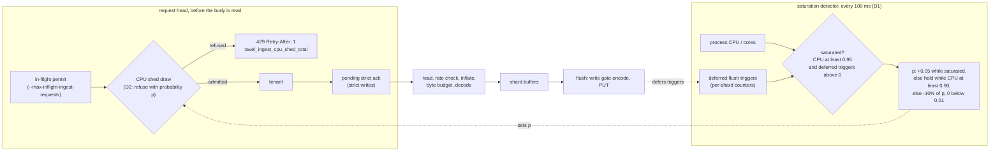

# ADR-3718: Refuse ingest before the node's cores saturate

- Status: Accepted (2026-11-03)
- Date: 2026-11-03
- Refs: #3718, #3645, #3492, ADR-0051, ADR-0069, ADR-1702, ADR-2708

## Context

Logs ingest throughput on one `ravel-server` follows its cores: about 18k
OTLP log lines/s per vCPU, about 46 to 47 us of CPU per stored line, on 8 and
on 16 vCPU alike (#3492 comments 6579509683 and 6589850073). Below that
ceiling every offered line is stored. Above it the server does not hold the
ceiling. It falls into an overloaded state and stores less than its peak, and
it stays there for as long as the excess load keeps arriving.

Peak stored is the highest stored rate the topology reached at any step.
Stored above the ceiling is the range over the overloaded steps. The loss is
peak minus stored, over peak.

| Node | Peak stored | Offered above the ceiling | Stored there | Loss | Source |
|---|---|---|---|---|---|
| 8 vCPU | 152k lines/s (fixed 150k) | 160k (fixed) | 115k to 123k | 19% to 24% | #3645 comments 6574471828 and 6584038929 |
| 16 vCPU | 283k lines/s (280k step) | 300k to 340k | 248k to 260k | 8% to 12% | #3492 comment 6589850073 |
| 2 x 8 vCPU, one Service | 261k lines/s (280k step, 9% dropped) | 300k to 340k | 227k to 248k | 5% to 13% | #3492 comment 6589850073 |

The two-replica row is on a different basis from the other two.
- **Clean step:** it held 243k with no drops at the 240k step. Measured from
  there, its 300k to 340k steps stored between 7% less and 2% more, so at the
  topology level there is no clear collapse.
- **Peak:** it peaked at 261k at the 280k step, with drops, because one
  replica saturated at 220k and the other never did.

The collapse is per replica: the busier one was in the overloaded signature
from 220k on (#3492 comment 6589850073). The topology-level figure
understates it, because the idle replica's spare cores absorb part of the
loss.

The overloaded state has one signature on every topology:
- every core is busy;
- flushes are size-triggered at the 32 MiB object backstop instead of age-triggered at about 9k lines;
- flushes wait seconds for a flush permit;
- ordinary flush triggers are deferred at about 90 per second (zero on every clean step);
- CPU per stored line is 59 to 76 us instead of 47 us, uniformly across decode, normalize and encode, with no lock or spin hotspot (#3645 comment 6584038929).

The measurements on #3645 changed one variable at a time against that state:

| Variable | Result | Source |
|---|---|---|
| Write-gate permits 4, 6, 8 | no change | #3645 comment 6573395997 |
| Flush slots 4 or 8 per shard | 8 delays the tip; it still happens | #3645 comment 6575073635 |
| Object backstop multiple 1 or 4 | 1 is 4% to 15% worse | #3645 comment 6584038929 |
| Ingest byte budget 1 GiB or 4 GiB | no change | #3645 comment 6584038929 |
| At most 8 requests decoding at once, against 1024 | 6% to 13% better, still overloaded; almost no 429s | #3645 comment 6585932504 |

None of these is a CPU limit. `--max-inflight-ingest-requests` bounds decode
memory and releases its permit at enqueue. The ADR-0069 byte budget bounds
buffered bytes. Rate admission (ADR-0051, ADR-0084) bounds a tenant's
configured rate. Flush permits (ADR-2708 D3) bound concurrent PUTs. A server
accepts any load these bounds allow, whether or not its cores can encode it,
and the backlog that builds then keeps it overloaded. ADR-1702 already
decided where the answer belongs: a busy node stays in its Service, and
"overload is handled by admission control, not by the probe" (ADR-1702,
lines 225 to 226). No admission control looks at CPU today.

## Decision

### D1. A saturation detector reads two signals the process already has

A background task samples every 100 ms:

- **CPU use:** the process's own CPU time (user plus system, fields 14 and
  15 of `/proc/self/stat` at Linux's fixed 100 ticks per second, a plain
  file read, as `crates/ravel-bench/src/columnar_load.rs` already does) over
  wall time, divided by the core count `HostProfile` already resolves
  through `available_parallelism`. That count follows a cgroup CPU quota.
  Off Linux there is no `/proc/self/stat`, so the detector never reports
  saturation and logs once that shedding is off.
- **Flush backlog:** the sum over shards of `flush_trigger_deferred` (an
  existing counter, `crates/ravel-ingest/src/metrics.rs`), read as a rate
  over the last second through a new cheap accessor on the ingest routers:
  one atomic load per shard, not the full metrics snapshot.

The node is **saturated** while CPU use is at or above
`--ingest-cpu-shed-threshold` (default 0.95) and deferred triggers are above
zero, both averaged over 1 s. CPU use alone does not trip it: a clean step at
the ceiling runs at about 91% of the node (#3492 comment 6579509683), close
enough that CPU alone would shed good load. Deferred triggers alone do not
trip it either: a multi-tenant node can defer one stalled tenant's trigger
with cores to spare (ADR-2708 D3). The two together mark the state measured
above and no clean step.

### D2. While saturated, refuse a growing fraction of new ingest requests at the head

The detector keeps a shed fraction `p` between 0 and `--ingest-cpu-shed-max`
(default 0.9). Each sample it moves `p` by one of three rules, with CPU use
and deferred triggers averaged over 1 s as in D1:

| CPU use | Deferred triggers | `p` |
|---|---|---|
| at or above the threshold | above zero (saturated) | rises by 0.05 |
| at or above the release level (threshold minus 0.05, so 0.90 by default) | any, while not saturated | holds |
| below the release level | any | falls by 10% of itself, and snaps to 0 below 0.01 |

The three rows partition every input: saturated, not saturated but near the
ceiling, and clear of it. The snap to 0 means a node that has left the ceiling
refuses nothing, rather than a vanishing fraction for ever.

The middle row is what lets `p` settle. Once shedding brings the admitted
load just under the ceiling, deferrals stop but CPU use stays near the
ceiling: a clean step at the ceiling runs at about 91% of the node (#3492
comment 6579509683). So `p` holds instead of collapsing back into the
overload.

The rule that lowers `p` needs CPU to fall clear of the ceiling, and it falls
slower than it rises: from 0.5 to under 0.05 takes about 2.2 s, against
1 s to climb from 0 to 0.5. A drop in offered load releases the shed within
seconds, and a server sitting at its ceiling does not cycle.

Each new ingest request draws once against `p`. Refused requests get 429
with `Retry-After: 1` on OTLP HTTP and Remote Write, and
`RESOURCE_EXHAUSTED` on gRPC.

The check runs at the request head, before the body is read or decoded, and
before the tenant is resolved: right after the in-flight permit, in the order
that permit already keeps (a shed is answered before a credential check, so
a saturated node does no tenant resolution for a request it will refuse):
- in `admit_ingest_request` (`services/ravel-server/src/ingest_admission.rs`),
  answered through `refuse_from_head`, which drains the body without decoding
  it. The in-flight permit is released before the refusal, as the
  pending-ack shed already does, so a drain does not hold an in-flight slot;
- in `GrpcIngestAdmissionLayer::call` at the same point for gRPC.

So an unauthenticated request that arrives while shedding gets 429, not 401,
as it already does from the in-flight permit.

A refusal costs the server a header parse and, when it can, a body drain. It
never costs a decode. The drain is bounded: at most 1 MiB, 1 s, and 64
concurrent drains per process. A refusal that finds no free drain slot, whose
body exceeds 1 MiB or whose drain times out is answered with
`Connection: close` and counted on `ravel_ingest_head_refusal_undrained_total`
(`services/ravel-server/src/ingest_admission.rs`, `refuse_from_head`). See
Consequences for what that costs at a high shed fraction.

Refusals count on a new `ravel_ingest_cpu_shed_total{mode}`, beside the
existing `ravel_ingest_concurrency_shed_total`, `ravel_ingest_pending_ack_shed_total`
and `ravel_ingest_buffer_shed_total`. The current `p` exports as the gauge
`ravel_ingest_cpu_shed_fraction`.

A probabilistic fraction, rather than refusing everything while saturated,
admits a steady share of the load. With the hold band above, that share
settles just under the ceiling instead of oscillating between full refusal
and overload.

Whether it settles is a measured question, not an assumption. D4 reports `p`
over time, and a cycle that drops back into overload fails D4's first bar.

### D3. Defaults scale with the node; one flag turns it off

The threshold is a fraction of the resolved core count, so the same default
holds on 8, 16 or more vCPU without tuning. `--ingest-cpu-shed-threshold 0`
disables shedding, which is today's behaviour. The resolved threshold and the
core count are logged at startup with the other derived defaults.

It is on by default: a server that saturates loses 5% to 24% of its peak
stored rate (Context), which no operator wants. Shedding is process-wide and does not
pick tenants; refusals fall on tenants in proportion to their requests. Per
tenant fairness stays with rate admission (ADR-0051).

### D4. Acceptance on the benchmark

Each figure below is pre-registered as predicted. The epic exits when all
three hold on the logs benchmark (GKE, GCS store, buffered acks), with the
detector on its defaults:

| Figure | Bar | Basis |
|---|---|---|
| 8 vCPU, fixed 160k offered: stored | at least 145k, with refusals in place of the collapse | predicted |
| 16 vCPU, fixed 320k offered: stored | at least 270k | predicted |
| 8 vCPU, exit ramp to 150k: best 30-min and the 150k step | within 1% of the same build with `--ingest-cpu-shed-threshold 0`, and no refusals below the 150k step | predicted |

Each run also reports, without a bar:
- `ravel_ingest_head_refusal_undrained_total` by reason, against the CPU
  sheds;
- the client's connection count;
- `ravel_ingest_cpu_shed_fraction` over time, with the share of each window
  spent in the overloaded signature (size-triggered flushes at the backstop,
  deferred triggers above zero).

The first two show how many refusals forced a reconnect (Consequences). The
third shows whether `p` settled or cycled (D2).

## Rejected alternatives

- **A lower fixed `--max-inflight-ingest-requests`.** It bounds a count, not
  CPU, so no single default fits 8 and 16 vCPU. Its permit is released at
  enqueue, before the encode that saturates the node. Measured at 8 against
  1024: 6% to 13% better but still overloaded, with almost no 429s (#3645
  comment 6585932504).
- **Tuning flush slots, the backstop multiple or the byte budget.** Each was
  measured against the overloaded state and none prevented it (#3645
  comments 6575073635 and 6584038929). The backstop multiple at 1 made it
  worse.
- **Queue requests at the head instead of refusing them.** A queue in front
  of a saturated node grows without bound under sustained excess load. It
  holds client connections and memory, and pushes the overload into the
  client's timeouts. A 429 with `Retry-After` lets an OTLP exporter back off
  and retry, which it already does.
- **Shed on CPU use alone.** The clean ceiling runs at about 91% of the node,
  so a CPU-only threshold either sheds good load or fires too late.
- **Leave it to horizontal scaling.** More replicas raise the ceiling, but each
  replica still collapses when its own share exceeds its cores. Connection
  balancing made one of two replicas saturate first (#3492 comment
  6589850073).
- **Shrink CPU per line further.** Two cuts aimed at the remaining hot spots
  measured no cheaper (#3654, #3655). A cheaper line moves the ceiling up, but
  the collapse above it remains.

## Consequences

- Above its ceiling a server refuses the excess instead of losing 5% to 24%
  of its peak stored rate. Clients see 429s where they saw latency and
  dropped lines.
- At a high shed fraction most refusals go through `refuse_from_head`.
  - **Undrained refusals reconnect.** Its 64 drain slots, 1 MiB cap and 1 s
    timeout were sized for the rare in-flight and pending-ack sheds. A
    refusal that misses a slot, or carries a body over 1 MiB, is answered
    with `Connection: close`, so an HTTP/1 exporter reconnects, and with TLS
    re-handshakes, for each one. That spends CPU on connection setup while
    the node is shedding for CPU.
  - **`Connection: close` stays mandatory.** Every refusal that leaves the
    body unread keeps the header. A reused HTTP/1.1 connection would
    otherwise parse the unread body bytes as the next request.
  - **The caps are the lever.** If D4's undrained count shows reconnects
    dominate, the change is to raise the drain caps
    (`HEAD_REFUSAL_DRAIN_MAX_CONCURRENT` and `HEAD_REFUSAL_DRAIN_MAX_BYTES`
    in `services/ravel-server/src/ingest_admission.rs`), measured, not to
    drop the header.
  - **gRPC is cheaper.** gRPC is refused per stream on a kept connection, so
    it pays no reconnect.
- On a node shared with other CPU-heavy work, the process's own CPU use
  under-states the node's, so shedding starts later. The threshold flag is the
  lever there.
- Strict acks are refused at the same head, so a strict client sees a 429
  instead of an ack that arrives late. The pending-ack budget is unchanged.
- Under heavy deferral with spare cores (one stalled tenant on a busy
  multi-tenant node), nothing is shed, because D1 needs both signals. That
  case stays with ADR-2708 D3's share.
- The detector adds one background task and two atomic reads per sample. A
  shed draw is one atomic load and one random number per request.
- `docs/ingest.md` ("Structure") gains the new refusal, including the OTAP
  per-batch draw point, and `docs/reference/ravel-server-flags.md` the two
  flags. `docs/guides/ingest-affinity.md`'s "Admission rejections" section is
  unrelated (Kubernetes CRD/operator validation, not runtime ingest
  admission) and does not need it.
