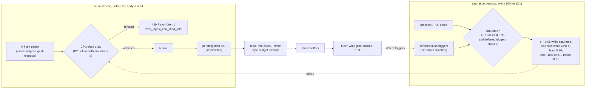

# ADR-3718: Refuse ingest before the node's cores saturate

- Status: Accepted (2026-11-03)
- Date: 2026-11-03
- Refs: #3718, #3645, #3492, ADR-0051, ADR-0069, ADR-1702, ADR-2708

## Context

Logs ingest throughput on one `ravel-server` follows its cores: about 18k
OTLP log lines/s per vCPU, about 46 to 47 us of CPU per stored line, on 8 and
on 16 vCPU alike (#3492 comments 6579509683 and 6589850073). Below that
ceiling every offered line is stored. Above it the server does not hold the
ceiling. It falls into an overloaded state and stores less than its peak, and
it stays there for as long as the excess load keeps arriving.

Peak stored is the highest stored rate the topology reached at any step.
Stored above the ceiling is the range over the overloaded steps. The loss is
peak minus stored, over peak.

| Node | Peak stored | Offered above the ceiling | Stored there | Loss | Source |
|---|---|---|---|---|---|
| 8 vCPU | 152k lines/s (fixed 150k) | 160k (fixed) | 115k to 123k | 19% to 24% | #3645 comments 6574471828 and 6584038929 |
| 16 vCPU | 283k lines/s (280k step) | 300k to 340k | 248k to 260k | 8% to 12% | #3492 comment 6589850073 |
| 2 x 8 vCPU, one Service | 261k lines/s (280k step, 9% dropped) | 300k to 340k | 227k to 248k | 5% to 13% | #3492 comment 6589850073 |

The two-replica row is on a different basis from the other two.
- **Clean step:** it held 243k with no drops at the 240k step. Measured from
  there, its 300k to 340k steps stored between 7% less and 2% more, so at the
  topology level there is no clear collapse.
- **Peak:** it peaked at 261k at the 280k step, with drops, because one
  replica saturated at 220k and the other never did.

The collapse is per replica: the busier one was in the overloaded signature
from 220k on (#3492 comment 6589850073). The topology-level figure
understates it, because the idle replica's spare cores absorb part of the
loss.

The overloaded state has one signature on every topology:
- every core is busy;
- flushes are size-triggered at the 32 MiB object backstop instead of age-triggered at about 9k lines;
- flushes wait seconds for a flush permit;
- ordinary flush triggers are deferred at about 90 per second (zero on every clean step);
- CPU per stored line is 59 to 76 us instead of 47 us, uniformly across decode, normalize and encode, with no lock or spin hotspot (#3645 comment 6584038929).

The measurements on #3645 changed one variable at a time against that state:

| Variable | Result | Source |
|---|---|---|
| Write-gate permits 4, 6, 8 | no change | #3645 comment 6573395997 |
| Flush slots 4 or 8 per shard | 8 delays the tip; it still happens | #3645 comment 6575073635 |
| Object backstop multiple 1 or 4 | 1 is 4% to 15% worse | #3645 comment 6584038929 |
| Ingest byte budget 1 GiB or 4 GiB | no change | #3645 comment 6584038929 |
| At most 8 requests decoding at once, against 1024 | 6% to 13% better, still overloaded; almost no 429s | #3645 comment 6585932504 |

None of these is a CPU limit. `--max-inflight-ingest-requests` bounds decode
memory and releases its permit at enqueue. The ADR-0069 byte budget bounds
buffered bytes. Rate admission (ADR-0051, ADR-0084) bounds a tenant's
configured rate. Flush permits (ADR-2708 D3) bound concurrent PUTs. A server
accepts any load these bounds allow, whether or not its cores can encode it,
and the backlog that builds then keeps it overloaded. ADR-1702 already
decided where the answer belongs: a busy node stays in its Service, and
"overload is handled by admission control, not by the probe" (ADR-1702,
lines 225 to 226). No admission control looks at CPU today.

## Decision

### D1. A saturation detector reads two signals the process already has

Replaced: the detector now reads the queued flush count and the deferred
triggers, and no CPU; see the flush-backlog hold amendment below.

A background task samples every 100 ms:

- **CPU use:** the process's own CPU time (user plus system, fields 14 and
  15 of `/proc/self/stat` at Linux's fixed 100 ticks per second, a plain
  file read, as `crates/ravel-bench/src/columnar_load.rs` already does) over
  wall time, divided by the core count `HostProfile` already resolves
  through `available_parallelism`. That count follows a cgroup CPU quota.
  Off Linux there is no `/proc/self/stat`, so the detector never reports
  saturation and logs once that shedding is off.
- **Flush backlog:** the sum over shards of `flush_trigger_deferred` (an
  existing counter, `crates/ravel-ingest/src/metrics.rs`), read as a rate
  over the last second through a new cheap accessor on the ingest routers:
  one atomic load per shard, not the full metrics snapshot.

The node is **saturated** while CPU use is at or above
`--ingest-cpu-shed-threshold` (default 0.95) and deferred triggers are above
zero, both averaged over 1 s. CPU use alone does not trip it: a clean step at
the ceiling runs at about 91% of the node (#3492 comment 6579509683), close
enough that CPU alone would shed good load. Deferred triggers alone do not
trip it either: a multi-tenant node can defer one stalled tenant's trigger
with cores to spare (ADR-2708 D3). The two together mark the state measured
above and no clean step.

### D2. While saturated, refuse a growing fraction of new ingest requests at the head

OTAP batches draw at a second point, after their stream's tenant is
resolved; see the OTAP batch amendment below.

Replaced: the shed fraction and its draw are gone, and a congested node
holds each request at the same point instead; see the flush-backlog hold
amendment below.

The detector keeps a shed fraction `p` between 0 and `--ingest-cpu-shed-max`
(default 0.9). Each sample it moves `p` by one of three rules, with CPU use
and deferred triggers averaged over 1 s as in D1:

| CPU use | Deferred triggers | `p` |
|---|---|---|
| at or above the threshold | above zero (saturated) | rises by 0.05 |
| at or above the release level (threshold minus 0.05, so 0.90 by default) | any, while not saturated | holds |
| below the release level | any | falls by 10% of itself, and snaps to 0 below 0.01 |

The three rows partition every input: saturated, not saturated but near the
ceiling, and clear of it. The snap to 0 means a node that has left the ceiling
refuses nothing, rather than a vanishing fraction for ever.

The middle row is what lets `p` settle. Once shedding brings the admitted
load just under the ceiling, deferrals stop but CPU use stays near the
ceiling: a clean step at the ceiling runs at about 91% of the node (#3492
comment 6579509683). So `p` holds instead of collapsing back into the
overload.

The rule that lowers `p` needs CPU to fall clear of the ceiling, and it falls
slower than it rises: from 0.5 to under 0.05 takes about 2.2 s, against
1 s to climb from 0 to 0.5. A drop in offered load releases the shed within
seconds, and a server sitting at its ceiling does not cycle.

Each new ingest request draws once against `p`. Refused requests get 429
with `Retry-After: 1` on OTLP HTTP and Remote Write, and
`RESOURCE_EXHAUSTED` on gRPC.

The check runs at the request head, before the body is read or decoded, and
before the tenant is resolved: right after the in-flight permit, in the order
that permit already keeps (a shed is answered before a credential check, so
a saturated node does no tenant resolution for a request it will refuse):
- in `admit_ingest_request` (`services/ravel-server/src/ingest_admission.rs`),
  answered through `refuse_from_head`, which drains the body without decoding
  it. The in-flight permit is released before the refusal, as the
  pending-ack shed already does, so a drain does not hold an in-flight slot;
- in `GrpcIngestAdmissionLayer::call` at the same point for gRPC.

So an unauthenticated request that arrives while shedding gets 429, not 401,
as it already does from the in-flight permit.

A refusal costs the server a header parse and, when it can, a body drain. It
never costs a decode. The drain is bounded: at most 1 MiB, 1 s, and 64
concurrent drains per process. A refusal that finds no free drain slot, whose
body exceeds 1 MiB or whose drain times out is answered with
`Connection: close` and counted on `ravel_ingest_head_refusal_undrained_total`
(`services/ravel-server/src/ingest_admission.rs`, `refuse_from_head`). See
Consequences for what that costs at a high shed fraction.

Refusals count on a new `ravel_ingest_cpu_shed_total{mode}`, beside the
existing `ravel_ingest_concurrency_shed_total`, `ravel_ingest_pending_ack_shed_total`
and `ravel_ingest_buffer_shed_total`. The current `p` exports as the gauge
`ravel_ingest_cpu_shed_fraction`.

A probabilistic fraction, rather than refusing everything while saturated,
admits a steady share of the load. With the hold band above, that share
settles just under the ceiling instead of oscillating between full refusal
and overload.

Whether it settles is a measured question, not an assumption. D4 reports `p`
over time, and a cycle that drops back into overload fails D4's first bar.

### D3. Defaults scale with the node; one flag turns it off

Replaced: the two flags below are removed and two others take their place;
see the flush-backlog hold amendment below.

The threshold is a fraction of the resolved core count, so the same default
holds on 8, 16 or more vCPU without tuning. `--ingest-cpu-shed-threshold 0`
disables shedding, which is today's behaviour. The resolved threshold and the
core count are logged at startup with the other derived defaults.

It is on by default: a server that saturates loses 5% to 24% of its peak
stored rate (Context), which no operator wants. Shedding is process-wide and does not
pick tenants; refusals fall on tenants in proportion to their requests. Per
tenant fairness stays with rate admission (ADR-0051).

### D4. Acceptance on the benchmark

The first bar below is replaced, and the shed-fraction figure no longer
exists; see the flush-backlog hold amendment below.

Each figure below is pre-registered as predicted. The epic exits when all
three hold on the logs benchmark (GKE, GCS store, buffered acks), with the
detector on its defaults:

| Figure | Bar | Basis |
|---|---|---|
| 8 vCPU, fixed 160k offered: stored | at least 145k, with refusals in place of the collapse | predicted |
| 16 vCPU, fixed 320k offered: stored | at least 270k | predicted |
| 8 vCPU, exit ramp to 150k: best 30-min and the 150k step | within 1% of the same build with `--ingest-cpu-shed-threshold 0`, and no refusals below the 150k step | predicted |

Each run also reports, without a bar:
- `ravel_ingest_head_refusal_undrained_total` by reason, against the CPU
  sheds;
- the client's connection count;
- `ravel_ingest_cpu_shed_fraction` over time, with the share of each window
  spent in the overloaded signature (size-triggered flushes at the backstop,
  deferred triggers above zero).

The first two show how many refusals forced a reconnect (Consequences). The
third shows whether `p` settled or cycled (D2).

## Rejected alternatives

The third bullet, queueing at the head, is reversed by the flush-backlog
hold amendment below.

- **A lower fixed `--max-inflight-ingest-requests`.** It bounds a count, not
  CPU, so no single default fits 8 and 16 vCPU. Its permit is released at
  enqueue, before the encode that saturates the node. Measured at 8 against
  1024: 6% to 13% better but still overloaded, with almost no 429s (#3645
  comment 6585932504).
- **Tuning flush slots, the backstop multiple or the byte budget.** Each was
  measured against the overloaded state and none prevented it (#3645
  comments 6575073635 and 6584038929). The backstop multiple at 1 made it
  worse.
- **Queue requests at the head instead of refusing them.** A queue in front
  of a saturated node grows without bound under sustained excess load. It
  holds client connections and memory, and pushes the overload into the
  client's timeouts. A 429 with `Retry-After` lets an OTLP exporter back off
  and retry, which it already does.
- **Shed on CPU use alone.** The clean ceiling runs at about 91% of the node,
  so a CPU-only threshold either sheds good load or fires too late.
- **Leave it to horizontal scaling.** More replicas raise the ceiling, but each
  replica still collapses when its own share exceeds its cores. Connection
  balancing made one of two replicas saturate first (#3492 comment
  6589850073).
- **Shrink CPU per line further.** Two cuts aimed at the remaining hot spots
  measured no cheaper (#3654, #3655). A cheaper line moves the ceiling up, but
  the collapse above it remains.

## Consequences

- Above its ceiling a server refuses the excess instead of losing 5% to 24%
  of its peak stored rate. Clients see 429s where they saw latency and
  dropped lines.
- At a high shed fraction most refusals go through `refuse_from_head`.
  - **Undrained refusals reconnect.** Its 64 drain slots, 1 MiB cap and 1 s
    timeout were sized for the rare in-flight and pending-ack sheds. A
    refusal that misses a slot, or carries a body over 1 MiB, is answered
    with `Connection: close`, so an HTTP/1 exporter reconnects, and with TLS
    re-handshakes, for each one. That spends CPU on connection setup while
    the node is shedding for CPU.
  - **`Connection: close` stays mandatory.** Every refusal that leaves the
    body unread keeps the header. A reused HTTP/1.1 connection would
    otherwise parse the unread body bytes as the next request.
  - **The caps are the lever.** If D4's undrained count shows reconnects
    dominate, the change is to raise the drain caps
    (`HEAD_REFUSAL_DRAIN_MAX_CONCURRENT` and `HEAD_REFUSAL_DRAIN_MAX_BYTES`
    in `services/ravel-server/src/ingest_admission.rs`), measured, not to
    drop the header.
  - **gRPC is cheaper.** gRPC is refused per stream on a kept connection, so
    it pays no reconnect.
- On a node shared with other CPU-heavy work, the process's own CPU use
  under-states the node's, so shedding starts later. The threshold flag is the
  lever there. (Superseded by the flush-backlog hold amendment below: the
  detector reads no CPU and the threshold flag is removed, so neither the
  under-statement nor this lever applies.)
- Strict acks are refused at the same head, so a strict client sees a 429
  instead of an ack that arrives late. The pending-ack budget is unchanged.
- Under heavy deferral with spare cores (one stalled tenant on a busy
  multi-tenant node), nothing is shed, because D1 needs both signals. That
  case stays with ADR-2708 D3's share. (Superseded by the flush-backlog hold
  amendment below: deferrals alone now mark the node congested and hold every
  tenant's requests; see its Consequences of the change.)
- The detector adds one background task and two atomic reads per sample. A
  shed draw is one atomic load and one random number per request.
  (Superseded by the flush-backlog hold amendment below: there is no draw and
  no random number; a request on a node that is not congested pays one
  relaxed atomic load, and a sample reads each router's queued flushes and
  deferred triggers.)
- `docs/ingest.md` and `docs/guides/ingest-affinity.md` ("Admission
  rejections") gain the new refusal, and `docs/reference/ravel-server-flags.md`
  the two flags. The guide pointer is corrected by the OTAP batch amendment
  below.

## Amendment (2026-11-03): OTAP batches, a full window, and the guide pointer (#3720)

<!-- amendment-applies: sections="D2. While saturated, refuse a growing fraction of new ingest requests at the head|Consequences" pointer="OTAP batch amendment" -->

Three changes from implementing D1 and D2 (#3720).

- **OTAP batches draw per batch.** An OTAP Arrow stream takes no in-flight
  permit at the gRPC layer, so the draw D2 places there never runs for it.
  The implementation draws once per `BatchArrowRecords` batch in
  `process_batch` (`services/ravel-server/src/otap_grpc.rs`), right after
  that batch's own in-flight permit and before its byte-rate check and
  decode.
  - The stream's tenant was resolved when it opened, so this draw runs after
    the tenant, unlike D2's head refusal.
  - A refused batch ends the stream with `RESOURCE_EXHAUSTED`, as the
    in-flight ceiling already does: skipping one batch would leave the
    stream's decoder state out of step with the sender.
- **Saturation needs a full window.** Until the detector holds 1 s of
  samples, the deferred average it feeds to D2's rules reads 0. A single
  100 ms sample at startup therefore cannot raise `p`, while the hold and
  decay rows apply from the first sample.
- **The refusal is documented in `docs/ingest.md`.** It is not in the
  "Admission rejections" section of `docs/guides/ingest-affinity.md`, which
  is about Kubernetes CRD validation, not runtime ingest admission.

## Amendment (2026-11-03): hold at the head while the flush backlog is over a bound, replacing the shed fraction (#3756)

<!-- amendment-applies: sections="D1. A saturation detector reads two signals the process already has|D2. While saturated, refuse a growing fraction of new ingest requests at the head|D3. Defaults scale with the node; one flag turns it off|D4. Acceptance on the benchmark|Rejected alternatives|Consequences" pointer="flush-backlog hold amendment" -->

The shed fraction `p` of D2 missed D4's first bar, and a model of the
benchmark explains why no rule for `p` can meet it. This amendment replaces
D1's signals and D2's draw with a bounded hold at the same point, and
replaces D3's flags.

### Why the shed fraction is replaced

Acceptance part 1 (8 vCPU, fixed 160k offered) stored 133.2k and 133.4k
lines/s in two runs against the 145k bar, with `p` cycling between 0.1 and
0.9 instead of settling (#3718 comment 6596936397).

A closed-loop plant was calibrated to GKE traces of 140k offered on 8 vCPU
(#3756). The traced node ingested logs only, on one router with `--shards 2`
and `--max-queued-flushes 8`, so its queued-flush cap was 16. In those traces:
- **Healthy:** 6.4 cores busy, 0 to 0.1 deferred flush triggers per second,
  6 to 14 queued flushes.
- **Collapsed:** about 112k stored, 8.0 cores busy, about 85 deferred
  triggers per second, about 40 queued flushes.

The plant shows three things.
- **The collapse is a start-burst transient that locks in.** A burst at
  startup builds a backlog that keeps the node in the overloaded state for
  as long as the load stays near capacity.
- **Every rule for `p` hits the client's retry-backoff cliff.** A refused
  batch is retried, not lost, so the exporter's doubling backoff parks its
  whole worker pool at a `p` of about 0.45 to 0.6, whatever the rule.
- **Holding instead of refusing makes the client's own latency the
  throttle.** An exporter has a fixed pool of workers, so a held request
  slows the sender without a retry. At 160k the plant stored 163k with no
  collapse and no drops, and below capacity it holds nothing.

### D1 replaced: the congestion detector

The 100 ms background task stays, with its shutdown handling (stopped
before the shard actors are joined). It no longer reads CPU. Each sample it
reads:
- each ingest router's (metrics, logs, spans) own queued flush count, its
  `flushes_queued_total`;
- the deferred flush triggers since the last sample, summed over the
  routers, as before.

The node is **congested** while any one router's queued flush count is above
that router's bound (D3 below) and at least 1 deferred trigger fell in the
last full 1 s window (10 samples). A window shorter than 10 samples is never
congested. The detector publishes one congested flag, which replaces `p`.
This rule is the one "GKE acceptance: both signals required" below sets; the
first image of this amendment held on either signal, with 10 deferred
triggers per window as the deferral half's threshold, and missed the bar.

The queued half is per router, not the process-wide sum `/metrics` exports
as `ravel_ingest_queued_flushes`. Each router's queue is capped per shard by
`--max-queued-flushes`, so a router at its own cap is the backlog the traces
show; a sum against one fixed bound would instead read two signals each
healthy under its own cap as congested once they add up past the bound, and
the bound would mean something different on every node with a different
shard count or signal mix. The deferral half stays process-wide.

### D2 replaced: the hold

At the point D2 drew against `p` (in `admit_ingest_request` and
`GrpcIngestAdmissionLayer::call`, right after the in-flight permit and
before tenant resolution; per `BatchArrowRecords` batch in OTAP's
`process_batch`, as the OTAP batch amendment placed it):
- **Not congested:** the request proceeds at once, at the cost of one
  relaxed atomic load. Nothing is counted.
- **Congested:** the request waits in 10 ms steps while the flag stays set,
  for at most `--ingest-hold-max-wait`, keeping its in-flight permit.
  - If the flag clears in time, the request proceeds, counted as
    `outcome="admitted"`.
  - If the wait runs out, the permit is released and the request is
    refused exactly as D2's draw refused it: through `refuse_from_head`,
    429 with `Retry-After: 1` on OTLP HTTP and Remote Write,
    `RESOURCE_EXHAUSTED` on gRPC and OTAP. It is counted as
    `outcome="refused"`.

An unauthenticated request that arrives while congested is held and, if
still congested at the max wait, refused 429 rather than 401, as D2's draw
was.

Metrics, with the label set the removed families had:
`ravel_ingest_head_hold_total{mode,outcome}` (counter),
`ravel_ingest_head_hold_seconds{mode}` (histogram of time held, one sample
per held request) and `ravel_ingest_head_congested{mode}` (0 or 1 gauge).
They replace the refusal counter and the shed-fraction gauge D2 named, which
no release carried.

### D3 replaced: the flags

D3's threshold and cap flags are removed; no release carried them. In their place:
- **A router's bound** defaults to its own queued-flush cap: its shard
  count times `--max-queued-flushes` (the per-shard cap, floored at 1). On
  the traced benchmark (logs only, `--shards 2`, `--max-queued-flushes 8`)
  that is 16, above the healthy traces' 6 to 14 queued flushes and well
  below the collapsed ones' 40. The collapsed figure can exceed the cap
  because a tenant buffer over its memory backstop spawns its flush
  whatever the queue depth; two more cases spawn past the cap with no
  backlog, listed under "GKE acceptance: both signals required" below. At
  the default `--shards 4` the bound is 32.
- `--ingest-hold-queued-flushes`, unset by default, at least 1 when set:
  overrides every router's bound with one count.
- `--ingest-hold-max-wait`, a duration, default `1s`, at most `20s`: the
  longest a request is held. `0` turns the gate off entirely and spawns no
  detector. 20 s is the listener-join share (four fifths) of the default
  25 s `--shutdown-timeout`, so a request held when shutdown starts is
  answered before the listener join is abandoned. A smaller
  `--shutdown-timeout` shrinks that budget without lowering the limit.

Both are logged at startup with the other derived defaults. The gate is
still on by default and still process-wide.

### Rejected alternatives: queueing at the head is reversed

The rejected alternative "queue requests at the head instead of refusing
them" assumed an unbounded queue. The hold is bounded twice:
- **in time,** by `--ingest-hold-max-wait`, after which a held request is
  refused as before;
- **in count,** by `--max-inflight-ingest-requests` (default 1024), since a
  held request keeps its in-flight permit, so the requests held at once
  never exceed the in-flight ceiling. With that ceiling at `0`
  (unlimited), the max wait is the only bound.

Within those bounds a held request costs the server a connection and an
in-flight slot, with its body not yet read, and the client sees latency up
to the max wait instead of an immediate 429. A 429 still answers what the
hold cannot absorb.

### D4: the first bar

The owner set D4's first bar to at least 0.95 times the same node's stored
rate at a fixed 150k offered with the gate off (`--ingest-hold-max-wait 0`),
in place of the absolute 145k (#3718 comment 6597954798). The shed-fraction
figure D4 asked each run to report is replaced by
`ravel_ingest_head_congested` over time and the held and refused counts.

| Figure | Bar | Source |
|---|---|---|
| 8 vCPU, fixed 160k offered: stored | at least 0.95 x the same node's stored rate at fixed 150k with `--ingest-hold-max-wait 0` | #3718 comment 6597954798 |
| Acceptance part 1 of the shed fraction, two runs: stored | 133.2k and 133.4k against the old 145k, `p` cycling 0.1 to 0.9 | #3718 comment 6596936397 |

### The plant

A line-for-line Rust port of the plant, deterministic with SplitMix64 and
run at jitter 0.25, is a test in the gate module. Stored and drops are in
thousands of lines per second over the span; collapsed is the share of the
span spent in the overloaded state. The Python reference values are those
of the plant this port was taken from (#3756).

| Case | Offered | Span | Bar, hold | Rust, hold | Bar, no gate | Rust, no gate | Python reference | Source |
|---|---|---|---|---|---|---|---|---|
| A | 160k for 80 s, 400k start burst | 20 to 80 s | stored at least 152, drops at most 3.2, collapsed 0 | stored 163.4, drops 0, collapsed 0 | collapsed above 0.5 | stored 106.7, collapsed 1.0 | hold 163.4, 0, 0; no gate 106.7, collapsed 1.0 | `services/ravel-server/src/ingest_hold.rs:960` |
| A, bound 1,000,000 (above the 300k tip) | as A | 20 to 80 s | collapsed above 0.5 | stored 106.7, collapsed 1.0 | - | - | stored 106.7, collapsed 1.0 | `services/ravel-server/src/ingest_hold.rs:960` |
| B | 320k for 80 s | 20 to 80 s | stored at least 155.1 (0.95 x the Python reference's 163.3), collapsed 0 | stored 163.4, collapsed 0 | - | - | - | `services/ravel-server/src/ingest_hold.rs:977` |
| C | 140k for 120 s, start burst | 60 to 120 s | stored at least 139, drops 0, collapsed 0 | stored 140.0, drops 0, collapsed 0 | collapsed above 0.5 | stored 105.8, collapsed 1.0 | - | `services/ravel-server/src/ingest_hold.rs:985` |
| D | 160k, then 100k from 40 s, 70 s | 45 to 70 s | stored within 1 of 100, cores under 5.5 | stored 100.1, cores 4.9 | - | - | - | `services/ravel-server/src/ingest_hold.rs:999` |

The bound-1,000,000 row is the distinguishing case: with the hold's bound
above the tip point the hold never engages, and the plant collapses as it
does with no gate. The plant's hold keys on its backlog in lines alone, a
stand-in for the queued-flush half of the detector. It models no deferrals,
so it does not test the detector's rule, and it could not show the deferral
behaviour the GKE runs below found.

### GKE acceptance: both signals required

The first image of this amendment counted a node as congested on either
signal: a router over its queued bound, or at least 10 deferred triggers in
the last full second. On GKE that rule held healthy nodes. At a fixed 160k
offered, healthy nodes defer 15 to 27 flush triggers per second with the
queue at its cap (max 15 to 16, never above), and the deferral half marked
them congested 60 to 63% of the time (#3718 comment 6604099387). At 140k the
hold created the deferrals it reacted to, about 23 per second, where the
same nodes without the hold defer 0 to 0.1 per second (#3718 comments
6605267841 and 6599055872). Collapsed nodes show both signals together: the
queue at 40 to 51, above the cap, and about 85 deferrals per second.

A second image ran with the deferral half turned off, so the queued bound
alone decided. The fleet review of #3760 (comment 4454759612) found why that
rule is not safe either. `queued_flush_cap_reached` in
`crates/ravel-ingest/src/shard.rs` lets a router's queued count exceed
shard count times `max_queued_flushes` in three cases:

- a buffer crossing its memory backstop spawns its flush past the cap;
- a buffer crossing its object backstop does the same;
- a tenant with no flush in flight on the shard gets one window past the
  cap.

The third scales with the number of tenants, not with the backlog, so a
node with many tenants can sit above the bound with no backlog and no
deferrals; a queued-only rule would hold every request there for the max
wait and then refuse it. So the rule is now an AND: a router over its bound,
and at least 1 deferred trigger over a full 1 s window. A healthy node at
its cap is not over the bound; an exempt node over the bound is not
deferring; a collapse is both. `flush_trigger_deferred` also counts
per-tenant share refusals (ADR-2708 D3), so a refusal of that kind alone
does not mark the node congested either, and one that coincides with a
router over its bound is a node whose flushes are queuing, which is the
case the hold is for. The congested set under the AND is a subset of the
queued-only set, so on the second image's runs the AND holds no more often
than the figures below. The second image's result was reported to this
task without a posted comment id; its bars and band are the
pre-registration's.

| Node | Image | Stored at fixed 160k | Bar | Congested share | Holds admitted, refused | Source |
|---|---|---|---|---|---|---|
| ravel-buffered | first, either signal | 103.6k, a miss | 142.5k (0.95 x 150k, since its gate-off 150k reference collapsed at 112.5k) | 0.60 | about 9.5/s, about 9.5/s | #3718 comment 6604099387; bar from comment 6605159425 |
| ravel-d250 | first, either signal | 125.1k, a miss | 143.7k (0.95 x its gate-off 151.3k) | 0.63 | about 9/s, about 11/s | #3718 comment 6604099387; bar from comment 6605159425 |
| ravel-buffered | second, queued bound only | 162.0k, a pass | 142.5k | 0, never congested | 0, 0 | bar from #3718 comment 6605159425 |
| ravel-d250 | second, queued bound only | 158.3k at 7.85 cores, a pass; queue max 19 while deferring 68/s | 143.7k | 0.37 | 14,410, 0; mean hold 0.25 s | bar from #3718 comment 6605159425 |

The pre-registration also set one band, and the second image missed it:
ravel-d250 was congested 37% of the time against a predicted under 10%
(#3718 comment 6605159425). Its queue went over the cap while it deferred
68 triggers per second, and at that rate a full 1 s window with no deferral
is rare, so the AND would have held it about as often: the miss is in the
band's prediction, not a case the AND removes. Every hold there was
admitted, at a mean of 0.25 s, and the node cleared its bar.

### Consequences of the change

- A request on a node that is not congested pays one relaxed atomic load;
  there is no random draw.
- Under sustained excess load the hold turns into refusals at the max wait,
  so the drain and reconnect costs listed under Consequences apply to the
  requests that are refused, each after a held second by default.
- A held request keeps its in-flight permit, so a long hold can shed new
  requests on the in-flight ceiling (`ravel_ingest_concurrency_shed_total`)
  before they reach the hold.
- Deferral with spare cores (one stalled tenant on a multi-tenant node)
  does not mark the node congested on its own: with every router's queue at
  or under its bound the node is not congested, however many triggers are
  deferred. A stalled tenant whose deferrals coincide with a router over its
  bound does hold every tenant's requests while both last, since CPU is no
  longer read; no measurement here covers that case.
