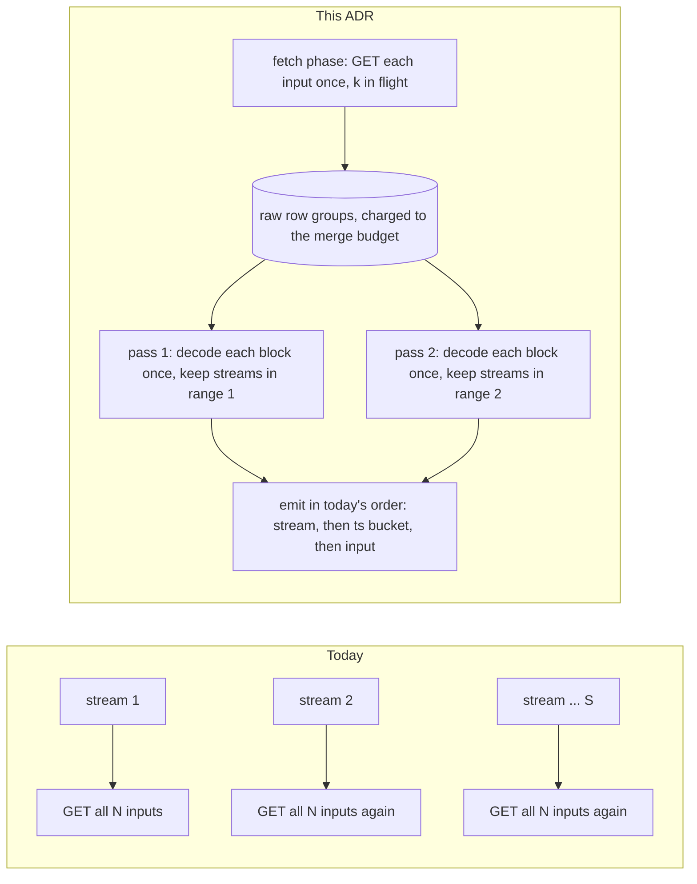

# ADR-3819: The RLOG merge reads each input once

- Status: Accepted (2026-11-04)
- Date: 2026-11-04
- Refs: #3819, #3492, #3802, #2861, ADR-0018, ADR-0032, ADR-0065, ADR-0979

## Context

An RLOG L0 to L1 merge reads each input row group once per stream it carries.
On a many-stream logs tenant that makes compaction about 2,000 times more
read-heavy than its input, and slower than ingest by orders of magnitude.

**Where it was found.** The logs-benchmark publication runs (#3492) left a
GCS bucket of L0 objects that `--mode all` never compacts. ravel-server 0.30.1
`--mode maintain` was run on it (#3802 made that possible on GCS). The bucket:

- 122,344 L0 objects, 69,970 MiB, one tenant, 2 shards, 5 ingest hours;
- 5,000 streams (125 hosts × 40 apps);
- about 17,000 L0 objects per shard in ingest hour 07 (17,066 and 17,120
  commit records).

After 72 minutes, two merges (hour 07, shards 0 and 1) had issued 461,608 GETs
for 48.8 GB and written four L1 parts of 16 MiB in total, at 0.17 to 0.36
cores (#3819).

**Why.** `merge_catalogs` walks `for stream_id in merged.keys()`
(`crates/ravel-maintain/src/rlog.rs:1136`) and finishes each stream across all
of its inputs before the next one starts. For each stream it opens a new
`StreamCursor` on every input that carries that stream. The cursor GETs the
stream's location (`rlog.rs:2549`), and a location names the whole row group
(`crates/ravel-logseg/src/ranged.rs:85-95`), so every stream's cursor downloads
the same bytes. Nothing keeps them between streams. The writer cuts blocks on
record count, never at a stream boundary (`crates/ravel-logseg/src/writer.rs:1646-1666`),
so each block holds rows from many streams.

| L0 object (`ravel-cli rlog inspect`) | records | blocks | streams |
|---|---|---|---|
| 98,886 bytes | 951 | 1 | 804 |
| 399,804 bytes | 4,966 | 1 | 2,150 |
| 674,188 bytes | 8,988 | 2 | 2,411 |
| 875,743 bytes | 11,993 | 2 | 2,458 |
| 1,093,189 bytes | 15,843 | 2 | 2,471 |

A shard-hour of N inputs carrying S streams each costs about N × S row-group
GETs where N would do. With no sort descriptor (`sort_descriptor: none` on
every object above), the frontier admits about one cursor at a time, and
the emit loop refills one `.await` at a time (`rlog.rs:3159`), so each merge
has about one GET in flight.

**Why no test caught it.** Every compaction test fixture and the ClickBench
logs tenant carry one stream, or a handful, per object. With S near 1, N × S
is N.

### Figures

| figure | value | source |
|---|---|---|
| streams per L0 object | 804 to 2,471 | five objects inspected, #3819 comment 6637559313 |
| GETs and bytes after 72 min, two merges | 461,608 GETs, 48.8 GB | #3819 |
| GETs per shard-hour merge at S = 2,000 | about 34 million (model) | N × S with N = 17,000 |
| merge wall time per shard-hour at 27 GETs/s | about 350 h (model) | 34 million / 27 |
| decoded (row heap estimate) over stored, L1 output | 55 to 67 | two L1 parts closed on the 269,565,184-byte memory target at 4,933,909 and 4,024,942 bytes |

## Decision

The merge emits exactly the record sequence it emits today, so every L1 part
keeps its bytes and its content-addressed key. Only how inputs are read
changes.

### D1. Fetch each input's row groups once, concurrently

After the catalog phase, the merge fetches every input's BLOCKS ranges once
with `k` GETs in flight. `k` is the existing `input_read_concurrency`. The raw
bytes stay resident for the whole merge and are charged to the merge's
memory budget (`merge_cursor_budget_bytes`) at fetch time.

When the inputs' raw bytes do not fit the budget, the merge does not fail. It
fetches per pass instead (D2), so each input is fetched once per pass. The
choice is made before any block is fetched, from the PAGE_DIR sizes the
catalog phase already holds, and the merge logs which one it took.

Admission counts the resident bytes. With `--maintain-unit-concurrency` above
1, a merge waits for budget rather than over-committing it.

### D2. Emit in stream-range passes, decoding each block once per pass

The merge splits its sorted stream ids into contiguous ranges, each sized so
that its retained rows fit a pass budget. For each range, it decodes every
input's blocks once, from the resident bytes or from one fetch, and keeps the
rows of the range's streams in columnar form (`StreamBlockRows`, ADR-0979).
It then emits those streams with today's k-way merge, in today's order:
stream id, then `ts.div_euclid(W)`, then canonical input order. Part cuts
(`PartSink`, the memory split target and the stored-size target) run on that
sequence unchanged.

A range's size comes from per-stream record counts that the catalog phase
reads, multiplied by a decoded-bytes-per-record estimate. Measuring that
estimate on this fixture is the first task. The row-heap ratio of 55 to 67 is
an upper bound for the columnar form, not its value.

### D3. A stream larger than one pass keeps today's streaming cursors

A single stream whose estimate exceeds the pass budget is a range of its own,
emitted with today's per-input `StreamCursor`s. It reads from the resident
bytes when D1 holds them, and fetches as today otherwise. This keeps
ADR-0065 decision 4's bound for one hot stream, the 45.7 GB case #711 fixed:
no path gathers a whole stream's rows.

### Commitments and their tests

<!-- band-sources-allow: these are acceptance commitments of this ADR, predicted until the implementation measures them -->
| commitment | band | test |
|---|---|---|
| L1 parts are byte-identical to today's | same keys and bytes on a many-stream fixture (N ≥ 50 inputs, S ≥ 200 streams per input) and on a one-hot-stream fixture | a golden comparison against the current merge |
| block fetches per input | exactly 1 with D1, exactly P with the per-pass fallback, counted per (object, range) | a counting `MemoryStore`. It must fail against a per-cursor cache (still N × S) and against a small LRU of row groups (thrashes, because every group spans the whole stream range) |
| hot-stream memory | unchanged from ADR-0065 decision 4's acceptance bound | the existing growing-hot-stream test, plus the same stream inside a many-stream bucket |
| this fixture, hours 08 and 09 | GETs per merge at most 1.1 × (N × catalog GETs + N); wall time within 10 × the fetch time at `k` in flight | measured on run 2's bucket, which is kept (predicted) |
| a mixed fleet | a 0.30.x compactor and a new one converge on the same parts through `CreateIfAbsent` | follows from byte-identical parts; the golden test above pins it |

## Rejected alternatives

- **A per-cursor cache.** Each `StreamCursor` would keep its own fetched
  bytes, but each stream opens new cursors, so the merge still costs N × S.
- **A bounded LRU of raw row groups.** Every row group carries streams from
  across the whole sorted range, so a stream-major walk touches almost every
  input for every stream. Any LRU smaller than all the inputs evicts every
  group before its next use, which is today's cost.
- **Shuffle through transient objects.** One read pass would write P
  stream-range intermediates, then a second pass would merge each. Reads stay
  at about 2 × and memory is bounded whatever the decoded ratio is. The cost
  is P × N extra PUTs, a new transient object class for GC to reap, and new
  crash and convergence states. D1 and D2 reach one read per input with no
  new durable state. This stays the fallback design if the measured pass
  count makes D2's decode CPU the bottleneck.
- **Change the output order to block-major.** Reading every input once in
  block order and emitting rows in that order would need no passes. But L1
  parts are content-addressed and readers rely on stream-major order inside
  an object, so this changes every part's bytes, needs a format decision,
  and breaks convergence with existing compactors.
- **Fix it at ingest only.** A clustering key or stream-aware block cuts
  would lower S per block. That helps queries too, but the merge would still
  cost N × S, and every existing bucket would still pay it.

## Consequences

- A many-stream shard-hour compacts with about one GET per input instead of
  about S, and with `k` fetches in flight instead of one.
- Decode CPU grows from once per block per stream (today's total, which a
  single GET in flight hides) to once per block per pass. When P is large,
  decode CPU replaces GET latency as the limit, which is the trigger for the
  shuffle alternative.
- Resident memory per merge grows by the inputs' raw bytes, about 5 to 7 GB
  per shard-hour on this fixture, bounded by the merge budget and counted at
  admission. When it does not fit, the merge falls back to one fetch per
  pass.
- ADR-0065 decision 4 and the ADR-0032 memory text gain an amendment that
  states the new peak: catalog metadata, plus resident raw bytes (D1), plus
  one pass's retained rows, plus the in-progress part. The `rlog.rs` module
  note changes with them.
- No persistent format changes. L1 parts keep their bytes, keys and version.

### Not in this ADR (separate tickets)

- The catalog phase re-GETs sections already inside its 64 KiB footer probe,
  and reads the whole POSTINGS section only to learn field names: 5 to 8 GETs
  per input, a large share of the 461,608.
- L1 parts close on the decoded-heap memory target at about 4 to 5 MB stored
  on this workload, so a shard-hour yields hundreds of small L1 objects.
- The fold's postings build fails with "bad magic bytes" on this bucket
  (#2861).
