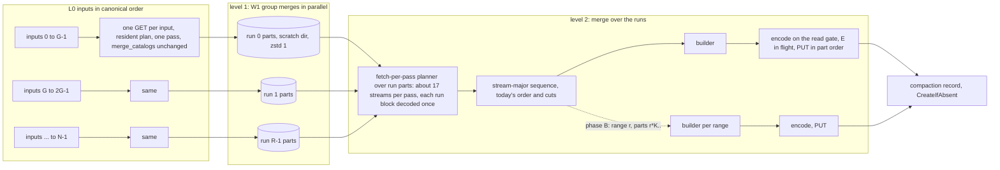

# ADR-3853: Two-level RLOG merge for many-input buckets

- Status: Accepted
- Date: 2026-11-05
- Refs: #3853, #3819, #3854, #3855, #3856, #3492, ADR-0018, ADR-0032, ADR-0046, ADR-0065, ADR-0699, ADR-0979, ADR-1029, ADR-1702, ADR-2135, ADR-3492, ADR-3819

## Context

ADR-3819 made the RLOG L0 to L1 merge read each input once by holding the
inputs' row groups resident and emitting the streams in ranges, each range a
pass that decodes every block once. On the bucket that motivated it, the
merge never takes that path. Code lines below are on `origin/main`
9b61011bf.

### Stage 0 numbers

Measured 2026-11-05 on GKE n2d-standard-32 against the logs-benchmark bucket
`nofire-production-logsbench-ravel-buffered-r2`, image `manual-ad0ab23` (main
at the #3836 head). Full write-ups: #3819 comments 6660371946 and
6660709107; the epic body of #3853 repeats them.

| unit | inputs | raw | mode | result | source |
|---|---|---|---|---|---|
| hour 498271, shard 0 | 17,066 | 3.9 GB | cursor (`largest_stream_pass_bytes=171164619526`, `hot_streams=2477`) | not finished | comment 6660371946 |
| hour 498273, shard 0 | 19,177 | 16.7 GiB | cursor | stopped after 64 min at 8 reads in flight and after 34 min at 64, both unfinished | comment 6660371946 |
| hour 498274, both shards | about 230 per shard | 0.39 GiB per shard | resident | 520 s, CPU-bound on one core, about 23k records/s (derived) | comment 6660709107 |

Other facts from the same runs:

- Catalog load costs about 6.6 GETs per input: 17 min at 8 in flight, 4.5
  min at 64 in flight, pinned at one core (comment 6660371946). #3855 serves
  the sections from the suffix probe, and #3856 raises the default read
  concurrency from 8 to 32; #3854 gives ravel-cli a tracing subscriber so
  the merge's mode line is visible from `compact-bucket`.
- GCS from the node is latency-bound: 16, 72 and 108 MB/s at 8, 32 and 64
  reads in flight (comment 6660371946).
- Each L0 object holds about 0.7 s of data, about 10.9k records in 1 to 4
  blocks, and about 2,440 of the 2,477 streams. A block spans about 1,800
  streams (comment 6660709107).
- The process working set sits at 5.9 to 6.6 GiB throughout hour 498274
  (about 230 inputs per shard) as well as on the 17k and 19k-input hours
  (measured 2026-11-05). That term is unexplained. Nothing in this ADR is
  sized on an explanation of it; it is an open item for the profile.

### Why the plan is cursor

`plan_merge` (`crates/ravel-maintain/src/rlog.rs:1440`) prices a stream as
the sum, over every input carrying it, of `pass_block_cost` of each
candidate block (`rlog.rs:1491-1537`). Candidate blocks come from SKIP_IDX's
per-block `min_stream_ref` and `max_stream_ref`
(`crates/ravel-logseg/src/ranged.rs:334-345`). On an L0 whose blocks are cut
every 8,192 records of `(stream_ref, ts)`-sorted rows, every block carries
about 1,800 streams, so every stream's candidate set is one block per input
and its estimate is `N x ceiling(one block)`: 171 GB against 3.9 GB raw on
hour 498271, 10 MB per input. No budget holds one stream, `hot_split`
(`rlog.rs:1635-1645`) marks all 2,477 hot, the hot cursor charge leaves no
pass budget, and the plan is cursor (`rlog.rs:1587-1605`).

The charge is not a planning artefact. A pass holds, per input, the whole
decoded block its streams fall in: `block_rows_for_refs`
(`ranged.rs:556-600`) decodes the entire block and the view owns it
(`StreamBlockRows.block`, `ranged.rs:683-700`), and `run_stream_pass`
pushes an unexhausted view into `held` with its heap charge
(`rlog.rs:1989-1996`) and keeps it until the pass pops its last wanted row
(the drained assertion at `rlog.rs:2058-2065`). So the memory floor of a
stream-major pass on this geometry is `N x h`, `h` the decoded heap of one
block. `h` is not measured on a real block. The ADR-3819 fixture figure of
108 bytes per record gives 0.9 MB. The ceiling `block_decode_ceiling_bytes`
(`rlog.rs:820-845`) prices a block by its two per-row terms, `16 B x rows x
total_cols` (`DECODED_CELL_BYTES`, `rlog.rs:704`, `831-833`) and `40 B x rows
x string_cols` (`DECODED_STRING_SLOT_BYTES`, `rlog.rs:711`, `834-836`), plus
the string pages' `uncomp_len` and a slot-spine term that does not scale with
rows (`48 B x total_cols x 5 x 2`, `rlog.rs:838-842`, 32.6 KB at 68 column
ids). On this schema (8,192 rows, 68 column ids, 35 string columns, about
2 MB of strings) the ceiling is `8.9 MB + 11.5 MB + 2 MB`, about 22 MB, and
`h` lies between the two figures. At N = 19,177 the floor is between 17 GB
and 422 GB. No ceiling admits it, no admission rule lowers
it, and a per-stream row count in the format (which the format does not
carry: STREAM_DIR has `first_blk` and `last_blk`,
`docs/log-segment-format.md:264-265`) would not lower it either.

Cursor mode on this geometry costs `N x S` block GETs and `N x S` whole-block
decodes: 47.5 million on hour 498273, each decoding 8,192 rows to emit about
4, a decode overhead of about 1,600x over the records (derived). Holding the
raw bytes resident removes the GETs and keeps the decodes.

### The objective

Compaction throughput at or above ingest throughput: about 134k records/s
per tenant on the benchmark (two shards of about 242M records per hour,
derived at 74 stored bytes per record). Plus a per-unit band for a
240M-record shard-hour. Five minutes per unit on 32 cores is out of reach:
`5 min x 32 cores` is 9,600 core-seconds, or 40 us per record for the whole
merge, and the single-level resident merge already costs 43.5 us per record
on hour 498274 (1 / 23k). A two-level merge costs more than one level.
Reaching five minutes per unit needs either about 50 cores or a decode and
merge cost well under 10 us per record, which only the profile can show.

## Decision

The merge of a many-input bucket runs in two levels. Level 1 merges
contiguous groups of a few hundred inputs into sorted runs on local scratch,
each group through the unchanged `merge_catalogs`, several groups in
parallel. Level 2 merges the runs into the final L1 parts in today's exact
record order, with part encodes pipelined behind the merge. Range workers at
level 2 are a second phase, gated on the first phase's measurement.

### D0. Refuse or route

Before this ADR's merge ships, a bucket whose plan is cursor and whose
predicted decoded rows exceed 16 times its record count is refused with a
typed error, `MergeGeometryUnsupported`, naming the inputs, streams, blocks,
records and predicted decoded rows. The prediction is the sum over every
stream and every input of the candidate blocks' `record_count`, which
`plan_merge` already walks. The refusal happens after the catalog phase and
before the first block GET; the claim is released; the server's maintain
memo records the outcome as terminal for the bucket under the running
binary version so the tick does not rebuild it, and a counter
`ravel_maintain_compaction_refused_total{reason="geometry"}` moves. A
bucket whose cursor plan is under that ratio (few streams per block, a hot
stream) keeps running cursor mode as today. Today's behaviour on the
refused buckets is a merge that holds a claim for days and issues tens of
millions of GETs; a loud refusal is better than that until the fix lands.

After this ADR's merge ships, the same plan routes instead: a plan that is
resident over all inputs runs the single-level merge as today; any other
plan (fetch-per-pass or cursor over all inputs) runs the two-level merge.
The refusal remains for a two-level plan that cannot run: a group size
under 2, a level-2 plan that is neither resident nor fetch-per-pass at one
level-1 worker (D4's constraint (b) fails at `W1 = 1`), or scratch headroom
below the unit's need (D2). The error names which of the three.

A cursor plan predicting at most 10 million decoded rows is neither refused
nor routed, whatever its ratio (see the D0 floor amendment below).

### D1. Group merges

Inputs in canonical order are cut into contiguous groups of `G`. `G` is the
largest value for which the shipped planner takes the resident path with one
pass for the group, constraint (a):

```
G x (raw per input + price(the input's blocks)) + run target <= C
```

where `C = U / W1` is the per-worker ceiling, `U` the unit's
`merge_resident_ceiling_bytes` (the 20 GiB `merge_cursor_budget_bytes`
default, `crates/ravel-maintain/src/config.rs:1573`, divided by
`--maintain-unit-concurrency` in ravel-server,
`services/ravel-server/src/config.rs:8715-8716`: 5 GiB at the default
concurrency 4, 20 GiB at 1 and for `compact-bucket`), `W1` the number of
level-1 workers (D4), the run target the fixed 256 MiB of D4, and `price` the
sum of `pass_block_cost` over the input's blocks, since one pass over the
whole group holds every block of every input. Each group is merged by
`merge_catalogs` exactly as a bucket is merged today, into a run (D2), with
`input_set_hash` of the whole bucket and the group index in the run's name.
The group's record sequence is today's sequence restricted to the group,
since the planner and the passes are the same code.

`price` is the ADR-0979 ceiling today: about 29 MB per hour-498273 input
(22 MB for its 8,192-row block and 7 MB for its 2,696-row block, Context).
When the profile reports `decoded_heap_bytes` of a real block, the plan
gains a measured-ratio term and prices a block at that figure, `h`, instead.
The sizing table is in D4, because `G`, the run count `R = N / G` and `W1`
constrain each other through level 2 (D3) (the #3873 amendment counted `R` in
run parts; the #3943 correction counts runs, one per group, at two blocks
each).

### D2. Scratch runs

A run is an RLOG object written by the frozen writer with transient
settings: `zstd_level 1`, `PageChoice::Estimated`, `group_target_blocks 1`,
all existing `RlogConfig` fields (`crates/ravel-logseg/src/writer.rs:92-109`).
One block per row group matters: a loc names a whole row group (ADR-0699)
and a fetch-per-pass pass at level 2 refetches the group per pass, 32x the
bytes it uses at the default. A group's run is one or more run parts, cut by
the run memory target the same way L1 parts are cut.

Runs live in a per-process scratch directory behind a scratch
`ObjectStoreBackend` over that directory, so `load_catalog_from_object` and
`merge_catalogs` run over runs unmodified. The directory is a cache and
nothing else:

- it is wiped when the process starts and when the unit ends, whatever the
  outcome;
- no run is published, listed by the catalog, or read by another process;
- a crash loses the runs and the unit restarts from the L0 objects, which
  remain the only source of truth. No durability and no recovery path
  depends on the directory, which is the posture of the query-node disk
  cache (`docs/consistency-model.md`, "Physical bytes gone from query-node
  disk caches", ADR-0046);
- before the first block GET the merge computes the unit's scratch need as
  1.3 times the inputs' object sizes, which the catalog probes return, and
  refuses with a typed error naming the need and the free space when the
  directory cannot hold it. It never falls back to cursor mode. (Which of
  these refusals the scan retries, and the error for a free figure that
  cannot be read, are in the #3873 amendment.)

The scratch directory is a new config input: `--scratch-dir` on
`ravel-cli maintain compact-bucket` and `compact-tenant`, and a field on
the operator's maintain Deployment that mounts an ephemeral volume
(Consequences). With no directory configured, the two-level route refuses
(D0); the single-level merge is unaffected.

Why local scratch rather than transient objects or memory is in Rejected
alternatives.

### D3. Level 2 over runs

Level 2 loads the run parts' catalogs from the scratch store and merges them
with the same planner and passes under the unit ceiling `U`. Every run
carries every stream, so a stream's level-2 estimate is `R x price(one run
block)`, and level 2 plans fetch-per-pass only under constraint (b):

```
R x price(one run block) + reads in flight + final part target <= U
```

Solved for the run count, (b) is `R <= (U - reads in flight - final part
target) / price(one run block)`. What `R` counts and how many blocks each
run is priced at are in the #3943 correction. Reads in flight at level 2 is
`input_read_concurrency` run row groups, and a run row group is one block
of at most 1 MB stored at zstd 1, so 32 MB at the #3856 default of 32. A
run block of 8,192 rows costs the same 22 MB as an L0 block at ceiling
pricing and `h` at measured-ratio pricing. D4's table evaluates the bound
beside each row's `R`. A run of 1.2M records has about 148 blocks and about
17 streams per block, so a pass
covers about 17 streams, decodes each run block once, and reads about 1.6
times the run bytes from local disk across the unit (block-aligned groups,
boundary blocks twice). A level-2 plan that fails (b) is refused (D0), never
run as a cursor merge over the runs. All predicted.

The emitted sequence is today's. Groups are contiguous in canonical input
order, a run stores equal-key ties in push order, and the level-2 tie-break
`(ts bucket, run index)` therefore orders two records the way
`(ts bucket, input index)` orders them today. Part cuts run on that sequence
unchanged, so every L1 part keeps its bytes and its content-addressed key.
One exception is stated rather than hidden: a keyed bucket whose per-bucket
reservation sum exceeds `merge_cursor_budget_bytes` is emitted batch-major
today (ADR-2135 decision 2, `reservation_batches`,
`rlog.rs:3561-3611`), and the batches over runs differ from the batches over
inputs. An unkeyed bucket never batches (`rlog.rs:3566-3568`, one batch at
`width_ns <= 1`), and the logs benchmark is unkeyed. A keyed bucket with
`R` near 870 runs (D4's 20 GiB ceiling row) at 37 MB per cursor reaches 32
GB per stream, above the 20 GiB budget, so the exception is live for a keyed many-input bucket at
ceiling pricing; the phase A fixture includes one such bucket and pins its
output as the two-level sequence, not today's.

Part encodes stop blocking the merge. Today a closed part's encode runs on
the read gate (`MaintainReadGate::run`,
`crates/ravel-maintain/src/read_gate.rs:31-45`, a capped `spawn_blocking` in
ravel-server and inline in ravel-cli) and the merge awaits it
(`rlog.rs:2289-2296`), so decode and encode never overlap. Level 2 hands a
closed builder to the gate and continues merging into the next builder,
with at most `E` builders in flight (`E` is 2 by default; derived per unit
instead, see the #3873 amendment), each charged to the tracker's writer term, and awaits the oldest only when the next close
would exceed `E`. Parts are still PUT in `part_index` order. The sequence,
the cuts and the bytes do not change.

### D4. Parallel groups

Level-1 groups run `W1` at a time as tokio tasks (their store and scratch
calls served on the unit's own task, see the #3873 amendment). `W1` is at most the
unit's core share (the usable cores divided by `--maintain-unit-concurrency`
in ravel-server, all usable cores for `compact-bucket`: 8 at the server
defaults on the 32-core reference box, 32 at concurrency 1), and the plan
takes the largest `W1` at or under that share for which D1's constraint (a)
and D3's constraint (b) both hold, since a larger `W1` lowers `C`, which
lowers `G`, which raises `R` until level 2 no longer fits. The per-merge
budgets are divided per worker: `merge_cursor_budget_bytes` and
`merge_resident_ceiling_bytes` over `W1`, and the run memory target is a
fixed 256 MiB per builder, not derived from host memory, so the number of
level-1 builders does not move the final parts. The final part memory target
is unchanged and still derived as ADR-2135's 2026-10-02 amendment states.
`MergeCursorBudgetExceeded` stays fail-closed per worker. The
`MergeMemoryTracker` becomes one instance per worker, and the unit's report
sums their high-water marks.

Predicted sizing on hour 498273. Every cell follows from these inputs and
rounding rules, all in MB (10^6 bytes): N = 19,177; raw 0.9 MB per input;
an input's blocks priced at 29 MB (22 + 7, Context) at ceiling pricing or
`2h` at measured-ratio pricing, so the per-input term of (a) is 29.9 MB or
`0.9 + 2h`; a run block priced at 22 MB or `h`; run target 268 MB (256
MiB); final part target 268 MB at concurrency 4 and 1,074 MB (1 GiB) at
concurrency 1; reads in flight 32 MB; `U` 5,369 MB (5 GiB) or 21,475 MB
(20 GiB). `C = U / W1` and `G` round down, `R = N / G` rounds up (the #3873
amendment recomputes `R` and `W1`, and the #3943 correction prices each run at
two blocks and recomputes the bound and `W1`), the bound
is (b) solved for `R` and rounded down, and `W1` is the largest value at or
under the core share whose `R` is at or under the bound.

| U, cores per unit | pricing | W1 | C | G | R | (b) bound on R | source |
|---|---|---|---|---|---|---|---|
| 5,369 MB, 8 (server defaults) | ceiling | 1 | 5,369 | 170 | 113 | 230 | predicted |
| 5,369 MB, 8 | h = 3 MB | 8 | 671 | 58 | 331 | 1,689 | predicted |
| 21,475 MB, 32 (concurrency 1, compact-bucket) | ceiling | 23 | 933 | 22 | 872 | 925 | predicted |
| 21,475 MB, 32 | h = 3 MB | 32 | 671 | 58 | 331 | 6,789 | predicted |

The server-defaults ceiling row admits no second worker: at `W1 = 2`, `C` is
2,684, `G` 80 and `R` 240, above the bound. So at ceiling pricing and the
server defaults, level 1 runs on one core per unit, and parallelism comes
from the four units the server merges at once. The measured-ratio term is
what buys level-1 parallelism inside a unit; any other `h` follows from the
same formulas, and the profile's `h` decides. Every row keeps the actual
pass memory per worker under `C` by construction; the actual figure is
`G x (raw per input + 2h)` and is reported, not planned.

Every worker ticks the claim checkpoints at the merge loop head and at each
part boundary (`rlog.rs:1752-1760`, `2312-2320`). The `ClaimGuard` is
shared and serializes renewals behind its own lock
(`crates/ravel-maintain/src/claim_guard.rs:294-309`). A checkpoint that
cancels sets a token every worker polls at its next checkpoint, so one
stolen claim stops the unit; the lease still only has to exceed one part
encode plus PUT, as ADR-1029 decision 3 states.

### D5. Range workers (gated)

Phase B splits level 2 into stream ranges, each merged by its own worker
with its own passes and its own builder. It ships only when phase A's
measurement shows the serial level-2 merge below the objective:

| figure | phase B ships if | source |
|---|---|---|
| level-2 records/s with pipelined encode, one unit, hour 498273 | below 134k | predicted; measured after phase A |

Ranges are cut by a data-derived quantum from the run catalogs (the sum of
the candidate blocks' `record_count` over the range), never by the worker
count, and consumed from a queue by `W2` workers, so two nodes with
different core counts produce the same parts. Each range starts a fresh
part and owns `K` part-index slots: range `r` writes parts
`r x K .. r x K + K - 1`, `K` 16 by default, and a range that would need a
seventeenth part fails with a typed error before encoding it. The key
format caps `part_index` at 9,999 (`crates/ravel-commit/src/keys.rs:108-112`),
so a unit of more than 625 ranges fails the same way; hour 498273 at today's
part size needs about 100 ranges. Whether anything reads part indexes as
contiguous (the record, the fold, the sweep) is checked in the phase B
ticket before the rule is fixed.

The final part memory target does not depend on `W2`: it is a part-close
trigger (`rlog_memory_target_bytes`, `rlog.rs:2201`), so dividing it by a
worker count would cut parts at different records on nodes with different
core counts. A range worker encodes its closed parts inline, not through
D3's pipelining: the parallelism across ranges replaces it, and it keeps
the builder count at `W2`. `W2` is bounded by memory: the largest value
such that `W2 x final part target` is at most half of
`merge_memory_budget_bytes` (`crates/ravel-maintain/src/config.rs:1115`),
and at most the unit's cores. On the 30 GB reference box at concurrency 1
the derived target is 1 GiB and the budget 8 GiB, so `W2 = 4`; at a 256 MiB
target set by the operator, `W2 = 16` with parts four times smaller.
Whether phase B at either `W2` beats phase A's pipelined level 2 is what
phase A's measurement answers; it is not derived here. Both the target and
`W2`'s bound are part-split settings in the sense of ADR-0979's 2026-10-02
amendment, and the phase B amendment records the bound; the target's
derivation is untouched.

Range-aligned cuts change part boundaries, so phase B re-pins the golden
content-hash vectors. Convergence does not depend on them: a racing
compactor on another version publishes under `CreateIfAbsent`,
`resolve_already_exists` compares only `input_set_hash`
(`crates/ravel-maintain/src/publish.rs:393-420`), and the loser's parts age
out under the unreferenced-part sweep.

### D6. Counters and bands

The merge's per-unit report gains counters, each named by what it counts:
`level1_block_decodes` and `level2_block_decodes` (whole blocks decoded),
`scratch_write_bytes` and `scratch_read_bytes` (bytes the scratch backend
wrote and read, uncompressed on neither side, as stored), `level1_passes`
and `level2_passes`, `level1_groups`, and GETs per input in the catalog and
block phases from the request ledger (`RequestPhase`,
`crates/ravel-maintain/src/request_ledger.rs:81-121`). Scratch traffic is
not a store request and is never pooled into the ledger's phases.

Bands for hour 498273, shard 0 (N = 19,177, about 242M records, 16.7 GiB).
Every figure is predicted; the profile task 108ffe3b (bin
`rlog_compaction_profile` in ravel-bench) and the first phase A run on this
bucket replace the predictions. The per-unit wall band and the phase B gate
are not derived here: they depend on the profile's split and on `W1` and
`W2`, and phase A's first run on this bucket measures them, with the band
pre-registered on #3853 before that run.

| figure | band | miss if | source |
|---|---|---|---|
| GETs, catalog plus block, per input | 1 with #3855 landed, at most 2 | above 2 | predicted |
| bytes read from GCS | 16.7 GiB, within 2% | outside | predicted |
| `level1_block_decodes` | the inputs' block count, within 5% | outside | predicted |
| `level2_block_decodes` | the run parts' block count, within 10% (boundary blocks twice) | above 1.3x | predicted |
| `scratch_write_bytes` | 1.0 to 1.3 x raw | outside | predicted |
| `scratch_read_bytes` | 1.2 to 2.0 x `scratch_write_bytes` | outside | predicted |
| peak working set, one unit, W1 level-1 workers | W1 x (G x (raw per input + 2h) + 256 MiB) plus the unexplained 6 GiB | above U plus 8 GiB | predicted |
| per-unit wall, one unit on 32 cores | set from phase A's first run; pre-registered on #3853 before it | above the pre-registered band | predicted |
| throughput, server defaults (4 units in flight on 32 cores) | at or above 134k records/s | below 134k | predicted |

The CPU cost per record follows from two inputs. Today's single-level cost
is 43.5 us per record (measured 2026-11-05, hour 498274). `f` is the share
of that in page trials and zstd, which the profile measures. Level 1 encodes
runs at zstd 1 and `Estimated`, taken as a quarter of today's encode
(predicted), so it costs `(1 - f) x 43.5 + f x 43.5 / 4` us per record;
level 2 encodes final parts at today's settings and costs 43.5 us. (Today's
settings here mean zstd 9 and `Exhaustive`, which the rows below assume;
final parts now use zstd 3 and `Estimated`, see the final-part settings
amendment at the end of this ADR.)

| | f = 0.75 | f = 0.5 | source |
|---|---|---|---|
| level 1 per record | 19.0 us | 27.2 us | predicted |
| both levels per record | 62.5 us | 70.7 us | predicted |
| core-seconds per 242M-record unit | 15,100 | 17,100 | predicted |
| cores to sustain 134k records/s | 8.4 | 9.5 | predicted |
| cores for five minutes per unit | 50 | 57 | predicted |

That last row is why five minutes per unit is out of reach on 32 cores:
the two-level merge needs 15,100 to 17,100 core-seconds per unit, and 32
cores deliver 9,600 in five minutes, 40 us per record, under the 43.5 us of
one level alone. The cores-to-sustain row is why the throughput objective
is within reach: about nine of the node's 32 cores, before any I/O wait or
imperfect scaling, which phase A's run measures.

What the profile must show for each part of the decision to stand:

| profile figure | decides | source |
|---|---|---|
| `decoded_heap_bytes` of a real 8,192-row block | which D4 row applies: G, R and W1, and whether the plan gains a measured-ratio term | predicted 0.9 to 22 MB |
| decode, merge, page-trial and zstd shares of 43.5 us | whether phase A alone meets the objective (it delivers `1 / (decode + merge)` records/s at level 2) or D5 ships | predicted |
| zstd 9 against 3 and 1, `Exhaustive` against `Estimated`, per record | whether level-1 runs cost a quarter of today's encode, and the deferred phase C decision on final-part settings | predicted |
| catalog decode CPU per input | #3855's expected catalog phase | predicted |
| GET throughput past 64 in flight | the I/O floor | predicted |

Phase C, final-part encode settings (`Estimated`, which ADR-3492 measured
at most 10% larger at ingest, and the zstd level ADR-2135 decision 4 sets to
9), is deferred to the profile and is not decided here. (Decided since, by
issue #3878; see the final-part settings amendment at the end of this ADR.)

## Rejected alternatives

- **Adaptive admission inside the shipped modes.** The floor of a stream-major
  pass is `N x h` whatever the estimate says; a runtime measure would find
  it after allocating it. Lost on arithmetic: 17 to 422 GB at N = 19,177.
- **A tighter per-block estimate alone.** Even at the optimistic 0.9 MB per
  block the pass needs 17 GB for one unit. Lost on the same arithmetic.
- **Per-stream row counts in the format.** An ADR and a trailer version bump
  that leave the floor where it is: the pass still holds one block per
  input. Lost because it does not move the number.
- **Stream-range workers over all N inputs, no fan-in.** Every worker
  decodes every input's block for its range, so decode work is `W x` and
  memory is `W x N x h`: the decode of every block repeats on every worker,
  so the wall never drops below one worker's full decode whatever `W` is,
  while two levels decode each block once per level. Lost on decode
  multiplicity.
- **Runs as transient objects in the bucket.** About 2,000 PUTs and GETs per
  unit, cheap, but a new object class under the frozen key layout
  (`docs/catalog-and-mvcc.md`), an orphan sweep rule and a lifecycle entry in
  the bucket contract: an ADR on the key layout for no functional gain. It
  is the fallback if a maintain pod cannot be given scratch disk.
- **Runs in memory.** 17 to 20 GiB of runs per unit does not fit beside the
  20 GiB cursor budget on the 30 GB reference box, and grows with the hour.
- **Time-sliced final parts, one level.** Publishing each group's output as
  final parts halves the CPU and needs no scratch, but every part then spans
  all 2,477 streams: a stream-filtered query opens every part of the hour,
  about 800 at today's 17 to 25 MB parts, and each part's STREAM_DIR is 180
  KB instead of a few entries. The query path owns that decision and it
  waits for larger parts, which the row-form part builder caps at roughly 17
  MB stored per GiB of memory target on this schema (ADR-3819, decoded over
  stored 55 to 67).
- **Partial compaction records, multi-level records.** The resolver already
  serves two records with disjoint input sets, with an alarm
  (`docs/catalog-and-mvcc.md`, "Racing compactors"), but the driver refuses a
  bucket with any record (`crates/ravel-maintain/src/compact.rs:681-682`),
  the record has no level above 1, and the rewrite fence and the
  superseded-input sweep rest on one record set per bucket. A catalog-model
  ADR with new convergence states, for compaction before the hour seals,
  which nothing asked for. Kept as the follow-up.
- **Bigger L0 objects at ingest, alone.** At 8 MiB objects N falls about 10x,
  and streams per block fall with it, but the planner still sees `N x one
  block` per stream (about 44 GB at 2,000 inputs) and fetch-per-pass on
  one-row-group objects refetches the whole object per pass. Worth doing
  under an ingest ADR (why the objects hold 0.7 s of data when
  `max_flush_delay` is 2 s and `target_bytes` is 8 MiB is that ADR's first
  question); not a fix for this one.
- **Phase B first.** Range workers without fan-in are the third bullet;
  range workers over runs change part boundaries, so they re-pin the golden
  vectors, and the measurement that says whether they are needed does not
  exist until phase A runs.

## Consequences

- A many-input unit reads each input once (one GET per input with #3855),
  decodes each L0 block once and each run block about once, and runs on
  `W1` cores at level 1. The merge CPU is about 1.5x the single-level cost
  (predicted) because the runs are decoded and merged a second time; the run
  encode is cheap by construction.
- Final L1 parts keep their bytes and keys in phase A. The byte-identity
  tests keep their pins: `streaming_merge_output_is_byte_identical_to_stable_sort_order`
  (`rlog.rs:8638`), `differential_part_hashes_match_the_pre_columnar_cursor`
  (`rlog.rs:8920`), `differential_check` (`rlog.rs:11554`),
  `same_inputs_same_bytes_and_keys` in `tests/rlog_determinism.rs` and
  `tests/determinism.rs`. A new fixture of many-stream inputs (N above G,
  so the two-level route runs) asserts the two-level output equals the
  single-level output under a ceiling large enough to hold it. Phase B
  re-pins the vectors and keeps the equality test only for N at or below G.
- A maintain pod needs an ephemeral volume. The operator's maintain
  Deployment (`deploy/k8s/operator/`) mounts none today; it gains a scratch
  volume field, sized at 1.3 times the largest unit's raw bytes times
  `--maintain-unit-concurrency`, about 90 GB for four units of this
  bucket's largest hour. Without it, those units are refused (D0) rather
  than run as cursor merges.
- The merge's memory terms change: per-worker catalogs (G of them, not N),
  per-worker resident raw and pass rows under a per-worker ceiling, `E`
  encoding builders at level 2. ADR-3819's amendment, in this branch, names
  the `N x h` floor and the measured cursor plan. ADR-0065 decision 4 gains
  an amendment with phase A's tracker changes that names the floor and the
  per-worker division of the budgets; that division is documented nowhere
  until then.
- The 6 GiB working set is unexplained and stays in the report as a term of
  its own until the profile names it.
- The ADR-3819 commitments row for hours 08 and 09 is a measured miss; its
  replacement is D6's band table.
- `changelog.d/3819.fixed.md` is rewritten in this branch to claim what
  shipped: three read modes, taken when a block carries few streams, with
  the per-stream cursor merge kept otherwise. The two-level merge gets its
  own fragment when it lands.

### Not in this ADR

- Phase C, final-part encode settings, deferred to the profile (since
  moved out of phase C; see the final-part settings amendment).
- Cross-merge admission, a shared budget concurrent units wait on (#3825).
- The ingest-side L0 geometry (why 0.7 s per object), a separate ADR.
- Partial and multi-level compaction records.



## Amendment (2026-11-06): the final-part settings amendment (#3878)

<!-- amendment-applies: sections="D6. Counters and bands|Not in this ADR" pointer="final-part settings amendment" -->

Phase C's final-part encode settings are decided ahead of the two-level
merge, in issue #3878, and no longer wait on the phase C profile. Every L1
merge path (resident, fetch-per-pass and cursor) and the erasure rewrite
write their parts at zstd 3 with `Estimated`, in place of zstd 9 with
`Exhaustive`; ADR-2135 and ADR-3492 carry the matching amendments. Level-1
runs keep D2's settings.

The measurement is #3853 comment 6670968041, on a synthetic logs-benchmark
hour of 230 inputs and 2.74M records, where writing parts is about 80% of
merge CPU. zstd 3 cut merge wall time from 173 s to 131 s (-24%) for 1.8%
more L1 bytes, and `Estimated` cut encode-thread CPU from 144 s to 102 s
(-29%) for 0.6% more bytes.

D6's per-record cost rows (level 1 per record, both levels per record,
core-seconds per unit, cores to sustain 134k records/s and cores for five
minutes per unit) assumed final parts at zstd 9 and `Exhaustive`, priced
at the 43.5 us single-level figure measured under those settings. They are
not re-derived here: they stay as predicted, and they overstate the level-2
cost by the share of encode the two changes removed.

## Amendment (2026-11-06): parallel level-1 workers and a derived encode depth (#3873)

<!-- amendment-applies: sections="D1. Group merges|D2. Scratch runs|D3. Level 2 over runs|D4. Parallel groups" pointer="#3873 amendment" -->
<!-- amendment-supersedes: phrase="`R = N / G`" pointer="#3873 amendment" -->
<!-- amendment-supersedes: phrase="`E` is 2 by default" pointer="#3873 amendment" -->

This records how D3 and D4 shipped, in issue #3873, corrects how D1,
D3 and D4 count `R`, and states two cases of D2's headroom refusal.

**`R` counts run parts.** The #3943 correction supersedes this paragraph,
its table and the paragraph after it: `R` counts runs, at two blocks each.
D2 cuts each group's run into parts at the run
memory target, and every run part is a level-2 input, so constraint (b)'s
term is `R x price(one run block)` with `R` the number of run parts, not the
number of groups `N / G`. A group of `G` inputs whose decoded bytes sum to
`S` writes `ceil(S / run target)` parts, at least 1. Level 2 checks (b)
against the run parts level 1 actually wrote, and D4's derivation predicts
them from each input's decoded bytes (the sum of its blocks' prices) before
level 1 reads a block. D4's table, recomputed with `R` in run parts, an
input's decoded bytes at 29 MB at ceiling pricing or `2h` = 6 MB at
measured-ratio pricing, and every other input and rounding rule as D4 states:

| U, cores per unit | pricing | W1 | C | G | R (run parts) | (b) bound on R | source |
|---|---|---|---|---|---|---|---|
| 5,369 MB, 8 (server defaults) | ceiling | 1 | 5,369 | 170 | 2,143 | 230 | predicted |
| 5,369 MB, 8 | h = 3 MB | 8 | 671 | 58 | 661 | 1,689 | predicted |
| 21,475 MB, 32 (concurrency 1, compact-bucket) | ceiling | 1 | 21,475 | 709 | 2,083 | 925 | predicted |
| 21,475 MB, 32 | h = 3 MB | 32 | 671 | 58 | 661 | 6,789 | predicted |

At ceiling pricing no worker count at or under the share fits (b): a group
of 170 inputs decodes to about 4.9 GB, 19 run parts, and a group of 709 to
about 20.6 GB, 77 parts. The derivation finds no `W1`, and the unit is
refused by (b) before level 1 reads a block (D0), so hour 498273 does not
merge in two levels at ceiling pricing under either ceiling, and level 1 is
not paid for first. The ceiling rows of D4's
table (`W1` 1 with 113 runs, and `W1` 23 with 872) held only with `R`
counting groups. The measured-ratio rows keep their `W1`, with 661 run
parts (330 groups of 2 parts and one of 1) against bounds of 1,689 and
6,789. The core share, `G`, `R` and `W1` of every row are pinned by the unit test
`level1_workers_and_encode_builders_at_the_production_shape`.

**Level-1 workers (D4).** `W1` is the largest count at or under the unit's
core share for which constraint (a) at `C = U / W1` leaves a group of at
least 2 and the predicted run parts keep (b)'s part term,
`R x price(the inputs' largest block) + reads in flight + final part target`,
at or under `U` (the #3943 correction counts runs and prices two blocks
each, here and in level 2's own check below). When no count does, the unit
is refused before level 1
reads a block, with the check `PredictedLevelTwoFit` and its figures at one
worker, the count with the largest groups and so the fewest run parts.
The core share is the usable cores
divided by the units `merge_cursor_budget_bytes` runs at once
(`budget / U`), at least 1. `CompactorConfig::level1_workers` names `W1`
outright, wins over the derivation and skips that prediction. Either way
level 2 checks (b) again against the run parts level 1 actually wrote,
which the prediction prices from the inputs and can overstate. Each worker
is its own tokio task, so the groups' decode and merge run on as many
runtime threads as there are workers; each takes the next group index from
a shared counter, and its run-part encodes still go through the read gate.
The input store and the unit's scratch are held by reference on the unit's
own task, so a worker reaches them through a channel that task serves: every
store and scratch call still runs on the unit's task, and once the unit's
merge returns or is dropped, which aborts the workers, no worker call
reaches either. A worker's run-part writes are counted in the ledger when
the worker issues them, as `scratch_write_bytes` and `scratch_writes`.
Each worker merges under
its own copy of the config with `merge_cursor_budget_bytes / W1` and `C`,
with its own `MergeMemoryTracker`; the unit's tracker raises each of its
high-water marks to at least the sum of the workers' and keeps each
worker's peak. The run memory target
is not divided. `W1` and the group size are on the `rlog two-level merge`
log line and `level1_workers` in the request ledger.

**Headroom refusals (D2).** Each running unit reserves its need in its
scratch directory, and a unit is admitted when the free bytes less what the
process's other units hold reserved cover its need. A refusal the free
bytes alone would have admitted, `free >= need` with `free - reserved <
need`, is caused only by those reservations, which end with their units, so
the scan memo does not hold it and the next tick evaluates the bucket
again. A refusal where `free < need`, and an out-of-space scratch write the
figures do not explain, stay terminal for the process as before. A
`statvfs` of the scratch directory that fails, at admission or when an
out-of-space write is reported, is the error `ScratchFreeUnreadable` naming
the directory and the failure, never a free figure of zero.

**Claims and failures (D4).** The `ClaimGuard` is shared, and a lost claim
is sticky in it: every worker's own next checkpoint, at the merge loop head
or a part boundary, returns cancel. The workers also share a stop token.
The first error any worker returns, a lost claim among them, sets it, and
every other worker checks it when it starts a group and immediately before
each run-part PUT, so none issues another run-part PUT once it is set.
Workers run at once, so a run-part PUT another worker issued between the
failing call and the moment the failing worker sets the token still
completes. The unit returns that
first error; a lost claim ends the unit `Cancelled` with its publish
`Abandoned`, and the scratch unit is removed either way.

**`E` is derived (D3).** D3 fixed `E` at 2. Writing parts is about 80% of
merge CPU (the #3853 comment 6670968041 measurement the #3878 amendment
cites), so two builders leave level 2 encoding on about one core. `E` is
now computed once per unit, after (b) holds:

```
E = max(2, min(core share, (U - resident - reads in flight) / final part target))
```

where `resident` is the larger of `R x price(one run block)` and the largest
level-2 stream estimate, the same term (b) compares (`R x 2 x price(one run
block)` with `R` in runs, the #3943 correction). `E` is on the
`rlog two-level merge` log line and is `encode_builders` in the request
ledger. Parts are still PUT in `part_index` order, and the tracker's writer
term carries every builder in flight, not only the open one. The floor of 2
can take the writer term one final part target past the single one (b)
reserves, when `U` leaves room for fewer than two parts beside the resident
side; (b) itself is unchanged.

## Correction (2026-11-07): constraint (b) counts runs at two blocks per run (#3943)

<!-- amendment-applies: sections="D1. Group merges|D3. Level 2 over runs|D4. Parallel groups|Amendment (2026-11-06): parallel level-1 workers and a derived encode depth (#3873)" pointer="#3943 correction" -->
<!-- amendment-supersedes: phrase="`R` counts run parts" pointer="#3943 correction" -->

The #3873 amendment counted `R` in run parts, pricing one block for every
part of every run. Level 1 writes a run stream by stream, and D2 cuts it
into parts at the run memory target, so a stream smaller than a part sits in
one part of a run, or in two when a cut falls inside it, and a larger stream
is priced by its level-2 stream estimate, the other side of (b)'s maximum:
level 2 never needs a block from every part of a run for one stream.
Counting parts multiplied the term
by the parts per run, and refused buckets whose level 2 fits, hour 498273
at ceiling pricing under both ceilings among them.

Constraint (b) counts runs, `R = ceil(N / G)`, one per group whatever its
part count, and prices each run at two blocks:

```
R x 2 x price(one run block) + reads in flight + final part target <= U
```

D4's derivation evaluates it before level 1 with the inputs' largest block
at ADR-0979 ceiling pricing (`pass_block_cost`), and refuses the unit with
`PredictedLevelTwoFit` when no worker count fits; the refusal names `P`,
`G`, `R` and the two blocks per run beside the price, reads in flight, the
final part target and `U`, at one worker. Level 2 checks it again after
level 1 with the largest block of the runs it wrote: `resident` is the
larger of `R x 2 x price(one run block)` and the largest level-2 stream
estimate, a cursor-mode level-2 plan is still refused, and the refusal
`LevelTwoFit` names the runs and the two blocks per run. `E`'s `resident`
is that same term. The parts level 1 wrote stay on the
`rlog two-level merge` log line as `run_parts`, beside `runs`.

D4's table, recomputed with `R` in runs and the bound as (b) solved for `R`,
`(U - reads in flight - final part target) / (2 x price(one run block))`
rounded down, every other input and rounding rule as D4 states:

| U, cores per unit | pricing | W1 | C | G | R (runs) | (b) bound on R | source |
|---|---|---|---|---|---|---|---|
| 5,369 MB, 8 (server defaults) | ceiling | 1 | 5,369 | 170 | 113 | 115 | predicted |
| 5,369 MB, 8 | h = 3 MB | 8 | 671 | 58 | 331 | 844 | predicted |
| 21,475 MB, 32 (concurrency 1, compact-bucket) | ceiling | 14 | 1,533 | 42 | 457 | 462 | predicted |
| 21,475 MB, 32 | h = 3 MB | 32 | 671 | 58 | 331 | 3,394 | predicted |

At the server defaults and ceiling pricing one worker fits: at `W1 = 2`,
`G` is 80 and `R` 240, above 115. At 20 GiB and ceiling pricing 14 workers
fit: at 15, `C` is 1,431, `G` 38 and `R` 505, above 462. The measured-ratio
rows keep their `W1`. The unit test
`level1_workers_and_encode_builders_at_the_production_shape` pins every
row's `G`, `R` and `W1`, and
`level2_fit_counts_runs_and_prices_two_blocks_per_run` pins the shape of
issue #3943 (19,177 inputs, a 29,769,629-byte block, 54,132,381 bytes in
flight, a 1,572,864,000-byte final part, `U` of 21,474,836,480 bytes, and a
per-input cost of 50,000,000 bytes the test states): `W1` 6, `G` 66, `R`
291, and a term of 18,952,920,459 bytes. That test also merges a fixture
whose runs are each cut into 20 parts in two levels, under a ceiling the
parts at one block each exceed, and refuses a ceiling that holds its runs
at one block each and not at two.

## Amendment (2026-11-07): the D0 floor amendment (#3905)

<!-- amendment-applies: sections="D0. Refuse or route" pointer="D0 floor amendment" -->

D0's ratio alone refused buckets that are cheap to merge: 2 inputs whose
one block each carries 20 streams predict 800 decoded rows for 40 records,
a ratio of 20, and were refused, and since the refusal is memoized until the
process restarts, never retried. D0 now has an absolute floor,
`MIN_GEOMETRY_PREDICTED_DECODED_ROWS`, of 10,000,000 predicted decoded rows.
A cursor plan predicting at or below the floor runs as a cursor merge: it is
neither refused nor routed to the two-level merge, whatever its ratio.
Above the floor D0 is unchanged. The refusal and the routing read one
predicate, so the floor applies to both or neither.

The floor's value is predicted, not measured: 10 million decoded rows is a
few seconds of decode at the profile's per-row cost, which a cursor merge
can afford however amplified it is. No measurement sets it.
`CompactorConfig::geometry_floor_decoded_rows` carries it, defaulting to the
constant; no flag sets it, and only tests lower it, to reach D0 with
fixtures far smaller than the floor.

The amendment also states one case of D2's headroom accounting. A unit
whose scratch subdirectory cannot be removed when it ends, its wipe having
failed, keeps a charge of the bytes it wrote (not its need, which it may
never have reached) against the scratch directory, marked as an orphan's.
The orphan's bytes are counted once. Admission leaves orphan charges out of
the reserved figure, because its free figure already sees the orphan's
bytes on disk (the bytes under the directory under a cap, `statvfs`
without one). The in-run cap check counts the orphan charge, because its
baseline is the bytes outside every unit subdirectory and so does not see
them. A process locks its scratch directory once, before its first unit,
so the charge stays until the process restarts: the next process's lock
removes the orphan from disk, and that process starts with no charges.
