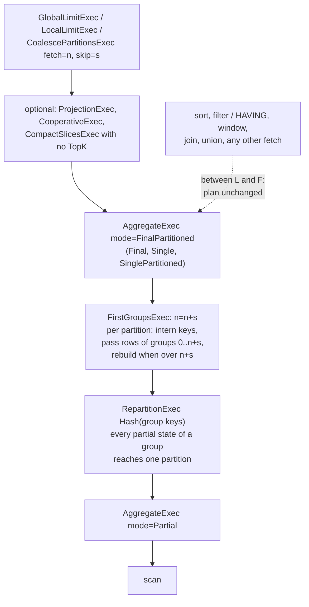

# ADR-3985: Bound the groups of an unordered GROUP BY ... LIMIT

- Status: Accepted (2026-11-08)
- Date: 2026-11-08
- Refs: #3985, #3899, #1402, ADR-0954, ADR-0102, ADR-3565

## Context

ClickBench row 18 (SQL index 17) is
`SELECT "UserID", "SearchPhrase", COUNT(*) FROM logs GROUP BY "UserID", "SearchPhrase" LIMIT 10`,
with no `ORDER BY`. DataFusion 55.2 plans it as a partial aggregate, a hash
`RepartitionExec` on the two keys, an `AggregateExec mode=FinalPartitioned`
and a limit above it. Each final partition builds a table of every group it
receives before it emits a row. `UserID` x `SearchPhrase` has 24 to 30
million groups, so the statement charges 2.5 to 2.8 GB to return 10 rows
(#3985 comment 6723874819, 18 tries over runs M3, M4 and M5).

On a c6a.xlarge (8 GB) that sits about 5% from the process limit of
3,754,644,297 bytes. At the one refusal in those 18 tries the statement's
pool held 2,668,148,360 charged bytes and its top four aggregate envelopes
1,016,238,080, so a 77,184,000-byte step did not fit; the statement then
answered through the ADR-0954 refusal-retry in 34.54 s against 6.4 to 9 s
without it. Which tries are refused depends on how the envelope classifies
the table's grow steps: a doubling that lands in the same grow as a 2 MiB
view-builder flush matches neither ladder within the 3% tolerance, and the
envelope reads one rung low. With classification fixed, the statement
charges 2.67 + 1.17 = 3.84 GB against the 3.75 GB limit and is refused on
every try (#3985 comment 6724585413).

SQL leaves unspecified which `n` groups an unordered `LIMIT n` returns. Any
`n` groups whose aggregates are computed over every one of their rows is an
exact answer, so the statement does not need the other groups at all.

DataFusion 55.2 has two rules near this shape, and neither applies.
`LimitedDistinctAggregation` requires an aggregate with no aggregate
expressions (`is_unordered_unfiltered_group_by_distinct` in
`datafusion-physical-plan-55.2.0/src/aggregates/mod.rs`), and
`TopKAggregation` requires a sort, and Ravel turns it off
(`crates/ravel-sql/src/session.rs`, the `session_config` comment on
`enable_topk_aggregation`).

## Decision

### 1. `FirstGroupsExec`

A Ravel physical node, `FirstGroupsExec { n, group expressions }`
(`crates/ravel-sql/src/first_groups.rs`), sits as the direct child of a
final-stage aggregate. For each output partition it:

- owns a DataFusion `GroupValues` built with the public `new_group_values`
  over the aggregate's group schema (`first_groups.rs:313-326`,
  `execute` at `first_groups.rs:408-428`), so two keys are one group here
  exactly when they are one group in the aggregate, NULLs and out-of-line
  `Utf8View` strings included;
- interns each input batch's keys and passes on only the rows whose group
  index is below `n` (`FirstGroupsStream::filter`, `first_groups.rs:487-518`).
  Indices are dense and given in first-seen order, so those are the rows of
  the first `n` groups the partition saw;
- when the table holds more than `n` groups after a batch, emits its keys,
  keeps groups `0..n` and rebuilds the table from them
  (`cut_to_bound`, `first_groups.rs:523-539`), so it holds at most `n` groups
  between batches and `n` plus one batch's new groups while interning one;
- charges its table and index buffer to the query pool under its own
  consumer, `FirstGroups[<partition>]` (`charge`, `first_groups.rs:542-563`);
- reads its input to the end, since a kept group's last row may arrive last;
- reports its input's partitioning and orderings unchanged
  (`maintains_input_order` at `first_groups.rs:369`), since it drops rows and
  never reorders them.

`EXPLAIN` prints it as `FirstGroupsExec: n=<n>`.

### 2. The rule and its gate

`FirstGroupsLimit` is a physical optimizer rule registered in
`build_session` right after `BoundedTopKAggregate` and before
`BucketedFinalAggregateRule` and `CompactSlices` (`session.rs:935-944`). It
walks down from every `GlobalLimitExec`, `LocalLimitExec` and
`CoalescePartitionsExec` that has a fetch (`rewrite`) and inserts the exec
when all of these hold:

1. Between the limit and the aggregate there is nothing but a further
   limit of those three kinds, a `ProjectionExec`, a `CooperativeExec`, a
   fetch-less `CoalescePartitionsExec`, or a `CompactSlicesExec` with no
   TopK pre-filter (`bound_below`, `first_groups.rs:179-213`). Any other node
   with a fetch, a sort for one, ends the walk, and so does every node not
   named, so a sort, a `HAVING` filter, a window, a join or a union between
   them leaves the plan unchanged.
2. The aggregate is in mode `FinalPartitioned`, `Final`, `Single` or
   `SinglePartitioned`; it has at least one aggregate expression; it has one
   grouping set with no null mask, no grouping id column and at least one
   key; it carries no limit options and no dynamic filter of its own; and
   its input order mode is linear (`admits`, `first_groups.rs:142-173`).
   The limit-options conjunct leaves alone an aggregate that
   `BoundedTopKAggregate`, which runs first, has already bounded.
3. The bound is the rows the limit reads from the aggregate: `n` for
   `LIMIT n`, `n + s` for `OFFSET s LIMIT n`, and under nested limits the
   rows the innermost one passes up. It must lie in
   `1..=SqlConfig::bounded_groups_max_limit` (`insert`,
   `first_groups.rs:218-247`).
4. The aggregate's input is not already a `FirstGroupsExec`, so a second run
   of the rule adds nothing.

`bounded_groups_max_limit` defaults to 1024
(`DEFAULT_BOUNDED_GROUPS_MAX_LIMIT`, `crates/ravel-sql/src/config.rs:77`),
the same ceiling as `bounded_topk_max_limit`. 0 does not install the rule.
ravel-server has no flag for it and takes the default
(`services/ravel-server/src/query.rs:1653`).

### 3. Why the answer is exact

The exec's input is the final aggregate's input, which DataFusion's
`EnforceDistribution` has already shaped to the aggregate's own requirement
(`AggregateExec::input_distribution_requirements`,
`datafusion-physical-plan-55.2.0/src/aggregates/mod.rs:2000-2012`): hash
partitioning on the group expressions for `FinalPartitioned` and
`SinglePartitioned`, a single partition for `Final` and `Single`. Either way
every partial state (or raw row) of a group reaches the one final partition
that owns the group, and the exec sees all of them there. A group the exec
keeps passes every one of its rows, so the aggregate computes it in full; a
group it drops reaches the aggregate with no row at all, so it is absent,
never partial. Each final partition emits `min(groups it owns, bound)`
complete groups, together at least `min(groups in the input, bound)`, which
is everything the limit reads.

The rule only looks at the input of an aggregate in a final mode, so it
places nothing below the exchange and nothing under a partial aggregate. The
two wrong placements fail
`the_returned_groups_carry_every_row_from_every_input_partition`
(`crates/ravel-sql/tests/first_groups.rs`): a filter below the exchange
returns `count(*)` 1 for a group of 4 rows, and a soft limit that stops
reading after `n` groups returns 1 for a group of 6.

### 4. The `n` ceiling

Per final partition the exec holds at most `bound` groups between batches,
plus one batch's new keys while interning, and the aggregate above it holds
at most `bound` groups. With `P` final partitions the final stage therefore
holds at most `P x bound` groups whatever the input's cardinality, and with
the default ceiling at most `P x 1024`. Past the ceiling the plan is
unchanged. The ceiling is the same as `bounded_topk_max_limit`'s, two orders
of magnitude above the `LIMIT 10` the measured statement asks for, and the
exec interns every input row of the final stage whatever the bound, so a
larger bound saves less memory for the same interning work.

### 5. Measured

`first_groups_bound_the_final_aggregates_charged_peak` runs 1,000,000
distinct `(Int64, Utf8View)` groups with 93% empty phrases over 8 partitions
with `LIMIT 10`, once with the rule and once with
`bounded_groups_max_limit = 0`, which plans exactly what main planned before
this change. Measured 2026-11-08 on the executor host (16 cores, 30 GB) over
four runs:

- the query pool's charged peak was 9.7 to 11.8 MB with the rule and 86 to
  93 MB without it. A CI run of main at the merge of this change measured
  18.1 MB with the rule and 81.5 MB without it. The test requires under
  32 MiB with the rule, about twice the largest figure, and over 32 MiB
  without it;
- the aggregate envelopes' peak was 7.86 MB with the rule and 153 to
  162 MB without it; the CI run measured 1.6 MB and 81.2 MB. With the rule
  the envelope is the eight partial aggregates', and this ADR does not
  account for the difference between the two runs. The test requires
  under 16 MiB with the rule, about twice the largest figure, and over
  32 MiB without it.

`the_returned_groups_carry_every_row_from_every_input_partition` runs the
exactness fixture under a 1 MiB pool: 749,408 bytes charged at peak with the
rule, and a `ResourcesExhausted` refusal without it.

## Rejected alternatives

- **Fix the envelope's step classification alone.** That makes the
  accounting honest, not the statement smaller: correctly classified, the
  statement needs 3.84 GB against a 3.75 GB limit and is refused on every try
  on an 8 GB host instead of once in 18. It stays a needed fix for every
  other aggregate and is tracked separately.
- **Lower the 1.25 undercount factor.** For this layout the factor is high,
  about 1.06 to 1.09 against hashbrown's real overhead, but the factor
  covers every grouped aggregate, ADR-1170 records live bytes the layout
  model does not see on string-key rows, and changing it needs an RSS
  against charged measurement first. Even at 1.06 the final stage holds 24
  to 30 million groups, about 2.2 GB, to return 10 rows.
- **DataFusion's soft limit.** `LimitedDistinctAggregation` stops reading
  input once the aggregate holds `n` groups. With no aggregate expressions
  that is exact; with `count(*)` it returns the count of whatever rows
  arrived before the stop. The test above shows it returning 1 for a group of
  6 rows.

## Consequences

- An unordered `GROUP BY ... LIMIT n` with at least one aggregate and
  `n + s` at most 1024 holds O(n + s) groups per final partition. ClickBench
  row 18's final stage holds at most 10 groups per partition instead of its
  share of 24 to 30 million, so the group table that took it to the process
  limit and the ADR-0954 refusal-retry is gone. The ClickBench figure itself
  is not re-measured here; the fixtures in section 5 are.
- Which `n` groups come back can differ from main: the first ones each final
  partition sees instead of whatever the aggregate's emit order gives. SQL
  leaves this unspecified and no test pins it.
- When ADR-3565's bucketed final aggregate engages, it wraps the bounded
  aggregate and routes only the groups the exec passed: in
  `bucketed_final_aggregate.rs`, the no-fetch test's
  `GROUP BY ts LIMIT 10` over 4 partitions read 40 groups instead of 64,000
  with this rule on, so that test turns the rule off to keep measuring the
  bucketed exec alone.
- The partial stage and the exchange are unchanged. The partial aggregate
  still builds up to its skip probe's worth of groups, and the
  `RepartitionExec` still buffers its output batches.
- Still exposed: an ordered top-k by `count` or `sum`, such as ClickBench row
  17 (`... ORDER BY COUNT(*) DESC LIMIT 10`), still builds every group, since
  #1402 showed no single-pass exact pruning exists for those aggregates. It
  keeps the ADR-0954 refusal-retry. So does an unordered `LIMIT` with a
  `HAVING` filter, which decides which groups survive only after they are
  complete.

## Diagram

