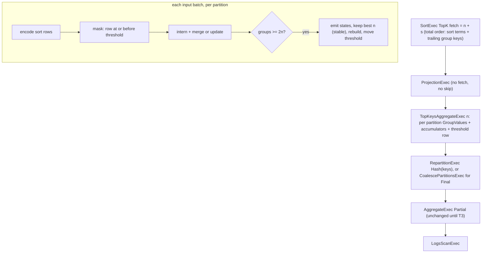

# ADR-4002: Bound GROUP BY ... ORDER BY group key LIMIT with a top-keys final aggregate

- Status: Accepted (2026-11-09)
- Date: 2026-11-09
- Refs: #4002, #3985, #1402, #3899, ADR-3985, ADR-3565, ADR-0954, ADR-0022, ADR-0087, ADR-0094

## Context

A statement that groups, orders by its group key and takes a limit, such as

```sql
SELECT host, count(*) FROM logs GROUP BY host ORDER BY host LIMIT 100
SELECT date_trunc('minute', ts) AS m, count(*) FROM logs GROUP BY m ORDER BY m DESC LIMIT 60
```

builds every group before the sort picks n of them. The second statement is the "latest N buckets" query that observability dashboards issue. On a high-cardinality key the final aggregate's memory grows with the number of distinct keys, not with n. On small hosts that ends in a memory refusal and the ADR-0954 spill retry, or in a failed query.

Stage 0 (#4002, comment 6728794535) measured the charged peak, the aggregate envelope and the wall time on main at b5aa2c8b5 for these shapes, at 100,000, 1,000,000 and 10,000,000 distinct keys. It used the session `build_session` produces, 8 partitions, a MemTable and 3 rows per key, on a 4-core aarch64 executor with `max_query_bytes` raised to 4 GiB. Medians of 3 runs; charged and envelope in MiB:

| statement | 100k charged / envelope | 1M charged / envelope | 10M charged / envelope | 10M wall |
|---|---|---|---|---|
| `ORDER BY k LIMIT 10`, Int64 key | 6.52 / 5.18 | 58.63 / 54.07 | 607.89 / 280.00 | 2.04 s |
| the same, Utf8View key of 8 to 40 bytes | 21.65 / 11.93 | 161.43 / 75.98 | 1260.60 / 551.25 | 4.77 s |
| `ORDER BY k DESC` | 6.52 / 5.53 | 57.63 / 54.07 | 614.15 / 280.00 | 2.06 s |
| `count`, `sum`, `avg` | 15.14 / 12.44 | 104.54 / 76.09 | 1257.14 / 539.00 | 4.06 s |
| two keys, ordered by both | 8.99 / 7.29 | 71.88 / 64.39 | 767.44 / 280.00 | 2.81 s |
| `date_trunc('minute')`, `DESC LIMIT 60` | 6.35 / 5.23 | 58.38 / 54.07 | 607.50 / 280.00 | 2.06 s |
| `min(v)`, ordered by key | 6.53 / 5.34 | 57.50 / 54.07 | 610.51 / 280.00 | 2.09 s |
| control: unordered `GROUP BY k LIMIT 10` | 1.96 / 0.05 | 3.84 / 0.04 | 7.47 / 0.04 | 1.36 s |
| control: `ORDER BY count(*) DESC` | 6.33 / 5.44 | 58.88 / 54.07 | 611.89 / 280.00 | 1.98 s |

Every ordered statement built the full group table, linear in the number of keys, as the out-of-scope `ORDER BY count(*)` control does. Only the unordered control, bounded by `FirstGroupsExec`, stayed flat. At the default 256 MiB query limit, every statement but that control would be refused at 10,000,000 keys.

T5 (#4005; pre-registered in comment 6730613003 on #4002, report and band judgments in comment 6733600310) re-measured the same statements on main at a94cf83, with `TopKeysAggregateExec` in place, using Stage 0's setup: `sql_partition_count = 8`, a MemTable of 8 partitions in 8,192-row batches, 8 tokio worker threads, 3 rows per key with keys permuted as `k * 7919 mod n`, and `max_query_bytes` at 4 GiB. Each statement ran with `SqlConfig::default()` and with `bounded_top_keys_max_limit = 0` in the same process, interleaved, 3 times each. The host was a 4-core aarch64 executor with 8 GB of memory (Raspberry Pi 5 class). The release profile was overridden on the command line: `lto = false` for every crate, and for ravel-sql `codegen-units = 16`, `opt-level = 1` and `debug = 0`; the memory figures do not depend on it. At 1M and 10M keys the rule-off figures of every ordered statement reproduced Stage 0's charged peak within 4 percent and its envelope within 0.2 percent. At 100k keys, where fixed costs dominate, they differed by up to 6 percent charged and 19 percent envelope. The unordered control, whose plan the rule leaves alone, did not reproduce as closely: rule off it read lower than Stage 0 at 100k and 10M keys and higher at 1M (1.83, 4.31 and 5.09 MiB against 1.96, 3.84 and 7.47), the 10M figure 32 percent lower. Its peak is the partial stage and the exchange, whose buffers vary with scheduling (#4011); T5 did not establish the cause of this gap. With the rule on, medians of 3 runs, charged and envelope in MiB, the `TopKeys[` figure is the largest single consumer's own peak in bytes:

| statement | 100k charged / envelope | 1M charged / envelope | 10M charged / envelope | 10M wall, on / off | 10M `TopKeys[` peak |
|---|---|---|---|---|---|
| `ORDER BY k LIMIT 10`, Int64 key | 2.51 / 0.00 | 4.87 / 0.00 | 7.09 / 0.13 | 0.56 s / 2.45 s | 697,016 |
| the same, Utf8View key of 8 to 40 bytes | 18.19 / 0.00 | 37.33 / 0.00 | 43.22 / 0.00 | 2.30 s / 5.33 s | 2,052,023 |
| `ORDER BY k DESC` | 3.17 / 0.00 | 5.19 / 0.00 | 5.36 / 0.00 | 0.57 s / 2.37 s | 697,016 |
| `count`, `sum`, `avg` | 9.35 / 0.00 | 11.99 / 0.00 | 15.99 / 0.02 | 2.02 s / 4.85 s | 1,289,176 |
| two keys, ordered by both | 4.10 / 0.00 | 7.17 / 0.00 | 8.68 / 0.00 | 1.06 s / 3.17 s | 967,288 |
| `date_trunc('minute')`, `DESC LIMIT 60` | 2.84 / 0.00 | 5.11 / 0.00 | 6.24 / 0.13 | 0.63 s / 2.46 s | 697,016 |
| `min(v)`, ordered by key | 3.64 / 0.00 | 4.45 / 0.00 | 7.76 / 0.13 | 0.64 s / 2.42 s | 697,016 |
| control: unordered `GROUP BY k LIMIT 10` | 2.17 / 0.05 | 4.39 / 0.04 | 5.21 / 0.04 | 1.43 s / 1.43 s | none |
| control: `ORDER BY count(*) DESC` | 6.40 / 5.16 | 59.26 / 54.07 | 610.51 / 280.00 | 2.40 s / 2.37 s | none |

Every ordered statement planned `TopKeysAggregateExec` in place of the `FinalPartitioned` aggregate, at every size, and the `CompactSlicesExec` above it left the plan. Its rows equalled the rule-off rows exactly in every run. Both controls kept their plans: `FirstGroupsExec` under the final aggregate for the unordered one, and `CompactSlicesExec` over a full `FinalPartitioned` aggregate for `ORDER BY count(*)`.

Neither existing bound applies:

- **DataFusion's `TopKAggregation`.** It admits ordering by the group key only with no aggregate or with a single `min`/`max`, on a single key (`datafusion-physical-optimizer-55.2.0/src/topk_aggregation.rs:52-54, 98-106`). Ravel turns it off for every session (`crates/ravel-sql/src/session.rs:694`, comment at 684-693, #1402). Its stream (`aggregates/mod.rs:211`, `mod grouped_topk_stream`) and `PriorityMap` (`mod topk`, 219) are private to DataFusion.
- **Ravel's `BoundedTopKAggregate`.** It re-admits only an order by a non-float `min` or `max` aggregate (`crates/ravel-sql/src/bounded_topk.rs:300-387`).
- **ADR-3985's `FirstGroupsLimit`.** It applies only with no `ORDER BY`, and stops at any fetch-bearing node such as a `SortExec` (`crates/ravel-sql/src/first_groups.rs:201-203`).

**The plan.** Before `CompactSlices` runs, Ravel plans the shape as a global `SortExec TopK(fetch = n + s)` with `preserve_partitioning=false`. It sits over projections and an `AggregateExec` final stage, which takes one of two forms:

- `FinalPartitioned`, over a hash `RepartitionExec` on the keys and a partial aggregate;
- `Final`, over a `CoalescePartitionsExec` and a partial aggregate. That is the form whenever a key or aggregate is not exact-typed (`executor.rs:7049-7055`, `aggregate_node_is_exact`), which includes every float `sum` and `avg`, under ADR-0094, and on an ADR-0954 spill retry, which plans with no `RepartitionExec` (`session.rs:650-651, 697-706`).

On a logs statement, `CompactSlices` later puts a `CompactSlicesExec` with a TopK pre-filter between the sort and the aggregate (`compact_slices.rs:124-146, 345-400`; pinned by `tests/logs_partition_topk.rs:249-262`). The pre-filter cuts the output rows of each batch, but the group table underneath stays unbounded. DataFusion folds `OFFSET s` into the sort's fetch and keeps a `GlobalLimitExec skip = s` above the sort (`datafusion-physical-optimizer-55.2.0/src/limit_pushdown.rs:232-247`).

**The sort is already total.** Before planning, `rewrite_sort_group_key_tie_order` (`crates/ravel-sql/src/executor.rs:7820`; ADR-0954 cache-dir amendment, requirement 4) appends every group key that is not already a sort term to a `Sort` over an aggregate. The keys go in as trailing terms, ascending with nulls last. The rewrite applies when the aggregate has no float group key, has only spill-family functions (`aggregate_functions_are_spill_families`), and the sort is not a bounded top-k candidate (`is_bounded_topk_candidate`, an order on a lone `min` or `max` output, which this ADR leaves out of scope anyway). It does so in every configuration (`total_tie_order_edit`).

So for count, sum and avg over this shape, the sort's order is already a total order on the keys. A key that the projection drops is carried through it under a reserved `__ravel_tiebreak_*` name and removed again by a restore projection above the sort (`TieOrderEdit::ProjectThrough`, `executor.rs:7403, 7786`).

## Decision

### 1. `TopKeysAggregateExec` replaces the final aggregate

A filter under the stock aggregate cannot bound this shape. Unlike ADR-3985's first-n filter, a best-n filter has to evict, because a later key can beat a kept one. An evicted key's earlier rows have already reached the aggregate, which still holds its group. If keys arrive ever-better (descending for an ascending order), every key is admitted once, and the aggregate holds every group. So the bound has to live in the aggregate itself.

`TopKeysAggregateExec` (a new module, `crates/ravel-sql/src/top_keys.rs`) replaces a final-stage `AggregateExec`, as ADR-3565's bucketed exec does. Per output partition it holds:

- a `GroupValues` from DataFusion's public `new_group_values` (`aggregates/mod.rs:209`, `group_values/mod.rs:90-136`), so two keys are one group exactly as in the aggregate;
- one `GroupsAccumulator` per aggregate expression (`datafusion-expr-common-55.2.0/src/groups_accumulator.rs:105-190`);
- the sort expressions, rewritten over the group-key columns, and an arrow-row `RowConverter` over them with the sort's own `SortOptions` (direction and null placement);
- a threshold: the encoded sort row of its current worst kept key, set only while it holds n keys.

For each input batch it:

1. evaluates the group keys (`evaluate_group_by`, `aggregates/mod.rs:3093`) and the sort expressions, and encodes the sort rows;
2. keeps only the rows whose sort row is at or before the threshold (all rows while it holds fewer than n keys);
3. interns the kept rows' keys, then:
   - in the `Final` modes, merges their partial states (`merge_batch`);
   - in the `Single` modes, updates from their rows (`update_batch`);
4. when it holds 2n groups or more:
   - emits every key and every accumulator's state;
   - ranks the groups by their sort row, and on equal rows by group index, which is a stable order;
   - keeps the first n, and rebuilds the table and the accumulators from the kept keys and states;
   - sets the threshold to the n-th kept row.

   Two requirements of the rebuild carry the exactness argument (Decision 3), and T1 tests both:
   - the fresh table holds the kept keys at group indexes 0 to n-1 before any later row is interned, so a key interned after the rebuild always has a larger index than every kept key;
   - the rank is by sort row and then group index, never by sort row alone.

At end of input it applies the same cut, with the same rank, once, then evaluates and emits at most n rows. The emit, state and merge round trip is the one `crates/ravel-sql/src/bucketed_final_aggregate.rs` already performs.

**Memory.** Rebuilding at 2n rather than at n+1 keeps the rebuild cost amortised. In the adversarial ever-better order, and when many groups tie at the threshold, a rebuild at n+1 would run on nearly every batch.

The resident state is at most 2n groups plus one batch's new keys. During a rebuild, the emitted key and state arrays sit beside the new table, a transient of the same size, as the bucketed exec documents for itself (`bucketed_final_aggregate.rs:80-84`). The resident state and that transient are both charged to the query pool, one to one, under the exec's own consumer name, with no aggregate reserve-ahead envelope.

**No spill.** The exec never spills, and needs not: its memory is bounded by the ceiling in section 4, not by the input.

A memory refusal charged to it is a `MemoryRefusal::Query`, which earns an ADR-0954 spill retry (`executor.rs:6612-6628, 6650-6662`). The retry plans a `Final` stage, the rule applies again, and the retry refuses the same way. That can happen only if 2n groups of state do not fit the per-query limit, which the ceiling is chosen to rule out. T1 measures the state per group, so the ceiling's sizing rests on numbers.

### 2. The rule and its gate

A physical optimizer rule, registered in `build_session` after `FirstGroupsLimit` and before `BucketedFinalAggregateRule` and `CompactSlices`, replaces a final-stage `AggregateExec` with `TopKeysAggregateExec { n }` when all of these hold.

**The sort:**
- It is a `SortExec` with a fetch n of at least 1 and `preserve_partitioning=false`.
- Between it and the aggregate there are only projections, `CoalescePartitionsExec` and cooperative wrappers.
- **No node in between carries a fetch or a skip.** A `GlobalLimitExec` below the sort belongs to a subquery: `SELECT * FROM (SELECT host, count(*) FROM logs GROUP BY host OFFSET 5) ORDER BY host LIMIT 10` would let that skip eat kept keys. `OFFSET` on the statement itself is already in the sort's fetch.

**The sort expressions:**
- Every sort expression is deterministic, and every column it reads resolves to a group-key output column of the aggregate.
- Resolution is by column index, through each projection's expressions, never by name. `SELECT count(*) AS host, host AS c ... ORDER BY host` must not resolve.
- The rule admits:
  - a key itself, and several keys in any order;
  - a strict prefix of the keys;
  - a function of keys, such as `date_trunc('hour', m)`;
  - the two-term sort the tie-order rewrite produces (`date_trunc('hour', m) DESC, m ASC NULLS LAST`);
  - a `__ravel_tiebreak_*` key projected through by `ProjectThrough`.
- No sort expression, and no key one reads, is a float type (section 3).

**The aggregate:**
- Its mode is `FinalPartitioned`, `Final`, `Single` or `SinglePartitioned`, with `input_order_mode == Linear`.
- It has at least one aggregate expression. Every aggregate expression:
  - supports a `GroupsAccumulator`;
  - has no `ORDER BY`;
  - has no `FILTER (WHERE ...)` clause (`filter_expr` is `None`, as `bounded_topk.rs:330-333` and DataFusion's rule require);
  - has no float state field.
- It has one grouping set, with no null mask, no grouping id, no limit options and no dynamic filter.

**The bound and earlier rewrites:**
- n is at most `bounded_top_keys_max_limit`, a new `SqlConfig` field. Its default is 1024, and 0 disables the rule.
- The aggregate has not already been replaced, and its input is not a `FirstGroupsExec`.

`EXPLAIN` names the node `TopKeysAggregateExec: n=<n>`.

**Ordering by an aggregate stays out of scope.** #1402's counterexample shows that the value of an aggregate needs every row of every group, so no bounded filter can choose by it.

### 3. Why the answer is exact

Let v(k) be the sort value of group k. Under the gate it is computed from the group's key alone, so it is the same for every row of the group. Each partition of the exec sees every input of its keys (`datafusion-physical-plan-55.2.0/src/aggregates/mod.rs:2000-2012`):
- `FinalPartitioned` and `SinglePartitioned` require their input partitioned by the keys, so each partition gets every partial state (`FinalPartitioned`) or every row (`SinglePartitioned`) of its keys;
- `Final` and `Single` require a single input partition, so that one partition gets all of them.

- **A kept group is complete.** Call a group complete when it has absorbed every input of its key that reached the partition. At each rebuild the kept groups are complete, by induction over rebuilds:
  - A key evicted at a rebuild is outranked there by n kept keys whose sort rows are at or before its own. The threshold, the worst of those n, only moves forward after that. So a later row of the evicted key passes the mask only when its sort row equals the threshold, and is then interned as a new, partial group.
  - That partial group has a group index of n or more (Decision 1, step 4), and the n kept keys each have a sort row at or before the threshold and a smaller index. So under the (sort row, group index) rank, the partial group ranks n-th or worse at every later rebuild and at the end-of-input cut, and is cut each time. It never reaches the output.
  - A key that is kept at a rebuild, and was never evicted before, is complete. Each rebuild it went through kept it among the first n, so its sort row is at or before every threshold set since its first row arrived. Thresholds only move forward, so each of its rows met a threshold at or after its own sort row and passed the mask.
- **The union is a correct answer.** Let t be the n-th best sort value over all groups, counted with multiplicity.
  - Every group with v strictly better than t is kept complete by its partition. Otherwise that partition held n complete groups strictly better than t, which is more than n over all partitions.
  - By the same argument, enough groups with v equal to t are kept complete to fill n.
  - The global `SortExec` picks n of them, and every one is complete.
- **Rows at the threshold pass.** The mask is "at or before" the threshold, not "strictly before", so the kept worst key's later rows are never dropped.
- **Ties.**
  - Under the tie-order rewrite, which covers count, sum and avg with no float key, the sort is total on the keys, so v is injective and the answer is fully determined.
  - Otherwise, ties among keys with equal sort values are resolved by arrival order, which SQL leaves unspecified. `BoundedTopKAggregate` documents the same stance.
- **Float keys are refused, not canonicalised.** `GroupValues` folds -0.0 into +0.0 for group equality and keeps NaN payloads distinct (`group_values/single_group_by/primitive.rs:88-92`). arrow-row orders floats by total-order bits, with -0.0 before +0.0 (`arrow-row-59.3.0/src/fixed.rs:152-157`). A group holding both zeros would therefore have two sort values, and a kept group could lose its +0.0 rows. ADR-0022 keeps -0.0 and NaN payloads significant, so canonicalising is not an option.
- **Float accumulator states are refused.** A rebuild merges each kept group's one emitted state into a freshly initialised accumulator. For a float state seeded at 0.0, that identity merge is not bit-exact: `0.0 + -0.0 = +0.0`, so a group whose true sum is -0.0 would come back as +0.0. ADR-0022 forbids that. A float accumulator whose fresh state is a bit-exact identity under merge (for example one seeded from its first value) could be admitted once a test proves it. That is follow-up T6.

### 4. The bound and its ceiling

The default ceiling of 1024 covers the dashboard shapes and ClickBench row 43, whose `LIMIT 10 OFFSET 1000` gives a fetch of 1010. It mirrors `bounded_topk_max_limit` and `bounded_groups_max_limit`. At 2n groups resident plus one rebuild transient, the ceiling keeps the exec's memory in the low megabytes for count and integer states; T1 pins the figure. Above the ceiling the plan is unchanged, and the ADR-0954 refusal-retry still applies.

### 5. Measured

T1's peak test, `the_exec_bounds_the_final_stages_charged_peak` in `crates/ravel-sql/tests/top_keys.rs`, measured on a 16-core x86_64 executor on 1,000,000 distinct `Int64` keys over 8 partitions with `ORDER BY k LIMIT 10`, ascending and descending, with keys arriving in the worst order or shuffled:

- the query pool's charged peak: 4.1 to 8.9 MB with the rule, 60 to 71 MB with `bounded_top_keys_max_limit = 0`;
- the aggregate envelope: 4.7 to 6.2 MB with the rule, all of it the partial stage's, and 107 to 134 MB without it;
- each `TopKeys[` consumer's own peak: 895,768 to 1,027,547 bytes. The test bounds it by `(2n + batch size) × 256` bytes, 2,102,272 at the default batch of 8192.

The test asserts the charged peak below 32 MiB with the rule, about twice the largest figure because the hash exchange's buffers vary with scheduling, and above 32 MiB without it. T5's re-measurement on the Stage 0 statement set adds the after-figures for the table in Context.

T5 (#4005) measured the Stage 0 statement set on the 4-core aarch64 executor and the setup the Context section describes, rule off and rule on in the same process. At 10,000,000 distinct keys, the query pool's charged peak before and after, the wall time with the rule as a fraction of the wall time without it, and the largest `TopKeys[` consumer's own peak:

- `ORDER BY k LIMIT 10`, Int64 key: 611.52 to 7.09 MiB; wall 0.23 (0.56 s against 2.45 s); 697,016 bytes.
- The same, Utf8View key: 1,224.97 to 43.22 MiB; wall 0.43 (2.30 s against 5.33 s); 2,052,023 bytes.
- `ORDER BY k DESC`: 612.89 to 5.36 MiB; wall 0.24; 697,016 bytes.
- `count`, `sum`, `avg`: 1,256.26 to 15.99 MiB; wall 0.42; 1,289,176 bytes.
- Two keys, ordered by both: 770.45 to 8.68 MiB; wall 0.33; 967,288 bytes.
- `date_trunc('minute')`, `DESC LIMIT 60`: 607.38 to 6.24 MiB; wall 0.26; 697,016 bytes.
- `min(v)`, ordered by key: 607.89 to 7.76 MiB; wall 0.26; 697,016 bytes.
- Control, unordered `GROUP BY k LIMIT 10`: 5.09 and 5.21 MiB; wall 1.00; no `TopKeys[` consumer, as planned.
- Control, `ORDER BY count(*) DESC`: 614.14 and 610.51 MiB; wall 1.01; no `TopKeys[` consumer, as planned.

Against the bounds this ADR states:

- Each `TopKeys[` consumer's peak stayed inside `(2n + batch size) × 256` bytes for every in-scope ordered statement and size: 2,102,272 bytes for n = 10, 2,127,872 for n = 60. The 256 is T1's test constant, about twice the 110 to 125 bytes per group measured for an Int64 key with `count` and `sum` (`crates/ravel-sql/tests/top_keys.rs`), and it does not scale with key width. The Utf8View key, 8 to 40 bytes, reached 2,052,023 bytes, 97.6 percent of it, so a longer key can exceed it; nothing in the gate bounds key width.
- The aggregate envelope with the rule was at most 0.13 MiB at any size for every in-scope ordered statement, against 280 to 551 MiB without it at 10M keys.
- The charged peak with the rule stayed below T1's 32 MiB for every in-scope Int64, timestamp and two-key statement at every size, at most 15.99 MiB. The out-of-scope `ORDER BY count(*)` control is not replaced and keeps its full figures. The Utf8View key exceeded 32 MiB at 1M keys (37.33 MiB) and at 10M (43.22 MiB). T1's assertion covers Int64 keys only, so this is not a failure of that test. But the Utf8View figure still grows with the number of keys, 18.19, 37.33 and 43.22 MiB at 100k, 1M and 10M, while each consumer's peak moved only from 1,904,599 to 2,052,023 bytes. The eight consumers together hold at most 15.66 MiB, and grew by 1.12 MiB of the 25.03 MiB rise from 100k to 10M keys; the rest, nearly all of the growth, is in the stages below the exec.
- Every ordered statement now fits the default 256 MiB query limit at 10,000,000 keys. The `ORDER BY count(*)` control, out of scope, still does not.

Against the pre-registration (comment 6730613003 on #4002), every band held but one:
- The plan, the Int64-type charged peaks (2 to 16 MiB), the per-consumer bound, the rule-off reproduction of Stage 0, the unchanged controls, the wall time and the row-for-row answers all held.
- The miss is the Utf8View key's charged peak with the rule, pre-registered under 32 MiB and measured at 37.33 MiB at 1M keys and 43.22 MiB at 10M. Its growth is in the partial stage and the exchange, which T3 (#4007) bounds, so that statement is T3's measured case.

## Rejected alternatives

- **Enable DataFusion's `TopKAggregation`.** It does not cover any aggregate other than `min`/`max`, and takes a single key only. It also brings back the float, NULL and unbounded-limit problems that turned it off (#1402).
- **A best-n filter under the stock aggregate,** as ADR-3985 does for the unordered case. It is exact, but gives no memory bound when keys arrive in an adversarial order (Decision 1).
- **Sort the rows by key, then aggregate in order and stop early.** The memory becomes the row sort or an ADR-0954 spill, not n. The logs scan declares no output order (ADR-0087), so no order comes free.
- **Two passes:** find the best n keys, then aggregate only those. That reads the scan twice.
- **Extend DataFusion's `GroupedTopKAggregateStream`.** It is private, and generalising it to any accumulator turns it into the design above.
- **Bound the partial stage in the same change.**
  - It would also shrink the exchange to at most n groups per input partition. Where the tie-order rewrite makes the sort total on the keys, a per-input-partition top n is exact: a key in the global top n is in every input partition's top n.
  - It is deferred, not rejected (T3), for two reasons:
    - it needs the same exec in `Partial` mode, with its own gate, limited to the rewrite's aggregates and non-float keys;
    - its benefit should be measured on top of T1's.
  - Outside the rewrite (a prefix sort over an aggregate the rewrite does not admit), partial stages that each cut ties independently can drop rows of a group the final stage keeps. So the partial stage stays limited to total orders.

## Consequences

- **Bounded memory.** The final stage of `GROUP BY ... ORDER BY <key> LIMIT n` uses O(n) memory per partition: 2n groups resident plus one batch and one rebuild transient.
- **Coverage today.** The bounded path covers `count(*)`, `count(x)` and integer `sum` and `avg`. It does not cover the rest:
  - float `sum` and `avg` (for example `avg(latency)` per minute bucket), whose state is refused (Decision 3, follow-up T6);
  - float `min` and `max`, which do not support a `GroupsAccumulator` (`minmax.rs:187-196`);
  - float sort keys;
  - ordering by an aggregate;
  - limits above the ceiling.

  Those keep today's plan.
- **`COUNT(DISTINCT)`.** It is planned as two aggregate levels (`group_keys.rs:1290-1291`). The outer final stage qualifies, but the inner `(key, value)` table stays unbounded.
- **Unchanged parts of the plan.** The partial stage and the exchange still carry every partial group until T3. ADR-3565's per-bucket top-k (decision 4) never engages for this shape once the final stage is replaced.
- **One plan change besides the replacement.** `CompactSlices` places a `CompactSlicesExec` directly above every `AggregateExec` and above nothing else (`compact_slices.rs:46-48`). In this shape it places exactly one, above the final stage: the partial stage gets none, since the final aggregate or the hash exchange stops the propagation from the sort (`compact_slices.rs:321-329`; pinned by `the_q29_plan_gets_one_exec_between_the_final_aggregate_and_the_round_robin_repartition`). Once the final stage is replaced, that `CompactSlicesExec` and its TopK pre-filter leave the plan, and none remains. The exec emits at most n rows, so the sort above it has little left to over-charge (#2720). Plans pinned for this shape change in T1.
- **No threshold reaches the scan, and nothing regresses.** The stock `AggregateExec` forwards parent filters on grouping columns (`aggregates/mod.rs:2155-2169`), and the replacement does not, since a custom exec is a pushdown barrier by default (`execution_plan.rs:851-860`). But on main, `CompactSlicesExec` already blocks that path for this shape. Forwarding the sort's dynamic threshold to the logs scan, for latest-N time buckets, is a separate ADR (T4).
- **Profiling still works.** `collect_aggregate_profile` reads the layout from every grouped `AggregateExec` in the plan (`memory.rs:743-770`), so the partial stage still supplies it once the final stage is replaced.
- **Distributed queries.** Aggregation never leaves the coordinator (`distributed.rs:28-32`), so the rule sees each final stage exactly once.

## Diagram


