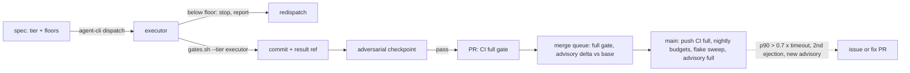

# ADR-4034: Dispatch-to-merge latency: gate tiers, placement floors, budget guards and baseline-anchored bands

- Status: Accepted (2026-11-09)
- Date: 2026-11-09
- Refs: #4034 (epic), ADR-2867 (changes 2, 5, 6), ADR-0053 (D1, D3), ADR-1586, issues #4000, #4011, #4012, #4026, #4028

## Context

Between 2026-10-26 and 2026-11-09 about 600 pull requests merged. From open to merge the median was 1.3 h, p90 4.8 h, max 61.5 h, and size barely moved it (1.2 h for 1 to 3 files, 1.5 h for 31 or more). 63 percent carried more than one commit, mostly fix rounds; the median pull request had 4 review records. The time is in the loop around the code, and the loop has five measured leaks.

**Merge queue ejections.** 678 entries, 78 ejections (66 failed checks, 12 conflicts). None of this week's failed checks was in the code under review: a wall-clock test reading the clock twice (#4000, three pull requests ejected), a source-tree walk racing test processes that create spill directories (#4012), a fixed 16 MiB memory band CI exceeded at 18.1 MB (#4011), a proptest in a reverted feature, `doc-scripts` growing from 19 to 30 minutes and timing out at its 30-minute cap on main too (raised to 45 in #4028; `.github/workflows/ci.yml:271-278` records the growth), GitHub release downloads returning 504 (`scripts/check-tla.sh:48,199-205` fetches `tla2tools.jar` with no retry and no CI cache, seven matrix legs per run at `ci.yml:626-658`; `ci.yml:836-855` fetches shellcheck and actionlint the same way), and a new RustSec advisory (rmcp, RUSTSEC-2026-0461) failing `cargo deny check` on every pull request at once (`ci.yml:1784-1803`).

**Fleet tasks.** Of 13 dispatches in one segment, 5 produced nothing usable. Three stopped at the disk-headroom gate: `label_selector` is a preference that falls back after a grace period (`.claude/skills/fleet-task-spec/SKILL.md:175-186`) to a 65 GB / 15 GB executor or an 8 GB arm64 Pi, and the spec's first command refuses below 70 GB (`SKILL.md:207-214`). One hit the 4 h ceiling inside `scripts/gates.sh -p` whose ravel-server closure runs the sql, agents, mcp, flight-sql, esql and ravel-bench lanes (`scripts/gates.sh:296-469`), 93 to more than 188 GB of `target/` and 75 or more minutes, although PR CI reruns every lane whose area the edit touches (`ci.yml:898-931, 1080, 1151, 1247, 1565, 1638`; the area filters at `ci.yml:165-241` skip the rest). One was blocked in review.

**Supply chain.** `supply-chain-nightly.yml` ran green at 05:45 UTC on 2026-11-09 (run 42569141047); the rmcp bump (634d5ce88) landed at 14:30 UTC the same day. The nightly did not miss the advisory for days; it appeared between the tick and the first red pull request. The gap is after publication: the per-PR job at `ci.yml:1784-1803` runs the full `cargo deny check` with no baseline, so an advisory already on main's lockfile blocks every pull request until a bump lands, and the nightly's only output is an issue (`supply-chain-nightly.yml:128-175`).

**Measurement.** Regressions against ClickBench's published v0.28.0 results (statement 9 on c6a.large; concurrent QPS on three machines, #4026) were found after v0.31.1 shipped. The kit's bands (`benchmarks/clickbench/bands/rlog.toml:18 [relative], :119 [absolute]`, `benchmarks/clickbench/kit/lib/kit.py:764 absolute_bands`) judge arm B against arm A and against fixed absolutes; no section holds the published upstream figures, so a drift of several small steps each inside its band is never seen.

**Review.** The adversarial checkpoint before a pull request opens (`.claude/skills/deliver-epic/SKILL.md:210-268`) caught every real defect earlier than the bot review; most bot findings were unpaired or wrong prose claims, which the claims audit (`fleet-task-spec/SKILL.md:262-275, 468`) exists to remove before the commit.

This ADR revises ADR-2867 change 5 and adds mechanisms where ADR-2867 left paragraphs. It changes no invariant and removes no CI check. Stage 0 of the epic measures each figure above before a wave dispatches; the plan is in the epic body.

## Decision

Trust boundary unchanged: the executor's green is never the gate (`CLAUDE.md:361`); the checkpoint, PR CI, the queue and `verify-dispatch-gates.sh` are.

### D1. Executor gate tiers

`scripts/gates.sh` gains `--tier executor|merge`. `merge` is today's behaviour byte for byte and stays the default, so `verify-dispatch-gates.sh:1-35`, `fleet-result-merge.sh` and the receipt (`gates.sh:698-712`) do not change. `executor` runs, for the crates named with `-p` (the edited crates) and their reverse-dependency closure from `affected-tests.sh -n` (`gates.sh:181-200`):

1. `cargo fmt --check` and every source guard `gates.sh:522-692` already runs (seconds, no build).
2. `cargo clippy --locked -p <edited> --all-targets -- -D warnings` and the edited crates' tests on the `ci` profile, doctests included.
3. One `cargo check --locked --all-targets` over the rest of the closure with the lane features it reaches unified in one invocation (`sql,esql,flight-sql,agents,mcp` for ravel-server, the bench features for ravel-bench), so a signature change is compiled against every dependent and feature-gated call site without running their tests.
4. For each lane whose feature-gated code an edited crate declares or is named by in `run_feature_lanes` (`gates.sh:356-469`), the lane's clippy and the lane's tests restricted to the edited crates.

What moves to CI: dependents' tests and lane suites, but only for lanes whose CI job the edit's paths trigger. The lane jobs `sql`, `flight-sql`, `features-lane`, `features-agents` and `features-mcp` are area-gated (`ci.yml:165-241`, `1080-1086`, `1151-1153`, `1565-1572`, `1638-1640`): an edit confined to `crates/ravel-ingest/` reaches ravel-server's lanes through `affected-tests.sh -n` but sets none of their areas, so CI skips them and the merge queue, which runs the same filtered `ci.yml`, does too. So the executor tier also runs, in full, the tests of every lane its closure reaches and whose CI job the edited paths do not trigger; it reads the edited paths' areas from the same filter lists `ci.yml` uses, so the two cannot drift. What the executor keeps: everything that can fail on its own edit, every lane test CI will skip, and a compile of everything its edit can break. The bar: for `-p ravel-query` and `-p ravel-server` the executor tier issues at most 40 percent of the merge tier's cargo commands, and a real run fits 60 minutes and 60 GB on the amd64 class; otherwise the tier is redesigned before wave 2.

Touches: `scripts/gates.sh` (argument parsing `:48-76`, selection `:296-354`, `run_feature_lanes`), `scripts/gates.test.sh` (a `--dry-run` case per tier), `fleet-task-spec/SKILL.md:124-128` (Gates template names `--tier executor`) and `:404-440` (Executor test scope), `CLAUDE.md:136-138`, the hook message `.claude/guards/pretooluse.mjs:562-568` and its suite. A scoped run writes no receipt in either tier.

### D2. Executor placement

Repo side. Every spec head declares `gate_tier: executor` and `disk_floor_gb: <N>` with N derived from the tier's `--dry-run` (40 without a lane, 60 with one; both replace the template's flat 70 at `SKILL.md:207`). `bin/agent-cli dispatch` (`bin/agent-cli:893-960`) refuses with exit 2 a spec whose head lacks either line and records both in the ledger line. The spec's first command keeps the headroom guard and, below the floor, ends the task with the fixed report `EXECUTOR BELOW FLOOR: <free> GB of <floor>` plus `uname -a` and `nproc`, the DEGRADED EXECUTOR shape at `SKILL.md:58-66`. `bin/agent-cli task` (`:698-720`) classifies that report as `below-floor`, a distinct terminal class, and the deliver-epic failure playbook (`SKILL.md:198-206`) gains the row: redispatch once with `--label host=<named amd64 executor>`; a second `below-floor` stops the wave. Lowering the gate (D1) is the larger lever: a 40 to 60 GB tier fits the 65 GB fallback executor the current gate cannot.

External dependency, its own ticket in claude-fleet, not a task here: a hard constraint form of `label_selector` (no fallback), or executor-published `disk_gb` and `mem_gb` labels the selector can bound on. Until it lands, the fallback pool is named in `fleet-task-spec/SKILL.md` as "will fail the floor".

### D3. CI runtime budget guard and tool-download resilience

`scripts/guards/check-ci-job-budgets.sh`: for the last 30 completed `push` runs on main and the last 30 `merge_group` runs (`gh api repos/NOFireAI/ravel/actions/runs?branch=main&event=push&status=completed`, then `.../runs/<id>/jobs?per_page=100`, fields `started_at`, `completed_at`, verified live), compute per-job p50 and p90, read each job's `timeout-minutes` from `ci.yml` at HEAD with the parser `ci-sweep-cancelled.sh` already has (`:45-48, 153-197`), and exit 1 when any p90 exceeds 0.7 of its cap, 2 when a query failed. A new `ci-budget-nightly.yml` runs it and its cases daily and files or updates one labelled issue on the `supply-chain-nightly.yml:92-175` report-job pattern. `bin/agent-cli ci-budgets` runs it on demand. Threshold rationale: 0.7 leaves 30 percent of the cap for a job's run-to-run spread. On 2026-11-03 `doc-scripts` measured 14.5 to 19.4 minutes against its 30-minute cap (`ci.yml:271-278`), below 0.7 of it, so the guard would not have fired then; by 2026-11-09 ten consecutive runs took 23.7 to 30.3 minutes, above 0.7, and two were cancelled at the cap. Stage 0 M1 records the run on which its p90 first passed 21 minutes, which is the lead the guard would have given; the ADR claims no figure for it until then.

Downloads. A composite action `.github/actions/fetch-pinned-tool` takes url, sha256 and destination; it restores from `actions/cache` keyed `tool-<name>-<version>-<sha256>`, on a miss downloads with three attempts and 15 s backoff, verifies the sha256 and saves the cache only on main (the `save-if` rule at `ci.yml:908-916`). The `actionlint` job (`ci.yml:836-855`) and the `tla-models` legs (`ci.yml:646-658`, `tla-nightly.yml:73`) use it, the latter by caching `.cache/tla/tla2tools-1.7.4.jar` so `check-tla.sh:190-214 ensure_jar` finds the jar and skips the fetch; `ensure_jar` gains the same three-attempt retry for the no-cache path. The sha256 pins at `ci.yml:826-831` and `check-tla.sh:47` stay the trust anchor; the cache is a transport.

### D4. Supply chain: one issue and one pull request, not a blocked queue

On `pull_request` and `merge_group` events the `supply-chain` job (`ci.yml:1784-1803`) runs `cargo deny check advisories --format json` twice, at the head and in a `git worktree add` of the base (`pull_request.base.sha`, `merge_group.base_sha`; cargo deny reads the lockfile and manifests and builds nothing). The job's checkout is depth 1 (`ci.yml:1796-1799`), so it first fetches the base commit with `git fetch --depth 1 origin <base sha>`; and fails only on an advisory id present at the head and absent at the base. Ids present on both are printed as a warning annotation naming the base. On `push` to main, and on the schedule, the full check runs as today, so a pre-existing advisory is red exactly once, on main, where the fix belongs. `supply-chain-nightly.yml:43` moves to every six hours, and its report job gains a sibling `fix` job: when `cargo update -p <crate> --precise <fixed>` makes `cargo deny check` pass, it pushes `deps/rustsec-<id>` and opens the pull request with `Fixes:` the tracking issue; when no fixed version resolves, the issue alone, as today. The `fix` job alone holds `contents: write` and `pull-requests: write`, and runs only `cargo update`, which executes no build script. The delta logic lives in `scripts/guards/check-advisory-delta.sh` with stubbed-JSON cases, testable without the network.

### D5. Flaky tests: a ledger and a required response

`assert-green-head.sh:136-294` already records a failure signature per pull request and head (`epic-orchestrator.sh:283-290 ci-attempt`), but the state is per session and per epic. A repository-wide ledger: `scripts/guards/ci-flake-sweep.sh` lists the last 24 h of failed `merge_group` and main `push` runs (`gh run list --workflow ci.yml --event merge_group --status failure`), extracts test identifiers with the grep at `assert-green-head.sh:188`, and files or updates one issue per identifier labelled `flaky-test` (dedup by title marker, the nightly pattern). A second ejection by the same identifier within 14 days adds `flake-quarantine-due`. The required response, enforced not written: `check-test-hygiene.sh` gains a rule that an `#[ignore]` whose reason names `flaky` must cite an open issue number, and `ci-flake-sweep.yml` fails its own run when a `flake-quarantine-due` issue is older than one working day with no pull request referencing it. The sweep runs on a schedule (every 6 h) and after any `merge_group` failure.

Stage 0 runs `check-test-hygiene.sh` against the #4000 test as it was before its fix; if the two-reads-of-`SystemTime::now()` shape passes, the wall-clock rule (`check-test-hygiene.sh:226-304`) is widened in the same task.

### D6. Measurement: the published baseline is a band

`benchmarks/clickbench/bands/rlog.toml` gains `[published]`: per statement, the published upstream hot and cold figures for the named machine and version, and the published concurrent QPS, each row with its source as `check-adr-band-sources.sh` requires. `kit.py` gains `published_bands()` beside `absolute_bands()` (`kit.py:764`): a statement misses when measured hot or cold exceeds published times 1.10, concurrent QPS misses below published times 0.90; `fetch.sh` exits non-zero on a published miss as on a relative one. The pre-registration comment (ADR-2867 change 6) gains a required line `published baseline: <file>@<sha>` or `none exists for <lane>`, and the kit refuses a `run.toml` that selects `published` without the section. Acceptance uses data in hand: judged against the v0.28.0 published rows, the stored v0.31.1 `results.json` must reproduce the #4026 misses.

### D7. Review: checkpoint before every non-trivial pull request, claims audit before the commit

`fleet-result-merge.sh` refuses, before `gh pr create`, a result whose epic state has no `checkpoint` event with `verdict=pass` for the result tree hash; `FLEET_MERGE_SKIP_CHECKPOINT=1` covers a trivial change (a docs-only or test-only diff under 50 lines, printed with the diffstat). The checkpoint procedure at `deliver-epic/SKILL.md:210-268` becomes `scripts/checkpoint-review.sh <result-ref>`: diff against current `origin/main`, the review subagent with the existing prompt, the verdict recorded, so the merge script has something mechanical to read. The claims audit (`fleet-task-spec/SKILL.md:262-275`) becomes checkable: the task report must carry a `CLAIMS AUDIT:` section, `bin/agent-cli task` flags a done task without one, and the checkpoint prompt lists every unpaired sentence as a finding.

## Rejected alternatives

- **Raise every timeout.** `doc-scripts` went 19 to 30 to 45 minutes in six days; a cap that follows the runtime hides the growth a budget guard reports. D3 keeps caps and watches p90.
- **Drop executor gates entirely.** A break found on the executor costs minutes; found in CI it costs a 40-minute cycle plus a redispatch, twice on #2833 (ADR-2867 change 5). The tier keeps what can fail on the edit.
- **Keep the full scoped gate; add executors or disks.** The ravel-server closure needs more than 188 GB and 75 minutes per task; more executors multiply that cost and leave the Pi and the 65 GB fallback unusable.
- **Hard-stop the task on an unexpected architecture.** Killed a healthy Pi task 24 s in on 2026-09-22 (`SKILL.md:179-186`). D2 stops only below a measured floor.
- **Auto-merge without the bot review.** #749 and #750 shipped six real findings that way. D7 moves findings earlier instead.
- **Make the fleet review a required status check.** ADR-1586 chose a comment-posting bot; a required check that stalls on pimox5 blocks every merge.
- **Retry failed checks until green.** `assert-green-head.sh` allows one rerun and escalates a repeat signature by design (`:5-17`). D5 adds the response, not retries.
- **Vendor the jar and binaries into git.** Over 10 MB of binaries per version bump in a repository executors clone fresh per task. A sha256-verified cache keeps the pin and loses only the transport.
- **Ignore the new advisory in `deny.toml` on the day.** An ignore with no fixed version is a decision nobody made; D4 bumps when a fix exists and files when it does not.
- **Widen bands when the previous build drifts.** Rejected in ADR-2867; D6 adds the fixed upstream anchor instead.

## Consequences

- Executor tasks finish inside the ceiling on the amd64 class and most fit the 65 GB fallback; dispatch-to-result p50 is the Stage 0 figure to move, and the end-to-end task (T11) measures it on a real dispatch.
- CI's work is unchanged. Lanes CI runs for the edit's areas leave the executor; lanes CI skips for those areas stay on the executor. The `merge` tier and `verify-dispatch` keep the cold full gate.
- An advisory on main is red once, on main, and fixed by a pull request the scheduler opens. The cost is two `cargo deny` runs per pull request, about a minute.
- A test that ejects the queue twice has an issue with a label and a deadline; ignoring it fails a workflow.
- Bands carry a third anchor that does not move with Ravel's releases. The cost is a `[published]` row per statement per machine class, each with a source.
- Two new scheduled workflows and one changed cadence; each files at most one issue per cause, by the dedup pattern in `supply-chain-nightly.yml`.
- Documents changed in the same commits: `CLAUDE.md` (Gates, Scripts, Guard scripts), the three skills named above, `docs/internal/clickbench.md`, the `docs/adrs/README.md` index row, and an amendment pointer on ADR-2867 change 5.
