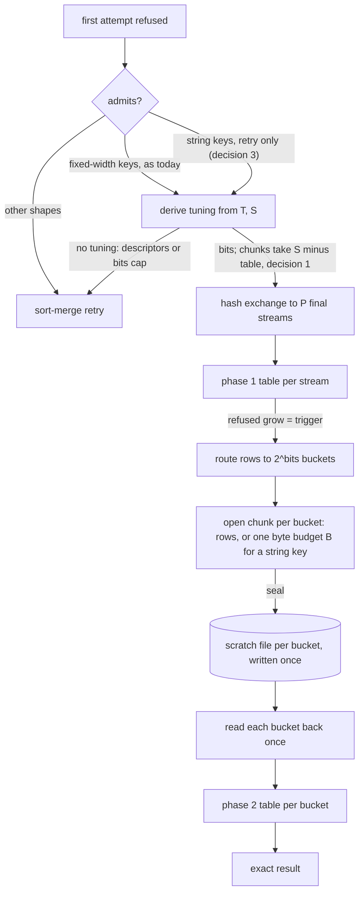

# ADR-4143: Bucketed spill retry for string group keys and small hosts

- Status: Accepted (2026-11-12)
- Date: 2026-11-12
- Refs: #4143, #4132, #4133, #4072, ADR-3565, ADR-0954, ADR-1195

## Context

A SQL statement refused for memory gets one retry. When the final aggregate is
one `BucketedFinalAggregateRule` admits and the derivation of ADR-3565
amendment 2, item 4 returns a tuning, the retry runs a hash exchange and
`BucketedFinalAggregateExec` with spill on. Each routed row is written to its
bucket's scratch file once and read back once. Otherwise the retry keeps the
sort-merge plan of ADR-0954, which writes and re-reads its runs through merge
passes.

v0.32.0 shipped this. Two refused shapes still take the sort-merge retry, and
both were measured (#4072 comments 6802934028 and 6818187104):

1. **An admitted shape on a small host (#4133).** ClickBench statement 33
   (`GROUP BY "WatchID", "ClientIP"`) on c6a.large derives `bits` 7 and a
   largest routed chunk below the 1,024-row floor, so the derivation returns
   `chunk_too_small`. The retry runs sort-merge: about 112 s hot and 11.6 GB
   of spill per try. The same statement runs bucketed on c6a.xlarge (`bits`
   5) and c6a.2xlarge (`bits` 4, 1.72 GB of spill). Its hot time there was
   17.5 s and 9.4 s in M8 (run `m8-t3-a7c3d527c-20261111T1124Z`, ADR-0954's
   M8 results amendment) and 16.8 s and 9.6 s in the v0.32.0 publication run
   (`pub-v0.32.0-20261112T0624Z`, #4072 comment 6818187104).
2. **A string group key (#4132).** `admits` takes fixed-width keys only, so
   statements 19, 34 and 35, which group by `"SearchPhrase"` or `"URL"`, retry
   on sort-merge on every box at 3.3 to 8.7 GB of spill each. In the two
   concurrent windows of M8 on c6a.2xlarge, 12 and 11 retries wrote 53.9 and
   47.8 GB. Concurrent QPS was 0.744, 0.761 and 0.847 of v0.28.0's on
   c6a.2xlarge, c6a.xlarge and c6a.large.

### Why statement 33 gets no tuning on c6a.large

The derivation (`bucket_spill_tuning.rs`, at origin/main 2e0b6fc3b) splits the
per-stream share `S = (L_eff - H) / C` into fixed parts:

- `bits` is the least `b` with `2T <= 2^b x P x 0.75 x S`. The table for one
  bucket, with a margin of 2, fits in three quarters of the share.
- `routed_chunk_rows` is the largest `c` up to 8,192 with
  `(2^bits + 1) x b(c) <= floor(0.25 x S)`. The open chunks and one read-back
  chunk fit in the remaining quarter.

On c6a.large `S` is 32,585,819 B. The routed row is 64 B, not the 52 B item 4
predicted (ADR-3565 amendment 3). The first attempt projected `T` at 12.65 to
12.78 GB, which gives `bits` 7 and a chunk charge that fits 972 rows. That is
below the floor, so there is no tuning. (ADR-3565 amendment 3 gives 980 rows:
that is `routed_chunk_charge` at the `S` of M8's logged effective limit,
32,874,379 B, and 972 is the same charge at item 4's `S` of 32,585,819 B.)
Under the fixed quarter, any `T` above 12.51 GB fails on that box.

Two facts in the code make the fixed quarter unnecessary:

- **The floor has no stated reason.** `BUCKET_SPILL_MIN_CHUNK_ROWS` is documented
  only as the point below which the retry keeps sort-merge
  (`bucket_spill_tuning.rs:52-54`). It is not part of any bound. The
  descriptor need `2 x P x 2^bits + P` does not depend on the chunk size, and
  a smaller chunk is charged less. The floor limits per-message IPC framing
  and per-batch overhead.
- **The open chunks and the phase 2 table are never held together.** `engage`
  and `force_route` empty the table before routing
  (`bucketed_final_aggregate.rs:1460-1526`), `finish_input` writes every
  retained chunk after a trigger (`:1699-1724`), and during the drain
  `relieve` writes later buckets' chunks (`:1534-1557`). Only one read-back
  chunk sits beside a phase 2 table. ADR-3565 item 3 adds the parts as if
  they were held together, so the bound holds with room to spare.

The first-attempt projection `T = A x N / n` runs high when the refusal
comes early. `A` is the peak asked bytes of every consumer, charged at
capacity, and an early refusal lands while the group tables are just past a
doubling. On c6a.large `A / n` was 126.5 to 127.8 B per consumed row, against
the 94 B per group ADR-3565 measured for a finished table. An overestimate
costs bits; an underestimate costs a typed failure with no third attempt. So
the projection stays as it is.

### Why string keys are not admitted

Fixed width is assumed in the routed chunk layout and the derivation, not in
the spill path:

- **Admission:** `admits` and `is_bucketed_key` (`bucketed_final_aggregate.rs:239-275`, `:334-362`).
- **Chunk layout:** a routed column is one values buffer of `rows x width`
  plus validity (`:686-803`). The router copies `width` bytes per row and
  closes a chunk on its row count (`:930-1004`). Forced-route slices are
  sized in rows (`:1493-1508`).
- **Derivation:** `column_widths`, `routed_chunk_charge` and the row search
  (`bucket_spill_tuning.rs:73-75`, `:164-177`, `:229-241`).
- **Not width-dependent:** the scratch write through Arrow `take`
  (`:1063-1083`), the spill schema, the read-back, `charge_table` (charged by
  `size()`), and the descriptor bound.

The scratch files are Arrow IPC through DataFusion's `SpillManager`, deleted
when dropped. They are not a persistent format, so this ADR changes no frozen
contract.

By the time the bucketed rule runs, `DictionaryGroupKeysAsViews` has cast a
declared `str` key to `Utf8View` (`session.rs:977` before `:1043`), and
DataFusion 55.2 has group tables for `Utf8View`.

ADR-3565 rejected bucketing string keys for the first attempt, because it was
measured slower on every string shape in memory. That finding is about CPU on
a statement that fits. This ADR is about a statement that has already been
refused and is bound by spill bytes, so it admits string keys in the retry
only.

### The risk the string route carries

ADR-3565 decision 3 notes that retained input is up to R times the group
state, where R is rows per group. The partial aggregate of these statements
gives up early (its reduction probe sees too few repeats), so after the
trigger every row the exchange hands the final is routed. For
`GROUP BY "URL"` that is about 100 million rows of URL bytes, a 16 B view and
an 8 B count before compression, where sort-merge writes rows its table has
already combined. Without combining, the write-once route can write more
bytes than the sort-merge it replaces.

## Decision

### 1. The open chunks take what the tables leave (#4133)

The derivation keeps its `bits` rule and drops the fixed quarter for the
chunks. With `table(b) = ceil(2T / (P x 2^b))`:

- `bits` is the least `b` with `2T / (P x 2^b) <= 0.75 x S` **and**
  `table(b) + (2^b + 1) x b(c_min) <= S`, where `c_min` is the chunk floor.
  The second condition takes one more bit only at the top of a `bits` step,
  where the table leaves no room for even floor-sized chunks.
- `routed_chunk_rows` is the largest `c` up to 8,192 with
  `(2^bits + 1) x b(c) <= S - table(bits)`.

Every bound of ADR-3565 item 3 still holds. The chunk area is at least
today's quarter, `table + chunks <= S` holds as written, and each bucket's
table still gets at least `2T / (P x 2^b)`. The descriptor rule is unchanged.

| box | `T` | today | this decision |
|---|---|---|---|
| c6a.large | 12.65 to 12.78 GB (measured) | `bits` 7, 972 rows at `S` 32,585,819 B (980 at the 1,461,083,554 B effective limit M8 logged, `S` 32,874,379 B), no tuning | `bits` 7, 2,416 rows at 12.65 GB and 2,400 at 12.78 GB at `S` 32,585,819 B; 2,452 rows at M8's logged inputs (`T` 12.65 GB, `S` 32,874,379 B); descriptor need 4,112 |
| c6a.large | largest that tunes, `bits` 7 | 12.51 GB | about 24.6 GB |
| c6a.large | largest that tunes, `bits` 8 | none | about 31.8 GB, with a soft `nofile` of at least 16,416 |
| c6a.xlarge | 9.48 GB (item 4) | `bits` 5, 8,192 rows | unchanged |
| c6a.2xlarge | 9.48 GB (item 4) | `bits` 4, 8,192 rows | unchanged |

The 1,024-row floor stays. On c6a.large it binds past about 24.6 GB at
`bits` 7 and about 31.8 GB at `bits` 8 (a floor chunk of 64 B rows is
charged 66,304 B). The test fixture `Q33_WIDTHS` moves from 52 B to the
measured 64 B. `bits` 7 needs a soft `nofile` limit of at least 8,224 on
c6a.large (one slot) and `bits` 8 at least 16,416. The M8 and publication
boxes were stamped at 8,320 or more, which allows `bits` 7; whether they
allow 8 depends on the hard limit ravel-server raised the soft limit to,
which those runs did not record. Past the descriptor limit the derivation
returns `descriptor_budget` and the statement keeps the sort-merge retry.

Under this rule `chunk_too_small` can no longer be returned: `bits` is chosen
so that a floor-sized chunk fits beside the table, and `routed_chunk_rows`
is the largest chunk that fits in the same area, so it is never below the
floor. A route that cannot tune now reports `descriptor_budget` when the
`bits` it needs exceed the descriptor budget, or `too_many_bits` when no
`bits` up to `BUCKETED_FINAL_AGGREGATE_MAX_BITS` (16) satisfies both
conditions. Statement 33 on c6a.large reported `chunk_too_small` in M8; a
box that still cannot tune it reports one of these two instead, and the M9
judge reads them as no tuning.

ADR-3565 item 5 says the slack from rounding `bits` up is extra safety
against an under-shoot. Under this rule the chunks spend that slack in
phase 1, so the margin in phase 2 rests on the phase disjointness above: the
open chunks are gone before a phase 2 table is built. The amendment to
ADR-3565 rewords item 5 to say so.

This decision ships on its own, ahead of decisions 2 and 3.

### 2. First, predict whether routing string keys writes fewer bytes

Decisions 3 and 4 are built only if this prediction says they pay. Before
any string-key code, one task predicts, for statements 19, 34 and 35 on each
M8 box, the bytes an uncombined write-once route would write:

- the rows the exchange hands the final after the trigger, from a run of the
  first attempt on the ClickBench corpus;
- the average routed row bytes, from the declared key types and the corpus's
  key lengths;
- the compression ratio of the scratch format, from writing a sample of those
  rows through the same spill writer.

The threshold, per statement and box, is the smallest `spill_bytes_written`
of that statement's sort-merge retries in M8, read from the M8 server logs
(run `m8-t3-a7c3d527c-20261111T1124Z`). On c6a.large and c6a.xlarge these
statements retried in the serial pass, three tries each. On c6a.2xlarge they
did not retry in the serial pass, only in the concurrent windows, so the
threshold there is read from the window logs. Statements 34 and 35 group by
the same key and differ only in a constant column, so their thresholds
coincide to three figures; each cell below is read from its own statement's
retry lines.

| statement | c6a.large, serial | c6a.xlarge, serial | c6a.2xlarge, concurrent |
|---|---|---|---|
| 19 | 4,649,336,784 B | 3,582,127,824 B | 3,290,644,448 B |
| 34 | 8,603,687,856 B | 6,831,250,656 B | 6,040,848,496 B |
| 35 | 8,598,806,208 B | 6,833,919,088 B | 6,044,972,448 B |

- If the prediction is below the threshold for every statement and box,
  decision 3 is built and decision 4 is not.
- If it misses, decision 3 is built with decision 4, and the prediction is
  repeated with combining before decision 3 ships.
- If combining cannot bring it under the threshold either, decisions 3 and 4
  are not built, and the epic records why.

**Result (#4152, comment 6830427408).** The prediction ran on the full
corpus (`benchmarks/clickbench/bucket-bytes/`). The uncombined route wrote
27 to 51% of the threshold in all 45 cells (the three statements, the three
boxes, `bits` 4 to 8), so decision 3 is built and decision 4 is not.
Combining cut bytes by 2 to 16%: lz4 already absorbs the repeats inside a
chunk. The same run showed that a 64 KiB data block per column, charged as
a 90,368 to 102,912 B floor, does not fit the chunk budget on c6a.large at
`bits` 7, which is why decision 3 states its chunk as one byte budget with
a 16 KiB floor.

### 3. String keys are routed in byte-budgeted chunks, in the retry only (#4132)

A routed column is either fixed-width, as today, or variable-width: Utf8,
LargeUtf8, Utf8View, Binary, LargeBinary or BinaryView.

- **Chunk layout.** A chunk is one byte budget `B`, charged in full before
  any row is written and never exceeded: its fixed-width columns, its views
  or offsets (16 B per variable-width column per row), its validity and its
  copied string bytes all come out of `B`. A chunk seals when the next row
  would take it past `B`, or at 8,192 rows. The rows a chunk holds and the
  bytes its strings take are what the data gives; `B` is the only parameter
  the derivation sets.
- **Copies, not views.** Strings longer than the 12-byte inline limit are
  copied into the chunk's own data block. A view into the source batch would
  keep that batch's buffers alive without a charge.
- **One row larger than `B`** is a chunk of its own, charged at its size
  before it is copied. A refused charge is a spill trigger, as for any
  chunk.
- **A chunk still refused once the stream retains nothing.** ADR-3565 item
  1 does not fail the stream in this case: that bucket's rows of the batch
  the router was handed are written to its file as one uncharged piece, and
  the next chunk is asked for again. Variable-width routes keep that rule,
  for an oversized row too. The piece is that bucket's share of the rows
  the router was handed in one call, and ADR-3565 bounds those rows, not
  their bytes: one input batch after an engage, `max(c, batch size)` rows
  after a forced route, and the whole engage state, up to
  `engage_groups + batch size` rows, at the engage itself. For a
  variable-width route the bound is the same row count times the bytes of
  those rows: the piece copies rows the router already holds, so it is at
  most the routed bytes of the rows handed in that call, which at an
  engage is the engage state the table held under its charge. ADR-3565's
  `(engage_groups + batch size) x (w + 4)` is that bound for a fixed `w`.
- **The forced route.** When a refusal arrives while a stream still holds its
  phase 1 stock table, ADR-3565 item 1 routes that table's emitted state
  straight to the files in uncharged slices, because the pool has just
  refused a grow. For a variable-width route a slice is cut the way a chunk
  seals: it ends when the next row would take it past `B` bytes, or at
  8,192 rows, and a single row larger than `B` is a slice of its own. The
  uncharged bound per stream is one slice of at most `B` bytes plus 12 B
  per row for its hashes and order (8 + 4 B, as in the router's scratch)
  plus the pieces' validity and per-bucket offsets, or one oversized row,
  whose bytes the stock table held under its charge at the refusal. The
  router's fixed scratch for these routes is sized to a slice's 8,192-row
  cap. This replaces ADR-3565 item 3's `c x (w + 12)` for these routes.
- **The derivation.** `bits` comes from `T`, as now. The chunk budget is
  `B = floor((S - table(bits)) / (2^bits + 1))`, the same area decision 1
  gives a fixed-width route's chunks. No bytes-per-row input is needed.
- **The floor.** For a variable-width route the floor is `B_min` = 16 KiB.
  In decision 1's second `bits` condition, `b(c_min)` is `B_min` for these
  routes, so `B` is never below it; a route whose budget cannot reach it
  reports `too_many_bits` or `descriptor_budget`, as decision 1 says. 16 KiB is chosen as a number: a 16 KiB chunk still carries about
  118 rows of statement 34's 114.6 B average URL plus its 24 B of view and
  count, and it fits the smallest budget the prediction found on any box at
  `bits` 8 (31,698 B on c6a.large). On
  c6a.large a string route then tunes up to about 25.0 GB at `bits` 7,
  where the table's 0.75 condition binds before the floor does. Smaller
  chunks compress worse: the prediction's bytes at `bits` 8 on c6a.large
  were 17 to 24% above those at `bits` 4, and all of them were under the
  threshold.
- **Admission.** `admits` takes these key types only when the rule is built
  `with_spill(true)`, which is the refusal retry. A first attempt plans as
  today.
- **Exactness.** The bucket is a function of the key, as for a fixed-width
  key, so every row of a group lands in one bucket and is aggregated by one
  table.

### 4. Combining a sealed chunk by key: not built

Decision 2's prediction met its threshold without combining, so a sealed
chunk is written as routed. Combining (merging a sealed chunk's rows by key
with the aggregate's state merge before it is written, exact, its memory one
chunk's group table) stays the recorded fallback if M9 finds string-keyed
bytes above the prediction's band. Fixed-width routing never combines:
statement 33 has about one row per group, so combining would cost one hash
pass per chunk and save nothing.

### 5. The gate (M9)

The change ships only after a pre-registered run on c6a.large, c6a.xlarge and
c6a.2xlarge, built and judged the way M8 was (ADR-0954 parallel bucket spill
gate). The bands are written before any box is launched and include:

- statement 33 on c6a.large derives a tuning (`bits` 7 at the measured `T`)
  and answers, with its retry spill at most 2.0 GB, and its hot time is at
  most 56 s, half the 112 s its sort-merge retry took in M8 and in the
  publication run. The prediction, reported beside the band, is about 35 s:
  c6a.xlarge's bucketed retry took 16.8 to 17.5 s on twice the vCPUs. A
  figure between 35 s and 56 s passes the band and is reported as a miss of
  the prediction;
- every retry of statements 19, 34 and 35 the run
  logs reports `retry_plan="bucket"`, and each one's
  `bucket_spill_bytes_written` comes in within the band decision 2's
  prediction set and below that statement's M8 sort-merge bytes on the same
  box. The number of retries expected per pass and box is read from M8's
  logs and written into the pre-registration, not assumed;
- statement 33's hot time on c6a.2xlarge and c6a.xlarge stays within 1.10 of
  the v0.32.0 publication run's 9.6 s and 16.8 s, the shipped binary's
  figures (decision 1 must not move a tuned box);
- no null answer on any box;
- concurrent QPS against v0.28.0 on the same box, reported against the 0.95
  bar the epic #4072 release bar started from.

## Rejected alternatives

- **Change the 0.75 / 0.25 split.** A 0.77 / 0.23 split tunes c6a.large only
  while `T` stays under 12.84 GB, 0.5% past the measured value. It moves the
  failure point instead of removing it.
- **A margin below 2 in the `bits` rule.** It would give `bits` 6, but it
  weakens the under-shoot argument of ADR-3565 item 5, and a bucketed retry
  that under-shoots fails the statement with no third attempt.
- **Lower the floor to 512 rows.** It tunes c6a.large at `bits` 7, but `bits`
  8 then gives 488 rows and fails again from about 25 GB, and it changes a
  floor whose purpose was never stated instead of the split that causes the
  failure.
- **Fewer final partitions on the retry.** Chunk rows scale like
  `P / (Q + 2P)^2`, which peaks at `P = Q / 2` with at most about 1.56 times
  the room. It would also change the validated c6a.xlarge plan and couple
  this ADR to ADR-1195's partition floor and the server's `retry_partitions`
  line.
- **A better projection of `T`.** No surrogate exists today: the ledger keeps
  charged bytes, not asked bytes per consumer, and no group count is
  reported. An underestimate fails the statement, so the conservative
  projection stays.
- **Hash string keys to a fixed-width surrogate.** Without side storage it is
  not exact (a 64-bit collision has probability about 3 x 10^-4 at 10^8
  keys). With side storage the string bytes are still routed and written, so
  nothing is saved.
- **A per-bucket dictionary.** It needs a key-to-code table per bucket for
  the whole of phase 1, which is the group table bucketing exists to avoid,
  and the share does not bound it.
- **Bucket string keys on the first attempt too.** ADR-3565 measured it
  slower on every string shape in memory, and nothing here changes that.

## Consequences

- c6a.large-sized hosts get the bucketed retry for statement 33 and for any
  admitted shape whose projected tables fit in three quarters of the share:
  up to about 24.6 GB at `bits` 7, about twice the 12.5 GB they reach today,
  and about 31.8 GB where the `nofile` limit allows `bits` 8.
- A refused statement grouping by a string key retries bucketed when its
  derivation tunes. Its scratch bytes no longer
  depend on the memory share, so they do not grow when concurrent statements
  shrink it.
- Fixed-width routing, which M8 and the publication runs validated, changes
  only in its chunk size (decision 1). Nothing is combined before it is
  written (decision 4).
- This ADR keeps the `retry_plan_reason` strings already shipped unchanged,
  so dashboards and the M8 and M9 judges read the same values.
  `not_fixed_width` remains for a key type decision 3 does not admit.
  `chunk_too_small` keeps its string but is no longer returned (decision
  1); a route that cannot tune reports `descriptor_budget` or
  `too_many_bits`, whatever its key type.
- Production cases this leaves exposed, stated for the release notes: a
  string-keyed retry under memory pressure writes out, uncharged, the rows
  the router already holds, which at an engage is the whole engage state; a
  statement whose `T` exceeds about 25 GB on a 4 GiB host with a soft
  `nofile` under 16,416 still takes sort-merge; and the projection's
  conservative bias still costs bits on an early refusal.
- ADR-3565 gets an amendment that points items 1, 3, 4 and 5 and the
  string-key rejection at this ADR. The part for items 3 to 5 lands with
  decision 1's implementation (#4133); the part for item 1's
  still-refused-chunk bound, item 3's forced-route bound and the string-key
  rejection lands with decision 3 (#4132). ADR-0954 gets one for the M9
  gate (#4154).
- No frozen format changes: RSEG, `proto/`, series identity, commit tokens
  and the object key layout are untouched.
