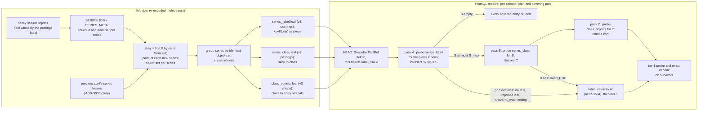

# ADR-4146: a series-level key index for metrics, routed before the label-value index

Status: Proposed. Issue: #4146.
Date: 2026-11-13
Builds on: ADR-3694 (decision 2, the metrics `label_value` leaf; decision
3 and the per-value routing amendment, the metrics route; the Stage 1
acceptance amendment, row 3 restated to value holders), ADR-2707 (the
`.kidx` leaf, its slices and buckets, decision 6's erasure rule), ADR-3692
(the tier-2 router, its `P_max`, `L_max` and `B_run`, the pass budget),
ADR-3939 (the day seal and decision 5's carry), ADR-0005 (canonical series
identity), ADR-0031 (empty-valued labels are absent from identity),
ADR-0066 (migration classes), ADR-1170 (decode reservations).
Changes a persistent format: the key-index leaf gains format version 3, a
second entry kind and one additive header field (decision 5). It changes
no RSEG byte, no series identity, no object key prefix and no HEAD
`format_version`.

## Context

ADR-3694's metrics route asks the `label_value` leaf one question per
positive equality value: does any object of this part hold the string
`v` in its LABEL_DICT? A selector plan drops an object when any of its
values is absent (the per-value routing amendment). That is a value-level
bound: an object survives when every value of the selector occurs in it
somewhere, on any series.

The Stage 1 run measured where that bound sits on the `cardinality`
tenant (ADR-3694 Stage 1 acceptance amendment, measured 2026-11-10,
comment 6790288400; row 3 at
docs/adrs/3694-long-range-metrics-exact-economics.md:765):

- R6 `mb_single_counter_rate`, the selector
  `metricsbench_requests_total{job="metricsbench-api",method="GET",status="200",instance="metricsbench-instance-0"}`
  (benchmarks/metrics/metrics.corpus.json:45), opened 1,601 of 2,908
  objects: 1,597 value holders plus 4 token objects. The route pruned
  1,307 of the resolved set of 2,904, exactly the value-holder prediction
  (docs/adrs/3694-long-range-metrics-exact-economics.md:778).
- Probe wire was 631.5 MB, 394 KB per opened object
  (docs/adrs/3694-long-range-metrics-exact-economics.md:780).
- `metricsbench-instance-0` sits in the LABEL_DICT of 55 % of the objects
  that hold the metric, because every L0 object is a shard flush across
  all series, and the series-level bound, the objects holding a series
  that matches the whole selector, is 141
  (docs/adrs/3694-long-range-metrics-exact-economics.md:806-810).
- The owner restated row 3 to value holders and named this issue as the
  follow-up that aims at the 141 (comment 6790537615).

Why a value index stops at the value-holder bound: LABEL_DICT is a flat
string set per object (docs/segment-format.md:224-235) and the leaf entry
records only that a `key8` occurs in an entry
(`KeyIndexLeafEntry`, crates/ravel-catalog/src/snapshot_format/kidx.rs:175).
Five facts "`GET` occurs in object o", "`200` occurs in o",
"`metricsbench-instance-0` occurs in o", and so on, are all true of an
object in which instance-0 carries one series and `GET` and `200` belong
to other series. No combination of per-value answers can tell that object
apart from one holding the selector's series: the conjunction has to be
evaluated on one series, and the value index has thrown the series away.
On a shard-flush L0 layout a common value such as an instance name is in
most objects of its family, so the value bound is loose by about an order
of magnitude: 1,597 against 141 here.

What exists today, which this decision builds on:

- The `.kidx` leaf: one object per (part, field, key slice), an RKI1
  envelope with a header, a bucket directory and zstd bucket frames of
  entries `(key8, entry_ordinal, blocks)` sorted by `(key8,
  entry_ordinal)` (docs/catalog-and-mvcc.md, "Per-part key-index leaves",
  object layout). Written at `KEY_INDEX_LEAF_FORMAT_VERSION` 2
  (kidx.rs:35); a reader accepts 2 for every signal and 1 for every
  signal but logs (`key_index_leaf_version_accepted`, kidx.rs:55), and a
  leaf it does not accept leaves its part uncovered for that field.
- A part's refs are selected by field name: `select_key_index_slice`
  ignores refs for any other field (kidx.rs:1932-1938). This is what lets
  a new field ride beside `label_value` without an older reader seeing it.
- The metrics fold declares one field, `label_value` of key type `Str`,
  when `metrics_label_index` is on
  (`declared_key_index_fields`, crates/ravel-catalog/src/fold.rs:1641-1662).
  The postings build fetches each newly sealed object whole, and the leaf
  build reads LABEL_DICT from those held bytes with no GET
  (crates/ravel-catalog/src/fold.rs:5046-5049).
- The query side: `route_metric_plans`
  (crates/ravel-query/src/engine.rs:2501) calls `route_values`
  (crates/ravel-query/src/key_index_route.rs:561), which routes nothing
  while the snapshot carries a pending erasure or holds no segment
  (key_index_route.rs:576), or
  when no part of the snapshot has a ref for the field
  (key_index_route.rs:579), and otherwise routes one one-key pass per
  distinct positive equality value (`positive_equality_values`,
  engine.rs:4240).
- Leaf GET bounds: `KEY_INDEX_LEAF_GET_CEILING` is 2,048 per one-key
  pass (kidx.rs:101), `P_max` is 1,024 parts (kidx.rs:79), `B_run` is 64
  bucket runs per set probe (kidx.rs:106). Its doc comment (kidx.rs:95-100)
  states the per-value rule: at most `2n` GETs per covering part for `n`
  values, `1 + n` on a one-slice leaf when the read cache serves the
  prefix to later passes.
- Series identity: `SeriesId` is the first 16 bytes of BLAKE3 over the
  canonical bytes of ADR-0005 (crates/ravel-types/src/lib.rs:406), and
  the `Id16` key type's `key8` is its first 8 bytes
  (`key8_id16`, crates/ravel-codec/src/key_idx.rs:98).

## Decision



### 1. The index: a series key, label-pair postings, and object-set classes

The index is three new metrics key-index fields of one part. Each is an
ordinary field in the ADR-2707 sense: one or more leaves per (part,
field), sliced on `key8`, bucketed by the existing mix, referenced from
`SnapshotPartRef.key_index` (field 8), bound to the part blake3.

- **The series key.** `skey = key8_id16(series_id)`: the first 8 bytes of
  the part's canonical `SeriesId`, read from the object's SERIES_IDS
  section (docs/segment-format.md:238-248). Nothing is invented: the key
  is a prefix of the frozen ADR-0005 identity, and two objects holding the
  same series give the same `skey`. Two distinct series sharing a prefix
  merge into one key; decision 3 shows that this only adds objects.
- **`series_label`, key type `Bytes`.** `key8 = key8_bytes(pair)`, where
  `pair` is the ADR-0005 label encoding of one label of a series,
  `u16_le(len(name)) name u16_le(len(value)) value`, and the metric name
  is the pair (`__name__`, name). The entry is a posting (decision 5's
  entry kind 1): the ascending `skey`s of every series of the part that
  carries the pair. Every label a series stores is indexed; an
  empty-valued label is absent from identity and from storage (ADR-0031)
  and so from the index.
- **`series_class`, key type `Id16`.** `key8 = skey`. The entry is a
  posting of one element, the series' class ordinal. A class is a set of
  part entries: the series of a part are grouped by the exact set of
  covered entries that hold them, and each distinct set gets an ordinal
  in the order of its smallest member `skey`, so the numbering is a
  function of the part's content.
- **`class_objects`, key type `I64`.** `key8 = key8_i64(class)`. The
  entries are the existing kind 0 shape, `(key8, entry_ordinal, {0})`,
  one per (class, entry holding every series of the class), with block
  ordinal 0 standing for the whole object as ADR-3694 decision 2 defines
  it for metrics.

Why classes. Storing each series' object list directly is one entry per
(series, object). On a shard-flush L0 part every series repeats in every
flush of its shard, so that list is the series count times the flushes
per shard, the shape that makes the value index loose in the first place.
The worked example in section "Expected cost" puts it at about half the
part's data bytes. Series of one shard share one object set, so the
classes collapse it to one entry per (class, object), which is the part's
entry count when shards are disjoint. When classes do not collapse
(churn, or objects that split one shard's series), the leaf byte cap of
decision 2 leaves the part uncovered and the label-value route answers
for it as today.

### 2. The fold builds the three fields under a new switch, beside `label_value`

- **Switch.** `metrics_series_index`, a fold setting, default off. It
  takes effect only where `metrics_label_index` is on and the fold builds
  leaves (`build_key_index_leaves`), the rule the Stage 1 acceptance
  amendment set for the label index. `declared_key_index_fields` returns
  the three fields after `label_value` when it is on. The default is
  decided by this ADR's acceptance, not by the code change.
- **Inputs.** For an object the postings build holds whole
  (fold.rs:5046-5049), SERIES_IDS and the SERIES_META (or
  SERIES_META_CHUNKS) label sets come from the held bytes, with no GET.
  An object not held (a rebuild, an entry no carry source covers) is read
  by one ranged GET of its catalog sections after the footer, the ranges
  the sparse probe reads. A section that fails to read or decode puts the
  entry in the leaf's `uncovered_entry_ordinals` for all three fields,
  the ADR-2707 rule.
- **Build.** For each covered entry: every `skey` of its SERIES_IDS joins
  the entry's set; the pairs of each series' stored label set are added
  to that `skey`'s pair set. Labels are decoded from every covered entry,
  so the pairs of a series are the union over every stored label set the
  part holds for its `skey`. Then the classes, then the three sorted entry
  lists, sliced and encoded by the existing splitter
  (`split_key_index_entries`) and encoder, with entry kind 1 for the
  first two fields.
- **Carry (ADR-3939 decision 5).** A re-encoded part carries from the
  previous part's three fields: the previous `series_class` and
  `class_objects` leaves give each `skey`'s entry set, remapped by data
  object key as the existing carry remaps entry ordinals; the previous
  `series_label` leaves give each carried `skey`'s pairs. New entries add
  their series; a series whose entry set becomes empty (a retired hour) is
  dropped from all three fields. Labels are decoded only for an `skey` the
  carry does not hold. The carried build must write the bytes a from-
  scratch build of the same entries writes, as
  `the_leaves_are_the_same_carried_from_scratch_and_after_a_restart` pins
  for the existing fields; the implementing task extends that test to the
  three new ones.
- **Cap.** The three fields together are capped at
  `metrics_series_index_max_ratio_ppm` of the part's data bytes, default
  10,000 (1 %), predicted, the same figure as the label index's cap. A
  part over it gets no series refs and the fold reports it, as a metrics
  leaf over the label cap is reported today. A single key whose posting
  exceeds the leaf body ceiling (`DEFAULT_MAX_COLUMN_STATS_BYTES`, 256 MiB,
  crates/ravel-catalog/src/snapshot_format/mod.rs:161) is
  `BodyOverCeiling` in the splitter and has the same outcome.
- **Erasure.** A pair hash and a series key are derived from subject
  values, so the three fields fall under ADR-2707 decision 6 exactly as
  `label_value` does: no series leaf is built while an erasure request is
  pending, and a day sealed under the gate stays without series refs until
  `ravel-cli catalog fold --rebuild-key-index` attaches them.

### 3. The router intersects per plan, and cannot drop a holder

For each selector plan with at least two distinct positive equality
pairs `k="v"` (`v` non-empty, `__name__` included), and each covering
part that carries refs for all three fields:

1. Pass A probes `series_label` with the plan's pair keys as one key set.
   A key absent from the part's leaf is an empty posting. `S` is the
   intersection of the postings.
2. If `S` is empty, every covered entry of the part is pruned for the
   plan. If `|S|` is above `S_max`, the part declines (step 5). `S_max`
   is 192, derived from the byte budget `Q_BC` of step 3 in section
   "Expected cost" (predicted); it only spares pass B's prefix GET on a
   part the budget would decline anyway.
3. Pass B probes `series_class` with `S`, giving the classes `C`. Passes
   B and C run under a byte budget of their own, `Q_BC` = 4 MiB per
   covering part (predicted), shared: pass C gets what pass B left. It
   counts every byte a pass reads past its prefix, bridged or not. The
   existing set probe checks only bridged runs, against
   `max_bridged_bytes`, before it reads past the prefix
   (kidx.rs:1469-1475), and its plan records no bridged bytes at or under
   `B_run` distinct buckets (kidx.rs:1589-1591), so the series route sets
   `max_bridged_bytes` to its share and adds the same comparison over the
   touched buckets in the unbridged case. The existing policy,
   `part_entry_count x KEY_INDEX_T1_BYTES` (kidx.rs:1301-1308), is not
   used for these passes: it bounds nothing at these leaf sizes (section
   "Expected cost").
4. Pass C probes `class_objects` with `C`. The plan keeps the entries
   these name plus every uncovered entry, and drops the part's other
   entries.
5. A part that declines, at any step, is handed to the label-value route
   of ADR-3694 for that plan: no series refs, a series leaf rejected (an
   unaccepted version, a binding mismatch, corruption, a failed GET), `S`
   over `S_max`, a pass over its GET ceiling, a pass B or C over its share
   of `Q_BC` at or under `B_run` buckets (step 3), or a set probe that
   declines with either `KeyIndexSetDecline` variant (kidx.rs:1321-1333):
   `OverBudget`, more than `b_run` distinct buckets whose bridged runs
   exceed `max_bridged_bytes` (here the pass's share of `Q_BC`), or
   `ReservationRefused`, a frame's `decoded_bound` refused under ADR-1170.
   That route keeps its own fallback to tier 1.

Passes are shared across plans as `route_values` shares one pass per
distinct value today: pass A probes the union of the plans' pairs once,
and passes B and C the union of their `S` and `C`; each plan intersects
and keeps on its own. Each pass is admitted per part by the existing rule (kidx.rs:88-91): a
part whose worst case exceeds two GETs for each of its segments is not
probed, and declines. A plan with one positive pair skips the series
route: one pair's posting proves no more than the value index does. A
plan with no positive pair is not routed. Nothing is routed while the
pinned snapshot carries a pending erasure. `Recent` segments are never
covered, and the objects a `min_commit_token` adds outside the resolved
set are never routed, both as today.

**No false negative.** Let o be an object of the part's covered entries
holding a series s that matches the plan's equality matchers. For each
pair p of the plan, s carries p in its stored label set, and the build
added `skey(s)` to the posting of `key8_bytes(p)`; so `skey(s)` is in
every posting the probe returns, and in `S`. The build gave `skey(s)` a
class whose entry set contains every covered entry holding s, o
included, and pass C returns that set. So o is kept. Every step that
can go wrong widens instead of narrowing:

- two pairs sharing a `key8` share one posting, the union of both: a
  superset;
- two series sharing an `skey` share one key: its pairs are the union of
  both label sets and its class the union of both object sets (the build
  keys by `skey` throughout), a superset;
- an entry the fold could not read is uncovered and always kept;
- a part, slice or leaf the router cannot use declines to the
  label-value route, which is itself exact (ADR-3694 decision 2).

Intersecting over fewer than all of the plan's pairs is also a superset,
so a later optimisation that skips a pair (see open questions) stays
exact. False positives come from the collisions above, and they are the
only way the series route can open an object holding no matching series;
the negative, regex and empty-value matchers stay with the exact decode,
as today.

### 4. The series route goes first, the label-value route answers what it declines

Per covering part, the series route is tried first, and its answer is
final for the parts it answers: a part it answers is not also probed on
`label_value`. The series survivors are a subset of the value survivors
whenever the series route answers (an object holding a matching series
holds every value of the plan in its LABEL_DICT), so asking both would
spend the label-value GETs to learn nothing. The label-value passes run
afterwards, over the parts the series route declined or could not try,
and the order matters only for cost: either route alone is exact.

`data.stats` gains `segmentsPrunedBySeriesIndex`, the segments no plan
reads among parts the series route answered; `segmentsPrunedByLabelIndex`
keeps its meaning over the parts the label-value route answered, so the
two add up to the key-index prune count. The `keyIndex` phase figures
gain one pass row per series pass (A, B, C), next to the per-value rows.
Both counters are zero when the switch is off.

### 5. Format: leaf format version 3, a posting entry kind, readers before writers

- **Header.** `KeyIndexLeafHeader` gains `uint32 entry_kind = 14`
  (proto/ravel/catalog.proto:310-324 holds fields 1 to 13).
  0 is the existing entry `(key8, entry_ordinal, blocks)`; 1 is a posting
  `(key8, uvarint count >= 1, uvarint delta[count])`, a strictly ascending
  list of `u64` values delta-coded from -1, which is the existing entry
  with the entry ordinal removed and a 64-bit list. A version 3 leaf with
  entry kind 0 means exactly what a version 2 leaf means. The kind is in
  the header, under `header_crc32c`, so every byte a reader interprets
  stays under a checksum on its access path; the frames keep their
  `frame_crc32c`. `SnapshotKeyIndexLeafRef` gains no field: the reader
  takes the kind from the header it already reads in GET 1 and checks it
  against the field's expected kind.
- **Version.** `KEY_INDEX_LEAF_FORMAT_VERSION` becomes 3 for leaves of the
  three new fields only; `label_value`, logs and spans leaves keep being
  written at 2, because nothing in them changed and an older reader keeps
  accepting them. `key_index_leaf_version_accepted` accepts 3 for metrics.
  The posting decoder keeps the hostile-frame bound of `decoded_bound`:
  a posting is at least 10 wire bytes and decodes to a `Vec<u64>` of at
  most 8 bytes per wire byte, so the bound is restated for kind 1 and the
  frame-count refusal is kept.
- **Readers before writers.** Step 1 ships the reader: the decoder for
  kind 1, version 3 accepted, the series route, `inspect kidx` printing
  the kind, with no writer. Step 2 ships the writer behind
  `metrics_series_index`, off. The switch is turned on only after every
  query, maintain and fold process of the deployment runs step 1.
- **What an older reader does.** An older query node does not ask for the
  three fields: refs are selected by field name (kidx.rs:1932-1938), so it
  keeps routing on `label_value` and is exact. If anything older did open
  a version 3 leaf (`inspect kidx`), it is rejected as
  `UnsupportedVersion` and the part reads as uncovered for that field.
  An older fold carries a sealed part by reference with its refs as they
  are, so the series refs survive; an older fold that re-encodes a part
  builds only the fields it knows and writes the part without series
  refs, and the part falls back to the label-value route until a newer
  fold re-encodes it or `--rebuild-key-index` attaches them. The sweep
  keeps every leaf a HEAD's field 8 references, whatever its field.
- **Class.** ADR-0066 class B, a derived catalog object rebuilt by the
  fold; the proto field is additive. Pre-v1.0 single-version regime
  (ADR-0027): the reader accepts 2 and 3 because both are written by the
  same release, not as an N-1 window. No HEAD `format_version` change, by
  the field 6, 7 and 8 precedent.
- **Docs and tests the implementation owes.** docs/catalog-and-mvcc.md
  "Per-part key-index leaves" gains the entry kind, the three fields and
  the version rule; docs/query-engine.md the series route; the codec gets
  a round-trip property test and a decode fuzz target for kind 1, and
  corrupt-input tests (unsorted posting, a zero count, a count over the
  frame, a kind that disagrees with the field), each a typed rejection.

## Expected cost

Symbols, per part: `N_s` distinct series, `L` pairs per series, `b_s`
wire bytes per posting delta, `C` classes, `E` covered entries, `D`
distinct pairs. Per statement: `k` pairs of the plan, `M = |S|`,
`M_c = |C|`. Every figure below is a prediction from the cited inputs,
not a measurement.

Index bytes per part, before zstd (the deltas of hashed keys barely
compress):

- `series_label`: `D x 10 + N_s x L x b_s`. A posting of `p` keys has a
  mean delta of `2^64 / p`, so `b_s` is about `ceil((64 - log2 p) / 7)`:
  7 for 2^15 <= `p` < 2^22 (exactly 6 at `p` = 2^22), 8 for 2^8 <= `p` <
  2^15, 9 for 2 <= `p` < 2^8, and 10 for a posting of one element, whose
  one delta from -1 can be as large as 2^64 - 1.
- `series_class`: `N_s x (8 + 1 + 2)`, for `C` under 16,384.
- `class_objects`: one entry of about 11 B per (class, entry); with
  disjoint shard classes that is `E x 11`.

Leaf GETs per covering part for one shared set of passes, by the existing
set-probe rule (touched slices plus at most `min(keys, B_run)` bucket
runs per field): `t_A + min(k, 64) + t_B + min(M, 64) + t_C + min(M_c, 64)`,
where `t_X` is the slices a pass touches, at most `min(keys, slices)`.
On one-slice fields that is `3 + k + min(M, 64) + min(M_c, 64)`. Each pass
is one set probe under the ADR-3692 ceiling `P_max x (1 + min(keys,
B_run))`, so pass A's ceiling at `k = 5` is 1,024 x 6 = 6,144 GETs, and
each stays under it at any part count up to `P_max`.

`min(M, 64)` bounds requests, not bytes. Leaf bytes per pass follow the
set probe's read plan: GET 1 reads the prefix; then, for `d` distinct
non-empty buckets, one GET per bucket while `d` is at most `B_run`, and
above that the smallest gaps between touched buckets are bridged until
`B_run` runs remain, each read whole (`bound_runs`, kidx.rs:1371-1396;
the plan at kidx.rs:1589-1594). The tier-1 form has the same shape: over
`B_run` buckets it reads one range from the first touched bucket to the
last (log_fetcher.rs:7109). For a pass `X` with `keys` keys over a leaf of
body `W_X` bytes in `2^b` buckets of about `W_X / 2^b` each:

```text
d       = 2^b x (1 - (1 - 2^-b)^keys)          expected, for hashed keys
bytes_X = prefix_X + d x W_X / 2^b             if d <= B_run
bytes_X = prefix_X + sum of the B_run runs      if d >  B_run, at most W_X
```

Pass A has `keys = k`, so `d <= k` and it never bridges below 65 pairs.
Passes B and C have `keys = M` and `M_c`: a large intersection reaches
the bridged case, and once `M` is a sizeable fraction of `2^b` the runs
cover almost the whole leaf. The existing probe declines a bridged plan
only above `part_entry_count x KEY_INDEX_T1_BYTES`, 11 KiB per entry
(kidx.rs:118, kidx.rs:1301-1308, the check at kidx.rs:1469-1475), which is
far above any series leaf of a part. That is why passes B and C carry the
budget `Q_BC` of decision 3 step 3, and why `S_max` is derived from it
below rather than chosen as a series count.

### Worked example: the cardinality tenant and `mb_single_counter_rate`

| figure | value | source |
|---|---|---|
| series in the part, `N_s` | 1,000,000 | docs/adrs/0927-metricsbench-benchmark-contract.md:308 |
| pairs per series, `L` | 4.05 (4.2 if each classic-histogram series also carries `le`) | predicted, from the families and their label lists in benchmarks/metrics/workload.json:1 plus `__name__` and the scaling label `instance` |
| entries in the one covering part, `E` | 25,401 | measured 2026-11-10, comment 6790288400 (row 7: the leaf build read 25,401 objects; T8's state check: 1 part) |
| part data bytes | 26.7 GB of L0 | measured 2026-11-10, comment 6790288400 (row 6: compaction read 26.7 GB of L0) |
| classes, `C` | about the shard count, each holding the flushes of one shard | predicted, from "every L0 object is a shard flush", docs/adrs/3694-long-range-metrics-exact-economics.md:806-809 |
| `series_label` bytes | 1,000,000 x 4.2 x 7 = 29.4 MB, plus `D x 10` (D is about the instance count plus a few dozen, well under 1 MB) | predicted |
| `series_class` bytes | 1,000,000 x 11 = 11.0 MB | predicted |
| `class_objects` bytes | 25,401 x 11 = 0.28 MB | predicted |
| index bytes per part | about 40.7 MB, 0.15 % of 26.7 GB | predicted |
| the same index without classes | each series is in 141 of the 2,904 resolved objects (4.9 %), so about 1,233 of 25,401 over the part; 1,000,000 x 1,233 x 11 = 13.6 GB, 51 % of the data bytes | predicted, from the 141 at docs/adrs/3694-long-range-metrics-exact-economics.md:810 and a uniform spread |
| `k`, `M`, `M_c` for the statement | 5 (`__name__`, job, method, status, instance), 1 (the selector names every label of `metricsbench_requests_total`), 1 | benchmarks/metrics/metrics.corpus.json:45 and benchmarks/metrics/workload.json:1 |
| leaf GETs per covering part | 3 + 5 + 1 + 1 = 10 on one-slice fields; at most 2 x 5 + 2 + 2 = 14 if every key falls in its own slice | predicted, from the formula above |
| leaf GETs today for the same statement | 3 per record on 1 covering part, bound (1 + n) = 6 | measured 2026-11-10, comment 6790288400 |
| pass A bytes | postings of `__name__` (300,000 series) 2.1 MB, job (250,000) 1.75 MB, method and status (75,000 each) 0.53 MB each, instance-0 a few KB: about 4.9 MB, in buckets of about 14 KB average otherwise (`bucket_bits` 11 for a 29.4 MB body, `choose_key_index_bucket_bits` at kidx.rs:293) | predicted, series counts from the `series_permille` and label value counts in benchmarks/metrics/workload.json:1 |
| passes B and C bytes | two prefixes, about 8 KB for `series_class` (`4 x 2^11` directory bytes; `bucket_bits` 11 for an 11.0 MB body) and 1 KB for `class_objects` (`4 x 2^8`; `bucket_bits` 8 for 0.28 MB), plus one bucket each of about 5.4 KB (11.0 MB / 2^11) and 1.1 KB (0.28 MB / 2^8): about 16 KB | predicted, `choose_key_index_bucket_bits` at kidx.rs:293 |
| the existing bridged budget | `part_entry_count x KEY_INDEX_T1_BYTES` = 25,401 x 11,264 B = 286.1 MB per part, against an 11.0 MB `series_class` leaf: no pass B on this part could reach it | predicted; the policy at kidx.rs:1301-1308, 11 KiB at kidx.rs:118 |
| objects opened | 141 series holders plus 4 token objects = 145, against 1,601 | predicted; 141 and 4 from comment 6790288400 |
| probe wire | 145 x 394 KB = 57 MB, against 631.5 MB | predicted; 394 KB per object measured 2026-11-10, comment 6790288400 |
| plan phase | 1,067 GETs and 69.9 MB scaled by 145 / 1,601: about 97 GETs and 6.3 MB | predicted, assuming plan cost per opened object stays as measured in comment 6790288400 |
| dollars, plan plus probe plus leaf | about 220 GETs ($0.0001) and 68 MB = 0.064 GiB ($0.0006), about $0.0007, against $0.0074 | predicted, at the $0.40 per million GETs and $0.01 per GiB of docs/adrs/3694-long-range-metrics-exact-economics.md:789-794 |

Decode memory: the largest frame pass A reads is the `__name__`
posting's bucket, about 2.1 MB, which reserves `decoded_bound` = 8 x 2.1
= 16.8 MB under ADR-1170 while it decodes; the whole of pass A reserves
about 8 x 4.9 = 39 MB (predicted). Latency: three sequential leaf rounds
instead of one, each a GET 1 then bucket reads, predicted at three
first-byte latencies more than the label-value route, against 1,456
fewer objects probed.

### Passes B and C at a large intersection, and `S_max`

Pass B bytes past the prefix on the worked example's `series_class` leaf
(`W` = 11.0 MB, 2^11 buckets of about 5.4 KB), by the formula above. All
predicted: each figure is the mean of 200 random key sets per `M` (2,000
for 192 to 204) run through a copy of `bound_runs` (kidx.rs:1371-1396)
with buckets of equal size.

| `M` | distinct buckets `d` | pass B bytes |
|---|---|---|
| 1 | 1 | 5.4 KB |
| 64 | 63 | 0.34 MB |
| 128 | 124 | 2.1 MB |
| 192 | about 183 | 3.68 MB |
| 204 | about 194 | 3.92 MB |
| 256 | 241 | 4.8 MB |
| 512 | 453 | 7.1 MB |
| 1,024 | 806 | 8.8 MB |
| 4,096 | 1,770 | 10.5 MB |

Above about 1,000 keys pass B reads most of the leaf: a plan whose
intersection is 4,000 series reads about 10.5 MB of `series_class` per
covering part, where the existing budget of 286.1 MB would let it.

The budget. `Q_BC` = 4 MiB = 4,194,304 B per covering part for passes B
and C together, predicted. It is about pass A's 4.9 MB on the worked
statement, so a routed part's leaf bytes stay under about twice pass A's;
and it is the probe wire of 4,194,304 / 394 KB = 10.6 opened objects, so
passes B and C pay for themselves on a part where the route prunes 11
objects or more.

`S_max` from the budget, on the worked example. Pass C can read at most
its whole leaf, 25,401 x 11 = 279,411 B, and the two prefixes take 8,192 +
1,024 = 9,216 B, so pass B's share is 4,194,304 - 279,411 - 9,216 =
3,905,677 B. The predicted mean crosses that between `M` = 200 (3.84 MB)
and 204 (3.92 MB). `S_max` is 192, the largest multiple of `B_run` below
the crossing (3.68 MB, plus at most 0.29 MB for pass C and the prefixes:
3.97 MB, under 4.19 MB). `S_max` is a pre-check, not the bound: a key set
that falls unevenly, or a part whose leaf is larger than this one, is
still held to `Q_BC` by the probe before it reads past pass B's prefix,
and declines with about 8 KB read. On a part whose `series_class` leaf is
smaller, a fixed 192 declines some plans the budget would admit, which
costs the label-value route's bytes and never an object.

Fold, per tenant (predicted):

- The first switch-on fold or a `--rebuild-key-index` over the cardinality
  tenant reads the catalog ranges of every object it does not hold:
  at most 25,401 x 394 KB = 10.0 GB and 25,401 ranged GETs, about $0.10
  at the prices above. An advancing fold reads no more: the new hour's
  objects are held whole already (fold.rs:5046-5049), and the carry reads
  the previous part's three fields (about 41 MB) and writes the new ones
  (about 41 MB) per re-encoded tail part.
- The index grows with distinct series and classes, not with objects:
  a day of the same 1,000,000 series adds entries to `class_objects` only.
- Fold memory for the build: an `skey` map of 1,000,000 series (about 24
  to 48 MB) and the postings before encode (4.2 million `u64` = 34 MB).

## Rejected alternatives

- **A value-combination index instead of a series index.** Keying on a
  hash of a selector's value combination answers only the combinations
  the fold chose to write. A series with `L` labels has `2^L` subsets;
  at `L = 5` that is 32 keys per series, 32,000,000 on the cardinality
  tenant, before any selector is known, and a selector naming a subset
  not written gets no answer. Restricting to pairs or triples does not
  express a four-matcher selector on one series either. The series index
  writes `L` keys per series and answers every subset, because the
  conjunction is evaluated on series keys at read time.
- **The series index without classes, `skey` to entry ordinals
  directly.** About 13.6 GB on the worked example, half the part's data
  bytes, against 40.7 MB with classes (section "Expected cost"); it would
  not pass the cap on a shard-flush L0 part.
- **Part-local dense series ordinals instead of `skey`.** Smaller
  postings (a dense ordinal delta is 1 to 3 bytes, against 7), but an
  ordinal is meaningless outside the build that assigned it, so the
  ADR-3939 carry could not reuse a previous part's postings without the
  full series id beside every ordinal (16 B per series), and every
  advance would re-read the tail's sections. `skey` is derived from the
  frozen identity and is the same in every part, which is what the carry
  needs.
- **Reusing the version 2 entry shape for postings, with no version
  bump.** Writing a series key in the `entry_ordinal` slot, or a series
  list in `blocks`, would parse as a valid leaf, and every generic leaf
  reader would misread it: the carry remaps `entry_ordinal` by data
  object key, coverage subtracts uncovered ordinals from
  `part_entry_count`, and `check_key_index_leaf_set` compares entry
  counts against the part. A field-name-dependent meaning for a shared
  slot turns those into silent wrong answers; a header kind under the
  header crc makes them refuse.
- **A bloom filter or other approximate set per object.** A bloom filter
  over each object's series label combinations, or a per-object filter
  over `skey`, answers "maybe" with a false-positive rate the operator did
  not choose, and an approximate structure that can be read as an answer
  breaks the repository's exact-by-default rule unless every use proves
  it can only add objects. A bloom filter can be made one-sided, but it
  still cannot evaluate the conjunction on one series: a per-object bloom
  over values has the value index's bound, and a bloom over pair subsets
  has the value-combination index's size. Where approximation could be
  opt-in is a later, visible knob that shrinks `series_label` by dropping
  postings over a size, which the intersection already tolerates exactly
  (decision 3); it is not needed at the predicted 0.15 %.
- **Bigger label dictionaries per object (a per-object series table in
  the snapshot entry, or SERIES_META in the leaf).** The data already
  sits in each object's catalog, and reading it is the 394 KB per object
  probe this ADR exists to avoid. Copying it per object into catalog
  metadata costs the per-(series, object) size of the no-class
  alternative, and splitting L0 flushes into smaller objects per label
  combination multiplies object count and PUTs on ingest, the cost
  ADR-0001's object-native L0 is designed around.
- **Reaching the series bound by compaction alone.** An L1 part holds one
  run per series per shard-hour, so a value index over L1 objects is
  closer to the series bound, but the T8 L1 arm did not answer (row 6,
  #4118) and the unfolded and L0 tail stays at the value bound. The
  series index is useful on both and does not wait for #4118.

## Consequences

- A selective metrics statement with two or more equality matchers opens
  the objects that hold a matching series, plus collisions, instead of
  the objects that hold its values; on the worked example 145 objects
  instead of 1,601, and plan plus probe bytes about a tenth.
- The routed statement pays more leaf GETs and leaf bytes: 10 GETs and
  about 5 MB per covering part on the worked example, against 3 GETs and a
  few KB, and two more sequential leaf rounds. A broad selector whose
  intersection is over `S_max` pays pass A and then the label-value
  passes too; the measurement below records that cost on the 21
  statements. Passes B and C never read more than `Q_BC`, 4 MiB, per
  covering part.
- The fold writes three more fields per metrics part, predicted at 0.15 %
  of data bytes on the cardinality tenant, decodes label sets of new
  series, and reads catalog ranges on a rebuild.
- The leaf format moves to version 3 for the new fields; the
  readers-before-writers order of decision 5 governs the rollout, and an
  older process degrades to today's route, not to a wrong answer.
- `label_value` stays built: it answers every part the series index
  declines or does not cover, and every plan with one positive pair.
- Nothing changes while `metrics_series_index` is off, or while
  `build_key_index_leaves` is off, which is the default today.

## Acceptance (pre-registered; a figure outside its band is a miss)

Run on the Stage 1 corpus and arrangement (ADR-3694 Stage 1 acceptance
amendment: one m6a.4xlarge, real S3 in us-east-1, the `cardinality`
profile, ravel-server at 2 CPUs and 8 GiB, five cold repetitions), with
`metrics_series_index` on, the build SHA and fold state stamped, and the
harness extended to stamp `series_holders` per run: objects of the
resolved set holding, in SERIES_IDS, a series whose stored labels match
every equality matcher of a selector. The stamp is computed from the
objects, not from the index.

| check | target | miss | source |
|---|---|---|---|
| A1. `mb_single_counter_rate`, objects opened | objects opened = `series_holders` plus token-only objects (141 + 4 = 145 if the state matches T8); `segmentsPrunedBySeriesIndex` = resolved set minus `series_holders`, exactly; the difference attributed to named `key8` collisions if any | any object opened beyond that without a named collision, or `series_holders` stamped outside 141 plus or minus 2 without a state explanation | predicted; 141 and 4 measured 2026-11-10, comment 6790288400; the 2 mirrors the one-object drift between 1,597 and 1,596 in comment 6822878261 |
| A2. same statement, probe wire | at most 145 x 394 KB = 57 MB, and at most 434 KB per opened object | over 434 KB per opened object | predicted; 394 KB and the 434 KB line from the restated row 3, comment 6790537615 |
| A3. same statement, leaf reads | leaf GETs at most `3 + k + min(M, 64) + min(M_c, 64)` per covering part on one-slice fields (10), with `k`, `M`, `M_c` recorded; leaf bytes about 5 MB per covering part | leaf GETs over the formula, or leaf bytes over 8 MB per covering part | predicted |
| A4. result agreement | result hash equal to the unrouted run and to the label-value-only run, on every one of the 21 statements | any difference | predicted; the comparison of row 9, comment 6790288400 |
| A5. nonselective control | no statement more than 5 % slower than the label-value-only build, same box, paired; no GET or byte increase on a statement with fewer than two positive pairs | over 5 % | predicted; the row 12 rule, comment 6790288400 |
| A6. fold | series index bytes at most 0.5 % of part data bytes on the cardinality tenant (40.7 MB, 0.15 %, predicted); uncovered parts 0; an advancing fold with the switch on issues no GET beyond the same fold with it off | over 1 % of part data bytes, or any extra GET on an advance | predicted |
| A7. erasure | with a pending `.dreq`, no series leaf built, `segmentsPrunedBySeriesIndex` 0 and results equal to the unrouted run | any series prune while pending | predicted; the rule is ADR-2707 decision 6 |
| A8. older reader | a query node at the step-1-less build over a HEAD carrying version 3 refs routes on `label_value` alone with equal results | any refusal or difference | predicted |
| A9. large intersection, `mb_selective_job_rate_sum` (benchmarks/metrics/metrics.corpus.json:69; `k` = 2, `M` about 75,000: 300,000 `metricsbench_requests_total` series over 4 `job` values), leaf bytes per covering part | `k` and `M` recorded. Run 1, default `S_max`: the part declines after pass A, no pass B or C GET; series leaf bytes are pass A's, about 2.1 + 1.75 = 3.85 MB. Run 2, the same statement with `S_max` lifted above `M` (a resolve override R2 exposes for this check only): pass B records `distinct_buckets` 2,048 and `bridged_bytes` about the whole `series_class` leaf, 11.0 MB (the probe's own figures, kidx.rs:1467-1468), declines on `Q_BC` after its prefix, and passes B and C read about 8 KB past pass A | run 1: any pass B or C GET, or pass A over 6.2 MB per covering part (A3's ratio of miss to target, 8 / 5, applied to 3.85 MB); run 2: any pass B or C bucket read, passes B and C over 4 MiB per covering part, or a recorded `bridged_bytes` outside 10 % of the `series_class` leaf's body bytes as written | predicted; `M` from the `series_permille` and `job` values in benchmarks/metrics/workload.json:1, the bytes from section "Expected cost" |

The miss line on A1 is exactness, not a tolerance: the route has no
approximate step, so any object above `series_holders` plus token objects
is either a named key collision (predicted 0 at these sizes: for
1,000,000 `skey`s, the birthday estimate `N^2 / 2^65` is about 3 x
10^-8) or a defect. A2's per-object line is row 3's, so the decision is
judged on object count, not on a different per-object probe.

## Open questions for the owner

1. `Q_BC`: 4 MiB per covering part for passes B and C, about pass A's
   bytes and about 11 opened objects of probe wire. `S_max` (192) follows
   from it on the worked example; a different `Q_BC` moves `S_max` along
   the table in section "Expected cost". A lower value sends broad
   selectors to the label-value route sooner.
2. The cap: one `metrics_series_index_max_ratio_ppm` at 1 %, separate
   from the label index's 1 %, or one shared cap over all four fields.
3. Large postings: pass A reads about 4.9 MB, mostly the `__name__` and
   `job` postings. Intersection over a subset is exact, so a per-key
   length written in the leaf would let the router skip the largest
   postings; that is another format detail, deferred unless A3's bytes
   matter.
4. Whether `label_value` should still be built for parts the series index
   covers. This ADR keeps it, since it answers single-pair plans and
   declined parts; dropping it would save its 0.77 % of data bytes.
5. Whether the harness's `series_holders` stamp is a new harness task or
   part of the measurement task, and which issue owns it.

## Plan

| task | decision | crates | depends on | risk |
|---|---|---|---|---|
| R1 leaf version 3 reader: header `entry_kind`, posting decoder and its property, fuzz and corrupt-input tests, `inspect kidx` prints the kind, docs/catalog-and-mvcc.md | 5 | ravel-catalog, ravel-cli, proto | owner approval | medium: a format change |
| R2 series route in the resolve: passes A to C, `S_max` and the `Q_BC` byte budget with its unbridged-case check and the `S_max` override A9 uses, the declines, the new counters and pass rows, the ordering against `label_value`, docs/query-engine.md | 3, 4 | ravel-query, ravel-server | R1 | medium |
| W1 the fold build and carry behind `metrics_series_index`, off; the cap and its report | 1, 2 | ravel-catalog, ravel-server, ravel-cli | R1 released to every process | medium |
| M1 harness `series_holders` stamp and the acceptance run | acceptance | ravel-bench | R2, W1 | low |
