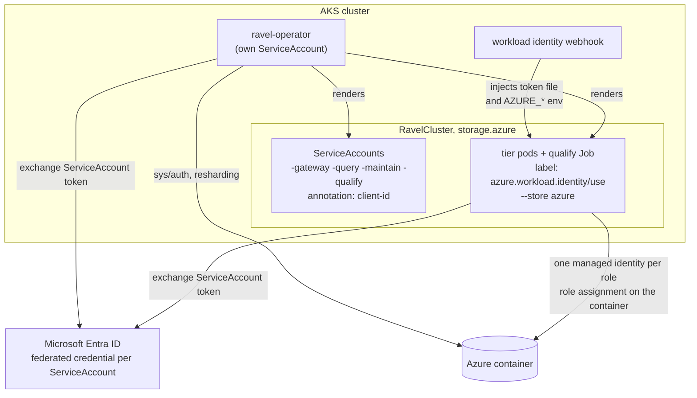
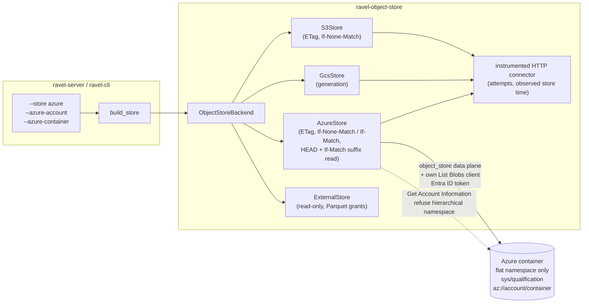
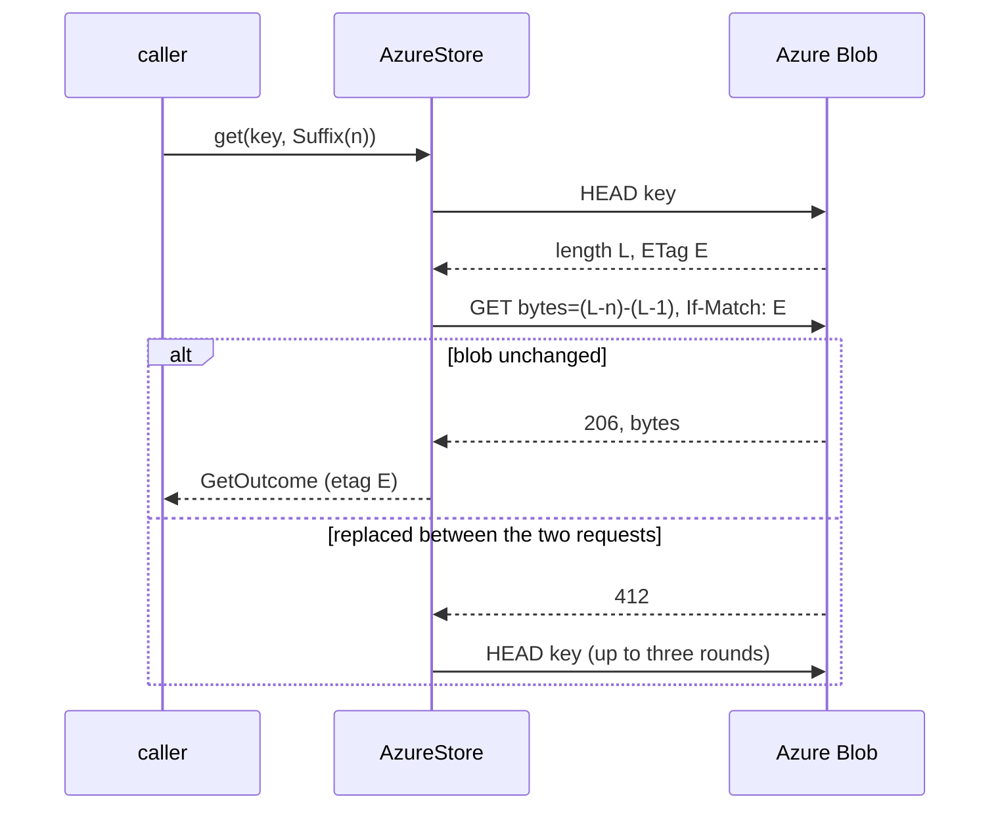

# ADR-4158: Native Azure Blob Storage object store backend

- Status: Accepted (2026-11-12)
- Date: 2026-11-12
- Refs: #4158, ADR-0002, ADR-0008, ADR-0034, ADR-0050, ADR-0055, ADR-0072,
  ADR-1685, ADR-2040, ADR-2637, ADR-3456

## Context

Object storage is Ravel's only durable store. The commit protocol (ADR-0002)
and every CAS-mutable record (catalog `HEAD`, tenant config, agent HEADs)
rest on two primitives: create-if-absent and compare-and-swap on a version
token. ADR-0008 put `object_store` behind Ravel's own `ObjectStoreBackend`
trait so that a backend with different preconditions could be added without
touching commit code, and named "Azure etags" as one of them. ADR-3456 used
that seam for GCS.

Today `--store` accepts `memory`, `s3` and `gcs`. Azure Blob Storage has no
S3-compatible endpoint, so there is no existing path to point at it. An
Azure client already ships: `ExternalStore`'s Azure arm reads granted
Parquet files (ADR-2040) through `object_store` 0.14's `azure` feature. It
is read-only by design, authenticates with an account key or a SAS token,
lists through `object_store`'s `Path`-based listing, and reports
`suffix_range: false`.

Azure differs from S3 and GCS in ways that reach the trait. The table is
from the Azure REST reference (List Blobs, Put Blob, "Specifying the range
header"), read on 2026-11-12. Each row was written as a prediction before
any request was sent; D9 says how it is checked, and "Measured" at the end
of this ADR gives the answers.

| # | Request against a real account | Predicted answer |
|---|---|---|
| P1 | Put Blob `If-None-Match: *` on a new key, then again | 201, then 409 `BlobAlreadyExists` |
| P2 | 8 concurrent Put Blob `If-None-Match: *` on one new key | one 201, seven 409 |
| P3 | Put Blob `If-Match: <wrong etag>`, then the current ETag | 412 `ConditionNotMet`, then 201 |
| P4 | Put Blob `If-Match: <any etag>` on an absent key | 412 or 404, never 201 |
| P5 | Two unconditional Put Blobs of identical bytes | two different ETags |
| P6 | Delete, then recreate with identical bytes | an ETag different from every earlier one |
| P7 | Get Blob `Range: bytes=-16` | not the last 16 bytes: the whole blob or an error |
| P8 | Get Blob `Range: bytes=a-b` with `If-Match: <wrong etag>` | 412 |
| P9 | List Blobs with `startFrom=<key>`, version 2023-05-03 or later | listing starts at `<key>`, inclusive |
| P10 | List Blobs over keys differing in case, digits and `/` | byte order on a flat-namespace account |
| P11 | List Blobs: the `Etag` element against the HEAD `ETag` header | same value, HEAD quoted, listing unquoted |
| P12 | List Blobs over a name holding U+0001, and one holding U+FFFE | U+FFFE percent-encoded with `Encoded="true"`; U+0001 to be found out |
| P13 | Put Block twice, Put Block List; HEAD before and after | 404 before the list is committed; one ETag after |
| P14 | Any failed request | `x-ms-error-code` response header present, HEAD included |
| P15 | Get Account Information with an Entra ID token | `x-ms-is-hns-enabled` header present |
| P16 | Any response | a `Date` header |

P5 and P6 matter because the ETag becomes the version token: an S3 ETag is
a content digest, so two writes of the same bytes share one, while Azure
documents its ETag as a change stamp. P7 matters because `suffix_range` is
a mandatory capability (`Capabilities::mandatory()`), and every segment
footer read uses it.

## Decision

### D1. An `AzureStore` backend in ravel-object-store

`crates/ravel-object-store/src/azure.rs` adds `AzureStore`, a full
read-write `ObjectStoreBackend` over `object_store::azure::MicrosoftAzure`.
It is a separate type from `ExternalStore`, which stays read-only. It writes
block blobs only.

- **Version token.** The token is the blob's ETag, on every path: `put`
  results, `head`, `get`, `list` entries and `pin_of`. `Etag` and `Version`
  carry the same string, as they do on S3.
- **Put modes.**
  - `CreateIfAbsent` sends `If-None-Match: *`. A 409 whose
    `x-ms-error-code` is `BlobAlreadyExists` maps to `AlreadyExists`. If the
    library hides the code behind its own `AlreadyExists`, the store
    confirms with one HEAD, as `S3Store` does for a raw 409. Any other 409
    is not `AlreadyExists`.
  - `CasVersion(v)` sends `If-Match: v`. A 412 maps to
    `PreconditionFailed`, and so does a 404 (P4: the key is gone, so the
    token no longer names it).
  - `Overwrite` sends no precondition.

  A test asserts each header on the wire against the in-process fake (D8),
  so an `object_store` upgrade that changes what is sent fails CI.
- **Reads.** `Full` is one GET. `Range` is one ranged GET. `Suffix` is D2.
  A pinned read sends the pin's ETag as `If-Match` on the request, and the
  pin's version as the `versionid` selector when the pin carries one, the
  same contract `ExternalStore`'s Azure arm already documents. `pin_of`
  reports `x-ms-version-id` when the account has blob versioning on, and an
  ETag-only pin otherwise. A 412 on a pinned read is settled by one HEAD
  without `If-Match` before it is reported (see the 2026-11-13 correction).
- **Listing.** `AzureStore` does not list through `object_store`, for the
  reason ADR-2637 gives: `Path::parse` fails a whole page on a key it
  rejects, and resuming from a re-encoded key re-delivers or skips keys. It
  carries its own List Blobs client, beside `s3/list.rs`:
  - It sends `prefix`, `maxresults`, `delimiter=/` for a delimited listing,
    and `marker` to continue within one call. It sends an `x-ms-version` of
    2023-05-03 or later, which `startFrom` and the `Encoded` attribute both
    need.
  - A `Name` or `BlobPrefix` element with `Encoded="true"` is
    percent-decoded as a whole string: Azure encodes every character of
    such a name, `/` included (Measured). Raw names go to `classify_objects` and
    `classify_prefixes`, so an unaddressable key is reported in
    `ListPage::unaddressable` and never fails the page.
  - `list_after` sends `startFrom=<start_after>`. `startFrom` is inclusive
    and `list_after` is exclusive, so the client drops every returned key
    that is not greater than `start_after`. That filter runs whether or not
    the service honoured `startFrom`, so correctness never depends on it;
    only the request count does.
  - The `PageToken` handed back is the raw last key, and the next call
    resumes from it with the same `startFrom` and filter. The service's
    `NextMarker` is used only inside one call. This is the shape
    `s3/list.rs` has with `start-after`.
  - The listed `Etag` is reported exactly as HEAD reports it. If P11 holds,
    that means adding the quotes the listing leaves off; the contract's
    "byte for byte" rule is tested against the fake and the real account.
  - The page size is a constructor argument sent as `maxresults`, and it is
    what `store qualify --list-page-size` passes. A delimited listing sends
    a fixed 1000, as the S3 and GCS listers do.
  - It authenticates with the credential the data-plane client resolved
    (D3) and runs through the shared connector (D4).
- **Multipart.** `multipart: true`, because `--mode maintain` requires it
  (ADR-3456, multipart amendment). `put_multipart` maps to Put Block per
  part and one Put Block List at `complete`, through `object_store`'s
  client. Ravel's own limits (5 MiB minimum part, 10 000 parts) are
  enforced locally as on every backend; Azure's are looser. Nothing is
  visible before `complete` (P13). `abort` sends nothing: Azure has no
  abort call and discards uncommitted blocks itself after seven days.
  `complete` is unconditional, as on S3.
- **Delete.** Delete Blob; a 404 `BlobNotFound` is success.
- **Upload checksum.** `upload_checksum: false` in this ADR. Full reads are
  counted on `ravel_store_get_unverified_total`, as they are on GCS.

### D2. Suffix reads without a suffix range

Azure accepts `bytes=a-b` and `bytes=a-` only (P7). It does not refuse
`bytes=-n`: it answers 200 with the whole blob (Measured). So `AzureStore`
never puts a suffix range on the wire, a test asserts that against the
fake, and the fake answers one as Azure does, so a regression reads wrong
bytes in a test instead of in production. `AzureStore` still reports
`suffix_range: true`, and serves `GetRange::Suffix(n)` in two requests:

1. HEAD the blob for its length `L` and ETag `E`.
2. GET `bytes=max(L-n, 0)-(L-1)` with `If-Match: E`.

A 412 on step 2 means the blob was replaced between the two requests. The
store starts again from step 1, at most three times, and then returns
`Transient`. The bytes returned are therefore always the suffix of one
version of the blob, which is what the capability promises. A zero-length
blob returns `InvalidRange`, as a suffix of it does on S3.

A pinned suffix read (`get_pinned` with `Suffix`) does not take `E` from
its own HEAD. `E` is the pin's ETag, sent as `If-Match` on the HEAD and on
the GET, with the pin's `versionid` on both when it has one. A 412 on
either request is `PreconditionFailed`, returned at once (the 2026-11-13
correction settles that 412 with one HEAD first): the key no longer
holds the pinned object, and retrying against whatever replaced it would serve bytes the
caller did not pin.

A suffix read on Azure costs two billed requests where S3 and GCS cost one.
The connector counts both attempts, and `StoreMetrics` counts one `get`
call, so the per-phase accounting shows the difference instead of hiding
it. Passing a known length down from callers that already hold it (a
manifest entry, a listing) would remove the HEAD; that changes callers, not
the backend, and is a follow-up (D10).

### D3. Credentials: Microsoft Entra ID through the standard environment

There are no Ravel flags carrying credentials, so no secret passes through
Ravel's configuration. `AzureStore` builds its client from the account and
container Ravel is given and lets `object_store` resolve the credential
from the standard `AZURE_*` environment:

- AKS workload identity (`AZURE_FEDERATED_TOKEN_FILE`, `AZURE_CLIENT_ID`,
  `AZURE_TENANT_ID`, which the AKS webhook injects),
- a managed identity through the instance metadata service,
- `AZURE_STORAGE_ACCOUNT_KEY`, where an operator chooses a shared key. The
  emulator lane (D8) uses this.

SAS tokens and the Azure CLI credential are not accepted for Ravel's own
store: a SAS expires under a running server, and the CLI credential is a
developer login. The builder is given only the environment keys above, not
the whole `AZURE_*` namespace, so a stray variable cannot redirect the
store.

A hidden `--azure-endpoint` sets the base URL, for the fake and the
emulator. It follows the rule `--gcs-endpoint` follows: an `https://` URL
to any host, or plain `http://` to a loopback host only, and anything else
is refused at startup. When it is set, the backend identity records it
(D6). Skipping
request authentication is constructible only under the crate's
`test-support` feature.

### D4. The same instrumentation as S3 and GCS

`AzureStore` installs the shared attempt connector through
`MicrosoftAzureBuilder::with_http_connector`, so
`ravel_store_attempts_total` and `observed_store_time_ns` work and the
ingest clock-lag check (ADR-1685) stays on (P16). Requests to the token
endpoint and the metadata service pass through the same connector and are
excluded by host, as on GCS: a token refresh is neither a store attempt nor
a clock reading. Per-operation call and byte counters come from the shared
instrumentation wrapper.

### D5. Error classification by status and `x-ms-error-code`

- 404 `BlobNotFound` is `NotFound`, except on a `CasVersion` put, where D1
  maps it to `PreconditionFailed`; 404 `ContainerNotFound` is `Permanent`.
  Azure sends the code as a response header, so a HEAD can tell the two
  apart (P14), which S3 and GCS cannot.
- 409 and 412 are the precondition outcomes named in D1.
- 429, 503 and a 500 `OperationTimedOut` are throttling or transient
  (retryable).
- 401 and 403 are `AccessDenied`.
- 416 is `InvalidRange`.
- Any other 409 (a lease, an immutability policy, a blob with snapshots) is
  `Permanent` (a lease's 412 too, per the 2026-11-13 correction): it is
  container state Ravel did not create.

### D6. Selection, identity and qualification

- `--store azure` with `--azure-account` (env `RAVEL_AZURE_ACCOUNT`) and
  `--azure-container` (env `RAVEL_AZURE_CONTAINER`) on ravel-server and on
  every ravel-cli command that takes `--store`.
- The backend identity is `az://<account>/<container>`, or
  `az://<account>/<container>@<endpoint>` when `--azure-endpoint` is set. It
  is written into `sys/qualification` by `store qualify` and compared at
  server startup exactly as `s3://` and `gs://` are.
- The conformance suite runs unchanged: it takes `&dyn ObjectStoreBackend`.
  The server refuses to start on an unqualified container.
- **Hierarchical-namespace accounts are refused.** On such an account `/`
  sorts lowest in a recursive listing, directories are objects, and a key
  cannot be written beneath an existing key (with `a` present, `a/b` is
  refused; Measured). The key layout does not promise that never happens.
  `AzureStore` reads
  `x-ms-is-hns-enabled` from Get Account Information once at construction
  (P15) and refuses a `true` with an error naming the setting. An answer it
  cannot read is a refusal too, never a pass. The 2026-11-13 correction
  adds the account URL as a second source when the container URL's answer
  lacks the header.

### D7. Explicit refusals

A flag counts as given when it was passed or set through its environment
variable (`ArgMatches::value_source`), as in ADR-3456 D6.

- Under `--store azure`: every `--s3-*` and `--gcs-*` flag, `--s3-kms-key`,
  `--tenant-kms-config` and `--require-bucket-protection`. Customer-managed
  keys on Azure are an account or encryption-scope setting made outside
  Ravel. `ravel-cli store verify-protection` exits non-zero saying Azure
  container protection is not checked.
- Under `--store s3`, `gcs` or `memory`: every `--azure-*` flag.
- `ravel-cli agents dev` refuses `--store azure`, as it refuses `gcs`.
- The Parquet own-bucket refusal (ADR-2040 D4) is extended:
  `RavelBucket` gains an Azure variant built from the configured account
  and container, and an Azure Parquet profile that resolves to them is
  refused at config time. Today an Azure profile always answers "not
  Ravel's bucket". This ships in the same release as `--store azure`.

### D8. Test surfaces

- **An in-process fake**, `azure::fake::FakeAzure`, behind `test-support`,
  as `gcs::fake::FakeGcs` is. It serves Put Blob with both preconditions,
  Get Blob with ranges and `If-Match` (and answers a suffix range as Azure
  does, with 200 and the whole blob; D2), HEAD,
  Delete, List Blobs with `startFrom`, `marker`, `delimiter` and encoded
  names, Put Block and Put Block List, and Get Account Information. The
  contract suite, the wire-header assertions and the server and CLI
  end-to-end tests run against it in every gate.
- **Azurite in CI.** The `object-store-contract` job starts the Azurite
  emulator beside RustFS and floci and runs `azurite_contract` with
  `RAVEL_AZURITE_URL` set, failing if the test skipped. This catches the
  fake and the service disagreeing, in every run that touches the crate.
  GCS has no such emulator lane; Azure has a first-party one.
- **A real account, opt-in.** `azure_contract` runs when
  `RAVEL_AZURE_TEST_ACCOUNT` and `RAVEL_AZURE_TEST_CONTAINER` are set, with
  the pinned-read ordering cases and a suffix read raced against an
  overwrite.

### D9. Measure before building

The Context table is a set of predictions from documentation. Before the
backend task is dispatched, each row is run with curl and an Entra ID token
against a fresh flat-namespace storage account, and the answers are posted
on #4158 beside the predictions. A row that comes back different is
recorded as a dated section at the end of this ADR before any code depends
on it. Four rows can change the design and are named here so the change
is not improvised:

- P5 or P6 false (an ETag can repeat for a key): the ETag cannot be the
  token. The fallback is `x-ms-version-id`, which requires blob versioning
  on the account, and D1 is rewritten around it.
- P9 false (`startFrom` not honoured): `list_after` stays correct through
  the client-side filter and costs a full prefix listing. That is a
  performance defect on resolve, filed as its own issue, and `--store
  azure` is not called supported for metrics until it is settled.
- P10 false (order is not byte order): the backend cannot pass
  `LexicographicListingOrder` and the epic stops.
- P15 false (the header is absent with an Entra ID token): D6 would refuse
  every account, so the epic stops until another way to read the setting
  is found. D6's refusal of an unreadable answer is not relaxed to make
  the backend start.

The first real qualification, from an image built on main, is recorded on
#4158 before `--store azure` is called supported.

### D10. Out of scope, filed as follow-ups

- **The operator on GCS** (#3483). D11 makes room for it and does not add
  it.
- **An operator-rendered cluster in the kind lane on Azure.** It needs an
  emulator endpoint and a shared key in the CRD, which D11 leaves out.
- **Upload integrity** (`x-ms-content-crc64` or `Content-MD5`).
- **Container-protection probes**: versioning, soft delete, immutability
  policies.
- **A known-length suffix read**, removing D2's HEAD.
- **Sovereign clouds.** `--azure-endpoint` stays hidden until an endpoint
  other than `blob.core.windows.net` has been qualified.
- **An Azure reference cost profile.** `--store-cost-profile` already takes
  a file; the built-in profile stays S3's.
- **ravel-bench's own store selection.**

### D11. The operator runs a `RavelCluster` on Azure with AKS workload identity

The goal of this epic is Ravel on AKS, and on Kubernetes Ravel is deployed
by the operator. Its CRD requires `storage.s3`, and `common_store_args`
renders `--store s3 --require-bucket-protection` for every tier, so
without this decision `--store azure` would be reachable only by hand.

- **CRD.** `spec.storage` holds exactly one backend. `storage.s3` becomes
  optional, `storage.azure` is added, and a CEL rule on `storage` requires
  exactly one of them. `v1alpha1` makes no compatibility promise
  (ADR-0034), but the rule the Pod Identity change established is kept: a
  cluster that sets `storage.s3` renders byte for byte as before, and its qualify
  hash does not move, so no existing cluster re-qualifies on upgrade. The
  two pinned hash literals are the test. The existing CEL rule that reads
  `self.storage.s3.auth` gains a `has(self.storage.s3)` guard.
- **`storage.azure` fields.** `account` and `container` (both required),
  and `clientId` (required): the client ID of the user-assigned managed
  identity the pods run as. `roleClientIds` (optional) overrides it per
  role with `gateway`, `query`, `maintain` and `qualify`, which is how
  ADR-0055's per-role scoping is expressed on Azure: one managed identity
  per role, each with its own role assignment on the container. There is
  no endpoint field and no secret reference.
- **Identity wiring.** The operator owns the four ServiceAccounts it
  already owns under Pod Identity (`<name>-gateway`, `-query`, `-maintain`,
  `-qualify`). Under `storage.azure` each carries the annotation
  `azure.workload.identity/client-id` with its role's client ID, and each
  tier's pod template and the qualify Job carry the label
  `azure.workload.identity/use: "true"` and the tier's
  `serviceAccountName`. The AKS workload identity webhook then injects the
  token file and the `AZURE_*` variables D3 reads. There is no sidecar and
  no credentials file: `object_store` reads the federated token itself.
  In the operator's code all of this sits behind `pod_identity(spec)`
  today, which reads `storage.s3.auth` and is false on an Azure cluster.
  So the gate is split in two. Rendering the four ServiceAccounts, setting
  each pod's `serviceAccountName`, and recording and sweeping the
  `podIdentityServiceAccounts` status marker are gated on "S3 Pod Identity
  or `storage.azure`". The credentials sidecar, the `aws-credentials`
  volume and mount, and `--s3-credentials-file` stay gated on S3 Pod
  Identity alone. A cluster edited from S3 Pod Identity to Azure keeps its
  four accounts, because the sweep sees them as still desired. A test
  pins each half: an Azure cluster renders the accounts and no sidecar,
  and the sweep returns nothing for it.
  The federated credential on each managed identity (one per
  ServiceAccount subject) is created outside Ravel, and the guide lists
  the five subjects.
- **Rendered arguments.** `--store azure --azure-account --azure-container`
  on every tier, and `ravel-cli --store azure store qualify` with
  `RAVEL_AZURE_ACCOUNT` and `RAVEL_AZURE_CONTAINER` on the qualify Job. No
  `--s3-*` flag and no `RAVEL_S3_*` variable is rendered, since D7 refuses
  them.
- **`--require-bucket-protection` is not rendered on Azure**, because D7
  refuses it: there are no Azure probes to run. ADR-0072 has the operator
  set it for production, so its absence must not be silent. An Azure
  cluster carries the status condition `BucketProtectionVerified=False`
  with reason `NotImplementedForAzure`, and the guide says what to
  configure by hand (versioning, soft delete, an immutability policy).
  When the probes exist (D10) the flag is rendered and the condition goes.
- **The qualify hash** for an Azure cluster covers the account, the
  container, the image and the `qualify` client ID. A change to any of
  them re-qualifies.
- **The operator's own store client.** `build_auth_store` returns `Arc<dyn
  ObjectStoreBackend>` and builds an `AzureStore` for an Azure cluster,
  authenticated as the operator's own ServiceAccount through the same
  workload identity mechanism. Its consumers (`sys/auth` convergence,
  resharding) already take `&dyn ObjectStoreBackend`. The operator's
  Deployment and ServiceAccount manifests gain the label and a client-ID
  annotation placeholder, documented as needed only for Azure clusters.
- **Proof.** Render and reconcile tests against the fake apiserver pin the
  arguments, labels, annotations, the one-of rule and the unchanged S3
  hashes. No test in CI starts an operator-rendered cluster on Azure: the
  kind lane has no workload identity. The proof that it works is a
  `RavelCluster` on the AKS staging cluster reaching `StoreQualified=True`
  and `Available=True` and answering an ingest and query round trip,
  recorded on #4158 before the epic closes.

## Rejected alternatives

1. **Make `ExternalStore`'s Azure arm writable.** `ExternalStore` exists to
   be unable to write; ADR-2040's isolation argument for granted buckets
   rests on that. It also lists through `Path`, which ADR-2637 removed from
   every store Ravel owns.
2. **Report `suffix_range: false` and relax the mandatory set.** Every
   footer read uses a suffix range. Relaxing the capability moves the
   HEAD-then-range dance into each caller, where each would have to get the
   race against an overwrite right separately. One implementation in the
   backend, tested against that race, is smaller and is where the trait
   says the difference belongs.
3. **Serve a suffix read by fetching the whole blob.** Correct in one
   request, and it turns a 64 KiB footer read into the whole segment's
   bytes on every query.
4. **Blob leases for compare-and-swap.** The contract doc mentions "etags +
   leases". A lease is a timed lock with a holder: a crashed holder blocks
   writers until it expires, and a lease left on a key makes every later
   write fail. `If-Match` gives the same exclusion with no state to leak.
5. **`x-ms-version-id` as the version token.** It is unique per write, but
   it exists only when blob versioning is enabled on the account, so the
   backend would refuse every account without it. It stays the fallback if
   D9 finds ETags repeat.
6. **Support hierarchical-namespace (ADLS Gen2) accounts.** The listing
   order and directory semantics differ, and a second listing
   implementation would be needed to restore byte order. Refusing is one
   check.
7. **Account key or SAS token in Ravel flags, as `ExternalStore` profiles
   take them.** That puts a long-lived secret in the server's
   configuration. S3's static mode does this for historical reasons; GCS
   does not, and Azure follows GCS.
8. **An S3-compatible gateway in front of Azure.** A stateful process in
   the commit path whose own precondition handling would need qualifying,
   against the rule that every compute process is disposable.
9. **Leave the operator for a follow-up, as ADR-3456 did for GCS.** GCS
    was driven by a benchmark that starts the binaries itself. This epic's
    goal is AKS, where the operator is the deployment path, so a backend
    the operator cannot select would not deliver it.
10. **A `storage.kind` discriminator with one flat set of fields.** The S3
    fields would have to become conditional on the kind, and every
    existing manifest would need the new field. A one-of over typed
    variants leaves `storage.s3` manifests valid unchanged.
11. **An account key Secret on `storage.azure`, mirroring S3's `static`
    mode.** It would let the kind lane run on Azurite, at the cost of a
    long-lived secret mode this ADR declines everywhere else (D3).
12. **Render `--require-bucket-protection` on Azure and let the server
    refuse to start.** That makes every Azure cluster unstartable until
    the probes exist. Dropping it silently is worse; a status condition
    states what was not verified.
13. **Only a fake, or only Azurite.** Only a fake leaves nothing in CI that
   Microsoft wrote. Only Azurite puts docker in front of every server and
   CLI end-to-end test, so they would skip in local gates.

## Consequences

- Ravel runs on AKS with workload identity and a storage container, with no
  long-lived credential in its configuration.
- Commit-protocol, catalog, agents and maintenance code is unchanged. All
  of it reaches the store through the trait.
- Persistent formats, the key layout and the qualification record schema
  are unchanged. `backend_identity` is a free-form string, and `az://` is a
  new value of it. `CONFORMANCE_SUITE_VERSION` is not bumped.
- A suffix read costs two requests on Azure. Footer-heavy query paths issue
  up to twice the GET-class requests they issue on S3 for the same plan,
  and the per-phase counters report it.
- A container on a hierarchical-namespace account cannot be used. The
  setting is fixed when the account is created, so the operator needs a
  different account, and the error says so.
- `docs/object-store-contract.md` stops describing S3 as the only durable
  backend, replaces "Azure: etags + leases" with what `AzureStore` does,
  and gains an Azure row in each per-backend table. Those edits land with
  the backend, in the same commit as the behaviour.
- A `RavelCluster` can name Azure storage. A cluster on Azure starts
  without verified container protection and says so in its status.
- `storage.s3` is no longer required by the schema; the one-of rule
  replaces it. Existing manifests stay valid and render unchanged.
- The Azurite lane adds a third emulator container to the
  `object-store-contract` job.

## Measured (2026-11-12)

D9's run, with curl and an Entra ID token at `x-ms-version: 2024-11-04`,
against two fresh Standard_LRS StorageV2 accounts in swedencentral, one
flat-namespace and one with hierarchical namespace on. The full table of
answers is on #4158 (issue comment 6833555806). On the flat-namespace
account all sixteen predictions hold, so no decision changes:

- P1 to P4: create answers 201 then 409 `BlobAlreadyExists`; eight
  concurrent creates give one 201 and seven 409; a wrong or stale
  `If-Match` answers 412 `ConditionNotMet`, on a present key and on an
  absent one.
- P5, P6: two writes of the same bytes get different ETags, and five
  delete-and-recreate rounds of the same bytes gave five new ETags.
- P7: `Range: bytes=-16` and `x-ms-range: bytes=-16` both answer 200 with
  the whole blob and no `Content-Range`.
- P8: a ranged GET with a wrong `If-Match` answers 412.
- P9: `startFrom` starts at the named key, or at the next key when the
  named one is absent, and combines with `marker`.
- P10: seventeen names differing in case, digits, punctuation and `/`
  came back in byte order.
- P11: the listing's `Etag` is the HEAD `ETag` without its quotes.
- P12: a name holding U+FFFE is listed with `Encoded="true"` and the whole
  name percent-encoded, slashes too: the key `<run>/enc/a<U+FFFE>b` came
  back as `<run>%2Fenc%2Fa%EF%BF%BEb`. A name holding U+0001 cannot be created: Put Blob
  answers 400 `InvalidUri`.
- P13: a blob with uncommitted blocks answers 404 to HEAD and is not
  listed; Put Block List makes it visible with one ETag.
- P14: `x-ms-error-code` is present on a failed HEAD, and tells
  `BlobNotFound` from `ContainerNotFound`.
- P15: `x-ms-is-hns-enabled` is `false` on the flat account and `true` on
  the other, from the account URL and from the container URL.
- P16: every response carried `Date`.

On the hierarchical-namespace account, two of the seventeen P10 keys could
not be written, `a/0` and `a/b`, because `a` already existed as a blob.

## Correction (2026-11-13): what Azurite and review showed

<!-- amendment-applies: sections="D1. An `AzureStore` backend in ravel-object-store|D2. Suffix reads without a suffix range|D5. Error classification by status and `x-ms-error-code`|D6. Selection, identity and qualification" pointer="2026-11-13 correction" -->
<!-- amendment-supersedes: phrase="Any other 409 (a lease" pointer="2026-11-13 correction" -->
<!-- amendment-supersedes: phrase="`PreconditionFailed`, returned at once" pointer="2026-11-13 correction" -->

Running the implementation against Azurite 3.35.0 on 2026-11-13, and the
review of #4161, showed three places where the decisions above did not
hold as written.

- **Azurite measurements (2026-11-13).** Get Account Information on the
  container URL answers without `x-ms-is-hns-enabled`; on the account URL
  it answers `false`. A GET or HEAD with `If-Match` on an absent key
  answers 412 `ConditionNotMet`, where Azure answers 404 `BlobNotFound`.
  `startFrom` is ignored, which D1's listing filter already tolerates. A
  suffix range (`bytes=-n`) answers 500, which D2 never sends. Azure itself
  sends the HNS header on both URLs (P15).
- **D6, hierarchical namespace.** Construction reads `x-ms-is-hns-enabled`
  from the container URL first and, when that answer carries no header,
  from the account URL. Only `false` is accepted: `true` from either, a
  header absent from both, an unreadable value and a failed request are
  refusals.
- **D1 Reads and D2, a pinned 412.** On Azurite a 412 on a pinned read
  cannot tell a deleted key from a replaced one. Any pinned read (`Full`,
  `Range` or `Suffix`, on its HEAD or its GET) that meets a 412 sends one
  HEAD that keeps the pin's `versionid` and drops the `If-Match`. A 404
  there is `NotFound`; any other answer is `PreconditionFailed`. Nothing is
  retried: the HEAD only names the outcome. Against Azure, which answers
  404 on an absent key, the extra HEAD is sent only when the blob was
  replaced, so it costs one request on a path that already fails. An
  unpinned suffix read keeps D2's three rounds.
- **D5, leases.** A leased blob refuses a write or a delete with a 412 or
  a 409 whose `x-ms-error-code` starts with `Lease`. That is `Permanent` in
  every put mode and on delete, never `AlreadyExists` or
  `PreconditionFailed`: Ravel takes no leases, so no retry clears one. This
  replaces D5's wording that only a 409 for a lease is `Permanent`, and
  narrows "409 and 412 are the precondition outcomes named in D1" to codes
  that are not lease codes.
