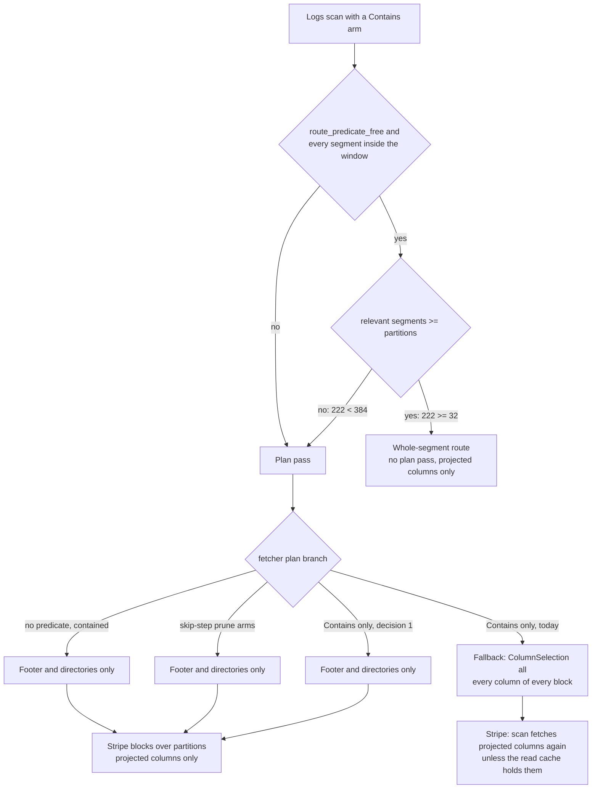
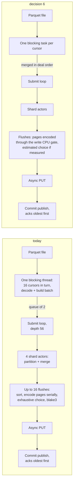

# ADR-4203: ClickBench parity with ClickHouse: plan-phase bytes and loopback store fan-out that do not grow with cores, and a profiled bulk load

- Status: Accepted (2026-11-14)
- Date: 2026-11-14
- Refs: #4203, #3714, #3217, #3231, #3081, #3072, ADR-0102, ADR-0107,
  ADR-0109, ADR-2614, ADR-3217

## Context

On the ClickBench entry (v0.32.0, 222 objects, 8.33 GB, loopback s3s-fs on
a gp2 volume) Ravel's cold total is 103.5 s on c6a.4xlarge and 219.9 s on
c6a.metal. ClickHouse goes from 95.1 s to 73.9 s on the same pair. Four LIKE
statements (Q21-Q24) account for 107.4 s of Ravel's 116.4 s regression.
Measured as ClickBench scores it (geometric mean over 43 statements of
`(ravel + 0.01) / (clickhouse + 0.01)`), the cold ratio is 1.35 on
c6a.4xlarge, 2.25 on c6a.metal, 2.09 on c7a.metal-48xl, 1.15 on c8g.4xlarge
and 2.03 on c8g.metal-48xl (c6a.2xlarge: see the Stage 0 amendment below).
Bulk load takes 397 to 666 s against
ClickHouse's 106 to 183 s and does not get faster with cores.

Three facts in the code produce the large-machine regression.

1. `resolve_performance_defaults`
   (`services/ravel-server/src/config.rs:6058-6079`) derives SQL partitions,
   store GET permits and the PromQL fan-out from one value,
   `max(8, 2 * cores)`: 32 on 16 vCPU and 384 on 192 vCPU.
2. `LogsScanExec::whole_segment_fast_path`
   (`crates/ravel-sql/src/logs_scan/mod.rs:2945-2972`) rejects a scan with
   fewer relevant segments than partitions (`mod.rs:2968-2970`). 222
   objects pass at 32 partitions and fail at 384, so on a large machine
   every logs scan takes plan-then-stripe.
3. The SQL route check and the fetcher's plan disagree about `Contains`.
   `route_predicate_free` (`mod.rs:1431`) treats a Contains-only content
   list as neutral. `LogSegmentFetcher::plan_segment_primed`
   (`crates/ravel-query/src/log_fetcher.rs:2277`) does not: its two
   directory-only branches require no content arm, so a Contains statement
   falls to the fallback (`log_fetcher.rs:2439`), which fetches with
   `ColumnSelection::all()`. No index covers Contains, so the plan pass
   moves every column of every object, 384 reads at a time, to learn a
   survivor count that no Contains arm can reduce. On objects above the
   whole-object bound that read is ranged and is not carried to the scan
   (`log_fetcher.rs:2484-2497`).

What is not yet known is which consequence costs the 31 to 35 s: the bytes
at the volume's throughput cap, or a connection stall from a 384-wide burst
against a store whose pool is empty on every cold statement. Issue #3714
measured 169 listen overflows and 1,743 body-read retries at 384 on
c6a.metal, and c8g.metal finishes sooner than the read alone could. The
decision below does not depend on the answer, because it removes both the
bytes and the uncapped burst; Stage 0 measures which one carried the time
so the figures in Consequences can be checked. (Settled: the bytes; see the
Stage 0 amendment below.)

On c6a.4xlarge the cold ratio is carried by two statements: Q2 at 41x and
Q1 at 7.7x (0.485 s and 0.082 s against 0.002 s). Without them the ratio is
1.18; with Q8, Q28, Q30 and Q18 also at parity it is 1.04 (both figures
reworded in the Stage 0 amendment below).

On load: 581 s on c6a.4xlarge against 165 s for ClickHouse, and 562 s on
c6a.metal. The loader decodes every read cursor on one blocking thread
(`services/ravel-cli/src/load/logs.rs:1509`), encodes each flush inline
with pages sealed serially because no write CPU gate is attached
(`logs.rs:493-503`, `crates/ravel-ingest/src/write_gate.rs:184`), and
selects `PageChoice::Exhaustive` (`logs.rs:2143`). The last load profile is
ADR-0109's, taken in August on the row path. ADR-2614 removed dictionaries
from the batch on purpose, and ADR-3217 showed that changing object
geometry costs load time. So the load has a history of changes that looked
right and measured flat.

## Target

Parity means, on each of the six published machines:

- cold geometric-mean ratio against ClickHouse at or under 1.10, and
- cold total at or under ClickHouse's, and
- load time at or under ClickHouse's (106 to 183 s by machine).

Milestones, each checked by a pre-registered run on the epic:

| Milestone | Bar | Basis |
|---|---|---|
| M-A | c6a.metal cold total at or under 115 s | predicted from per-query.tsv on #4203 (Q21-Q24, Q25, Q27 at their c6a.4xlarge times) |
| M-B | c6a.4xlarge cold ratio at or under 1.18 | predicted from per-query.tsv on #4203 (Q1 and Q2 at parity) |
| M-C | c6a.4xlarge cold ratio at or under 1.10 | predicted from per-query.tsv on #4203 |
| L-A | c6a.4xlarge load at or under 250 s | predicted; replaced by the Stage 0 load profile |
| L-B | c6a.4xlarge load at or under 165 s | measured 2026-11-14 (ClickHouse's published load, results 20261114) |

What this architecture cannot reach, stated so the target is not read as a
per-statement promise:

- **Q1 and Q2 within 10% each.** ClickHouse answers Q1 in 0.002 s, so the
  per-statement bar is 0.0032 s with the 0.01 shift. A restarted Ravel
  server resolves the tenant's catalog from object storage before it can
  answer: about 27 ms hot today (five LISTs and the cached catalog records,
  #3231) and 0.082 s cold. At 27 ms the shifted ratio is 3.1x. Q2 has the
  same floor plus one read. Two statements at 3.1x add a factor of 1.054 to
  the geomean, so the other 41 must average 1.04 or better for 1.10. Parity
  here is a geomean and total target, not every statement. (Stage 0 found
  the catalog already warm before the timed query; see the Stage 0
  amendment below for what that changes in this bullet.)
- **c6a.metal cold total at or under 73.9 s and load at or under 165 s.**
  Not shown reachable by anything measured so far. Both are marked unknown
  until the metal confirmation run and the Stage 0 load profile, rather
  than predicted.

## Decision

1. **A Contains-only content list is plan-neutral in the fetcher, as it is
   in the SQL route check.** The new branch of `plan_segment_primed` applies
   only when all of these hold: the content list holds Contains arms and
   nothing else, there is no stream-attribute arm, the prune list is empty
   or decidable from the skip step, and the object is above
   `plan_whole_object_bound()` (at or under the bound the scan already reads
   the whole object once). Then it plans from the footer and directories:
   the survivor list is the skip-index candidates for the time window and
   any skip-step prune arms, and no BLOCKS byte is read in the plan phase.
   The carried footer and directories go to the subset opens as they do for
   the other directory-only branches. The scan evaluates Contains per row,
   as it does on the fast path today. Any other content list keeps the
   fallback.

   The task must prove the survivor list equals the reader's own for a
   Contains query, including on a tenant with bloom scope `text`. If the
   reader can drop a block for a Contains arm, the plan uses the reader's
   prune over the directories instead of the skip step alone.

2. **The rejection for fewer segments than partitions stays unless Stage 0
   says otherwise.** For objects with several row groups, striping is what
   lets a large machine use its cores on few objects, and the route is
   correct once decision 1 makes its plan pass cheap. The entry's objects
   have one row group each, so on that tenant striping has no finer unit
   than the object and the rejected route only adds the plan barrier. If
   the Stage 0 boundary pair shows Q25, Q27 and the hot small statements
   stepping at the object count, a scan whose relevant objects all have one
   row group takes whole-object assignment over
   `min(partitions, objects)` partitions, as an amendment to this ADR with
   its own task.

3. **The derived store GET concurrency is capped at 64 when the store is a
   loopback endpoint.** `flags.store_is_loopback` already exists
   (`config.rs:5649`); its doc comment, which says only the fetcher cache
   reads it, is updated with the change. The cap applies only to the
   derived value; an explicit `--store-get-concurrency` or
   `--fetch-concurrency` is used as given. SQL partitions keep their own
   derivation and `promql_fetch_fanout` is unchanged. The value 64 is not
   yet measured at 384 partitions: the #3714 reading at 64 permits also cut
   partitions to 64, which restored the fast path, and Stage 0 runs 32 and
   384 permits only. The metal confirmation run is the first measurement of
   64 permits at 384 partitions; a different value goes in as an amendment.
   Real S3 is not capped here; #3714 keeps that question.

4. **Under an ascending-ts TopK the first round of opens is bounded
   independently of the partition count.** Specified only if Stage 0 shows
   `blocks_scanned` for Q25 rising with partitions. (Withdrawn in the Stage 0
   amendment below: the trigger did not fire, and the task is cancelled.)

5. **The parity work outside decisions 1 to 4 and 6 is routed, not
   dropped.** Each item names its home and the figure it must move:

   | Item | Figure | Home |
   |---|---|---|
   | Cold resolve floor after a restart (restated as the Q1 per-statement floor in the Stage 0 amendment below) | Q1 0.082 s against 0.002 s | #3231 |
   | Narrow-column cold read | Q2 0.485 s (41x), Q8 | ADR-3217 amendment, #3217 |
   | String length from offsets | Q28 5.415 s against 0.792 s | ADR-3217 amendment, #3217 |
   | Q30 cold | from the per-phase split | ADR-3217 amendment, #3217 |
   | Q18 string GROUP BY | from the per-phase split | #3231 |
   | Plan streamed into the scan | 120 ms barrier, hot geomean 1.20x to 1.70x on metal | #3081, #3072 |
   | Partition width per query | 162 of 384 partitions empty; Q43 48 to 204 ms hot | #3231, after #3081 |
   | Cold on metal uses its cores | 40 of 43 statements about 10% slower on metal | amendment to this ADR after the metal run |

6. **No load change is specified until a profile of the current loader
   exists.** Stage 0 produces five numbers (decoder busy share, encode CPU
   share and core use, CPU on discarded candidates, CPU in
   `build_columnar_batch`, non-loader seconds). Then, in this order and
   only where the number supports it:
   - decode each cursor on its own blocking task, merged in the existing
     deal order so batch composition is unchanged;
   - attach the write CPU gate so pages of one flush encode in parallel;
   - choose page encoding by estimate for bulk load if stored bytes stay
     within the band and cold query bytes do not grow;
   - derive loader shards, cursors and flush concurrency from cores;
   - parallelise the flush sort and content hash if they exceed 15% of
     load CPU;
   - remove non-loader seconds from the timed load if they exceed 20 s.

   (The measured numbers, and the order and set they select, are in the
   Stage 0 amendment below.)

7. **No persistent format changes.** Page choice selects among encodings
   the format already defines (`docs/log-segment-format.md:737-738`:
   readers are unaffected by which choice wrote an object). That passage
   also names `Exhaustive` as the loader's choice, so the page-choice task
   edits it; it is a writer note, not a format change. Decode workers and
   the write gate change who runs the work, not what is written; with the
   same page choice the objects must be byte-identical to today's.
   Dictionaries are an in-memory batch representation. No RLOG layout,
   proto, key layout or commit token is touched, so no version bump.

   (Decision 8, per-object metadata loaded before readiness, is added in the
   Stage 0 amendment below.)

## Rejected alternatives

- **Drop the fewer-segments rejection and assign whole objects when objects
  are fewer than partitions.** It would fix this tenant, and on this
  geometry (one row group per object) striping has no finer unit anyway.
  Rejected as the primary fix because the all-column plan read would remain
  for every Contains statement that leaves the fast path for another reason
  (a partial time window, a pending erasure, a mixed predicate), because
  four test files pin the rejection as the contract of ADR-0102, and because
  objects with several row groups can stripe where one-group objects
  cannot. It is kept as a conditional follow-up (decision 2), limited to
  objects with nothing finer to stripe.
- **Change the derived partition count (cores instead of 2 x cores, or a
  fixed ceiling).** It moves the cliff to a different object count. A
  tenant with 100 objects would meet it on a 64 vCPU box. (Adopted in a
  narrowed, loopback-only form by the partition-count cap amendment below:
  the ceiling applies only to a loopback store, where the trade was
  measured, not to every deployment.)
- **Cap GET concurrency everywhere.** No measurement on a real object store
  at 384 permits exists. A cap without one trades a local-store problem for
  a possible regression on the stores customers run. #3714 owns that.
- **Size partitions per query from surviving objects, projected bytes and
  CPU cost, in this ADR.** This is the right long-term shape and is too
  large to specify from one published table. The plan barrier (#3081)
  changes the same code and has to land first. Routed to #3231 (decision
  5).
- **One ADR for all parity work.** ADR-3217 is accepted with its own
  measured geometry history, and #3081 changes the same files as decision
  4. A hub decision that keeps growing stalls the work that depends on it
  (ADR-2867 change 4). Decision 5 routes each item instead.
- **Tell the entry to pass `--fetch-concurrency 64`.** The entry is
  published as untuned, and the defect is in the defaults.
- **Carry Parquet dictionaries into the writer.** ADR-2614 dropped them for
  memory accounting, and `partition_columnar` discards them
  (`crates/ravel-ingest/src/log_router.rs:1234`). No measurement of a
  dictionary-carrying load exists. Reopened only if the profile puts
  `build_columnar_batch` above 15% of load CPU. (The profile measured 17.7%;
  the copy question is reopened in the Stage 0 amendment below.)
- **Parallelise the load now, from the code reading.** The same reasoning
  produced the columnar path, which measured flat. The profile comes first.
- **Raise zstd level or change object geometry to shrink cold reads.**
  Epic #3217 measured both: zstd level 9 took the load from 927 s to
  1,152 s against the same-wave baseline, and 1M-row one-group objects took
  it to 1,388 s against a band of 840 to 1,100 s.

## Consequences

- For objects above the whole-object bound, a Contains statement's
  plan-phase bytes no longer depend on whether the object count is above or
  below the partition count. Objects at or under the bound are read whole
  once by the scan and are not affected. A test pins this across the
  boundary through the server's SQL entry point.
- Large machines keep the striped route, so they still pay the plan
  barrier's directory reads (about 120 ms hot on 407 objects, #3231) until
  #3081 removes it.
- Expected on c6a.metal after decisions 1 and 3: Q21-Q24 near their
  c6a.4xlarge times, cold total at or under 115 s (M-A) from 219.9 s, cold
  ratio about 1.8 from 2.25.
- c6a.4xlarge cold is unchanged by decisions 1 to 4. Its ratio moves only
  with the items decision 5 routes to #3217 and #3231 (M-B, M-C).
- Expected load after the decision 6 changes the profile supports: 300 to
  400 s on c6a.4xlarge, low confidence until the profile exists. L-B (165
  s) is not shown reachable. (Revised against the profile in the Stage 0
  amendment below.)
- A loopback deployment on a large machine issues fewer concurrent GETs
  than before. Hot statements that were GET-bound at 384 may slow; the
  metal confirmation run checks hot total and geomean against the published
  figures.
- Load changes that alter object count move every object-count boundary.
  Each load task pins rows, object count and bytes in a band, and a task
  that changes stored bytes (page choice) re-runs the cold statements
  before it lands.
- The published load and size figures change if page choice changes; the
  entry is re-measured and the docs that quote those figures are updated in
  the same pull request.
- The `--read-cursors` help text says cursors read in parallel; it is
  corrected by the task that makes it true.

## Amendment (2026-11-14): Stage 0 outcomes

<!-- amendment-applies: sections="Context|Target|Decision|Rejected alternatives|Consequences" pointer="Stage 0 amendment" -->

Stage 0 ran on one c6a.4xlarge (run s0-20261114T180450Z), the published
v0.32.0 entry and its 222-object tenant. The bands were written before the
run in the #4203 issue body (Stage 0, steps 1 and 2) and comment
6881934320, amended before any data in comment 6882019950. Readouts: step 1
in comment 6882960874, step 2 and the Q25 test in comment 6883696111.

**Query route (step 1: six arms, three rounds).**

- **Context, the cause of the 31 to 35 s: the bytes.** With 384 partitions
  and GET permits held at 32, Q21-Q24 take 31.5 to 34.0 s and the plan
  phase reads 8,385,333,984 wire bytes in 443 GETs (1.007 x the l0 bytes)
  with no scan bytes, at the gp2 cap. At the boundary, 222 partitions take
  5.41 s on Q21 and 223 take 32.83 s (6.07x in time, 5.6x in plan plus
  scan bytes). Decision 1 attacks the measured cause.
- **Decision 2 stands.** Q25 and Q27 take the same time at 222 and 223
  partitions (1.45 and 1.47 s), so the fewer-segments rejection is ruled
  out as the cause of their slowdown. What does cause it is not
  established: they take 0.25 s at 32 partitions, and the one explanation
  tested (below) was refuted.
- **Decision 4 is withdrawn.** Its trigger, `blocks_scanned` for Q25
  growing with partitions, did not fire (119 to 156 at 32, 116 to 135 at
  384); by the band written before the run that refutes its reading. An
  explanation noticed after the run (objects opened growing as about
  min(222, 2 x partitions)) was not used as evidence; it was pre-registered
  separately (comment 6883009414) and refuted: 53, 64, 72 and 128 objects
  opened at 16, 32, 64 and 128 partitions. The prediction held only at 32;
  it missed at 16 (53 against 26 to 40), 64 (72 against 110 to 150) and 128
  (128 against 215 to 222),
  and the pre-registration named this as its refutation: the 64-partition
  figure (72) within 15% of the 32-partition figure (64). Task #4209 is
  cancelled.
  The Q25 and Q27 slowdown goes to the partition-width item in decision 5
  (#3231) with these figures as its starting point.
- **Decision 3, supporting evidence.** On the fast path, 384 GET permits
  against 32 make Q29 64% slower (10.13 against 6.16 s), Q28 23% and Q23
  13%. The cap value 64 is still first measured at 384 partitions by the
  metal confirmation run.
- **Context, the ratios.** c6a.2xlarge's cold ratio is 1.51, so all six
  published machines carry a current figure. "Without them the ratio is
  1.18" means the ratio with Q1 and Q2 at parity, not with them dropped;
  likewise 1.04 is the ratio with Q1, Q2, Q8, Q28, Q30 and Q18 at parity.

**Bulk load (step 2).** b0 is v0.32.0 built from source with default
features: 640.8 s wall, 3,099.8 CPU-s (4.84 of 16 cores), 222 objects,
8,328,210,617 l0 bytes, equal to the release binary's load to 0.2% on wall
and byte for byte on l0. The five numbers decision 6 asked for, from the
profiled load's flamegraph (inclusive shares of load CPU):

1. The decode pipeline's one blocking thread carries 18.6% of 3,169 CPU-s,
   about 590 s over a 658 s wall: about 90% busy. Parquet decode is 0.8% of
   load CPU; `build_columnar_batch` is 17.7%.
2. Flush encode (`RlogWriter::finish_with_stats`) is 70.5%, about 3.4
   cores. Of load CPU, column staging is 18.4%, the
   `columnar_key_values` grid 10.7%, `BTreeSet<u32>` inserts 5.0% and zstd
   5.8%.
3. CPU on discarded page candidates is small: `i64_candidates` 3.3%.
4. `build_columnar_batch` at 17.7% is above the 15% trigger.
5. About 2 s of the published load is outside the loader.

One-variable arms against b0: `PageChoice::Estimated` cut total load CPU 11.9% and
wall 5.0% (band: 10 to 30%, missed) for 2.43% more l0 bytes, with Q21, Q28
and Q29 cold 0.1% to 2.6% slower on that tenant; a 16-permit write gate
left wall unchanged (+0.5%, band 5 to 25% lower, missed) and l0 bytes
identical. A 12% cut in total load CPU (all of it in encode) moving wall 5%, and parallel page
encode moving it 0%, while the decoder thread stays about 90% busy, put
the single decoder on the load's critical path.

So decision 6's six items, plus one, are settled as follows:

- Decode each cursor on its own blocking task (#4210) is first. Its tests
  prove builds run concurrently and the batch sequence is unchanged. The
  figure it must move is measured by the epic on the published entry load
  after it lands, against b0: wall at least 10% under 640.8 s, or the
  decode thread under 85% busy. If neither moves, the reading that the
  decoder is the critical path is revisited before the write gate is
  re-measured.
- The write gate (#4211) is held until the decoder is off the critical
  path, then re-measured.
- Estimated page choice (#4212) stays, after #4210: its win is small and
  its stored-byte and cold-read cost is inside the bands.
- Deriving loader shards, cursors and flush concurrency from cores (#4214)
  stays, after #4210, and is not measured yet: Stage 0 ran on one machine
  size, and the metal load (562 s against 581 s on c6a.4xlarge) is the
  only evidence. It is specified from a load on a larger machine.
- Parallelising the flush sort and content hash (#4215) is cancelled: the
  flush sort is 0.75% of load CPU and no content-hash frame appears in the
  profile, under the 15% trigger.
- Removing non-loader seconds (#4216) is cancelled (2 s).
- New (#4220): remove row-shaped materialization from the columnar load
  path: the `columnar_key_values` grid (10.7%), the per-row attribute
  vectors in `partition_columnar` (7.4%), the `BTreeSet` inserts (5.0%) and
  the `ColumnValue` pushes, clones and drops (about 13%). Those inclusive
  shares sum to about 36% and may overlap, so "about a third of load CPU"
  is an upper estimate. This reopens the rejected alternative on
  carrying column buffers further into the writer, on the 15% trigger it
  named; whether Parquet dictionaries are carried is decided inside that
  task from its own measurement, under the ADR-2614 memory accounting.
- Consequences, the load expectation: 300 to 400 s stays the expectation
  after the changes above; it now rests on the profile rather than on the
  code reading. L-B (165 s) is still not shown reachable.

**Decision 8, added: per-object metadata is loaded before readiness.** The
startup warm-up (ADR-0046) already resolves each tenant's catalog before
`/readyz`: every cold statement's resolve phase on this box was 223 cache
hits, 0 misses, one GET of 33 bytes. Per-object metadata is not warmed:
Q21's plan phase on the stock arm is 222 GETs and 57,190,858 bytes of
footers and directories, all misses, inside the timed query, and Q2 and Q8
read their 222 footers inside their scan phase (439 GETs, 182,887,672
bytes). The warm-up therefore also reads the footer and four directories,
not column pages, of every logs object in the window it already warms,
into the read cache before `/readyz` latches. This metadata pass is not
bounded by the warm-up's whole-object part cap
(`MAX_PARTS_PER_TENANT_PER_SIGNAL`, 4 parts per tenant and signal, which
stays for whole-object warming), because at four objects it would leave
218 of these 222 reads in the timed query. It is bounded by the read-cache
budget and the existing 10 s `WARM_DEADLINE`, and degrades to warming less
on any failure, as ADR-0046 requires. On this tenant it is about 57 MB, or
about 0.2 s at the volume's 256 MB/s. It applies to every deployment, as
ClickHouse loads part metadata at startup. Task #4218.

**The Q1 floor.** Q1 cold takes 0.100 to 0.115 s and reads nothing after
the catalog (one GET, 33 bytes, 223 cache hits). The Target section's
reasoning that a restarted server must resolve the catalog from the store
before answering does not describe this run: the catalog is already warm.
Where the 0.1 s goes is not measured; it is handed to #3231 with this
figure, and the "not reachable" bullet for Q1 and Q2 stands only as a
statement that nothing measured so far reaches it.

## Amendment (2026-11-16): the derived SQL partition count is capped at 32 on a loopback store (M3)

<!-- amendment-applies: sections="Rejected alternatives" pointer="partition-count cap amendment" -->

**Decision.** On a loopback store only, the derived SQL partition count
becomes `max(8, min(2 x cores, 32))`: the pre-amendment `max(8, 2 x cores)`
with a ceiling of 32. An explicit `--sql-partition-count` is used as given,
and so is the legacy `--fetch-concurrency`. A non-loopback store keeps
`max(8, 2 x cores)`. Every other derived value is unchanged. Three values
still start from the uncapped `max(8, 2 x cores)` figure: the store GET
concurrency, before its own loopback cap of 64 (decision 3); the
`promql_fetch_fanout`; and the catalog resolve ceiling's query estimate `Q`
when `--max-concurrent-queries` is unset (ADR-1733 decision 2). The CPU-gate
read permits and the concurrent-query ceiling were never derived from that
figure: the read permits are `max(1, cores - 1)` (ADR-1702 decision 3), and
the query ceiling defaults to unlimited (ADR-0061 decision 2). The capped
value is what the SQL
engine's `target_partitions` is built from and what the startup
`performance default resolved` line reports, at source
`derived-loopback-cap` when the cap lowered it.

This narrows the rejected "Change the derived partition count" alternative
to a loopback-only ceiling, applied on the one deployment where the trade
was measured rather than on every deployment, so the object-count cliff that
rejection warned of is not moved on a real store.

**Evidence (M3 readout, issue #4203 comment 6902318979).** One c6a.metal,
192 vCPU, loopback store, same-box arm differences; drift control passed at
+0.1% cold. At 32 partitions against the stock 384, the cold total is lower
and the hot total is lower, per-statement geomean below 1.0 on both:

| Arm | Cold total (s) | Hot total (s) | Cold geomean | Hot geomean | Source |
|---|---|---|---|---|---|
| 32 partitions | 137.2 | 16.5 | 0.861 | 0.580 | comment 6902318979 |
| 384 partitions (stock, basis) | 150.5 | 24.4 | 1.000 (basis, by definition) | 1.000 (basis, by definition) | comment 6902318979 |

32 is the measured cold trough. Over a sweep that excludes three
statements, cold is flat from 19 to 96 partitions and lowest at 32:

| Partitions | Cold total, three statements excluded (s) | Source |
|---|---|---|
| 19 | 131.7 | comment 6902318979 |
| 32 | 129.4 | comment 6902318979 |
| 96 | 131.6 | comment 6902318979 |

Hot continues to fall above 32 but by little: at 96 and 222 partitions it is
15.9 s, 0.6 s better than the 16.5 s at 32. The cold trough is chosen over
that small hot gain.

| Partitions | Hot total (s) | Source |
|---|---|---|
| 32 | 16.5 | comment 6902318979 |
| 96 | 15.9 | comment 6902318979 |
| 222 | 15.9 | comment 6902318979 |

**Why the cap is loopback-only.** 32 beating 96 rests on cold reads from
one local volume. On a real object store, partitions also bound the GETs a
scan keeps in flight, which nothing here measured; issue #3714 keeps that
question, exactly as decision 3 keeps it for the GET cap. A real store is
not capped.

**The per-statement partition rule (drafted as decision 9) is not
adopted.** Decision 9 would plan each statement at the smaller of the
derived count and the number of relevant objects. Emulated on the same run
it measured worse than the flat cap on the cold total (139.7 s against
137.2 s) and on both geomeans (0.878 and 0.596 against 0.861 and 0.580),
and better only on the hot total, by 0.8 s (15.7 s against 16.5 s). The
cold total and both geomeans decide, so the flat loopback cap is taken
instead:

| Shape | Cold total (s) | Hot total (s) | Cold geomean | Hot geomean | Source |
|---|---|---|---|---|---|
| flat cap at 32 | 137.2 | 16.5 | 0.861 | 0.580 | comment 6902318979 |
| per-statement min(derived, objects) | 139.7 | 15.7 | 0.878 | 0.596 | comment 6902318979 |

**The TopK first-wave gate (drafted as decision 10) is not adopted.** Its
pre-registered test (issue #4203 comment 6902440325) measured the objects
Q25 opens at 8 partitions: under 30 selects the gate, 45 or more cancels it.
M4 (comment 6904276040, one c6a.4xlarge, drift N = 0.061 s) measured 48, so
the gate is cancelled. The same run also found 32 partitions the best width
measured on that box:

| Arm (c6a.4xlarge) | Q25 objects opened | Q25 wire MB | Cold total, s | Cold total without Q24, Q25, Q27, s | Source |
|---|---|---|---|---|---|
| 8 partitions | 48 | 101.8 | 111.7 | | comment 6904276040 |
| 16 partitions | | | 105.7 | 99.9 | comment 6904276040 |
| 32 partitions (derived) | 69 | 148.1 | 100.8 | 95.7 | comment 6904276040 |
| 64 partitions | | | 102.2 | 96.7 | comment 6904276040 |

**The publication run gate (predicted).** The publication run on c6a.metal
must show the stock (no explicit flags) cold total at or under 0.93x, and
the hot total at or under 0.75x, a same-run 384-partition arm. Both are
predictions from the M3 ratios above, not yet confirmed on the published
entry's binary:

| Figure | Threshold vs a same-run 384-partition arm | Source |
|---|---|---|
| stock cold total | at or under 0.93x | predicted |
| stock hot total | at or under 0.75x | predicted |
