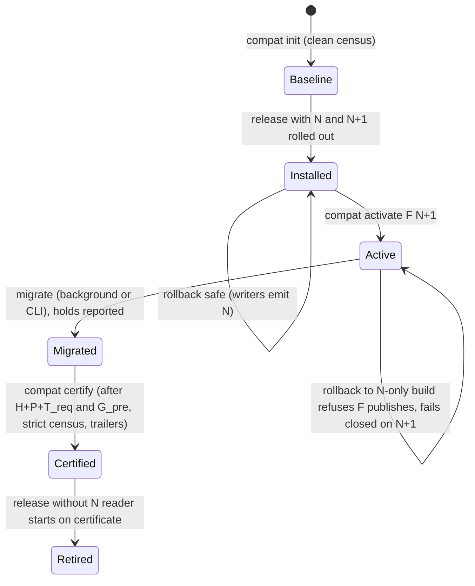
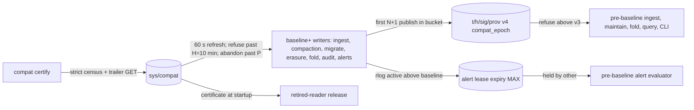

# ADR-4233: the retained-data compatibility contract: install, activate, migrate, retire

Status: Accepted (2026-11-15). Epic #4233. Approved through the owner's
delegation to an adversarial review, which approved it in its fourth round.

Amends ADR-0531 decisions 1 and 2 and its rollback stance, ADR-0066 decision
1 (version lifecycle policy), and ADR-1746 decision 2 (what evidence permits
retiring a reader). Supersedes the open tasks of #16 (T6, T10, T11).

Migration classes touched (ADR-0066 decision 4): class C for two additive
changes (`ProvisioningRecord` gains `compat_epoch` and `compat_fenced_unix_ns`
and writes format version 4 only when it carries them; the alert lease JSON
gains `compat_expiry_ns` and `compat_epoch`),
and one new class C record, `sys/compat`. No class A, B or D format changes.
No bulk data-object version is bumped by this ADR.

## Context

### What main does today

- **One version at a time.** Every class A reader admits exactly one
  version (`SegmentVersion::WINDOW` in `crates/ravel-segment/src/format.rs`,
  `SUPPORTED_VERSIONS` in `crates/ravel-logseg/src/footer.rs` and
  `crates/ravel-rspan/src/footer.rs`). ADR-0531 keeps it so until v1.0.
  Shipped releases used that freedom: v0.20.0 replaced RLOG v4 with v5 and
  v0.24.0 replaced RSPAN v4 with v5, each deleting the old reader in the same
  release. A store written before those releases holds objects no current
  build reads.
- **Writers cannot choose.** Every writer stamps a compile-time constant:
  the ingest flushes (`crates/ravel-ingest/src/config.rs`, the
  `*_FORMAT_VERSION` constants), compaction, migration and erasure parts
  (`OUTPUT_FORMAT_VERSION` in `crates/ravel-maintain/src/build.rs`,
  `rlog.rs`, `rspan_codec.rs`), the audit writer
  (`crates/ravel-maintain/src/audit_write.rs`) and the alert evaluator
  (`services/ravel-server/src/alerting.rs`). Installing a binary that
  writes N+1 starts writing N+1, whatever its peers read. ADR-0066 decision 1
  says so on purpose ("there is never a write-the-old-format mode"), which
  makes a rolling upgrade across a bump safe only when every reader is
  upgraded before any writer, an ordering nothing enforces: the operator
  rolls the gateway, query and maintain tiers from one `spec.image` (the
  ingest router from its own `routerImage`), every Deployment with plain
  `RollingUpdate` and no version gate
  (`services/ravel-operator/src/reconcile.rs`).
- **No process records what it can read.** The maintain heartbeat carries a
  process id and timestamps, the query-worker record a protocol version; no
  persisted object records a build's format window. A missing heartbeat
  says only that a process stopped heartbeating.
- **The machinery to converge and certify exists, with gaps.** `ravel-cli
  maintain migrate` walks commit and compaction records, re-encodes below a
  version through the compaction publish path with exact conservation,
  resumes from an advisory cursor, re-audits and raises a format floor with
  its basis (ADR-1746). `audit-versions` classifies floors as `Current`,
  `Stale`, `Contradicted` or `Unknown`. The gaps:
  - Evidence is metadata only: the census reads each record's
    `segment_format_version` stamp, never the object trailer.
  - `list_all` drops keys it cannot address, so a malformed key under a
    census prefix shortens the population instead of failing it.
  - One input outside the reader window aborts the whole `migrate` walk,
    where compaction holds the bucket and moves on.
  - The alerts and audit signals have no floor, census, migrate or startup
    check of their own. Both are written as RLOG by writers that bypass
    ingest (`FormatFamily::for_signal` covers metrics, logs and spans only),
    and neither signal is ever provisioned
    (`crates/ravel-catalog/src/provisioning.rs`, the
    `scan_shards_over_range` doc).
  - The server never runs `migrate`; only the CLI does.

### Where a newer version is taken for corruption or absence

A research pass over every persisted format (inventory below) found these
sites where a process meeting a version newer than it knows does something
other than fail closed:

| Id | Site | What happens |
|---|---|---|
| H1 | catalog fold, previous `.csnap`/`.npost`/`.cstat`/`.kidx` part | any decode error, a newer version included, rebuilds from commit records and CAS-replaces HEAD; the catalog sweep then deletes the newer peer's parts |
| H3 | alert evaluator history fold | an RLOG object at an unreadable version is skipped and counted (`alerting.rs`, `AlertHistorySkipReason::UnsupportedVersion`), so the alert state is rebuilt without it |
| H5 | RLOG POSTINGS and KEY_IDX nested sections | a newer section version reads as `Corrupted`; the trailer probe the retention hold uses never sees it |
| H6 | re-encode (compaction, migrate, erasure, force 2) | the readers skip a section kind they do not know, so a re-encode of such an input writes an output without that section (the drop is inferred from the skip rule in `crates/ravel-segment/src/format.rs` and the POSTINGS rules, not observed) |
| H7 | audit retention | deletes by age with no version hold |
| H8 | compaction claim | an unreadable (newer) claim is stolen and overwritten as version 1 after the lease ceiling |
| H9 | migrate and scan cursors | a newer cursor reads as absent and is CAS-overwritten |
| H10 | idempotency marker | a newer marker reads as a miss, so the request is ingested twice |
| H11 | tenant config in the fold | a newer record is treated as absent: default retention, no typed columns, the next rebuild drops column stats |

Others are reported for follow-up rather than fixed here: H2 (a HEAD
rebuild strips additive HEAD fields a newer build added without a version
bump; the rule that HEAD changes bump the version already covers it), H4 (a
magic change reads as `BadMagic` and is swept as corrupt; magic is frozen
and this ADR says so), H12 (scrub and seal-divergence label a newer version as
corruption in reports only).

### Persisted-format inventory

| Family | Key | Read set (main) | Written | Class | Producers |
|---|---|---|---|---|---|
| RSEG trailer | `m/l0`, `m/l1` `.rseg` | {7} | 7 | A | ingest, compaction, migrate, erasure |
| RSEG SERIES_IDX | inside RSEG | {1} | 1 | A, nested | same |
| RLOG trailer | logs, alerts, audit data objects | {5} | 5 | A | ingest, compaction, migrate, erasure, audit writer, alert evaluator, legal hold |
| RLOG POSTINGS / KEY_IDX | inside RLOG | {1,2} / {1,2} | 2 / 2 | A, nested | same |
| RSPAN trailer | spans data objects | {5} | 5 | A | ingest, compaction, migrate, erasure |
| commit record | `c/<sh>/<hr>/…cmt` | {1} | 1 | C, immutable | ingest, audit, alerts |
| compaction record | `l1.<h16>.cmt` | {1,2} | 1 (2 behind `--reencode-compaction-parts`) | C, immutable | compaction, migrate |
| rewrite record, erasure request, completion | `rw.`, `del/` | {1} | 1 | C, immutable | erasure rewrite, CLI |
| retention tombstone | `retire.tmb` | {1} | 1 | C, immutable | retention |
| catalog HEAD | `catalog/<sig>/HEAD` | {1,2} | by content | B | fold |
| `.csnap` `.npost` `.cstat` `.kidx` | catalog parts | {1} {1} {3} {1,2} | 1 1 3 2 | B | fold |
| provisioning | `t/<h>/<sig>/prov` | {1,2,3} | 3 | C, CAS-mutable | ingest first touch, reshard, migrate floor raise |
| tenant config | `t/<h>/config` | {1..4} | 2 (3, 4 behind `ReadersRolledOut`) | C, CAS-mutable | CLI, operator |
| metric metadata, key epoch, `sys/auth`, `sys/gc` | various | small closed sets | newest | C | ingest, CLI, maintain |
| tenancy marker, recovery manifest | `sys/tenancy`, `sys/t/<h>` | {1} | 1 | D, write-once | startup |
| idempotency marker | `idem/…idm` | {1} | 1 | C, write-once | ingest |
| claims, cursors, memos, heartbeats, admission snapshots | `sys/maintain/…`, `maint/…`, `admission/…` | small | newest | advisory | maintain, query |
| alert lease, alert memo | `t/<h>/a/alert-lease`, `a/state/latest` | JSON, v1 memo | 1 | advisory | alert evaluator |
| agents HEAD, objects | `ag/<id>/head`, `o/<hash>` | {1,2}, {1} | 2, 1 | C | agents runtime |
| commit token | client-held, inside idempotency receipt | `v2:` | `v2:` | D | ingest |
| series identity | domain `ravel-series-v1` | v1 | v1 | D | ingest |
| local disk cache | local only | RVCD 3 | 3 | none, a miss | query |

The inventory is checked into this ADR as a table, and a test asserts
that every format-version constant the workspace exports is named in
`docs/compatibility.md`, so a new family cannot be added without entering
the contract (decision 9, the inventory-completeness row).

## Decision

### 1. The contract starts at a baseline release

The **baseline release** is the first release that ships decisions 2 to 5
(expected v0.34.0). The contract covers stores and processes from the
baseline onward. It replaces ADR-0531 decisions 1 and 2: the window policy
starts at the baseline, not at v1.0.

- **Existing stores (owner, 2026-11-15: nothing before v0.33 is in
  scope).** A store written by v0.33.x holds the baseline's bulk versions
  (RSEG 7, RLOG 5, RSPAN 5) and metadata inside the baseline's read sets,
  and is adopted in place: `ravel-cli compat init` runs a census over every
  tenant and signal, and only on a clean result creates `sys/compat` at the
  baseline versions. For the class A families the census is decision 7's
  population and trailer check with "at least N+1" replaced by "inside the
  baseline read set" (every live, held and pinned member's stamp and
  trailer); for every other family it is the read-set check of each
  object's own `format_version`: catalog HEAD and every part HEAD names,
  the provisioning record, tenant config, and every commit, compaction,
  rewrite and tombstone record the class A census already lists. Any
  version outside the baseline read set, any listing failure and any
  unreadable object refuses `init`. A baseline binary
  runs on such a store before `init` exactly as v0.33 does; `init` is
  required before any activation (decision 3).
- **Unsupported starting points.** Stores, data and processes from releases
  before v0.33.0 are outside the contract: no test covers them and no
  bridge exists. `compat init` decides by content, not by which release
  wrote the store, so it refuses any object at a version no baseline reader
  admits and names each (tenant, signal, version, count); the remedy is to
  re-ingest or discard those objects, and the retention version hold keeps
  them, unreadable, meanwhile. A store with nothing outside the read sets
  passes the census whatever wrote it. "Only v0.33.x stores are supported"
  is therefore a support statement, not an enforced check: nothing in a
  store records which release wrote it. `init` prints, and records in
  `sys/compat`, the version histogram it found per family, so what was
  adopted is on record.
- **Unsupported processes.** A release before the baseline is not part of
  the contract. It may run beside the baseline until the first activation
  above the baseline (decision 3), because until then the baseline writes
  nothing it cannot read. After that it must be gone (the prerequisite in
  decision 4); decision 4's fences are defence in depth against one that
  returns.

### 2. A release ships reader and writer for two versions, and emits the older until activated

Replaces ADR-0066 decision 1's "writers always emit N".

- A release that introduces version N+1 of a family ships the reader **and
  the writer** for N and N+1. `SegmentVersion::WINDOW` and the
  `SupportedVersions` windows become two wide for that family in that
  release (the existing compile-time bound already allows two).
- Every writer takes its emitted version from a `WritePolicy` resolved from
  `sys/compat` (decision 3), never from a constant. Before activation the
  policy names N, so a newly installed binary writes what the deployed
  readers read. This covers every producer: the three ingest flushes,
  compaction, `migrate`, the force-2 re-encode, the erasure rewrite, the
  audit writer, the alert evaluator, the legal-hold writer, and the catalog
  fold's part and HEAD writers.
- For a class A family, the release that drops the reader for N is a later
  release, and it starts only on a certificate (decision 7). Catalog and
  record families follow decision 7's own rules for them.
- A release never ships two new versions of one family, and never ships a
  writer for a version it cannot read.

### 3. Activation is a durable, monotone record, not a binary install

A new class C record, `sys/compat` (protobuf, `format_version` 1, CAS on the
store version, MAC under the deployment key like the heartbeat), holds one
entry per family:

```
message CompatFamily {
  string   family = 1;               // "rseg", "rlog", "rspan", "csnap", ...
  uint32   active_write_version = 2; // what writers emit
  uint64   activated_epoch = 3;      // the store-wide epoch this activation set
  sfixed64 activated_unix_ns = 4;
  string   activated_by = 5;
  Certificate certificate = 6;       // decision 7; absent until certified
  sfixed64 fence_complete_unix_ns = 7; // the activation's fence walk finished
  sfixed64 late_writes_verified_through_unix_ns = 8; // decision 7, CAS-advanced
  bool     contradicted = 9;         // decision 7, set by a late-write finding
}
message CompatRecord {
  uint32 format_version = 1;
  uint32 baseline_release_major = 2; uint32 baseline_release_minor = 3;
  repeated CompatFamily families = 4;
  uint64 compat_epoch = 5;           // raised by every activation of any family
  sfixed64 max_publish_lifetime_ns = 6; // P, decision 7
  repeated AdoptedVersion adopted = 7; // decision 1: what `init` found
}
message AdoptedVersion { string family = 1; uint32 version = 2; uint64 count = 3; }
```

- **Absent record.** A baseline-or-later process treats an absent
  `sys/compat` as "every family at its baseline version". Nothing is
  activated, so nothing changes until `init`.
- **Activation.** `ravel-cli compat activate --family F --version N+1` CASes
  `active_write_version` up and the store-wide `compat_epoch` up. It refuses unless `sys/compat`
  exists, the CLI's own build reads and writes N+1, and N+1 is exactly one
  above the current active version. It never lowers a version.
- **One store-wide epoch.** `CompatRecord` carries `uint64 compat_epoch`,
  raised by every activation of any family; each family records the epoch
  at which it was activated. Every comparison below uses this one counter.
- **Refresh and staleness.** Every process reads `sys/compat` at startup and
  every 60 s (the `GenerationSwitch` refresh interval), off the hot path. A writer
  chooses an object's version when it starts encoding it: for an ingest
  flush that is the moment the flush is granted its permit, not the moment
  the flush opens (a flush can wait up to `max_flush_lifetime` for a permit
  and then has a second `max_flush_lifetime` for its own store calls,
  re-derived from the grant: `crates/ravel-ingest/src/shard.rs`, the
  flush-open deadline, and `docs/consistency-model.md`); for compaction,
  migrate and erasure it is the run's start. It refuses to start one, and
  it refuses every PUT attempt of a data object or record, retries
  included, when its last successful read is older than the hard horizon
  `H = 10 min`. So an object at the pre-activation version starts encoding
  no later than `activated + H`, and its publish ends within the budget
  measured from that start: `max_flush_lifetime` from the permit grant for
  the ingest flushes (recorded in `sys/gc`), `max_compaction_lifetime` from
  the run start for compaction, migrate and erasure, the 30 s audit budget,
  one evaluation tick for alerts. `P` is the
  bound all of them are held to, recorded in `sys/compat` and enforced
  (decision 7); `T_req` is the store request timeout. The latest an
  in-contract writer can land a pre-activation version is
  `activated + H + P + T_req`, which decision 7 waits out. A process paused
  between its last check and a PUT is not bounded by any timer; that
  residual is detected, not prevented (decision 7).
- **Monotone views.** Activation only raises versions, so a view can only be
  behind, never ahead. A process never lowers a version it has seen in this
  run. A process that finds `sys/compat` absent while a bucket's
  provisioning record carries `compat_epoch > 0` refuses that bucket's
  publishes with `CompatRecordMissing`, and `compat init` refuses a store
  showing such an epoch: a deleted or rolled-back `sys/compat` is restored
  from bucket versioning, never re-created at the baseline.
- **A build that cannot honour the active version.** A process whose build
  cannot write the active version of a family refuses that family's
  publishes (typed `ActiveVersionNotWritable { family, active, writable }`,
  retryable, counted under `ravel_compat_publish_refused_total{family}`). It
  still starts, serves queries over what it reads, folds, and runs the
  retention hold: the ADR-1746 rejection of a startup refusal applies. When
  the family is a catalog family (decision 8) the fold of that signal
  refuses its cycle on the newer parts, and queries resolve through the
  commit-record listing fallback the resolver already uses for an
  unreadable snapshot, at listing cost, failing closed on any object at a
  version they cannot read.
- **No capability evidence authorizes activation.** The command reports the
  live maintain heartbeats and query workers it can see, as information.
  Safety does not depend on them: decision 4 makes a process that cannot
  read the new version fail closed whether or not it ever heartbeated
  (narrowed for pre-baseline processes by the prerequisite amendment below).

### 4. Fencing: what stops a process that cannot read an activated version

Three mechanisms, by process class. For baseline-or-later processes the
mechanism is the guarantee. For pre-baseline processes the guarantee is the
stated prerequisite below (terminate them before the first activation);
the provisioning and lease fences are defence in depth that make the common
returns (a restarted pod, a lagging ingest node, a lingering evaluator)
fail closed, and wave 0 measures them against the released binary.

- **Baseline or later.** The process reads `sys/compat` and refuses
  publishes it cannot honour (decision 3). Its readers fail closed on a
  version they do not admit (typed `UnsupportedVersion`): the metrics
  fetcher's `settle_version_refusal` in `crates/ravel-query/src/fetcher.rs`
  turns it into `FetchError::UnsupportedVersion`, the log and span fetchers
  do the same, and the SQL scan stream (`crates/ravel-sql/src/scan.rs`) ends
  on its first error, which Flight SQL forwards; decision 9's matrix pins
  each surface, Flight SQL included, with a test.
- **Hazard closures in the baseline.** Each is a typed refusal or hold,
  pinned by its own matrix row (decision 9):

| Id | Baseline behaviour |
|---|---|
| H1 | the fold classifies a previous part or HEAD whose version is above its read set as newer (a new typed classification; today only the HEAD has one), fails its cycle, writes nothing, and never rebuilds over it |
| H3 | the alert evaluator refuses its tick on an unreadable-version history object (counted), keeping the previous state and writing no transition |
| H5 | POSTINGS and KEY_IDX return a typed `UnsupportedSectionVersion`; the retention probe and `certify` treat it like a trailer version outside the window |
| H6 | every re-encode (compaction, migrate, erasure, force 2) refuses an input carrying a section kind it does not know and holds the bucket, instead of dropping the section |
| H7 | audit retention applies the retention version hold |
| H8 | a compaction claim above the known version, or at version 0, is never stolen or overwritten |
| H9 | a cursor with an unknown tag is left in place and the run starts from the beginning without writing a cursor |
| H10 | a newer idempotency marker refuses the request with a retryable error instead of ingesting it again |
| H11 | the fold refuses its cycle on a newer tenant config instead of using defaults |

  H2 and H4 are closed by rule rather than code: a HEAD change always bumps
  the HEAD version, so H1's refusal covers it, and a family's magic never
  changes. So, from the baseline on, no process repairs, overwrites or
  deletes an object whose version, section version or magic marks it as
  written by a newer build. Report-only mislabels (H12) stay reports.
- **Before the baseline, provisioned signals.** The fence is the provisioning
  record, which every pre-baseline write path already refuses above version
  3: the ingest flush (`GenerationSwitch`), first-touch provisioning, server
  startup for named tenants, the maintenance floor check, `migrate`, query
  resolution, the fold and the CLI (narrowed by the prerequisite amendment
  below: the drill found v0.33.0 paths that never read it). `ProvisioningRecord` gains
  `uint64 compat_epoch = 8` and `sfixed64 compat_fenced_unix_ns = 9` (when
  that bucket's fence was raised to that epoch); a record carrying them is
  written at
  `format_version` 4, and the baseline reads {1,2,3,4} and writes 3
  otherwise (ADR-0066 R1: readers first, and here the reader ships in the
  baseline while only activation writes 4). The baseline models fields 8
  and 9, so its two rewrite paths (`append_generation` and
  `raise_format_floor`, which today refuse any record above the writer's
  stamp) take a separate rewrite ceiling of 4 while the default stamp stays
  3: a rewrite of a record carrying the fields keeps them and stamps 4, a
  rewrite of one without them stamps 3, and a record above 4 is still
  refused with `RefusingToRewriteNewerRecord`. Without that split no fenced
  bucket's floor could be raised and no fenced bucket could be resharded.
  **Conditional publication:** a
  writer publishes the first object at an activated version above the
  baseline into a (tenant, signal) only after that bucket's provisioning
  record carries a `compat_epoch` at or above the family's
  `activated_epoch`, CAS-raising it (and stamping `compat_fenced_unix_ns`)
  first when it does not. After any activation, a baseline-or-later first
  touch creates a new bucket's record directly at version 4 with the
  current `compat_epoch` and `compat_fenced_unix_ns = 0` (born fenced: no
  pre-baseline process ever saw it at version 3), so onboarding a tenant
  does not restart any wait; only a raise from version 3 stamps a time. `compat activate` also fences every existing provisioned bucket
  eagerly (a resumable walk under strict listing) and records
  `fence_complete_unix_ns` in the family's entry once the walk covered every
  bucket; buckets provisioned later are fenced by conditional publication.
  A pre-baseline process then refuses every write path into a fenced bucket
  once its cached view expires (narrowed by the prerequisite amendment
  below: the drill found v0.33.0 paths that never read the record). Its ingest router keeps answering from a
  cached view inside `GenerationSwitch`'s trust horizon after a failed
  refresh, so for up to that horizon it can still write the older version,
  which baseline readers read. A pre-baseline flush chooses its version
  when it opens, so a flush opened inside that horizon can still land up to
  two `max_flush_lifetime` budgets later (permit wait, then its own store
  calls). That trust horizon is the start of the refresh hour plus two
  hours, exclusive (`crates/ravel-ingest/src/generation.rs`,
  `trust_horizon` and its `hour_of(now) >= trust_horizon` check), so under
  two hours after the last successful refresh. This ADR fixes
  `G_pre = 3 h + 2 × max_flush_lifetime + P + T_req`, carrying one hour
  of deliberate margin over that bound, measured per
  bucket from its own
  `compat_fenced_unix_ns`, so a bucket fenced late (one a pre-baseline node
  provisioned after the walk, fenced by conditional publication or by
  `certify`) gets its own wait.
- **Before the baseline, alerts.** Alerts are never provisioned. The fence
  is the alert lease (`t/<h>/a/alert-lease`). When `rlog` is activated above
  the baseline, `compat activate` parks the lease of every tenant it can
  discover (the alert rules file and a strict listing of the alert
  prefixes): it CAS-replaces an existing lease, whoever holds it, and
  creates an absent one with `CreateIfAbsent`, in both cases with holder
  `compat-fence/<epoch>`, `expiry_ns = i64::MAX` and two new fields,
  `compat_expiry_ns = 0` and `compat_epoch`. Every parked lease, including
  one a capable evaluator holds, carries `compat_epoch`. In v0.33.0's
  `acquire_lease` every tick re-reads the lease before renewing it, so the
  displaced holder's next tick finds a lease held by another whose
  `expiry_ns` is in the future and returns at `held_by_other &&
  existing.expiry_ns > now_ns` without writing; a renew CAS already in
  flight against the version it read before the parking fails its
  precondition. Either way it stops evaluating. Baseline-or-later
  evaluators read `compat_expiry_ns` as the real expiry and write the
  parked form whenever `rlog` is active above the baseline. Three rules
  keep a baseline-or-later evaluator from un-parking it:
  - an evaluator that finds a lease whose `compat_epoch` field is above its
    view's epoch, whoever holds it, refreshes `sys/compat` before acting on
    the lease;
  - an evaluator whose view says `rlog` is active above the baseline never
    writes an unparked lease, and one whose view predates the parking
    cannot see a parked lease as expired, by the first rule;
  - an evaluator whose build cannot write the active `rlog` version takes
    no lease, and if it holds one it CAS-writes it back to the parked form
    with `compat_expiry_ns = 0` instead of letting it lapse, so a capable
    evaluator takes over and alerting continues on a mixed fleet.
  A tick already running in a displaced holder may publish one transition
  at the older version, the two-holder overlap the lease already documents.
  A tenant whose first-ever evaluation happens on a pre-baseline process
  after activation creates its own unparked lease; the prerequisite, not
  the fence, covers that case.
- **Before the baseline, audit: not fenced.** The audit writer reads nothing
  a version bump could make it refuse. A pre-baseline query process that
  outlives the rollout can still write audit records at the older RLOG
  version. Those objects stay readable until the old reader is retired,
  and decision 7's late-write pass finds them. This is the one
  external orchestration prerequisite the contract states rather than
  enforces: **every pre-baseline process is terminated before the first
  activation above the baseline**.

Wave 0 of the epic proves the provisioning and lease fences against the
released v0.33.0 image (decision 9). If any v0.33.0 write path publishes
into a fenced bucket after its grace horizon, this decision is reopened.
The drill found such paths, and the decision was reopened and narrowed: see the
prerequisite amendment below.

### 5. Rollback and downgrade

| Situation | Safe? | What happens |
|---|---|---|
| Release B+1 installed, F not activated, roll back to B | yes | B+1 wrote only versions B reads |
| F activated, no N+1 object published yet, roll back to B | the data is safe; F's writes stop | B reads `sys/compat`, sees F above what it writes, refuses F's publishes; activation is not undone, so F's ingest waits for a roll forward |
| F activated and N+1 objects exist, roll back to B | no: unsupported downgrade | B refuses F's publishes and fails closed on N+1 objects (typed), so queries touching them fail; nothing is deleted (retention version hold); the remedy is to roll forward |
| F activated, roll back to a pre-baseline release | no: outside the contract | excluded by the prerequisite; as defence in depth the provisioning and lease fences make its request admission, folds and maintenance under `m`/`l`/`s`, queries and alert evaluation fail closed on fenced buckets; other paths (metadata, audit and alert retention deletes, teardown flushes) are covered only by the prerequisite (see the prerequisite amendment below) |
| F certified, retired-reader release B+2 installed, roll back to B+1 | yes | B+1 reads N+1 |

The irreversible step is the first activation of a version some deployed
binary cannot read, not the binary install. `compat activate` prints the
oldest release that can still read the store after the change.

### 6. Migration under activation

`migrate` is reused (ADR-0066 decision 5, ADR-1746) with these changes:

- It writes at the family's active version and refuses a target that is not
  active.
- An input outside the reader window, an unwritable input, or a corrupt
  object holds that bucket, reports it with a reason, and the walk goes on;
  any held bucket makes the run exit nonzero and blocks certification.
- Listings used by the walk, the re-audit and the census are strict: a key
  the census cannot address, a failed page, or a truncated listing fails
  the run instead of shortening the population.
- `ravel-server --mode maintain --background-migrate` runs the same walk as
  a low-priority maintenance unit under the existing cost budget, so
  convergence does not need a CLI host. The cursor stays advisory (resume
  from it, or from the start, is correct: a bucket already converted has
  nothing raw-served below the version).
- Published data objects are never modified: every output is a new
  content-addressed object published through `CreateIfAbsent` compaction
  records with exact conservation, so identities, commit-token resolution
  (through the covering record's parts), provenance and visibility follow
  the existing supersession rules. A retried or ambiguous PUT converges on
  the same key. Competing maintainers race on the record key; one wins.

### 7. Retiring a reader requires a certificate that stays checkable

`ravel-cli compat certify --family F --version N+1` produces the only
evidence a reader-retiring release accepts. It applies to the class A
families (`rseg`, `rlog`, `rspan`) only, and refuses any other:

- Catalog families (class B) need no certificate. A release that drops a
  catalog part or HEAD version rebuilds parts below its window from commit
  records through the fold's existing below-floor rebuild (ADR-0066,
  below-floor HEAD amendment), which costs a full rebuild of each tenant's
  catalog on its first fold; #944's caveat applies, so that release's ADR
  states the rebuild cost.
- Immutable class C records (commit, compaction, rewrite, tombstone) are
  never rewritten, so their old versions never converge and their readers
  are never retired under this ADR. A future change that wants to retire
  one needs its own ADR and mechanism.

For a class A family:

- **Preconditions.** F's active version is at least N+1, the activation's
  fence walk completed, and
  `now > max(activated_unix_ns + H + P + T_req, newest compat_fenced_unix_ns
  over every provisioned bucket + G_pre) + clock_skew_allowance`, where a
  born-fenced bucket (`compat_fenced_unix_ns = 0`) is left out of the
  maximum. Decisions 3 and 4 define the terms. After that no in-contract
  writer, and no pre-baseline writer on a fenced bucket, can still land N
  (see the prerequisite amendment below), except a process paused between
  its check and its PUT. For pre-baseline writers this rests on the
  prerequisite: a v0.33.0 teardown flush has no time bound.
- **The time precondition gates `S`.** `certify` refuses to start a census,
  and so to record `S`, before the bound above has passed; a resumed run
  keeps its `S`, which already satisfied the activation term. The per-bucket
  `G_pre` term is rechecked before the certificate CAS, because `certify`
  itself may fence a bucket provisioned at version 3 mid-census, and the
  certificate waits until that bucket's own `G_pre` has passed.
- **`P` is recorded, not assumed.** `compat init` writes
  `max_publish_lifetime_ns` into `sys/compat` (default 1 h, the compiled
  `max_flush_lifetime` and the default `max_compaction_lifetime`). It can be
  raised later and never lowered, so no bound already relied on shrinks.
  Every in-contract producer abandons an object it started encoding,
  without its record PUT, once that lifetime passes from the start defined
  in decision 3: the ingest flushes already abandon at `max_flush_lifetime`
  from the permit grant, and compaction and erasure at
  `max_compaction_lifetime` from the run start; the baseline moves the
  ingest version choice to the permit grant so that budget is the whole
  span; the audit writer's 30 s budget is inside it; the alert evaluator
  and the legal-hold writer gain the same abandon-at-`P` rule. A process
  configured with a `max_flush_lifetime` or `max_compaction_lifetime` above
  the recorded `P` refuses publishes with `PublishLifetimeAboveCompat`
  rather than outliving the bound (for ingest, at admission only: see the
  prerequisite amendment below).
- **Population.** For every tenant (strict discovery listing), every signal
  the family carries (RLOG: logs, alerts, audit; RSEG: metrics; RSPAN:
  spans), every shard in the generation history: live L0 records, the parts
  of every authoritative compaction and rewrite record, superseded inputs
  still inside the GC protection horizon (a pinned query or a Flight ticket
  may still read them), objects of tombstoned buckets held by a legal hold
  or by the retention version hold, and legal-hold records themselves.
  Orphans in `quarantine/` are garbage and do not count.
- **Checks.** Every member's stamp is at least N+1, and a 16-byte suffix GET
  of every member's trailer agrees with its stamp. Any member below N+1, any
  disagreement, any held bucket from decision 6, any rewrite-chain part
  below N+1, and any listing failure refuses the certificate and names the
  cause. Every provisioned bucket's provisioning record is fenced
  (decision 4) and its floor raised with a basis, as `migrate` does today;
  the alerts and audit signals, which have no provisioning record, are
  covered by the certificate alone.
- **The certificate** is written into the family's `sys/compat` entry under
  CAS: version, `certified_unix_ns`, member count, newest `created_unix_ns`
  seen, buckets scanned, and a digest of the tenant set. Nothing edits it
  in place. A later certify replaces it whole: one of a higher version, or
  one of the same version after a late write was remedied by `migrate`;
  that replacement starts from a new `S`, resets the watermark to it, and
  clears `contradicted` in the same CAS.
- **The retired-reader release starts only on it.** A release whose reader
  for F no longer admits N reads `sys/compat` at startup, before any
  listener binds or any write, and refuses to start in every mode unless F
  carries a certificate at or above its oldest readable version.
- **Late writes are detected, not prevented.**
  - `S` is the start of the first `certify` run of this certification. It
    is persisted in the certify cursor; a run that resumes reads `S` from
    the cursor, and a run that finds no cursor (lost, or never written)
    starts the census over with a new `S`. So every census read happens
    after `S`, and a record that lands after a shard-hour was read has a
    store `LastModified` after `S`.
  - The certificate's family entry carries a mutable
    `late_writes_verified_through_unix_ns`, set to `S` by `certify`. A pass
    that completes CAS-writes its start time there only when that is later
    than the stored value, so the watermark never moves back when passes
    finish out of order. A pass interrupted by its budget and resumed keeps
    the start of its first run, the earliest, like `certify`'s `S`.
  - The late-write pass lists the commit prefixes (commit, compaction and
    rewrite records) of every signal of F and GETs only the records whose
    `LastModified` is after the watermark minus `clock_skew_allowance`; every
    pass boundary carries the same margin. Any such record below the
    certified version is a late write: the pass CAS-sets `contradicted` on
    the family entry, sets `ravel_compat_certificate_contradicted{family}`,
    and the bucket's writes are refused; `compat verify` reports it.
  - The pass runs as a daily maintenance unit (any maintain process; the
    CAS makes concurrent passes harmless) and on demand as `ravel-cli compat
    verify`, under `--compat-check-budget`. It costs one LIST of every
    commit page of those signals and one GET per record landed since the
    watermark.
  - The retired-reader release at startup refuses when the certificate is
    absent or `contradicted` is set, and when the watermark was never
    advanced past `S` (the procedure runs `compat verify` from the release
    that reads both versions before installing it). A watermark older than
    7 days only warns and sets `ravel_compat_late_write_watermark_age_seconds`,
    so a long maintenance outage does not stop processes from restarting.
  - A late write is never a silent wrong answer: its object fails closed
    typed at read time and the retention version hold keeps it. The remedy
    is to roll back to the release that reads both versions, `migrate`, and
    re-certify.
- **Fresh stores, for the retired-reader release only.** A release whose
  reader for F no longer admits N treats a store with no `sys/compat` and
  no `sys/tenancy` as fresh and bootstraps it, and refuses to start on one
  with `sys/tenancy` and no `sys/compat`. This is how an unsupported upgrade
  path, including skipping the release that carried both readers, is
  refused before it modifies anything. The baseline and every release that
  retires no reader run on a store without `sys/compat` as decision 1
  says.
- **What keeps it true.** Baseline-or-later writers stop starting to encode
  objects below the active version within `H` and stop publishing them within
  `H + P + T_req`, and once F is certified `--write-below-format-floor` is
  refused for F. Pre-baseline writers are excluded by the prerequisite and
  mostly fenced (decision 4). What remains (a paused process, the audit
  writer of a pre-baseline process that outlived the rollout, and a v0.33.0
  teardown flush) is caught by the late-write pass above rather than
  prevented. Metadata, idempotency markers and retention deletions are not
  caught: see the prerequisite amendment below.
- **Restores.** A restore of a noncurrent object version from bucket
  versioning (ADR-0072) can bring back an N object after certification.
  That is a restore into a state the certificate does not describe: the
  procedure is to run the release that reads both versions, re-run
  `migrate`, then re-certify.

### 8. Commit tokens, identities and metadata families

- Commit tokens (`v2:`) and series identity (`ravel-series-v1`) remain class
  D: never activated through `sys/compat`, and any change is its own ADR
  with per-bucket containment (ADR-0066 decision 4). The baseline asserts in
  a test that the token and identity encodings of the fixture corpus
  (decision 9) resolve unchanged.
- Catalog parts and HEAD (class B) go through activation like bulk families:
  the fold emits the active version, and from the baseline on it refuses its
  cycle on a newer previous part instead of rebuilding over it (H1).
- Immutable class C records (commit, compaction, rewrite, tombstone) are
  activation families too: the force-2 compaction record version 2, today
  behind `--reencode-compaction-parts`, is written only once family
  `compaction-record` is active at 2.
- CAS-mutable class C records keep ADR-0066's R1 rule (readers one release
  ahead). Moving their opt-in tokens (`StorageLayoutWrite::ReadersRolledOut`)
  onto `sys/compat` activation is a follow-up, not part of this epic.

### 9. Evidence: an executable compatibility matrix and a frozen corpus

- **Frozen corpus.** The baseline writes a fixture corpus with its own real
  write paths (ingest flush, compaction, erasure rewrite, alert evaluator,
  audit writer, legal hold, fold) into a directory store:
  `crates/ravel-compat-tests/corpus/<release>/`, with the exact expected
  results of a fixed query set (PromQL instant and range, logs and spans
  SQL including metadata columns, alert state, audit query, commit-token
  resolution). Corpora are append-only: a guard fails any change to a
  published corpus directory. Every later release's tests open every
  corpus in the supported range and assert exact results. These fixtures
  are written by a released build's code, not regenerated by the release
  under test.
- **Drill version.** No production version is bumped to demonstrate the
  framework. A cargo feature `format-drill` on the three bulk format crates
  adds a version N+1 whose bytes are N's with the trailer version raised,
  so dispatch, activation, fencing, migration and certification run end to
  end against two real versions. `scripts/guards/check-release-profile.sh`
  is extended to refuse the feature in release builds and the Dockerfile.
  The drill window must also be unreachable from a default workspace
  build, where cargo unifies features across everything one invocation
  builds: `ravel-compat-tests` is listed in the root manifest's `exclude`,
  so it is its own workspace built by its own CI lane, and the root
  `members = ["crates/*"]` glob never selects it. `default-members` would
  not do, since `--workspace` selects every member regardless of it. So
  `cargo test --workspace` and `cargo clippy --workspace --all-targets`
  never compile the other crates with a two-wide window. CI's all-features job, which turns every feature
  on by construction, type-checks only and runs no test that asserts a
  window.
  The drill proves the mechanism; the first real bump proves the next
  layout, and its ADR must add its own corpus.
- **Matrix tests** (in `ravel-compat-tests`, shared `MemoryStore` or a local
  RustFS, two simulated nodes with injected build capabilities):

| Case | Asserted |
|---|---|
| corpus written by release R, read by HEAD | exact query results, every signal including metadata |
| corpus at N, drill activation, migrate | exact results before and after; old objects unreachable from HEAD; certificate `Current` |
| mixed nodes N-only and N+1, before activation | every object written is version N; both nodes read everything |
| mixed nodes, after activation | N-only node refuses publishes for the family, fails closed on N+1 objects, writes nothing |
| rollback before activation | N-only node reads the whole store and writes normally |
| crash after each publish step (data PUT, record PUT, prov CAS, compat CAS, cursor write, floor raise, certificate CAS) | a fresh process resumes and converges to the same keys and results (`FaultStore` counters prove each fault fired) |
| concurrent migrate, ingest, compaction, and a late N write inside `H` | single winner per record; late write lands at N and blocks certify until migrated |
| stale `sys/compat` view, stale floor, a newer peer's `sys/compat` | stale writer emits only the older version and stops past `H`; stale floor does not certify; newer record refused, never overwritten |
| a publish straddling activation: a flush opened just before activation queues for a permit, is granted inside `H` and encodes at N, then retries its PUTs until near `P` | it lands at N; `certify` before `activated + H + P + T_req` refuses to start; after, the census counts it |
| a flush opened before activation whose permit is granted after `activated + H` | it encodes at N+1, the active version |
| two late-write passes finishing out of order; a same-version re-certify after a late write | the watermark never moves back; the re-certify resets `S` and the watermark and clears `contradicted` |
| a late N record landing after `certify` (injected) | the late-write pass finds it by `LastModified`, sets `contradicted`; the retired-reader release then refuses startup |
| a late N record landing between two resumed `certify` runs, in a shard-hour the first run already read | the resumed run keeps the first run's `S`, so the late-write pass examines the record |
| certify cursor lost mid-run | the next run starts the census over with a new `S` |
| a tenant onboarded after activation | its record is born fenced; the `certify` wait does not restart |
| lease parking: holder is a v-old evaluator; lease absent; a baseline evaluator with a pre-activation view; an evaluator that cannot write the active version holding the lease | displaced holder stops; absent lease created parked; stale evaluator refreshes before acting; incapable holder re-parks and a capable one takes over |
| `sys/compat` deleted after activation | publishes refused with `CompatRecordMissing`; `compat init` refuses |
| `compat init` over a corpus holding one object below the baseline read set (made with the drill version raised and the window shifted, or a hand-stamped catalog part, record or tenant config) | `init` refuses, names (tenant, signal, version, count), and writes nothing; a clean v0.33.0 corpus is adopted and its histogram recorded |
| a bucket provisioned at version 3 after the fence walk | fenced on first activated publish or by `certify`; `certify` waits `G_pre` from that bucket's fence time |
| one row per closed hazard H1, H3, H5 to H11 | the baseline behaviour in decision 4's table, with the store listed before and after to show nothing was rebuilt, overwritten or deleted |
| Flight SQL scan over an object at an unreadable version | the stream ends with a typed error, no partial result |
| inventory completeness: every format-version constant the workspace exports | each is named in `docs/compatibility.md`; a new constant without a row fails the test |
| fenced (version 4) provisioning record: reshard and floor raise by the baseline | both succeed and keep fields 8 and 9 at version 4; a record above 4 is refused |
| unfenced (version 3) provisioning record: reshard and floor raise by the baseline | both stamp 3 and add neither field, so the pre-baseline fence never fires on an unfenced bucket |
| incomplete listing (`FaultStore` failed page, unaddressable key) | migrate and certify refuse; nothing certified |
| retention, erasure, legal hold, pinned query and Flight ticket during migrate | held objects counted; pinned inputs keep certify waiting; erasure completes at the active version |
| retired-reader startup with no, stale, contradicted, or `Current` certificate | refuse, refuse, refuse, start |

- **Released binaries.** The images are published as
  `ghcr.io/nofireai/ravel-server:<version>`. Against isolated RustFS
  buckets, v0.33.0 writes every signal; the baseline reads it with exact
  results and `compat init` adopts it. No bulk format boundary exists
  between v0.33.0 and the baseline (both write RSEG 7, RLOG 5, RSPAN 5), and
  boundaries in older releases are out of scope by the owner's decision, so
  a two-version boundary is exercised by the format-drill version only, and
  no released binary meets a version it cannot read until the first real
  bump. The release that makes that bump must add a boundary lane of its
  own: its corpus at N+1 after activation, opened by the previous
  release's published image, asserting typed failure and, by listing the
  store before and after, that it deleted and rewrote nothing. The
  previous-release lane below does not cover that case, since it runs with
  nothing activated.
- **Released-binary fence drill (wave 0).** The released v0.33.0 image runs
  against an isolated RustFS bucket whose provisioning records were fenced
  and whose alert lease was parked by the baseline code, including a run
  where v0.33.0 holds the lease when it is parked. The drill lists the
  bucket before and after and asserts that no object or record lands in a
  fenced bucket after `G_pre` (replaced by the prerequisite amendment's
  drill verdict below) and that the evaluator stops writing
  transitions; it records every write it observes.
- **Previous-release lane.** From the release after the baseline on, CI runs
  the previous release's published image against a store the release under
  test wrote with nothing activated, and asserts exact results, so rollback
  before activation is tested with the real older binary and not only with
  simulated capabilities.
- **End-to-end reachability.** One test drives the whole sequence through a
  real `ravel-server` (ingest over HTTP, the maintain loop's background
  migrate, queries over HTTP and Flight SQL) and the `ravel-cli compat`
  commands, so the contract is proven reachable from shipping entry points.





The diagram's pre-baseline CLI arrow is narrowed by the prerequisite
amendment below: several v0.33.0 CLI write paths never read the record.

## Compatibility matrix (the contract)

For a family F with baseline version N and a release introducing N+1:

| Release | Reads F | Writes F | Runs beside |
|---|---|---|---|
| v0.33.x (pre-baseline; older releases are out of scope) | N | N | baseline and B+1 until the first activation above the baseline |
| baseline B | N | N | B+1 before and after activation (refuses F publishes after) |
| B+1 (introduces N+1) | N, N+1 | active version | B, B+2 |
| B+2 (retires N) | N+1 | N+1 | B+1; starts only on a certificate |

Supported upgrade paths: v0.33.x to B (rolling, no activation needed); B to B+1 (rolling), activate, migrate, certify, then B+2 (rolling).
B straight to B+2 is refused by B+2 at startup. Unsupported: any store
holding versions outside B's read set (decision 1).

## Rejected alternatives

- **Authorize activation on heartbeats or capability claims.** No existing
  record states a build's window, a new one would only say what was true
  when last written, and a missing heartbeat does not prove a process
  cannot return. The fence makes the answer unnecessary.
- **Keep "writers always emit N" and enforce readers-first in the operator.**
  The operator is one way to deploy among several, rolls its tiers with no
  version gate (the gateway, query and maintain tiers from one image, the
  router from its own), and cannot fence a process it does not own. Ordering a rollout
  stays advice; activation is the enforcement.
- **Refuse to start when the active version is above the build.** Bricks the
  rollback that must keep serving and holding (the ADR-1746 argument).
  Startup refusal is kept for the one case it is right: a release that
  cannot read data the store may still hold (decision 7).
- **Fence by rewriting `sys/tenancy` or `sys/gc`.** The tenancy marker is a
  write-once class D marker; `sys/gc` is GC configuration, and coupling a
  format fence to it makes a GC change a format event. Both are read only at
  startup, so neither fences a process that is already running.
- **Per-bucket activation only, in the provisioning record.** Alerts and
  audit are not provisioned, and an operator would have to activate every
  bucket. The provisioning record carries the fence, `sys/compat` the
  decision.
- **Support stores from releases before v0.33, or rebuild bridges for RSPAN
  4 and RLOG 4.** Out of scope by the owner's decisions (2026-11-15): the
  contract starts at v0.33.x stores and the baseline release.
- **Bump a production format to demonstrate the framework.** It would carry
  a real reader and corpus forever for no user value. The drill feature
  proves the mechanism without shipping a version.
- **Migrate on read, or rewrite in place.** Rejected by ADR-0066 for the
  credential boundary and by the immutability invariant.

## Consequences

- **Costs.** One `sys/compat` GET per process per 60 s. One provisioning CAS
  per (tenant, signal) per activation, on the first publish. `certify`: one
  LIST per shard-hour page, one GET per record, one 16-byte suffix GET per
  member object, and one provisioning CAS per bucket; it is resumable from
  an advisory cursor and takes `--budget-records`, the `migrate` cost
  control.
- **External prerequisites.** Every pre-baseline process is terminated
  before the first activation above the baseline; `compat activate` must
  refuse without the operator's attestation of it (see the prerequisite amendment
  below). Clocks are inside
  `clock_skew_allowance`. Restores from bucket versioning after
  certification follow decision 7's restore procedure.
- **Residual risk.** A pre-baseline query process that outlives the rollout
  can write audit records at the older RLOG version (decision 4), a tenant
  first evaluated by a pre-baseline evaluator after activation is not
  parked, and a process paused between its staleness check and a PUT can
  land a late write. All are readable until retirement, and after
  retirement the late-write pass (decision 7) finds them; none is a silent
  wrong answer or a deletion (narrowed by the audit retention amendment
  and the prerequisite amendment below: alert history deletion).
- **Cost of the late-write pass.** One LIST of every commit page of the
  retired family's signals per daily pass, plus one GET per record whose
  `LastModified` is after the persisted watermark. Startup reads only
  `sys/compat`.
- **Policy changes.** ADR-0531 decisions 1 and 2 and ADR-0066 decision 1 are
  amended (pointers added in the same change). The format-change skill's
  regime list changes from "pre-v1.0 single version / v1.0 N/N-1" to
  "pre-baseline single version / baseline onward two-version window with
  activation and certification". `docs/compatibility.md` becomes the
  normative contract document, and the maintenance guide's "Rolling a
  format bump" becomes the operator procedure for decisions 3, 6 and 7.
- **Normative documents amended with the code:** `docs/compatibility.md`
  (new), `docs/catalog-and-mvcc.md` (the `sys/compat` key and the
  provisioning record's fields 8 and 9), ADR-0066's R1 table (`ProvisioningRecord`
  read set {1,2,3,4}, `CompatRecord` added), the sys-proto classification
  test `crates/ravel-catalog/tests/sys_proto_format_version_classification.rs`,
  `proto/ravel/sys.proto`, the alerting doc for the two lease fields, and
  `docs/guides/operations/maintenance.md`.
- **Not done here.** Rewrite-record supersession for below-version erasure
  parts (certification refuses and names them; ADR-1331's blocked buckets);
  moving `ReadersRolledOut` opt-ins onto activation; H12.

## Amendment (2026-11-17): audit under the released-binary drill, and the audit retention residual (issue #4243)

<!-- amendment-applies: sections="Consequences" pointer="audit retention amendment" -->
<!-- amendment-supersedes: phrase="none is a silent wrong answer or a deletion" pointer="audit retention amendment" -->

Decision 4 does not fence audit. The released-binary fence drill
(decision 9, wave 0) therefore puts post-fence writes of per-query audit
records, `u/l0/` and `u/c/`, in their own class, "audit: unfenced by
design". The drill records them and does not judge them. Every other audit
event the drill sees (`u/l1/` and `u/maint/` writes, and audit removals)
stays in the prerequisite-only class, which the drill also records and does
not judge.

The audit retention residual. Hazard H7 is that audit retention deletes by
age with no version hold, and decision 4's remedy for it ships from the
baseline on. A pre-baseline process that outlives the rollout, against the
prerequisite in decision 4, still runs audit retention without the hold
after an activation above the baseline, so it can delete an audit object
the hold would keep. The late-write pass does not see a deletion. The
Consequences sentence that no residual is a deletion therefore holds for
the other residuals it lists and for the audit records such a process
writes, not for its audit retention. The prerequisite is the only control
over this residual; no fence and no pass detects it.

## Amendment (2026-11-17): the pre-baseline fence is defence in depth; the prerequisite is the guarantee (issue #4243)

<!-- amendment-applies: sections="4. Fencing: what stops a process that cannot read an activated version|5. Rollback and downgrade|7. Retiring a reader requires a certificate that stays checkable|9. Evidence: an executable compatibility matrix and a frozen corpus|Consequences" pointer="prerequisite amendment" -->
<!-- amendment-supersedes: phrase="refuses every write path into a fenced bucket" pointer="prerequisite amendment" -->
<!-- amendment-supersedes: phrase="no pre-baseline writer on a fenced bucket" pointer="prerequisite amendment" -->
<!-- amendment-supersedes: phrase="fenced bucket after `G_pre`" pointer="prerequisite amendment" -->

Decision 4's kill criterion fired. The released-binary drill (decision 9,
wave 0; two runs, recorded on issue #4243) ran the signed v0.33.0 release
binary against isolated buckets and found v0.33.0 write paths that never
consult the provisioning record or the generation trust view, so they
publish into a fenced bucket after any horizon:

- the admission reconciler rewrites `t/<h>/{m,l,s}/admission/<pid>.snapshot`
  every 10 s;
- maintain scrub writes `t/<h>/{m,l,s}/maint/scrub/<shard>.cursor`, and its
  provisioning read fails open;
- the ingest teardown pass writes a held buffer in place at process stop, a
  data object and its commit record, with no time bound (the hold is the
  same one issue #4363 tracks for baseline-or-later processes);
- the metadata sink writes `t/<h>/m/meta`, and idempotency markers ride the
  teardown flush;
- audit maintenance (`u/`), alert retention deletes and sweep (which never
  read the alert lease), `t/<h>/enc` at startup with tenant KMS, and the CLI
  paths that rebuild a key index, reconstruct commit records, submit
  erasures or write tenant config.

The decision is narrowed as follows, by owner decision (delegated):

- **The prerequisite is the guarantee.** Every pre-baseline process is
  terminated before the first activation above the baseline, and
  `compat activate` must refuse unless the operator attests it with
  `--pre-baseline-processes-terminated`. The attestation is recorded in
  the family entry's existing `activated_by` field; no field is added to
  `sys/compat`.
- **The fence is defence in depth, with a narrowed claim.** Against a
  pre-baseline process that outlives the rollout anyway, the provisioning
  and lease fences claim exactly this: its request admission refuses once
  its trust view lapses, its folds and its maintenance under `m`, `l` and
  `s` refuse, its queries refuse, and its alert evaluator stops at the
  parked lease. Every fence-scope row of the second drill run passed, warm
  and cold, and reads of a v0.33.0-written store were identical on v0.33.0 and
  the baseline.
- **Exempt advisory writes.** `admission/<pid>.snapshot` and
  `maint/scrub/<shard>.cursor` carry no data; a baseline build reads the
  same snapshot version, counts a stale sibling only until it ages out, and
  resumes from or overwrites a cursor. They are exempt.
- **Covered only by the prerequisite.** `m/meta`, the teardown flush and its
  idempotency markers, audit maintenance, alert retention deletes and sweep,
  `t/<h>/enc`, `t/<h>/config`, and the CLI paths above. A teardown data
  object lands at the version v0.33.0 writes, and `certify`'s census and
  the late-write pass flag it (the deterministic test in
  `crates/ravel-compat-tests` pins this). The irreversible residual is a
  pre-baseline maintain process deleting alert history, and audit objects,
  by age with no version hold after an activation; no fence and no pass
  detects a deletion, so the prerequisite is its only control. `compat
  activate`'s help and the operator procedure must name this residual next to
  the attestation flag.
- **The baseline's own writers.** The baseline's metadata sink,
  idempotency markers and `enc` writer carry no compat gate. That is safe
  only because none of those formats is an activation family in this ADR
  (decision 8); any future bump of one of them must add the gate first.
- **Drill verdict.** The drill no longer asserts that no object lands after
  `G_pre`. It fails on any 2xx ingest after the trust limit, any
  non-teardown `l0`/`c` write under `m`, `l` or `s` after the horizon, any
  fold, compaction, retention or sweep write or removal there, any teardown
  data object at a version v0.33.0 does not write, any query served from a
  fenced bucket, any alert lease or alert history write after the alerts
  horizon, any read mismatch, a positive control at zero, or any write that
  matches no class; it records and classifies everything else. Its census
  row became the deterministic test above, because `certify`'s time gate
  opens about 6 h after the fence, past any drill run.
- **Ingest publish lifetime.** A baseline ingest router whose
  `max_flush_lifetime` is above the recorded `P` refuses at admission;
  rows it acknowledged before it saw that `P` publish within the router's
  own lifetime rather than being dropped. `P` is recorded by `compat init`
  and only raised later, so this window exists only when `init` records a
  `P` below a live router's lifetime.

The replacement kill criterion: if a pre-baseline process that outlives
the rollout writes into a fenced bucket on any path outside the classes
above, or any fence-scope row of the drill fails, this decision is reopened
again.
