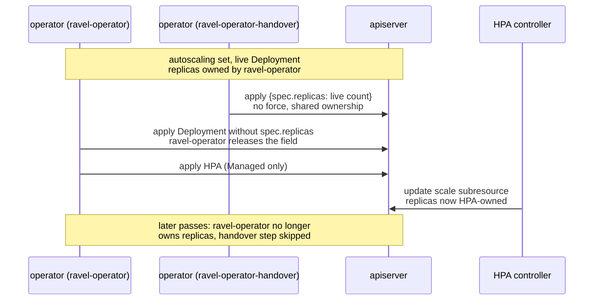

# ADR-4314: Autoscale RavelCluster tiers from the operator

- Status: Accepted (2026-11-16)
- Date: 2026-11-16
- Refs: #4314, ADR-0065, ADR-1693, ADR-3718

## Context

Every Ravel compute process is disposable and needs no leader or quorum
(docs/architecture.md, "Which processes are disposable"), so the gateway, query and maintain
tiers can each run any number of replicas:

- gateway: admission caps are fleet-wide totals reconciled through objects,
  so a replica count change needs no reconfiguration
  (docs/guides/admission-limits.md).
- query: the coordinator is a per-request role, workers are found through
  heartbeats under `sys/query/workers/`, and "there is nothing to rebalance"
  on scale-out (docs/guides/distributed-query.md).
- maintain: work is split by rendezvous hashing over store heartbeats
  (crates/ravel-fleet, ADR-0065, ADR-1693). A survivor takes over a departed
  replica's fold work within 570 s (docs/guides/operations/maintenance.md).

Scale-in uses the same drain as a rollout: `/readyz` turns 503, listeners
close, every shard actor flushes, bounded by `--shutdown-timeout`. Worst case
SIGTERM to exit is 38.5 s with the dedicated health port, and the operator
renders a 51 s grace period for it (docs/architecture.md, "Shutdown").

The operator cannot coexist with a horizontal scaler today. Every tier is a
Deployment built by `deployment()` in `services/ravel-operator/src/reconcile.rs`
with `replicas: Some(spec.<tier>.replicas)`, applied with
`PatchParams::apply("ravel-operator").force()`. The controller owns those
Deployments, so any change to one triggers a reconcile, and it resyncs every
300 s. An HPA or KEDA writing `spec.replicas` is reverted within seconds.
The CRD has no scale subresource, and the operator's RBAC grants nothing in
the `autoscaling` API group.

There is also a trap in the obvious fix. Under server-side apply, a manager
that stops sending a field it is the sole owner of gets that field removed,
and a Deployment with no `spec.replicas` defaults to 1. Dropping `replicas`
from the operator's apply on a ten-replica tier scales it to one before any
HPA acts. Kubernetes documents this case and its remedy: hand the field to
a second manager first ("Transferring ownership", server-side apply docs).

## Decision

### 1. Per-tier `autoscaling` block

`spec.gateway`, `spec.query` and `spec.maintain` each gain an optional
`autoscaling` block. Absent means today's behaviour, unchanged.

```yaml
spec:
  gateway:
    replicas: 3            # ignored while autoscaling is set
    resources:
      requests: { cpu: "4" }
    autoscaling:
      mode: Managed        # Managed | External
      minReplicas: 2
      maxReplicas: 12
      targetCPUUtilizationPercentage: 70   # required for Managed, no default
      scaleDownStabilizationSeconds: 300   # optional, HPA default
```

- `Managed`: the operator renders an `autoscaling/v2` HorizontalPodAutoscaler
  named after the tier Deployment, scaling on CPU utilisation, with a
  scale-down policy described in section 4. Resource metrics need only
  metrics-server.
- `External`: the operator renders no HPA and stops owning `spec.replicas`.
  The user's own HPA, KEDA ScaledObject or any other scaler owns it. This is
  the path for scaling on Ravel's own signals (`ravel_cpu_gate_queued`,
  `ravel_ingest_buffer_bytes`, `ravel_maintain_l0_records_pending`), which
  need a metrics adapter the operator cannot assume is installed.

CEL rules on the CRD: `minReplicas >= 1`, `maxReplicas >= minReplicas`,
`targetCPUUtilizationPercentage` in 1..=100 and required when `mode` is
`Managed`. `minReplicas >= 1` keeps maintain from scaling to zero, which
stops compaction and GC silently (docs/guides/kubernetes.md).

### 2. Handing `spec.replicas` to the scaler



On each pass for a tier with `autoscaling` set:

0. If the Deployment does not exist, apply it as today with
   `spec.replicas` set to `minReplicas`, and stop for this tier. Creating it
   is an owned-object change, so the next pass follows at once and takes
   the steps below. (A handover patch cannot create the Deployment: it
   holds no selector or template.)
1. Read the live Deployment's `managedFields`. If they show
   `ravel-operator` owning `f:spec.f:replicas`, apply a patch holding only
   `spec.replicas` under field manager `ravel-operator-handover`, without
   force, at the live replica count. That is the operator's own value, so
   the two managers share the field with no conflict. The value is not
   clamped to `[minReplicas, maxReplicas]`: a different value would be a
   conflict without force, and the HPA brings a count outside its bounds
   inside them on its first sync.
2. Apply the Deployment without `spec.replicas`. `ravel-operator` releases
   the field; `ravel-operator-handover` still owns it, so it is kept.
3. In `Managed` mode, apply the HPA.
4. Record the tier in status as autoscaled (`autoscaledTiers`), which the
   turn-off path below reads.

Step 1 runs only while `ravel-operator` still owns the field, so once the
handover lands it never runs again and never fights the scaler. Repeating
it after an interrupted pass is safe: it is a no-op when the field is
already shared at that value.

Turning autoscaling off keeps the live replica count. Owner decision
(2026-11-16): a tier the scaler grew to twelve must not drop to a stale
declared `replicas: 1` the moment the block is removed. On the first pass
for a tier that is listed in `autoscaledTiers` and no longer has
`autoscaling` set (or is now withheld):

1. Write to status, before anything else, an adoption record for the tier:
   the live replica count and the `spec.<tier>.replicas` declared at that
   moment (corrected: see the declared-count amendment below). If that
   write fails, the pass fails for the tier and nothing
   else is applied.
2. Delete the HPA it rendered (sweep by label, as for every other owned
   object), apply the Deployment with `spec.replicas` at the adopted count,
   with force, taking the field back, and remove the tier from
   `autoscaledTiers`.

On later passes, while `spec.<tier>.replicas` still equals the declared
value in the record, the operator keeps applying the adopted count. When
the user changes `spec.<tier>.replicas`, the new value applies and the
record is cleared. A GitOps tool that keeps re-applying the old value does
not change it, so it does not undo the adoption.

The status record is what carries the adopted count across passes. Writing
it before the apply is what keeps an interrupted pass safe: after a failed
status write the operator has not yet taken the field, so the HPA's last
count stands and the next pass starts again from step 1. A tier that was
never autoscaled has no record and no `autoscaledTiers` entry, so a manual
`kubectl scale` on it is still reverted to the declared count, as today.

### 3. Refusals

The operator withholds autoscaling for a tier, keeps applying
`spec.<tier>.replicas` with force and no HPA, and sets an
`AutoscalingWithheld` condition naming the tier and the reason, when:

- `Managed` mode and the tier has no CPU request. The HPA computes
  utilisation against the request, so without one it never scales.
- the tier is `gateway` and `spec.gateway.ingestAffinity.backend` is
  `ingressNginx`. ingress-nginx regroups the whole subset partition on every
  endpoint count change (docs/guides/ingest-affinity.md, "Rolling restarts and replica loss"), the docs
  ask for steps of `subsetSize`, and an HPA cannot step in multiples of it.
  The backend is already deprecated; `ravelNative` moves only the tenants
  whose rendezvous rank crosses position S on a one-pod step.

Withholding instead of rendering a broken scaler follows the existing
"withheld" conditions (query memory budget, maintain key).

### 4. Scale-down pacing

A Managed HPA's `behavior.scaleDown` allows one pod per period, with the
period above the time one departure takes to settle:

| Tier | Period | Basis |
|---|---|---|
| gateway, query | 60 s | above the 51 s grace period: docs/architecture.md, "Shutdown" |
| maintain | 600 s | above the 570 s fold handover: docs/guides/operations/maintenance.md |

So at most one gateway or query pod drains at a time, and a maintain pod
leaves only after the previous one's fold work has been picked up.
Scale-up uses the HPA defaults. `External` mode leaves pacing to the user,
and the guide states these two periods for them.

### 5. Reporting

The operator owns the HPAs it renders, watches them, and copies their state
into the RavelCluster: per-tier desired and current replicas in status, and
an `AutoscalingDegraded` condition when an HPA reports `ScalingActive=False`
(metrics unavailable, typically no metrics-server) or `AbleToScale=False`.
An HPA that cannot read metrics otherwise does nothing and says so only on
its own object.

### Scope

In: gateway, query, maintain. Out: the ingest router (pinned to 2 replicas,
no `/metrics`, no graceful shutdown in `services/ravel-ingest-router`), and
the operator itself (a singleton by design). The router needs a drain path
before any scaler should remove its pods; that is a separate issue.

## Rejected alternatives

- **A `scale` subresource on RavelCluster.** A CRD carries one scale
  subresource with one `specReplicasPath`, and RavelCluster has three
  scalable tiers. It would also leave the operator force-applying the
  Deployment it derives from that path, so the HPA would scale the CR and
  the operator would follow, adding a reconcile hop to every scaling step.
- **Simply omitting `replicas` from the apply.** The field's sole owner
  drops it, the apiserver resets it to 1, and an enabled tier collapses
  before the HPA's first sync (Context).
- **Applying `replicas` without force.** The operator would conflict with
  the HPA on every pass and fail the whole Deployment apply, blocking image
  and config rollouts while autoscaling is on.
- **An autoscaler inside the operator** reading Prometheus and writing
  `replicas`. It reimplements HPA stabilisation and pacing, needs a
  Prometheus endpoint and credentials in the operator, and puts scaling on a
  singleton process that already recreates on every upgrade.
- **Passing the full `autoscaling/v2` `metrics` and `behavior` objects
  through the CRD.** It imports the upstream schema into a frozen-shape
  CRD, lets a user write a metric the cluster cannot serve with no way for
  the operator to validate it, and duplicates what `External` mode gives
  without the schema. If custom metrics are needed, the user writes the
  HPA.
- **A default CPU target.** No measurement in this repository supports one
  value for all deployments, so the field is required (exact semantics by
  default).
- **Including the ingest router.** Its pods drop in-flight requests on
  SIGTERM today; autoscaling it would turn every scale-in into dropped
  ingest.

## Consequences

- An HPA or KEDA can own a tier's replica count, and the operator no longer
  reverts it. `spec.<tier>.replicas` is ignored while `autoscaling` is set.
- The operator's ClusterRole gains `get, list, watch, create, patch, delete`
  on `autoscaling/horizontalpodautoscalers`.
- Scale-in happens more often than rollouts. Each one runs the drain path,
  so `ravel_ingest_flush_all_residue_tenants_total` (data left after a
  drain) and `ravel_shutdown_drain_overrun_total` become the alerts to watch
  on an autoscaled gateway; the guide says so.
- Each gateway scale step moves some tenants' buffers to a new replica: one
  extra flush and some small L0 objects per moved `(tenant, signal, shard)`
  (docs/guides/ingest-affinity.md). Each query scale step moves rendezvous
  placement and costs cache misses on the moved shards.
- Turning autoscaling off keeps the tier at the count the scaler left it
  at, until the user changes `spec.<tier>.replicas`. A user who expects the
  declared value to apply at once has to change it in the same edit; the
  guide says so. The adopted count lives in the RavelCluster's status, so
  deleting and recreating the RavelCluster loses it, as it loses every
  other status field.
- The handover's correctness rests on apiserver field-manager semantics
  that the operator's fake-apiserver tests do not emulate. Those tests prove
  the request sequence; the kind lane (`k8s-integration`, `k8s-nightly`)
  proves the outcome: on a real apiserver, enabling autoscaling on a
  three-replica gateway leaves three replicas, and an external `kubectl
  scale` survives a reconcile.

## Amendment (2026-11-16): record the declared count while autoscaling is on

<!-- amendment-applies: sections="2. Handing `spec.replicas` to the scaler" pointer="declared-count amendment" -->

Decision 2 had the turn-off pass record the `spec.<tier>.replicas` declared
at that moment. Recorded that way, a `replicas` change made in the same
edit that removes the `autoscaling` block becomes the record's baseline,
so it never applies, which contradicts the Consequences' advice to change
it in the same edit.

Corrected rule:

- Each `autoscaledTiers` entry holds the tier and `declaredReplicas`, the
  `spec.<tier>.replicas` seen on an autoscaled pass, refreshed on every
  autoscaled pass.
- On the turn-off pass, if `spec.<tier>.replicas` differs from the entry's
  `declaredReplicas`, the user changed it in the same edit: the operator
  deletes the HPA, applies that value with force, drops the entry and
  writes no adoption record.
- Otherwise the adoption record holds the live count and the entry's
  `declaredReplicas`, and the rest of decision 2 stands: written to status
  before the apply, and kept until `spec.<tier>.replicas` changes.

The guide spells out the consequence with an example: a tier declared at
`replicas: 3` and scaled to 12 stays at 12 when the block is removed, and
re-applying an unchanged `replicas: 3` (from Git, say) leaves it at 12.
