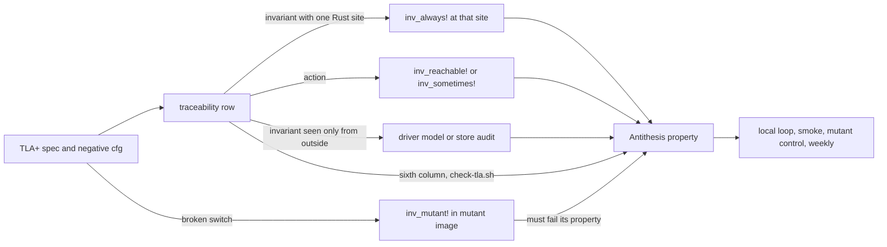

# ADR-4326: TLA+ invariants as Antithesis properties

- Status: Accepted (2026-11-16)
- Date: 2026-11-16
- Refs: #4326, #4325, #4308, ADR-1113 (D8, edited by this epic's checker
  task; 1113's own status line reads Accepted, while its index row in
  `docs/adrs/README.md` still says Proposed, corrected by #4330: see the
  #4330 amendment below), ADR-0002, ADR-0020, ADR-0052,
  ADR-0064, ADR-0065

## Context

`formal/tla` proves seven protocol designs in small models. Its 202
traceability rows (as `scripts/check-tla.sh traceability` counts them;
`formal/tla/TRACEABILITY.md` still says 199, corrected by #4330: see the
#4330 amendment below) name the Rust symbol behind each action and invariant, and
each area's `negative/` configs show that a broken switch violates the
invariant it names. Nothing checks the real binaries against those invariants
under crashes, pauses and partitions.

The ingest-durability workload (branch `antithesis/ingest-durability`, not yet
a pull request) runs two `ravel-server --mode all` processes over RustFS with a
driver that models acknowledged writes. Its first completed run held every
durability property and found #4325. The Antithesis SDK is linked only into
ravel-server, behind the off-by-default `antithesis` feature, while most rows
cite ravel-commit, ravel-ingest, ravel-catalog, ravel-maintain and
ravel-fleet, and some sites run in ravel-cli.

Two facts bound the design. Fold seal, compaction and retention work on whole
ingest hours and a reshard needs a two-hour lead, while a run lasts minutes: a
run uses 48 cores, so a cap of 12 compute hours is 15 minutes. And the task's
budget, raised by the owner for this epic from 200 to about 490 compute hours,
has about 452 left (38 billed before this epic).

## Decision

### 1. One invariant, one carrier

- **SUT site.** An invariant whose row names one Rust site becomes
  `inv_always!` there. Its predicate reads evidence the guarded step did not
  itself produce: the store call's result or a re-read, never a flag the same
  code just set. `assert_always` also fails when never reached, so it is the
  default. `inv_always_or_unreachable!` is allowed only on a guard that only a
  fault reaches, and its row then also names an `inv_reachable!`. A site
  whose re-read can fail to tell uses `inv_always_if_known!` (see the #4335
  amendment below).
- **Driver.** An invariant that no single site sees is checked in the driver:
  against the acked-record model, or by a store audit that lists the bucket
  and decodes HEAD, parts and records through `ravel-cli`.
- **Actions** become `inv_reachable!` or `inv_sometimes!`. A `*-reachable` or
  `*-nonvacuity` negative config maps to one of these, not to a mutant.

The macros live in a new crate, `ravel-invariant`, with no dependencies unless
its `antithesis` feature is on; then it links `antithesis_sdk`. The five
crates above depend on it. ravel-server's feature forwards to it, ravel-cli
gains the same feature, and the workload image builds both instrumented.
Without the feature every macro expands to nothing. A `capture` feature
records evaluations in process, so crate tests in a new gates lane show each
site holding and each mutant breaking it.

### 2. Rows in scope

| Area | In scope | Out of scope, and why |
|---|---|---|
| commit (21 rows) | SUT: `NoCommitWithoutData`, `OneIdentityOneContent`, `MarkerImpliesAllShardsDurable`, `NoPublishAfterAbandon`, `TokenNeverServesStale`. Driver (exists): `StrictAckImpliesDurable`, the duplicate and deadline obligations. Reachable: the put, retry, ack, abandon and marker actions | `TombstoneBucket`, `SupersedeRecord` (maintain, area 2); token identity and `PinFlush` (pure values, unit tested) |
| catalog (25) | Driver model: `CompactionPreservesMultiset`. Store audit: `HeadNamedObjectNeverDeleted` (also an SUT site at the sweep, see the #4335 amendment below), `HeadNamesOnlyCompleteParts`. SUT: `NoLiveCommitOmittedByLostCas`, `CorruptHeadFailsClosedOnDeletePaths`, `CompactionRecordImmutable` | Query rows and `SignalDedupContract` (differential tests own them); the offline oracle row |
| common (9) | All nine, from a raw S3 contract driver against RustFS | none |
| lifecycle (29) | SUT and audit: the delete gates, hold, refresh-failure, rewrite and completion rows, including `CompletionImpliesNoPreRewriteExposure`. Driver: `ErasedSubjectNeverServedAfterRequest` | Flight ticket and cached-HEAD pin rows (the driver holds no long-pinned query); the horizon `ASSUME` (startup validation) |
| resharding (19) | SUT: `OneCasWinner`, `CasAppendNeverDiscards`, the reader fence. With clock control (decision 5): `StaleWriterFailsClosed`, `EveryAdmittedWriteInScanSet`, `TokenResolvesAcrossReshards` | constants and CLI lead enforcement (unit tested) |
| maintenance (45) | SUT, ownership model: `MergeAttemptsConverge`, `DivergentInputSetNeverMutates`, `OwnershipIsNotPublicationAuthority`, the heartbeat and memo rows | The compaction-claim rows (no shipped caller; ADR-1029 is a proposal); type invariants |
| agents (54) | none | the runtime does not exist yet |

### 3. Mutant controls

A broken-switch negative config whose invariant decision 2 puts in scope
becomes a test-only mutant at the same Rust site; one outside that scope is
recorded `none: <reason>` in the area's `.tsv` (decision 6). The mutant form: `if inv_mutant!("commit/commit-before-data") { ... }`, named
`<area>/<negative cfg stem>`. One cargo feature, `antithesis-mutants`,
compiles every mutant in; `RAVEL_ANTITHESIS_MUTANT` selects at most one at
start, and an unknown name refuses to start. Without the feature the macro is
the constant `false`. Only `<workload>-mutants` image tags build the feature.
`check-release-profile.sh` refuses `antithesis` and `antithesis-mutants` in
the published build, in any `default` and in any workspace dependency edge,
as it does `format-drill`.

| Area | Mutants (negative cfg stem); each also runs in Antithesis |
|---|---|
| commit | `ack-before-commit`, `commit-before-data`, `mismatched-identity-idempotent` (also pins the identity RNG), `marker-before-all-shards` |
| catalog | `lost-cas-proceeds`, `compaction-swaps-record`, `sweep-superseded-no-head-gate`, `corrupt-head-ignores-delete-gate`; the #4335 amendment below adds `compaction-loser-overwrites` and names the property each compaction mutant breaks |
| common | `lost-response-not-applied`, `cas-accepts-stale-version`, `list-never-progresses` (bounded page count), in a driver-side broken store, since RustFS cannot be mutated |
| lifecycle | `refresh-failure-is-no-hold`, `delete-before-horizon`, `rewrite-keeps-erased-records`, `complete-ignores-served-set` |
| resharding, maintenance | `mo-diverge-overwrites-record`, `mo-missing-part-reports-converged`, `no-writer-fence`, `token-validated-against-count` |

Pass rule, two levels. Every mutant must make its named property false in the
local loop on the build box (mutant image, real server, real driver; no
Antithesis hours), and then fail its property in its own Antithesis run, with
a counterexample whose condition is false. Never reached does not count. A mutant whose property passes, or that fails only
another property, means the property is vacuous and blocks the wave.

### 4. Workloads

One config directory per topology, not one compose for everything. Each
workload documents itself in its directory and opts into the weekly run with
a marker file there.

- `ingest-durability`: unchanged topology; the commit area adds only
  assertions and the mutant image.
- `catalog-maintenance`: RustFS, init, two `--mode all`, two `--mode
  maintain`, and a driver that also runs `ravel-cli` (seeded load, fold,
  compact and sweep on demand, HEAD corruption through raw S3, the audit).
  Lifecycle and reshard are profiles of this driver, each with its own config
  directory and test name: holds, erasure requests and minimum GC horizons;
  `provision reshard` and a third maintain worker.
- `store-contract`: RustFS and a driver over `S3Store`, with no ravel-server.

### 5. Whole hours inside a short run

Sealed hours come from `ravel-cli load --ingest-hour-stride <HOURS>
--ingest-hour-start <unix hour>`, which writes backdated ingest hours the
driver's model knows. That lane refuses a tenant whose signal catalog HEAD
already exists, and nothing may fold or maintain the tenant while it runs
(`services/ravel-cli/src/load/hour_stride.rs`, the HEAD refusal and the
no-fold precondition). So each profile seeds a fresh tenant during setup,
before setup complete: the maintain workers and the driver's fold and compact
actions start only once the load has finished, which the driver signals by
writing a marker the workers' entrypoints wait for. Rows that need the clock to
move (a live hour sealing, reshard activation, erasure completion) get one
spike in the local loop: libfaketime with one offset in every container (the
clock-jump amendment below moves it into the Antithesis config). If
it fails, those rows are recorded `none: needs clock control`. This ADR adds
no clock seam to production code.

### 6. The traceability column

Each area table gains a sixth column, "Antithesis property". An area is
enrolled when its directory holds `antithesis-mutants.tsv`. For an enrolled
area, `check-tla.sh traceability` fails unless each data row's cell is one of:

- `sut: <path.rs> -- <message>`: the file exists and holds the literal
  message;
- `driver: <workload> -- <message>`: the literal occurs under
  `antithesis/<workload>/`;
- `none: <reason>`, with a non-empty reason.

The #4330 amendment below narrows what counts as the literal, where a mutant
may occur, and which table rows are separators.

The ` -- ` separator keeps the path a whole token: the checker's sweep
already resolves every `crates/...` token in a row
(`scripts/check-tla.sh`, `check_traceability`'s trailing loop), and a
`<path>:` form would leave a trailing colon that the resolver rejects.

A five-column table in an enrolled area fails, and so does a six-column table
with no `.tsv`. A header is recognised by its exact first cell, not by a
pattern. The `.tsv` has one line per `negative/*.cfg`, naming a mutant that
occurs as a literal in Rust and a property the table carries, or `none:
<reason>`. Each child epic's last task enrolls its area.

### 7. Budget

| Run class | Cap, compute hours | Band | Basis |
|---|---|---|---|
| Clean smoke, per workload config (5) | 12 | completes; every guarantee passes; every new SUT assertion reached | predicted; the 12-hour smoke run 4d85276e32085a10291c9eddd59d34b3-67-0 billed 13.0 compute hours over 16 minutes of billable time (`snouty runs usage`), measured 2026-11-16 |
| Overshoot above the cap, per run | about 1 | billed hours within cap + 1 | measured 2026-11-16: run 4d85276e32085a10291c9eddd59d34b3-67-0 billed 13.0 under a cap of 12, run 5bafcae0c50b1efc354cb19c89294955-67-0 billed 25.0 under a cap of 24 (`snouty runs usage`) |
| Mutant control in Antithesis, every mutant (19; 20 per the #4335 amendment below) | 12 each | named property fails with a counterexample | predicted |
| Mutant control, local loop, every mutant | 0 | named property false in the SDK's local output | predicted |
| Long run, per workload config (5) | 24 | no new guarantee failure, or one issue per failure | predicted |
| Whole epic | caps of 423, plus about 29 overshoot, about 452 of about 452 remaining | 5 smokes (60), 19 mutant runs (228; the twentieth the #4335 amendment below adds is not priced), 5 long runs (120), 15 for reruns; 29 runs at about 1 hour of overshoot each; one smoke and one long run per workload config, not per area | predicted; budget raised by the owner 2026-11-16 from 200 to about 490; 38 compute hours billed before this epic (13.0 and 25.0), measured 2026-11-16 (`snouty runs usage`, runs.md) |

A cap is not a hard ceiling: the billed hours of both runs so far came in about
one hour above it. Twenty-nine runs at that rate cost about 29 hours beyond
their caps, so the rerun reserve is 15 hours, not 24, and the epic plans to the
whole of the raised budget. A further rerun beyond that reserve needs the
owner's go. The #4335 amendment below brings the mutant count to 20; the
twentieth mutant's Antithesis run is not priced here.

Runs are priced per workload config, of which decision 4 defines five
(ingest-durability; catalog-maintenance and its lifecycle and reshard
profiles; store-contract), not per area: the maintenance-ownership rows ride
on the reshard profile, which runs the third maintain worker, so maintenance
has no smoke or long run of its own. Each config's long run is inside the
task's budget. Once enrolled, a clean
workload also joins the weekly workflow, whose 240-hour cap is split across
workloads, not multiplied.

### 8. Sequencing

The ingest-durability pull request lands first and is this epic's base; #4308
lands after it, and the first workload task waits for both. The contract
workload (area 3) is built beside the commit runs, ahead of catalog, because
it touches no SUT code. Images build on a replacement c6a.4xlarge in
nf-sandbox us-east-1, self-terminating after 12 hours, one per wave that
builds images; approving this ADR approves those boxes. Config images are
built with buildx, OCI media types, for the tenant registry.

Until #4325 is fixed, the entrypoint wait stays and "no unexpected container
exits" is expected to fail. A container exit whose log shows a startup
refusal after a store error is recorded against #4325 and does not block a
wave; any other exit does. The fix for #4325 removes both.

## Rejected alternatives

- **One workload for every area.** Faults spread over more services reach
  each property less often, and one broken service fails every run.
- **Driver-only checks.** A black box cannot see publish order, a lost CAS or
  a delete gate, only their late symptoms.
- **Assertions generated from the TLA text.** Model state has no mechanical
  map to Rust state; ADR-1113 D8 refuses refinement by shared vocabulary.
- **TLA trace validation.** It needs a trace exporter in every protocol path
  and checks runs already seen; it does not search faults.
- **One cargo feature per mutant.** CI's `all-features` job would turn every
  mutant on at once, and each would cost an instrumented build.
- **Mutants proven in the local loop only.** A local run is one fault-free
  timeline; an Antithesis run shows the property fails under the same fault
  search that is meant to find a real bug, so every mutant gets one.
- **A clock seam in ravel-server.** It changes production time handling.

## Consequences

- Five library crates gain a dependency on `ravel-invariant` and assertion
  sites on durability paths. They compile to nothing by default; the tasks
  that add them are high risk anyway. `antithesis_sdk` moves from ravel-server
  to `ravel-invariant`, and no published build links it.
- `NoPublishAfterAbandon` and `TokenNeverServesStale` have no negative config,
  so they are reached and checked but have no mutant control.
- Unproven after this epic: agents; the claim rows; query pinning rows;
  liveness beyond "eventually after faults stop"; hour-bound rows if the clock
  spike fails; and anything RustFS gets wrong beyond the nine contract rows.
  A held property is evidence over the explored timelines, not a proof.

## Amendment (2026-11-16): #4330 corrections to Context and decision 6

<!-- amendment-applies: sections="Context|6. The traceability column" pointer="#4330 amendment" -->

Two facts the Context states were corrected by #4330, the checker task: the
ADR-1113 row in `docs/adrs/README.md` now says Accepted, as ADR-1113's own
status line does, and `formal/tla/TRACEABILITY.md` now gives 202 rows, the
count `scripts/check-tla.sh traceability` resolves.

Decision 6 is narrowed as #4330 implements it:

- A message counts only as a double-quoted string literal: the `sut:` file,
  or a `.rs` file under `antithesis/<workload>/` for `driver:`, holds
  `"<message>"`. A substring of a longer literal, an unquoted occurrence and
  markdown under the workload do not count.
- A mutant from decision 3 occurs as `inv_mutant!("<area>/<stem>")` in a
  `.rs` file under `crates/`, `services/` or `antithesis/*/driver/`, the last
  for the common area's driver-side broken store.
- For a message and a mutant alike, a literal in a comment (a line starting
  with `//`, or inside a `/* ... */` block) or inside a `#[cfg(test)]` item
  does not count, and neither does one in a file under a `tests/`
  directory; a `sut:` path under `tests/` fails.
- `none:` is followed by a space and a non-empty reason, in the cell and in
  the `.tsv`.
- Only the row directly under a table's header may be its separator; any
  later row of pipes, spaces, dashes and colons is a data row and fails.

## Amendment (2026-11-17): the clock jump runs in the Antithesis config (#4334)

<!-- amendment-applies: sections="5. Whole hours inside a short run" pointer="clock-jump amendment" -->
<!-- amendment-supersedes: phrase="recorded `none: needs clock control`" pointer="clock-jump amendment" -->

Decision 5 put the clock spike in the local loop only. That leaves the
Antithesis run unable to reach compaction: `ravel-cli load` writes one object
per (shard, hour), and compaction skips a bucket with fewer than two inputs,
so a seeded hour folds but never compacts. Only hours ingested live, which
the short flush cadence fills with many level-0 objects, give compaction its
inputs, and a live hour seals only once its end plus `max_flush_lifetime +
clock_skew_allowance + fold_safety_margin` (4800 s with the defaults) has
passed. A timeline does not last that long, so the clock has to move where
the faults are.

For the catalog-maintenance workload and its lifecycle and reshard profiles,
the clock jump therefore runs in the Antithesis config itself, not only in
the local loop:

- Every container, the object store included, runs under libfaketime and
  reads one offset file on a shared volume. The offset starts at `+0`; each
  process rereads it at most every `FAKETIME_CACHE_DURATION` (2 s), so a
  jump lands in every process within about 2 s of the offset write. Inside
  that window a process that has not reread is a whole jump behind one that
  has, far beyond SigV4's 900 s skew limit, so a request between two such
  processes (a server's background request to the store included) may be
  refused or fail. The driver holds its write gate from before the offset
  write until the reread interval has passed, so none of its own writes or
  checks falls in the window. Monotonic clocks are not faked.
- After seeding and some acknowledged live writes, the driver moves every
  clock forward once per timeline, as one of its actions, and records the
  jump in its assertions. This sealing jump is at least one hour plus
  `max_flush_lifetime + clock_skew_allowance + fold_safety_margin`, 8400 s
  with the defaults, which seals the ingest hour of every write acknowledged
  before it, wherever in its hour the write landed. The config uses 9000 s.
- It fails closed. A container whose binary libfaketime cannot reach (a
  statically linked one) or that cannot read the offset file refuses to
  start, so setup never completes over a clock that would not move, and a
  row that needs the clock fails instead of being recorded as `none: needs
  clock control`. The store therefore runs RustFS's glibc build; its default
  build is a static-pie musl binary that no preload reaches.
- Once that jump has landed and a compaction record has been seen, the
  driver moves every clock forward twice more, the same way and under the
  same write-gate hold, so the sweep can delete a superseded compaction
  input. The first sweep jump passes the record's protection horizon
  (`max_query_duration + grace + clock_skew_allowance`, 90300 s with the
  defaults); the driver then folds and sweeps, which writes each input's
  unnamed-since marker (ADR-1133). The second passes the marker's
  pinned-query window (`max_query_duration + head_cache_ttl + 4 *
  clock_skew_allowance`, 4830 s), after which a sweep deletes the input.
  One jump cannot do both, since the marker records the time of the pass
  that wrote it. Both minimums come from the shipped defaults, which the
  run keeps; the config uses 91200 s and 5400 s.
- `clock: an hour ingested live was sealed by a fold`, `catalog: a
  compaction record was published` and `catalog: sweep deleted a
  superseded compaction input` are reachable in a plain run, and the local
  loop gates on all three.

Production code still has no clock seam: the jump is test infrastructure
around unmodified binaries.

## Amendment (2026-11-17): #4335 catalog mutants and the sweep site

<!-- amendment-applies: sections="1. One invariant, one carrier|2. Rows in scope|3. Mutant controls|7. Budget" pointer="#4335 amendment" -->

#4335, the catalog task, corrects the catalog rows of decisions 2 and 3 to
match the TLA model's negative configs and the sites it shipped, and adds one
macro to decision 1.

Decision 1 gains `inv_always_if_known!`, an always-property over an
`Option<bool>`: `Some` is evaluated as `inv_always!` evaluates its condition,
`None` records nothing, and without the feature it expands to nothing. It
carries `NoLiveCommitOmittedByLostCas`, "catalog: a fold reports as folded
only a HEAD the store holds", in `ravel-catalog`'s fold, which re-reads HEAD
after its CAS. After an acknowledged CAS the property is false only when the
re-read returns the version the CAS was conditioned on, or no HEAD after an
acknowledged create; any other version is this write or a later one, such as
a rebuild over a corrupted HEAD, whatever watermark it holds. After a refused
CAS, reached only under the `lost-cas-proceeds` mutant, it holds only when the
stored HEAD is this fold's. A failed re-read, a HEAD that does not decode
where it is compared, and no HEAD after an acknowledged overwrite cannot
tell, and record nothing.

This property assumes a store does not reuse a version for a different write.
A CAS conditioned on a corrupt HEAD breaks that assumption and so records
nothing (the `None` arm): the catalog-maintenance driver corrupts HEAD with a
fixed body, and RustFS reuses a content-derived ETag for identical bytes
(#4389), so when the driver re-corrupts with the same body between the acked
CAS and the re-read, the re-read returns the very version the CAS was
conditioned on even though the write landed. A Valid HEAD's bytes carry the
fold's `folder_id` and `created_unix_ns`, so its version does not recur and
its arm still evaluates. One case stays uncovered: a retry within a single
fold call that rewrites byte-identical HEAD bytes over its own applied write
could still read as not applied; closing it needs a nonce in the HEAD, a
format change that is out of scope here.

Decision 3's catalog row has five mutants, not four. The model has two
compaction switches, and each breaks a different invariant
(`formal/tla/catalog/results.md`):

| Mutant | Model switch | Property it makes false |
|---|---|---|
| `compaction-swaps-record` | `CompactionSwapsRecord` | `CompactionPreservesMultiset`, the driver property "catalog: compaction preserves the acked multiset" |
| `compaction-loser-overwrites` | `CompactionLoserOverwrites` | `CompactionRecordImmutable`, the SUT property "catalog: a published compaction record is never replaced" |

`compaction-swaps-record` moves the last input identity of a compaction to the
writer id `ffffffff-ffff-ffff-ffff-ffffffffffff`, which no writer is issued
(writers get version 4 UUIDs), before the parts are built. The record and its
parts are built under the hash of the identities it names, so it decodes, its
key matches, its declared `input_set_hash` is the hash of its own inputs (the
seal-divergence check passes), every part footer carries that hash (the query
path's L1 identity check passes), and the identity count and every sample
count are kept (the counts-only conservation gate in `ravel-maintain`'s
publish path passes). Only the driver's check of the acked multiset sees it.
The mutant is compaction's: a format migration rewrite, which publishes
through the same path, is untouched. `compaction-loser-overwrites`
is the switch an earlier draft shipped under the `compaction-swaps-record`
name: a publisher that loses the record's create-only PUT writes its own
payload over the winner's.

Decision 2's catalog row lists `HeadNamedObjectNeverDeleted` under the store
audit. It also has an SUT site, "catalog: a sweep never deletes an object the
current HEAD names", in the superseded sweep of `ravel-maintain`, judged from
one fresh HEAD read per cleared group before that group's first delete; the
`sweep-superseded-no-head-gate` mutant makes it false there. The store audit
stays.

Decision 7 prices 19 mutant runs. With this correction there are 20, and the
twentieth run (a 12-hour cap and about one hour of overshoot) is not in the
plan of about 452 hours. It comes out of the rerun reserve or needs the
owner's go, as a rerun beyond the reserve does.

## Amendment (2026-11-19): fault switches for ingest answers a store fault cannot reach (#4496)

<!-- amendment-applies: none reason="adds a fault-switch macro and two ingest switches beside the mutant controls of decision 3, which stand as written; it retires and narrows no earlier wording" -->

Approved by the owner 2026-11-19, as Phase B1 of the ingest-durability
coverage variant (#4326).

A store fault does not reach three ingest answers: the `ShardUnavailable`
answer of a flush whose write-gate encode returned no result, the
partial-shard commit that answer leaves when a sibling shard committed, and
the metrics and logs `Abandoned` answer of a data PUT that ended without
landing. A store outage retries inside `object_store` for up to 180 s, so the
10 s strict-ack timeout answers the write first. This amendment adds a switch
that takes each of those paths on demand.

- `inv_fault!("<area>/<name>")`, in `ravel-invariant`, is a `bool`. It is
  compiled in under the `antithesis` feature (the workload images) and under
  `capture` (the invariants lane, so its tests run in CI); with neither it is
  the constant `false`, as `inv_mutant!` is without `antithesis-mutants`. A
  name outside `fault::FAULTS` does not compile where the switch is compiled
  in.
- `RAVEL_ANTITHESIS_FAULTS` sets the rates, as `name=rate,name=rate` with each
  rate a decimal in `[0, 1]`. `init` reads it once; unset or empty enables
  nothing. An unknown name, a rate that does not parse or lies outside
  `[0, 1]`, an entry that is not `name=rate`, a name given twice, or a value
  that is not UTF-8 is a typed `InitError`, and the process refuses to start.
  Rate 0 does not fire and rate 1 fires at every evaluation, neither with a
  draw; a rate between draws from `antithesis_sdk::random` under
  `antithesis` and from a std-only generator under `capture` alone. Each
  firing records the reachable `fault: <name> fired`. A test sets a rate on
  its own thread with `fault::scoped`.
- `ingest/encode-cancelled`, in `WriteGateSlot::encode_on`, returns the gate's
  `Cancelled` error without running the encode, before the slot's gate-less
  inline return, so it reaches a flush with or without a write gate. The
  metrics, logs and spans flush encodes all pass through `encode_on`. The
  flush answers it as case five of the buffered-drop list in
  `docs/consistency-model.md` answers a gate fault: no store call, the strict
  waiter gets the retryable `ShardUnavailable`, and `flush_gate_faults`
  counts it.
- `ingest/data-put-refused`, in the metrics and logs
  `put_data_object_with_retry`, returns `PutAbort::Exhausted` before the
  first data PUT; the flush has already made its fencing call
  (`ensure_fenced`) by then. The flush answers it as case one of that
  list: the strict waiter gets the retryable `Abandoned`, and
  `abandoned_retry_exhausted` counts it. The spans twin carries no switch.

A switch is not a mutant. A mutant run expects its named property to go
false; a fault run expects every property to hold, since the switch only
takes a failure path the SUT already answers. The two keep separate macros,
environment variables, registries and `InitError` variants, and a fault
needs no mutant image.

The switches weaken no durability. Each answer they produce is one
`docs/consistency-model.md` already defines; on both paths the flush ends
before its data object is written, so that shard gives the strict waiter no
token and writes no commit record. A write whose other shards committed
answers `PartialWrite` with their tokens: the partial-shard commit named
above. A buffered write was
acknowledged at enqueue, before either switch, as it is for the store
faults these switches stand in for. `check-release-profile.sh` refuses
`antithesis` and `ravel-invariant/capture` in the published image build (the
Dockerfile and `publish-images.yml`) and in every workspace manifest, except
`antithesis` forwarded by a feature of the same name, so a published binary
compiles neither switch in.
