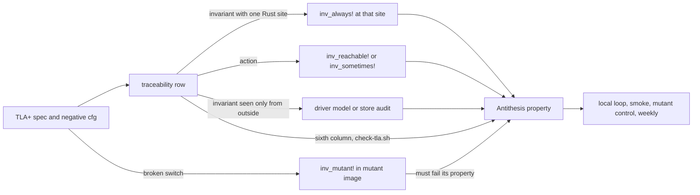

# ADR-4326: TLA+ invariants as Antithesis properties

- Status: Proposed
- Date: 2026-11-16
- Refs: #4326, #4325, #4308, ADR-1113 (D8, edited by this epic's checker
  task; 1113 is still Proposed), ADR-0002, ADR-0020, ADR-0052, ADR-0064,
  ADR-0065

## Context

`formal/tla` proves seven protocol designs in small models. Its 199
traceability rows name the Rust symbol behind each action and invariant, and
each area's `negative/` configs show that a broken switch violates the
invariant it names. Nothing checks the real binaries against those invariants
under crashes, pauses and partitions.

The ingest-durability workload (branch `antithesis/ingest-durability`, not yet
a pull request) runs two `ravel-server --mode all` processes over RustFS with a
driver that models acknowledged writes. Its first completed run held every
durability property and found #4325. The Antithesis SDK is linked only into
ravel-server, behind the off-by-default `antithesis` feature, while most rows
cite ravel-commit, ravel-ingest, ravel-catalog, ravel-maintain and
ravel-fleet, and some sites run in ravel-cli.

Two facts bound the design. Fold seal, compaction and retention work on whole
ingest hours and a reshard needs a two-hour lead, while a run lasts minutes: a
run uses 48 cores, so a cap of 12 compute hours is 15 minutes. And the task's
budget, raised by the owner for this epic from 200 to about 490 compute hours,
has about 453 left.

## Decision

### 1. One invariant, one carrier

- **SUT site.** An invariant whose row names one Rust site becomes
  `inv_always!` there. Its predicate reads evidence the guarded step did not
  itself produce: the store call's result or a re-read, never a flag the same
  code just set. `assert_always` also fails when never reached, so it is the
  default. `inv_always_or_unreachable!` is allowed only on a guard that only a
  fault reaches, and its row then also names an `inv_reachable!`.
- **Driver.** An invariant that no single site sees is checked in the driver:
  against the acked-record model, or by a store audit that lists the bucket
  and decodes HEAD, parts and records through `ravel-cli`.
- **Actions** become `inv_reachable!` or `inv_sometimes!`. A `*-reachable` or
  `*-nonvacuity` negative config maps to one of these, not to a mutant.

The macros live in a new crate, `ravel-invariant`, with no dependencies unless
its `antithesis` feature is on; then it links `antithesis_sdk`. The five
crates above depend on it. ravel-server's feature forwards to it, ravel-cli
gains the same feature, and the workload image builds both instrumented.
Without the feature every macro expands to nothing. A `capture` feature
records evaluations in process, so crate tests in a new gates lane show each
site holding and each mutant breaking it.

### 2. Rows in scope

| Area | In scope | Out of scope, and why |
|---|---|---|
| commit (21 rows) | SUT: `NoCommitWithoutData`, `OneIdentityOneContent`, `MarkerImpliesAllShardsDurable`, `NoPublishAfterAbandon`, `TokenNeverServesStale`. Driver (exists): `StrictAckImpliesDurable`, the duplicate and deadline obligations. Reachable: the put, retry, ack, abandon and marker actions | `TombstoneBucket`, `SupersedeRecord` (maintain, area 2); token identity and `PinFlush` (pure values, unit tested) |
| catalog (25) | Driver model: `CompactionPreservesMultiset`. Store audit: `HeadNamedObjectNeverDeleted`, `HeadNamesOnlyCompleteParts`. SUT: `NoLiveCommitOmittedByLostCas`, `CorruptHeadFailsClosedOnDeletePaths`, `CompactionRecordImmutable` | Query rows and `SignalDedupContract` (differential tests own them); the offline oracle row |
| common (9) | All nine, from a raw S3 contract driver against RustFS | none |
| lifecycle (29) | SUT and audit: the delete gates, hold, refresh-failure, rewrite and completion rows, including `CompletionImpliesNoPreRewriteExposure`. Driver: `ErasedSubjectNeverServedAfterRequest` | Flight ticket and cached-HEAD pin rows (the driver holds no long-pinned query); the horizon `ASSUME` (startup validation) |
| resharding (19) | SUT: `OneCasWinner`, `CasAppendNeverDiscards`, the reader fence. With clock control (decision 5): `StaleWriterFailsClosed`, `EveryAdmittedWriteInScanSet`, `TokenResolvesAcrossReshards` | constants and CLI lead enforcement (unit tested) |
| maintenance (45) | SUT, ownership model: `MergeAttemptsConverge`, `DivergentInputSetNeverMutates`, `OwnershipIsNotPublicationAuthority`, the heartbeat and memo rows | The compaction-claim rows (no shipped caller; ADR-1029 is a proposal); type invariants |
| agents (51) | none | the runtime does not exist yet |

### 3. Mutant controls

A broken-switch negative config becomes a test-only mutant at the same Rust
site: `if inv_mutant!("commit/commit-before-data") { ... }`, named
`<area>/<negative cfg stem>`. One cargo feature, `antithesis-mutants`,
compiles every mutant in; `RAVEL_ANTITHESIS_MUTANT` selects at most one at
start, and an unknown name refuses to start. Without the feature the macro is
the constant `false`. Only `<workload>-mutants` image tags build the feature.
`check-release-profile.sh` refuses `antithesis` and `antithesis-mutants` in
the published build, in any `default` and in any workspace dependency edge,
as it does `format-drill`.

| Area | Mutants (negative cfg stem); each also runs in Antithesis |
|---|---|
| commit | `ack-before-commit`, `commit-before-data`, `mismatched-identity-idempotent` (also pins the identity RNG), `marker-before-all-shards` |
| catalog | `lost-cas-proceeds`, `compaction-swaps-record`, `sweep-superseded-no-head-gate`, `corrupt-head-ignores-delete-gate` |
| common | `lost-response-not-applied`, `cas-accepts-stale-version`, `list-never-progresses` (bounded page count), in a driver-side broken store, since RustFS cannot be mutated |
| lifecycle | `refresh-failure-is-no-hold`, `delete-before-horizon`, `rewrite-keeps-erased-records`, `complete-ignores-served-set` |
| resharding, maintenance | `mo-diverge-overwrites-record`, `mo-missing-part-reports-converged`, `no-writer-fence`, `token-validated-against-count` |

Pass rule, two levels. Every mutant must make its named property false in the
local loop on the build box (mutant image, real server, real driver; no
Antithesis hours), and then fail its property in its own Antithesis run, with
a counterexample whose condition is false. Never reached does not count. A mutant whose property passes, or that fails only
another property, means the property is vacuous and blocks the wave.

### 4. Workloads

One config directory per topology, not one compose for everything. Each
workload documents itself in its directory and opts into the weekly run with
a marker file there.

- `ingest-durability`: unchanged topology; the commit area adds only
  assertions and the mutant image.
- `catalog-maintenance`: RustFS, init, two `--mode all`, two `--mode
  maintain`, and a driver that also runs `ravel-cli` (seeded load, fold,
  compact and sweep on demand, HEAD corruption through raw S3, the audit).
  Lifecycle and reshard are profiles of this driver, each with its own config
  directory and test name: holds, erasure requests and minimum GC horizons;
  `provision reshard` and a third maintain worker.
- `store-contract`: RustFS and a driver over `S3Store`, with no ravel-server.

### 5. Whole hours inside a short run

Sealed hours come from `ravel-cli load --ingest-hour-start`, which writes
backdated ingest hours the driver's model knows. Rows that need the clock to
move (a live hour sealing, reshard activation, erasure completion) get one
spike in the local loop: libfaketime with one offset in every container. If
it fails, those rows are recorded `none: needs clock control`. This ADR adds
no clock seam to production code.

### 6. The traceability column

Each area table gains a sixth column, "Antithesis property". An area is
enrolled when its directory holds `antithesis-mutants.tsv`. For an enrolled
area, `check-tla.sh traceability` fails unless each data row's cell is one of:

- `sut: <path.rs>: <message>`: the file exists and holds the literal message;
- `driver: <workload>: <message>`: the literal occurs under
  `antithesis/<workload>/`;
- `none: <reason>`, with a non-empty reason.

A five-column table in an enrolled area fails, and so does a six-column table
with no `.tsv`. A header is recognised by its exact first cell, not by a
pattern. The `.tsv` has one line per `negative/*.cfg`, naming a mutant that
occurs as a literal in Rust and a property the table carries, or `none:
<reason>`. Each child epic's last task enrolls its area.

### 7. Budget

| Run class | Cap, compute hours | Band | Basis |
|---|---|---|---|
| Clean smoke, per area | 12 | completes; every guarantee passes; every new SUT assertion reached | predicted; run 4d85276e32085a10291c9eddd59d34b3-67-0 completed in 22 minutes under a cap of 12, measured 2026-11-16 |
| Mutant control in Antithesis, every mutant (19) | 12 each | named property fails with a counterexample | predicted |
| Mutant control, local loop, every mutant | 0 | named property false in the SDK's local output | predicted |
| Long run, per area | 24 | no new guarantee failure, or one issue per failure | predicted |
| Whole epic | 432 of about 453 remaining | 5 smokes (60), 19 mutant runs (228), 5 long runs (120), 24 for reruns | predicted; budget raised by the owner 2026-11-16 from 200 to about 490; caps of 36 launched before this epic, measured 2026-11-16 (runs.md) |

Each area's long run is inside the task's budget. Once enrolled, a clean
workload also joins the weekly workflow, whose 240-hour cap is split across
workloads, not multiplied.

### 8. Sequencing

The ingest-durability pull request lands first and is this epic's base; #4308
lands after it, and the first workload task waits for both. The contract
workload (area 3) is built beside the commit runs, ahead of catalog, because
it touches no SUT code. Images build on a replacement c6a.4xlarge in
nf-sandbox us-east-1, self-terminating after 12 hours, one per wave that
builds images; approving this ADR approves those boxes. Config images are
built with buildx, OCI media types, for the tenant registry.

Until #4325 is fixed, the entrypoint wait stays and "no unexpected container
exits" is expected to fail. A container exit whose log shows a startup
refusal after a store error is recorded against #4325 and does not block a
wave; any other exit does. The fix for #4325 removes both.

## Rejected alternatives

- **One workload for every area.** Faults spread over more services reach
  each property less often, and one broken service fails every run.
- **Driver-only checks.** A black box cannot see publish order, a lost CAS or
  a delete gate, only their late symptoms.
- **Assertions generated from the TLA text.** Model state has no mechanical
  map to Rust state; ADR-1113 D8 refuses refinement by shared vocabulary.
- **TLA trace validation.** It needs a trace exporter in every protocol path
  and checks runs already seen; it does not search faults.
- **One cargo feature per mutant.** CI's `all-features` job would turn every
  mutant on at once, and each would cost an instrumented build.
- **Mutants proven in the local loop only.** A local run is one fault-free
  timeline; an Antithesis run shows the property fails under the same fault
  search that is meant to find a real bug, so every mutant gets one.
- **A clock seam in ravel-server.** It changes production time handling.

## Consequences

- Five library crates gain a dependency on `ravel-invariant` and assertion
  sites on durability paths. They compile to nothing by default; the tasks
  that add them are high risk anyway. `antithesis_sdk` moves from ravel-server
  to `ravel-invariant`, and no published build links it.
- `NoPublishAfterAbandon` and `TokenNeverServesStale` have no negative config,
  so they are reached and checked but have no mutant control.
- Unproven after this epic: agents; the claim rows; query pinning rows;
  liveness beyond "eventually after faults stop"; hour-bound rows if the clock
  spike fails; and anything RustFS gets wrong beyond the nine contract rows.
  A held property is evidence over the explored timelines, not a proof.
