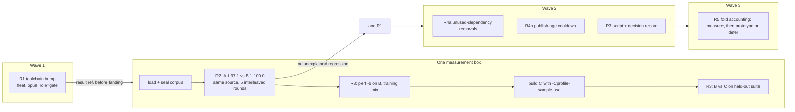

# ADR-4523: Rust 1.100.0 toolchain, a compiler-only measurement, and three separable experiments

Status: Accepted (2026-11-20). Epic #4523. Approved by the owner, together
with decision 2 (keep `rust-version` at 1.97) and the box in decision 4
(c6a.metal, with a c7i.metal-24xl only if the branch-sampling check fails).

Migration classes touched (ADR-0066 decision 4): none. No persistent format,
proto schema, series identity, commit token or object key changes. No wire
change, no DataFusion or Arrow upgrade, no global allocator change.

## Context

### What main does today (d766815c0)

- `rust-toolchain.toml` pins 1.97.1 with rustfmt, clippy and llvm-tools.
  The workspace declares `rust-version = "1.97"`
  (`Cargo.toml:12`), inherited by every member, and
  `crates/ravel-compat-tests/Cargo.toml:6` repeats it for that standalone
  workspace. Every manifest, including the three Antithesis drivers and the
  fuzz crates, is edition 2024. No crate is published and no CI lane builds
  with any compiler other than the pin.
- Release profile: `lto = "thin"`, `codegen-units = 1`, `debug = 1`
  (`Cargo.toml:270-273`). The server image builds
  `--features sql,flight-sql,otap,agents,mcp` (`Dockerfile:53`), splits
  symbols with objcopy into a `debug-symbols` stage, and runs on
  distroless cc-debian12 (glibc 2.36). jemalloc (`tikv-jemallocator`) is the
  global allocator of ravel-server and ravel-cli.
- Toolchain consumers:
  - `Dockerfile:16` and `.brig/Dockerfile:28` pin
    `rust:1.97.1-bookworm` by the same digest.
  - `Dockerfile.prebuilt:19` names the version in a comment, and
    `scripts/build-prebuilt-binaries.sh` builds inside the Dockerfile's
    builder stage with `RUSTUP_TOOLCHAIN` set from the toml, so the two must
    agree.
  - Seven Antithesis stages use `rust:1.97.1-trixie` by tag (the
    catalog-maintenance, ingest-durability and store-contract drivers and
    server images).
  - CI runs `rustup show` against the toml in every Rust job. A toml change
    forces every CI lane to run (`ci.yml:169`).
  - Live docs that name the version: the README badge and
    `docs/guides/getting-started.md:220`.
- No repository script reads Cargo's intermediate build layout (`deps`,
  `build/`, `.fingerprint`, `incremental`, another crate's `OUT_DIR`); every
  script uses final paths under `target/<profile>/`. The exposure to the
  1.100 build-dir layout change is third-party: cargo-llvm-cov,
  Swatinem/rust-cache and sccache.
- No gate turns Cargo-level warnings into errors: every `-D warnings` sits
  after `--` and applies to rustc and clippy only. One step reads cargo's
  stderr strictly: `scripts/guards/check-advisory-delta.sh` requires every
  non-blank stderr line of `cargo deny --format json` to be JSON.
- `fuzz-nightly.yml:101` runs `cargo install cargo-fuzz --locked` with no
  version. Tool installs elsewhere go through taiki-e/install-action (no
  version pin) or, in the Brig image, by sha256.
- Issue #2103: clippy 1.98 fails on `chunks_exact_to_as_chunks` in
  ravel-segment. The sites on main are `crates/ravel-segment/src/reader.rs:909`,
  `crates/ravel-segment/src/value_codecs.rs:444` and
  `crates/ravel-codec/src/key_idx.rs:755,928`.

### What Rust 1.98 through 1.100 change that matters here

From the 1.100.0 announcement and the release notes for 1.98.0 to 1.100.0:

- The never-type fallback becomes `!` and `Infallible` becomes an alias of
  `!`. Closures capture more precisely in `if let`. Some `Box` impls are
  generic over the allocator, which can break inference. `box` patterns
  are gone. `Iterator::{min, max}` may call different `Ord` methods.
  Main has no `Infallible` trait impls, no `box` patterns, no
  `repr(packed)`, and its only manual `Ord` impls order integers
  (`crates/ravel-catalog/src/fold.rs:3468`).
- Cargo's build-dir layout changes (artifacts grouped by build step, the
  config hash moves into the parent directory). Cargo 1.99 disables
  incremental compilation when `CI` is set.
- `cargo install` ignores `--locked` and uses the tarball's lockfile by
  default.
- New Cargo lint `cargo::unused_dependencies`, warn by default, under
  `[lints.cargo]`. It never fires on dev-dependencies and only fires when
  every target that could use a dependency is built.
- `[registry] global-min-publish-age` holds back index versions younger
  than the limit at resolution. Versions already in `Cargo.lock` are never
  held back, versions without an index `pubtime` are never held back,
  `cargo install` ignores it, and
  `CARGO_RESOLVER_INCOMPATIBLE_PUBLISH_AGE=allow` overrides it for one
  command.
- `-Cprofile-sample-use` is stable. The 1.99 notes record an update to
  LLVM 23; main's 1.97.1 is LLVM 22.1.6. R1 records the LLVM version of the
  1.100.0 toolchain from `rustc -vV`, since the 1.100 notes do not state it.
- The `Allocator` trait, `Global`, `System`, `Vec::new_in` and `Box::new_in`
  are stable. `Allocator` is an `unsafe trait`, so implementing it needs
  `unsafe`, which the workspace forbids (`unsafe_code = "forbid"`).

### Baseline the measurement starts from

The #4232 perfmap readouts on main 90e7643c9 (rustc 1.97.1, c6a.4xlarge,
loopback s3s-fs, 8 GB decoded cache; comments 6900075592 and 6900206618)
are the reference. Q33 hot runs at 15.0 of 16 vCPU, so it is CPU-bound and is
where a compiler or PGO effect would show. Peak RSS (VmHWM) is 25.1 GB. The row-path
`SELECT *` by UserID figure in comment 6900075592 no longer applies after
#4255. c6a.4xlarge exposes no PMU, so no
virtualised c6a size can collect branch samples. R2's arm A re-measures the
baseline under this ADR's protocol rather than reusing those numbers, because
the host differs.

The harness pieces are:

- `benchmarks/clickbench/kit/box/run.sh` for load, fold, declare, cold and hot
  statements and the concurrent client phase;
- the stats JSON for per-phase GET requests and wire bytes;
- the comparator in `crates/ravel-bench/src/clickbench_parquet/comparator.rs`;
- the perfmap harness at s3://ravel-clickbench-5b7101/reports/perfmap/harness/
  for the OTLP ingest plus query mix, per-thread CPU and RSS sampling.

Neither the stats nor the kit reports per-query CPU seconds or query
p95/p99. Both come from `/proc/<pid>/stat` deltas and from the per-call
durations in `calls.jsonl`.

## Decision

### 1. R1: pin 1.100.0 everywhere live, change source only where it breaks

- `rust-toolchain.toml` channel `1.100.0`, same three components.
- `Dockerfile` builder and `.brig/Dockerfile` `FETCH_IMAGE`:
  `rust:1.100.0-bookworm@sha256:ade39a710ef85f3506cffcfec3e8a24ba090badef1dff2fb798f71d878833fea`
  (Docker Hub index digest, resolved 2026-11-20; the same lookup reproduces
  main's 1.97.1 pin). Bookworm keeps the glibc 2.36 match with the distroless
  runtime. `Dockerfile.prebuilt` comment, README badge and
  `getting-started.md` follow. The seven Antithesis stages move to
  `rust:1.100.0-trixie` by tag, as they are pinned today. Historical
  benchmark provenance (`benchmarks/metrics/`, `benchmarks/rlog-compaction/`,
  ADR text, `docs/internal/` readouts, `bench/baselines/s3-envelope.json`)
  stays as recorded.
- Source changes are limited to what fails the existing gates under 1.100:
  the #2103 sites and any other rustc, clippy or rustfmt finding (1.98
  changed rustfmt). No new lint is enabled and no lint cleanup rides along.
  Lockfiles stay as reviewed: every build is `--locked`.
- Discovery is a sweep, not a CI loop. Under 1.100 the executor runs
  `cargo clippy --locked -p <crate> --all-targets -- -D warnings` for every
  workspace member, the same with each feature set the gates' lanes select,
  `cargo fmt --all --check`, and the same three for
  `crates/ravel-compat-tests` and the three Antithesis drivers against
  their own manifests. It fixes each finding, then repeats the sweep until
  it is clean.
- The R1 source must still compile on 1.97.1. Two things depend on that.
  R2's arm A builds the same source on the old compiler. A compiler rollback
  must also be a one-commit revert. So R1 uses no std API or language feature
  newer than 1.97, and clippy's `incompatible_msrv` enforces the std half
  while `rust-version` stays at 1.97 (decision 2).
- `fuzz-nightly.yml` pins `cargo install cargo-fuzz@<current version>`,
  because `--locked` no longer pins anything. The taiki-e installs and the
  cache actions are checked by the PR's own CI run. Their behaviour under
  the new build-dir layout is verified by green coverage, cache restore and
  sccache steps, not assumed.
- `cargo::unused_dependencies` warnings that 1.100 prints are left alone in
  R1. They fail no gate (no gate denies cargo lints), and their removal is
  R4a's change. `check-advisory-delta.sh` is confirmed against cargo 1.100's
  stderr in the same CI run.

Gating. R1 touches every crate's compile, so its closure is the workspace.
The evidence comes from two fleet tasks plus the pull request's CI:

- **The R1 executor** (`role=gate`) runs:
  - the discovery sweep above until it is clean;
  - `scripts/gates.sh --tier executor` scoped to every crate it edits;
  - the MSRV proof for decision 2, `cargo +1.97.0 check --locked
    --workspace --all-targets` with each feature set the gates' lanes select
    (`sql`, `flight-sql`, `esql`, `otap`, `agents`, `mcp`, the ravel-bench
    and ravel-cli sets);
  - the `ravel-compat-tests` fmt, clippy and test steps, against its own
    manifest.
- **A read-only fleet task** runs the unscoped merge gate
  (`RAVEL_GATES_ALLOW_UNSCOPED=1 RAVEL_GATES_SKIP_SDK=1 scripts/gates.sh`)
  on the result ref, on the `role=gate` executor: 484 GB volume, with
  static.rust-lang.org on its egress allowlist. It is a separate task so the
  4 h executor ceiling covers each half.
- **The pull request's CI** runs every lane, because the toml change forces
  them all, including `docker-build` and `compat-tests`.

If the read-only gate does not finish, the receipt is written by hand on the
split evidence (the owner's 2026-11-10 ruling) and recorded on the ledger
with each task id and EXIT line. The previous-release compatibility lane is disabled (`if: false`
until v0.35) and is reported as not run. The active compat drills and the
released-binary drill run in `compat-tests`.

Beyond the pull request:

- Release images and the prebuilt path are smoke-built for amd64 and arm64.
- The three Antithesis images are rebuilt on the existing GCP build VM. The
  `build.sh` instrumentation checks must pass: `nm` for
  `antithesis_load_libvoidstar`, `readelf` for `__sancov_guards`, and
  `--build-id` present. The new LLVM keeps the sancov flags (verified, not
  assumed).

Reachability: the acceptance check is the shipped artefact. The release
image's server binary, read with `readelf -p .comment` or by running
`rustc -vV` in the builder, names rustc 1.100.0, and the image's smoke test
passes.

### 2. MSRV: keep 1.97 through this epic, prove it, raise it later on its own

`rust-version` stays `"1.97"` in both manifests. R1 proves it with the
`cargo +1.97.0 check --locked` runs above, across the shipped feature sets.

With the floor at 1.97, clippy's `incompatible_msrv` refuses std APIs newer
than 1.97. That is the std half of keeping a compiler rollback a one-commit
revert. The lint does not see language features or edition-behaviour
changes stabilised in 1.98 to 1.100, and no standing check covers that half
after R1's one-off `+1.97.0 check` (rejected alternatives, MSRV lane). This
epic accepts that risk for the window until the floor is raised. Before any
compiler rollback, run `cargo +1.97.0 check --locked --workspace
--all-targets` on the rollback candidate. That one command lists every
language-feature use that has to be reverted along with the pin. The lint is
in clippy's default-on
`suspicious` group. It reads `rust-version` when there is no `clippy.toml`,
and main has none. R1 confirms this once with a throwaway probe: a call to a
1.98+ std API in a scratch commit must fail `clippy -D warnings`, and the
probe is dropped before the result commit. If the probe passes, decision 2
still holds, but the guard is the `+1.97.0 check` alone, and the ledger
says so.

Raising the floor to 1.100 is a separate one-line change. It ships after the
first release built on 1.100 has gone out without a compiler rollback, or
earlier if an adopted change in this epic needs a 1.98+ API, in which case
that change raises it in its own commit. No 1.100-only API is planned in this
epic (decisions 6 and 7).

### 3. R2: one controlled host, same source, interleaved pairs

- **Arms.** A is the R1 candidate source built with 1.97.1. B is the same
  source built with 1.100.0.
- **Build.** Both arms build on the box with the same `Cargo.lock`, release
  profile, features (`sql,flight-sql,otap,agents,mcp`), target
  (`x86_64-unknown-linux-gnu`) and allocator. Each arm gets its own
  `CARGO_TARGET_DIR` and an explicit `RUSTUP_TOOLCHAIN`, because the kit
  otherwise installs whatever the toml names and arm A would silently build
  with 1.100. The report records each binary's sha256 and its `rustc -vV`.
- **Arm identity is a failing precondition.** Before any timed statement,
  `readelf -p .comment` on each server binary must name rustc 1.97.1 for A
  and 1.100.0 for B. A mismatch stops the run.
- **Build cost.** Build wall time and target-dir size are reported
  separately from runtime.
- **Data.** One loaded ClickBench corpus (`hits.parquet`, kit load flags,
  4 shards) is folded and verified sealed before the first timed statement.
  The fold's `entries` must equal `objects written`, and declared columns
  must be present. Both arms run against the same store, cache configuration
  and server flags.
- **Cache arms.** The shipping cache configuration is decoded cache 0. The
  ClickBench arm is 8 GB. Each is reported on its own.
- **CPU and memory.** c6a.metal has several NUMA nodes, where the
  c6a.4xlarge reference host has one memory domain. A page placed on a
  remote node would move the memory-bound Q33 by more than the 5% band. So
  the server runs under `numactl --cpunodebind=<n> --membind=<n>` on the
  same node in every arm, pinned to 16 logical CPUs of that node (SMT
  siblings included). The report stamps the node, the CPU list and the box's
  NPS setting from `lscpu` and `numactl --hardware`. Clients and the loader
  run on other nodes. The server runs with the same process memory budget and
  query limits in every
  arm, and those flags are stamped into the report.
- **Workloads:**
  - cold control `q01_count_all`;
  - selective `q20_userid_lookup`;
  - regex `q29_referer_length_by_host`;
  - high-cardinality `q33_watch_ip_aggregates_all`, warm;
  - a 4-client closed-loop mix over the 43-statement corpus;
  - mixed OTLP logs ingest plus query, from the perfmap harness.
- **Figures:**
  - wall time;
  - CPU seconds per correct completed query, from server `utime + stime`
    deltas;
  - p50, p95 and p99 where the call count supports them (p99 needs at least
    200 calls per arm);
  - ingest lines per second and acknowledged writes;
  - errors and refusals;
  - peak RSS (VmHWM per server start);
  - per-phase GET requests and wire bytes from the stats JSON.
- **Rounds.** Five rounds, each an ABBA pair, with the server restarted per
  arm and the page cache dropped before every cold statement.
- **A/A first.** One A-against-A pair runs before the A/B rounds. It
  measures each figure's noise floor and whether per-phase GET counts and
  wire bytes are exact for one binary. Single-client statements should be;
  the concurrent mix may not be.
- **Correctness.** Each statement's rows match between arms under the
  perfmap harness's `rowdiff.py`, with the same tie and float rules as
  `crates/ravel-bench/src/clickbench_parquet/comparator.rs`, and match the
  kit's expected row count. Storage work must be comparable:
  - where A/A was exact, GET counts and wire bytes must be exact between
    arms;
  - elsewhere, B must fall inside A/A's spread.

  The compiler cannot change storage work, so a miss stops the run as a
  harness fault.

Every figure, band and sample size is posted on #4523 as a
pre-registration comment before the first timed statement. The thresholds
the pre-registration starts from:

| Figure | Band | Miss | Basis |
|---|---|---|---|
| CPU-s per correct query, warm Q29/Q33/q20 (B/A median over 5 rounds) | at most 1.05 (a ratio below 0.95 is reported as a gain, not a miss) | B/A above 1.05 in at least 3 of 5 rounds: investigate, upgrade blocked until explained | predicted |
| p99, 4-client mix (B/A) | at most 1.05 | above 1.05 in at least 3 of 5 rounds | predicted |
| Ingest lines/s under the mix (B/A) | at least 0.95 | below 0.95 in at least 3 of 5 rounds | predicted |
| Peak RSS (B/A) | at most 1.05 | above 1.05 in at least 3 of 5 rounds | predicted |
| Rows | identical | any difference | predicted |
| Per-phase GET counts and wire bytes | identical where A/A is exact, else inside A/A spread | outside that | predicted |

If round-to-round spread inside one arm exceeds 5%, the result is reported as
inconclusive, not as a pass. The figure is then repeated after the noise
source is found.

### 4. R3: sample PGO as an opt-in build, judged on held-out statements

- **Host.** A Linux x86_64 host with branch-stack sampling, shared with R2
  so that R3's B control is R2's B binary. Virtualised c6a.4xlarge exposes
  no PMU at all (#4232).
  - **First choice: one c6a.metal.** It is the AMD class of the reference
    hosts, and the owner approved it for the v0.34 publication runs. On
    Zen 3, branch sampling exists only as AMD BRS on bare metal, and whether
    `llvm-profgen` accepts BRS data is unverified.
  - **Gate check.** In the box's first minutes, two things must succeed: a
    `perf record -b` smoke, and an `llvm-profgen` conversion of a short
    sample against the B binary that yields a non-empty profile.
  - **If either fails,** R2 continues on that box and R3 needs one
    c7i.metal-24xl (Intel, LBR) for its own run.

  R2 figures from this host do not transfer as absolute numbers to the
  c6a.4xlarge reference boxes. R2 is a ratio between compilers on one host.
- **Training and held-out sets.** The held-out evaluation set is
  q20/Q29/Q33 plus 10 corpus statements chosen by seeded random draw and
  named in the pre-registration. The training mix is:
  - the remaining corpus statements;
  - the PromQL range queries of the perfmap C phase;
  - OTLP logs ingest from one generator seed.

  The mixed evaluation uses a different generator seed. No held-out
  statement or input appears in training.
- **Profile.** `perf record -b` runs on the unstripped B binary (debug = 1
  line tables, as shipped before the symbol split). The data is converted
  with `llvm-profgen` whose LLVM major matches rustc 1.100's LLVM, against
  that exact binary. Resolution is checked before C is built: the top 20
  self-time functions from `perf report` must appear in the profile with
  samples, and Ravel and DataFusion functions must be among them.
- **Arm C.** C is B's source and settings plus
  `-Cprofile-sample-use=<absolute path>`. Proof that the profile was used:
  - C's binary hash differs from B's while every other input is identical;
  - an LLVM remark or coverage switch passed through `-Cllvm-args` reports
    that the profile's functions matched;
  - a profile that matches nothing fails the build script rather than
    producing a plain build.
- **Adoption criterion:**

  | Figure | Target | Miss | Basis |
  |---|---|---|---|
  | CPU-s per correct query, held-out warm suite (C/B) | at most 0.95, in at least 4 of 5 rounds | above 0.95 | predicted |
  | Mixed-workload p99, ingest lines/s, peak RSS (C/B) | within 5% | worse than 5% in at least 3 of 5 rounds | predicted |
  | Rows and per-phase GET counts on held-out statements | identical | any difference | predicted |

  Cold latency, binary size and build time (profile collection plus the C
  build) are reported, not gated.
- **Outcomes.**
  - Pass: the opt-in script (`scripts/build-pgo.sh`) and a runbook land in
    wave 2, recording:
    - how a profile is refreshed;
    - per-target profile provenance (source SHA, binary hash, training mix,
      host, LLVM version);
    - the fallback, which is the ordinary build with no flag.
    Release images keep building without PGO. Promoting PGO into
    `publish-images` and qualifying arm64 are follow-up issues.
  - Fail or blocked: the script and the readout land as the reproduction,
    and the decision record says why the experiment closed.

### 5. R4: two independent Cargo changes

- **R4a, unused dependency removals.** The `cargo::unused_dependencies`
  diagnostics are collected under 1.100 for:
  - default features;
  - every feature lane CI runs (`sql`, `flight-sql`, `esql`, `otap`,
    `agents`, `mcp`, the ravel-bench and ravel-cli feature sets);
  - `--all-features`;
  - `--all-targets`.

  A dependency is removed only when all of these hold:
  - it is reported in every configuration that builds its crate's targets;
  - grep finds no use in the crate's code;
  - it activates no feature that a transitive dependency needs: the
    dependency's `features = [...]` is checked against the crate's
    `cargo tree -e features` with and without it;
  - no `cfg(target_os)` or `cfg(target_arch)` code uses it.

  The `Cargo.lock` delta must contain removals only. Dev-dependencies are
  out of the lint's reach and out of scope. The lint stays at its default
  `warn` level.
- **R4b, three-day cooldown.** A new root `.cargo/config.toml` holds
  `[registry]` with `global-min-publish-age = "3 days"`. It applies to every
  workspace in the tree, including `crates/ravel-compat-tests`, the
  Antithesis drivers and the fuzz crates; `crates/ravel-bench/.cargo/config.toml`
  merges with it.

  Ravel has no Dependabot or automated `cargo update`, so dependency updates
  are resolved by hand, in sessions and fleet tasks. The policy is verified
  on that path, an executor with cargo 1.100. The verification shows that:
  - `cargo build --locked` is unaffected;
  - `cargo update -p <crate> --dry-run` holds back a version published less
    than three days earlier, and the held-back line is quoted;
  - `CARGO_RESOLVER_INCOMPATIBLE_PUBLISH_AGE=allow cargo update -p <crate>
    --precise <version>` takes it, on a disposable branch;
  - cargo 1.97.1 accepts the file (for rollback).

  `CONTRIBUTING.md` documents three gaps and the override:
  - existing lockfile entries are not held back;
  - versions without `pubtime` are not held back;
  - `cargo install` ignores the policy, so tools are pinned with
    `cargo install <tool>@<version>`.

  `cargo deny` and lockfile review stay as they are.

### 6. R5: the metrics run fold is the pilot buffer

- **Candidate.** The metrics run fold (`crates/ravel-query/src/engine/sample_fold.rs`)
  is the candidate with an unknown, signed accounting error:
  - it charges a length-based estimate before growth (`sample_fold.rs:270`);
  - its reservation only grows (`:433`), so it over-counts after merges;
  - it charges nothing for the `by_series` and `prefix_ids` hash maps
    (`:211`, `:213`), the `levels` spine, or the decoded input runs;
  - its growth is infallible (`push`, `with_capacity`).

  The SQL row-path scan already charges by capacity through `try_grow`
  (`crates/ravel-sql/src/logs_scan/batch.rs:969`), so it is the weaker
  candidate. No test compares charged bytes with live capacity today.
- **Step 1, measure.** Two measurements, both reported with their sign:
  - **Unit level.** A deterministic test drives `RunFold` over three
    shapes: many series with few samples, few series with many samples, and
    a merge-heavy mix. It compares charged bytes with the sum of live
    container capacities (`Vec::capacity` × element size plus the hash
    tables' allocation).
  - **Real query.** A PromQL range query runs through the engine over an
    ingested `MemoryStore` fixture with many series. It compares the fold's
    charged bytes at peak with the jemalloc `stats.allocated` delta, using
    the `tikv-jemalloc-ctl` pattern of `ravel-query/tests/l1_read_memory.rs`.

  A gap is meaningful when charged bytes miss live capacity by more than 10%
  or by more than 1 MiB on any shape or in the real query. Step 1 also adds a
  criterion bench of `RunFold` on those shapes, which is the CPU baseline
  for step 2. No existing bench exercises the fold directly.
- **Step 2, only on a meaningful gap: the safe prototype.** It keeps the
  `MemoryBudget` and `Reservation` lifetimes and `take_reservations`
  ownership transfer:
  - it charges by capacity before acquiring it: reserve from the budget,
    then `Vec::try_reserve_exact`, then release the budget charge exactly
    once if the allocation fails;
  - it counts the old and new buffers during a reallocation copy;
  - it releases the over-charge after a merge: `Reservation` has a fixed
    size, so the fold reserves the new, smaller size before dropping the old
    reservation. The overlap is counted, and ravel-memory's API does not
    change. If the prototype finds it needs a resize on `Reservation`, that
    is a ravel-memory change in its own commit, and the rollback row names
    both;
  - budget refusal stays the typed `MemoryExhausted`.

  Tests cover success, refused growth, injected allocation failure,
  cancellation (dropping the fold mid-run), transfer to the caller with no
  double charge, and release on drop of the last owner. They also run a
  concurrent PromQL workload. Results must be bit-identical, and fold CPU
  and latency must stay within 5% on step 1's `RunFold` bench.
- **Allocator API.** The `Allocator` arm is not built. Implementing
  `Allocator` needs `unsafe`, which the workspace forbids. The workspace
  dependencies hold no safe adapter. The stable surface covers `Vec` and
  `Box`, not the hashbrown maps that hold part of the uncounted bytes. A new
  dependency whose job is unsafe allocator code is a supply-chain and policy
  change outside this epic. The finding and the smallest upstream
  requirement go in the decision record: a std or hashbrown fallible
  allocation path that reports capacity growth to a safe callback.
- **Adopt** when the prototype closes the gap to within allocator rounding,
  with no result change and no CPU or latency regression beyond 5%.
  **Defer** when there is no meaningful gap, or the prototype cannot close
  it. A deferral records the evidence and leaves `sample_fold.rs` as it was.

### 7. Rollback

| Change | Rollback |
|---|---|
| R1 | Revert the one R1 commit: pins, digests and the source fixes, all of which compile on 1.97.1. The previous image digests are in that commit's diff. |
| R3 | Build without `scripts/build-pgo.sh`. Release images never depend on it in this epic. |
| R4a | Revert the removal commit. The lockfile delta is removals only. |
| R4b | Delete `.cargo/config.toml`'s `[registry]` table. |
| R5 | Revert the pilot commit: `sample_fold.rs`, its tests and bench. Also revert the separate ravel-memory commit, if step 2 needed one. |

No change in this epic depends on a 1.100-only API. If one is adopted, its
commit names the API, and that commit is reverted before a compiler
rollback.

## Rejected alternatives

- **Raise `rust-version` to 1.100 in R1.** No consumer builds from source
  with an older compiler, so the floor protects nobody. It lost because the
  1.97 floor is the only mechanical guard (`incompatible_msrv`, std APIs
  only) keeping the compiler rollback a one-commit revert while the upgrade
  is new. It would
  also force R2's arm A to build with `--ignore-rust-version`.
- **Add a standing MSRV CI lane on 1.97.0.** It would keep the floor honest
  permanently. It lost because no published crate or source consumer needs
  it, and it adds a cold workspace build per pull request to a CI whose
  runtime budget is already the bottleneck. The one-off `+1.97.0 check` in R1
  proves the floor at landing. After that, the language-feature half of the
  floor is unguarded until it is raised, which decision 2 accepts as a risk.
- **Arm A from main's pre-R1 source.** It lost because the lint fixes would
  differ between arms and confound a compiler-only comparison. The same
  source builds on both compilers, so nothing needs labelling.
- **Run R2 on c6a.4xlarge, as #4232 did, and R3 on a second box.** This would
  keep R2's numbers comparable with #4232. It lost because R3 needs a metal
  host anyway, B must be the same binary in both comparisons, and one box
  loads the corpus once. Comparability with #4232 is not needed: arm A
  re-measures on the same host.
- **Intel metal as the first choice.** LBR on Intel is the path
  `llvm-profgen` documents. It lost first place because c6a.metal is the
  reference CPU family and an approved class. The Intel box stays the named
  fallback if the BRS check fails.
- **Instrumented PGO (`-Cprofile-generate` / `-Cprofile-use`).** It needs no
  PMU. It lost because the instrumented server runs several times slower,
  which distorts concurrency-dependent paths during training, and its
  profiles must be regenerated with an instrumented build per target. Sample
  PGO trains on the shipping binary. If no LBR host is available, this is
  the fallback the decision record names, not something this epic builds.
- **Adopt PGO straight into `publish-images`.** It lost because a profile is
  tied to one binary, one target and one training mix. Promotion needs a
  refresh procedure and arm64 qualification first.
- **Allocator API wrapper around the fold's `Vec`s.** It lost because it
  needs `unsafe` or a new unsafe-internal dependency, and it would not see
  the hash maps. Decision 6 gives the full reason.
- **Set `cargo::unused_dependencies` to deny.** It lost because the lint
  cannot see feature activation or platform-specific use, so a hard gate
  would turn every false positive into a red build.
- **Cooldown through a Dependabot `cooldown` setting.** It lost because
  Ravel has no Dependabot, and resolution happens in local and fleet
  sessions, which the Cargo setting covers.

## Consequences

- Rust 1.100 becomes the build compiler for CI, images, prebuilt binaries,
  Brig, fleet executors (through the toml) and the Antithesis images. The
  first CI runs after the bump build cold until main saves new caches.
- Until the separate floor raise, `incompatible_msrv` refuses std APIs from
  1.98 to 1.100. Nothing refuses a 1.98+ language feature in that window.
  A rollback finds such uses with `cargo +1.97.0 check` (decision 2).
- R2 produces a compiler-only readout with binary hashes and
  reproduction commands. A repeated material regression blocks R1 from
  landing until it is explained or accepted by the owner.
- R3 and R5 each end in a recorded adopt or defer decision with data. The
  release build and the fold path change only on adoption.
- New dependency updates wait three days unless overridden, and the
  override is one environment variable on one command.
- The epic needs one measurement box, a c6a.metal, as one self-terminating
  run for R2 and R3. A c7i.metal-24xl is needed only if the branch-sampling
  check fails.

  | Phase | Estimated hours |
  |---|---|
  | Setup, toolchains, both builds in parallel | 1.0 |
  | Load and seal corpus (666 s on 16 vCPU in #4232) | 0.3 |
  | A/A pair | 0.5 |
  | R2: 5 rounds × 2 arms × about 15 min, plus the 8 GB cache arm on warm statements | 3.5 |
  | R3: training profile, conversion, C build | 1.2 |
  | R3: 5 rounds × 2 arms on held-out suite and mix | 2.0 |
  | Total | 8.5 |

  The box self-terminates at +720 min. Antithesis rebuilds use the existing
  GCP build VM.
