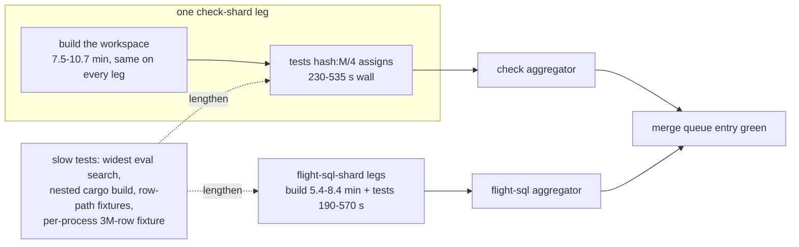

# ADR-4583: Cut the time to green of the `check` and `flight-sql` required checks

Status: Accepted (2026-11-22). Epic #4583. Refs #4375. Approved by the owner.

Migration classes touched (ADR-0066 decision 4): none. No persistent format,
proto schema, series identity, commit token or object key changes. Tests,
one test-only example (`crates/ravel-sim/examples/print_master_seed.rs`,
deleted), `.github/workflows/ci.yml`, `CLAUDE.md` and a script under
`scripts/` change; no production code path does.

## Context

A change lands in two waits. On the pull request, `scripts/pr-review-status.sh`
and `scripts/guards/assert-green-head.sh` withhold the merge line while any
check in the rollup is pending, required or not. In the merge queue, the
entry merges once every check the `protect-main` ruleset requires has
passed. After #4575 split `doc-scripts` into parallel jobs, the required
checks that finish last are `check` (the aggregator of the `check-shard`
matrix) and `flight-sql` (the aggregator of `flight-sql-shard`). Minutes
after the run started that each required check finished, on 2026-11-22
with a warm cache:

| Run | Last | Next |
|---|---|---|
| PR 45007617170 | `flight-sql` 24.8 | `check` 23.1 |
| PR 45003110822 | `check` 20.4 | `flight-sql` 16.6 |
| merge queue 45005275753 | `check` 20.2 | `flight-sql` 16.4 |
| merge queue 44972695754 | `check` 20.3 | `doc-scripts` 15.9 |

On the pull request side two jobs that are not required run as long:
`invariants` (17.3 to 17.9 min) and `invariants-services` (13.1 to 19.1
min). `invariants` runs two passes one after the other, each a clippy run
(1.3 to 1.4 min) and a `cargo test` run (7.2 min): one with
`ravel-invariant/capture,ravel-invariant/antithesis-mutants` and one with
`ravel-invariant/antithesis` alone. `invariants-services` runs ravel-server
and ravel-cli's tests under nextest and spends its time in several of the
tests below.

On one run of six (PR 45007617170) about 20 jobs waited 4 to 6.4 min for
a runner before starting, which is why `check` and `flight-sql` finished
there at 23.1 and 24.8 min against slowest legs of 20.2 and 18.7. The
other five runs waited under 0.2 min. Every added job competes for the
same runners.

Both matrices run `cargo nextest run --partition hash:M/4`. Every leg
compiles the same selection (7.5 to 10.7 min warm for `check-shard`, 5.4
to 8.4 min for `flight-sql-shard`) and then runs the tests the hash
assigns it. Summed test seconds per leg, from nextest's per-test `PASS`
lines in run 45003110822:

| Job | Leg 1 | Leg 2 | Leg 3 | Leg 4 |
|---|---|---|---|---|
| `check-shard` (`ci-opt` profile) | 884 | 911 | 1,282 | 1,954 |
| `flight-sql-shard` (`ci` profile) | 786 | 726 | 1,681 | 1,454 |

A few tests make the long legs long:

| Test | `check` s | `flight-sql` s | Where the time goes |
|---|---|---|---|
| ravel-sql `esql` `stack::the_widest_long_eval_runs_on_a_worker_stack` | 213 | 320 | a doubling and bisection search for a limit the test then asserts exactly (n = 3640), about 23 prepares of statements up to 3,640 fields wide |
| ravel-sql `esql` `stack::the_widest_double_eval_runs_on_a_worker_stack` | 41 | 147 | the same search, n = 1340 |
| ravel-sim `env_seed_override_changes_resolved_seed` | 236 | not run | two nested `cargo run --example`, a cold `dev` profile build of ravel-sim's closure inside the test |
| ravel-server `sql_logs_streaming_e2e` `wide_full_table_aggregates_complete_within_a_small_memory_pool` | 158 | 224 to 241 | not measured. Hypothesis from the code: building 30 objects of 10,000 records by 100 attributes through the row path of `RlogWriter`, whose gather is linear per column, while the two queries decode no attribute column |
| ravel-sql `logs_filter_coalescer_pin` p5 (p1 to p4: 31 to 58) | 109 | 191 to 209 | one RLOG of 776 blocks of 8,192 rows, built per process and scanned twice per case; p4 repeats p1's measurement only to print a figure |
| ravel-sql `it` `bucketed_final_aggregate::*`, 11 tests | 42 to 125 | 75 to 147 | ten tests write the same 3,000,000-row fixture again in their own process and one writes a 2,000,000-row string-keyed one; from the sibling timings, about 31 s of each on `check` is the fixture |
| ravel-cli `compact_tenant` `compact_tenant_range_workers_publish_the_same_parts_at_any_worker_count` | 45 | not run | its workers = 2 compaction is the one `compact_tenant_runs_level_2_on_range_workers` also runs (52 s in `invariants-services`) |

The per-binary `OnceLock` caches in the ravel-sql tests do nothing under
nextest, because nextest runs every test in its own process.

A Python copy of nextest's partition rule (`xxh64(test_name, 0) % N`, from
nextest-runner's `partition.rs`, which says the rule is fixed for the 0.9
series; CI installs nextest unpinned, so a later series could change it)
assigns all 16,164 `check` tests and all 4,733 `flight-sql` tests to the
leg they ran on, with no exceptions. With the measured durations it
predicts:

| Slowest leg, summed test s | `check-shard` | `flight-sql-shard` |
|---|---|---|
| today, 4 legs | 1,954 to 2,029 | 1,681 to 1,773 |
| today, 5 legs | 1,179 to 1,227 | 1,162 to 1,339 |
| after decision 1, 4 legs | 1,555 to 1,593 | 1,547 to 1,628 |
| after decisions 1 and 2, 4 legs | 1,500 to 1,535 | 1,404 to 1,472 |
| after decisions 1 and 2, 5 legs | 925 to 943 | 908 to 981 |

The rows after a decision scale each named test by the cut the decision
expects (for example the seed test to 0.5 s, the widest eval tests to 30%,
the shared fixture's 31 s paid once per leg), so they are estimates on top
of an exact partition. nextest keeps about four tests running at once on a
four-vCPU runner, so a leg's test wall time is about its summed seconds
divided by 3.8 (534 s measured against 2,029 summed on `check-shard` leg
4). A leg's wall time is its build, plus that, plus, on `check-shard` leg
1 only, the unpartitioned doctest step (11 to 14 s on five warm runs,
2026-11-22). In wall time on the slowest leg:

| Change | `check-shard` | `flight-sql-shard` |
|---|---|---|
| Decision 1 | about 1.75 min | about 0.6 min |
| Decision 2 | about 15 s | about 40 s |
| A fifth leg, on today's tests | about 3.4 min | about 2.3 min |
| A fifth leg after decisions 1 and 2 | about 4.8 min in all | about 3.4 min in all |

## Decision

1. **Speed the slow tests up without weakening what they pin.** Each change
   keeps every assertion and every exact figure the test states, and its
   pull request quotes the test's duration on CI before and after.
   - ravel-sim: the seed test re-executes its own test binary
     (`std::env::current_exe()` with `--exact` and a marker variable, the
     pattern in ravel-invariant's `tests/fault_init_from_env.rs`) instead
     of running `cargo run --example`. The example goes. The module doc's
     sentence that the crate does not opt into the workspace `[lints]`
     table is stale (it does) and is corrected.
   - ravel-sql `tests/esql/stack.rs`: the `n` search first checks the
     expected `n` (admitted at `n`, refused at `n + 1`) and runs today's
     search only when that check fails, so a moved limit still fails with
     the limit actually found. `largest` already states monotone admission
     as its precondition; under it the two checks and the search agree.
   - ravel-sql `logs_filter_coalescer_pin.rs`: p4, which asserts nothing
     and repeats p1's measurement to print `cast_utf8_bytes`, folds into p1.
   - ravel-server `tests/sql_logs_streaming_e2e.rs`: the task first times
     the fixture build against the two queries. If the build dominates,
     the wide fixture is built as `ColumnarLogBatch`es through
     `push_columnar`, as ravel-ingest's log shard flushes, instead of one
     record at a time, after showing that the columnar path writes objects
     the scan reads the same way (same column set, same row count, the
     test's exact answers). If the queries dominate, the task changes
     nothing and reports the split.
   - ravel-cli `tests/compact_tenant.rs`: the worker-count test reuses the
     workers = 2 compaction of `compact_tenant_runs_level_2_on_range_workers`
     by merging the two tests, every assertion kept.
2. **Share the retry fixtures across test processes.** The ravel-sql
   `bucketed_final_aggregate` tests write the 3,000,000-row and the
   2,000,000-row string-keyed fixture bytes once per target directory under
   `CARGO_TARGET_TMPDIR` (`target/tmp`). That is the checkout's own volume,
   not the system temporary directory, which on the amd64 executor class
   is the harness's capture tmpfs and is shared by every checkout on a
   host. rust-cache never stores the file: its cleanup before the save on
   main deletes every file under a target subdirectory that is not a
   profile (`cleanTargetDir` in its `src/cleanup.ts`, which treats
   `target/tmp` that way). The file name names the fixture (the
   3,000,000-row one and the string-keyed one are separate files, since
   both decode as valid RLOGs and a reader could not tell them apart) and
   is keyed by the test binary's path, size and modification time, so any
   rebuild of the generator or the writer changes the key. A test builds
   under an exclusive file lock, writes to a temporary name and renames it
   into place, and removes older keys of the same binary path and fixture;
   a test that finds the file reads it. Any failure on the cache path
   (open, lock, write, rename, a read that does not decode, a full volume)
   makes that test build the fixture in its own process as it does today,
   so a failure costs no more than today's build; the wait on the lock is
   a cost of its own, stated under Consequences. The
   implementing pull request states the files' size on disk. The doc
   comments that say a fixture is "written once per test binary" are
   corrected to say what holds under nextest.
3. **Split `invariants` into one job per feature set.** A two-entry matrix
   runs the capture-and-mutants pass and the antithesis-alone pass on
   separate runners, each with its clippy step and its test step. The job
   is not required, so no aggregator is needed; the job key stays
   `invariants` and the check names become `invariants (<feature set>)`.
   The same pull request updates the text that names the job: `CLAUDE.md`'s
   gates section and the ci.yml comments on `invariants` and
   `invariants-services`. Expected: about 9 min instead of 17.3 to 17.9, at
   the cost of one more build per run.
4. **Re-measure, then decide the leg counts.** After decisions 1 and 2
   land, take the per-leg summed test seconds from a warm main push run and
   simulate four and five legs with the partition copy. This decision
   commits the copy under `scripts/` with a self-check that CI's
   `doc-scripts-rest` job runs, replaying a recorded assignment and failing
   on any misassigned test. The measurement replays the run it measures the
   same way and refuses on any misassignment, so a nextest release that
   changes the rule stops the decision instead of sizing it on a wrong
   split. Add a fifth leg to `check-shard` or `flight-sql-shard` where it
   shortens that job's slowest leg wall time (build, tests at summed
   seconds over 3.8, and leg 1's doctests) by at least 2 min, and that job
   is still the last required check to finish on at least half of the
   week's warm runs. The denominator stays `strategy.job-total`, so a fifth
   matrix entry is the whole change. Each added leg costs one more build
   per run, about 9 runner-minutes for `check-shard` and 6.5 for
   `flight-sql-shard`, and one more job waiting for a runner when the
   account is at its limit. `invariants-services` is re-measured the same
   way; if it is still the last job on a pull request, a two-leg hash split
   of it is proposed on the epic rather than made here.

Pre-registered figures, to check against the measurement in decision 4
(source: the simulation and timings above, run 45003110822 and
45007617170):

| Figure | Expected | A miss | Source |
|---|---|---|---|
| `check-shard` slowest leg, summed test s, 4 legs | 1,480 to 1,560 | outside the band | predicted from the partition simulation after decisions 1 and 2, timings measured 2026-11-22 |
| `flight-sql-shard` slowest leg, summed test s, 4 legs | 1,380 to 1,500 | outside the band | predicted from the partition simulation after decisions 1 and 2, timings measured 2026-11-22 |
| the 50 `bucketed_final_aggregate` tests on `check`, summed s over all legs | 560 to 720 | 760 or more: decision 2 saved nothing | predicted: 853 to 861 measured 2026-11-22, less about 31 s for each of the about 7 fixture builds a shared file removes |
| `env_seed_override_changes_resolved_seed` on `check` | under 5 s | 5 s or more | predicted: no nested build remains |
| `the_widest_long_eval_runs_on_a_worker_stack` on `check` | 40 to 100 s | outside the band | predicted: 2 large prepares instead of about 23, from 213 s measured 2026-11-22 |
| `invariants (<feature set>)`, each leg, minutes | 8 to 11 | outside the band | predicted: one clippy and one test step, each measured 2026-11-22 |

## Rejected alternatives

- **Add the fifth legs first and leave the tests alone.** It costs a build
  per leg on every run for good, and the hash would still put the 200 s
  tests together on some leg as tests are added. The tests' own cost also
  lands on `invariants-services`, coverage and local gates, which more legs
  do not help.
- **`--partition slice:M/N`.** It deals tests round-robin by count, not by
  time, and every added test moves the assignment of every test after it.
  Its order across binaries could not be checked without a workspace build,
  so its balance could not be predicted the way the hash's was.
- **Build once and run the legs from a nextest archive.** It saves runner
  minutes, not wall time: the build still precedes the tests on the
  critical path.
- **Shrink the fixtures** (`BLOCK_ROWS` from 8,192 to 1,024 in the
  coalescer pins, fewer rows in the retry tests). The coalescer bands are
  registered against 8,192-row blocks on #3237 and fixed costs would grow
  eightfold against their 10% margins. The retry tests need a fixture whose
  unlimited peak sits well above the 64 MiB spill headroom
  (`SPILL_MODE_HEADROOM_MIN_BYTES`), and one test pins figures of the
  3,000,000-row fixture. Both would be a re-registration, not a speed-up.
- **A coarser step in ravel-query's in-budget histogram read** (721 to 145
  instants). It compares fewer instants, which weakens the equality the
  test states.
- **`sql_string_key_bucket_retry_e2e`.** No change was found that keeps its
  claim: the 2,000,000 rows are needed for the retry, and ingesting them
  over HTTP is the reachability the test proves.

## Consequences

- After decisions 1 and 2, `check-shard`'s slowest leg should finish about
  2 min sooner and `flight-sql-shard`'s about 1.2 min sooner. With both
  fifth legs from decision 4 the totals are about 4.8 and 3.4 min, which
  would put `check` at about 15 to 16 min and leave `doc-scripts` and
  `features` (13 to 16 min) close behind.
- The fixture cache in decision 2 is a file in the target directory's
  `tmp`, shared by the test processes of one checkout. A stale file cannot
  outlive a rebuild of the test binary, and any failure on the cache path
  falls back to today's in-process build. A test waiting on the lock holds
  a nextest slot for up to the build time, about 31 s on `check`. It is
  the riskiest change here for the least time saved, and it can be dropped
  without touching the others.
- The ravel-sim example `print_master_seed` is removed; nothing else uses it.
- The `invariants` check names change. The ruleset does not list them, and
  decision 3's pull request updates the text that names the job.
- Decision 4 may add no leg. The decision and its numbers go on the epic
  ledger either way.
